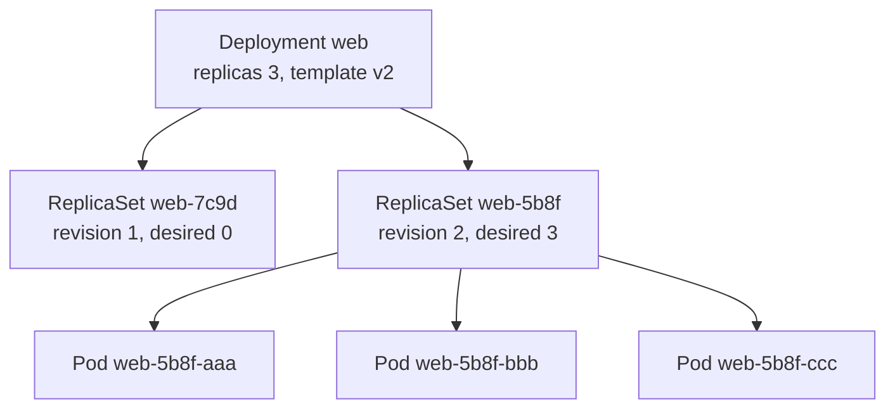

> [!info] Level: junior-middle | Time: about 7 h | You need: [[learn/kubernetes-architecture-and-kind|Kubernetes 01: Architecture, kind and the kubectl workflow]] | Lab: Lab B, the local tools and a kind cluster from [[learn/lab-setup|Start 01: Set up your lab]] (you recreate the cluster in the first exercise)

In the last lesson you learned who does what inside a cluster. Now you will use the two objects you meet in almost every manifest: the **Pod**, which runs your containers, and the **Deployment**, which keeps the right number of Pods running and replaces them safely when you ship a new version. By the end you will have broken a release on purpose and recovered from it with one command, which is the skill you need on the day it happens for real.

## What you will learn

- Why a Pod is not a container, what its containers share, and how a Pod's phase differs from the state of a container.
- How labels, selectors and annotations connect objects, and which labels to use by convention.
- Why bare Pods are disposable, and what init containers and sidecars add.
- The ownership chain Deployment, ReplicaSet and Pod, and what `pod-template-hash` is.
- How a rolling update works (`maxSurge`, `maxUnavailable`, `progressDeadlineSeconds`), and how to read, pause, undo and annotate a rollout.
- How self-healing and scaling look in practice, and the mistakes (`:latest`, changing a selector) that cause outages.

## A Pod is not a container

The smallest thing Kubernetes schedules is a **Pod**: a group of one or more containers that are always placed on the same node and run together. Most Pods have one application container. The containers in a Pod share:

- **One network identity.** They have the same IP address and the same port space. Container A reaches container B at `localhost:PORT`. This is the opposite of the lesson from [[learn/container-storage-networking-and-compose|Containers 04]], where `localhost` meant "myself" because each container had its own network. In a Pod, the containers share one network namespace.
- **Volumes.** A volume declared on the Pod can be mounted into several containers, so they can pass files to each other.
- **A lifecycle.** The Pod is scheduled, started and deleted as a whole. A Pod never moves to another node. If the node fails, the Pod is gone, and a controller creates a new one elsewhere.

They do _not_ share a filesystem (each container has its own image) or, by default, a process table.

Pod IP addresses are temporary. When a Pod is replaced, the new one has a new address. That is why you never hard-code a Pod IP, and why the next lesson introduces Services.

### The anatomy of a Pod manifest

```yaml title="pod.yaml"
apiVersion: v1
kind: Pod
metadata:
  name: web
  labels:
    app.kubernetes.io/name: web
    app.kubernetes.io/part-of: lab
    app.kubernetes.io/version: "1.0"
spec:
  securityContext:
    runAsNonRoot: true
    runAsUser: 101
    seccompProfile:
      type: RuntimeDefault
  containers:
    - name: web
      image: nginxinc/nginx-unprivileged:1.27-alpine
      ports:
        - containerPort: 8080
      securityContext:
        allowPrivilegeEscalation: false
        capabilities:
          drop: ["ALL"]
      resources:
        requests:
          cpu: 25m
          memory: 32Mi
        limits:
          memory: 64Mi
```

Read it top to bottom:

- `apiVersion`, `kind`, `metadata.name`: the same envelope as every object. A Pod is `v1` (the "core" group).
- `metadata.labels`: key-value pairs used to find this Pod later (next section).
- `spec.containers`: a list. Each has a `name`, an `image`, and usually `ports`, `env`, `resources`, `volumeMounts` and probes. The `containerPort` is documentation plus a hint for tooling; it does not open anything, just like `EXPOSE`.
- `securityContext`: how the process runs. The settings above (non-root, no privilege escalation, no Linux capabilities, the runtime's default seccomp profile) are a good baseline, and Pods that meet it pass the strictest built-in Pod Security level (see [[patterns/pod-security-admission]]). The image is the unprivileged build of nginx so that it can run as a non-root user and listen on a port above 1024.
- `resources`: what the scheduler reserves (`requests`) and the ceiling the kernel enforces (`limits`). Lesson [[learn/kubernetes-probes-resources-and-debugging|Kubernetes 05]] and [[patterns/kubernetes-resource-requests-and-limits]] explain how to choose them.

> [!warning] Check before relying on this
> The image `nginxinc/nginx-unprivileged:1.27-alpine`, its port (8080) and its user ID (101) are what this lesson assumes; they were not checked on the day of writing. Read the image's page on Docker Hub, and if you pick another tag, check that it exists and which user and port it uses. A mismatch with `runAsUser` or `runAsNonRoot` shows up as a Pod stuck in `CreateContainerConfigError`.

### Phase and container state

Two different things are called "status", and mixing them up wastes time.

The Pod's **phase** is a coarse summary:

| Phase       | Meaning                                                                            |
| ----------- | ---------------------------------------------------------------------------------- |
| `Pending`   | Accepted, but not running yet: waiting to be scheduled, or pulling images.         |
| `Running`   | Bound to a node and at least one container is running (or starting or restarting). |
| `Succeeded` | All containers ended with exit code 0 and will not restart (a finished job).       |
| `Failed`    | All containers ended and at least one failed (non-zero exit code, or killed).      |
| `Unknown`   | The control plane lost contact with the node. Rare.                                |

Each **container** inside has its own state: `Waiting` (with a reason such as `ContainerCreating`, `ImagePullBackOff`, `CrashLoopBackOff`), `Running`, or `Terminated` (with an exit code and a reason such as `Completed`, `Error` or `OOMKilled`). The `STATUS` column of `kubectl get pods` is a human-friendly mix of these: it can show `CrashLoopBackOff`, which is not a phase at all. The truth is in `kubectl describe pod` (look at `State`, `Last State` and `Events`).

### restartPolicy

`spec.restartPolicy` tells the kubelet what to do when a container exits:

- `Always` (the default): restart it, whatever the exit code. Right for services that should run forever.
- `OnFailure`: restart only on a non-zero exit code. Fits jobs that may retry.
- `Never`: do not restart. The Pod ends as `Succeeded` or `Failed`.

Restarts are delayed with an exponential back-off (10 seconds, 20, 40, and so on, up to a cap of about five minutes; verify the numbers for your version). While the kubelet is waiting, `kubectl get pods` shows `CrashLoopBackOff`: it is not an error type, it means "this container keeps failing and I am waiting before the next try".

## Labels, selectors and annotations

Kubernetes objects find each other by **labels**, not by name. A label is a key-value pair attached to an object's metadata: `app.kubernetes.io/name: web`. A **selector** is a query over labels: "every Pod with `app.kubernetes.io/name=web`". A Service finds its Pods this way, a ReplicaSet counts its Pods this way, and you filter output with `-l`.

```bash
kubectl get pods -l app.kubernetes.io/name=web                 # equality
kubectl get pods -l 'app.kubernetes.io/name=web,tier!=db'      # AND of several terms
kubectl get pods -l 'env in (dev,stage)'                        # set-based
kubectl get pods --show-labels                                  # print all labels
```

Label rules in short: a key has an optional prefix (a DNS name such as `app.kubernetes.io`) and a name; a value is at most 63 characters of letters, digits, `-`, `_` and `.`, starting and ending with an alphanumeric character. Check the "Labels and Selectors" page for the exact grammar.

**Annotations** are also key-value pairs, but they are for non-identifying information that tools and people read: a build URL, a contact, a change cause. You cannot select by annotation, and values can be much larger.

### The recommended labels

Kubernetes documents a shared set of labels so that tools (dashboards, Helm, GitOps) can group objects:

| Label                          | Example    | Meaning                                 |
| ------------------------------ | ---------- | --------------------------------------- |
| `app.kubernetes.io/name`       | `web`      | The name of the application.            |
| `app.kubernetes.io/instance`   | `web-prod` | A unique name for this installation.    |
| `app.kubernetes.io/version`    | `1.0`      | The current version of the application. |
| `app.kubernetes.io/component`  | `frontend` | The role within the architecture.       |
| `app.kubernetes.io/part-of`    | `shop`     | The larger application this belongs to. |
| `app.kubernetes.io/managed-by` | `Helm`     | The tool that manages this object.      |

Use them on every workload. Your own labels, such as `team` or `cost-center`, are fine in addition. The convention is also in [[patterns/helm-chart-conventions]].

## Why bare Pods are disposable

If you create a Pod directly, **nothing owns it**. No controller watches it. If you delete it, it is gone. If its node fails, it is gone. If it crashes, only the kubelet's own restart (per `restartPolicy`) acts, and only on that node. A bare Pod gives you none of the self-healing that makes Kubernetes worth using.

That is fine for learning, for one-off debugging Pods and for short jobs. For anything that should keep running, you create a **controller** that owns Pods: a Deployment for stateless services, and others for batch work and stateful systems.

## Init containers and sidecars

A Pod can hold more than the main container.

**Init containers** run **before** the app containers, one after another, and each must finish successfully (exit 0) before the next starts. Use them for one-time setup: wait for a dependency, fetch a file, run a migration check, fix permissions on a volume. If one fails, the kubelet retries it (per `restartPolicy`) and the app containers do not start. They share the Pod's volumes, which is how they pass results on:

```yaml title="web-init.yaml"
apiVersion: v1
kind: Pod
metadata:
  name: web-init
  labels:
    app.kubernetes.io/name: web-init
spec:
  securityContext:
    runAsNonRoot: true
    runAsUser: 101
    seccompProfile:
      type: RuntimeDefault
  initContainers:
    - name: render-page
      image: alpine:3.20
      command: ["sh", "-c", "echo '<h1>rendered by init</h1>' > /work/index.html"]
      securityContext:
        allowPrivilegeEscalation: false
        capabilities:
          drop: ["ALL"]
      volumeMounts:
        - name: html
          mountPath: /work
  containers:
    - name: web
      image: nginxinc/nginx-unprivileged:1.27-alpine
      ports:
        - containerPort: 8080
      securityContext:
        allowPrivilegeEscalation: false
        capabilities:
          drop: ["ALL"]
      volumeMounts:
        - name: html
          mountPath: /usr/share/nginx/html
          readOnly: true
  volumes:
    - name: html
      emptyDir: {}
```

An `emptyDir` volume is empty when the Pod starts and is deleted with the Pod. It is the standard scratch space for sharing files between containers of one Pod.

A **sidecar** is a helper container that runs _alongside_ the main one for the whole life of the Pod: a log shipper, a proxy, a certificate refresher. Because it shares the network and volumes, it can talk to the app on `localhost`. For years sidecars were simply a second entry in `containers:`, which had a flaw: the Pod could not tell the sidecar apart from the app, so start-up order and shutdown were awkward, and a sidecar in a Job kept the Job from finishing.

Newer clusters have **native sidecars**: an entry in `initContainers` with `restartPolicy: Always`. It starts before the app containers, keeps running, is restarted if it fails, and is stopped after the app containers.

```yaml
spec:
  initContainers:
    - name: log-shipper
      image: registry.example.com/log-shipper:1.0 # placeholder image
      restartPolicy: Always # this line makes it a sidecar
  containers:
    - name: app
      image: registry.example.com/app:1.0 # placeholder image
```

> [!warning] Check before relying on this
> Native sidecar containers arrived in stages (first behind a feature gate, then enabled by default, then generally available in a later release). Check which Kubernetes version introduced each stage, and which your cluster runs, in the "Sidecar Containers" page before you depend on `restartPolicy: Always` in an init container. On a cluster that does not support it, the Pod is rejected or the field is ignored.

## Deployments: the owner of your Pods

A **Deployment** declares "I want N identical Pods of this template, and I want updates rolled out safely". It does not create Pods itself. It creates and manages a **ReplicaSet**, and the ReplicaSet creates the Pods. This three-level chain explains most of what you see in `kubectl get`.



- The **ReplicaSet** has one job: keep N Pods that match its selector running. If one disappears, it creates another. If there are too many, it deletes some. You rarely touch a ReplicaSet directly.
- The **Deployment** owns ReplicaSets. A new ReplicaSet is created each time the Pod **template** changes (a new image, a new environment variable). Old ReplicaSets are kept, scaled to zero, as the **revision history** that makes rollback possible.
- Each object records its owner in `metadata.ownerReferences`. Deleting the Deployment deletes its ReplicaSets and Pods (garbage collection). Deleting a Pod makes the ReplicaSet replace it.
- The ReplicaSet's Pods carry a label `pod-template-hash`, a hash of the Pod template that the Deployment controller adds. It keeps the Pods of different ReplicaSets apart even though they share your own labels, and it is the suffix in names like `web-5b8f6c7d9-x2k4q`.

### The Deployment spec

```yaml title="deployment.yaml"
apiVersion: apps/v1
kind: Deployment
metadata:
  name: web
  labels:
    app.kubernetes.io/name: web
    app.kubernetes.io/part-of: lab
spec:
  replicas: 3
  revisionHistoryLimit: 5
  progressDeadlineSeconds: 60
  selector:
    matchLabels:
      app.kubernetes.io/name: web
  strategy:
    type: RollingUpdate
    rollingUpdate:
      maxSurge: 1
      maxUnavailable: 0
  template:
    metadata:
      labels:
        app.kubernetes.io/name: web
        app.kubernetes.io/part-of: lab
    spec:
      securityContext:
        runAsNonRoot: true
        runAsUser: 101
        seccompProfile:
          type: RuntimeDefault
      containers:
        - name: web
          image: nginxinc/nginx-unprivileged:1.27-alpine
          ports:
            - containerPort: 8080
          securityContext:
            allowPrivilegeEscalation: false
            capabilities:
              drop: ["ALL"]
          resources:
            requests:
              cpu: 25m
              memory: 32Mi
            limits:
              memory: 64Mi
```

The fields that matter:

- **`replicas`**: how many Pods you want. The default is 1.
- **`selector`**: which Pods this Deployment owns. It **must match** the labels in `template.metadata.labels`, otherwise the API rejects the Deployment. It is **immutable** after creation in `apps/v1`: you cannot edit it. To change it you create a new Deployment. Pick selector labels that never need to change (the `name` label, not the `version` label).
- **`template`**: the Pod blueprint (a Pod spec without a name). Changing anything in it starts a rollout.
- **`strategy`**: how to replace old Pods with new ones (below).
- **`revisionHistoryLimit`**: how many old ReplicaSets to keep for rollback (the default is 10).
- **`progressDeadlineSeconds`**: how long a rollout may make no progress before the Deployment reports failure. The default is 600 seconds, which is 10 minutes of waiting in a lab. The manifest sets 60 so that the failure exercise finishes quickly. In production, choose a value longer than your slowest healthy start-up.

### Rolling updates: `maxSurge` and `maxUnavailable`

`RollingUpdate` is the default strategy. The Deployment creates Pods from the new ReplicaSet and removes Pods from the old one gradually, within two limits:

- **`maxSurge`**: how many Pods _above_ the desired count may exist during the update. A number, or a percentage (rounded up). The default is 25%.
- **`maxUnavailable`**: how many Pods _below_ the desired count may be unavailable. A number, or a percentage (rounded down). The default is 25%.

With `replicas: 3`, the defaults work out to a surge of 1 (25% of 3 is 0.75, rounded up) and 0 unavailable (rounded down). The manifest above writes these values out so you can read them. Rolling from v1 to v2 then goes like this:

```text
start        v1 v1 v1                  3 ready
step 1       v1 v1 v1 v2*              v2 starting (4 Pods, the surge)
step 2       v1 v1 v1 v2               v2 is Ready (4 ready)
step 3       v1 v1 v2 + v2*            one v1 is removed, the next v2 starts
...
end          v2 v2 v2                  3 ready
```

_Illustrative._ With `maxUnavailable: 0` the number of ready Pods never drops below 3, so capacity holds. It costs one extra Pod's worth of resources during the update, and the cluster needs room for it. Setting `maxSurge: 0` and `maxUnavailable: 1` trades the other way: no extra capacity, but one fewer ready Pod during the update.

The other strategy is **`Recreate`**: delete all old Pods, then create the new ones. There is downtime between them. Use it only when two versions must never run at the same time (for example, an exclusive lock on a data file).

A new Pod counts as _available_ when it is **Ready**. A Pod is Ready when its readiness probe passes (or, with no probe, as soon as its containers start). So the rollout is only as safe as your readiness probe. Without one, "Ready" means "the process started", and a version that starts and then fails would receive traffic. Probes are the first topic of [[learn/kubernetes-probes-resources-and-debugging|Kubernetes 05]]; for now remember that **readiness gates rollouts**.

### Rollout commands

```bash
kubectl rollout status deployment/web         # wait for a rollout to finish (exit code 1 on failure)
kubectl rollout history deployment/web        # list revisions
kubectl rollout history deployment/web --revision=2   # details of one revision
kubectl rollout undo deployment/web           # go back to the previous revision
kubectl rollout undo deployment/web --to-revision=1
kubectl rollout pause deployment/web          # stop a rollout part-way (make several edits, then resume)
kubectl rollout resume deployment/web
kubectl rollout restart deployment/web        # roll all Pods again with the same template
```

`rollout status` is the command CI scripts use to wait for a deploy: it returns when the rollout succeeds, and with a non-zero exit code when the deadline passes.

The history is more useful when each revision says why it exists. Kubernetes shows the annotation `kubernetes.io/change-cause` in the `CHANGE-CAUSE` column. Set it after a change:

```bash
kubectl annotate deployment/web kubernetes.io/change-cause="bump nginx to 1.26-alpine" --overwrite
```

The old `--record` flag that did this automatically is deprecated; use the annotation, or better, let your pipeline set it from the commit message. In a GitOps setup the change cause is the Git history (see [[adr/0001-gitops-with-argocd]]).

### Self-healing and scaling

Because the ReplicaSet keeps counting, two things come for free:

- **Self-healing.** Delete a Pod (or lose its node) and a new one appears. Crashed containers are restarted in place by the kubelet.
- **Scaling.** `kubectl scale deployment/web --replicas=5` changes the desired count and the ReplicaSet adds Pods. You can also scale automatically on load with a HorizontalPodAutoscaler, which is outside this lesson.

> [!note] A Deployment is not a backup of your data
> Self-healing replaces Pods with new, empty ones. Anything stored only in a Pod's filesystem is lost. State belongs in a database or a persistent volume.

### Mistakes that cause outages

- **Using `:latest`, or no tag.** The tag moves, so two Pods of the "same" Deployment can run different code, a restart can pick up a new version without anyone deploying it, and a rollback to "the previous revision" may pull the same new image. Pin a version tag, or better a digest (`image@sha256:...`), and let CI update it. See [[patterns/dockerfile-hardening]] and [[patterns/zero-downtime-deployments-kubernetes]].
- **Changing the selector, or the labels the selector depends on.** The selector is immutable, and editing Pod labels by hand can detach Pods from their ReplicaSet (they become orphans that still run, while a replacement is created) or attach unrelated Pods. Choose stable selector labels.
- **No readiness probe.** Rollouts move on as soon as the process starts.
- **No resource requests.** The scheduler cannot place Pods sensibly, and a rolling update with a surge may not fit.
- **Editing Pods directly.** The Deployment manages them. Change the Deployment.

## Hands-on exercises

You need the lab VM from [[learn/lab-setup|Start 01]]. Outputs are illustrative: names, hashes and ages will differ. If you deleted your cluster at the end of the last lesson, recreate it first.

1. **Get a cluster and a working directory.**

   ```bash
   kind get clusters
   # if "lab" is not listed:
   kind create cluster --name lab --config ~/k8s01/kind-lab.yaml --wait 120s
   # if you no longer have that file: kind create cluster --name lab --wait 120s  (one node is enough here)
   kubectl config current-context
   kubectl get nodes
   mkdir -p ~/k8s02 && cd ~/k8s02
   ```

   Expected: the context is `kind-lab` and every node is `Ready`.
   If you see something else: a different context name means `kubectl` points at another cluster; run `kubectl config use-context kind-lab` before you go on. This is the habit from the last lesson.

2. **Run the `web` Pod.** Save the `pod.yaml` from the lesson, then:

   ```bash
   kubectl apply -f pod.yaml
   kubectl wait --for=condition=Ready pod/web --timeout=90s
   kubectl get pod web
   ```

   Expected: `pod/web created`, `pod/web condition met`, and

   ```text
   NAME   READY   STATUS    RESTARTS   AGE
   web    1/1     Running   0          15s
   ```

   If you see something else: `ImagePullBackOff` or `ErrImagePull` means the image or tag cannot be pulled (check the name, your network, and that the tag exists); read `kubectl describe pod web`. `CreateContainerConfigError` with a message about a non-numeric user or `runAsNonRoot` means the image does not match the user settings; see the warning in the lesson. `Pending` for long means no node has room or a node is not ready; read the Events.

3. **Use labels and selectors.**

   ```bash
   kubectl get pods --show-labels
   kubectl get pods -l app.kubernetes.io/name=web
   kubectl get pods -l app.kubernetes.io/name=other
   kubectl label pod web tier=lab
   kubectl get pods -l tier=lab --show-labels
   ```

   Expected: the first command prints the three `app.kubernetes.io` labels. The second lists `web`. The third prints `No resources found in default namespace.` because nothing matches. After `pod/web labeled`, the last command lists `web` with `tier=lab` added.
   If you see something else: if the selector `-l` finds nothing for the second command, check the label spelling against the first command's output; label keys and values are case sensitive.

4. **Watch a restart.** Stop the main process from inside the container. Because the default `restartPolicy` is `Always`, the kubelet restarts it.

   ```bash
   kubectl exec web -- nginx -s stop
   sleep 10
   kubectl get pod web
   kubectl get pod web -o jsonpath='{.status.containerStatuses[0].lastState.terminated.reason} {.status.containerStatuses[0].restartCount}{"\n"}'
   ```

   Expected: `kubectl get pod` shows `RESTARTS` of `1` (newer versions print `1 (8s ago)`), the Pod is `Running` again, and the jsonpath line prints `Completed 1` (the process exited with 0).
   If you see something else: if `RESTARTS` is still `0`, the command did not stop the main process; check the output of `kubectl exec`. A `command terminated with exit code ...` message from `exec` is normal because the process you talked to went away. If `nginx` is not found, the image has a different path or program; use `kubectl exec web -- sh -c 'kill 1'` instead (it may be refused if PID 1 has no handler for the signal).

5. **`restartPolicy: Never` ends a Pod, and the exit code decides how.** Save the following as `oneshot.yaml`:

   ```yaml title="oneshot.yaml"
   apiVersion: v1
   kind: Pod
   metadata:
     name: oneshot-fail
   spec:
     restartPolicy: Never
     securityContext:
       runAsNonRoot: true
       runAsUser: 65534
       seccompProfile:
         type: RuntimeDefault
     containers:
       - name: job
         image: alpine:3.20
         command: ["sh", "-c", "echo boom; exit 3"]
         securityContext:
           allowPrivilegeEscalation: false
           capabilities:
             drop: ["ALL"]
   ---
   apiVersion: v1
   kind: Pod
   metadata:
     name: oneshot-ok
   spec:
     restartPolicy: Never
     securityContext:
       runAsNonRoot: true
       runAsUser: 65534
       seccompProfile:
         type: RuntimeDefault
     containers:
       - name: job
         image: alpine:3.20
         command: ["sh", "-c", "echo fine; exit 0"]
         securityContext:
           allowPrivilegeEscalation: false
           capabilities:
             drop: ["ALL"]
   ```

   ```bash
   kubectl apply -f oneshot.yaml
   sleep 15
   kubectl get pods oneshot-fail oneshot-ok
   kubectl logs oneshot-fail
   kubectl get pod oneshot-fail -o jsonpath='{.status.phase} exit={.status.containerStatuses[0].state.terminated.exitCode}{"\n"}'
   kubectl get pod oneshot-ok -o jsonpath='{.status.phase}{"\n"}'
   ```

   Expected: `oneshot-fail` shows `0/1 Error 0`, `oneshot-ok` shows `0/1 Completed 0`, the log prints `boom`, the phase and exit code print `Failed exit=3`, and the second phase prints `Succeeded`. Neither Pod restarted, because the policy is `Never`.
   If you see something else: `ContainerCreating` just means more time is needed. If both Pods show `Completed`, the `exit 3` was changed; check the file.

6. **Delete the bare Pod. Nothing brings it back.**

   ```bash
   kubectl delete pod web
   sleep 10
   kubectl get pods -l app.kubernetes.io/name=web
   kubectl delete pod oneshot-fail oneshot-ok
   ```

   Expected: `pod "web" deleted`, then `No resources found in default namespace.` for the selector. No controller owned the Pod, so no replacement.
   If you see something else: if the Pod reappears, something else is managing it (an operator or a GitOps tool); look at its `ownerReferences` with `kubectl get pod NAME -o yaml`.

7. **Create the Deployment.** Save the `deployment.yaml` from the lesson, then:

   ```bash
   kubectl apply -f deployment.yaml
   kubectl rollout status deployment/web --timeout=120s
   kubectl get deployment web
   kubectl get rs
   kubectl get pods --show-labels
   POD=$(kubectl get pods -l app.kubernetes.io/name=web -o name | head -n 1)
   kubectl get "$POD" -o jsonpath='{.metadata.ownerReferences[0].kind}/{.metadata.ownerReferences[0].name}{"\n"}'
   ```

   Expected: `deployment "web" successfully rolled out`, then

   ```text
   NAME   READY   UP-TO-DATE   AVAILABLE   AGE
   web    3/3     3            3           25s
   ```

   One ReplicaSet (named `web-` plus a hash) with `DESIRED 3  CURRENT 3  READY 3`, three Pods that all carry a `pod-template-hash` label, and an owner line such as `ReplicaSet/web-5b8f6c7d9`.
   If you see something else: `READY 2/3` for long means a Pod cannot start; run `kubectl get pods` and `kubectl describe pod NAME`. An error `selector does not match template labels` means you edited one but not the other. If the file was rejected for a field, check the indentation.

8. **Self-healing and scaling.**

   ```bash
   kubectl delete "$POD" --wait=false
   kubectl get pods -l app.kubernetes.io/name=web
   kubectl scale deployment/web --replicas=5
   kubectl rollout status deployment/web
   kubectl get deployment web
   kubectl scale deployment/web --replicas=3
   ```

   Expected: right after the delete, you see three or four Pods: the old one `Terminating` and a new one `ContainerCreating` or `Running` with a small age. The deployment reaches `5/5`, then goes back to three.
   If you see something else: if the count never returns to 3 after the last command, run `kubectl get deployment web -o yaml` and look at `spec.replicas`. A manual `scale` is overwritten by the file the next time you `apply` it, which is the point of keeping the file as the source of truth.

9. **Roll out a new image and look at the two ReplicaSets.** In one terminal run `kubectl get pods -l app.kubernetes.io/name=web -w`, and in another:

   ```bash
   kubectl set image deployment/web web=nginxinc/nginx-unprivileged:1.26-alpine
   kubectl annotate deployment/web kubernetes.io/change-cause="bump nginx to 1.26-alpine" --overwrite
   kubectl rollout status deployment/web --timeout=120s
   kubectl get rs
   kubectl rollout history deployment/web
   ```

   Expected: the watch shows a new Pod start before an old one terminates, one at a time, never fewer than three ready. `rollout status` prints lines like `Waiting for deployment "web" rollout to finish: 1 out of 3 new replicas have been updated...` and ends with `deployment "web" successfully rolled out`. `get rs` now shows two ReplicaSets: the old one with `DESIRED 0  CURRENT 0  READY 0` and the new one with `3  3  3`. The history shows revisions 1 and 2, with the change cause in the second.
   If you see something else: the second tag is an example and was not checked. If the new Pods stay in `ImagePullBackOff`, pick another existing tag of the same image. If you cannot find one, trigger a rollout without changing the image: `kubectl set env deployment/web LAB_REVISION=2` also changes the template and gives you the same two ReplicaSets. Use `Ctrl+C` to stop the watch.

10. **Break a release on purpose, and undo it.**

    ```bash
    kubectl set image deployment/web web=nginxinc/nginx-unprivileged:does-not-exist
    kubectl rollout status deployment/web --timeout=90s; echo "exit=$?"
    kubectl get pods -l app.kubernetes.io/name=web
    kubectl get deployment web -o jsonpath='{.status.conditions[?(@.type=="Progressing")].reason}{"\n"}'
    ```

    Expected: after about 60 seconds (the `progressDeadlineSeconds`), `rollout status` prints `error: deployment "web" exceeded its progress deadline` and `exit=1`. `get pods` shows three old Pods `Running 1/1` and one new Pod in `ErrImagePull` or `ImagePullBackOff`. The condition reason prints `ProgressDeadlineExceeded`. The old Pods kept serving traffic the whole time, because `maxUnavailable` is 0 and the new Pod never became Ready, so the rollout never removed an old one.
    If you see something else: if the Pods do not reach `ImagePullBackOff`, wait a few more seconds. If the command returns `successfully rolled out`, the tag you typed exists; use any tag you are sure does not. If you set a long `progressDeadlineSeconds` yourself, `rollout status --timeout=90s` returns before the deadline with `timed out waiting for the condition`.

    Now recover:

    ```bash
    kubectl rollout undo deployment/web
    kubectl rollout status deployment/web --timeout=120s
    kubectl get pods -l app.kubernetes.io/name=web
    kubectl get deployment web -o jsonpath='{.status.conditions[?(@.type=="Progressing")].reason}{"\n"}'
    kubectl rollout history deployment/web
    ```

    Expected: `deployment.apps/web rolled back`, then `successfully rolled out`, three `Running` Pods all from the earlier good revision, the condition reason `NewReplicaSetAvailable`, and a history in which the restored template appears under a new, highest revision number (the older number it came from disappears from the list, and the bad revision is still listed). The Deployment did **not** roll back by itself: it reported the failure and waited for you. Rolling back is your decision.
    If you see something else: if `undo` restores the wrong image, list the revisions with `kubectl rollout history deployment/web` and pick one with `--to-revision=N` after reading `--revision=N`.

11. **Init container and shared volume.** Save `web-init.yaml` from the lesson, then:

    ```bash
    kubectl apply -f web-init.yaml
    kubectl wait --for=condition=Ready pod/web-init --timeout=90s
    kubectl exec web-init -c web -- wget -qO- http://localhost:8080
    ```

    Expected: the Pod passes through `Init:0/1` and `PodInitializing` to `Running`, and `wget` prints `<h1>rendered by init</h1>`. It reached `localhost` because the `wget` ran in a container of the Pod, and it showed a file that a different container wrote into the shared `emptyDir`.
    If you see something else: `Init:Error` means the init container failed; read `kubectl logs web-init -c render-page`. If `wget` is not found in the image, use `kubectl exec web-init -c web -- cat /usr/share/nginx/html/index.html` to show the file instead.

12. **Clean up.**

    ```bash
    kubectl delete -f web-init.yaml -f deployment.yaml --ignore-not-found
    kubectl get all
    ```

    Expected: `pod "web-init" deleted`, `deployment.apps "web" deleted`, and `get all` lists only the `service/kubernetes` object. Keep the `lab` cluster for the next lesson (or delete it with `kind delete cluster --name lab` and recreate it later).
    If you see something else: a Pod that lingers in `Terminating` will go away after its grace period (30 seconds by default); wait and check again.

## Common mistakes

- **Running a bare Pod for a service.** It has no owner, so it is not replaced. Use a Deployment.
- **Reading `Running` as healthy.** It means a container is running, not that the app works. Add readiness and liveness probes (Kubernetes 05).
- **Editing the Deployment's Pods or ReplicaSets by hand.** The controller reverts or fights you. Edit the Deployment's template.
- **Changing the selector.** It is immutable. Make a new Deployment, move traffic, delete the old one.
- **Using `:latest` or an unpinned tag.** You cannot tell what runs, and rollback does not restore a known state. Pin versions or digests.
- **Waiting 10 minutes for a failed rollout.** The default `progressDeadlineSeconds` is 600 seconds. Set it to match how long a healthy start-up really takes.
- **Assuming a failed rollout reverts itself.** The old Pods keep serving, but the Deployment stays half-updated until you undo or fix it.
- **Skipping the change cause.** `CHANGE-CAUSE` shows `<none>` and the history cannot tell you which revision to restore. Annotate, or let the pipeline do it.
- **No resource requests or a surge with no room.** A rolling update with a surge of one Pod needs space for it; otherwise the extra Pod stays `Pending` and the rollout stalls.
- **Treating restarts as free.** A rising `RESTARTS` count is a signal. Read `kubectl logs --previous` and the last termination reason.

## Check your understanding

1. During the failed rollout in exercise 10, the old Pods kept serving traffic. Why did they not go away?
2. A Deployment owns a ReplicaSet, which owns Pods. What happens when you delete (a) a Pod, (b) the Deployment?
3. Why is `image: nginx:latest` a bad idea in a Deployment?
4. `replicas: 4` with `maxSurge: 25%` and `maxUnavailable: 25%`. How many Pods can exist at most during the update, and how many must stay available?
5. You try to change `spec.selector` of a Deployment with `kubectl apply` and get an error. Why, and what do you do instead?
6. What is the difference between the Pod phase `Failed` and the status `CrashLoopBackOff`?

> [!question]- Answers
>
> 1. `maxUnavailable` was 0 and `maxSurge` was 1. The Deployment started one new Pod, which could never become Ready (its image cannot be pulled). A rolling update removes an old Pod only when a new one is available, so all three old Pods stayed. If there had been no readiness gate and the new image had started and failed later, the outcome could have been worse, which is why probes matter.
> 2. (a) The ReplicaSet notices it has too few Pods and creates a replacement. (b) The Deployment's ReplicaSets and their Pods are deleted too (garbage collection through `ownerReferences`). Nothing is recreated, because nothing owns the desired state any more.
> 3. The tag is mutable. Pods created at different times can run different code, a restart can change the version without a deploy, `rollout undo` may restore the same moving tag, and you cannot say later what ran. Pin a version tag or a digest.
> 4. The surge is 25% of 4, which is 1 Pod, so at most 5 Pods. The unavailable limit is 25% of 4 rounded down, which is 1, so at least 3 must stay available.
> 5. In `apps/v1` the selector is immutable, because changing it would orphan existing Pods and ReplicaSets. Create a new Deployment with the new selector and labels, shift traffic to it, and delete the old Deployment.
> 6. `Failed` is a Pod **phase**: all containers ended and at least one failed, with no restart coming (for example `restartPolicy: Never`). `CrashLoopBackOff` is a container **wait reason** shown in the `STATUS` column: the container keeps failing and the kubelet is delaying the next restart. The Pod's phase is still `Running`.

## Next steps

Next lesson: [[learn/kubernetes-services-and-ingress|Kubernetes 03: Services, DNS and Ingress]]. Previous lesson: [[learn/kubernetes-architecture-and-kind|Kubernetes 01: Architecture, kind and the kubectl workflow]].

To go deeper:

- [[patterns/zero-downtime-deployments-kubernetes]] adds readiness probes, graceful shutdown and disruption budgets to the rolling update you ran here.
- [[patterns/kubernetes-resource-requests-and-limits]] explains the `resources` block in the manifests above.
- [[runbooks/kubernetes-pod-troubleshooting]] is the procedure for the `Pending`, `ImagePullBackOff` and `CrashLoopBackOff` states you saw.
- [[runbooks/helm-release-rollback]] is the Helm version of `rollout undo`, which you will meet in [[learn/helm-basics-and-capstone|Kubernetes 06]].
- The whole path is mapped in [[learn/index|the learning path]].

## Sources

- Kubernetes documentation, "Pods", "Pod Lifecycle" and "Init Containers": <https://kubernetes.io/docs/concepts/workloads/pods/>. Not checked against a running cluster for this page.
- Kubernetes documentation, "Sidecar Containers": <https://kubernetes.io/docs/concepts/workloads/pods/sidecar-containers/>. The version in which the feature became generally available was not confirmed.
- Kubernetes documentation, "Labels and Selectors", "Recommended Labels" and "Annotations": <https://kubernetes.io/docs/concepts/overview/working-with-objects/labels/>.
- Kubernetes documentation, "Deployments" (including rolling update, `progressDeadlineSeconds`, rollback and `kubernetes.io/change-cause`) and "ReplicaSet": <https://kubernetes.io/docs/concepts/workloads/controllers/deployment/>.
- Kubernetes reference, `kubectl rollout`: <https://kubernetes.io/docs/reference/kubectl/generated/kubectl_rollout/>.
- Kubernetes documentation, "Pod Security Standards" for the baseline security context used in the manifests: <https://kubernetes.io/docs/concepts/security/pod-security-standards/>.
- Docker Hub, the `nginxinc/nginx-unprivileged` image (port, user and tags): <https://hub.docker.com/r/nginxinc/nginx-unprivileged>. The tags used here are examples and were not checked.
- Nothing in this lesson was run against a live cluster, so no value on it is marked as verified.
