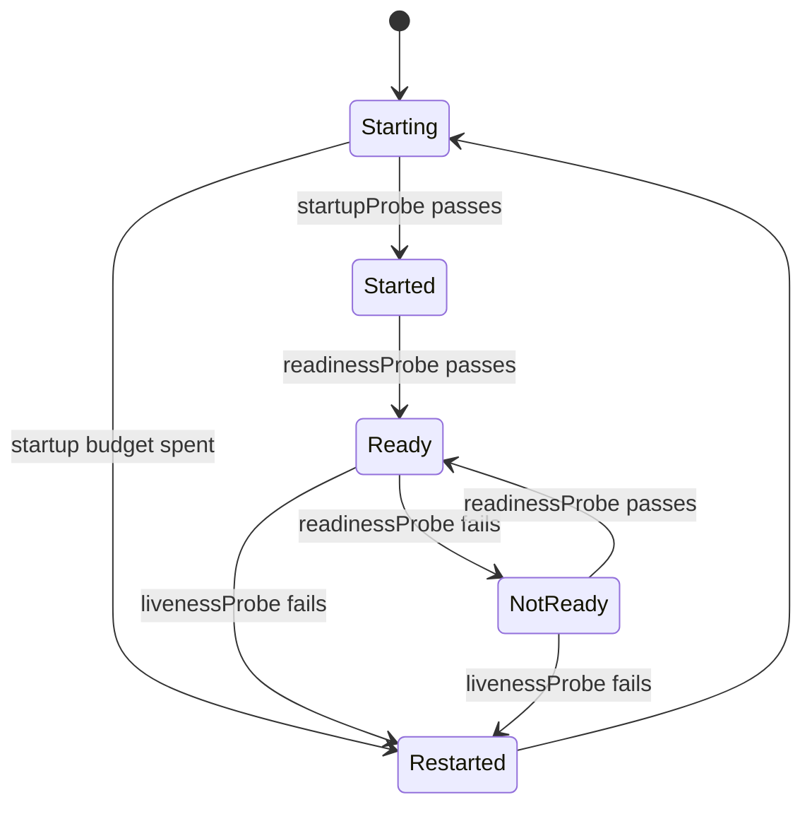

> [!info] Level: middle | Time: about 7 h | You need: [[learn/kubernetes-config-secrets-and-namespaces|Kubernetes 04: ConfigMaps, Secrets and Namespaces]] and [[learn/kubernetes-services-and-ingress|Kubernetes 03: Services, DNS and Ingress]] | Lab: Lab B, the kind cluster `lab` from [[learn/lab-setup|Start 01: Set up your lab]]

A Pod that starts is not a Pod that works. Kubernetes can only keep your application healthy if you tell it what "healthy" means (probes) and how much of the machine the application may use (resources). Get these two wrong and Kubernetes will either restart healthy Pods, send traffic to broken ones, or squeeze your application until it is killed.

This lesson has three parts. **Probes** tell the kubelet when to restart a container and when to send it traffic. **Resources** decide where a Pod can be scheduled and what happens when it uses too much. The **playbook** turns the usual Pod failures into a fixed procedure you can follow at 3 a.m.

## What you will learn

- What the liveness, readiness and startup probes each do, which probe type to choose, and how to tune them.
- The cascading-restart anti-pattern, and why a liveness probe must never check a dependency.
- How requests drive scheduling and limits enforce, what happens when CPU or memory runs over, and what the QoS classes are.
- How LimitRange and ResourceQuota keep a namespace in check.
- A debugging playbook by symptom (`Pending`, `ImagePullBackOff`, `CrashLoopBackOff`, `OOMKilled`, `Running` but not ready, a Service without endpoints, `CreateContainerConfigError`) and the tools to read events, logs and a live Pod.
- How to keep a debugging log so the next person does not start from zero.

## Part 1: Probes

The kubelet on each node runs probes against your containers. There are three kinds, and each answers a different question and has a different consequence.

| Probe            | Question                               | If it fails                                                                                                                                    |
| ---------------- | -------------------------------------- | ---------------------------------------------------------------------------------------------------------------------------------------------- |
| `startupProbe`   | Has the application finished starting? | Keeps trying until `failureThreshold` is spent, then the container is restarted. While it has not succeeded, the other two probes do not run.  |
| `readinessProbe` | Can this Pod take traffic right now?   | The Pod is **removed from Service endpoints**. The container keeps running and is not restarted. When the probe passes again, traffic returns. |
| `livenessProbe`  | Is this container stuck for good?      | The kubelet **kills and restarts** the container (subject to the Pod's `restartPolicy`).                                                       |

Keep the consequences apart in your head: **readiness removes, liveness restarts, startup protects.** Mixing them up is the root of most probe incidents.



### Probe mechanisms

A probe is one of four checks:

| Mechanism   | How it works                                                 | Use it for                                                 |
| ----------- | ------------------------------------------------------------ | ---------------------------------------------------------- |
| `httpGet`   | An HTTP GET; a status from 200 to 399 is success.            | Web apps and APIs. The most common.                        |
| `tcpSocket` | Opens a TCP connection; success if it connects.              | Services that are not HTTP, such as a database or a cache. |
| `exec`      | Runs a command inside the container; exit code 0 is success. | Anything custom. Costs a process each time; keep it cheap. |
| `grpc`      | Calls the gRPC health-checking protocol.                     | gRPC servers that implement that protocol.                 |

> [!warning] Check before relying on this
> The `grpc` probe type was added after the other three and its stability depends on your Kubernetes version (verify for your version). The default values for `periodSeconds`, `timeoutSeconds` and the thresholds below are as documented at the time of writing; confirm them in the "Configure Liveness, Readiness and Startup Probes" page for your version.

### Tuning fields

| Field                 | Default (verify for your version) | Meaning                                                      |
| --------------------- | --------------------------------- | ------------------------------------------------------------ |
| `initialDelaySeconds` | 0                                 | Wait before the first probe. Prefer a startup probe instead. |
| `periodSeconds`       | 10                                | How often to probe.                                          |
| `timeoutSeconds`      | 1                                 | How long to wait for an answer before counting a failure.    |
| `successThreshold`    | 1                                 | Consecutive passes needed to count as success.               |
| `failureThreshold`    | 3                                 | Consecutive failures needed to count as failed.              |

The time to react is roughly `periodSeconds x failureThreshold`. With the defaults that is about 30 seconds. A one-second `timeoutSeconds` is tight for an application that is busy: a slow garbage collection pause can turn into a failure, and a failed liveness probe restarts a perfectly good process.

### A complete example

```yaml title="web-probes.yaml"
apiVersion: apps/v1
kind: Deployment
metadata:
  name: web
spec:
  replicas: 2
  selector:
    matchLabels:
      app: web
  template:
    metadata:
      labels:
        app: web
    spec:
      containers:
        - name: web
          image: nginxinc/nginx-unprivileged:1.27-alpine # example tag; pin the one you use
          ports:
            - name: http
              containerPort: 8080
          startupProbe: # gives a slow boot up to 30 x 2 = 60 s
            httpGet:
              path: /
              port: http
            periodSeconds: 2
            failureThreshold: 30
          readinessProbe: # decides whether traffic is sent
            httpGet:
              path: /
              port: http
            periodSeconds: 5
            timeoutSeconds: 2
            failureThreshold: 3
          livenessProbe: # decides whether to restart; keep it simple and local
            httpGet:
              path: /
              port: http
            periodSeconds: 10
            timeoutSeconds: 2
            failureThreshold: 3
          resources:
            requests:
              cpu: 50m
              memory: 32Mi
            limits:
              memory: 64Mi
          securityContext:
            runAsNonRoot: true
            runAsUser: 101 # the user the example image runs as; change with the image
            allowPrivilegeEscalation: false
            capabilities:
              drop: ["ALL"]
            seccompProfile:
              type: RuntimeDefault
```

The **startup probe** is the right answer to a slow boot. Without it, the only options are a long `initialDelaySeconds` (which delays readiness on every restart even when the app starts fast) or a lenient liveness probe (which is slow to catch real deadlocks). With a startup probe you allow a generous budget for the first start (here up to 60 seconds) and keep liveness and readiness tight afterwards.

### What a liveness endpoint may check

Liveness answers one narrow question: "is this process wedged in a way that only a restart fixes?" The check should be **local and cheap**: the event loop answers, the main thread is not deadlocked. It must not depend on anything outside the container.

> [!warning] The cascading-restart anti-pattern
> If a liveness probe calls the database and the database goes down, **every Pod fails liveness at once** and the kubelet restarts all of them. The restarts add load (reconnect storms, cold caches), the database recovers more slowly, and a partial outage becomes a full one that outlasts the original fault. Never check a dependency in liveness. If you are unsure whether a liveness probe is needed at all, remember that a crashed process is restarted anyway; liveness is only for hangs that keep the process alive.

Readiness may reasonably include things the Pod cannot work without, but be careful here too. If all Pods become unready because a shared dependency is down, the Service has no endpoints and every request fails. Often it is better to stay ready and return a clear error (or a degraded answer) than to be removed from the Service. Decide per dependency, and let [[patterns/zero-downtime-deployments-kubernetes]] guide how readiness interacts with rollouts.

## Part 2: Resources

Each container can declare **requests** and **limits** for CPU and memory.

```yaml
resources:
  requests:
    cpu: 250m # a quarter of a core
    memory: 128Mi
  limits:
    memory: 256Mi
```

CPU is measured in cores (`1` is one core, `250m` is 250 millicores, a quarter of a core). Memory is measured in bytes with suffixes: `128Mi` is 128 mebibytes (powers of 1024), while `128M` is 128 megabytes (powers of 1000). Writing `128m` for memory means 0.128 bytes and is a classic mistake.

### Requests drive scheduling; limits enforce

- **Requests** are a promise to the scheduler. The scheduler places a Pod only on a node that has enough unrequested capacity. It adds up requests, not actual use. A node can be "full" by requests while the CPU is idle. Requests also set the Pod's relative CPU share when the node is busy.
- **Limits** are enforced on the node by the container runtime and the kernel. They are a ceiling, and they act differently for the two resources.

| Resource | Type           | When the container goes over its limit                                                                         |
| -------- | -------------- | -------------------------------------------------------------------------------------------------------------- |
| CPU      | Compressible   | It is **throttled**: the kernel pauses it for part of each scheduling period. It slows down but lives.         |
| Memory   | Incompressible | The kernel's OOM killer **kills** the container with `SIGKILL`. Kubernetes reports `OOMKilled`, exit code 137. |

Exit code 137 is 128 plus 9, the signal number of `SIGKILL`. After an OOM kill the container is restarted according to the Pod's restart policy, which is how you get a Pod that runs for a while, dies, and shows a rising restart count.

### Why "no CPU limit" can be the right choice

A CPU limit throttles a container even when the node has idle CPU, because the limit is a quota per scheduling period. Latency-sensitive services can see slow requests and high p99 times from throttling while the node looks idle. Many teams set a CPU **request** (for scheduling and fair share) and no CPU **limit**, and set a memory limit equal to the request. Others require limits for cost or multi-tenant fairness. This is a policy decision, not a law: the trade-offs, and what to measure, are in [[patterns/kubernetes-resource-requests-and-limits]]. Never apply the same rule to memory, where having no limit lets one Pod take down the node's other workloads.

### QoS classes and eviction

Kubernetes assigns each Pod a **Quality of Service class** from its requests and limits. You do not set it; you read it from `status.qosClass`.

| Class        | Rule                                                                                                       |
| ------------ | ---------------------------------------------------------------------------------------------------------- |
| `Guaranteed` | **Every** container in the Pod has both CPU and memory requests and limits, and requests **equal** limits. |
| `Burstable`  | At least one container has a request or a limit, but the Pod is not Guaranteed.                            |
| `BestEffort` | No container sets any request or limit.                                                                    |

A frequent mistake is to think that setting requests and a memory limit gives `Guaranteed`. It does not: requests plus only a memory limit is `Burstable`. Guaranteed needs CPU **and** memory, for requests **and** limits, equal, on every container (including init and sidecar containers, verify for your version).

When a node runs short of memory or disk, the kubelet **evicts** Pods to protect the node. In rough order, Pods that are using more than they requested go first, and `BestEffort` and `Burstable` Pods are in that group, while `Guaranteed` Pods are the last to be evicted. Within a class, Pod priority and how far above its request a Pod is also matter. QoS also influences which process the kernel's OOM killer picks. So: `BestEffort` is evicted first, `Burstable` next, `Guaranteed` last.

> [!warning] Check before relying on this
> The precise eviction ranking (priority, usage over request, the exact thresholds) is documented under "Node-pressure Eviction" and has changed between versions. Use the class order above as the mental model and read the page for your version for the details.

### LimitRange and ResourceQuota

Two namespace-level objects keep resource use sane.

- **LimitRange** sets defaults and bounds for individual containers or Pods in a namespace: the default request and limit applied when a container sets none, a minimum and a maximum.
- **ResourceQuota** caps the **total** a namespace may use: sum of CPU and memory requests and limits, and counts of objects such as Pods and Services.

```yaml title="namespace-guardrails.yaml"
apiVersion: v1
kind: LimitRange
metadata:
  name: defaults
spec:
  limits:
    - type: Container
      defaultRequest: # used when a container sets no request
        cpu: 50m
        memory: 64Mi
      default: # used when a container sets no limit
        memory: 128Mi
      max: # no single container may ask for more
        cpu: "2"
        memory: 1Gi
---
apiVersion: v1
kind: ResourceQuota
metadata:
  name: team-quota
spec:
  hard:
    requests.cpu: "4"
    requests.memory: 8Gi
    limits.memory: 16Gi
    pods: "40"
```

If a quota covers CPU or memory, every new Pod must specify those values or be rejected, unless a LimitRange supplies defaults. A Deployment that exceeds the quota is not rejected at creation: the ReplicaSet's `describe` shows `exceeded quota` events and the Pods are simply never created. This is a trap when you debug (see the playbook). Choose real numbers from measurements, not from this example.

## Part 3: A debugging playbook

Debugging a Pod is a search with a small set of well-known answers. The way to be fast is to follow the same order every time and to read what Kubernetes already tells you before you guess.

### Read the evidence in a fixed order

1. **Status:** `kubectl get pod NAME -o wide`. Read `STATUS`, `READY`, `RESTARTS` and the node.
2. **Events:** `kubectl describe pod NAME`. Scroll to the `Events` section at the bottom. Events are listed oldest first, so the **last lines are the most recent**: read them from the bottom up. Also read `State`, `Last State` (with `Reason` and `Exit Code`) and `Conditions` above them.
3. **Logs:** `kubectl logs NAME`, and for a container that has restarted, `kubectl logs NAME --previous` (or `-p`) to see the run that died. Add `-c CONTAINER` for multi-container Pods.
4. **Cluster events:** `kubectl get events --sort-by=.lastTimestamp` for a time-ordered view across objects, in the right namespace. Events are only kept for a limited time (about an hour by default; verify for your cluster), so read them early.
5. **Inside:** `kubectl exec -it NAME -- sh` if the image has a shell, otherwise an ephemeral debug container (below).
6. **Usage:** `kubectl top pod NAME` shows current CPU and memory. It needs the metrics-server add-on; a fresh kind cluster does not have it and answers `error: Metrics API not available`, while GKE ships it.

### The playbook by symptom

| Symptom (`STATUS` or condition)     | What it means                                                                            | First commands                                           | Usual causes and fixes                                                                                                                                                                                                        |
| ----------------------------------- | ---------------------------------------------------------------------------------------- | -------------------------------------------------------- | ----------------------------------------------------------------------------------------------------------------------------------------------------------------------------------------------------------------------------- |
| `Pending`                           | The scheduler has not placed the Pod on a node.                                          | `describe pod`, read the Events (`FailedScheduling`)     | Not enough CPU or memory (`Insufficient cpu`), a taint with no toleration, a `nodeSelector` or affinity that matches no node, an unbound PersistentVolumeClaim. Lower the request, add capacity, fix the selector or storage. |
| `ImagePullBackOff` / `ErrImagePull` | The node cannot pull the image.                                                          | `describe pod`, read the `Failed to pull image` event    | A typo in the image name or tag, a private registry with no `imagePullSecrets`, a missing permission, or no network path to the registry.                                                                                     |
| `CrashLoopBackOff`                  | The container starts, exits, and is restarted with a growing delay (up to five minutes). | `logs --previous`, then `describe` for `Last State`      | The process fails at start: bad arguments, missing config or file, a dependency not reachable, an exception. Fix the cause; the loop is only the symptom. A failing liveness probe also looks like this.                      |
| `OOMKilled` (exit code 137)         | The container exceeded its memory limit and was killed.                                  | `describe` (`Last State: Terminated, Reason: OOMKilled`) | The limit is too low, or the application leaks. Raise the limit after measuring, or fix the leak. Check whether it is the container limit or the node running out.                                                            |
| `Running`, but `READY 0/1`          | The readiness probe is failing.                                                          | `describe` (`Readiness probe failed` events), `logs`     | A wrong probe path or port, the app not listening yet, or a dependency check that fails. The Pod gets no traffic until it passes.                                                                                             |
| Service has no endpoints            | The Service has nothing to send traffic to.                                              | `get endpointslices -l kubernetes.io/service-name=NAME`  | An empty slice means the selector matches no Pod; `ready: false` means failing readiness. See [[learn/kubernetes-services-and-ingress\|Kubernetes 03]].                                                                       |
| `CreateContainerConfigError`        | Kubernetes could not build the container's configuration.                                | `describe pod`, read the event text                      | A referenced ConfigMap or Secret (or a key in it) does not exist, or `runAsNonRoot` is set with an image whose user is not numeric.                                                                                           |
| `Evicted`                           | The kubelet removed the Pod under node pressure.                                         | `describe pod` (message), `describe node`                | Node memory or disk pressure. Set requests so the Pod has a better class, and find what filled the node.                                                                                                                      |
| `Terminating` for a long time       | Deletion is blocked.                                                                     | `describe pod`, check `finalizers` and the node          | A finalizer waiting on something, or a node that is down. Fix the cause before you force-delete.                                                                                                                              |
| Pods never appear for a Deployment  | The ReplicaSet could not create them.                                                    | `describe replicaset`, read its Events                   | A ResourceQuota is exceeded, an admission policy rejected the Pod (for example Pod Security Admission), or the ServiceAccount is missing.                                                                                     |

The `exit code` is a fast clue. `1` is usually an application error, `126` and `127` are a command that cannot run or is not found, `137` is `SIGKILL` (often `OOMKilled`), and `143` is `SIGTERM`. These are the same numbers as in [[learn/running-and-debugging-containers|Containers 02]].

> [!note] Event wording
> The exact text of events and the `describe` layout vary a little between Kubernetes versions. The examples on this page are illustrative; search for the reason keywords (`Insufficient`, `Failed to pull`, `Readiness probe failed`, `OOMKilled`) rather than expecting a word-for-word match.

### Debugging a live Pod without a shell

Hardened images often have no shell and no tools. The Kubernetes answer is the **ephemeral debug container**: `kubectl debug` adds a temporary container with the tools you choose into the running Pod.

```bash
kubectl debug -it pod/NAME --image=busybox:1.36 --target=CONTAINER_NAME -- sh
```

`--target` makes the debug container share the target container's process namespace, so `ps` shows the application's processes, and the files under `/proc/<pid>/root` let you read its filesystem. The Pod itself is not restarted. Other forms are useful too:

```bash
# A copy of the Pod with a debug container, leaving the original untouched
kubectl debug pod/NAME -it --copy-to=NAME-debug --image=busybox:1.36 -- sh
# A debug Pod on a node, with the node's filesystem under /host
kubectl debug node/NODE_NAME -it --image=busybox:1.36
```

> [!warning] Check before relying on this
> Ephemeral containers and the process-namespace sharing from `--target` depend on your Kubernetes version and container runtime, and your RBAC and any admission policy may forbid them. A debug container is also a way into the Pod, so on production it needs the same approvals as `exec`. Do not leave `--copy-to` copies running.

### Keep a debugging log

While you debug, write down what you saw and what you changed. It prevents repeated guesses, and it is the start of the incident timeline if this becomes one (see [[learn/on-call-incidents-and-postmortems|Incidents 02]]). A plain template is enough:

```text
Time (UTC)  | Observation or action                              | Result
10:02       | web-5d9c Pending 4 min; events: Insufficient cpu   | Request is 100 cores; typo
10:05       | Changed cpu request 100 -> 100m, applied           | Pod scheduled, Running 1/1
10:06       | Hypothesis: Service had no endpoints because of Pending | Confirmed: slice now has 1 endpoint
Cause: typo in request (100 vs 100m). Fix: corrected manifest in Git.
Follow-up: add a policy check for CPU requests above 8 cores.
```

For incidents, the longer runbook is [[runbooks/kubernetes-pod-troubleshooting]].

## Hands-on exercises

Do these in the kind cluster `lab`. Names start with `k5-`. Check `kubectl config current-context` prints `kind-lab` first.

> [!warning] Exercises are not verified
> The commands and outputs were written from the Kubernetes documentation and not run for this page (no `verified` date). Output is illustrative. Image tags are examples. Event wording differs between versions. Read the "If you see something else" lines first.

1. **Read a QoS class: Burstable, then Guaranteed.** The first Pod has requests and a memory limit only. The second has CPU and memory requests equal to limits.

   ```yaml title="k5-qos.yaml"
   apiVersion: v1
   kind: Pod
   metadata:
     name: k5-burstable
   spec:
     containers:
       - name: app
         image: busybox:1.36 # example tag; pin the one you use
         command: ["sleep", "3600"]
         resources:
           requests:
             cpu: 50m
             memory: 32Mi
           limits:
             memory: 64Mi
         securityContext:
           runAsNonRoot: true
           runAsUser: 65534
           allowPrivilegeEscalation: false
           capabilities:
             drop: ["ALL"]
           seccompProfile:
             type: RuntimeDefault
   ---
   apiVersion: v1
   kind: Pod
   metadata:
     name: k5-guaranteed
   spec:
     containers:
       - name: app
         image: busybox:1.36
         command: ["sleep", "3600"]
         resources:
           requests:
             cpu: 50m
             memory: 32Mi
           limits:
             cpu: 50m
             memory: 32Mi
         securityContext:
           runAsNonRoot: true
           runAsUser: 65534
           allowPrivilegeEscalation: false
           capabilities:
             drop: ["ALL"]
           seccompProfile:
             type: RuntimeDefault
   ```

   ```bash
   kubectl apply -f k5-qos.yaml
   kubectl wait --for=condition=Ready pod/k5-burstable pod/k5-guaranteed --timeout=60s
   kubectl get pod k5-burstable -o jsonpath='{.status.qosClass}'; echo
   kubectl get pod k5-guaranteed -o jsonpath='{.status.qosClass}'; echo
   ```

   Expected: `Burstable`, then `Guaranteed`. The first one has requests and only a memory limit, so it is not Guaranteed (a CPU limit equal to the request is missing).
   If you see something else: `BestEffort` means the `resources` block was not applied (check indentation). If both say `Burstable`, check that every request equals the limit for both CPU and memory in the second Pod.

2. **Trigger an OOM kill.** A Python one-liner allocates and touches 300 MiB inside a container limited to 100 MiB. This uses a plain Python image so you do not depend on a stress tool.

   ```yaml title="k5-hog.yaml"
   apiVersion: v1
   kind: Pod
   metadata:
     name: k5-hog
   spec:
     restartPolicy: Never
     containers:
       - name: hog
         image: python:3-alpine # example tag; pin the one you use
         command:
           - python3
           - -c
           - "x = b'x' * (300 * 1024 * 1024); import time; time.sleep(3600)"
         resources:
           requests:
             memory: 64Mi
           limits:
             memory: 100Mi
         securityContext:
           runAsNonRoot: true
           runAsUser: 65534
           allowPrivilegeEscalation: false
           capabilities:
             drop: ["ALL"]
           seccompProfile:
             type: RuntimeDefault
   ```

   ```bash
   kubectl apply -f k5-hog.yaml
   sleep 20
   kubectl get pod k5-hog
   kubectl get pod k5-hog -o jsonpath='{.status.containerStatuses[0].state.terminated.reason} {.status.containerStatuses[0].state.terminated.exitCode}'; echo
   ```

   Expected: the Pod is not `Running` any more, and the second command prints `OOMKilled 137`:

   ```text
   NAME     READY   STATUS      RESTARTS   AGE
   k5-hog   0/1     OOMKilled   0          25s
   OOMKilled 137
   ```

   If you see something else: if the Pod is still `Running`, the memory was not touched or the limit was not applied; check `kubectl get pod k5-hog -o yaml | grep -A3 limits`. If the image cannot be pulled, choose another small image that has Python. The older `polinux/stress` image would also work but was not verified, so this page does not depend on it.

3. **Fail a readiness probe and follow the effect.** A Deployment whose readiness probe asks for a path that does not exist, behind a Service.

   ```yaml title="k5-bad-ready.yaml"
   apiVersion: apps/v1
   kind: Deployment
   metadata:
     name: k5-bad-ready
   spec:
     replicas: 1
     selector:
       matchLabels:
         app: k5-bad-ready
     template:
       metadata:
         labels:
           app: k5-bad-ready
       spec:
         containers:
           - name: web
             image: nginxinc/nginx-unprivileged:1.27-alpine # example tag; pin the one you use
             ports:
               - name: http
                 containerPort: 8080
             readinessProbe:
               httpGet:
                 path: /nonexistent
                 port: http
               periodSeconds: 3
             resources:
               requests:
                 cpu: 20m
                 memory: 32Mi
               limits:
                 memory: 64Mi
             securityContext:
               runAsNonRoot: true
               runAsUser: 101
               allowPrivilegeEscalation: false
               capabilities:
                 drop: ["ALL"]
               seccompProfile:
                 type: RuntimeDefault
   ---
   apiVersion: v1
   kind: Service
   metadata:
     name: k5-bad-ready
   spec:
     selector:
       app: k5-bad-ready
     ports:
       - port: 80
         targetPort: http
   ```

   ```bash
   kubectl apply -f k5-bad-ready.yaml
   sleep 20
   kubectl get pods -l app=k5-bad-ready
   kubectl describe pod -l app=k5-bad-ready | grep -A1 'Readiness probe'
   kubectl get endpointslices -l kubernetes.io/service-name=k5-bad-ready \
     -o jsonpath='{.items[*].endpoints[*].conditions.ready}'; echo
   ```

   Expected: the Pod is `Running` with `READY 0/1`, the event says the readiness probe failed with status code 404, and the endpoint (if listed) has `ready` as `false`, so the Service sends it nothing:

   ```text
   NAME                           READY   STATUS    RESTARTS   AGE
   k5-bad-ready-6d8f9c7b5-x2k4j   0/1     Running   0          22s
     Warning  Unhealthy  4s (x7 over 22s)  kubelet  Readiness probe failed: HTTP probe failed with statuscode: 404
   false
   ```

   If you see something else: if the Pod is `1/1`, the path `/nonexistent` returned a success for your image; use a path that surely returns an error. If the last command prints nothing, the slice has no endpoint at all, which means the label does not match; the 404 is still the cause of `0/1`. Fix it by changing the path to `/` and re-applying, and watch `READY` become `1/1`.

4. **Make a Pod `Pending` with an impossible request.**

   ```bash
   kubectl run k5-big --image=busybox:1.36 --restart=Never \
     --overrides='{"spec":{"containers":[{"name":"k5-big","image":"busybox:1.36","command":["sleep","3600"],"resources":{"requests":{"cpu":"100"}}}]}}'
   sleep 5
   kubectl get pod k5-big
   kubectl describe pod k5-big | grep -A3 Events
   ```

   Expected: `STATUS Pending`, and an event from the scheduler such as `0/1 nodes are available: 1 Insufficient cpu`:

   ```text
   NAME     READY   STATUS    RESTARTS   AGE
   k5-big   0/1     Pending   0          6s
     Warning  FailedScheduling  6s  default-scheduler  0/1 nodes are available: 1 Insufficient cpu. ...
   ```

   If you see something else: if the Pod runs, your machine reports 100 or more CPUs; use a larger value. The number of nodes and the tail of the message differ with the cluster. The `cpu: "100"` request is 100 whole cores. Compare with `100m`, which is a tenth of a core: the missing `m` is the classic typo.

5. **Debug a Pod with an ephemeral container.** Use the nginx Deployment from exercise 3 after you fixed it, or any running Pod.

   ```bash
   POD=$(kubectl get pod -l app=k5-bad-ready -o jsonpath='{.items[0].metadata.name}')
   kubectl debug -it "$POD" --image=busybox:1.36 --target=web -- sh
   ```

   Inside the debug shell run `ps` and then `exit`.
   Expected: `ps` lists the nginx processes (`nginx: master process ...`) next to the debug shell, because the process namespace is shared. After `exit`, `kubectl get pod "$POD" -o jsonpath='{.spec.ephemeralContainers[*].name}'` prints the debug container name, and the Pod was not restarted.
   If you see something else: if you see only your own `sh`, the runtime did not share the process namespace; check that you passed `--target` with the real container name. `error: ephemeral containers are disabled` or a forbidden error means your cluster or RBAC does not allow it.

6. **Clean up.**

   ```bash
   kubectl delete -f k5-qos.yaml -f k5-hog.yaml -f k5-bad-ready.yaml --ignore-not-found
   kubectl delete pod k5-big --ignore-not-found
   ```

   Expected: every object created in this lesson is deleted.
   If you see something else: check `kubectl get pods,deployments,services` for leftovers named `k5-`.

## Common mistakes

- **A liveness probe that checks a dependency.** Why it bites: when the dependency is slow or down, every Pod is restarted at once, which makes the outage bigger. Fix: liveness checks only the local process; use readiness (with care) for dependencies.
- **The same endpoint and settings for liveness and readiness.** Why it bites: a temporary overload makes the Pod unready and then, after the same few failures, restarts it. Fix: separate, cheaper liveness with a higher threshold and a longer timeout than readiness.
- **A long `initialDelaySeconds` instead of a startup probe.** Why it bites: every restart waits the full delay even when the app starts quickly. Fix: a startup probe with a generous budget.
- **No resource requests.** Why it bites: the scheduler cannot place Pods sensibly, the Pod is `BestEffort`, and it is first to be evicted. Fix: set requests from measured use, and use a LimitRange for defaults.
- **A memory limit equal to typical use.** Why it bites: normal spikes OOM-kill the container. Fix: size the limit above the observed peak, watch `OOMKilled` restarts and decide from data.
- **A CPU limit set too low on a latency-sensitive service.** Why it bites: throttling looks like a slow application. Fix: measure CPU throttling and follow the team policy in [[patterns/kubernetes-resource-requests-and-limits]].
- **Confusing `Mi` with `M`, and `100m` with `100`.** Why it bites: a memory limit of `128m` is under one byte and a CPU request of `100` is a hundred cores. Fix: check units on every resource value.
- **Reading `describe` from the top.** Why it bites: the answer is at the bottom, in the newest events. Fix: start from the last lines of `Events`, then work upwards.
- **Forgetting `--previous`.** Why it bites: `kubectl logs` shows the new, empty container, not the one that crashed. Fix: `kubectl logs NAME --previous`.
- **Restarting to "fix" a problem and losing the evidence.** Why it bites: logs and `Last State` are gone. Fix: capture `describe`, logs and events first, then restart.

## Check your understanding

1. What is the difference between a liveness probe and a readiness probe, and what does each do when it fails?
2. Why must a liveness probe not check the database?
3. Why can leaving CPU limits unset be a reasonable choice, and why is leaving out the memory limit a worse idea?
4. A Pod has CPU and memory requests and a memory limit, but no CPU limit. Which QoS class is it? Which class is evicted first under node pressure?
5. A Pod shows `CrashLoopBackOff`. Which commands do you run first, and in which order?
6. A Deployment's Pods never appear, and `kubectl get pods` shows nothing for it. Where do you look?

> [!question]- Answers
>
> 1. A failing liveness probe makes the kubelet kill and restart the container; it is for a process that is stuck. A failing readiness probe removes the Pod from the Service endpoints without restarting it; it is for a Pod that cannot take traffic right now. A startup probe delays the other two until the application has started.
> 2. If the database fails, every Pod fails liveness at the same time and is restarted. The restarts add load, slow the recovery and turn a dependency problem into an outage of your own service. Liveness should check only that the local process is responsive.
> 3. A CPU limit throttles the container even when the node has idle CPU, which can hurt latency; a CPU request still gives it a fair share. Memory cannot be reclaimed by slowing a process down, so without a limit one Pod can use up the node's memory and cause OOM kills or evictions for others. Whether to set CPU limits is a team policy.
> 4. `Burstable`: Guaranteed needs CPU and memory requests equal to limits on every container. `BestEffort` Pods (no requests or limits) are evicted first, then `Burstable` Pods using more than they requested; `Guaranteed` Pods last.
> 5. `kubectl get pod NAME` for status and restarts, `kubectl logs NAME --previous` for the run that crashed, and `kubectl describe pod NAME` for `Last State`, the exit code and the Events (newest at the bottom). Then fix the cause that the logs and exit code show.
> 6. At the ReplicaSet: `kubectl describe replicaset` (or `kubectl get events`) in the same namespace. A ResourceQuota that is exceeded, an admission policy that rejected the Pod, or a missing ServiceAccount stops Pods from being created, so the Pod itself never exists to describe.

## Next steps

Next lesson: [[learn/helm-basics-and-capstone|Kubernetes 06: Helm basics and the capstone]]. Previous lesson: [[learn/kubernetes-config-secrets-and-namespaces|Kubernetes 04: ConfigMaps, Secrets and Namespaces]].

To go deeper:

- [[runbooks/kubernetes-pod-troubleshooting]] is the on-call version of the playbook in this lesson.
- [[patterns/kubernetes-resource-requests-and-limits]] for how to choose requests and limits from data, and the CPU limit debate.
- [[patterns/zero-downtime-deployments-kubernetes]] for readiness, shutdown and rollouts working together.
- [[learn/running-and-debugging-containers|Containers 02]] for exit codes and the container-level view of the same failures.
- The whole path is mapped in [[learn/index|the learning path]].

## Sources

- Kubernetes documentation, "Liveness, Readiness, and Startup Probes" (https://kubernetes.io/docs/concepts/configuration/liveness-readiness-startup-probes/) and "Configure Liveness, Readiness and Startup Probes" (https://kubernetes.io/docs/tasks/configure-pod-container/configure-liveness-readiness-startup-probes/).
- Kubernetes documentation, "Resource Management for Pods and Containers" (https://kubernetes.io/docs/concepts/configuration/manage-resources-containers/).
- Kubernetes documentation, "Pod Quality of Service Classes" (https://kubernetes.io/docs/concepts/workloads/pods/pod-qos/) and "Node-pressure Eviction" (https://kubernetes.io/docs/concepts/scheduling-eviction/node-pressure-eviction/).
- Kubernetes documentation, "Limit Ranges" and "Resource Quotas" (https://kubernetes.io/docs/concepts/policy/limit-range/ and https://kubernetes.io/docs/concepts/policy/resource-quotas/).
- Kubernetes documentation, "Troubleshooting Applications", including "Debug Pods" (https://kubernetes.io/docs/tasks/debug/debug-application/) and "Ephemeral Containers" (https://kubernetes.io/docs/concepts/workloads/pods/ephemeral-containers/).
- Not checked against a running cluster for this page. The probe defaults, the `grpc` probe status, event wording, the eviction ranking, the `kubectl debug` behaviour on your runtime and the image tags (`busybox`, `python`, `nginxinc/nginx-unprivileged`) are not verified.
