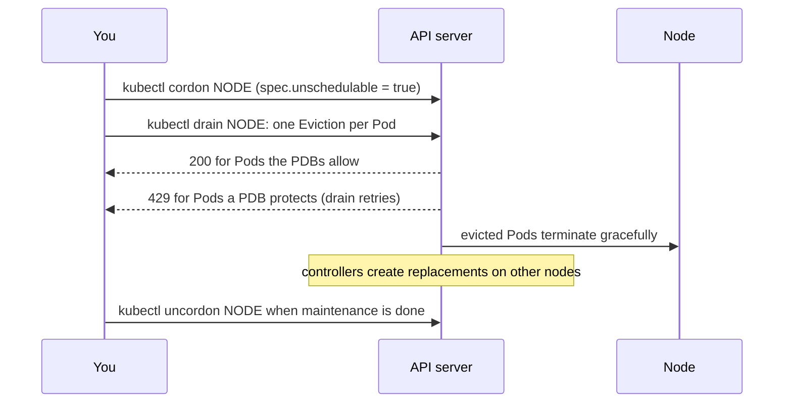

> [!info] Level: middle | Time: about 4 h | You need: [[learn/kubernetes-probes-resources-and-debugging|Kubernetes 05: Probes, resources and a pod debugging playbook]] | Lab: a new kind cluster `sched` with one control plane and three workers labelled as three fake zones (built in exercise 1)

Every Pod you create goes through the scheduler, which picks a node for it once and never moves it again. Most of the time the default choice is fine. Production needs more: replicas spread over zones so one zone outage does not take the service down, GPU or batch nodes kept for the work that needs them, and node maintenance that never removes more replicas than the service can lose. This lesson covers the tools for each, and the day-to-day operation where they all meet: **draining a node**.

[[learn/kubernetes-probes-resources-and-debugging|Kubernetes 05]] showed that requests, not live usage, decide whether a Pod fits. Here you add the rules that decide **which** of the nodes that fit gets the Pod, and what may take it away again.

> [!note] Nothing here was run for this page
> The manifests, commands and sample output follow the Kubernetes documentation and the `kubectl` source, and are not verified on a running cluster. Output is illustrative. Feature states are given as "stable since 1.xx"; check yours with `kubectl version`.

## What you will learn

- How the scheduler filters and scores nodes, and how to read a `FailedScheduling` event.
- `nodeSelector`, node affinity (required and preferred) and Pod affinity and anti-affinity, and when each is the right tool.
- Taints and tolerations, their three effects, and why a toleration alone does not dedicate a node.
- Topology spread constraints for spreading replicas over zones and nodes, and their built-in defaults.
- PodDisruptionBudgets, the Eviction API, and how to cordon, drain and uncordon a node safely, including why a drain blocks.

## How the scheduler decides

The scheduler watches for Pods with no `spec.nodeName`. For each one it runs two phases:

1. **Filtering** finds the nodes where the Pod **can** run: enough unrequested CPU and memory for its requests, a matching `nodeSelector` and required affinity, tolerated taints, satisfiable spread constraints, volumes that can attach there.
2. **Scoring** ranks those feasible nodes by preferences (preferred affinity, spreading, image locality, balance) and picks the highest score, breaking ties at random.

If no node passes filtering, the Pod stays `Pending` and the scheduler records a `FailedScheduling` event that counts, per reason, how many nodes failed:

```text
Warning  FailedScheduling  12s  default-scheduler  0/4 nodes are available: 1 node(s) had untolerated taint {node-role.kubernetes.io/control-plane: }, 3 node(s) didn't match Pod's node affinity/selector. preemption: 0/4 nodes are available: 4 Preemption is not helpful for scheduling.
```

Read it as a sum: every node is listed once under the first filter it failed. The common reasons, with wording that differs between versions:

| Reason fragment                                                                       | Filter that failed                                                                                                |
| ------------------------------------------------------------------------------------- | ----------------------------------------------------------------------------------------------------------------- |
| `Insufficient cpu`, `Insufficient memory`                                             | Requests do not fit in the node's unrequested capacity.                                                           |
| `didn't match Pod's node affinity/selector`                                           | `nodeSelector` or required node affinity.                                                                         |
| `had untolerated taint` / `had taints that the pod didn't tolerate`                   | A taint the Pod does not tolerate.                                                                                |
| `didn't match pod topology spread constraints`                                        | A `DoNotSchedule` spread constraint would be violated.                                                            |
| `didn't match pod affinity rules`, `didn't satisfy existing pods anti-affinity rules` | Pod affinity or anti-affinity.                                                                                    |
| `didn't match PersistentVolume's node affinity`                                       | The Pod's volume lives elsewhere (see [[learn/kubernetes-storage-volumes-pvcs-and-statefulsets\|Kubernetes 09]]). |

The decision is made once. "IgnoredDuringExecution" in the field names below means exactly that: if labels change later, running Pods are not moved.

## nodeSelector: the simple filter

```yaml
spec:
  nodeSelector:
    disktype: ssd
```

The Pod runs only on nodes that carry **all** the listed labels. Every node also has built-in labels you can select on: `kubernetes.io/hostname`, `kubernetes.io/os`, `kubernetes.io/arch`, `topology.kubernetes.io/zone` and `topology.kubernetes.io/region` (the last two set by the cloud provider or, in a lab, by you).

`spec.nodeName` is different: it skips the scheduler altogether and binds the Pod to a node directly, ignoring taints and cordons. Avoid it outside debugging.

## Node affinity: required and preferred

Node affinity is `nodeSelector` with operators and preferences.

```yaml
spec:
  affinity:
    nodeAffinity:
      requiredDuringSchedulingIgnoredDuringExecution: # hard: a filter
        nodeSelectorTerms:
          - matchExpressions:
              - key: kubernetes.io/arch
                operator: In
                values: ["amd64", "arm64"]
      preferredDuringSchedulingIgnoredDuringExecution: # soft: adds to the score
        - weight: 50 # 1 to 100
          preference:
            matchExpressions:
              - key: topology.kubernetes.io/zone
                operator: In
                values: ["zone-a"]
```

- Operators: `In`, `NotIn`, `Exists`, `DoesNotExist`, `Gt`, `Lt`. `NotIn` and `DoesNotExist` give you anti-affinity to nodes.
- Several `nodeSelectorTerms` are **ORed**; several `matchExpressions` inside one term are **ANDed**. Getting this backwards is a classic way to allow too much or nothing.
- Preferred rules carry a `weight` from 1 to 100 that is added to the node's score. A preference never makes a Pod `Pending`.

## Pod affinity and anti-affinity

These place a Pod relative to **other Pods**, by label, inside a **topology domain** named by `topologyKey` (a node, a zone).

```yaml
spec:
  affinity:
    podAntiAffinity:
      preferredDuringSchedulingIgnoredDuringExecution:
        - weight: 100
          podAffinityTerm:
            topologyKey: kubernetes.io/hostname
            labelSelector:
              matchLabels:
                app: web
```

This says "prefer not to put two `app: web` Pods on the same node". Use cases: anti-affinity to keep replicas apart, affinity to put a cache next to its client. Every node must carry the `topologyKey` label. Required Pod anti-affinity is a hard filter: with three nodes, the fourth replica of a "never on the same node" rule stays `Pending`. Pod affinity is also the most expensive rule for the scheduler in large clusters. For spreading replicas, prefer **topology spread constraints** (below); keep Pod anti-affinity for "never together" rules that are truly hard.

## Taints and tolerations

Affinity attracts Pods to nodes. **Taints repel** them: a tainted node accepts only Pods that **tolerate** the taint.

```bash
NODE=sched-worker3
kubectl taint nodes "$NODE" dedicated=batch:NoSchedule      # add
kubectl taint nodes "$NODE" dedicated=batch:NoSchedule-     # remove (trailing minus)
kubectl get node "$NODE" -o jsonpath='{.spec.taints}{"\n"}'
```

| Effect             | New Pods without a toleration | Running Pods without a toleration                                                             |
| ------------------ | ----------------------------- | --------------------------------------------------------------------------------------------- |
| `NoSchedule`       | Not scheduled.                | Stay.                                                                                         |
| `PreferNoSchedule` | Avoided if possible (soft).   | Stay.                                                                                         |
| `NoExecute`        | Not scheduled.                | **Evicted.** A toleration with `tolerationSeconds` bounds how long a tolerating Pod may stay. |

```yaml
spec:
  tolerations:
    - key: dedicated
      operator: Equal # the default; Exists matches any value
      value: batch
      effect: NoSchedule
```

A toleration only **allows** the Pod onto the tainted node; it does not send it there. To dedicate nodes to a workload you need both: a taint (to keep everything else out) and node affinity or a `nodeSelector` (to pull the workload in). An empty `key` with `operator: Exists` tolerates every taint; DaemonSets for node agents do that on purpose, and an application that copies it can land on nodes it should never touch.

Kubernetes uses taints itself. The control plane carries `node-role.kubernetes.io/control-plane:NoSchedule`, a cordoned node gets `node.kubernetes.io/unschedulable:NoSchedule`, and nodes that are not ready or unreachable get `NoExecute` taints that evict Pods after a timeout. That is how a Pod leaves a dead node.

## Topology spread constraints

The direct way to say "spread my replicas evenly over zones":

```yaml
spec:
  topologySpreadConstraints:
    - maxSkew: 1
      topologyKey: topology.kubernetes.io/zone
      whenUnsatisfiable: DoNotSchedule # hard; ScheduleAnyway is soft
      labelSelector:
        matchLabels:
          app: web
      matchLabelKeys: ["pod-template-hash"] # count only Pods of the same Deployment revision
    - maxSkew: 1
      topologyKey: kubernetes.io/hostname
      whenUnsatisfiable: ScheduleAnyway
      labelSelector:
        matchLabels:
          app: web
```

- **Skew** is the difference between the domain with the most matching Pods and the one with the fewest. `maxSkew: 1` over three zones lets six replicas sit 2/2/2 and a seventh make it 3/2/2, but never 3/2/1.
- `whenUnsatisfiable: DoNotSchedule` (the default) is a filter: a Pod that would break the skew stays `Pending`. `ScheduleAnyway` only lowers the score.
- `labelSelector` decides which Pods are counted; it should match the workload's own Pods. `matchLabelKeys` with `pod-template-hash` (beta since 1.27, on by default) keeps old and new revisions from being counted together during a rollout.
- `minDomains` (only with `DoNotSchedule`, stable since 1.30) makes the scheduler treat missing domains as having zero Pods, useful with a cluster autoscaler.
- `nodeAffinityPolicy` and `nodeTaintsPolicy` decide whether nodes excluded by affinity or taints count as domains. Check their defaults on the "Pod Topology Spread Constraints" page for your version.

If you set no constraints, the scheduler applies **built-in defaults** (stable since 1.24) to Pods that belong to a Service, ReplicaSet, StatefulSet or ReplicationController: `maxSkew: 3` over `kubernetes.io/hostname` and `maxSkew: 5` over `topology.kubernetes.io/zone`, both `ScheduleAnyway`. Soft, so they do not guarantee zone spreading. If zone loss matters, state it explicitly.

Two limits from the documentation. Constraints are evaluated **only when a Pod is scheduled**: after a scale-down or node changes, the spread can drift and nothing rebalances it (the docs point to the Descheduler project for that). And a hard zone constraint can make Pods `Pending` during maintenance: if all nodes of one zone are cordoned or tainted but still counted as a domain, putting the evicted replicas in the other zones may break the skew. GKE specifics are in [[patterns/topology-spread-constraints-gke]].

## PriorityClass, briefly

A **PriorityClass** gives Pods a priority number. When a high-priority Pod cannot be scheduled, the scheduler may **preempt** (evict) lower-priority Pods to make room.

```yaml title="priorityclass.yaml"
apiVersion: scheduling.k8s.io/v1
kind: PriorityClass
metadata:
  name: business-critical
value: 100000 # user classes go up to 1,000,000,000
globalDefault: false
preemptionPolicy: PreemptLowerPriority # or Never: high priority in the queue, but no preemption
description: Customer-facing services.
```

The built-in `system-cluster-critical` and `system-node-critical` classes sit above every user value and are for cluster components only. Preemption is powerful and easy to misuse (a batch job with a high priority can evict your web tier); the design rules are in [[patterns/priority-classes-and-preemption]].

## PodDisruptionBudgets and the Eviction API

Pods leave nodes for two kinds of reason. **Involuntary** disruptions (a node crash, a kernel panic, a zone outage) cannot be negotiated. **Voluntary** ones (a drain for an upgrade, the cluster autoscaler removing a node) go through the **Eviction API**, and those respect a **PodDisruptionBudget (PDB)**.

```yaml title="pdb.yaml"
apiVersion: policy/v1
kind: PodDisruptionBudget
metadata:
  name: web
spec:
  maxUnavailable: 1 # or minAvailable: N (exactly one of the two)
  selector:
    matchLabels:
      app: web
  unhealthyPodEvictionPolicy: AlwaysAllow # stable since 1.31; default IfHealthyBudget
```

- `minAvailable` or `maxUnavailable`, as a number or a percentage. Exactly one of them.
- A Pod counts as healthy when its `Ready` condition is `True`. `kubectl get pdb` shows `ALLOWED DISRUPTIONS`, computed from the healthy count.
- `maxUnavailable: 0` or `minAvailable: 100%` forbids every voluntary eviction, so **no drain can ever finish** while the budget exists. That is almost always a mistake.
- `unhealthyPodEvictionPolicy: AlwaysAllow` lets already-unhealthy Pods (crash-looping, not Ready) be evicted even when the budget is exhausted, so a broken Pod does not block node maintenance. The drain documentation recommends it.
- A PDB does nothing for involuntary disruptions. Spread (above) protects against those.

When something evicts a Pod, the API server answers:

| Response                    | Meaning                                                                                                                                         |
| --------------------------- | ----------------------------------------------------------------------------------------------------------------------------------------------- |
| `200 OK`                    | Allowed. The Pod is deleted with its normal `terminationGracePeriodSeconds`.                                                                    |
| `429 Too Many Requests`     | Not allowed now, because of a PDB (message: `Cannot evict pod as it would violate the pod's disruption budget.`) or rate limiting. Retry later. |
| `500 Internal Server Error` | Misconfiguration, for example several PDBs selecting the same Pod.                                                                              |

Without any PDB, an eviction always succeeds. The design guidance for budgets is in [[patterns/pod-disruption-budgets-for-stateless-services]].

## Cordon, drain, uncordon



- `kubectl cordon NODE` marks the node unschedulable. Nothing running is touched.
- `kubectl drain NODE` cordons and then evicts every Pod through the Eviction API, so PDBs are respected. It retries Pods that get a 429 until they succeed or the `--timeout` expires (`0`, the default, waits forever).
- `kubectl uncordon NODE` makes the node schedulable again. Drained Pods do not move back on their own.

`kubectl drain` refuses to start (before evicting anything) when it finds Pods it cannot handle safely, and tells you the flag that overrides each case:

| Message fragment                                                   | Why drain stops                                           | Flag                     |
| ------------------------------------------------------------------ | --------------------------------------------------------- | ------------------------ |
| `DaemonSet-managed Pods (use --ignore-daemonsets to ignore)`       | A DaemonSet Pod would just be recreated on the same node. | `--ignore-daemonsets`    |
| `Pods with local storage (use --delete-emptydir-data to override)` | `emptyDir` data is lost when the Pod leaves.              | `--delete-emptydir-data` |
| `Pods that declare no controller (use --force to override)`        | A bare Pod is not recreated anywhere; it is simply gone.  | `--force`                |

Other useful flags (confirm with `kubectl drain --help`): `--timeout`, `--grace-period`, `--pod-selector`, `--dry-run=server`, and `--disable-eviction`, which **deletes** Pods instead of evicting them and therefore **bypasses PDBs**. Never reach for `--disable-eviction` or `--force` to make a stuck drain finish without understanding which Pod is blocking and why.

Drain one node at a time and check the service between nodes. On GKE, node pool upgrades drain nodes for you, with the surge and timeout behaviour described in [[patterns/gke-node-pool-upgrade-strategies]] and the procedure in [[runbooks/gke-cluster-upgrade]]; the GKE-specific numbers are not restated here because they were not checked against the GKE documentation for this page; verify them there.

## Hands-on exercises

> [!warning] Lab only
> `kubectl drain` evicts every Pod on a node and taints change where Pods may run. Use the throwaway `sched` cluster from exercise 1, never a shared or production cluster.

> [!warning] Exercises are not verified
> The commands and outputs were written from the Kubernetes documentation and the `kubectl` source and were not run for this page. Output is illustrative; node names depend on the cluster name. Read the "If you see something else" lines first.

1. **Build a four-node cluster with fake zones.**

   ```bash
   mkdir -p ~/k8s10 && cd ~/k8s10
   cat > kind-sched.yaml <<'EOF'
   kind: Cluster
   apiVersion: kind.x-k8s.io/v1alpha4
   nodes:
     - role: control-plane
     - role: worker
     - role: worker
     - role: worker
   EOF
   kind create cluster --name sched --config kind-sched.yaml --wait 120s
   kubectl label node sched-worker  topology.kubernetes.io/zone=zone-a
   kubectl label node sched-worker2 topology.kubernetes.io/zone=zone-b
   kubectl label node sched-worker3 topology.kubernetes.io/zone=zone-c
   kubectl get nodes -L topology.kubernetes.io/zone
   ```

   Expected:

   ```text
   NAME                  STATUS   ROLES           AGE   VERSION   ZONE
   sched-control-plane   Ready    control-plane   90s   v1.xx.x
   sched-worker          Ready    <none>          70s   v1.xx.x   zone-a
   sched-worker2         Ready    <none>          70s   v1.xx.x   zone-b
   sched-worker3         Ready    <none>          70s   v1.xx.x   zone-c
   ```

   If you see something else: if `kubectl` still points at another cluster, run `kubectl config use-context kind-sched`. If the label command says the node is not found, list the real names with `kubectl get nodes` and use those. The extra workers share your machine's CPU and memory, so they add no real capacity; they are for placement only.

2. **Spread six replicas over three zones.**

   ```yaml title="k10-web.yaml"
   apiVersion: apps/v1
   kind: Deployment
   metadata:
     name: k10-web
   spec:
     replicas: 6
     selector:
       matchLabels:
         app: k10-web
     template:
       metadata:
         labels:
           app: k10-web
       spec:
         topologySpreadConstraints:
           - maxSkew: 1
             topologyKey: topology.kubernetes.io/zone
             whenUnsatisfiable: DoNotSchedule
             labelSelector:
               matchLabels:
                 app: k10-web
             matchLabelKeys: ["pod-template-hash"]
         containers:
           - name: web
             image: nginxinc/nginx-unprivileged:1.27-alpine # example tag; pin the one you use
             resources:
               requests:
                 cpu: 20m
                 memory: 32Mi
               limits:
                 memory: 64Mi
   ```

   ```bash
   kubectl apply -f k10-web.yaml
   kubectl rollout status deployment/k10-web --timeout=120s
   kubectl get pods -l app=k10-web -o jsonpath='{range .items[*]}{.spec.nodeName}{"\n"}{end}' | sort | uniq -c
   kubectl scale deployment k10-web --replicas=7
   sleep 10
   kubectl get pods -l app=k10-web -o jsonpath='{range .items[*]}{.spec.nodeName}{"\n"}{end}' | sort | uniq -c
   ```

   Expected: `2` Pods on each worker, then `3/2/2` after scaling to seven.
   If you see something else: no Pod should land on the control-plane node, because it has the control-plane taint and no zone label (with `DoNotSchedule`, a node without the `topologyKey` label is filtered out). If some do, check `kubectl describe node sched-control-plane | grep Taints` and its labels. If Pods are `Pending` with `didn't match pod topology spread constraints (missing required label)` on every worker, a worker lost its zone label.

3. **A selector that matches nothing, then something.**

   ```bash
   kubectl run k10-ssd --image=busybox:1.36 --restart=Never \
     --overrides='{"spec":{"nodeSelector":{"disktype":"ssd"}}}' -- sleep 3600
   sleep 5
   kubectl get pod k10-ssd
   kubectl describe pod k10-ssd | sed -n '/Events/,$p'
   kubectl label node sched-worker2 disktype=ssd
   kubectl wait --for=condition=Ready pod/k10-ssd --timeout=60s
   kubectl get pod k10-ssd -o wide
   kubectl label node sched-worker2 disktype-
   kubectl get pod k10-ssd
   ```

   Expected: `Pending` with `didn't match Pod's node affinity/selector`; after labelling, the Pod runs on `sched-worker2`; after removing the label it **keeps running** (IgnoredDuringExecution).
   If you see something else: if the Pod runs before you label anything, some node already has `disktype=ssd`; check `kubectl get nodes -L disktype`.

4. **Taint a node, read the reason, tolerate it.**

   ```bash
   kubectl taint nodes sched-worker3 dedicated=batch:NoSchedule
   kubectl run k10-pinned --image=busybox:1.36 --restart=Never \
     --overrides='{"spec":{"nodeSelector":{"kubernetes.io/hostname":"sched-worker3"}}}' -- sleep 3600
   sleep 5
   kubectl describe pod k10-pinned | sed -n '/Events/,$p'
   kubectl get pods -l app=k10-web -o wide | grep sched-worker3
   ```

   Expected: `k10-pinned` is `Pending` with a message that one node had an untolerated taint `{dedicated: batch}` and the others did not match the selector. The `k10-web` Pods already on `sched-worker3` are still running: `NoSchedule` does not evict.

   Now a Pod that tolerates the taint:

   ```bash
   kubectl run k10-tolerant --image=busybox:1.36 --restart=Never \
     --overrides='{"spec":{"nodeSelector":{"kubernetes.io/hostname":"sched-worker3"},"tolerations":[{"key":"dedicated","operator":"Equal","value":"batch","effect":"NoSchedule"}]}}' -- sleep 3600
   kubectl wait --for=condition=Ready pod/k10-tolerant --timeout=60s
   kubectl get pod k10-tolerant -o wide
   ```

   Expected: `k10-tolerant` runs on `sched-worker3`.
   If you see something else: if it is `Pending` too, compare key, value and effect of the toleration with `kubectl get node sched-worker3 -o jsonpath='{.spec.taints}'`; all three must match with `Equal`.

   Clean up before the drain exercise, so no bare Pods are left on the nodes:

   ```bash
   kubectl delete pod k10-ssd k10-pinned k10-tolerant --ignore-not-found
   kubectl taint nodes sched-worker3 dedicated=batch:NoSchedule-
   kubectl delete -f k10-web.yaml
   ```

5. **A PodDisruptionBudget that blocks a drain.** Two replicas and a budget that allows no disruption.

   ```yaml title="k10-api.yaml"
   apiVersion: apps/v1
   kind: Deployment
   metadata:
     name: k10-api
   spec:
     replicas: 2
     selector:
       matchLabels:
         app: k10-api
     template:
       metadata:
         labels:
           app: k10-api
       spec:
         containers:
           - name: api
             image: nginxinc/nginx-unprivileged:1.27-alpine # example tag; pin the one you use
             resources:
               requests:
                 cpu: 20m
                 memory: 32Mi
               limits:
                 memory: 64Mi
   ---
   apiVersion: policy/v1
   kind: PodDisruptionBudget
   metadata:
     name: k10-api
   spec:
     minAvailable: 2
     selector:
       matchLabels:
         app: k10-api
   ```

   ```bash
   kubectl apply -f k10-api.yaml
   kubectl rollout status deployment/k10-api --timeout=120s
   kubectl get pdb k10-api
   NODE=$(kubectl get pods -l app=k10-api -o jsonpath='{.items[0].spec.nodeName}')
   echo "draining $NODE"
   kubectl drain "$NODE" --ignore-daemonsets --delete-emptydir-data --timeout=60s
   ```

   Expected: `ALLOWED DISRUPTIONS 0`, then the drain cordons the node, evicts the other Pods on it, and keeps retrying the protected one until the timeout:

   ```text
   node/sched-worker cordoned
   Warning: ignoring DaemonSet-managed Pods: kube-system/kindnet-xxxxx, kube-system/kube-proxy-xxxxx
   evicting pod default/k10-api-6b7c9d8f5-abcde
   error when evicting pods/"k10-api-6b7c9d8f5-abcde" -n "default" (will retry after 5s): Cannot evict pod as it would violate the pod's disruption budget.
   ...
   error: unable to drain node "sched-worker" due to error: [error when evicting pods/"k10-api-6b7c9d8f5-abcde" -n "default": global timeout reached: 1m0s], continuing command...
   ```

   Then check the state the failed drain left behind:

   ```bash
   kubectl get node "$NODE"
   kubectl get pods -l app=k10-api -o wide
   ```

   Expected: the node is `Ready,SchedulingDisabled` (still cordoned) and both `k10-api` Pods are still running. A failed drain does not uncordon.
   If you see something else: if the drain succeeds, the PDB did not select the Pods (compare the labels) or the Deployment had more Pods than `minAvailable`. If the drain refuses to start with "Pods that declare no controller", a bare Pod from exercise 4 is still on the node; delete it.

6. **Fix the budget, drain, uncordon.**

   ```bash
   kubectl patch pdb k10-api --type=merge -p '{"spec":{"minAvailable":null,"maxUnavailable":1}}'
   kubectl get pdb k10-api
   kubectl drain "$NODE" --ignore-daemonsets --delete-emptydir-data --timeout=120s
   kubectl get pods -l app=k10-api -o wide
   kubectl uncordon "$NODE"
   kubectl get nodes
   ```

   Expected: `ALLOWED DISRUPTIONS 1`, the drain ends with `node/<name> drained`, the evicted replica runs on another worker (the Deployment created a replacement), and after `uncordon` all nodes are `Ready` without `SchedulingDisabled`.
   If you see something else: if the patch is rejected, delete and recreate the PDB with `maxUnavailable: 1`. If the replacement Pod is `Pending`, read its events: the remaining nodes may not fit it.

7. **Clean up.**

   ```bash
   kubectl delete -f k10-api.yaml --ignore-not-found
   kind delete cluster --name sched
   kubectl config current-context
   ```

   Expected: the cluster is deleted. Switch back to your main lab with `kubectl config use-context kind-lab`.
   If you see something else: `kind get clusters` lists what still exists.

## Common mistakes

- **`maxUnavailable: 0` (or `minAvailable` equal to the replica count) in a PDB.** Why it bites: every drain and every node pool upgrade blocks forever on that service. Fix: allow at least one disruption and make the service tolerate it; run enough replicas.
- **A PDB with a single replica.** Why it bites: either it blocks drains (minAvailable 1) or protects nothing. Fix: two or more replicas for anything that needs a budget.
- **No `unhealthyPodEvictionPolicy: AlwaysAllow`.** Why it bites: a crash-looping Pod is never healthy, the budget stays exhausted and the drain hangs. Fix: set `AlwaysAllow` where your version supports it.
- **A toleration without affinity, to "dedicate" nodes.** Why it bites: the workload may still land anywhere; the toleration only allows the tainted nodes. Fix: taint plus node affinity or `nodeSelector`.
- **Copying a tolerate-everything toleration** (`operator: Exists` with no key). Why it bites: the Pod ignores every taint, including the ones that keep it off broken or special nodes. Fix: tolerate the specific taints you mean.
- **Relying on the built-in spread defaults for zone resilience.** Why it bites: they are `ScheduleAnyway`, so all replicas can still end up in one zone. Fix: an explicit zone constraint.
- **Hard zone spread plus draining a whole zone.** Why it bites: replacements can go `Pending` because the other zones would exceed `maxSkew`. Fix: drain node by node, keep spare capacity per zone, and consider `ScheduleAnyway` where availability matters more than balance.
- **Forcing a drain** with `--force` or `--disable-eviction` to "get it done". Why it bites: bare Pods vanish and PDBs are bypassed, which is exactly the outage the budget was preventing. Fix: find the blocking Pod and fix the budget or the replica count.

## Check your understanding

1. A Pod is `Pending` with `0/4 nodes are available: 1 node(s) had untolerated taint ..., 3 Insufficient memory`. What do you change?
2. What is the difference between `nodeSelector`, required node affinity and preferred node affinity?
3. You taint three nodes `gpu=true:NoSchedule` and add a matching toleration to your GPU workload. Why can it still run on other nodes, and what is missing?
4. Six replicas with a zone spread constraint `maxSkew: 1`, `DoNotSchedule`, over three zones. Where do they go, and what happens to a seventh replica?
5. Why does `kubectl drain` hang on a Deployment with `minAvailable: 3` and three replicas, and what are the safe fixes?
6. What does `kubectl drain` do with DaemonSet Pods, Pods with `emptyDir`, and bare Pods, and why does it ask before touching them?

> [!question]- Answers
>
> 1. The control-plane node is excluded by its taint (normal). The three workers do not have enough unrequested memory for the Pod's request. Lower the memory request if it is oversized, free capacity by removing or right-sizing other Pods, or add nodes. Do not tolerate the control-plane taint.
> 2. `nodeSelector` is a hard filter on exact labels. Required node affinity is also a hard filter, but with operators (`In`, `NotIn`, `Exists`, ...) and OR between terms. Preferred node affinity adds a weight to the score of matching nodes and never makes a Pod `Pending`.
> 3. A toleration only allows the Pod onto tainted nodes; it does not attract it. Add node affinity or a `nodeSelector` for a GPU node label so the workload is pulled onto those nodes, and the taint keeps other workloads off them.
> 4. Two per zone (skew 0). The seventh goes to any zone, giving 3/2/2 (skew 1). An eighth goes to one of the zones with two. If a placement would push the skew above 1, the Pod stays `Pending`.
> 5. With three healthy replicas and `minAvailable: 3`, the allowed disruptions are zero, so every eviction gets a 429 and drain retries until its timeout. Safe fixes: change the budget to `maxUnavailable: 1` (or `minAvailable: 2`), or scale the Deployment up first so one replica can go. Do not use `--disable-eviction`.
> 6. It refuses to start until you pass `--ignore-daemonsets` (DaemonSet Pods are left in place, as they would be recreated on the node), `--delete-emptydir-data` (their `emptyDir` data is lost) and `--force` (bare Pods are deleted and not recreated anywhere). It asks because each case can lose work or data silently.

## Next steps

Next lesson: [[learn/kubernetes-network-policies-from-zero|Kubernetes 11: NetworkPolicy from zero]]. Previous lesson: [[learn/kubernetes-storage-volumes-pvcs-and-statefulsets|Kubernetes 09: Storage]].

To go deeper:

- [[patterns/topology-spread-constraints-gke]] and [[patterns/pod-disruption-budgets-for-stateless-services]] for production settings.
- [[patterns/priority-classes-and-preemption]] before you create any PriorityClass.
- [[patterns/gke-node-pool-upgrade-strategies]] and [[runbooks/gke-cluster-upgrade]] for how GKE drains nodes during upgrades.
- [[runbooks/gke-node-notready-triage]] for the involuntary side: a node that disappears.
- [[runbooks/pods-stuck-terminating-and-blocked-drains]] when a drain hangs on a PDB or a Pod stuck in `Terminating`.
- [[learn/kubernetes-pods-and-deployments|Kubernetes 02]] for how Deployments replace evicted Pods.
- The whole path is mapped in [[learn/index|the learning path]].

## Sources

- Kubernetes documentation, "Kubernetes Scheduler" (https://kubernetes.io/docs/concepts/scheduling-eviction/kube-scheduler/), for filtering and scoring.
- Kubernetes documentation, "Assigning Pods to Nodes" (https://kubernetes.io/docs/concepts/scheduling-eviction/assign-pod-node/), for `nodeSelector`, `nodeName`, node affinity operators and weights, and Pod affinity and anti-affinity.
- Kubernetes documentation, "Taints and Tolerations" (https://kubernetes.io/docs/concepts/scheduling-eviction/taint-and-toleration/), for effects, operators and `tolerationSeconds`.
- Kubernetes documentation, "Pod Topology Spread Constraints" (https://kubernetes.io/docs/concepts/scheduling-eviction/topology-spread-constraints/), for the fields, `minDomains` (stable since 1.30), `matchLabelKeys`, the built-in defaults and the known limitations.
- Kubernetes documentation, "Pod Priority and Preemption" (https://kubernetes.io/docs/concepts/scheduling-eviction/pod-priority-preemption/), for PriorityClass values and `preemptionPolicy`.
- Kubernetes documentation, "Disruptions" (https://kubernetes.io/docs/concepts/workloads/pods/disruptions/), "Specifying a Disruption Budget for your Application" (https://kubernetes.io/docs/tasks/run-application/configure-pdb/) and "API-initiated Eviction" (https://kubernetes.io/docs/concepts/scheduling-eviction/api-eviction/), for PDB rules, `unhealthyPodEvictionPolicy` (stable since 1.31) and the eviction responses.
- Kubernetes documentation, "Safely Drain a Node" (https://kubernetes.io/docs/tasks/administer-cluster/safely-drain-node/), and the `kubectl drain` source (https://github.com/kubernetes/kubernetes, `staging/src/k8s.io/kubectl/pkg/cmd/drain/`), for the flags and messages.
- kind documentation, "Configuration" (https://kind.sigs.k8s.io/docs/user/configuration/), for multi-node clusters.
- Not checked against a running cluster for this page. Not verified: all output; event and drain message wording on your version; whether the kind control-plane node is tainted in your kind version; the default `nodeAffinityPolicy` and `nodeTaintsPolicy` on your version; GKE upgrade surge and eviction timeouts (not checked against the GKE documentation for this page; verify there). Check the current docs.
