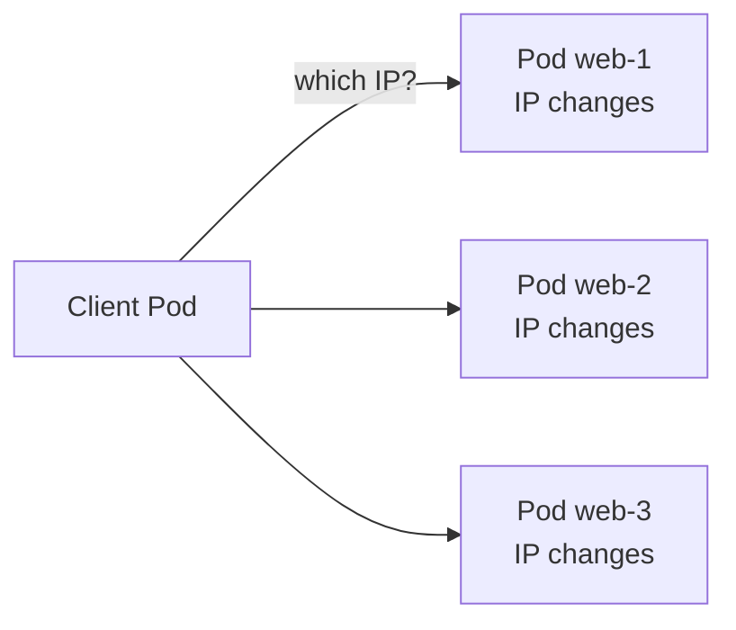

> [!info] Level: junior-middle | Time: about 5 h | You need: [[learn/kubernetes-pods-and-deployments|Kubernetes 02: Pods, labels and Deployments]] and [[learn/dns-resolution|Networking 03: DNS resolution end to end]] | Lab: Lab B, the kind cluster `lab` from [[learn/lab-setup|Start 01: Set up your lab]]

A Pod gets an IP address, but you cannot build anything on it. When a Pod is replaced, the new one gets a different address. A Deployment that rolls out three new replicas changes every address behind your application. Something has to stay still while the Pods move. In Kubernetes that something is a **Service**.

This lesson explains what a Service really is (a stable name and virtual IP, plus a list of ready Pods), how DNS finds it, and how traffic from outside the cluster reaches it through an Ingress or the Gateway API. It also teaches the three mistakes that cause most "my Service does not work" tickets: a label typo, confusing `port` with `targetPort`, and a Pod that is not ready.

## What you will learn

- Why Pod IPs cannot be used directly, and what a Service, its selector and its ports (`port`, `targetPort`, `nodePort`) do.
- How EndpointSlices connect a Service to ready Pods, and how to read one when traffic does not flow.
- The four Service types (`ClusterIP`, `NodePort`, `LoadBalancer`, `ExternalName`) and when each fits, including what `LoadBalancer` means on GKE.
- How cluster DNS names and search domains work, and how to reach a Service in another namespace.
- What Ingress and the Gateway API add on top of Services, and why new work should start with the Gateway API.
- How to debug a Service systematically, and how to use `kubectl port-forward` for development only.

## The problem: Pod IPs change

Start with a Deployment of three nginx Pods. Each Pod has its own IP address, and that address is only valid for the life of that Pod.



Three things make Pod IPs a poor foundation:

- **Pods are replaced, not repaired.** A rollout, a node drain, a crash or a scale-down ends a Pod, and the replacement has a new IP.
- **There are several of them.** A client would need to know all the addresses and pick one.
- **Not all of them can take traffic.** A Pod that is starting or failing its readiness probe should not receive requests (see [[learn/kubernetes-probes-resources-and-debugging|Kubernetes 05]]).

A Service solves all three. It gives a group of Pods one stable name and one stable virtual IP, and it only forwards to Pods that are ready.

## What a Service is

A Service is an API object with three parts that matter:

1. A **selector**: a set of labels. Every Pod in the Service's namespace whose labels match is a member.
2. One or more **ports**: what clients connect to, and where that traffic goes on the Pod.
3. A **type**, which decides how the Service is reachable (the next section).

Here is the Service you will use throughout this lesson, together with the Deployment it fronts. Save both in `web.yaml`.

```yaml title="web.yaml"
apiVersion: apps/v1
kind: Deployment
metadata:
  name: web
  labels:
    app: web
spec:
  replicas: 3
  selector:
    matchLabels:
      app: web
  template:
    metadata:
      labels:
        app: web
    spec:
      containers:
        - name: web
          # Example image: an nginx build that runs as a non-root user and
          # listens on 8080. Check the tag exists and pin the one you use.
          image: nginxinc/nginx-unprivileged:1.27-alpine
          ports:
            - name: http
              containerPort: 8080
          readinessProbe:
            httpGet:
              path: /
              port: http
            periodSeconds: 5
          resources:
            requests:
              cpu: 50m
              memory: 32Mi
            limits:
              memory: 64Mi
          securityContext:
            runAsNonRoot: true
            runAsUser: 101 # the user nginx-unprivileged runs as; change if you use another image
            allowPrivilegeEscalation: false
            capabilities:
              drop: ["ALL"]
            seccompProfile:
              type: RuntimeDefault
---
apiVersion: v1
kind: Service
metadata:
  name: web
spec:
  type: ClusterIP # the default; written out so the type is visible
  selector:
    app: web # must match the Pod labels above exactly
  ports:
    - name: http
      port: 80 # what clients connect to on the Service
      targetPort: http # the container port named "http" (8080) on the Pod
```

> [!note] Why the Service port is 80 and the container port is 8080
> The unprivileged nginx image listens on 8080 so that it does not need root. Clients still use the usual port 80 on the Service. This difference is exactly what `port` and `targetPort` exist for, and it is the cheapest way to see them apart.

The ports have three names that people confuse:

| Field           | Where it lives | Meaning                                                                                    |
| --------------- | -------------- | ------------------------------------------------------------------------------------------ |
| `port`          | Service        | The port on the Service's virtual IP. This is what clients use: `http://web:80`.           |
| `targetPort`    | Service        | The port on the Pod that traffic is sent to. A number, or the name of a `containerPort`.   |
| `nodePort`      | Service        | Only for types `NodePort` and `LoadBalancer`: a port opened on every node, in 30000-32767. |
| `containerPort` | Pod            | Documentation of the port the container listens on. It does not open or close anything.    |

If `targetPort` is left out it defaults to the value of `port`. If your container listens on 8080 and the Service says `port: 80` with no `targetPort`, traffic goes to Pod port 80, where nothing listens, and clients get "connection refused". Using a **named** `targetPort` (as above) removes the need to repeat the number.

> [!tip] Name your ports
> A named container port lets you change the number in the Deployment without touching the Service, and lets different Pod versions behind one Service listen on different numbers.

### The virtual IP is not on any machine

A `ClusterIP` is a virtual IP. In `iptables` and `nftables` mode (the kind default; verify for your cluster), no network interface owns it and no process listens on it, so you cannot `ping` it either: the rules that handle it only translate TCP and UDP connections to the Service's ports. If you ping a Service and get no reply, that is normal, not a fault. In IPVS mode the IP is bound to a dummy interface and may answer ping, which still tells you nothing about the backends.

What does the work is a component on every node, usually `kube-proxy`. It watches Services and EndpointSlices through the API server and programs the node's kernel so that a connection to the Service's IP and port is rewritten (destination NAT) to the address of one ready Pod. Which Pod is picked, and how, depends on the mode:

- **iptables mode** is the long-standing default on Linux. A chain of rules picks a backend; the choice is random per new connection. This is what a kind cluster uses by default.
- **IPVS mode** uses a kernel load-balancing table and offers more scheduling algorithms.
- **nftables mode** is the newer replacement for the iptables backend.
- Some network plugins replace `kube-proxy` entirely with their own data path. GKE Dataplane V2 is one such design.

> [!warning] Check before relying on this
> The available `kube-proxy` modes, which one is the default and the maturity of the nftables mode depend on your Kubernetes version and your network plugin. Read the "Virtual IPs and Service proxies" page for your version before you choose or change a mode. For day-to-day work the behaviour is the same: a stable IP and port, translated to a ready Pod.

Because the choice happens when a connection is opened, load is balanced per **connection**, not per request. A client that keeps one HTTP/2 or gRPC connection open sends all its requests to one Pod. If you see uneven load behind a Service, this is the usual reason. Balancing long-lived connections needs a layer 7 proxy, a service mesh or client-side balancing.

## EndpointSlices: the list behind the Service

The selector is not evaluated by `kube-proxy` directly. A controller in the control plane watches Pods and writes the matching ones into **EndpointSlice** objects, and the proxies read those. You can read them too, and they are the best first stop when a Service misbehaves.

```bash
kubectl get endpointslices -l kubernetes.io/service-name=web
```

```text
NAME        ADDRESSTYPE   PORTS   ENDPOINTS                         AGE
web-x7k2p   IPv4          8080    10.244.0.5,10.244.0.6,10.244.0.7  2m
```

_Illustrative. The slice name suffix and the Pod IPs differ on every cluster._

Each slice lists the Pod addresses, the port numbers (the resolved `targetPort`) and, per endpoint, **conditions**. The one that matters is `ready`: an endpoint is ready only when the Pod passes its readiness probe. To see the conditions, ask for YAML:

```bash
kubectl get endpointslices -l kubernetes.io/service-name=web -o yaml | grep -E 'ip|ready|nodeName' | head
```

An EndpointSlice with **no endpoints**, or only endpoints whose `ready` condition is `false`, means the Service has nobody to send traffic to. A Service in that state still has a ClusterIP and still resolves in DNS, but connections fail. The two causes are different:

| What you see in the slice               | Likely cause                                                                                     |
| --------------------------------------- | ------------------------------------------------------------------------------------------------ |
| No endpoints at all (`ENDPOINTS` unset) | The selector matches no Pods: a label typo, a wrong namespace, or the Deployment is scaled to 0. |
| Endpoints present, `ready: false`       | Pods match but fail their readiness probe, or are still starting.                                |

> [!note] The older Endpoints object
> Before EndpointSlices there was one `Endpoints` object per Service. You will still see `kubectl get endpoints web` in older guides. Kubernetes has marked the Endpoints API as deprecated in favour of EndpointSlices in recent releases (verify for your version), so prefer EndpointSlices in new habits and scripts.

## Service types

The `type` field decides who can reach the Service. Each type builds on the one before it.

| Type           | Reachable from                                   | How                                                                                                        |
| -------------- | ------------------------------------------------ | ---------------------------------------------------------------------------------------------------------- |
| `ClusterIP`    | Inside the cluster only                          | A virtual IP and a DNS name. The default, and what most Services should be.                                |
| `NodePort`     | Anything that can reach a node IP                | Opens the same port (default range 30000-32767) on every node and forwards it to the Service.              |
| `LoadBalancer` | The internet or a VPC, via a cloud load balancer | Asks the cloud provider for a load balancer that points at the nodes. Includes a NodePort and a ClusterIP. |
| `ExternalName` | Inside the cluster                               | A DNS alias (a CNAME) to an outside name such as `db.example.com`. No proxying, no selector.               |

**ClusterIP** is for traffic between workloads, such as a web tier calling an API. Most Services in a cluster are of this type, and the other types are about exposing it further.

**NodePort** exposes the Service on a high port of every node. It is useful in a lab and as a building block, but a poor public entry point: you must manage node firewall rules and node IPs, and the port range is awkward.

**LoadBalancer** is the standard way to put one Service on a network address. What it creates depends on where the cluster runs. On GKE, a `LoadBalancer` Service normally provisions a Google Cloud network load balancer with its own external IP, and an annotation switches it to an internal address inside your VPC. On a kind cluster nothing provisions the load balancer, so `EXTERNAL-IP` stays `<pending>` forever. That is expected.

> [!warning] Costs money
> Each `LoadBalancer` Service on GKE creates a billable load balancer and forwarding rule that exists until the Service is deleted. This is also why one `LoadBalancer` per application does not scale: you pay for, and manage, one per Service. Prefer one shared entry point (Ingress or Gateway) for HTTP workloads. Clean up with `kubectl delete service NAME` and check the load balancer is gone in the Google Cloud console or with `gcloud compute forwarding-rules list`. In this lesson you only use kind, so nothing is billed.

> [!warning] Check before relying on this
> The load balancer type that GKE creates, the annotation that makes it internal and how it handles source IPs (`externalTrafficPolicy`) depend on your GKE version and cluster mode. See the GKE page on LoadBalancer Services in the sources, and [[learn/gke-for-beginners|GCP 04]] for the managed cluster.

**ExternalName** has no selector and no proxy. It makes the Service name resolve to a CNAME. A common use is to give an external database a stable in-cluster name, so that you can later move it in-cluster without changing application config:

```yaml title="external-db.yaml"
apiVersion: v1
kind: Service
metadata:
  name: orders-db
spec:
  type: ExternalName
  externalName: db.example.com # change to the real host name
```

Be careful: because it is only DNS, TLS verification sees the external name rather than `orders-db`, and the target is not health-checked by Kubernetes.

### Headless Services

If you set `clusterIP: None`, the Service gets no virtual IP. DNS then returns the individual Pod addresses instead of one Service IP. This is how StatefulSets give each Pod a stable name and how clients that do their own load balancing find all backends. You will need it once you run databases on Kubernetes; for now, remember that it exists and that "no ClusterIP" is a deliberate choice, not an error.

## DNS: finding the Service by name

Nobody types a ClusterIP. Clusters run a DNS service (CoreDNS on most clusters, listed in the `kube-system` namespace) and configure every Pod to use it. For each Service it creates a record:

```text
<service>.<namespace>.svc.<cluster-domain>
```

The default cluster domain is `cluster.local`, so the Service `web` in namespace `default` is `web.default.svc.cluster.local`. That is the fully qualified domain name (FQDN). Look at what a Pod is configured with:

```bash
kubectl exec client -- cat /etc/resolv.conf
```

```text
search default.svc.cluster.local svc.cluster.local cluster.local
nameserver 10.96.0.10
options ndots:5
```

_Illustrative. The nameserver address is the ClusterIP of the cluster's DNS service and differs between clusters, and a real cluster may add extra search entries._

Two lines do the work:

- **`search`** lists suffixes that the resolver appends to a name it considers "short". The first one is the Pod's own namespace. This is why a Pod in `default` can call just `web`: the resolver tries `web.default.svc.cluster.local` first.
- **`ndots:5`** says that any name with fewer than five dots is tried with the search suffixes **before** being tried as given. `web.default` has one dot, so it gets the suffixes. `api.example.com` has two dots, so the resolver first tries `api.example.com.default.svc.cluster.local`, then the next suffixes, and only then the real name. Each failed attempt is an extra DNS query. A trailing dot (`api.example.com.`) marks a name as fully qualified and skips the search list.

This is the same resolver behaviour you met in [[learn/dns-resolution|Networking 03]]; the only new part is that Kubernetes writes the file for you.

So there are several valid names for the same Service, depending on where the caller is:

| Name                           | Works from                          | Why                                                            |
| ------------------------------ | ----------------------------------- | -------------------------------------------------------------- |
| `web`                          | The same namespace only             | The first search suffix is the caller's namespace.             |
| `web.team-a`                   | Any namespace (service in `team-a`) | `svc.cluster.local` is a search suffix.                        |
| `web.team-a.svc.cluster.local` | Anywhere in the cluster             | The FQDN. Use it in config that must not depend on the caller. |

> [!warning] Check before relying on this
> The search list and `ndots` value are the Kubernetes defaults. A workload can change them with `dnsConfig`, and a different cluster domain is possible. Always read `/etc/resolv.conf` in the Pod you are debugging instead of assuming it.

Environment variables are a second, older discovery mechanism: Pods started after a Service exists get `WEB_SERVICE_HOST` style variables. They only work for Services created before the Pod and they clutter the environment, so use DNS.

## From outside the cluster: Ingress and the Gateway API

A ClusterIP is not reachable from outside. A `LoadBalancer` Service is, but one per application is expensive and works at layer 4 only: it knows nothing about host names, URL paths or TLS certificates. For HTTP you want one shared entry point that routes by host and path. Kubernetes has two APIs for this.

### Ingress

An **Ingress** is an object that holds routing rules: "requests for host `web.example.com` and path `/` go to Service `web`, port 80". An Ingress does nothing by itself. A separate **Ingress controller** must be running in the cluster, watch Ingress objects and configure a real proxy or load balancer. An `IngressClass` object names a controller, and each Ingress picks one with `spec.ingressClassName`.

```yaml title="ingress.yaml"
apiVersion: networking.k8s.io/v1
kind: Ingress
metadata:
  name: web
spec:
  ingressClassName: nginx # change to a class that exists: kubectl get ingressclass
  tls:
    - hosts:
        - web.example.com # change to your host name
      secretName: web-example-com-tls # a TLS Secret in this namespace; you must create it
  rules:
    - host: web.example.com # change to your host name
      http:
        paths:
          - path: /
            pathType: Prefix # Exact, Prefix or ImplementationSpecific
            backend:
              service:
                name: web
                port:
                  number: 80
```

Without a running controller for the class, this object is accepted by the API server and then ignored. That is the commonest Ingress surprise: `kubectl get ingress` shows no address and nothing ever happens. Check `kubectl get ingressclass` and the controller's Pods first.

Ingress has limits. The API is small, so everything beyond host, path and TLS (rewrites, timeouts, header manipulation, rate limits) was added through controller-specific annotations that do not carry from one controller to another. It also mixes the concerns of whoever runs the cluster and whoever deploys an app into one object.

### The Gateway API

The **Gateway API** is the newer, more expressive successor. It splits the work across separate objects owned by different people:

| Object         | Owned by              | Role                                                                                                                      |
| -------------- | --------------------- | ------------------------------------------------------------------------------------------------------------------------- |
| `GatewayClass` | Platform provider     | Names an implementation (the Gateway API's counterpart of an `IngressClass`).                                             |
| `Gateway`      | Cluster operator      | A listener: a port, protocol and optionally TLS, backed by a real load balancer. Says which namespaces may attach routes. |
| `HTTPRoute`    | Application developer | Host, path, header and method matching, and which Services get the traffic (with weights).                                |

Features that were annotations on Ingress (traffic splitting, header matching, redirects, URL rewrites) are part of the typed `HTTPRoute` API, so they behave the same across implementations that support them. Cross-namespace attachment is explicit, which is safer when many teams share one Gateway.

```yaml title="gateway.yaml"
apiVersion: gateway.networking.k8s.io/v1
kind: Gateway
metadata:
  name: web-gateway
spec:
  gatewayClassName: CHANGE-ME # change to a name from: kubectl get gatewayclass
  listeners:
    - name: http
      protocol: HTTP
      port: 80
      allowedRoutes:
        namespaces:
          from: Same # only routes in this namespace may attach; widen on purpose
---
apiVersion: gateway.networking.k8s.io/v1
kind: HTTPRoute
metadata:
  name: web
spec:
  parentRefs:
    - name: web-gateway
  hostnames:
    - web.example.com # change to your host name
  rules:
    - matches:
        - path:
            type: PathPrefix
            value: /
      backendRefs:
        - name: web
          port: 80
```

The Gateway API CRDs are not built into Kubernetes. They are installed separately, and you also need a controller that implements them. Managed platforms often ship one: GKE has its own Gateway controller with Google-provided `GatewayClass` names.

> [!warning] Check before relying on this
> Two points were not confirmed for this page and change over time. First, the community `ingress-nginx` controller: its retirement was announced for 2026, so check its current status in the project's repository and the Kubernetes blog before you build anything new on it. Second, which Gateway API features are in the standard channel (stable) and which are experimental, and which GKE `GatewayClass` names exist, depend on the Gateway API release and your GKE version. The Ingress API itself remains in Kubernetes, but it is frozen, and the Kubernetes documentation points new work to the Gateway API.

**Default for new work:** use the Gateway API. Use Ingress when the platform already runs a supported controller and an existing app needs a small change, and plan to migrate. For the senior view of controlling which Pods may talk to your Service, see [[patterns/kubernetes-network-policies]].

### Choosing the entry point

| You need                                                    | Use                                          |
| ----------------------------------------------------------- | -------------------------------------------- |
| Pod-to-Pod calls inside the cluster                         | `ClusterIP` and DNS                          |
| A non-HTTP service (a database, a game server) from outside | `LoadBalancer`                               |
| Many HTTP apps on one address, host and path routing, TLS   | Gateway API (or Ingress on an older cluster) |
| A quick look at an app from your laptop while developing    | `kubectl port-forward`                       |
| A stable in-cluster alias for something outside             | `ExternalName`                               |

## `kubectl port-forward` for development

`kubectl port-forward` opens a tunnel from a port on your machine, through the API server, to a Pod (or a Pod chosen from a Service):

```bash
kubectl port-forward svc/web 8080:80
```

```text
Forwarding from 127.0.0.1:8080 -> 8080
Forwarding from [::1]:8080 -> 8080
```

It binds to `127.0.0.1` by default, so only your machine can use it. It needs only the access to Pods that `kubectl` already gives you, which is why it is perfect for a quick look. It is not a production path: all its connections go through one tunnel via the API server to a single Pod, so it does not balance and does not scale, it ends when your terminal does, it picks a single Pod when you give it a Service (it does not balance), and it bypasses any Ingress, authentication or policy in front of the app. Do not script it as a way for users to reach a service, and do not bind it to `0.0.0.0` on a shared machine.

## Debugging a Service: a fixed order

When "the Service does not work", go in this order. Each step removes a whole class of causes.

1. **Do the Pods run and are they ready?** `kubectl get pods -l app=web`. If `READY` is `0/1`, fix that first (see [[learn/kubernetes-probes-resources-and-debugging|Kubernetes 05]]).
2. **Does the Service select them?** Compare `kubectl get svc web -o jsonpath='{.spec.selector}'` with `kubectl get pods --show-labels`.
3. **Does it have endpoints?** `kubectl get endpointslices -l kubernetes.io/service-name=web`. None means a selector problem; `ready: false` means a readiness problem.
4. **Do the ports line up?** The Service's `targetPort` must be the port the container really listens on. Test the Pod directly (`kubectl port-forward pod/NAME 8081:8080`) to separate "the app is broken" from "the Service is mis-wired".
5. **Does the name resolve from a Pod in the same cluster?** `kubectl exec client -- curl -sS http://web`. A curl exit code of 6 means a DNS failure; 7 (connection refused) or 28 (timeout) means DNS worked and the connection failed.
6. **Is something blocking it?** A NetworkPolicy may deny the traffic. See [[patterns/kubernetes-network-policies]].
7. **Only then look at the Ingress, Gateway or load balancer** in front of the Service.

The same reasoning is used on a host in [[learn/load-balancers-firewalls-and-network-troubleshooting|Networking 05]]: test one hop at a time, from the inside out.

## Hands-on exercises

Do these in the kind cluster `lab`. Check `kubectl config current-context` prints `kind-lab` before you start.

> [!warning] Exercises are not verified
> The commands and outputs were written from the Kubernetes documentation and not run for this page (no `verified` date). Output is illustrative: names, IPs and ages differ on your cluster, and wording of messages differs between versions. Read the "If you see something else" lines first.

1. **Create the Deployment and Service, and read the EndpointSlice.** Save the manifest from earlier as `web.yaml`, then apply it.

   ```bash
   kubectl apply -f web.yaml
   kubectl rollout status deployment/web --timeout=90s
   kubectl get svc web
   kubectl get endpointslices -l kubernetes.io/service-name=web
   ```

   Expected: `deployment "web" successfully rolled out`, a Service of type `ClusterIP` with a `CLUSTER-IP` and `80/TCP`, and one EndpointSlice whose `ENDPOINTS` lists three addresses on port `8080` (illustrative):

   ```text
   NAME   TYPE        CLUSTER-IP     EXTERNAL-IP   PORT(S)   AGE
   web    ClusterIP   10.96.142.17   <none>        80/TCP    10s

   NAME        ADDRESSTYPE   PORTS   ENDPOINTS                         AGE
   web-x7k2p   IPv4          8080    10.244.0.5,10.244.0.6,10.244.0.7  10s
   ```

   If you see something else: if the rollout waits, run `kubectl get pods -l app=web` and `kubectl describe pod NAME`; an `ImagePullBackOff` means the image tag does not exist or the node cannot reach the registry, so pick a tag that exists. If there are fewer than three endpoints, the other Pods are not ready yet; wait and repeat. If the slice list is empty, check that the label `app: web` is the same in the Deployment template and the Service selector.

2. **Start a client Pod and reach the Service by name.** A long-running curl Pod is a reusable "inside the cluster" viewpoint.

   ```bash
   kubectl run client --image=curlimages/curl:8.10.1 --restart=Never --command -- sleep 3600
   kubectl wait --for=condition=Ready pod/client --timeout=60s
   kubectl exec client -- curl -sS http://web | head -n 5
   ```

   Expected: the first lines of the nginx welcome page:

   ```text
   <!DOCTYPE html>
   <html>
   <head>
   <title>Welcome to nginx!</title>
   <style>
   ```

   If you see something else: `curl: (6) Could not resolve host: web` means the Pod is not in the same namespace as the Service or cluster DNS is down (`kubectl -n kube-system get pods -l k8s-app=kube-dns`). `curl: (7) Failed to connect` means DNS worked but nothing answered: go to exercise 4. `curl: (28)` is a timeout; see exercise 4 as well. The image is an example; a production Pod would pin a tag you checked.

3. **Read the DNS configuration the Pod received.**

   ```bash
   kubectl exec client -- cat /etc/resolv.conf
   kubectl exec client -- curl -sS -o /dev/null -w '%{http_code}\n' http://web.default.svc.cluster.local
   ```

   Expected: a `search` line starting with `default.svc.cluster.local`, a `nameserver`, `options ndots:5`, and then `200` for the FQDN request (illustrative output as shown earlier).
   If you see something else: a `curl` that works with `web` but fails with the FQDN suggests a different cluster domain; read the `search` line to find it.

4. **Break the selector and read the symptom.** This is the label typo, the most common Service failure. The Pods are untouched; only the Service changes.

   ```bash
   kubectl patch service web --type merge -p '{"spec":{"selector":{"app":"wbe"}}}'
   kubectl get endpointslices -l kubernetes.io/service-name=web
   kubectl get svc web
   kubectl exec client -- sh -c 'curl -sS --max-time 3 http://web; echo "curl exit=$?"'
   ```

   Expected: the Service keeps its `CLUSTER-IP`, the EndpointSlice shows no addresses (`ENDPOINTS` is `<unset>` or empty), and curl fails after DNS succeeded, with `Failed to connect ... Couldn't connect to server` and `curl exit=7` or a timeout with `curl exit=28`:

   ```text
   NAME        ADDRESSTYPE   PORTS   ENDPOINTS   AGE
   web-x7k2p   IPv4          8080    <unset>     4m

   curl: (7) Failed to connect to web port 80 after 5 ms: Couldn't connect to server
   curl exit=7
   ```

   The key point is that the name **still resolves**. A Service whose selector matches nothing has a ClusterIP and a DNS record, so the failure is "connection refused" or a timeout, not "could not resolve host" (exit 6). Whether you get a refusal or a timeout depends on the proxy mode and network plugin.
   If you see something else: if curl still returns the nginx page, the patch did not apply (read `kubectl get svc web -o yaml`). If you get exit 6, you ran curl from a Pod in a different namespace (see exercise 6).

5. **Restore the selector and watch the endpoints return.**

   ```bash
   kubectl patch service web --type merge -p '{"spec":{"selector":{"app":"web"}}}'
   kubectl get endpointslices -l kubernetes.io/service-name=web
   kubectl exec client -- curl -sS -o /dev/null -w '%{http_code}\n' http://web
   ```

   Expected: the slice lists three addresses again and curl prints `200`.
   If you see something else: if it is still empty after a few seconds, compare `kubectl get svc web -o jsonpath='{.spec.selector}'` with `kubectl get pods --show-labels` character by character.

6. **Reach the Service from another namespace.**

   ```bash
   kubectl create namespace other
   kubectl -n other run client --image=curlimages/curl:8.10.1 --restart=Never --command -- sleep 3600
   kubectl -n other wait --for=condition=Ready pod/client --timeout=60s
   kubectl -n other exec client -- sh -c 'curl -sS --max-time 3 http://web; echo "exit=$?"'
   kubectl -n other exec client -- curl -sS -o /dev/null -w '%{http_code}\n' http://web.default.svc.cluster.local
   ```

   Expected: the short name `web` fails with `Could not resolve host: web` and `exit=6`, because `web` is searched in namespace `other` where no such Service exists. The FQDN works and prints `200`.
   If you see something else: if the short name works, a Service named `web` also exists in `other`; list with `kubectl get svc -A | grep web`.

7. **Use `port-forward` and then close it.**

   ```bash
   kubectl port-forward svc/web 8080:80 > /dev/null &
   PF_PID=$!
   sleep 2
   curl -s http://127.0.0.1:8080 | head -n 4
   kill "$PF_PID"
   ```

   Expected: the first four lines of the nginx page (`<!DOCTYPE html>`, `<html>`, `<head>`, `<title>Welcome to nginx!</title>`).
   If you see something else: `unable to listen on any of the requested ports` means port 8080 is already used on your machine; pick another local port such as `18080:80`. An empty reply means the tunnel was not ready; wait a second longer.

8. **Optional: route with the Gateway API on kind.** This needs a Gateway API implementation in the cluster and takes the longest, so treat it as a stretch goal. Pick one implementation that documents a kind quick start, install the Gateway API CRDs and the controller as its documentation describes, and then apply the `gateway.yaml` from earlier with `gatewayClassName` set to a name from `kubectl get gatewayclass`.

   ```bash
   kubectl get gatewayclass
   kubectl apply -f gateway.yaml
   kubectl get gateway web-gateway
   kubectl get httproute web
   ```

   Expected: the Gateway shows `PROGRAMMED` as `True` once the controller has set it up. On kind there is no cloud load balancer, so it may have no external address; reach it by running `kubectl port-forward` against the Service the controller created for the Gateway, then call it with `curl -H 'Host: web.example.com' http://127.0.0.1:8080/`.
   If you see something else: `no matches for kind "Gateway"` means the CRDs are not installed. A Gateway stuck without `PROGRAMMED` points to a wrong `gatewayClassName` or a controller that is not running; read `kubectl describe gateway web-gateway` conditions. Which implementation to use and its install steps were not verified here: follow its own documentation for your version.

9. **Clean up.**

   ```bash
   kubectl delete -f web.yaml --ignore-not-found
   kubectl delete pod client --ignore-not-found
   kubectl delete namespace other --ignore-not-found
   ```

   Expected: the Deployment, Service and Pods are removed, and the `other` namespace and everything in it with it.
   If you see something else: a namespace stuck in `Terminating` usually has a resource with a finalizer that is waiting on something; list what remains with `kubectl get all -n other`.

## Common mistakes

- **A label typo in the selector.** The Service is created without error and has no endpoints. Why it bites: nothing in the API validates that a selector matches anything, so you find out when traffic fails. Fix: check the EndpointSlice right after you create or edit a Service, and keep labels in one place (a Helm chart helper, see [[patterns/helm-chart-conventions]]).
- **Confusing `port` and `targetPort`.** The client uses `port`; the container must listen on `targetPort`. Why it bites: `targetPort` defaults to `port`, so a container on 8080 behind `port: 80` fails silently. Fix: use a named container port and a named `targetPort`.
- **A Pod that is not ready.** The selector matches, but the endpoint has `ready: false` and receives no traffic. Why it bites: the Pod shows `Running`, so it looks healthy. Fix: read the `READY` column and the readiness probe events.
- **Expecting `ping` to work on a Service IP.** The virtual IP only handles the Service's TCP and UDP ports. Fix: test with `curl` or `nc -vz web 80`, not `ping`.
- **Using `NodePort` or a `LoadBalancer` per app as the default.** Why it bites: it spreads firewall rules and, on GKE, creates a billed load balancer for each Service. Fix: one shared Gateway or Ingress for HTTP, and `ClusterIP` for everything internal.
- **Treating `port-forward` as access for users.** Why it bites: it is a single tunnel with no authentication of its own beyond your `kubectl` login, and it disappears when your terminal closes. Fix: expose the service through a proper entry point and use port-forward for your own debugging.
- **Building new routing on an Ingress controller without checking its status.** Why it bites: controller-specific annotations lock you in, and a retired controller stops receiving fixes. Fix: start new work on the Gateway API and check the support status of whichever implementation you pick.
- **Forgetting the namespace in a cross-namespace call.** `web` means "in my namespace". Fix: use `web.<namespace>` or the FQDN in configuration.

## Check your understanding

1. A Service exists, `kubectl get svc` shows a ClusterIP, and the name resolves, but every request fails. The EndpointSlice has no endpoints. What does that tell you, and what do you check?
2. What is the difference between `port` and `targetPort`, and which one does a client use?
3. When would you use a `LoadBalancer` Service, and when an Ingress or Gateway?
4. A Pod in namespace `team-a` needs the Service `db` in namespace `data`. Write two names that work, and say why plain `db` does not.
5. Why can a Service balance requests unevenly across Pods even though it is "load balancing"?
6. A Deployment has three Pods that all show `Running` with `READY 0/1`. The Service has endpoints in its slice. What state are they in, and do they receive traffic?

> [!question]- Answers
>
> 1. No Pod matches the selector in that namespace. Compare the Service selector with the Pod labels (`kubectl get pods --show-labels`), check that the Pods are in the same namespace as the Service, and that the Deployment is not scaled to zero. A label typo is the usual cause.
> 2. `port` is the port on the Service's virtual IP and is what clients connect to. `targetPort` is the port on the Pod that traffic is forwarded to, and the container must listen on it. They are often the same number, but they do not have to be.
> 3. Use `LoadBalancer` for a non-HTTP service that needs its own address, or a single service you want directly on a network address. Use an Ingress or Gateway for HTTP(S) workloads when you want one shared address with routing by host and path, TLS in one place, and no billed load balancer per application. On GKE each `LoadBalancer` Service creates a billable load balancer.
> 4. `db.data` and `db.data.svc.cluster.local` (the second is the FQDN). Plain `db` is completed with the caller's own namespace first (`db.team-a.svc.cluster.local`), where no such Service exists, so the lookup fails.
> 5. The choice of backend is made per connection, not per request. One client with a long-lived connection (HTTP/2, gRPC, a connection pool) sends all its requests to one Pod. Fixes are a layer 7 proxy or mesh, or client-side balancing.
> 6. They are running but not ready: they fail their readiness probe. Their endpoints have `ready: false`, so the Service does not send them traffic. Read the readiness probe configuration and the events from `kubectl describe pod`.

## Next steps

Next lesson: [[learn/kubernetes-config-secrets-and-namespaces|Kubernetes 04: ConfigMaps, Secrets and Namespaces]]. Previous lesson: [[learn/kubernetes-pods-and-deployments|Kubernetes 02: Pods, labels and Deployments]].

To go deeper:

- [[patterns/kubernetes-network-policies]] controls which Pods may reach your Service, which a Service alone never does.
- [[patterns/zero-downtime-deployments-kubernetes]] shows how readiness, endpoints and shutdown fit together during a rollout.
- [[learn/dns-resolution|Networking 03]] for the resolver rules behind `search` and `ndots`, and [[learn/load-balancers-firewalls-and-network-troubleshooting|Networking 05]] for load balancers.
- [[learn/gke-for-beginners|GCP 04: GKE for beginners]] for what a managed cluster adds around Services.
- The whole path is mapped in [[learn/index|the learning path]].

## Sources

- Kubernetes documentation, "Service" (https://kubernetes.io/docs/concepts/services-networking/service/) and "Virtual IPs and Service proxies" (https://kubernetes.io/docs/reference/networking/virtual-ips/).
- Kubernetes documentation, "EndpointSlices" (https://kubernetes.io/docs/concepts/services-networking/endpoint-slices/).
- Kubernetes documentation, "DNS for Services and Pods" (https://kubernetes.io/docs/concepts/services-networking/dns-pod-service/).
- Kubernetes documentation, "Ingress" and "Ingress Controllers" (https://kubernetes.io/docs/concepts/services-networking/ingress/), and "Gateway API" (https://kubernetes.io/docs/concepts/services-networking/gateway/).
- Gateway API project documentation (https://gateway-api.sigs.k8s.io/), including the list of implementations.
- Kubernetes documentation, "Use Port Forwarding to Access Applications in a Cluster" (https://kubernetes.io/docs/tasks/access-application-cluster/port-forward-access-application-cluster/).
- Google Cloud documentation, "LoadBalancer Service concepts" for GKE (https://cloud.google.com/kubernetes-engine/docs/concepts/service-load-balancer).
- Not checked against a running cluster for this page. The `ingress-nginx` retirement status, `kube-proxy` mode defaults, the Endpoints deprecation, the GKE load balancer details and the Docker Hub image tags (`nginxinc/nginx-unprivileged`, `curlimages/curl`) are not verified.
