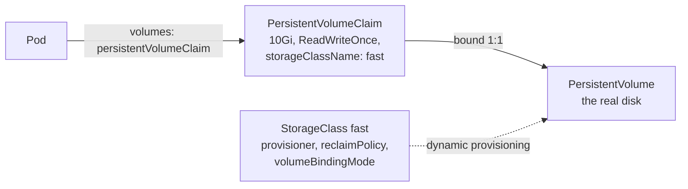

> [!info] Level: middle | Time: about 4 h | You need: [[learn/kubernetes-probes-resources-and-debugging|Kubernetes 05: Probes, resources and a pod debugging playbook]] | Lab: the kind cluster `lab` from [[learn/kubernetes-architecture-and-kind|Kubernetes 01]] (its built-in local-path StorageClass), plus one optional GKE step that costs money

A container's filesystem is thrown away with the container. That is a feature for stateless web servers and a disaster for a database. Kubernetes separates **what a Pod asks for** (a PersistentVolumeClaim: "10 GiB, one writer") from **how the storage is made** (a StorageClass and its provisioner) and from **the disk itself** (a PersistentVolume). Once you see those three objects and the binding between them, Pending claims, disks stuck in the wrong zone and "volume is already used by another pod" stop being mysteries.

[[learn/container-storage-networking-and-compose|Containers 04]] showed the same problem with Docker volumes on one host. This lesson moves it to a cluster, where the disk and the Pod can be on different machines, and the scheduler has to bring them together.

> [!note] Nothing here was run for this page
> The manifests, commands and sample output follow the Kubernetes documentation and the kind and local-path-provisioner sources, and are not verified on a running cluster. Output is illustrative. Feature states are given as "stable since 1.xx"; check yours with `kubectl version`. GKE specifics not checked against the GKE documentation are marked.

## What you will learn

- The difference between ephemeral volumes (`emptyDir`, ConfigMap and Secret volumes) and persistent ones, and what survives what.
- How a PersistentVolumeClaim binds to a PersistentVolume, how a StorageClass provisions one on demand, and what `WaitForFirstConsumer` changes.
- Access modes (RWO, ROX, RWX, RWOP), reclaim policies (`Delete`, `Retain`) and volume expansion, and which of them your provisioner actually supports.
- How a StatefulSet gives each replica a stable name and its own volume, and what happens to those volumes when you scale down or delete the set.
- How to debug a `Pending` PVC, a Pod stuck on an unbound claim, and a `FailedAttachVolume` error.

## Ephemeral volumes: storage that dies with the Pod

A `volume` in a Pod spec is a directory the containers can mount. Several volume types live only as long as the Pod:

| Volume type             | What it holds                                         | Survives a container restart | Survives the Pod being deleted |
| ----------------------- | ----------------------------------------------------- | ---------------------------- | ------------------------------ |
| `emptyDir`              | An empty scratch directory, shared by the containers. | Yes                          | No                             |
| `configMap`, `secret`   | Keys from a ConfigMap or Secret, as files.            | Yes                          | Not applicable (re-rendered)   |
| `projected`             | Several sources (ConfigMap, Secret, tokens) together. | Yes                          | Not applicable (re-rendered)   |
| `persistentVolumeClaim` | A real disk or share, through a claim.                | Yes                          | **Yes**                        |

`emptyDir` is created when the Pod is assigned to a node and is deleted permanently when the Pod leaves that node, for any reason. A container crash does not remove the Pod, so data in an `emptyDir` survives a container restart; a rescheduled Pod starts empty. `emptyDir.medium: Memory` gives a tmpfs (it counts against the container's memory), and `sizeLimit` caps the default medium.

```yaml
volumes:
  - name: scratch
    emptyDir:
      sizeLimit: 500Mi # the kubelet evicts the Pod if it writes more
```

Use `emptyDir` for caches, unpacked archives and files shared between a main container and a sidecar. Anything you cannot lose needs a claim.

## The three objects: PV, PVC and StorageClass



- A **PersistentVolume (PV)** is a cluster-wide object that represents one real piece of storage: a cloud disk, an NFS export, a directory on a node. It has a capacity, access modes, a reclaim policy and, for zonal or node-local storage, a `nodeAffinity` that says where it can be attached.
- A **PersistentVolumeClaim (PVC)** is a namespaced request: "I need this much, with this access mode, from this class". A Pod mounts the claim, never the PV directly.
- A **StorageClass** names a **provisioner** (a CSI driver such as `pd.csi.storage.gke.io`, or `rancher.io/local-path` on kind) plus parameters. When a claim names a class and no matching PV exists, the provisioner creates a disk and a PV for it. That is **dynamic provisioning**, and it is how almost every cluster works today.

Binding is one to one: a PV is bound to exactly one claim, and the claim's `spec.volumeName` and the PV's `spec.claimRef` point at each other. Look at the pairs with:

```bash
kubectl get pvc -A
kubectl get pv
```

```text
NAMESPACE   NAME       STATUS   VOLUME                                     CAPACITY   ACCESS MODES   STORAGECLASS   AGE
default     k9-data    Bound    pvc-3f6c1a2e-8d7b-4e7a-9a51-2c0b7e1d9f10   1Gi        RWO            standard       2m
```

The output is illustrative. The PV name `pvc-<uid>` is generated by the provisioner from the claim's UID.

### The default StorageClass and `storageClassName`

One class can be marked default with the annotation `storageclass.kubernetes.io/is-default-class: "true"`. What a claim gets depends on the field:

| In the PVC                            | Result                                                                                                                   |
| ------------------------------------- | ------------------------------------------------------------------------------------------------------------------------ |
| `storageClassName` not set            | The default class is filled in (by the DefaultStorageClass admission plugin, or retroactively once a default exists).    |
| `storageClassName: fast`              | Class `fast` is used. If it does not exist, the claim stays `Pending`.                                                   |
| `storageClassName: ""` (empty string) | **No class**: only a pre-created PV with no class can bind. Dynamic provisioning is off. Used for static, hand-made PVs. |

The empty string and the missing field are different things, and mixing them up is a common reason for a claim that never binds. Retroactive default assignment (a claim with no class gets the default when one appears later) is stable since 1.28.

### `volumeBindingMode`: when the disk is created

A StorageClass decides **when** to provision:

- `Immediate` (the default when the field is unset): the disk is created as soon as the claim exists. For zonal storage, the provisioner picks a zone without knowing where the Pod will run, and the Pod can end up unschedulable because its disk is in another zone.
- `WaitForFirstConsumer`: provisioning waits until a Pod that uses the claim is scheduled, and honours that Pod's constraints (resources, `nodeSelector`, affinity, taints and tolerations). The disk is created where the Pod is going.

Prefer `WaitForFirstConsumer` for any topology-constrained storage: zonal cloud disks and node-local volumes. With it, a new claim sits in `Pending` with an event like `waiting for first consumer to be created before binding` until a Pod uses it. That is normal, not a fault.

## Access modes

| Mode               | Short | Meaning                                                                      |
| ------------------ | ----- | ---------------------------------------------------------------------------- |
| `ReadWriteOnce`    | RWO   | Read-write by **one node**. Several Pods on that same node can still use it. |
| `ReadOnlyMany`     | ROX   | Read-only by many nodes.                                                     |
| `ReadWriteMany`    | RWX   | Read-write by many nodes. Needs a shared filesystem (NFS-like), not a disk.  |
| `ReadWriteOncePod` | RWOP  | Read-write by **exactly one Pod** in the whole cluster. CSI volumes only.    |

Three points catch people:

1. **RWO is per node, not per Pod.** Two replicas on the same node can both mount an RWO volume, and both write. If that corrupts your data, you want RWOP (stable since 1.29, CSI drivers only, and the driver's sidecars must be recent enough; see the Persistent Volumes page).
2. **A block disk is RWO.** A cloud persistent disk attaches to one VM at a time for writing. If you need many writers on many nodes, you need a file service, and the cost and performance trade-offs are different.
3. **Access modes describe capability, they do not enforce read-only.** The Kubernetes docs say so explicitly: mount the volume `readOnly: true` in the Pod if you mean read-only.

## Reclaim policy: what happens when the claim is deleted

| `reclaimPolicy` | When the PVC is deleted                                                                                                         |
| --------------- | ------------------------------------------------------------------------------------------------------------------------------- |
| `Delete`        | The PV object **and the real disk** are deleted. Default for dynamically provisioned volumes (they inherit the class's policy). |
| `Retain`        | The PV moves to `Released`. The disk and its data stay. Nothing else can bind it until an administrator cleans it up by hand.   |
| `Recycle`       | Deprecated. Do not use.                                                                                                         |

> [!warning] `Delete` is the default
> Deleting a claim from a class with `reclaimPolicy: Delete` deletes the disk and its data. That includes `kubectl delete namespace`, which deletes every claim in it. For data you cannot lose, use a class with `Retain`, or change an existing PV's policy with `kubectl patch pv <name> -p '{"spec":{"persistentVolumeReclaimPolicy":"Retain"}}'` before risky work, and keep tested backups (see below).

A `Released` PV keeps a `claimRef` to the deleted claim, which is why a new claim does not bind to it. To reuse the data you delete the PV object (the disk stays, because the policy is `Retain`) and create a new static PV that points at the same disk, or you clear the `claimRef`. To throw the data away you delete the disk in the storage system yourself.

Two finalizers protect storage in use: `kubernetes.io/pvc-protection` keeps a claim from disappearing while a Pod uses it, and `kubernetes.io/pv-protection` does the same for a bound PV. That is why `kubectl delete pvc` can hang in `Terminating`; the fix is to find the Pod, not to strip the finalizer. The on-call version is [[runbooks/pvc-stuck-terminating]].

## Expanding a volume

Volume expansion is stable since 1.24. It works only when:

- the claim's StorageClass has `allowVolumeExpansion: true`, and
- the CSI driver supports expansion, and
- the filesystem is one Kubernetes can grow (the docs name XFS, Ext3 and Ext4).

You edit the claim's `spec.resources.requests.storage` upwards. Kubernetes never creates a new PV; it resizes the existing volume, then the filesystem is grown when a Pod uses the claim (online, if the driver and filesystem support it). Shrinking is not offered. Do not edit the PV's capacity by hand: the docs warn that it can stop the automatic resize.

```bash
PVC=k9-data
kubectl patch pvc "$PVC" -p '{"spec":{"resources":{"requests":{"storage":"2Gi"}}}}'
kubectl get pvc "$PVC" -o jsonpath='{.status.capacity.storage}{"\n"}'
kubectl describe pvc "$PVC" | sed -n '/Conditions/,$p'
```

On a class without `allowVolumeExpansion` the API server rejects the patch with a `forbidden` error that says the class must support resize (wording differs between versions). The default kind class is such a class (see the exercises).

## StatefulSets: stable identity plus a volume per replica

A Deployment treats Pods as interchangeable: random names, any order, and one shared claim if you mount one (which an RWO disk cannot serve across nodes). Databases, queues and consensus systems need the opposite. A **StatefulSet** gives each replica:

- a **stable name**: `<set>-0`, `<set>-1`, ... `<set>-N-1`, kept across rescheduling;
- a **stable DNS name**: `<pod>.<service>.<namespace>.svc.cluster.local`, through a **headless Service** (`clusterIP: None`) named in `spec.serviceName`, which you must create yourself;
- **its own claim** from `volumeClaimTemplates`, named `<template>-<set>-<ordinal>` (for template `data` and set `db`: `data-db-0`, `data-db-1`), which is re-attached to the replacement Pod with the same ordinal;
- **ordered operations** by default (`podManagementPolicy: OrderedReady`): Pods are created 0, 1, 2 with each one Running and Ready before the next, and removed in reverse order.

```yaml title="statefulset-sketch.yaml"
apiVersion: v1
kind: Service
metadata:
  name: db
spec:
  clusterIP: None # headless: DNS returns one record per Pod
  selector:
    app: db
  ports:
    - name: tcp
      port: 5432
---
apiVersion: apps/v1
kind: StatefulSet
metadata:
  name: db
spec:
  serviceName: db
  replicas: 3
  selector:
    matchLabels:
      app: db
  persistentVolumeClaimRetentionPolicy: # stable since 1.32; both default to Retain
    whenDeleted: Retain
    whenScaled: Retain
  template:
    metadata:
      labels:
        app: db
    spec:
      containers:
        - name: db
          image: registry.example.com/db:pinned-tag # illustrative only
          volumeMounts:
            - name: data
              mountPath: /var/lib/db
  volumeClaimTemplates:
    - metadata:
        name: data
      spec:
        accessModes: ["ReadWriteOnce"]
        resources:
          requests:
            storage: 10Gi
```

What the StatefulSet does **not** do, from the documentation's own limitations list:

- **Volumes are kept** when you scale down or delete the set, unless `persistentVolumeClaimRetentionPolicy` says `Delete`. That is deliberate: data safety beats tidiness. The policy covers only scale-down and deletion of the set; a Pod replaced after a node failure always gets its old claim back.
- **No ordering on deletion.** Deleting the StatefulSet object does not promise to stop Pods in order. Scale to 0 first if order matters.
- **A broken rolling update can stall.** With `OrderedReady` and the default `RollingUpdate` strategy (highest ordinal first, one at a time, waiting for Ready), a bad template can leave a Pod that never becomes Ready, and the docs describe a manual repair ("forced rollback"). `rollingUpdate.partition` lets you stage an update on the highest ordinals first.
- **Changing `volumeClaimTemplates` of an existing set** is not documented as supported. Resize existing claims one by one instead (if the class allows it). The longer discussion is in [[patterns/stateful-workloads-gke]].

A StatefulSet is plumbing, not a database operator: it does not replicate data, elect a leader or take backups. For production databases on GKE, read [[patterns/stateful-workloads-gke]] before choosing it over a managed service.

## Snapshots and backups

A **VolumeSnapshot** asks the CSI driver for a point-in-time copy of a claim. It is three objects (`VolumeSnapshot`, `VolumeSnapshotContent`, `VolumeSnapshotClass`) that are **CRDs, not core Kubernetes**: the snapshot controller and CRDs are installed by your distribution, and only CSI drivers support them. `deletionPolicy` on the class (`Delete` or `Retain`) decides whether the real snapshot goes away with the object. You restore by creating a new claim with `spec.dataSource` pointing at the snapshot.

The default kind setup installs no snapshot CRDs, so this part is concept only in the lab. And a snapshot is not a backup until you have restored from it: the site's rule is [[adr/0051-backups-proven-by-quarterly-restore-drills|ADR 0051]], the design is in [[architecture/backup-architecture-gke-cloud-sql-gcs]], and the tool choice in [[tools/velero-vs-backup-for-gke]].

## Storage on GKE

On GKE, persistent disks are provisioned by the Compute Engine Persistent Disk CSI driver, provisioner name `pd.csi.storage.gke.io`. The driver's own README documents a `type` parameter for the disk type, `replication-type` (`none` or `regional-pd`), the topology key `topology.gke.io/zone`, and an example class with `volumeBindingMode: WaitForFirstConsumer`; it also says that on GKE the driver is managed for you and should not be deployed by hand.

> [!warning] GKE details not verified
> Not checked against the GKE documentation for this page; verify there. The names of the StorageClasses GKE creates, which one is the default, the default disk type, disk size limits, attach limits per node and prices are **not stated here** on purpose. Run `kubectl get storageclass` on your cluster and read the GKE "Persistent volumes and dynamic provisioning" page for your version.

What matters for design does not depend on those names: a zonal persistent disk lives in one zone, so a Pod that uses it can only run in that zone. If the zone fails, the Pod cannot move until the zone is back, unless you use a regional disk (replicated across two zones) or replicate at the application level. That is the trade-off [[patterns/stateful-workloads-gke]] works through.

## Debugging storage

Read the claim first, then the Pod, then the node. Kubernetes almost always tells you the answer in events.

```bash
NS=default
kubectl -n "$NS" get pvc
kubectl -n "$NS" describe pvc NAME        # Events at the bottom
kubectl -n "$NS" describe pod NAME        # FailedScheduling, FailedAttachVolume, FailedMount
kubectl get pv NAME -o yaml               # nodeAffinity, claimRef, reclaim policy
kubectl get storageclass
kubectl get events -n "$NS" --sort-by=.lastTimestamp | tail -20
```

| Symptom                                                                                              | What it means                                                                                                         | Fix                                                                                                                                           |
| ---------------------------------------------------------------------------------------------------- | --------------------------------------------------------------------------------------------------------------------- | --------------------------------------------------------------------------------------------------------------------------------------------- |
| PVC `Pending`, event `waiting for first consumer to be created before binding`                       | `WaitForFirstConsumer` class and no Pod uses the claim yet.                                                           | Nothing; create the Pod.                                                                                                                      |
| PVC `Pending`, event `ProvisioningFailed` with `storageclass ... not found`                          | `storageClassName` names a class that does not exist (often a typo).                                                  | Recreate the claim with a real class name (`storageClassName` cannot be changed on a bound claim; on a Pending one, recreate).                |
| PVC `Pending`, `no persistent volumes available for this claim and no storage class is set`          | `storageClassName: ""` and no static PV matches.                                                                      | Set a class, or create the static PV.                                                                                                         |
| PVC `Pending`, `ProvisioningFailed` with a driver error                                              | The provisioner tried and failed: quota, invalid parameters, permissions.                                             | Read the message; check the driver's logs in its namespace.                                                                                   |
| Pod `Pending`, `pod has unbound immediate PersistentVolumeClaims`                                    | An `Immediate` claim is not bound yet.                                                                                | Fix the claim first (rows above).                                                                                                             |
| Pod `Pending`, `node(s) didn't match PersistentVolume's node affinity`                               | The PV can only attach in a zone or node where the Pod may not run (other constraints, taints, or no capacity there). | Free capacity in that zone, relax the Pod's constraints, or use `WaitForFirstConsumer` for new claims.                                        |
| Pod `ContainerCreating`, event `FailedAttachVolume` ("Waiting for detach", "already used by pod(s)") | An RWO disk is still attached to another node, usually from a Pod that has not finished terminating.                  | Wait for the old Pod and the detach to finish; if the old node is dead, follow [[runbooks/gke-node-notready-triage]] before forcing anything. |
| Pod `ContainerCreating`, event `FailedMount`                                                         | Attach worked but mounting failed: filesystem, permissions, a missing Secret for the driver.                          | Read the message; check `fsGroup` and the driver.                                                                                             |

> [!note] Event wording
> The strings above come from current Kubernetes source and change between versions. The widely quoted "Multi-Attach error for volume ..." text in older blog posts is one such case: current versions report the same situation as `FailedAttachVolume`. Search for the **reason** (`ProvisioningFailed`, `FailedBinding`, `FailedAttachVolume`, `FailedMount`) and read the message, rather than grepping for exact text.

## Hands-on exercises

Do these in the kind cluster `lab`. Names start with `k9-`. Check that `kubectl config current-context` prints `kind-lab` first.

> [!warning] Exercises are not verified
> The commands and outputs were written from the Kubernetes documentation and the kind sources and were not run for this page. Output is illustrative. Image tags are examples; pin the ones you use. Read the "If you see something else" lines first.

1. **Read the default StorageClass.**

   ```bash
   kubectl get storageclass
   kubectl get storageclass standard -o yaml | grep -E 'is-default-class|provisioner|reclaimPolicy|volumeBindingMode|allowVolumeExpansion'
   ```

   Expected (illustrative): one class `standard (default)` with provisioner `rancher.io/local-path`, `reclaimPolicy: Delete`, `volumeBindingMode: WaitForFirstConsumer`, and **no** `allowVolumeExpansion` line:

   ```text
   NAME                 PROVISIONER             RECLAIMPOLICY   VOLUMEBINDINGMODE      ALLOWVOLUMEEXPANSION   AGE
   standard (default)   rancher.io/local-path   Delete          WaitForFirstConsumer   false                  3d
   ```

   If you see something else: another provisioner or class name means your kind version ships something different; use the name it shows in every exercise below. If there is no default class, the claims below must set `storageClassName` explicitly.

2. **Data that survives the Pod.** A claim in one file, and a Pod that writes to it in another, so you can see the claim on its own first.

   ```yaml title="k9-data-pvc.yaml"
   apiVersion: v1
   kind: PersistentVolumeClaim
   metadata:
     name: k9-data
   spec:
     accessModes: ["ReadWriteOnce"]
     resources:
       requests:
         storage: 1Gi
   ```

   ```yaml title="k9-writer.yaml"
   apiVersion: v1
   kind: Pod
   metadata:
     name: k9-writer
   spec:
     containers:
       - name: app
         image: busybox:1.36 # example tag; pin the one you use
         command: ["sh", "-c", "date >> /data/log; sleep 3600"]
         volumeMounts:
           - name: data
             mountPath: /data
         securityContext:
           allowPrivilegeEscalation: false
           capabilities:
             drop: ["ALL"]
     volumes:
       - name: data
         persistentVolumeClaim:
           claimName: k9-data
   ```

   ```bash
   kubectl apply -f k9-data-pvc.yaml
   kubectl get pvc k9-data
   kubectl describe pvc k9-data | sed -n '/Events/,$p'
   kubectl apply -f k9-writer.yaml
   kubectl wait --for=condition=Ready pod/k9-writer --timeout=120s
   kubectl get pvc k9-data
   kubectl get pod k9-writer -o wide
   ```

   Expected: before the Pod exists the claim is `Pending` and its events show "waiting for first consumer to be created before binding"; after the Pod starts it is `Bound`. Now delete the Pod, create it again and read the file:

   ```bash
   kubectl delete pod k9-writer
   kubectl apply -f k9-writer.yaml
   kubectl wait --for=condition=Ready pod/k9-writer --timeout=120s
   kubectl exec k9-writer -- cat /data/log
   kubectl get pod k9-writer -o wide
   kubectl get pv "$(kubectl get pvc k9-data -o jsonpath='{.spec.volumeName}')" -o jsonpath='{.spec.nodeAffinity}{"\n"}'
   ```

   Expected: two date lines, one per Pod start. The Pod runs on the **same node** as before, and the PV shows a `nodeAffinity` for that node: a local-path volume is a directory on one node, so the scheduler must bring the Pod back to it.
   If you see something else: one line only means the volume is not mounted where the command writes (check `mountPath`). If the claim stays `Pending` after the Pod exists, run `kubectl -n local-path-storage get pods` and check the provisioner is running.

3. **A Pending claim from a typo.**

   ```bash
   kubectl create -f - <<'EOF'
   apiVersion: v1
   kind: PersistentVolumeClaim
   metadata:
     name: k9-typo
   spec:
     storageClassName: standrd
     accessModes: ["ReadWriteOnce"]
     resources:
       requests:
         storage: 1Gi
   EOF
   sleep 5
   kubectl get pvc k9-typo
   kubectl describe pvc k9-typo | sed -n '/Events/,$p'
   ```

   Expected: `STATUS Pending` and a warning event naming the missing class, for example:

   ```text
   Warning  ProvisioningFailed  3s (x2 over 5s)  persistentvolume-controller  storageclass.storage.k8s.io "standrd" not found
   ```

   If you see something else: the reason or wording can differ by version; the class name in the message is the clue. Fix it by deleting the claim and creating it with `standard` (the class of an existing claim is not edited in place).

4. **A StatefulSet with a volume per replica.**

   ```yaml title="k9-sts.yaml"
   apiVersion: v1
   kind: Service
   metadata:
     name: k9-db
   spec:
     clusterIP: None
     selector:
       app: k9-db
     ports:
       - name: tcp
         port: 8080
   ---
   apiVersion: apps/v1
   kind: StatefulSet
   metadata:
     name: k9-db
   spec:
     serviceName: k9-db
     replicas: 3
     selector:
       matchLabels:
         app: k9-db
     template:
       metadata:
         labels:
           app: k9-db
       spec:
         containers:
           - name: app
             image: busybox:1.36 # example tag; pin the one you use
             command: ["sh", "-c", "test -f /data/born || date > /data/born; sleep 3600"]
             volumeMounts:
               - name: data
                 mountPath: /data
             securityContext:
               allowPrivilegeEscalation: false
               capabilities:
                 drop: ["ALL"]
     volumeClaimTemplates:
       - metadata:
           name: data
         spec:
           accessModes: ["ReadWriteOnce"]
           resources:
             requests:
               storage: 1Gi
   ```

   ```bash
   kubectl apply -f k9-sts.yaml
   kubectl rollout status statefulset/k9-db --timeout=180s
   kubectl get pods -l app=k9-db -o wide
   kubectl get pvc -l app=k9-db
   kubectl exec k9-db-2 -- cat /data/born
   ```

   Expected: Pods `k9-db-0`, `k9-db-1`, `k9-db-2` (created in that order) and claims `data-k9-db-0`, `data-k9-db-1`, `data-k9-db-2`. Note the "born" timestamp of `k9-db-2`. Now scale down and up:

   ```bash
   kubectl scale statefulset k9-db --replicas=1
   kubectl get pods -l app=k9-db
   kubectl get pvc -l app=k9-db
   kubectl scale statefulset k9-db --replicas=3
   kubectl rollout status statefulset/k9-db --timeout=180s
   kubectl exec k9-db-2 -- cat /data/born
   ```

   Expected: after the scale-down only `k9-db-0` runs (`k9-db-2` stops first, then `k9-db-1`), but **all three claims are still there**. After scaling back up, `k9-db-2` prints the same timestamp as before: it got its own volume back.
   If you see something else: if `kubectl get pvc -l app=k9-db` lists nothing, your version does not copy the template labels to the claims; use `kubectl get pvc | grep k9-db`. If the timestamp changed, check whether your StatefulSet has a `persistentVolumeClaimRetentionPolicy` with `whenScaled: Delete` (`kubectl get sts k9-db -o yaml | grep -A2 Retention`).

   Bonus: check the per-Pod DNS names from a throwaway Pod:

   ```bash
   kubectl run k9-dns --rm -it --restart=Never --image=busybox:1.36 -- nslookup k9-db-0.k9-db
   ```

   Expected: one address for `k9-db-0.k9-db.default.svc.cluster.local`. If you see `NXDOMAIN`, the Service name and `serviceName` do not match.

5. **Retain versus Delete.** Make a class with `Retain` that uses the same provisioner, then delete a claim from each class.

   ```bash
   kubectl create -f - <<'EOF'
   apiVersion: storage.k8s.io/v1
   kind: StorageClass
   metadata:
     name: k9-retain
   provisioner: rancher.io/local-path
   reclaimPolicy: Retain
   volumeBindingMode: WaitForFirstConsumer
   EOF
   kubectl create -f - <<'EOF'
   apiVersion: v1
   kind: PersistentVolumeClaim
   metadata:
     name: k9-keep
   spec:
     storageClassName: k9-retain
     accessModes: ["ReadWriteOnce"]
     resources:
       requests:
         storage: 1Gi
   ---
   apiVersion: v1
   kind: Pod
   metadata:
     name: k9-keeper
   spec:
     containers:
       - name: app
         image: busybox:1.36
         command: ["sh", "-c", "echo important > /data/file; sleep 3600"]
         volumeMounts:
           - name: data
             mountPath: /data
     volumes:
       - name: data
         persistentVolumeClaim:
           claimName: k9-keep
   EOF
   kubectl wait --for=condition=Ready pod/k9-keeper --timeout=120s
   KEEP_PV=$(kubectl get pvc k9-keep -o jsonpath='{.spec.volumeName}')
   DATA_PV=$(kubectl get pvc k9-data -o jsonpath='{.spec.volumeName}')
   kubectl delete pod k9-keeper k9-writer
   kubectl delete pvc k9-keep k9-data
   sleep 10
   kubectl get pv "$KEEP_PV" "$DATA_PV"
   ```

   Expected: the `Retain` PV is listed with `STATUS Released` and a `CLAIM` that still names `default/k9-keep`; the `Delete` PV is gone (`NotFound` for it).
   If you see something else: if both PVs are gone, check the `RECLAIMPOLICY` column of `kubectl get pv` before deleting next time. If the `Retain` PV shows `Failed`, read `kubectl describe pv "$KEEP_PV"`; local-path behaviour with `Retain` was not verified for this page.

   Clean up the released volume by hand, as an administrator would. Deleting the PV object leaves the directory on the node (that is what `Retain` means); kind nodes are containers, so you can look:

   ```bash
   kubectl get pv "$KEEP_PV" -o jsonpath='{.spec.local.path}{.spec.hostPath.path}{"\n"}'
   kubectl delete pv "$KEEP_PV"
   ```

   The path is under the directory configured in the provisioner's ConfigMap (`kubectl -n local-path-storage get configmap local-path-config -o yaml`); to remove the data, `docker exec <node-name> rm -rf <that path>` on the node from the PV's `nodeAffinity`. Only do that in the lab.

6. **Try to expand a volume on a class that does not allow it.**

   ```bash
   kubectl patch pvc data-k9-db-0 -p '{"spec":{"resources":{"requests":{"storage":"2Gi"}}}}'
   ```

   Expected: the API server refuses with a `forbidden` error saying the claim's StorageClass must support resize. The kind default class has no `allowVolumeExpansion`, and the local-path provisioner does not enforce capacity at all (its README says the capacity limit is ignored), so expansion cannot be practised on kind.
   If you see something else: if the patch is accepted, your class allows expansion; check `kubectl get pvc data-k9-db-0 -o jsonpath='{.status.conditions}'` and the capacity, and treat what you see as specific to that provisioner.

7. **Optional, on GKE: a real disk, a resize and a zone.** Use the cluster from [[learn/gke-for-beginners|GCP 04]].

   > [!warning] Costs money
   > This creates a persistent disk, which bills while it exists, on a cluster that bills while it exists. Do it in one sitting. Cleanup is the last block of this exercise; afterwards check `gcloud compute disks list --filter="name~^pvc-"` for leftovers and delete the cluster as GCP 04 describes.

   ```bash
   kubectl config current-context        # must be your lab GKE cluster
   kubectl get storageclass              # pick a class that shows ALLOWVOLUMEEXPANSION true
   SC_NAME="change-me"                   # Change: a class name from the list above that allows expansion
   kubectl create -f - <<EOF
   apiVersion: v1
   kind: PersistentVolumeClaim
   metadata:
     name: k9-gke
   spec:
     storageClassName: ${SC_NAME}
     accessModes: ["ReadWriteOnce"]
     resources:
       requests:
         storage: 10Gi
   ---
   apiVersion: v1
   kind: Pod
   metadata:
     name: k9-gke
   spec:
     containers:
       - name: app
         image: busybox:1.36
         command: ["sh", "-c", "sleep 3600"]
         resources:
           requests:
             cpu: 50m
             memory: 32Mi
         volumeMounts:
           - name: data
             mountPath: /data
     volumes:
       - name: data
         persistentVolumeClaim:
           claimName: k9-gke
   EOF
   kubectl wait --for=condition=Ready pod/k9-gke --timeout=300s
   PV=$(kubectl get pvc k9-gke -o jsonpath='{.spec.volumeName}')
   kubectl get pv "$PV" -o jsonpath='{.spec.csi.driver}{"\n"}{.spec.nodeAffinity}{"\n"}'
   kubectl exec k9-gke -- df -h /data
   kubectl patch pvc k9-gke -p '{"spec":{"resources":{"requests":{"storage":"20Gi"}}}}'
   kubectl get pvc k9-gke -w    # Ctrl-C when CAPACITY shows the new size
   kubectl exec k9-gke -- df -h /data
   ```

   Expected: the PV's driver is `pd.csi.storage.gke.io` and its `nodeAffinity` names one zone. After the patch, the claim's capacity and the filesystem size grow without restarting the Pod (if your class and driver support online expansion; the minimum disk size and the exact timing are not verified here).
   If you see something else: if the patch is forbidden, the class does not allow expansion; pick another. If the size grows in the claim but not in `df`, read `kubectl describe pvc k9-gke` for a resize condition that waits for the Pod.

   Cleanup (deletes the disk, because the class's policy is normally `Delete`; check the PV's policy first):

   ```bash
   kubectl get pv "$PV" -o jsonpath='{.spec.persistentVolumeReclaimPolicy}{"\n"}'
   kubectl delete pod k9-gke
   kubectl delete pvc k9-gke
   ```

8. **Clean up the kind lab.**

   ```bash
   kubectl delete -f k9-sts.yaml --ignore-not-found
   kubectl delete pvc -l app=k9-db --ignore-not-found
   kubectl delete pvc k9-typo k9-data k9-keep --ignore-not-found
   kubectl delete pod k9-writer k9-keeper --ignore-not-found
   kubectl delete storageclass k9-retain --ignore-not-found
   kubectl get pvc,pv | grep k9 || echo "clean"
   ```

   Expected: `clean`. The StatefulSet's claims must be deleted explicitly, which is the point of exercise 4.
   If you see something else: a PV left in `Released` belongs to the `Retain` class; delete it as in exercise 5.

## Common mistakes

- **Leaving `reclaimPolicy: Delete` on data you cannot lose.** Why it bites: deleting a claim or a namespace deletes the disk. Fix: `Retain` for important data, plus backups that are restore-tested.
- **`Immediate` binding with zonal disks.** Why it bites: the disk is created in a zone where the Pod cannot run, and the Pod stays `Pending` with a node affinity message. Fix: `WaitForFirstConsumer` on every class for zonal or local storage.
- **Assuming RWO means one Pod.** Why it bites: two Pods on the same node both write to the same filesystem. Fix: RWOP where the driver supports it, or a StatefulSet with one claim per Pod.
- **Asking for RWX from a block-disk class.** Why it bites: the claim never binds, or provisioning fails. Fix: use a file storage class that supports RWX, and check its cost and performance.
- **`storageClassName: ""` when you meant the default.** Why it bites: dynamic provisioning is switched off and the claim waits forever for a static PV. Fix: leave the field out to get the default.
- **Expecting StatefulSet scale-down to free storage.** Why it bites: the claims stay and keep costing money. Fix: delete them deliberately, or set `persistentVolumeClaimRetentionPolicy.whenScaled: Delete` if you really want that.
- **Stripping finalizers to unstick a claim.** Why it bites: the disk can be deleted while a Pod still writes to it. Fix: find the Pod that uses the claim first ([[runbooks/pvc-stuck-terminating]]).
- **Treating a snapshot as a backup.** Why it bites: it lives in the same project and failure domain and has never been restored. Fix: off-site copies and restore drills.

## Check your understanding

1. What is the difference between a PersistentVolume, a PersistentVolumeClaim and a StorageClass?
2. Why does a new claim on the kind default class stay `Pending` until a Pod uses it, and why is that a good default for zonal disks?
3. Two replicas of a Deployment mount the same RWO claim. When does that work, and why is it still dangerous?
4. You scale a StatefulSet from 3 to 1 and back to 3. What happens to `data-<set>-2` and to the data in it?
5. A PV is `Released` after its claim was deleted. Why does a new claim not bind to it, and what are your two options?
6. A Pod is stuck in `ContainerCreating` with `FailedAttachVolume` after its previous Pod moved from another node. What is going on and what do you check?

> [!question]- Answers
>
> 1. A PV is one real piece of storage, cluster-wide. A PVC is a namespaced request for storage that a Pod mounts. A StorageClass names a provisioner and parameters, so a claim that names it gets a new PV created on demand (dynamic provisioning).
> 2. The class uses `volumeBindingMode: WaitForFirstConsumer`, so provisioning waits for a Pod that uses the claim. That way the volume is created where the Pod is scheduled (the right node for local-path, the right zone for a cloud disk), instead of somewhere the Pod cannot run.
> 3. It works only while both Pods are on the same node, because RWO limits attachment to one node, not one Pod. Both Pods can write the same files at once, which most applications cannot handle; a Pod scheduled on another node cannot start. Use RWOP or a StatefulSet with a claim per replica.
> 4. With the default retention policy, `data-<set>-2` is kept when `<set>-2` is removed, and is re-attached to the new `<set>-2` when you scale up, so the data is still there. With `whenScaled: Delete` the claim, and with a `Delete` class the disk, would be deleted.
> 5. The PV keeps a `claimRef` to the deleted claim, so it is not available for binding. Either reuse the data (delete the PV object, which keeps the disk under `Retain`, and create a new static PV for the same disk, or clear the `claimRef`), or discard it (delete the PV and then the disk in the storage system).
> 6. The RWO disk is still attached to the old node, usually because the old Pod is still terminating or the old node is unreachable, so it cannot attach to the new node yet. Check `kubectl describe pod` for the message and the old Pod and node status; wait for detach, and treat a dead node with the node triage runbook before forcing anything.

## Next steps

Next lesson: [[learn/kubernetes-scheduling-affinity-taints-and-draining|Kubernetes 10: Scheduling, affinity, taints, PodDisruptionBudgets and safe draining]]. Previous lesson: [[learn/helm-chart-authoring-schema-dependencies-and-tests|Kubernetes 08: Authoring a reusable Helm chart]].

To go deeper:

- [[patterns/stateful-workloads-gke]] for when to run state on GKE at all, regional disks and operators.
- [[runbooks/pvc-stuck-terminating]] for the protection finalizers in an incident.
- [[architecture/backup-architecture-gke-cloud-sql-gcs]] and [[tools/velero-vs-backup-for-gke]] for backups that cover volumes.
- [[runbooks/kubernetes-pod-troubleshooting]] for the rest of the Pod debugging playbook.
- The whole path is mapped in [[learn/index|the learning path]].

## Sources

- Kubernetes documentation, "Volumes" (https://kubernetes.io/docs/concepts/storage/volumes/), for `emptyDir`, its lifetime, `medium` and `sizeLimit`.
- Kubernetes documentation, "Persistent Volumes" (https://kubernetes.io/docs/concepts/storage/persistent-volumes/), for binding, access modes including RWOP (stable since 1.29), reclaim policies, protection finalizers, `storageClassName: ""`, retroactive default class assignment (stable since 1.28), expansion (stable since 1.24) and `dataSource`.
- Kubernetes documentation, "Storage Classes" (https://kubernetes.io/docs/concepts/storage/storage-classes/), for the default class annotation, `volumeBindingMode`, `reclaimPolicy` and `allowVolumeExpansion`.
- Kubernetes documentation, "StatefulSets" (https://kubernetes.io/docs/concepts/workloads/controllers/statefulset/) and the "StatefulSet Basics" tutorial (https://kubernetes.io/docs/tutorials/stateful-application/basic-stateful-set/), for identity, ordering, update strategies, limitations, claim naming and `persistentVolumeClaimRetentionPolicy` (stable since 1.32).
- Kubernetes documentation, "Volume Snapshots" (https://kubernetes.io/docs/concepts/storage/volume-snapshots/), for the snapshot objects and who installs them.
- kind source, default storage manifest (https://github.com/kubernetes-sigs/kind, `pkg/build/nodeimage/const_storage.go`), and the local-path provisioner README (https://github.com/rancher/local-path-provisioner), for the kind `standard` class and the ignored capacity limit.
- Compute Engine Persistent Disk CSI driver README (https://github.com/kubernetes-sigs/gcp-compute-persistent-disk-csi-driver), for the provisioner name, parameters and topology key.
- Event and scheduler messages were read from the Kubernetes source (https://github.com/kubernetes/kubernetes) and change between versions.
- Not checked against a running cluster for this page. Not verified: all output; the GKE StorageClass names, default class, disk types, limits and prices (not checked against the GKE documentation for this page; verify there); local-path behaviour with `Retain` and its on-node path in your kind version; the exact resize rejection text; online expansion timing on GKE; whether claim labels are copied from `volumeClaimTemplates` on your version. Check the current docs.
