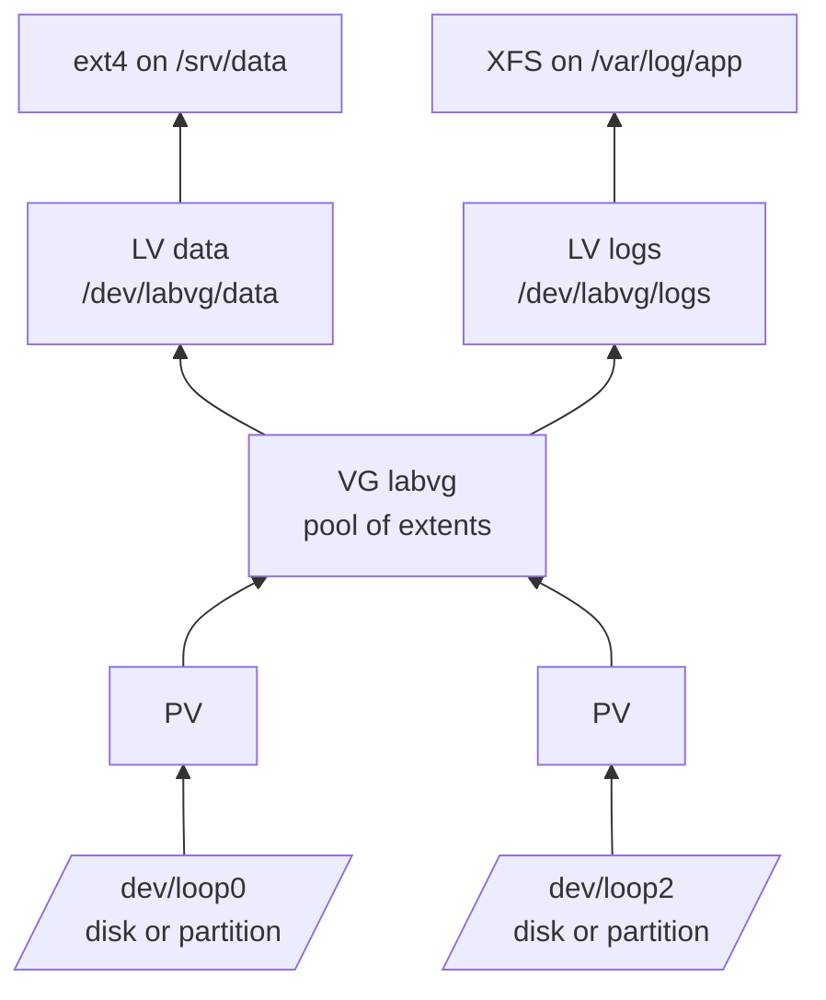
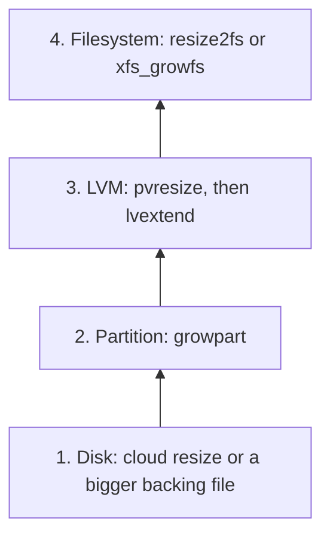

> [!info] Level: junior-middle | Time: about 3 h | You need: [[learn/linux-processes-memory-and-disk|Linux 04: Processes, memory and disk]] | Lab: Option A, the Ubuntu LTS VM from [[learn/lab-setup|Start 01: Set up your lab]], using loop devices only (Option B, the container, cannot run the LVM steps); one optional Compute Engine step costs money

"Disk full on `/var`, please add 20 GB" is one of the most common on-call tickets, and one of the few where a typo destroys data. Adding space is never one step: the cloud disk grows, then the partition, then (with LVM) the logical volume, then the filesystem. Miss a layer and `df` still shows the old size; act on the wrong device and you format someone's database. This lesson builds every layer on **loop devices** (files that pretend to be disks), so you can practise partitioning, formatting, mounting, `/etc/fstab`, LVM and online growth without any risk to the VM itself. It ends with the same procedure on a Compute Engine disk.

> [!danger] Commands in this lesson destroy data on the device you name
> `mkfs`, `wipefs`, `sgdisk`, `parted`, `pvcreate` and `lvremove` do exactly what you tell them, to whatever device you name, without asking. Every exercise here uses a `/dev/loopN` device backed by a file in `~/disk-lab`. Before every command that writes to a device, run `lsblk` and check the name you are about to use is the loop device you just created, not `/dev/sda`, `/dev/vda`, `/dev/nvme0n1` or anything mounted. On a real server, take a snapshot or backup first.

> [!note] What was run for this page
> The loop device, `findmnt --verify` and `mount -a --fstab` on a test file, GPT partitioning with `sgdisk`, ext4 creation and offline growth, XFS creation and **online** growth with `growpart` and `xfs_growfs`, inode exhaustion, the deleted-but-open file and the swap file were run on Ubuntu 24.04.5 with util-linux 2.39.3, e2fsprogs 1.47.0, xfsprogs 6.6.0, gdisk 1.0.10, cloud-guest-utils 0.33 and lvm2 2.03.16. That lab was a container: it had no udev and no kernel device-mapper, so **creating and extending logical volumes and growing ext4 online were not run**, and their output is illustrative. The `gcloud` steps were checked against the SDK 570.0.0 help text only. Output marked "observed" is from that lab.

## What you will learn

- How to list block devices and filesystems with `lsblk` and `blkid`, and why you refer to filesystems by UUID.
- How to create a GPT partition, choose between ext4 and XFS, format, and mount with sensible options.
- How to write an `/etc/fstab` line that will not drop the server into emergency mode, and test it before you reboot.
- How LVM's physical volumes, volume groups and logical volumes fit together, and how `lvextend -r` grows a volume and its filesystem in one step.
- How to grow a disk online layer by layer (disk, partition, volume, filesystem), including on a Compute Engine persistent disk.
- How to explain a "full" disk that is not full: inode exhaustion and deleted files still held open.

## Block devices and how to see them

A **block device** is anything the kernel can read and write in fixed-size blocks: a disk (`/dev/sda`, `/dev/vda`, `/dev/nvme0n1`), a partition on it (`/dev/sda1`, `/dev/nvme0n1p1`), an LVM volume (`/dev/mapper/vg-lv`) or a loop device. A **filesystem** is a structure written onto a block device so it can hold files, and it becomes visible only when it is **mounted** on a directory.

```bash
lsblk -o NAME,SIZE,TYPE,FSTYPE,UUID,MOUNTPOINTS
sudo blkid
findmnt --real
```

```text
NAME    SIZE TYPE FSTYPE UUID                                 MOUNTPOINTS
sda      40G disk
├─sda1   39G part ext4   4b6a3a0e-0d55-4c3e-9b1e-6a2f6f6e1a10 /
├─sda14   4M part
└─sda15 106M part vfat   7C1D-2B3A                            /boot/efi
```

_Illustrative: names and sizes differ per machine._ Three habits:

- **Find the device by its contents, not its name.** `/dev/sdb` today can be `/dev/sdc` after a reboot or a new disk. A filesystem's **UUID** (or label) does not change, and the links under `/dev/disk/by-uuid/` and `/dev/disk/by-id/` resolve to the right device.
- **`blkid` reads the device itself.** `lsblk -f` shows FSTYPE and UUID from the udev database; in a container without udev those columns are blank even when a filesystem exists. When in doubt, ask `blkid`.
- **Check what is mounted before you touch anything.** `findmnt` shows the mount tree; a device with a mount point is in use.

## Loop devices: a disk you can throw away

A **loop device** maps a regular file to a block device. Everything in this lesson that would need a spare disk works on one, and deleting the file deletes the "disk".

```bash
export LAB=~/disk-lab
mkdir -p "$LAB/mnt" && cd "$LAB"
truncate -s 128M disk1.img                     # a sparse 128 MiB file
export L1="$(sudo losetup --find --show disk1.img)"
echo "$L1"
lsblk "$L1"
```

```text
/dev/loop0
NAME  MAJ:MIN RM  SIZE RO TYPE MOUNTPOINTS
loop0   7:0    0  128M  0 loop
```

_`/dev/loop0` was observed; on your VM it may be another number, since snaps also use loop devices. Always use the variable._

`losetup -a` lists every loop device and its backing file; check it before and after the lesson.

## Partition tables: GPT

A **partition table** divides a disk into partitions. Use **GPT** for anything new: it supports large disks and many partitions, and keeps a backup copy of itself at the end of the disk. (The older MBR format is limited to 2 TiB disks and four primary partitions.) `sgdisk` is scriptable, which is what you want in runbooks; `parted` and the interactive `gdisk` and `fdisk` do the same job.

```bash
truncate -s 400M part.img
export LP="$(sudo losetup --find --show --partscan part.img)"
sudo sgdisk -n 1:0:0 -t 1:8300 -c 1:labdata "$LP"   # partition 1, all free space, type Linux filesystem, name labdata
sudo partprobe "$LP"
lsblk "$LP"
```

```text
Creating new GPT entries in memory.
The operation has completed successfully.
NAME      MAJ:MIN RM  SIZE RO TYPE MOUNTPOINTS
loop1       7:1    0  400M  0 loop
└─loop1p1 259:0    0  399M  0 part
```

_Observed format (on a 200 MiB image in the lab); sizes illustrative._ `--partscan` makes the kernel create `loop1p1` for the partition. `-n 1:0:0` means partition number 1, default start, default end (the rest of the disk); type `8300` is "Linux filesystem".

Many cloud data disks are used **without** a partition table: the filesystem goes straight on `/dev/sdb`. That is simpler to grow (one layer fewer), and fine for data disks. Boot disks are always partitioned.

## Filesystems: ext4 or XFS

| Property           | ext4                                     | XFS                                                              |
| ------------------ | ---------------------------------------- | ---------------------------------------------------------------- |
| Grow               | Online (mounted) or offline, `resize2fs` | Online only (must be mounted), `xfs_growfs`                      |
| Shrink             | Offline only, `resize2fs` with a size    | Plan as **not possible**; create a smaller one and copy the data |
| Check and repair   | `e2fsck` (unmounted)                     | `xfs_repair` (unmounted); `-n` checks without changing           |
| Minimum size       | Very small                               | `mkfs.xfs` 6.6.0 refused anything under 300 MB                   |
| Typical default on | Debian and Ubuntu                        | Red Hat family                                                   |

XFS shrinking deserves a footnote: recent xfsprogs has an experimental shrink path, and in the lab `xfs_growfs -D` with a smaller size printed `[EXPERIMENTAL] try to shrink unused space` and then failed with `Invalid argument`. LVM's own resize helper says XFS shrinking is unsupported. Treat XFS as grow-only, and size it with that in mind.

Format and mount an ext4 filesystem on the first loop device:

```bash
sudo mkfs.ext4 -q -L labdata "$L1"
sudo blkid "$L1"
sudo mount "$L1" "$LAB/mnt"
df -h "$LAB/mnt"
```

```text
/dev/loop0: LABEL="labdata" UUID="0b0e5f7c-2f8a-4d0e-8d55-3f2c1d9a6b11" BLOCK_SIZE="4096" TYPE="ext4"
Filesystem      Size  Used Avail Use% Mounted on
/dev/loop0      104M   24K   95M   1% /home/ubuntu/disk-lab/mnt
```

_Observed shape; your UUID differs._ The filesystem is smaller than the 128 MiB device: metadata, the journal and the reserved blocks (space only root can use, so a full disk does not stop root logging in) take their share.

### Mount options worth knowing

- `noatime`: do not update the access time on every read. Saves writes on busy filesystems.
- `nodev`: do not interpret device files on this filesystem.
- `nosuid`: ignore set-user-ID and set-group-ID bits (and file capabilities) on this filesystem.
- `noexec`: do not allow running binaries directly from this filesystem.

`nodev,nosuid,noexec` are good defaults for data and upload directories that should never hold programs; check `mount(8)` for the exact semantics on your kernel, because `noexec` does not stop an interpreter from reading a script. `defaults` means a kernel- and filesystem-dependent set, usually `rw,suid,dev,exec,auto,nouser,async`.

## /etc/fstab: mounts that survive a reboot, safely

`/etc/fstab` lists what to mount at boot. Each line has six fields:

```text title="/etc/fstab"
# <spec>                                  <mount point>  <type>  <options>                          <dump> <pass>
UUID=0b0e5f7c-2f8a-4d0e-8d55-3f2c1d9a6b11  /srv/data      ext4    defaults,nofail,noatime,nodev,nosuid  0      2
```

- **spec**: which filesystem. Use `UUID=` or `LABEL=` (or `PARTUUID=` on GPT), the fstab man page's recommended method, because device names change when disks are added or removed. Write UUIDs in lower case.
- **mount point** and **type**: where, and which filesystem driver (`none` for swap).
- **options**: `nofail` means "do not report an error if this device does not exist", so a missing data disk does not stop the boot. `noauto` means `mount -a` skips the line.
- **dump**: 0 (legacy backup tool).
- **pass**: fsck order at boot: 1 for the root filesystem, 2 for others, 0 to skip.

A wrong line on a non-`nofail` entry, such as a UUID of a disk that is gone, can leave a server stuck in **emergency mode** at the next boot, which on a cloud VM means serial console work. So test every change **before** a reboot:

```bash
sudo findmnt --verify --verbose          # checks /etc/fstab
sudo findmnt --verify --tab-file ./fstab.test   # checks a test copy instead
```

`findmnt --verify` parses the file and checks that sources exist, targets are directories and types are known. In the lab, a three-line test file (a valid UUID, a missing UUID with `nofail`, and a missing device without it) produced:

```text
[E] unreachable on boot required source: UUID=00000000-0000-0000-0000-000000000000
[W] unreachable source: /dev/doesnotexist: No such file or directory
0 parse errors, 3 errors, 2 warnings
```

_Observed, abridged; exit status 1. A single valid line, checked with `--verbose`, lists each check and ends with `Success, no errors or warnings detected`._ Notice it still reported an error for the `nofail` entry: `nofail` changes what happens at boot, not what `--verify` reports. Read each message instead of aiming for a clean count.

The safe order for a production change:

1. Back up the file: `sudo cp -a /etc/fstab /etc/fstab.$(date +%F)`.
2. Add the line, with `nofail` for anything that is not needed to boot.
3. `sudo findmnt --verify --verbose`.
4. `sudo systemctl daemon-reload`, because on systemd systems fstab is turned into mount units.
5. `sudo mount -a` (mounts everything not yet mounted) and `findmnt /srv/data` to see it mounted.
6. Only then reboot, if you need to prove the boot path, with console access ready.

## LVM: volumes you can resize and move

**LVM** (Logical Volume Manager) puts a flexible layer between disks and filesystems:



- A **physical volume** (PV) is a disk or partition initialised for LVM (`pvcreate`).
- A **volume group** (VG) pools one or more PVs into one store of fixed-size extents (`vgcreate`, `vgextend` to add a disk later).
- A **logical volume** (LV) is a slice of a VG that you format and mount like a partition (`lvcreate`), and it can be grown while mounted, spread over several disks and snapshotted.

The win in operations: when `/srv/data` fills, you add a disk to the VG and grow the LV, with no repartitioning and no downtime.

```bash
cd "$LAB"
sudo umount "$LAB/mnt"
truncate -s 128M disk2.img
export L2="$(sudo losetup --find --show disk2.img)"
sudo wipefs -a "$L1"                     # remove the ext4 signature from the earlier step
sudo pvcreate -q "$L1" "$L2"
sudo vgcreate -q labvg "$L1" "$L2"
sudo vgs labvg
sudo lvcreate -n data -L 100M labvg
sudo mkfs.ext4 -q -L labdata /dev/labvg/data
sudo mount /dev/labvg/data "$LAB/mnt"
sudo lvs labvg
df -h "$LAB/mnt"
```

```text
  VG    #PV #LV #SN Attr   VSize   VFree
  labvg   2   0   0 wz--n- 248.00m 248.00m
  Logical volume "data" created.
  LV   VG    Attr       LSize   Pool Origin Data%  Meta%  Move Log Cpy%Sync Convert
  data labvg -wi-ao---- 100.00m
Filesystem              Size  Used Avail Use% Mounted on
/dev/mapper/labvg-data   88M   14K   81M   1% /home/ubuntu/disk-lab/mnt
```

_The `vgs` line (248.00m from two 128 MiB files) was observed; `lvcreate` failed in the lab container because it had no device-mapper, so the rest is illustrative. On a normal VM it works._

`/dev/labvg/data` and `/dev/mapper/labvg-data` are two names for the same LV.

### Grow the LV and its filesystem in one step

```bash
sudo lvextend -r -L +60M labvg/data      # or: -l +100%FREE for all free space in the VG
df -h "$LAB/mnt"
```

```text
  Size of logical volume labvg/data changed from 100.00 MiB (25 extents) to 160.00 MiB (40 extents).
  Logical volume labvg/data successfully resized.
resize2fs 1.47.0 (5-Feb-2023)
Filesystem at /dev/mapper/labvg-data is mounted on /home/ubuntu/disk-lab/mnt; on-line resizing required
The filesystem on /dev/mapper/labvg-data is now 163840 (1k) blocks long.
Filesystem              Size  Used Avail Use% Mounted on
/dev/mapper/labvg-data  146M   14K  137M   1% /home/ubuntu/disk-lab/mnt
```

_Illustrative: not run in the lab._ `-r` (`--resizefs`) makes `lvextend` call the right filesystem tool afterwards (`resize2fs` for ext4, `xfs_growfs` for XFS). Without `-r`, the LV grows and the filesystem does not, and `df` shows the old size until you run the tool yourself. The man page's own example is `lvextend -l+100%FREE -r vg01/lvol01`.

## Growing a disk online, layer by layer

Whatever the platform, growing storage means growing each layer from the bottom up, and checking each one:



| Layer      | Grow command                                                                 | Check                              |
| ---------- | ---------------------------------------------------------------------------- | ---------------------------------- |
| Disk       | `gcloud compute disks resize`, or `truncate` + `losetup --set-capacity` here | `lsblk -b` shows the new size      |
| Partition  | `growpart <disk> <partition-number>`                                         | `lsblk` shows the partition larger |
| PV and LV  | `pvresize <pv>`, then `lvextend -r ...`                                      | `pvs`, `vgs`, `lvs`                |
| Filesystem | `resize2fs <device>` (ext4), `xfs_growfs <mountpoint>` (XFS)                 | `df -h`                            |

Skip any layer that is not there (no partition table, no LVM).

`growpart` comes from the `cloud-guest-utils` package on Debian and Ubuntu, `cloud-utils-growpart` on the Red Hat family. It takes the disk and the partition **number** separately (`growpart /dev/sdb 1`, not `growpart /dev/sdb1`), and `--dry-run` shows what it would change.

On a loop device, the online XFS growth on a GPT partition looked like this in the lab:

```bash
sudo mkfs.xfs -q -L labxfs "${LP}p1"
mkdir -p "$LAB/xfs" && sudo mount "${LP}p1" "$LAB/xfs"
df -h "$LAB/xfs"

truncate -s 800M part.img && sudo losetup --set-capacity "$LP"   # 1. the "disk" grows
sudo sgdisk -e "$LP"            # lab only: move the backup GPT header to the new end of the bigger file
sudo growpart "$LP" 1           # 2. the partition grows
sudo xfs_growfs "$LAB/xfs"      # 4. the filesystem grows, while mounted
df -h "$LAB/xfs"
```

```text
Filesystem      Size  Used Avail Use% Mounted on
/dev/loop1p1    335M   20M  315M   6% /home/ubuntu/disk-lab/xfs
CHANGED: partition=1 start=2048 old: size=817119 end=819166 new: size=1636319 end=1638366
data blocks changed from 102139 to 204539
Filesystem      Size  Used Avail Use% Mounted on
/dev/loop1p1    735M   21M  714M   3% /home/ubuntu/disk-lab/xfs
```

_Observed (`Used` and `Avail` columns illustrative)._ The `sgdisk -e` step exists only because a file was enlarged under an existing GPT; a cloud disk resized under a running VM may need the same fix, so read `growpart`'s output and `sgdisk -v` if it complains about the backup header.

For ext4 the last step is `sudo resize2fs <device>` with no size, which grows the filesystem to fill the device. It never touches partitions, and a filesystem can never be larger than its partition, which is why the partition must grow first. In the lab, online `resize2fs` was blocked by the container, and growth was done offline instead: `umount`, `e2fsck -f -p`, then `resize2fs`, which printed `The filesystem on /dev/loop0 is now 65536 (4k) blocks long.` On a normal host, ext4 grows online.

### On Compute Engine

> [!warning] Costs money
> This optional part creates a persistent disk and a snapshot in your sandbox project; both bill while they exist, and the disk bills at its new size after the resize. You need the `lab-vm` from [[learn/gcp-vpc-compute-and-cloud-sql|GCP 03]] (or any lab VM). Cleanup: `gcloud compute instances detach-disk lab-vm --disk=lab-data --zone="$ZONE"`, then `gcloud compute disks delete lab-data --zone="$ZONE" --quiet` and `gcloud compute snapshots delete lab-data-before-resize --quiet`.

```bash
export LAB_PROJECT_ID="lab-yourname-123456"   # change: your sandbox project id
export ZONE="europe-west1-b"                  # change: the zone of lab-vm
gcloud config set project "$LAB_PROJECT_ID"

gcloud compute disks create lab-data --zone="$ZONE" --size=10GB   # check the minimum size for the default disk type
gcloud compute instances attach-disk lab-vm --disk=lab-data --zone="$ZONE"
# In the VM: find the new disk with lsblk, then mkfs.ext4 it and mount it (no partition table needed).

# Before any resize: a snapshot, taken while attached.
gcloud compute disks snapshot lab-data --zone="$ZONE" --snapshot-names=lab-data-before-resize
gcloud compute disks resize lab-data --zone="$ZONE" --size=20GB --quiet
```

Then, inside the VM, grow the layers that exist: `lsblk` to confirm the disk shows 20G, `growpart` if it has a partition, then `resize2fs` or `xfs_growfs`. The `gcloud` help states that only increasing a disk's size is supported, that disks can be resized whether or not they are attached, and that the size must be a whole number of GB; there is no going back, which is why the snapshot comes first. Whether a given image grows the boot disk's filesystem automatically at boot, and the exact device names (`/dev/sdb` or a `/dev/disk/by-id/google-...` link), were not verified; check the Compute Engine "Resize a persistent disk" page and `lsblk`.

## "No space left on device" when the disk is not full

Linux 04 met two causes; here you can reproduce both safely.

**Inodes.** Every file needs an inode, and ext4 fixes the number at `mkfs` time. Millions of tiny files (session files, a cache, a mail spool) can use them all while bytes are free:

```bash
cd "$LAB"
truncate -s 32M tiny.img && export LT="$(sudo losetup --find --show tiny.img)"
sudo mkfs.ext4 -q -N 128 "$LT"          # deliberately only 128 inodes
mkdir -p "$LAB/tiny" && sudo mount "$LT" "$LAB/tiny"
for i in $(seq 1 200); do sudo touch "$LAB/tiny/f$i" 2>/dev/null || { echo "failed at file $i"; break; }; done
df -h "$LAB/tiny"; df -i "$LAB/tiny"
```

```text
failed at file 118
Filesystem      Size  Used Avail Use% Mounted on
/dev/loop3       27M   14K   25M   1% /home/ubuntu/disk-lab/tiny
Filesystem     Inodes IUsed IFree IUse% Mounted on
/dev/loop3        128   128     0  100% /home/ubuntu/disk-lab/tiny
```

_Observed: creation stopped at file 118 because the new filesystem already used 11 inodes. `df -h` said 1%, `df -i` said 100%._ The fix is to find and remove the files at their source (`sudo find /path -xdev -type f | cut -d/ -f2,3 | sort | uniq -c | sort -rn | head` narrows it), and, for a filesystem that will always hold many small files, to choose the inode count at `mkfs` time or use XFS, which allocates inodes dynamically.

**Deleted but still open.** Deleting a file removes its name; the space is freed only when the last process closes it:

```bash
sudo dd if=/dev/zero of="$LAB/mnt/big.log" bs=1M count=40 status=none
exec 3< "$LAB/mnt/big.log"     # this shell now holds the file open on descriptor 3
sudo rm "$LAB/mnt/big.log"
df -h "$LAB/mnt"; sudo du -sh "$LAB/mnt"
sudo lsof +L1 "$LAB/mnt"
exec 3<&-                       # close it; the space comes back
df -h "$LAB/mnt"
```

```text
Filesystem              Size  Used Avail Use% Mounted on
/dev/mapper/labvg-data  146M   41M   96M  30% /home/ubuntu/disk-lab/mnt
20K	/home/ubuntu/disk-lab/mnt
COMMAND  PID   USER FD   TYPE DEVICE SIZE/OFF NLINK NODE NAME
bash    4242 ubuntu  3r   REG  252,0 41943040     0   12 /home/ubuntu/disk-lab/mnt/big.log (deleted)
```

_Observed on an ext4 loop device (41M used by `df`, 20K by `du`, `(deleted)` with NLINK 0); device names here illustrative._ On a server, restart or signal the process that holds the file (for a log, the service's log reopen), or truncate it through `/proc/<pid>/fd/<n>`.

## A swap file

Swap gives the kernel somewhere to put rarely used memory pages. On servers it is a policy decision (many Kubernetes nodes run without it), but you will meet it:

```bash
sudo fallocate -l 64M "$LAB/swapfile"
sudo chmod 600 "$LAB/swapfile"
sudo mkswap "$LAB/swapfile"
sudo swapon "$LAB/swapfile"
swapon --show
sudo swapoff "$LAB/swapfile"
```

```text
Setting up swapspace version 1, size = 64 MiB (67104768 bytes)
no label, UUID=6f1a2b3c-...
NAME                       TYPE SIZE USED PRIO
/home/ubuntu/disk-lab/swapfile file  64M   0B   -2
```

_Observed format._ Mode 600 matters: swap holds memory contents, including secrets. In fstab a swap file is `/swapfile none swap sw 0 0`. Whether `fallocate` is acceptable for swap depends on the filesystem; check `swapon(8)`, which describes the cases where you must write the file with `dd` instead.

## Hands-on exercises

Run everything on the lab VM in `~/disk-lab`, as a user with `sudo`. Keep the variables (`LAB`, `L1`, `L2`, `LP`, `LT`) in the same shell; if you open a new one, find the devices again with `losetup -a`. Output is illustrative unless the section above marked it observed.

1. **Survey before you touch.**

   ```bash
   lsblk -o NAME,SIZE,TYPE,FSTYPE,MOUNTPOINTS
   losetup -a
   findmnt --real
   ```

   Expected: your VM's real disk (for example `sda` or `vda`) with `/` mounted on it, and the loop devices snaps use. Write down the real disk's name: it is the one you must never type in this lesson.
   If you see something else: if you cannot tell which disk holds `/`, `findmnt /` names the device.

2. **Create the loop device and an ext4 filesystem.** Run the "Loop devices" block and the `mkfs.ext4`, `blkid`, `mount` and `df` block from the filesystems section.
   Expected: a `loopN` device, a `TYPE="ext4"` line with a UUID from `blkid`, and a mounted filesystem of about 104M.
   If you see something else: "permission denied" means you forgot `sudo`; "device or resource busy" means you are formatting something mounted. Stop and run `lsblk` again.

3. **Write and verify a test fstab, then mount from it.**

   ```bash
   UUID="$(sudo blkid -s UUID -o value "$L1")"
   sudo umount "$LAB/mnt"
   printf 'UUID=%s %s ext4 defaults,nofail,noatime,nodev,nosuid 0 2\n' "$UUID" "$LAB/mnt" > fstab.test
   printf 'UUID=00000000-0000-0000-0000-000000000000 /mnt/missing ext4 defaults 0 2\n' >> fstab.test
   sudo findmnt --verify --tab-file ./fstab.test; echo "exit: $?"
   ```

   Expected: two `[E]` lines for `/mnt/missing` (`unreachable on boot required target` and `unreachable on boot required source: UUID=0000...`), then `0 parse errors, 2 errors, 0 warnings` and exit 1. Delete that second line (`sed -i '2d' fstab.test`) and rerun with `--verbose`: each check for your line is listed, then `Success, no errors or warnings detected` and exit 0.
   Then mount from the test file only: `sudo mount -a --fstab ./fstab.test && findmnt "$LAB/mnt"`. Expected: `findmnt` shows the loop device on `$LAB/mnt` with `rw,nosuid,nodev,noatime`.
   If you see something else: an error about the target means `$LAB/mnt` does not exist or the path in the file is not absolute. If `mount -a` says `can't find UUID=0000...`, the bad line is still in the file.

4. **Build LVM on two loop devices.** Run the LVM block (it unmounts the ext4 filesystem, wipes it, and creates `labvg/data`).
   Expected: `vgs` shows `labvg` with 2 PVs and about 248m; `lvs` shows `data` at 100m; `df` shows it mounted.
   If you see something else: "Required device-mapper target(s) not detected in your kernel" means you are in a container (Option B) or a kernel without device-mapper; use the VM. "Device /dev/loop0 excluded by a filter" usually means an old signature is still there: run `sudo wipefs -a` on that loop device (and only that one).

5. **Fill it, then grow it online.**

   ```bash
   sudo fallocate -l 70M "$LAB/mnt/fill.bin"; df -h "$LAB/mnt"
   sudo lvextend -r -L +60M labvg/data
   df -h "$LAB/mnt"
   ```

   Expected: `df` jumps from about 88M to about 146M while the filesystem stays mounted, and `fill.bin` is still there.
   If you see something else: if `lvs` shows the new size but `df` does not, you left out `-r`; run `sudo resize2fs /dev/labvg/data`. "Insufficient free space" means the VG has less free than you asked for; check `vgs`.

6. **Grow a partition and XFS online.** Run the partition block from "Partition tables", then the XFS growth block.
   Expected: `growpart` prints `CHANGED: partition=1 ...` and `xfs_growfs` prints `data blocks changed from ... to ...`; `df` shows about 735M.
   If you see something else: `NOCHANGE` from `growpart` means the disk did not grow (`losetup --set-capacity` missing) or the backup GPT header was not moved (`sgdisk -e`). `xfs_growfs` on an unmounted device fails: XFS grows only while mounted.

7. **Run out of inodes.** Run the inode block.
   Expected: creation fails before file 128, `df -h` shows a near-empty filesystem and `df -i` shows 100%.
   If you see something else: if all 200 files succeed, the `-N 128` option did not apply; check `sudo tune2fs -l "$LT" | grep 'Inode count'`.

8. **Find space held by a deleted file.** Run the deleted-file block.
   Expected: `df` counts the 40 MiB, `du` does not, `lsof +L1` lists `big.log (deleted)`, and closing descriptor 3 gives the space back.
   If you see something else: if `lsof` is not installed, `sudo apt install lsof`; or look for `(deleted)` in `ls -l /proc/$$/fd`.

9. **Clean up everything.**

   ```bash
   cd "$LAB"
   sudo swapoff "$LAB/swapfile" 2>/dev/null; sudo rm -f "$LAB/swapfile"
   sudo umount "$LAB/mnt" "$LAB/xfs" "$LAB/tiny" 2>/dev/null
   sudo lvremove -y labvg/data; sudo vgremove -f labvg; sudo pvremove -f "$L1" "$L2"
   sudo losetup -d "$L1" "$L2" "$LP" "$LT"
   rm -f ./*.img fstab.test
   losetup -a | grep disk-lab || echo "no lab loop devices left"
   ```

   Expected: `no lab loop devices left`, and `lsblk` shows only your real disk and the snap loop devices.
   If you see something else: "device is busy" on `umount` means a shell is still inside the directory (`cd ~` first) or a descriptor is still open (`lsof +D "$LAB"`). A loop device that will not detach is still mounted or still a PV.

## Common mistakes

- **Running a destructive command on a name you did not just check.** Device names change between boots and machines. Run `lsblk` right before, and prefer `/dev/disk/by-id/` paths in runbooks.
- **Device names in fstab.** `/dev/sdb1` today can be another disk tomorrow. Use `UUID=` or `LABEL=`.
- **No `nofail` on a non-essential disk.** If it is missing at boot, the server stops in emergency mode. Add `nofail` to anything the OS does not need to boot.
- **Rebooting to test fstab.** Test with `findmnt --verify`, `systemctl daemon-reload` and `mount -a` first; reboot only with console access ready.
- **Growing the disk and forgetting the layers above.** `df` shows the old size until the partition, LV and filesystem are grown. Work bottom up and check each layer.
- **`lvextend` without `-r`.** The LV grows, the filesystem does not. Use `-r`, or run `resize2fs` or `xfs_growfs` afterwards.
- **Planning to shrink XFS.** You cannot, in practice. Grow in modest steps; LVM leaves free extents for later.
- **No snapshot before a resize.** A cloud disk resize cannot be undone, and a mistake in the guest can corrupt data. Snapshot first.
- **Reading only `df -h`.** Check `df -i` for inodes and `lsof +L1` for deleted files before deleting anything else.

## Check your understanding

1. Why should `/etc/fstab` use `UUID=` rather than `/dev/sdb1`?
2. You resized a cloud disk from 10 GB to 20 GB. `lsblk` shows 20G, but `df -h` still shows 10G. What is missing, for a disk with one partition and ext4 on it?
3. What does `nofail` change, and what does it not change about `findmnt --verify` output?
4. What do `pvcreate`, `vgcreate` and `lvcreate` each create, and what does `lvextend -r` add?
5. Can you shrink an XFS filesystem to give space back to the volume group? What do you do instead?
6. `df -h` shows 30% used, but writes fail with "No space left on device". Name two causes and the command that confirms each.

> [!question]- Answers
>
> 1. Device names are assigned at boot and change when disks are added, removed or detected in another order. A UUID belongs to the filesystem, so the line always mounts the right one.
> 2. The partition and the filesystem: `sudo growpart /dev/sdb 1`, then `sudo resize2fs /dev/sdb1` (device names from `lsblk`). Each layer must be grown separately.
> 3. At boot, a missing `nofail` device is not treated as an error, so boot continues. `findmnt --verify` still reports the unreachable source; read the message rather than expecting no errors.
> 4. A physical volume on a disk or partition, a volume group pooling PVs, and a logical volume carved from the VG. `-r` resizes the filesystem on the LV in the same command.
> 5. No: treat XFS as grow-only. Create a smaller filesystem (a new LV), copy the data, switch over, then remove the old LV.
> 6. Inode exhaustion (`df -i` shows 100%) and deleted files still held open (`lsof +L1`, plus `df` and `du` disagreeing). A filesystem with all space in reserved blocks for root is a third, rarer case.

## Next steps

Next lesson: [[learn/image-build-speed-cache-mounts-and-measurement|Containers 05: Faster image builds]], or move on in [[learn/index|the learning path]]. Previous lesson: [[learn/linux-performance-triage-with-mpstat-pidstat-sar-and-psi|Linux 06: Performance triage with mpstat, pidstat, sar and PSI]].

To go deeper:

- [[learn/linux-services-packages-and-scheduled-jobs]] for the systemd units that fstab lines become.
- [[runbooks/node-resource-pressure-triage]] for disk pressure on Kubernetes nodes.
- [[learn/kubernetes-storage-volumes-pvcs-and-statefulsets]] for how the same disks reach Pods through PersistentVolumeClaims, including volume expansion.
- [[patterns/stateful-workloads-gke]] and [[architecture/backup-architecture-gke-cloud-sql-gcs]] for disks and backups on GKE.
- [[adr/0051-backups-proven-by-quarterly-restore-drills]] for why a snapshot is only a backup once you have restored it.

## Sources

- Linux man-pages and util-linux documentation (https://man7.org/linux/man-pages/): `lsblk(8)`, `blkid(8)`, `losetup(8)`, `mount(8)`, `fstab(5)`, `findmnt(8)` and `swapon(8)`. The fstab fields, UUID recommendation, `nofail`, `noauto`, `defaults`, pass numbers and the `daemon-reload` note come from the util-linux `fstab.5` source; util-linux 2.39.3 was run.
- e2fsprogs `resize2fs(8)` and `mke2fs(8)` (https://e2fsprogs.sourceforge.net/): growth and shrink rules and the partition-size limit. e2fsprogs 1.47.0 was run.
- XFS documentation (https://xfs.wiki.kernel.org/) and xfsprogs `mkfs.xfs(8)`, `xfs_growfs(8)` and `xfs_repair(8)`: online growth and the shrink limitation. xfsprogs 6.6.0 was run.
- LVM2 man pages `pvcreate(8)`, `vgcreate(8)`, `lvcreate(8)`, `lvextend(8)` and `fsadm(8)` (https://man7.org/linux/man-pages/man8/lvm.8.html), and the Red Hat "Configuring and managing logical volumes" guide (https://docs.redhat.com/): `lvextend -r` and the `-l +100%FREE` example. Only `pvcreate`, `vgcreate` and `vgs` were run.
- cloud-utils (https://github.com/canonical/cloud-utils): `growpart` usage and its Debian package. `growpart` 0.33 was run.
- Google Cloud documentation, "Resize a persistent disk" (https://cloud.google.com/compute/docs/disks/resize-persistent-disk), and the `gcloud compute disks resize` and `snapshot` reference: only increases, attached or not, whole GB, snapshots while attached. Checked against the SDK 570.0.0 help text only.
- Not verified: `lvcreate`, `lvextend -r` and online ext4 growth on a normal kernel (illustrative output); whether `growpart` fixes a stale backup GPT header itself; automatic filesystem growth on Compute Engine images, device names and minimum disk sizes; `fallocate` swap files on every filesystem; reserved-block tuning; ext4 and XFS performance differences. Check the current docs.
