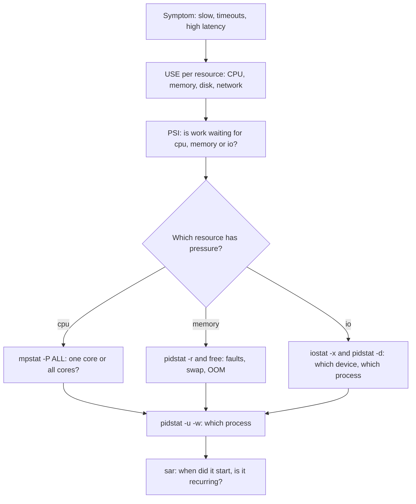

> [!info] Level: middle | Time: about 4 h | You need: [[learn/linux-processes-memory-and-disk|Linux 04: Processes, memory and disk]] | Lab: Option A, the Ubuntu LTS VM from [[learn/lab-setup|Start 01: Set up your lab]]

[[learn/linux-processes-memory-and-disk|Linux 04]] ended with a playbook: look at load, then `vmstat`, then `iostat`, and decide which resource is the limit. That gets you to "it is the CPU" or "it is the disk". It does not tell you **which core**, **which process**, **since when**, or **whether work is actually waiting**. This lesson adds four tools for exactly those questions: `mpstat` for each CPU, `pidstat` for each process, pressure stall information (PSI) for "how much time is lost waiting", and `sar` for history.

> [!note] Nothing here was run for this page
> The commands, flags and sample output follow the official documentation and man pages. All numbers, PIDs and timestamps are illustrative. Compare them with your own output, and check the man pages of the sysstat version your distribution ships.

## What you will learn

- Which question each tool answers, and a triage order that moves from the whole host to one process and then to history.
- How to read `mpstat -P ALL` and tell one hot core from a host where every core is busy.
- How to use `pidstat` for CPU, memory and page faults, disk I/O and context switches per process.
- What PSI measures (`some` and `full`, `avg10`, `avg60`, `avg300`, `total`), where to read it for the host and for a cgroup, and why it is a better saturation signal than load.
- How to switch on `sar` collection and read yesterday's data after the incident is over.
- How to create load safely with `stress-ng` so you can practise on a lab VM.

## Where Linux 04 stopped

Linux 04 taught the vocabulary this lesson relies on. It is not repeated here, only linked:

- **Load average and the CPU count.** Load counts tasks that are running, runnable or in `D` state. A load of 8 on 4 CPUs is not automatically a CPU problem. See [[learn/linux-processes-memory-and-disk#Load average and the CPU count|Load average and the CPU count]] and [[learn/linux-processes-memory-and-disk#Zombies and D state|Zombies and D state]].
- **`vmstat` and `iostat`.** The `r`, `b`, `si`, `so` and `wa` columns, and `%util` and `await` in `iostat -x`. See [[learn/linux-processes-memory-and-disk#I/O saturation|I/O saturation]].
- **The USE method.** For every resource, check utilisation, saturation and errors. See [[learn/linux-processes-memory-and-disk#The USE-method playbook|The USE-method playbook]].

What those tools cannot show:

| Question                                              | Why Linux 04's tools fall short                                       |
| ----------------------------------------------------- | --------------------------------------------------------------------- |
| Is one core pinned while the rest idle?               | `top` and `vmstat` average all CPUs into one number.                  |
| Which process causes the I/O, the faults or switches? | `iostat` is per device, not per process.                              |
| Is work waiting, and for how long?                    | Load is a count of tasks, not a measure of lost time.                 |
| What happened at 03:10 last night?                    | `vmstat` and `top` show only now, unless something recorded the past. |

## A triage order

The order matters more than any single tool. Start wide and cheap, and narrow only when a number points somewhere.



Read it as a loop, not a one-way street: the history step often sends you back up with a better question ("it spikes at 03:10, what runs at 03:10?", see [[learn/linux-services-packages-and-scheduled-jobs|Linux 05]] for timers and cron). The general habit of forming a hypothesis and testing it is in [[learn/troubleshooting-method]].

> [!note] These tools come from one package
> `iostat`, `mpstat`, `pidstat` and `sar` all come from the **sysstat** package. On Debian and Ubuntu: `sudo apt-get install -y sysstat`. On RHEL-family systems: `sudo dnf install -y sysstat`. Installing it does not by itself start collecting history; that is the `sar` section.

## Per-CPU view with mpstat

`mpstat` prints CPU time split by category, either averaged or per CPU. The useful form is one line per CPU, refreshed every second:

```bash title="per-CPU utilisation, 1 s interval, 5 samples"
mpstat -P ALL 1 5
```

```text
Linux 6.8.0-45-generic (lab01)  10/19/2026  _x86_64_  (4 CPU)

14:02:11     CPU    %usr   %nice    %sys %iowait    %irq   %soft  %steal  %guest  %gnice   %idle
14:02:12     all   26.00    0.00    1.50    0.00    0.00    0.25    0.00    0.00    0.00   72.25
14:02:12       0   99.00    0.00    1.00    0.00    0.00    0.00    0.00    0.00    0.00    0.00
14:02:12       1    2.00    0.00    1.00    0.00    0.00    0.00    0.00    0.00    0.00   97.00
14:02:12       2    1.00    0.00    2.00    0.00    0.00    1.00    0.00    0.00    0.00   96.00
14:02:12       3    2.00    0.00    2.00    0.00    0.00    0.00    0.00    0.00    0.00   96.00
```

_Illustrative: column order and the set of columns vary a little between sysstat versions._

The `all` line says the host is 72% idle. A dashboard that shows only that average would say "healthy". CPU 0 is at 99% user time: a single-threaded process is pinned to one core, and that process is the bottleneck for its own work. Averages hide this on a machine with many cores.

The columns that matter most:

- **`%usr`**: time in user-space code (your application). High means the application itself is computing.
- **`%sys`**: time in the kernel on behalf of processes: system calls, network stack, filesystem work. High `%sys` with low `%usr` often means a lot of small system calls, many context switches or heavy network traffic.
- **`%iowait`**: the CPU was **idle** and at least one task was waiting for I/O. This is easy to misread. It is **not** a measure of how busy the disk is, and it is not CPU work. A host with nothing else to run and one slow read shows high `%iowait`; the same slow read on a host with a busy CPU shows low `%iowait`, because the CPU was not idle. Use it as a hint that tasks are waiting on I/O, then confirm with `iostat -x` and PSI `io`.
- **`%steal`**: time the hypervisor ran something else while this virtual CPU wanted to run. On a VM, sustained `%steal` means the host is oversubscribed or you have used up a burstable allowance. No setting inside the guest fixes it; the remedy is a different instance type, fewer noisy neighbours or a move to dedicated capacity. On bare metal it is always about 0.
- **`%irq` and `%soft`**: time handling hardware and software interrupts. High `%soft` on one CPU often means network receive processing is concentrated on that core.

### One hot core or every core busy

The two patterns lead to different actions.

| Pattern                               | Typical cause                                                                            | Typical action                                                        |
| ------------------------------------- | ---------------------------------------------------------------------------------------- | --------------------------------------------------------------------- |
| One CPU near 100%, the rest idle      | A single-threaded process, a lock, or interrupts and a network queue pinned to one core. | Find the process (`pidstat`), parallelise or shard it, check IRQs.    |
| All CPUs high in `%usr`               | Real compute demand above capacity.                                                      | Profile the hot code, scale out, or add capacity.                     |
| All CPUs high in `%sys`               | Heavy system-call, network or filesystem activity, or a kernel-side problem.             | `pidstat -w` for context switches, `perf` or `strace` on the process. |
| Low `%usr` and `%sys`, high `%iowait` | Tasks waiting on storage while the CPU has nothing else to do.                           | Look at disks (`iostat -x`) and at `pidstat -d`.                      |
| `%steal` above a few percent          | The hypervisor takes CPU time away from the guest.                                       | Raise it with the cloud or virtualisation owner; resize or move.      |

For containers the picture is more subtle: a container can be throttled by its CPU limit while the host is mostly idle. That shows up in the cgroup counters, not in `mpstat`; see [[patterns/kubernetes-resource-requests-and-limits]] and [[learn/containers-under-the-hood]].

## Per-process view with pidstat

Once a resource is suspect, `pidstat` tells you which process is responsible. Without options it shows CPU. With an interval it reports per-interval values, and it shows only processes that were active unless you ask for all.

### CPU: pidstat -u

```bash title="per-process CPU every second"
pidstat -u 1 3
```

```text
14:05:01      UID       PID    %usr %system  %guest   %wait    %CPU   CPU  Command
14:05:02     1000      4312   98.00    1.00    0.00    0.00   99.00     0  encoder
14:05:02        0       811    0.00    1.00    0.00    0.00    1.00     2  rsyslogd
```

_Illustrative._

`%CPU` is the process's share of one CPU, so a multi-threaded process can exceed 100% on a multi-core host. `%wait` is time the task was runnable but waiting for a CPU, which is a saturation signal at process level. `CPU` is the core the process last ran on, which matches the hot core in `mpstat`. Add `-t` to list threads, which separates a busy thread from the rest of a process.

### Memory and page faults: pidstat -r

```bash title="per-process memory and faults"
pidstat -r 1 3
```

```text
14:06:01      UID       PID  minflt/s  majflt/s     VSZ     RSS   %MEM  Command
14:06:02     1000      5120   1520.00      0.00 2210456  812340   10.2  worker
14:06:02     1000      5188     12.00     85.00  980112  402216    5.1  indexer
```

_Illustrative._

A **minor fault** (`minflt/s`) is resolved without disk I/O, for example by mapping a page that is already in memory. It is normal and cheap in small numbers. A **major fault** (`majflt/s`) needed disk I/O to bring a page in: a sustained high rate means the process is stalling on storage for memory, which happens under memory pressure or when reading a large file-backed mapping. `RSS` is resident memory, as in `VmRSS` from Linux 04.

### Disk I/O: pidstat -d

```bash title="per-process disk I/O"
pidstat -d 1 3
```

```text
14:07:01      UID       PID   kB_rd/s   kB_wr/s kB_ccwr/s iodelay  Command
14:07:02        0      3301      0.00  48210.00      0.00      12  backup
14:07:02      999      1180    120.00    260.00      0.00       1  postgres
```

_Illustrative._

`kB_wr/s` is the write rate the process caused. `kB_ccwr/s` is data that was cancelled before it reached the disk, for example a file truncated while dirty. `iodelay` is the time the process spent waiting for block I/O, in clock ticks, so it says who is being slowed, not only who is writing. This is the missing link after `iostat -x` showed a busy device: the process list with the biggest writer.

### Context switches: pidstat -w

```bash title="per-process context switches"
pidstat -w 1 3
```

```text
14:08:01      UID       PID   cswch/s nvcswch/s  Command
14:08:02     1000      6120   1800.00     35.00  api
14:08:02     1000      6155     15.00   2400.00  encoder
```

_Illustrative._

`cswch/s` counts **voluntary** switches: the task gave up the CPU because it waited for something (I/O, a lock, a sleep). `nvcswch/s` counts **involuntary** switches: the scheduler took the CPU away because the time slice ended or a higher-priority task became runnable. A CPU-bound task that competes for cores shows a high `nvcswch/s`, a signal of CPU contention. An I/O-bound or lock-bound task shows a high `cswch/s`. Add `-t` to see the same per thread.

> [!tip] Combine flags and pick a name
> `pidstat -u -r -d -w 1 5` prints all four tables. `pidstat -C nginx 1` filters by command name. `pidstat -p 4312 1` follows one PID. Add `-h` for a single-line, machine-friendly format when you pipe it into a file.

### perf, only as a pointer

When `pidstat` says a process burns CPU but you need to know **which function**, the next tool is `perf` (`perf top` for a live view, `perf record` and `perf report` for a capture). It is outside this lesson. Know that access is controlled by the sysctl `kernel.perf_event_paranoid`: higher values restrict what an unprivileged user may profile, and some distributions set it high by default. Check your kernel's documentation before you loosen it, because lowering it widens what ordinary users can observe. [Brendan Gregg's Linux performance page](https://www.brendangregg.com/linuxperf.html) maps the tools to questions.

## Pressure stall information

Load, `%iowait` and run-queue counts are indirect. They count tasks, not lost time. **Pressure stall information (PSI)** measures the quantity you actually care about: the share of wall-clock time in which work was **stalled** because a resource was not available.

### Where to read it

The kernel exposes three files for the whole host:

```bash title="host-level PSI"
cat /proc/pressure/cpu
cat /proc/pressure/memory
cat /proc/pressure/io
```

```text
some avg10=12.40 avg60=8.15 avg300=3.02 total=18765432
```

```text
some avg10=0.00 avg60=0.00 avg300=0.00 total=402113
full avg10=0.00 avg60=0.00 avg300=0.00 total=311207
```

_Illustrative: the first block is `cpu`, the second is `memory` or `io`, which have both lines._

### Reading the fields

- **`some`**: the percentage of time in which **at least one** task was stalled on this resource. For `cpu`, that means at least one runnable task was waiting for a CPU. It says "someone was delayed", and it is the first number to look at.
- **`full`**: the percentage of time in which **all** non-idle tasks were stalled at the same time, so the CPUs (or the memory or I/O path) were doing no useful work for anyone. It is the more severe signal. For `memory` and `io` it is the headline number.
- **`avg10`, `avg60`, `avg300`**: exponentially weighted moving averages over about 10, 60 and 300 seconds, as percentages. Compare them: `avg10` high and `avg300` low means a recent spike; all three high means a lasting problem.
- **`total`**: the cumulative stall time in microseconds since boot. Averages hide short bursts; the counter does not. Sample it twice and subtract to get the exact stall time in an interval.

A reading of `some avg10=12.40` on `cpu` means that over the last ten seconds, some runnable task was waiting for a CPU for about 12% of the time. That is concrete and comparable between hosts, which load is not.

> [!warning] The meaning of `cpu full` depends on the kernel version
> The host-level `/proc/pressure/cpu` historically had only a `some` line, because "all tasks stalled on CPU" is not meaningful for the whole system (something is always running). Newer kernels print a `full` line for `cpu` as well, but at the system level it is reported as zero or has a different meaning from the cgroup `cpu.pressure` file. Check the kernel's PSI document for your version and do not alert on `cpu full` at the host level. Check the current docs.

### Requirements and caveats

- **PSI must be built into the kernel.** Most current distribution kernels enable it. On some distributions it is compiled in but switched off by default and needs the `psi=1` boot parameter; if `/proc/pressure/` does not exist, or reads fail, check your distribution's kernel configuration and the current docs rather than assuming. Changing boot parameters needs a reboot, so plan it.
- **It is a pressure signal, not a cause.** `io some` high tells you tasks waited for I/O. Which device and which process still need `iostat -x` and `pidstat -d`.
- **It is cheap to read** and safe to sample every few seconds from an agent. Node exporters and similar agents can export it, so it can be graphed and alerted on ([[learn/observability-signals-and-dashboards]]).

### Per-cgroup pressure

On cgroup v2, each cgroup exposes the same three files in its directory: `cpu.pressure`, `memory.pressure` and `io.pressure`. They use the same format but count only the tasks in that group. This is how you tell which service or container is being starved, rather than the whole host:

```bash title="PSI for one systemd service"
SVC=ssh.service   # Change: a service on your VM
CG="/sys/fs/cgroup/system.slice/${SVC}"
cat "${CG}/cpu.pressure" "${CG}/memory.pressure" "${CG}/io.pressure"
```

On Kubernetes, pods live in cgroups below the kubelet's slice, and a pod that is throttled by its limit will show `cpu.pressure` while the node does not. The path layout depends on the cgroup driver and runtime, so find the pod's cgroup before you read it. If you find `cpu.stat` with `nr_throttled` rising, that is the throttling signal described in [[patterns/kubernetes-resource-requests-and-limits]]. The node-level procedure that uses these signals is [[runbooks/node-resource-pressure-triage]].

### Triggers

PSI can also notify you instead of making you poll: a process opens a pressure file, writes a threshold such as `some 150000 1000000` (150 ms of stall in a 1 s window) and waits with `poll`/`epoll`. This is how some memory-pressure daemons act early. Writing such a trigger needs privileges or cgroup ownership and some code; see the kernel PSI document for the exact rules.

## History with sar

Everything above shows the present. `sar` (system activity reporter) reads **recorded** data, so you can answer "what was happening at 03:10?" after the host recovered. Collection is a sysstat feature that must be switched on, and **how** differs per distribution.

### Enable collection

> [!warning] Check your distribution
> The way collection is turned on, and the directory where data is written, differ between distributions and between sysstat versions. Do not copy paths from another system. Check the current docs for your distribution.

- **Debian and Ubuntu.** The package ships a config file `/etc/default/sysstat` with `ENABLED="false"` by default. Set it to `"true"`, then enable and start the service:

  ```bash title="Debian or Ubuntu: enable sysstat collection"
  sudo sed -i 's/^ENABLED=.*/ENABLED="true"/' /etc/default/sysstat
  sudo systemctl enable --now sysstat
  systemctl list-timers 'sysstat*'
  ```

  Data is written under `/var/log/sysstat/` in files named `saDD` (binary, `DD` is the day of the month).

- **RHEL-family.** Collection is driven by systemd timers (`sysstat-collect.timer` and `sysstat-summary.timer`) shipped by the package, and data goes under `/var/log/sa/`. Enable them:

  ```bash title="RHEL-family: enable sysstat collection"
  sudo systemctl enable --now sysstat
  systemctl list-timers 'sysstat*'
  ```

- **Interval and retention.** The default is one sample every 10 minutes (older and newer packages differ) and about a month of retention, set in `/etc/sysstat/sysstat` or `/etc/sysconfig/sysstat` (`HISTORY`) and in the timer or cron definition. Ten minutes is too coarse for a one-minute spike; lowering the interval costs disk and a little CPU. Check your package's files.

Because the data lives on the same host, a disk-full or reboot incident can lose it. Hosts that matter should also ship metrics off the box ([[learn/observability-signals-and-dashboards]]); `sar` is the safety net, not the monitoring system.

### Read it

```bash title="sar reports, today's data"
sar -u              # CPU: %user, %system, %iowait, %steal, %idle
sar -q              # run queue length, task list size, load averages
sar -r              # memory: kbmemfree, kbavail, %memused, commit
sar -d -p           # block devices: tps, rd/wr sectors, await, %util
sar -u -s 02:30:00 -e 03:30:00     # only a time window
```

```text
Linux 6.8.0-45-generic (lab01)  10/19/2026  _x86_64_  (4 CPU)

03:00:01     CPU     %user     %nice   %system   %iowait    %steal     %idle
03:10:01     all      4.10      0.00      2.20      1.10      0.00     92.60
03:20:01     all     71.40      0.00      6.90     12.30      0.00      9.40
03:30:01     all      6.30      0.00      2.50      1.30      0.00     89.90
Average:     all     27.27      0.00      3.87      4.90      0.00     63.96
```

_Illustrative._

The 03:20 sample shows the burst. `sar -q` for the same window tells you whether the run queue (`runq-sz`) and load (`ldavg-1`) rose with it. `sar -r` tells you whether `kbavail` fell. `sar -d -p` tells you whether a device's `await` and `%util` rose, and `-p` prints device names such as `sda` instead of `dev8-0`.

For an earlier day, point `-f` at that day's file:

```bash title="read a specific day"
sar -u -f /var/log/sysstat/sa17      # Debian or Ubuntu: the 17th
sar -u -f /var/log/sa/sa17           # RHEL-family: the 17th
ls -l /var/log/sysstat /var/log/sa 2>/dev/null
```

Newer sysstat may also write `saYYYYMMDD` file names or compress old files with `xz`, so list the directory first. If the interval is the problem, you can run a one-off live capture with an interval and count instead of relying on the daily collector: `sar -u 1 60`.

## Generating load safely with stress-ng

To practise, you need something that misbehaves on demand. `stress-ng` can create controlled CPU, memory and I/O load. Run it only on your own lab VM, with a time limit, never on a shared or production host.

```bash title="install and run bounded load"
sudo apt-get install -y stress-ng

stress-ng --cpu 1 --timeout 60s          # one worker: pins roughly one core
stress-ng --cpu 4 --timeout 60s          # all four cores of a 4 CPU VM
stress-ng --vm 1 --vm-bytes 512M --timeout 60s   # memory pressure; size below free RAM
stress-ng --hdd 1 --hdd-bytes 1G --timeout 60s   # disk writes in the current directory
```

Always set `--timeout`. For `--vm-bytes`, stay below `available` memory from `free -h`: asking for more can trigger the OOM killer and kill something you care about, which is a useful lesson in its own right, but only on a throwaway VM. `stress-ng` has many more stressors (`--io`, `--switch` for context switches); see its man page and check the options for your version.

## Hands-on exercises

You need the lab VM with `sysstat` and `stress-ng` installed: `sudo apt-get install -y sysstat stress-ng`. Use two terminals, called A (load and watching) and B (load source). Output below is illustrative.

1. **Confirm the tools and your CPU count.**

   ```bash
   mpstat -V | head -1
   nproc
   ls /proc/pressure/
   ```

   Expected: a sysstat version line, a CPU count such as `4`, and `cpu  io  memory`.
   If you see something else: `command not found` means `sysstat` is not installed. If `/proc/pressure/` does not exist, the kernel has no PSI or it is disabled; check your kernel and the `psi=1` note above, and skip the PSI steps until it is on.

2. **Find one hot core.** In B run `stress-ng --cpu 1 --timeout 90s`. In A run:

   ```bash
   mpstat -P ALL 1 5
   ```

   Expected: one CPU near 100% in `%usr`, the others mostly idle, and the `all` line near 25% on a 4 CPU VM.
   If you see something else: the scheduler may move the worker between cores, so the hot core can change between samples; the `all` average staying near 25% is the stable sign. If `%steal` is not 0, your VM host is busy.

3. **Find the process behind it.** While B still runs:

   ```bash
   pidstat -u 1 3 | grep -E 'stress|Command'
   ```

   Expected: a `stress-ng-cpu` row with `%CPU` near 100.
   If you see something else: if nothing is listed, the worker ended (`--timeout`). Start it again. Add `-t` to list the worker threads separately.

4. **Watch CPU pressure appear.** In B run `stress-ng --cpu 8 --timeout 90s` (twice your CPU count, so tasks queue). In A run:

   ```bash
   watch -n 2 cat /proc/pressure/cpu
   ```

   Expected: `some avg10` rising to a double-digit percentage while the load average climbs. Compare `avg10` with `avg300` to see that it is a recent event.
   If you see something else: if `some` stays near 0, the VM may have more CPUs than workers; raise `--cpu` above `nproc`. Compare the `total=` value twice, 10 seconds apart, to compute stall time precisely.

5. **Read involuntary context switches.** With the 8-worker load running:

   ```bash
   pidstat -w 1 3 | grep -E 'stress|Command'
   ```

   Expected: the `stress-ng-cpu` rows have a high `nvcswch/s` and a low `cswch/s`, because they compete for cores and never wait voluntarily.
   If you see something else: if both are low, the workers are not competing. Increase `--cpu`.

6. **Create I/O wait and see it three ways.** In B run `stress-ng --hdd 2 --hdd-bytes 1G --timeout 60s` from a scratch directory (`mkdir -p ~/psi && cd ~/psi`). In A run `mpstat 1 5`, `iostat -x 1 3` and `cat /proc/pressure/io`.
   Expected: `%iowait` and `io some` rise, `iostat -x` shows the device `%util` and `await` up, and `pidstat -d 1 3` lists the stress-ng workers as the writers.
   If you see something else: on a fast virtual disk or a cached write path the rise can be small. Remember the rule: `%iowait` is idle time with I/O outstanding, so a CPU that is also busy hides it. Use `io some` and `await`. Remove `~/psi` afterwards.

7. **Compare `some` and `full` for memory.** In B run `stress-ng --vm 1 --vm-bytes 80% --timeout 60s` on a VM with swap. In A run `watch -n 2 cat /proc/pressure/memory` and, in a third pane, `vmstat 1`.
   Expected: `memory some` rises first, then `full` once tasks stall on reclaim or swap; `vmstat` shows `si`/`so` activity.
   If you see something else: with plenty of free RAM and no swap, 80% may fit comfortably and nothing happens. Check `free -h` first, and only push closer to `available` on a throwaway VM, since the OOM killer may act.

8. **Switch on sar and read it.** Enable collection for your distribution (the section above), then force a first sample:

   ```bash
   sudo systemctl status sysstat --no-pager | head -5
   sudo /usr/lib/sysstat/debian-sa1 1 1 2>/dev/null || sudo /usr/lib64/sa/sa1 1 1
   sar -u | tail -5
   ```

   Expected: at least one line of CPU history for today.
   If you see something else: the `sa1` helper path differs per distribution and version, so one of the two paths will fail. Look in `systemctl list-timers 'sysstat*'` and `/etc/cron.d/sysstat`. "Cannot open /var/log/sysstat/saDD" means collection is not on yet, or you look in the wrong directory. Do not expect history from before you enabled it.

9. **Take a window from the past.** After an hour (run exercise 2's load once more in that hour), read the window:

   ```bash
   sar -u -s "$(date -d '1 hour ago' +%H:%M:%S)"
   sar -q
   ```

   Expected: an elevated `%user` sample and a higher `runq-sz` or `ldavg-1` in `sar -q` around the load.
   If you see something else: with a 10-minute interval a 90-second burst is smeared or missed. Lower the collection interval in your distribution's timer or cron file (check the docs for the exact place) or capture live with `sar -u 1 90`.

Clean up: `pkill stress-ng 2>/dev/null; rm -rf ~/psi`. Disable `sysstat` collection again if you do not want the files: `sudo systemctl disable --now sysstat`.

## Common mistakes

- **Reading `%iowait` as "the disk is busy".** Why it bites: it is idle CPU time while I/O is outstanding, so it moves with how busy the CPU is, not with the device. Fix: confirm with `iostat -x` (`await`, `%util`), `io` PSI and `pidstat -d`.
- **Judging a many-core host by the `all` line.** Why it bites: one pinned core out of 32 averages to 3% and looks healthy. Fix: `mpstat -P ALL`, and `pidstat -t` to find the thread.
- **Ignoring `%steal` on a VM.** Why it bites: the guest looks idle or only mildly busy while the application is slow, and no guest setting fixes it. Fix: check `%steal` first on virtual machines, and escalate to whoever owns the host or the instance type.
- **Alerting on load average.** Why it bites: load includes tasks in `D` state, so I/O stalls look like CPU demand (Linux 04). Fix: alert on PSI `some` and `full` (`memory` and `io`) or on saturation metrics tied to latency.
- **Assuming PSI exists.** Why it bites: scripts and agents fail silently on kernels without it. Fix: test for `/proc/pressure/`, and check the distribution notes on `psi=1`.
- **Using `cpu full` at host level.** Why it bites: its meaning depends on the kernel version. Fix: use `cpu some` at host level and `cpu.pressure` per cgroup, and check the kernel document.
- **Expecting `sar` history that was never collected.** Why it bites: after the incident the data is not there. Fix: enable collection on every host that matters, before you need it, and ship metrics off-box as well.
- **Copying `sar` paths between distributions.** Why it bites: `/var/log/sysstat` and `/var/log/sa` differ, and so does the enabling step. Fix: `ls` the directory and read the package's config.
- **Running `stress-ng` without a timeout, or beyond free RAM.** Why it bites: it can hang the lab VM or trigger the OOM killer. Fix: always `--timeout`, and size `--vm-bytes` from `available`.
- **Profiling production with `perf` first.** Why it bites: it needs privileges and adds overhead. Fix: finish the cheap tools first, and treat `perf_event_paranoid` as a security setting, not a nuisance.

## Check your understanding

1. `mpstat` shows `all` at 25% busy on a 4 CPU host, yet the API is slow. What pattern do you suspect, and which two commands confirm it?
2. A host shows 40% `%iowait` and the disk graph shows only light activity. What does that tell you, and what do you check?
3. What is the difference between `some` and `full` in `/proc/pressure/memory`, and which one is the more severe signal?
4. `avg10=30`, `avg60=4`, `avg300=1` on `io some`. Is it a lasting problem? How do you get an exact stall figure for a window?
5. A teammate says "load is 12, so we need more CPUs". What three checks do you ask for first?
6. You must investigate a slowdown that ended an hour ago. What must have been true beforehand, and which `sar` options do you use?

> [!question]- Answers
>
> 1. One core is pinned (a single-threaded process or a hot interrupt queue) while the others idle. Confirm with `mpstat -P ALL 1`, then find the process with `pidstat -u -t 1` and compare its `CPU` column with the hot core.
> 2. `%iowait` is idle time while I/O is outstanding, not device utilisation. A few slow requests on an otherwise idle host produce a high figure. Check `iostat -x` (`await`, queue size), `/proc/pressure/io` and `pidstat -d` for who waits.
> 3. `some` is the share of time at least one task was stalled; `full` is the share of time all non-idle tasks were stalled at once. `full` is more severe because nothing useful ran.
> 4. No, it is a recent spike: the 10-second average is high and the 300-second average is low. Read the `total` counter (microseconds) twice and subtract to get the exact stall time for the interval.
> 5. Check PSI `cpu some` (is work waiting?), `vmstat` `b` and `wa` or `ps` for `D` state tasks (is the load really I/O?), and `mpstat -P ALL` (is it one core?). Load alone counts `D` state tasks.
> 6. `sysstat` collection must have been enabled (Debian and Ubuntu: `ENABLED="true"` in `/etc/default/sysstat`; RHEL-family: the timers). Then `sar -u -s HH:MM:SS -e HH:MM:SS`, `sar -q`, `sar -r` and `sar -d -p`, with `-f` for an earlier day's file.

## Next steps

Next lesson: [[learn/linux-disks-filesystems-and-lvm|Linux 07: Disks, partitions, filesystems and LVM]]. If you have not done [[learn/linux-services-packages-and-scheduled-jobs|Linux 05: Services, packages and scheduled jobs]], do it first (it explains the timers that drive `sysstat`). Previous lesson: [[learn/linux-processes-memory-and-disk|Linux 04: Processes, memory and disk]].

To go deeper:

- [[learn/troubleshooting-method]] for forming and testing hypotheses.
- [[learn/observability-signals-and-dashboards]] for graphing and alerting on saturation signals such as PSI instead of looking at hosts one by one.
- [[runbooks/node-resource-pressure-triage]] for the node-level procedure on Kubernetes.
- [[patterns/kubernetes-resource-requests-and-limits]] for CPU throttling and memory limits.
- [[learn/containers-under-the-hood]] for the cgroups that PSI reads.
- The whole path is mapped in [[learn/index|the learning path]].

## Sources

- Linux kernel documentation, "PSI - Pressure Stall Information" (https://docs.kernel.org/accounting/psi.html), for `some`, `full`, the averages, `total`, triggers and cgroup v2 files. Check the document for your kernel version.
- sysstat project and man pages for `mpstat`, `pidstat` and `sar` (https://sysstat.github.io/). Column sets and defaults differ between versions; check `man mpstat`, `man pidstat` and `man sar` on your system.
- Linux man-pages, `proc(5)` (https://man7.org/linux/man-pages/man5/proc.5.html), for the `/proc` files and counters.
- Brendan Gregg, "The USE Method" (https://www.brendangregg.com/usemethod.html) and "Linux Performance" (https://www.brendangregg.com/linuxperf.html).
- Not verified: every command output on this page (illustrative), the distribution-specific `sysstat` enabling steps, paths and default intervals, whether PSI is on by default in your kernel, and the `cpu full` behaviour of your kernel.
