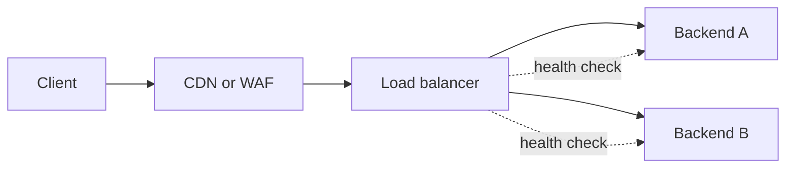

> [!info] Level: middle | Time: about 6 h | You need: [[learn/http-and-tls|Networking 04: HTTP and TLS]] | Lab: Option A, the Ubuntu LTS VM from [[learn/lab-setup|Start 01: Set up your lab]]

This is the last networking lesson, and the one that ties the others together. Real traffic rarely goes from a client straight to an application. It passes proxies, load balancers, NAT gateways and firewalls, and each of them can change, refuse or lose it. When something breaks, you need a method that finds the failing hop without guessing. This lesson builds the pieces in your lab, breaks them on purpose, and ends with a triage method and a runbook you write yourself.

The commands and configuration below were not run for this lesson, except that the two firewall rule sets (`nft -c`) and the backend script were syntax-checked. All output is illustrative. Use only `example.com` and the documentation ranges `192.0.2.0/24`, `198.51.100.0/24` and `203.0.113.0/24` in notes and tickets, never real addresses.

## What you will learn

- The difference between a forward proxy, a reverse proxy and a load balancer, and what Layer 4 and Layer 7 balancing can route on.
- Balancing algorithms, session affinity, and how health checks work (and how the wrong path hides a broken app).
- TLS termination versus re-encryption, and how the real client address survives a proxy (`X-Forwarded-For`, PROXY protocol).
- How NAT works (SNAT, DNAT, connection tracking) and why NAT gateways run out of ports.
- Stateless versus stateful firewalls, default deny, rule order, GCP firewall rules and on-host `nftables`.
- A bottom-up method for troubleshooting, the tools for each layer, and how to capture packets safely.

## Proxies and load balancers

Three words are often mixed up.

- A **forward proxy** acts for the clients. Clients send their requests to it, and it sends them on to the internet. Examples are a corporate proxy and an egress proxy that restricts where workloads can go.
- A **reverse proxy** acts for the servers. Clients think they talk to the site, and the proxy forwards to one or more servers behind it. It can terminate TLS, cache, compress and add headers.
- A **load balancer** (LB) is a reverse proxy, or a packet forwarder, whose main job is to spread requests across several backends and to stop sending to broken ones.

The product you meet in practice is usually all three at once: nginx, HAProxy, Envoy or a cloud load balancer that terminates TLS, balances and rewrites headers.



### Layer 4 and Layer 7

The layers come from [[learn/network-layers-tcp-and-udp|Networking 01]]. A balancer works at one of two levels.

| Property            | Layer 4 (transport)                                     | Layer 7 (application)                                   |
| ------------------- | ------------------------------------------------------- | ------------------------------------------------------- |
| Sees                | IP addresses, ports, TCP or UDP                         | Full HTTP request: host, path, headers, cookies, method |
| Routes on           | Source and destination address and port                 | Host name, URL path, header, cookie, and so on          |
| TLS                 | Usually passes it through untouched (it cannot read it) | Terminates it, or terminates and re-encrypts            |
| Cost                | Low; works for any protocol over TCP or UDP             | More CPU; understands HTTP only                         |
| Can fix up requests | No                                                      | Yes: redirects, header changes, retries, compression    |
| Failure you notice  | Connection refused or reset, timeouts                   | HTTP status codes: `502`, `503`, `504`                  |

Choose Layer 4 for non-HTTP protocols, for lowest overhead, or when the backend must see the client's own TLS session. Choose Layer 7 when you need host-based or path-based routing, header control or per-request retries.

> [!warning] Check before relying on this
> Not verified: Google Cloud product names and capabilities change. At the time of writing, the family includes Application Load Balancers (Layer 7 HTTP and HTTPS), proxy Network Load Balancers (Layer 4 proxies for TCP) and passthrough Network Load Balancers (Layer 4 packet forwarding that preserves the client address), each in external and internal forms. Confirm the current names, features and limits in the Cloud Load Balancing documentation before you pick one.

### Balancing algorithms and affinity

| Algorithm                | How it picks                                 | Good for                                              |
| ------------------------ | -------------------------------------------- | ----------------------------------------------------- |
| Round robin              | Each backend in turn                         | Equal backends, similar request cost                  |
| Weighted round robin     | In turn, in proportion to a weight           | Mixed backend sizes, and gradual rollouts             |
| Least connections        | The backend with the fewest open connections | Long or uneven requests                               |
| Hash (IP, header or URL) | A hash of a key picks the backend            | Cache locality, affinity without cookies              |
| Random with two choices  | Pick two at random, take the less loaded     | Large fleets, avoids herding on a "least loaded" node |

**Session affinity** (sticky sessions) sends one client to the same backend again, by cookie or by client address hash. It is a workaround for apps that keep state in memory. It makes load uneven and loses the session when that backend goes away. Prefer stateless backends with shared state in a database or cache, and use affinity only where it is really needed.

### Health checks

A balancer must stop sending traffic to a backend that cannot serve it.

- **Active** checks: the balancer calls the backend itself, on an interval, for example `GET /healthz` expecting `200`. They find a failure even when no user traffic arrives.
- **Passive** checks: the balancer watches real traffic and marks a backend down after errors or timeouts. They need no extra requests, but they notice only after users were hit. nginx's open-source `max_fails` and `fail_timeout` are passive. Active checks in nginx need a commercial feature or another tool (verify for your version).

Two classic mistakes:

1. **The check hits the wrong path or port.** The balancer checks `/` which returns `200` from a static page, while the real API on another path is broken. Or it checks a port the app does not use, so every backend is "unhealthy" and traffic stops. In Google Cloud, the health-check probes come from Google-owned source ranges; a firewall rule that blocks them makes every backend look dead (look up the ranges in the current docs, do not copy them from memory).
2. **The check is too shallow.** `/healthz` returns `200` as long as the process is alive, even when the database is unreachable. The balancer reports healthy while every real request fails. A check that is too deep is bad as well: if every backend checks a shared dependency and it blips, all of them drop out at once and you have an outage that the check created. A good compromise: a readiness check for what this instance needs to serve (its own warm-up, its local config) and alerts, not health checks, for shared dependencies.

### TLS termination and re-encryption

Where does TLS end? Three common designs:

| Design        | What happens                                                              | Trade-off                                                               |
| ------------- | ------------------------------------------------------------------------- | ----------------------------------------------------------------------- |
| Passthrough   | A Layer 4 balancer forwards the encrypted stream; the backend terminates  | The LB cannot read or route on HTTP; end-to-end encryption              |
| Termination   | The LB decrypts; plain HTTP inside the network                            | Simplest; traffic is unencrypted behind the LB, so protect that network |
| Re-encryption | The LB decrypts, inspects, then opens a new TLS connection to the backend | Encrypted on both legs; double the certificates to manage               |

With termination or re-encryption, the certificate users see is on the load balancer, which is why [[learn/http-and-tls|expiry monitoring]] must test the public endpoint. The backend's own certificate matters only when the LB re-encrypts.

### Keeping the real client address

When a proxy opens its own connection to the backend, the backend sees the proxy's address, not the client's. Two ways to pass the client address on:

- **HTTP headers.** `X-Forwarded-For` (XFF) is a de-facto header holding a list of addresses. Each proxy appends the address of the peer that connected to it. The standard `Forwarded` header (RFC 7239) does the same in a defined format. These work only for HTTP.
- **PROXY protocol.** The proxy prepends a small header with the original source and destination to the TCP stream, before the payload. It works for any protocol and is defined in the HAProxy PROXY protocol specification. Both sides must be configured for it. If only one side expects it, the connection fails with garbage or a "broken header" style error.

**The trust rule:** a client can send its own `X-Forwarded-For`. A proxy that appends to what it received therefore produces `203.0.113.9, 198.51.100.4`, where the left-most address is a claim by the client. Never take the left-most entry as the client address for allow lists or rate limits unless every hop is yours and the first one overwrites the header instead of appending. Use the right-most address that was added by a proxy you trust, or have the edge set the header from the real peer address. You will see forgery in exercise 5.

Why this is dangerous: if an app grants access to "internal" addresses by reading XFF, an outside client who sends `X-Forwarded-For: 10.0.0.5` can act as an insider. Rate limits and audit logs are fooled the same way.

Google Cloud's external Application Load Balancer adds the client address to `X-Forwarded-For` itself, in a documented position; read the documentation for the exact format before you parse it (verify).

## NAT

**Network Address Translation** rewrites addresses in packets as they pass a router.

- **SNAT** (source NAT) rewrites the source. Many private hosts share one public address for outgoing traffic. In Linux this is called masquerading when the public address is dynamic. Replies come back to the NAT device, which maps them to the right private host.
- **DNAT** (destination NAT) rewrites the destination. Traffic sent to a public address and port is forwarded to a private host and port. Port forwarding and some load balancers work this way.

To translate replies, the device keeps a table of flows. On Linux this is **conntrack** (connection tracking). Each entry records the original tuple (source, destination, ports) and the reply tuple, plus a state and a timeout. The same table also lets a stateful firewall know that a packet belongs to an existing connection.

### Port exhaustion

A connection is identified by the four-tuple: source address, source port, destination address and destination port. A NAT gateway sharing one public source address must give each outgoing connection to the **same destination address and port** a different source port. There are only about 64,000 usable ports per source address, so a single gateway address can hold only that many simultaneous connections to one destination. When many instances call the same API through one NAT address, the ports run out. New connections are dropped or time out, while established ones keep working. The symptoms are intermittent connect timeouts from private workloads to one popular external service, mostly under load.

What helps: more NAT addresses, longer-lived connections (keep-alive and connection pools instead of a new connection per request), and tuning how many ports each VM may use. In Google Cloud, Cloud NAT exposes per-VM minimum port settings and logs and metrics for dropped connections; read the current Cloud NAT documentation for the setting names and defaults (not verified here). See [[runbooks/network-troubleshooting-dns-mtu-tls-load-balancers]] for the cloud-side checks.

A full conntrack table on a Linux gateway causes similar drops. The kernel logs a message like `nf_conntrack: table full, dropping packet`. Check with `sudo conntrack -C` (the count) against `sysctl net.netfilter.nf_conntrack_max`.

## Firewalls

A firewall decides which packets pass. Two properties matter first.

| Kind      | How it judges                                                        | What you must write                                       |
| --------- | -------------------------------------------------------------------- | --------------------------------------------------------- |
| Stateless | Each packet alone, by addresses, ports and flags                     | A rule for each direction, including return traffic       |
| Stateful  | Tracks connections; replies to allowed connections pass on their own | A rule for the direction in which connections are started |

Most modern firewalls are stateful. A stateful firewall that allows inbound TCP 443 automatically lets the replies out. It needs a state entry, which is why **asymmetric routing** (a reply that returns by another path and never meets the firewall that saw the request) gets dropped as "not part of a known connection".

Good practice:

- **Default deny.** Block everything and allow only what is needed. The rule that remains after all the others should be the deny.
- **Order matters** in rule lists that are evaluated top to bottom (nftables chains, iptables, network ACLs): the first matching terminal rule wins. A broad `accept` above a narrow `drop` makes the `drop` dead. In systems that use a priority number (Google Cloud), the lowest number wins.
- **Drop and reject differ in what the client sees.** `reject` sends an answer ("port unreachable" or a TCP reset), so the client fails at once with _connection refused_. `drop` says nothing, so the client waits and ends with a _timeout_. This difference is one of the most useful clues in troubleshooting.

### GCP firewall rules

In Google Cloud, firewall rules are defined on the VPC network and applied to instances by target tags or service accounts. In brief:

- They are stateful: if a rule allows a connection, return traffic is allowed.
- Every VPC has implied rules at the lowest priority: deny all ingress and allow all egress.
- A rule has a priority number, a direction (ingress or egress), an action (allow or deny), a target and a source or destination. The rule with the lowest priority number that matches wins; ties are resolved with deny before allow.
- Health-check and proxy traffic from Google's infrastructure needs explicit allow rules.

> [!warning] Check before relying on this
> Not verified here: the priority range and default, how ties are resolved, and the implied rules are as described in the VPC firewall documentation at the time of writing. Also check whether firewall policies at the folder or organisation level apply in your project, because they are evaluated before VPC rules. Read the current VPC firewall rules documentation before you change a production rule.

### On-host firewall with nftables

On a Linux host, `nftables` is the current packet filtering framework (it replaces the older `iptables` front ends on current distributions). Rules live in tables and chains. A base chain is attached to a hook such as `input` and has a **policy** that applies when no rule ends the decision.

A small, safe-by-default host firewall, as a file you can check without applying:

```text title="lab-fw.nft"
#!/usr/sbin/nft -f
table inet lab_fw {
  chain input {
    type filter hook input priority 0; policy drop;
    iif "lo" accept
    ct state invalid drop
    ct state established,related accept
    icmp type { echo-request, destination-unreachable, time-exceeded } accept
    meta l4proto ipv6-icmp accept
    tcp dport 22 ip saddr 203.0.113.0/24 accept
    tcp dport { 80, 443 } accept
  }
  chain forward {
    type filter hook forward priority 0; policy drop;
  }
  chain output {
    type filter hook output priority 0; policy accept;
  }
}
```

Things to change and why: the SSH source range `203.0.113.0/24` is a documentation range, so replace it with the range your administrators really connect from, or you lock yourself out of a remote host. `policy drop` on input is the default-deny stance. `ct state established,related accept` is what makes the firewall stateful. It sits before the specific rules so that replies and related packets pass quickly. The `forward` chain drops by default, so this host does not route for others unless you decide that it should.

Check the syntax without loading the rules with `sudo nft -c -f lab-fw.nft`. No output and exit code 0 means the file parses. The rule sets in this lesson were checked this way. Do not load a default-drop input policy on a remote machine unless you can reach its console.

## A troubleshooting method

A network problem has too many possible causes to think your way to. Use a method that cuts the search space.

1. **State the symptom precisely.** What is failing, from where, since when, for whom. "Site is down" becomes "`curl https://shop.example.com` from the office returns a timeout; from a phone it works; it began at 10:05".
2. **Check each layer from the bottom up.** Do not skip a layer because it feels unlikely. The usual order: name resolution, network path and routing, port reachability, TLS, HTTP, application.
3. **Change one thing at a time**, and note what you changed and what happened. Undo changes that did not help.
4. **Compare a working and a failing case.** Different source, different destination, different time. The difference points to the cause.
5. **Write down what you find**, as you go. It is your timeline for the incident ([[runbooks/incident-response]]).

This follows the approach in Google's SRE material on effective troubleshooting: form a hypothesis from the symptoms, test it, and treat the test result as data rather than as proof of your guess.

### The tools, by layer

| Layer or question             | Command                                                | What it tells you                                                                          |
| ----------------------------- | ------------------------------------------------------ | ------------------------------------------------------------------------------------------ |
| Name resolution               | `dig +short NAME`, `getent hosts NAME`                 | What DNS says, and what the application will see ([[learn/dns-resolution\|Networking 03]]) |
| Local config                  | `ip addr`, `ip route get ADDRESS`                      | Which interface and gateway the host will use for that destination                         |
| Reachability (maybe)          | `ping -c 3 ADDRESS`                                    | Whether ICMP echo is answered. Many networks block it, so a failure proves little.         |
| Path                          | `traceroute -n ADDRESS`, `mtr -n --report ADDRESS`     | Which hops answer, and where loss or delay starts                                          |
| Port                          | `nc -vz ADDRESS PORT`, `curl -v telnet://ADDRESS:PORT` | Whether a TCP connection can be opened                                                     |
| Sockets on this host          | `ss -tanp`, `ss -ltnp`                                 | Listening sockets, connection states, and which process owns them                          |
| TLS                           | `openssl s_client -connect HOST:PORT -servername HOST` | The certificate and chain the server really sends ([[learn/http-and-tls\|Networking 04]])  |
| HTTP                          | `curl -v URL`, `curl -w` timing                        | Status, headers, redirects, and where time goes                                            |
| Packets                       | `sudo tcpdump -nn -i IFACE 'FILTER'`                   | What really crosses the wire, which settles arguments                                      |
| MTU                           | `ping -M do -s 1472 ADDRESS`, `tracepath -n ADDRESS`   | The largest packet that passes without fragmenting                                         |
| Firewall and NAT on this host | `sudo nft list ruleset`, `sudo conntrack -L`           | Rules in force, and tracked flows                                                          |

### Symptom to layer

The failure message already says a lot. Learn this table.

| What you see                                                         | Most likely layer and cause                                                     |
| -------------------------------------------------------------------- | ------------------------------------------------------------------------------- |
| `Could not resolve host` (curl exit 6)                               | DNS: wrong name, no record, resolver unreachable                                |
| Connection **timed out** (curl exit 28, or `SYN-SENT` stuck in `ss`) | Packets are dropped: firewall `drop`, wrong address, routing hole, host down    |
| Connection **refused** (curl exit 7)                                 | The host answered, nothing listens on that port, or a firewall `reject`         |
| `No route to host` or `Network is unreachable`                       | Routing: no route, or an ICMP "unreachable" from a router                       |
| TLS error, curl exit 35 or 60                                        | TLS: certificate, name, chain, protocol ([[learn/http-and-tls\|Networking 04]]) |
| `502 Bad Gateway`                                                    | The proxy reached the backend, which refused, reset or sent garbage             |
| `503 Service Unavailable`                                            | No healthy backend, or the app is shedding load                                 |
| `504 Gateway Timeout`                                                | The backend is up but too slow or silent                                        |
| `4xx`                                                                | The request: authentication, permissions, a bad path                            |
| Small requests work, big responses hang                              | MTU or fragmentation, a firewall dropping ICMP "fragmentation needed"           |
| Works from one source, not another                                   | Source-based rule, NAT, an asymmetric path, or a split-horizon DNS difference   |
| Works for minutes, then new connections fail under load              | NAT port exhaustion, conntrack table full, or connection limits                 |

A very useful trick follows from the _timeout versus refused_ rule. A connect that fails **fast** means something answered (nobody listening, or a reject). A connect that **hangs** means packets vanish (a drop or no route). Look in a different place for each.

### Reading traceroute

`traceroute` sends probes with a growing time-to-live; each router that discards a probe sends back an ICMP "time exceeded" message, which reveals the hop.

```text
$ traceroute -n 198.51.100.50
traceroute to 198.51.100.50 (198.51.100.50), 30 hops max, 60 byte packets
 1  192.0.2.1  0.521 ms  0.489 ms  0.472 ms
 2  203.0.113.1  1.912 ms  1.875 ms  1.861 ms
 3  * * *
 4  198.51.100.9  8.342 ms  8.311 ms  8.299 ms
 5  198.51.100.50  8.901 ms  8.877 ms  8.860 ms
```

_Illustrative._ Hop 3 shows stars: no answer to the probes. That alone is **not** a fault. Many routers do not send "time exceeded", rate-limit it, or filter it, yet forward your traffic normally. Look at what follows: if later hops answer and the destination is reached, hop 3 is just silent. If every hop after it also shows stars and the destination is never reached, the path ends at or after hop 3 (or probes are being dropped there). Also remember that a `traceroute` shows the path _to_ the destination only. The path back can be different.

**Asymmetric return paths** are a classic cause of strange failures. The request goes out by one route and the reply returns by another. A stateful firewall or NAT on one route sees only one direction and drops the traffic as if it were invalid. A cloud router with several paths, a multi-homed server, or a VPN with a second route can cause it. Check routing from both ends.

### MTU

The **MTU** is the largest packet a link carries. Ethernet is typically 1500 bytes; tunnels, VPNs and some cloud networks use less. When a packet is too big and the sender sets "do not fragment" (as TCP usually does), the router should send back an ICMP "fragmentation needed" message so the sender shrinks its packets (path MTU discovery). If a firewall blocks those ICMP messages, large packets vanish silently while small ones work. TCP then hangs after the handshake and small request, and stalls on the big response. This is why the nftables example above allows `destination-unreachable`.

Test with:

```bash
ping -M do -s 1472 -c 3 198.51.100.50
```

`1472` bytes of payload plus 28 bytes of ICMP and IP headers is a 1500-byte packet. If it fails and a smaller size works, find the size that passes. The value for Google Cloud VPC networks is documented; it can be less than 1500, so check the current default for your network (not verified here).

### Packet capture, safely

`tcpdump` settles arguments about what is really on the wire, but a capture is also a copy of other people's traffic.

> [!warning] Capture only with approval, and keep it small
> A packet capture can hold credentials, tokens, personal data and internal addresses, even when the application uses TLS (DNS names, handshake metadata and any plain protocols stay visible). Capture only with the approval of the service owner or incident commander, on the narrowest scope that answers the question, for the shortest time, and delete the file when you are done.

Rules to follow:

- Use a **filter** (`host`, `port`) and a **limit** (`-c COUNT`, or a time limit) so the capture is small and ends by itself.
- Use a short **snap length** (`-s 96`) when you only need headers.
- Write with `-w FILE` into a directory only you can read (create the file with `umask 077`), and read it back with `-r`.
- Do not attach captures to tickets, chat or email. Share the few lines you need.
- **Delete** the file after use, and never leave `tcpdump` running unattended.
- Inside Kubernetes, use the approach in [[runbooks/kubernetes-packet-capture]].

## Hands-on exercises

Build a small load-balanced service in the lab VM, break it, and read the evidence. Everything listens on the loopback address `127.0.0.1` only.

Install the tools you need: `sudo apt install -y nginx tcpdump conntrack nftables traceroute mtr-tiny netcat-openbsd curl`. Save the backend as `~/backend.py`:

```python title="~/backend.py"
#!/usr/bin/env python3
"""A tiny lab backend. Usage: backend.py NAME PORT"""
import sys
import time
from http.server import BaseHTTPRequestHandler, ThreadingHTTPServer

NAME = sys.argv[1]
PORT = int(sys.argv[2])


class Handler(BaseHTTPRequestHandler):
    def do_GET(self):
        if self.path == "/healthz":
            body = "ok\n"
        elif self.path == "/slow":
            time.sleep(10)
            body = f"slow answer from {NAME}\n"
        elif self.path == "/headers":
            keys = ("X-Forwarded-For", "X-Real-IP", "X-Forwarded-Proto", "Host")
            lines = [f"{k}: {self.headers.get(k, '-')}" for k in keys]
            body = f"{NAME} saw peer {self.client_address[0]}\n" + "\n".join(lines) + "\n"
        else:
            body = f"hello from {NAME}\n"
        data = body.encode()
        self.send_response(200)
        self.send_header("Content-Type", "text/plain")
        self.send_header("Content-Length", str(len(data)))
        self.end_headers()
        self.wfile.write(data)

    def log_message(self, fmt, *args):
        sys.stderr.write(f"{NAME} {self.address_string()} {fmt % args}\n")


if __name__ == "__main__":
    ThreadingHTTPServer(("127.0.0.1", PORT), Handler).serve_forever()
```

It answers `/` with its own name, `/healthz` with `ok`, `/headers` with what it saw, and `/slow` after 10 seconds. It is a lab toy: it has no authentication and logs to standard error, so do not use it for anything real.

Now the nginx configuration:

```nginx title="/etc/nginx/conf.d/lab-lb.conf"
upstream lab_app {
    server 127.0.0.1:9001 max_fails=1 fail_timeout=10s;
    server 127.0.0.1:9002 max_fails=1 fail_timeout=10s;
}

server {
    listen 127.0.0.1:8081;
    server_name lb.lab.example.com;

    location / {
        proxy_pass http://lab_app;
        proxy_set_header Host              $host;
        proxy_set_header X-Real-IP         $remote_addr;
        # Overwrite, do not append: this proxy is the first trusted hop.
        proxy_set_header X-Forwarded-For   $remote_addr;
        proxy_set_header X-Forwarded-Proto $scheme;
        proxy_connect_timeout 2s;
        proxy_read_timeout    5s;
    }

    # Deliberately unsafe: appends whatever the client sent.
    location /append/ {
        proxy_pass http://lab_app/;
        proxy_set_header X-Forwarded-For $proxy_add_x_forwarded_for;
    }
}
```

Things to change and why: nothing, for the lab. In production, `proxy_read_timeout` must be longer than your slowest legitimate request, and `max_fails`/`fail_timeout` need tuning to your traffic. The second location exists only so that you can see the unsafe behaviour.

1. **Start two backends.** In two spare terminals (or with `&` in one), run `python3 ~/backend.py a 9001` and `python3 ~/backend.py b 9002`. Then run `curl -s http://127.0.0.1:9001/` and `curl -s http://127.0.0.1:9002/`.
   Expected: `hello from a` and `hello from b`.
   If you see something else: `Address already in use` means a port is taken; run `ss -ltnp | grep -E '9001|9002'`. `Connection refused` means the backend is not running.

2. **Put nginx in front and watch the balancing.** Save the configuration, then `sudo nginx -t && sudo systemctl reload nginx`, then:

   ```bash
   for i in 1 2 3 4; do curl -s http://127.0.0.1:8081/; done
   ```

   Expected: `hello from a`, `hello from b`, `hello from a`, `hello from b`. Round robin is nginx's default and alternates.
   If you see something else: `502 Bad Gateway` as HTML means nginx cannot reach the backends; go back to step 1. The default nginx welcome page means your request went to port 80, not 8081.

3. **Stop one backend and read the upstream error.** Stop backend `b` (Ctrl-C in its terminal, or `pkill -f 'backend.py b 9002'`). Then:

   ```bash
   for i in 1 2 3 4; do curl -s -o /dev/null -w '%{http_code}\n' http://127.0.0.1:8081/; done
   sudo grep -i 'connect() failed' /var/log/nginx/error.log | tail -n 3
   ```

   Expected: four `200` lines. The users saw no error, because by default nginx tries the next backend when a connection fails. The error log shows one line like `connect() failed (111: Connection refused) while connecting to upstream, client: 127.0.0.1, server: lb.lab.example.com, request: "GET / HTTP/1.1", upstream: "http://127.0.0.1:9002/", host: "127.0.0.1:8081"`. Only one line, because after `max_fails=1` nginx stops using that backend for `fail_timeout` (10 s).
   If you see something else: if you see several error lines every request, `max_fails` or `fail_timeout` was not applied; check that the file was reloaded. Wait over 10 s and request again and you will get one more line, when nginx probes the backend again.

4. **Make a 502, then a 504.** Stop backend `a` as well and request `/`. Then start both backends again and request `/slow`.

   ```bash
   curl -s -o /dev/null -w '%{http_code}\n' http://127.0.0.1:8081/
   python3 ~/backend.py a 9001 2>/dev/null &
   python3 ~/backend.py b 9002 2>/dev/null &
   sleep 11
   curl -s -o /dev/null -w '%{http_code} %{time_total}s\n' --max-time 30 http://127.0.0.1:8081/slow
   sudo tail -n 3 /var/log/nginx/error.log
   ```

   Expected: `502` for the first request, and the log shows `connect() failed (111: Connection refused)` or `no live upstreams while connecting to upstream`. After restarting, the `/slow` request returns `504` after about 10 seconds (illustrative: `504 10.0s`), because nginx waits 5 s for each of two backends. The log shows `upstream timed out (110: Connection timed out) while reading response header from upstream`.
   If you see something else: if `/slow` returns `200` after 10 s, `proxy_read_timeout` was not set to 5 s. If `/slow` returns `502`, a backend is not running. The point to keep: `502` came fast and meant "refused", `504` came slowly and meant "no answer in time".

5. **Forge a client address.** Compare the safe location with the unsafe one:

   ```bash
   curl -s -H 'X-Forwarded-For: 203.0.113.9' http://127.0.0.1:8081/headers
   curl -s -H 'X-Forwarded-For: 203.0.113.9' http://127.0.0.1:8081/append/headers
   ```

   Expected: the first output shows `X-Forwarded-For: 127.0.0.1`, the real peer, because the config overwrites the header. The second shows `X-Forwarded-For: 203.0.113.9, 127.0.0.1`: the forged value is the left-most entry. An application that trusts the left-most address believes the client is `203.0.113.9`.
   If you see something else: if both show `127.0.0.1`, nginx used the main location for `/append/`; check the trailing slashes. If both show the forged value, the first location is not overwriting: look at the `proxy_set_header X-Forwarded-For` line.

6. **Simulate a firewall that drops.** Load a rule that drops new connections to backend `b`, and compare with the earlier "refused" case:

   ```bash
   sudo nft add table inet lab
   sudo nft 'add chain inet lab input { type filter hook input priority 0 ; policy accept ; }'
   sudo nft add rule inet lab input ct state established,related counter accept
   sudo nft add rule inet lab input tcp dport 9002 counter drop
   sudo nft list ruleset
   for i in 1 2 3; do curl -s -o /dev/null -w '%{http_code} %{time_total}s\n' http://127.0.0.1:8081/; done
   sudo grep -i 'timed out' /var/log/nginx/error.log | tail -n 2
   ```

   Expected: `nft list ruleset` shows the table, the established-and-related rule and a rule `tcp dport 9002 counter packets N bytes M drop`. One request is slow (about 2 s, the `proxy_connect_timeout`) and still returns `200`, served by backend `a`. The error log shows `upstream timed out (110: Connection timed out) while connecting to upstream` for port 9002. Compare with exercise 3: a `drop` gives a timeout, a stopped listener gives _refused_.
   If you see something else: if no request is slow, nginx had already marked `b` down; wait 10 s and repeat. If `nft` complains about the `ct` rule, the kernel module may be missing; this is unusual on Ubuntu.
   Clean up: `sudo nft delete table inet lab`.

7. **Look at connection tracking.** Generate a few requests and list tracked flows:

   ```bash
   for i in 1 2 3; do curl -s -o /dev/null http://127.0.0.1:8081/; done
   sudo conntrack -L 2>/dev/null | grep 'dport=8081' | head -n 3
   sudo conntrack -C
   ```

   Expected: lines like `tcp 6 117 TIME_WAIT src=127.0.0.1 dst=127.0.0.1 sport=51234 dport=8081 src=127.0.0.1 dst=127.0.0.1 sport=8081 dport=51234 [ASSURED] mark=0 use=1` (illustrative). Each shows the original direction, then the expected reply direction. `conntrack -C` prints the number of tracked flows.
   If you see something else: no output means conntrack is not tracking traffic on this host, which happens when no firewall or NAT rule uses it. Repeat exercise 6 first (its rule loads the module), run this exercise, then delete the table.

8. **Check the firewall file.** Save the `lab-fw.nft` example from this lesson and run `sudo nft -c -f lab-fw.nft; echo "exit: $?"`.
   Expected: no output and `exit: 0`. Edit one keyword to something invalid (for example change `accept` to `acept`) and run it again.
   Expected: an error such as `Error: syntax error, unexpected ...` with a caret under the problem, and a non-zero exit.
   If you see something else: if `nft` says `command not found`, install it. If you get `Operation not permitted`, you forgot `sudo`. Do not load this file with `nft -f` on a remote machine.

9. **Inject a DNS fault and diagnose it.** Make the name point at an address where nothing answers:

   ```bash
   echo "192.0.2.55 lb.lab.example.com" | sudo tee -a /etc/hosts
   dig +short lb.lab.example.com
   getent hosts lb.lab.example.com
   curl -sS -m 5 -o /dev/null http://lb.lab.example.com:8081/; echo "exit: $?"
   ```

   Expected: `dig` prints nothing (DNS has no such name). `getent` prints `192.0.2.55 lb.lab.example.com`. `curl` fails with `curl: (28) Connection timed out after 5001 milliseconds` and `exit: 28`. While it waits, run `ss -tan state syn-sent` in a second terminal: you see a `SYN-SENT` socket to `192.0.2.55:8081`. Resolution "worked" (the application found an address), but the connection never completes, because that documentation address goes nowhere.
   If you see something else: `Network is unreachable` means the VM has no default route, so the packets cannot even leave. `Connection refused` means something answered at that address, which should not happen in the documentation range.
   Clean up: `sudo sed -i '/lb.lab.example.com/d' /etc/hosts`, then `getent hosts lb.lab.example.com` prints nothing.

10. **Capture and read back a few packets.** In one terminal:

    ```bash
    umask 077
    sudo tcpdump -i lo -nn -s 96 -c 20 -w /tmp/lab-lb.pcap 'tcp port 8081'
    ```

    In a second terminal run `curl -s http://127.0.0.1:8081/ >/dev/null`. When `tcpdump` stops (after 20 packets or Ctrl-C), read the file:

    ```bash
    sudo tcpdump -nn -r /tmp/lab-lb.pcap | head -n 8
    ```

    Expected (illustrative): the first lines are the TCP handshake, `Flags [S]`, `Flags [S.]`, `Flags [.]`, then `Flags [P.]` with a `GET`-sized `length`, and `Flags [F.]` at the end. That is SYN, SYN-ACK, ACK, the request, and the close, all against port 8081.
    If you see something else: no packets means the filter or interface is wrong. Traffic to `127.0.0.1` goes over `lo`, not `eth0`. Fewer than 20 packets is fine; press Ctrl-C.
    Clean up: `sudo rm /tmp/lab-lb.pcap`. This is the routine for every real capture: small, restricted, deleted.

11. **Write the runbook for "502 from the LB".** Using the template below and exercises 3 and 4, write a one-page runbook for your lab service. Each step names the command and what each result means.
    Expected: a file where someone who has never seen your lab can follow the first ten minutes: check, decide, mitigate, escalate.
    If you see something else: if your runbook says "investigate the backend" without a command, make it concrete. A reader at 3 a.m. should not have to invent the command.

    ```markdown
    # 502 from the load balancer: <service name>

    Symptom: users get 502 on <URL>. Owner: <team>. Last reviewed: <date>.

    ## First five minutes

    1. Confirm: `curl -sv <URL>`; note the time and any request ID.
    2. Scope: all paths or one? all users or one region/source?
    3. Recent change? Check the deploy and config history. If yes, consider rollback first.

    ## Checks, in order

    1. Are backends healthy in the LB? (command / console path) -> none healthy: go to "Backends".
    2. Can the LB reach one backend directly? (command) -> refused or timeout: go to "Network".
    3. Does the backend answer on its own? (command) -> error: go to "Application".

    ## Mitigation

    - Roll back the last release: <link to rollback runbook>.
    - Add capacity / restart unhealthy backends: <command>.

    ## Escalate when

    - No improvement after 15 minutes, or user impact is wide: start the incident process.

    ## After

    - Record the timeline; open a follow-up for the cause.
    ```

When you finish, clean up: stop the backends (`pkill -f backend.py`), `sudo rm /etc/nginx/conf.d/lab-lb.conf`, `sudo systemctl reload nginx`, and check `sudo nft list ruleset` shows no `lab` table.

## Common mistakes

- **Trusting the left-most `X-Forwarded-For`.** A client can write anything there. Take the address added by your own trusted proxy, or have the edge overwrite the header.
- **A health check that always says yes.** `/healthz` returns `200` while the app cannot serve. Make the check reflect whether this instance can serve, and keep a separate alert for shared dependencies.
- **A health check on the wrong port or path.** Every backend looks unhealthy and traffic stops, or a broken path looks fine. Check the exact path and port, and the firewall for the probe sources.
- **Using `ping` to prove the network is fine.** ICMP is often blocked, and a reply says nothing about your TCP port. Test the real port with `nc -vz` or `curl`.
- **Reading stars in `traceroute` as the fault.** Silent hops are normal. Look at whether later hops and the destination answer.
- **Not telling `drop` from `reject`.** A timeout and a refusal point at different places. Use the fast-or-hang clue before anything else.
- **Making two changes at once.** If you change the DNS entry and the firewall at once, you do not know which one fixed it. One change at a time, and log it.
- **Capturing packets without approval or cleanup.** The file contains other people's data. Filter, limit, protect and delete.
- **Trusting NAT for unlimited connections.** A gateway address has a finite number of ports per destination. Reuse connections and watch the port metrics.
- **Forgetting the return path.** A rule allows the request but a different route carries the reply, and a stateful device drops it. Check both directions.

## Check your understanding

1. Why is it dangerous to use the left-most `X-Forwarded-For` value for an access rule, and what is a safer way?
2. A load balancer reports all backends healthy, yet users get errors. Give two causes related to the health check.
3. In `traceroute`, hop 5 shows `* * *` but hops 6 and 7 answer and the destination is reached. Is hop 5 a problem?
4. What does an asymmetric return path do to a stateful firewall?
5. A connection attempt fails after 0.02 seconds with "connection refused", another fails after 5 seconds with a timeout. What does each suggest?
6. Private workloads call one external API through a single NAT address. Under load, new connections to it time out while existing ones work. What do you suspect and what do you try?

> [!question]- Answers
>
> 1. The client controls its own header, so the left-most entry can be forged to look like an internal or allowed address. Use the address your own trusted proxy appended (the right-most trusted entry), or have the first proxy overwrite the header from the real peer address, and trust forwarded headers only from known proxies.
> 2. The check tests something shallow (the process is alive, a static page) while the real function is broken, or it tests the wrong path or port. In the other direction, a health check that depends on a shared service can mark every backend down at once. Either way the check does not reflect whether a backend can serve real requests.
> 3. No. Many routers do not answer or rate-limit the probes yet forward traffic. Because later hops and the destination answer, the path works. Only a path that ends in stars and never reaches the destination points to a problem.
> 4. The device sees only one direction of the flow. Traffic that arrives for a connection it never saw start looks invalid, so a stateful firewall or NAT drops it, and the connection stalls even though the rules allow it. Fix the routing so both directions cross the same device, or use rules for that case.
> 5. A fast "refused" means a host answered and no process listens on the port, or a firewall rejected it. A timeout means packets were dropped or never arrived: a `drop` rule, a wrong address, a routing hole or a down host.
> 6. Port exhaustion on the NAT address: it can give only about 64,000 ports for connections to one destination address and port. Try more NAT addresses, reuse connections with keep-alive and pools, check the NAT gateway's port settings and drop metrics, and spread the load.

## Next steps

Next lesson: [[learn/git-mental-model-and-daily-workflow|Git 01: The mental model and the daily workflow]]. Previous lesson: [[learn/http-and-tls|Networking 04: HTTP and TLS]]. You will meet this material again in [[learn/gcp-vpc-compute-and-cloud-sql|GCP 03: VPC, Compute Engine and Cloud SQL]], where the VPC and firewall rules are real cloud resources.

For going deeper as a senior engineer:

- [[runbooks/incident-response]] for how to run an incident while you troubleshoot.
- [[patterns/kubernetes-network-policies]] for the same default-deny idea inside a cluster.
- [[runbooks/network-troubleshooting-dns-mtu-tls-load-balancers]] for a symptom-first runbook on GKE and GCP.
- [[runbooks/kubernetes-packet-capture]] for capturing packets in a cluster.
- The whole path is mapped in [[learn/index|the learning path]].

## Sources

- nginx documentation: `ngx_http_upstream_module` and `ngx_http_proxy_module` (https://nginx.org/en/docs/). The configuration in this lesson was not run.
- nftables wiki (https://wiki.nftables.org/). The two rule sets here were checked with `nft -c`, which parses but does not load them; nftables syntax can change between versions.
- conntrack-tools documentation (https://conntrack-tools.netfilter.org/).
- RFC 7239, Forwarded HTTP extension (https://www.rfc-editor.org/rfc/rfc7239).
- HAProxy, PROXY protocol specification (https://www.haproxy.org/download/latest/doc/proxy-protocol.txt). Check the document for the current protocol versions.
- Google SRE book, "Effective Troubleshooting" (https://sre.google/sre-book/effective-troubleshooting/).
- Google Cloud documentation: Cloud Load Balancing overview, VPC firewall rules and Cloud NAT (https://cloud.google.com/docs). Not verified against the current pages; product names, defaults and limits change.
- `man 8 tcpdump`, `man 8 ss`, `man 8 traceroute` (https://man7.org/linux/man-pages/ and https://www.tcpdump.org/manpages/).
