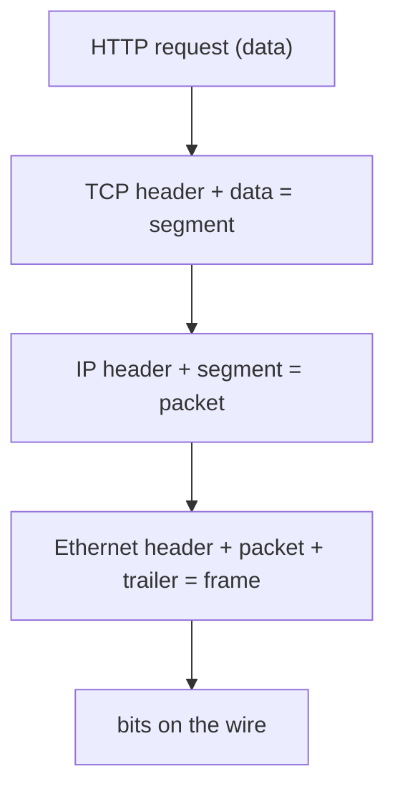
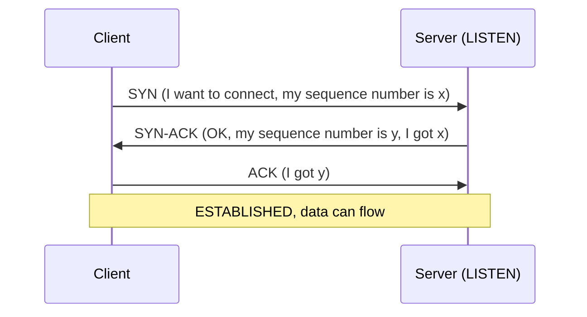

> [!info] Level: junior | Time: about 4 h | You need: [[learn/linux-services-packages-and-scheduled-jobs|Linux 05: systemd services, packages and scheduled jobs]] | Lab: Option A, the Ubuntu LTS VM from [[learn/lab-setup|Start 01: Set up your lab]] (Option B, a container, works for most exercises but not for `tcpdump` on real interfaces)

"The network is broken" is not a diagnosis. It could mean a cable, a wrong address, a closed port, a firewall, a crashed program, or a slow link. Engineers solve this by asking one question at a time, from the bottom up: can the machines reach each other, and then can the program be reached? The model of **layers** gives you the order of those questions. This lesson teaches the layers, then goes deep on the one you will debug most: the transport layer, where TCP, UDP and ports live.

## What you will learn

- Why networks are described in layers, and how the OSI model maps to the TCP/IP model you actually use.
- What encapsulation is, and the name of the data unit at each layer.
- What a MAC address, ARP and a route do, and how to look at them with `ip`.
- How a TCP connection opens and closes, what the 5-tuple is, and what each TCP state means in operations.
- Why DNS and QUIC use UDP, and how a program picks a port.
- How to read the symptoms (refused, timeout, slow) and to name the layer that is broken.

## Why layers

Sending a web page involves many separate problems: turning bits into signals on a wire, finding the next machine, finding the destination across many networks, making sure data arrives in order, and finally speaking HTTP. If one piece of software had to solve all of them, any change would break everything.

So the problems are split into **layers**. Each layer offers a service to the layer above and uses the service of the layer below, and it does not care how the others work. HTTP does not know if the packets travel over Wi-Fi or fibre. For you, the practical gain is that a failure has a layer, and you can test layer by layer instead of guessing.

### OSI and TCP/IP

Two models are in use. **OSI** has seven layers and is the vocabulary people use in meetings ("that's a layer 4 load balancer"). **TCP/IP** has four layers and describes what is actually implemented. The usual mapping:

| OSI layer    | Number | TCP/IP layer | Examples                           | Data unit (PDU)               |
| ------------ | ------ | ------------ | ---------------------------------- | ----------------------------- |
| Application  | 7      | Application  | HTTP, DNS, SSH, SMTP               | Data or message               |
| Presentation | 6      | Application  | Encoding, TLS (see the note below) | Data                          |
| Session      | 5      | Application  | Sessions, TLS (see the note below) | Data                          |
| Transport    | 4      | Transport    | TCP, UDP                           | Segment (TCP), datagram (UDP) |
| Network      | 3      | Internet     | IP, ICMP                           | Packet                        |
| Data link    | 2      | Link         | Ethernet, Wi-Fi, ARP               | Frame                         |
| Physical     | 1      | Link         | Cable, fibre, radio                | Bits                          |

> [!note] Where does TLS go?
> TLS runs on top of TCP and below HTTP. The models disagree about whether that is layer 5, 6 or just "part of the application". Do not memorise an answer; say "TLS, between transport and HTTP". See [[learn/http-and-tls|Networking 04: HTTP and TLS]].

The OSI numbers are still useful shorthand. "L2" is Ethernet and MAC addresses, "L3" is IP, "L4" is TCP/UDP and ports, "L7" is the application protocol.

### Encapsulation

When an application sends data, each layer wraps it with its own header (and the link layer also adds a trailer). This is **encapsulation**. The receiver unwraps in the opposite order.



A frame is only valid on one network segment. At every router the Ethernet header is removed and replaced with a new one for the next hop, while the IP packet inside stays the same (apart from its TTL, covered below). That is why MAC addresses are local and IP addresses are end to end.

## Layers 1 and 2: links, MAC addresses and ARP

Layer 1 is the physical medium. You rarely debug it in the cloud, but on a lab VM you can still ask if the interface is up:

```bash
ip link show
ip -br link
```

Illustrative output:

```text
lo               UNKNOWN        00:00:00:00:00:00 <LOOPBACK,UP,LOWER_UP>
enp0s3           UP             00:00:5e:00:53:10 <BROADCAST,MULTICAST,UP,LOWER_UP>
```

`lo` is the **loopback** interface, a virtual interface that only talks to the local machine. `enp0s3` is a network card (names vary: `eth0`, `ens4` and so on). `UP` with `LOWER_UP` means the interface is enabled and has a link. `NO-CARRIER` or `DOWN` points to layer 1 or to a disabled interface. The `mtu` in `ip link show` is the largest frame payload, usually 1500 bytes.

A **MAC address** (six bytes, written like `00:00:5e:00:53:10`) identifies a network card on its local network segment. Layer 2 uses MAC addresses to deliver a frame to the next device.

How does a machine find the MAC address for an IP address on its own network? It asks with **ARP** (Address Resolution Protocol, RFC 826): "who has 192.0.2.1? tell 192.0.2.50". The owner answers with its MAC address, and the answer is cached in the **neighbour table**:

```bash
ip neigh show
```

```text
192.0.2.1 dev enp0s3 lladdr 00:00:5e:00:53:01 REACHABLE
```

(Illustrative addresses from the documentation range.) States such as `REACHABLE`, `STALE` and `FAILED` tell you if the entry is fresh. `FAILED` or `INCOMPLETE` means the neighbour did not answer ARP: it is down, on another network, or blocked at layer 2. For IPv6 the same job is done by Neighbour Discovery, which `ip neigh` also shows.

## Layer 3: IP in brief

IP gives every interface an address and moves packets between networks. You will study addresses and subnets in [[learn/ip-addressing-and-subnets|Networking 02]]; here you only need to read what the host knows:

```bash
ip -br addr
ip route show default
```

```text
lo               UNKNOWN        127.0.0.1/8 ::1/128
enp0s3           UP             192.0.2.50/24
default via 192.0.2.1 dev enp0s3 proto dhcp src 192.0.2.50 metric 100
```

The first output says which addresses this machine has. The second says where packets for "everything else" go: to the **default gateway** `192.0.2.1`. A host sends a packet directly to a destination on its own subnet and to the gateway for anything else.

Every IP packet has a **TTL** (time to live, a counter, 64 on many Linux hosts and 128 on others). Each router decrements it, and when it reaches zero the router drops the packet and sends back an ICMP "time exceeded" message. This stops packets from circling forever, and it is the trick behind `traceroute`. **ICMP** is the control protocol next to IP; `ping` uses ICMP echo requests.

> [!warning] A successful ping proves less than you think
> `ping` tests layers 1 to 3 with ICMP. Many firewalls and cloud networks block ICMP, so a failed ping does not prove the host is down, and a successful ping does not prove a TCP port is open. The question "ping works but my service does not" is almost always a layer 4 or a layer 7 problem.

## Layer 4: ports, TCP and UDP

IP delivers a packet to a machine. The **transport layer** delivers it to the right program on that machine, using a **port**, a 16-bit number from 0 to 65535. A program that wants to receive traffic **listens** on a port. A client picks a source port for each connection.

Port ranges, from IANA's registry:

| Range       | Name                | Used for                                                       |
| ----------- | ------------------- | -------------------------------------------------------------- |
| 0-1023      | System (well-known) | Standard services: 22 SSH, 53 DNS, 80 HTTP, 443 HTTPS          |
| 1024-49151  | User (registered)   | Applications registered with IANA, such as 5432 PostgreSQL     |
| 49152-65535 | Dynamic or private  | Temporary (ephemeral) client ports, in the IANA recommendation |

Linux uses its own ephemeral range, which you can read:

```bash
cat /proc/sys/net/ipv4/ip_local_port_range
```

```text
32768	60999
```

This is the common Linux default, but it is a setting and can differ (verify on your host). On Linux, binding a port below 1024 normally needs root or the capability `CAP_NET_BIND_SERVICE`, which is why services run as an unprivileged user usually listen on 8080 and sit behind something on 443.

### The 5-tuple

A TCP or UDP conversation is identified by five values, the **5-tuple**:

```text
protocol, source IP, source port, destination IP, destination port
tcp       192.0.2.50  52114        198.51.100.7   443
```

Two connections that differ in any one value are different connections. This is why one server port can serve thousands of clients at once: each client has a different source IP or source port. It is also why a client can run out of ephemeral ports when it opens very many connections to the same destination IP and port, since only the source port can vary.

### TCP: a reliable stream

**TCP** (RFC 9293) gives the application a reliable, ordered stream of bytes. To do that it first sets up a **connection**, numbers every byte, acknowledges what arrives, and resends what does not.

The connection opens with the **three-way handshake**:



The connection closes with **FIN** segments. Each side sends a FIN when it has no more data, and the other side acknowledges it. A **RST** (reset) is the abrupt alternative: it means "this connection does not exist or is being torn down at once".

While it lasts, TCP does three more things that you will meet in troubleshooting:

- **Retransmission.** If a segment is not acknowledged in time, the sender sends it again. A lossy path shows as many retransmissions and a slow transfer.
- **Flow control.** The receiver advertises a **window**, the amount of data it can accept. A slow application that does not read its socket makes the window shrink to zero and the sender stops.
- **Congestion control.** The sender slows down when it detects loss, to protect the network.

### TCP states

The kernel tracks each connection as a **state**. The ones you will see with `ss`:

| State          | Meaning                                                            | What it tells you in operations                                                                |
| -------------- | ------------------------------------------------------------------ | ---------------------------------------------------------------------------------------------- |
| `LISTEN`       | A program waits for new connections on this port                   | The port is open. No `LISTEN` line means nothing is listening.                                 |
| `SYN-SENT`     | The client sent a SYN and waits for the SYN-ACK                    | Many of these means the server or the path does not answer: firewall drop, wrong address, down |
| `SYN-RECV`     | The server got a SYN and sent SYN-ACK                              | Many of these can be a SYN flood or a slow client network                                      |
| `ESTABLISHED`  | The handshake is done, data can flow                               | Normal. A very high count may show a connection leak or heavy load.                            |
| `FIN-WAIT-1/2` | This side closed and waits for the other side's FIN                | A pile of `FIN-WAIT-2` means the other side has not closed its half                            |
| `CLOSE-WAIT`   | The **other** side closed; this side has not closed its socket yet | Almost always an application bug: the program is not calling `close()`                         |
| `TIME-WAIT`    | This side closed first and waits before freeing the connection     | Normal after many short connections. Lasts about 60 seconds on Linux.                          |

`CLOSE-WAIT` deserves attention because it is a bug signal. The remote side sent a FIN and the kernel acknowledged it, but the local program never closed its end, so the socket stays until the program does or exits. A growing `CLOSE-WAIT` count is a connection (and file descriptor) leak in the application, not a network problem. Restarting the program hides it temporarily.

`TIME-WAIT` is not a bug. The side that closes first keeps the connection record for a while so that late duplicate segments from the old connection cannot be mixed into a new one. On Linux the TIME-WAIT length is fixed at 60 seconds in the kernel source (not a setting you can tune with a sysctl; verify for your kernel). Thousands of `TIME-WAIT` entries are normal for a busy client; trouble comes only when you run out of source ports (see the 5-tuple above).

### UDP: no connection, no promises

**UDP** (RFC 768) sends individual **datagrams** with only a source port, a destination port, a length and a checksum. There is no handshake, no retransmission, no ordering and no congestion control. A sender cannot tell if a datagram arrived.

That sounds worse, but it is a good fit when speed matters more than perfect delivery, or when the application wants to do its own recovery:

- **DNS** (port 53) asks one small question and gets one small answer. A handshake would double the cost. If the answer is lost, the client asks again. (DNS falls back to TCP for large answers; see [[learn/dns-resolution|Networking 03]].)
- **QUIC** (RFC 9000), the transport under HTTP/3, runs on UDP port 443. It implements its own reliability and encryption inside UDP, which avoids waiting for the kernel's TCP and lets it evolve faster.
- Time-sensitive streams, such as voice, video and some games, where a late packet is useless.

Because UDP has no connection, there is no "refused" for a closed UDP port unless the host sends an ICMP "port unreachable" message back, and firewalls often drop that. A UDP test that prints nothing does not prove success.

## Reading the symptoms

The way a connection attempt fails tells you which layer to look at:

| What you see                                     | What happened                                                       | Likely cause and next step                                                                                               |
| ------------------------------------------------ | ------------------------------------------------------------------- | ------------------------------------------------------------------------------------------------------------------------ |
| `Connection refused`, instant                    | The host answered the SYN with a **RST**                            | The host is reachable, but nothing listens on that port (or a firewall rejects). Check `ss -tlnp` on the server.         |
| `timed out`, after the full wait                 | The SYN got **no answer at all**                                    | Packets are dropped (firewall, security group, wrong IP, no route) or the host is down. Check routes and firewall rules. |
| `No route to host` or `Network is unreachable`   | The local host has no route, or a router sent back ICMP unreachable | Layer 3: check `ip route`, the subnet and the gateway.                                                                   |
| Connects, but is slow or stalls                  | Retransmissions, a full window, a small MTU, or a slow application  | Check `ss -ti` for retransmits, test with smaller packets, look at the application.                                      |
| Small requests work, large ones hang             | Often an MTU or path MTU discovery problem                          | Layer 3/4 interaction; test with `ping -M do -s 1400 HOST` and lower sizes.                                              |
| Connects, then `reset by peer` or an early close | The other side or something in the path closed the connection       | A server crash, a proxy timeout or a firewall idle timeout; check logs on both sides.                                    |

> [!warning] Check before relying on this
> The default MTU of a Google Cloud VPC network is 1460 bytes and is configurable, but verify the current value for your network in the Google Cloud documentation before you size packets or tunnels around it. The usual Ethernet MTU on a home network or a plain Linux VM is 1500.

### Which layer is broken?

Go from the bottom up, and stop at the first failure:

1. **Link (L1/L2).** Is the interface `UP`? Does `ip neigh` show the gateway as reachable?
2. **Address and route (L3).** Does the host have an address (`ip -br addr`) and a default route (`ip route show default`)? Can it ping the gateway, then a remote address by IP?
3. **Name (L7, DNS).** Does the name resolve to the address you expect (`getent hosts example.com`)? DNS is an application-layer protocol that sits on top of UDP and TCP, not a layer of its own.
4. **Port (L4).** Can you open a TCP connection to the port (`nc -vz HOST PORT`)? Is something listening (`ss -tlnp` on the server)?
5. **Application (L7).** Does the protocol work (`curl -v`), including TLS, and what does the application log say?

The same list works in the other direction, for a server that nobody can reach: confirm the program is listening, then that the local firewall allows it, then the network path.

## Hands-on exercises

Run these in the lab VM. Outputs are illustrative where addresses, names, PIDs and timings differ. Exercises 3 to 9 need two or three terminals (or tmux panes).

1. **Read your link, address and route.** Run:

   ```bash
   ip -br link
   ip -br addr
   ip route show default
   ip neigh show
   ```

   Expected: `lo` and one real interface in state `UP`; an address on the real interface; a line starting `default via` and the gateway address; zero or more neighbour lines ending in `REACHABLE` or `STALE`.
   If you see something else: if there is no `default` line, the VM has no gateway and cannot reach other networks (check the VM's network mode). If `ip` is not found, install `iproute2` (`sudo apt install iproute2`); minimal containers often lack it. An empty `ip neigh` just means no recent traffic: run `ping -c1 <gateway>` first.

2. **List what is listening.** Run:

   ```bash
   sudo ss -tlnp
   ```

   Expected: a table with columns `State Recv-Q Send-Q Local Address:Port Peer Address:Port Process`, for example a `LISTEN` line for `0.0.0.0:22` or `*:22` and process `sshd` (and `127.0.0.53%lo:53` for the local DNS resolver on Ubuntu). For a `LISTEN` socket, `Send-Q` is the backlog size and `Recv-Q` is how many connections wait to be accepted.
   If you see something else: without `sudo` the `Process` column is empty for other users' programs. If the table is empty, nothing listens, which is normal for a bare container.

3. **Start a server and find it.** Run in terminal 1:

   ```bash
   python3 -m http.server 8080 --bind 127.0.0.1
   ```

   and in terminal 2:

   ```bash
   ss -tlnp | grep 8080
   ```

   Expected: terminal 1 prints `Serving HTTP on 127.0.0.1 port 8080 (http://127.0.0.1:8080/) ...`; terminal 2 shows `LISTEN 0 5 127.0.0.1:8080 0.0.0.0:* users:(("python3",pid=1234,fd=3))` (the numbers differ).
   If you see something else: `OSError: [Errno 98] Address already in use` means another program owns port 8080: pick `8081` for this and the next exercises, or find the owner with `ss -tlnp | grep 8080`.

4. **Succeeded vs refused.** With the server still running, in terminal 2 run:

   ```bash
   nc -vz 127.0.0.1 8080
   nc -vz 127.0.0.1 8081
   ```

   Expected, with the OpenBSD `nc` that Ubuntu installs by default: `Connection to 127.0.0.1 8080 port [tcp/http-alt] succeeded!` and then `nc: connect to 127.0.0.1 port 8081 (tcp) failed: Connection refused`. Both answer at once.
   If you see something else: with the `ncat` flavour from Nmap the text differs (for example `Ncat: Connected to 127.0.0.1:8080.`; verify for your flavour). Check which one you have with `nc -h 2>&1 | head -1`. If port 8081 succeeds, something else listens there. The point is the speed: "refused" is an instant answer from a reachable host.

5. **Watch the handshake.** Install the tool, then capture while you make one request. In terminal 2 run (with the server from exercise 3 running):

   ```bash
   sudo apt install -y tcpdump
   sudo tcpdump -n -i lo port 8080 -c 12
   ```

   and in terminal 3 (or after the capture has started, from another shell):

   ```bash
   curl -s -o /dev/null http://127.0.0.1:8080/
   ```

   Expected: a sequence like the one below. Read the flags: `[S]` is SYN, `[S.]` is SYN-ACK, `[.]` is a bare ACK, `[P.]` is data pushed with ACK, `[F.]` is FIN with ACK.

   ```text
   12:00:01.000100 IP 127.0.0.1.52114 > 127.0.0.1.8080: Flags [S], seq 0, win 65495, ..., length 0
   12:00:01.000110 IP 127.0.0.1.8080 > 127.0.0.1.52114: Flags [S.], seq 0, ack 1, win 65483, ..., length 0
   12:00:01.000118 IP 127.0.0.1.52114 > 127.0.0.1.8080: Flags [.], ack 1, ..., length 0
   12:00:01.000300 IP 127.0.0.1.52114 > 127.0.0.1.8080: Flags [P.], seq 1:78, ack 1, ..., length 77
   12:00:01.001000 IP 127.0.0.1.8080 > 127.0.0.1.52114: Flags [P.], seq 1:160, ack 78, ..., length 159
   12:00:01.001050 IP 127.0.0.1.8080 > 127.0.0.1.52114: Flags [F.], seq 160, ack 78, ..., length 0
   12:00:01.001300 IP 127.0.0.1.52114 > 127.0.0.1.8080: Flags [F.], seq 78, ack 161, ..., length 0
   12:00:01.001310 IP 127.0.0.1.8080 > 127.0.0.1.52114: Flags [.], ack 79, ..., length 0
   ```

   The first three lines are the handshake. `curl` sends its request in the `[P.]` from the client, the server answers with a `[P.]` and then closes first (this simple server closes after one reply), and the last lines are the close. Timestamps, source port, sizes and window values will differ.
   If you see something else: no packets at all means you captured on the wrong interface; `lo` is right only for a request to 127.0.0.1. `tcpdump: permission denied` means you forgot `sudo`. Different flags order is fine, as long as the S, S., . start comes first.

6. **See a TIME-WAIT.** After exercise 5, run:

   ```bash
   ss -tan state time-wait
   ```

   Expected: one line with `127.0.0.1:8080` as the local address, because the server closed first and so keeps the connection record, for up to about a minute (illustrative):

   ```text
   Recv-Q Send-Q Local Address:Port Peer Address:Port Process
   0      0          127.0.0.1:8080    127.0.0.1:52114
   ```

   If you see something else: an empty table means more than a minute passed. Repeat the `curl` and look again straight away.

7. **A timeout, not a refusal.** Stop the server with Ctrl+C, then run:

   ```bash
   nc -vz -w 3 192.0.2.1 80
   echo "exit code: $?"
   ```

   `192.0.2.1` is in a documentation range (TEST-NET-1) that should not be routed on the internet, so SYN packets sent to it normally disappear.
   Expected after about 3 seconds, with the OpenBSD `nc` (illustrative): `nc: connect to 192.0.2.1 port 80 (tcp) timed out: Operation now in progress` and `exit code: 1`. The point is the difference from exercise 4: there the answer came **immediately** because a host replied with a RST, and here there was **silence** until the timer expired.
   If you see something else: an instant `No route to host` or `Network is unreachable` means your network or VM has no route for the address and your own host or a router said so (a layer 3 answer). An instant `Connection refused` means something on your network, such as a proxy or a captive gateway, answers for that address. Both results are valid lessons; name the layer for each.

8. **See UDP.** In terminal 1 run `nc -u -l 127.0.0.1 9999`. In terminal 2 run:

   ```bash
   echo "hello udp" | nc -u -w1 127.0.0.1 9999
   ss -ulnp | grep 9999
   ```

   Expected: terminal 1 prints `hello udp`. `ss -ulnp` shows the socket in state `UNCONN` (UDP has no connection, so there is no `LISTEN` or `ESTABLISHED`).
   If you see something else: if terminal 1 prints nothing, check that the listener binds the same address you send to. With the `ncat` flavour the listen command is `ncat -u -l 127.0.0.1 9999` (verify for your flavour). Stop the listener with Ctrl+C.

9. **Find a CLOSE-WAIT.** Make one on purpose. In terminal 1 run a listener that accepts a connection and does nothing with it; in terminal 2 connect and quit:

   ```bash
   # terminal 1: accepts one connection, never closes it
   python3 - <<'PY'
   import socket, time
   s = socket.socket()
   s.setsockopt(socket.SOL_SOCKET, socket.SO_REUSEADDR, 1)
   s.bind(("127.0.0.1", 9100))
   s.listen(1)
   conn, addr = s.accept()
   print("accepted", addr, "now sleeping without closing")
   time.sleep(120)
   PY
   ```

   ```bash
   # terminal 2: connect, then close the client side after 2 seconds
   python3 -c 'import socket,time; c=socket.create_connection(("127.0.0.1",9100)); time.sleep(2); c.close()'
   ss -tan state close-wait
   ```

   Expected: the listener prints `accepted ...`, and `ss` shows a `CLOSE-WAIT` line for the server side, local port `9100`:

   ```text
   Recv-Q Send-Q Local Address:Port Peer Address:Port Process
   0      0         127.0.0.1:9100   127.0.0.1:50122
   ```

   This is exactly a program that received the remote FIN and never closed its socket. It disappears when the listener exits or after the 120 seconds.
   If you see something else: no `CLOSE-WAIT` line means the listener already exited. Run the commands again, and run `ss` before the 120 seconds end.

10. **Name the layer.** For each case, write which layer is broken and the first command you would run: (a) `curl: (7) Failed to connect to 127.0.0.1 port 8081`, (b) `ssh: connect to host 192.0.2.10 port 22: Connection timed out`, (c) `ping: connect: Network is unreachable`, (d) `curl: (6) Could not resolve host`.
    Expected: (a) L4, refused, check `ss -tlnp` on the target; (b) L3 or a firewall drop, check the route and the firewall; (c) L3, check `ip route`; (d) L7 DNS, check `getent hosts` and the resolver.
    If you see something else: there are several defensible first commands. What matters is that you name the layer and test from the bottom up.

## Common mistakes

- **Treating `ping` as the test of a service.** It tests ICMP reachability. Fix: test the actual port (`nc -vz HOST PORT`) and then the protocol (`curl -v`).
- **Mixing up refused and timed out.** They have different causes. Refused means the host answered, so the path works and the port is closed. A timeout means no answer, so look at routes, firewalls and whether the host is up. Fix: read the wording and the time it took.
- **Restarting the app to cure many `CLOSE-WAIT` sockets.** It hides a leak that will return. Fix: find where the program fails to close sockets or connections (an unclosed HTTP response body or a missing `finally`), and fix the code.
- **Tuning the kernel to remove `TIME-WAIT`.** The state protects connections from stray packets. Fix: reuse connections (keep-alive, connection pools) so fewer connections are created, and widen the port range only if you really run out of ports.
- **Using a UDP test and treating silence as success.** UDP has no handshake. Fix: test with an application-level request and check for the reply, and do not rely on "no error".
- **Binding a service to `127.0.0.1` and wondering why other machines cannot reach it.** `127.0.0.1:8080` accepts only local connections. Fix: bind to the address you need, such as `0.0.0.0` (all IPv4 addresses) or a specific private address, after thinking about who should reach it.
- **Forgetting the local firewall.** A port can listen and still be blocked by `ufw`, `nftables` or a cloud firewall rule. Fix: check `ss -tlnp` first, then the firewall rules, then the path.

## Check your understanding

1. `ping` to a server works, but the service on port 443 does not respond. Which layers have you shown to work, and which do you test next?
2. `ss -tan` shows hundreds of `CLOSE-WAIT` connections on an application server. What does that tell you, and who is likely at fault?
3. What is the difference between "connection refused" and "connection timed out", and what does each say about the host?
4. On which layer does a MAC address work, and why does it change at every router while the IP address does not?
5. Is DNS a network layer? Which transport does it use, and why?
6. Why does a busy HTTP client accumulate thousands of `TIME-WAIT` sockets, and is that a problem?

> [!question]- Answers
>
> 1. ICMP reachability, so layers 1 to 3 (link, address and route) work, at least for ICMP. Next test the TCP port with `nc -vz HOST 443`, and check on the server that something listens with `ss -tlnp` and that no firewall blocks 443. Then test the protocol with `curl -v`.
> 2. The remote side closed its end and the local program never closed its own socket. It is almost always an application bug, a connection or file descriptor leak, not a network fault. Look at how the program handles and closes its connections.
> 3. Refused: the host is reachable and replied with a RST, so nothing listens on that port, or a firewall actively rejects. Timed out: nothing answered, so packets are dropped on the path, there is no route, or the host is down. Refused returns at once, a timeout takes the full wait.
> 4. Layer 2 (the data link). A MAC address is only meaningful on one local segment. Each router removes the old Ethernet frame and builds a new one for the next hop, with new MAC addresses, while the IP packet inside keeps the end-to-end source and destination.
> 5. No. DNS is an application-layer protocol (layer 7). It uses UDP port 53 for most queries because one small question and one small answer do not need a handshake, and falls back to TCP for large answers.
> 6. The side that closes a connection first keeps it in `TIME-WAIT` for about 60 seconds on Linux, so a client that opens and closes many short connections has many of them. It is normal and harmless unless the client runs out of free source ports to the same destination, which you reduce by reusing connections.

## Next steps

Next lesson: [[learn/ip-addressing-and-subnets|Networking 02: IP addressing and subnets from zero]]. Previous lesson: [[learn/linux-services-packages-and-scheduled-jobs|Linux 05: systemd services, packages and scheduled jobs]].

For going deeper as a senior engineer:

- [[runbooks/network-troubleshooting-dns-mtu-tls-load-balancers]] for the troubleshooting order applied to DNS, MTU, TLS and load balancers.
- [[runbooks/kubernetes-packet-capture]] for taking captures like exercise 5 inside a cluster.
- [[patterns/kubernetes-node-sysctls]] for kernel network settings on cluster nodes, such as the port range and connection tracking.
- The whole path is mapped in [[learn/index|the learning path]].

## Sources

- RFC 1122, Requirements for Internet Hosts (https://www.rfc-editor.org/rfc/rfc1122), RFC 9293, Transmission Control Protocol (https://www.rfc-editor.org/rfc/rfc9293, which replaces RFC 793), RFC 768, User Datagram Protocol (https://www.rfc-editor.org/rfc/rfc768), RFC 826, ARP (https://www.rfc-editor.org/rfc/rfc826) and RFC 9000, QUIC (https://www.rfc-editor.org/rfc/rfc9000).
- IANA Service Name and Transport Protocol Port Number Registry (https://www.iana.org/assignments/service-names-port-numbers/) for the port ranges.
- `man 8 ip`, `man 8 ss` (iproute2, https://man7.org/linux/man-pages/) and the tcpdump man page (https://www.tcpdump.org/manpages/tcpdump.1.html).
- Run while writing: only the `nc -vz` success and refusal messages for the OpenBSD `nc` (Debian patchlevel 1.226-1ubuntu2) were run, on Ubuntu 24.04. The outputs of `ip`, `ss` and `tcpdump` are illustrative and were not captured on a lab VM. The 60-second `TIME-WAIT`, the Linux port range and the Google Cloud MTU are marked above for you to verify.
