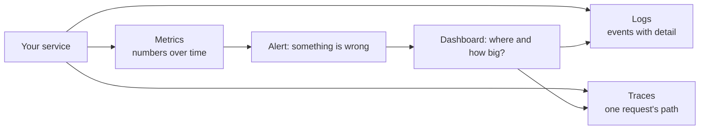

> [!info] Level: junior | Time: about 5 h | You need: [[learn/text-and-data-tools|Linux 03: Text and data tools]] and [[learn/python-for-ops|Scripting 03: Python for ops]] | Lab: Lab A (a Linux VM or container) from [[learn/lab-setup|Start 01: Set up your lab]]. Prometheus, Grafana and Jaeger are optional extras in exercises 3 and 8 to 10.

When something is wrong in production, nobody can attach a debugger. All you have is what the system tells you about itself. **Observability** is how well you can work out what is happening inside a system from the data it emits. This lesson explains the three kinds of data (metrics, logs and traces), the small amount of PromQL you need in order to read a dashboard, and a routine for looking at a Grafana screen without being fooled by it.

> [!note] What was run
> On Ubuntu 24.04 with Python 3.13 and `jq` 1.7: the demo app `metrics_demo.py` and its `curl` output (exercises 1 and 5), the trace example with `opentelemetry-sdk` 1.45.1 and its console exporter (exercise 3), the window script `window.py` (exercise 7) and the `jq` filter on the sample log (exercise 2) were run, and the output shown is what they printed (timestamps and trace IDs are different on every run). **Not run, so not verified:** Prometheus, Grafana, Jaeger, and every PromQL query and every Grafana menu name in this lesson. Menu names and layout change between Grafana versions; compare with what you see.

## What you will learn

- What question each of metrics, logs and traces answers best, and which to open first for a symptom.
- How counters, gauges and histograms differ, and why a label with many values (high cardinality) can break a monitoring system.
- How to read the PromQL behind a panel: selectors, `rate`, `sum by`, a ratio and `histogram_quantile`.
- The RED and USE methods, as a checklist of what to graph for a service or a resource.
- How to read a Grafana dashboard without being tricked by time ranges, variables, units, axes and missing data.

## What observability answers

Monitoring answers questions you thought of in advance: "is the CPU above 90%?" Observability is about questions you did not think of: "why are checkout requests from one region slow only since the last deploy?" You can ask that kind of question only if the system emits rich enough data. The three standard types of data, called **signals**, are metrics, logs and traces.



A typical investigation goes from a **metric** (it is broken, and this is how much), to a **trace** (which step in the request chain is slow or failing), to a **log** (the exact error and its context).

## Metrics

A **metric** is a number measured over time, such as requests per second, memory in use or queue length. Metrics are small and cheap, so you can keep them for a long time and draw graphs and alerts from them. A metric tells you _that_ something changed and _how much_. It cannot tell you why a single request failed.

A system like Prometheus **scrapes** metrics: every few seconds it asks each service for its current values over HTTP and stores each value with a timestamp. A series of (timestamp, value) pairs for one metric is a **time series**. There are three basic types:

| Type          | What it is                                                         | Example                                  | How to use it                          |
| ------------- | ------------------------------------------------------------------ | ---------------------------------------- | -------------------------------------- |
| **Counter**   | A number that only goes up (and resets to zero on a restart)       | `http_requests_total`                    | Take its **rate** (`rate(...)`)        |
| **Gauge**     | A number that goes up and down                                     | memory in use, queue length, temperature | Read it directly, or average over time |
| **Histogram** | Counts of observations in ranges ("buckets"), plus a sum and count | `http_request_duration_seconds_bucket`   | Compute a **quantile** (p95, p99)      |

Here is real output from the demo app you will run in exercise 1. This is the Prometheus text format that a scrape reads:

```text
# HELP http_requests_total Total HTTP requests.
# TYPE http_requests_total counter
http_requests_total{method="GET",path="/fail",status="500"} 3
http_requests_total{method="GET",path="/work",status="200"} 50
# HELP http_request_duration_seconds Request duration.
# TYPE http_request_duration_seconds histogram
http_request_duration_seconds_bucket{le="0.05"} 11
http_request_duration_seconds_bucket{le="0.1"} 17
http_request_duration_seconds_bucket{le="0.25"} 43
http_request_duration_seconds_bucket{le="0.5"} 53
http_request_duration_seconds_bucket{le="+Inf"} 53
http_request_duration_seconds_sum 7.99
http_request_duration_seconds_count 53
```

Read the histogram carefully. The bucket labelled `le="0.1"` means "less than or equal to 0.1 seconds" and counts **17** requests. Buckets are **cumulative**: `le="0.25"` includes everything in `le="0.1"`. The `+Inf` bucket is always the total (53). `_sum` is the total seconds spent, `_count` the number of observations. The average is `_sum / _count`; the percentile is estimated from the buckets.

### Labels and cardinality

The `{method="GET",path="/work",status="200"}` part is a set of **labels**. Labels let you slice a metric: errors by path, requests by status. **Every unique combination of label values is a separate time series**, stored and indexed on its own.

That is where the danger is. The number of series is the **product** of the number of values of each label. `method` (4 values) times `path` (20) times `status` (6) is at most 480 series, which is fine. Add `user_id` with a million users and you have hundreds of millions. The monitoring system runs out of memory or becomes slow and expensive, and the dashboards stop loading. This is **high cardinality**.

> [!warning] Never put an unbounded value in a label
> Do not use `user_id`, `request_id`, `email`, full URLs with IDs in them, or timestamps as metric labels. Labels must come from a small, known set. Put per-request detail in logs and traces instead. Exercise 5 shows the effect.

### A few metrics you will meet

Services built by good practice expose request counts, error counts and durations. The host exposes CPU, memory, disk and network. The platform exposes Pod restarts, deployment replicas and so on. On Google Cloud, much of this is also available in Cloud Monitoring ([[tools/prometheus-vs-cloud-monitoring]] compares the two).

## Logs

A **log** is a record of a single event: "request failed, request ID r-123, user's card was declined". Logs hold the detail that metrics throw away. They are the best signal for _why_ something happened to one request or one user. They cost more per event than metrics, so you pay for volume.

### Structured logs

A plain text line needs a regular expression to pick apart:

```text
2026-10-17 10:00:03 ERROR checkout failed for order 4412: payment backend timeout (2.4s)
```

A **structured** log is one JSON object per line, with named fields:

```json
{
  "time": "2026-10-17T10:00:03Z",
  "level": "ERROR",
  "path": "/checkout",
  "status": 500,
  "request_id": "req-7a3",
  "msg": "payment backend timeout"
}
```

Structured logs can be filtered by field (`status >= 500`), counted and grouped without guessing at text formats. Use them for every service you write ([[standards/structured-logging-conventions]]).

### Levels, cost and retention

Log levels (`DEBUG`, `INFO`, `WARN`, `ERROR`) rank how serious a line is. Use `ERROR` for failures someone should look at, not for expected cases such as "user typed the wrong password". If everything is an error, nothing is. Logs cost money to ingest, store and search, so decide how long to keep them (days for debug detail, longer for audit trails) and never log secrets, tokens or personal data.

## Traces

A **trace** follows one request through many services. A trace is made of **spans**: each span is one step with a start, a duration, a name and attributes ("SELECT cart", "call payment-api"). Spans have a **parent**, so they form a tree. All spans in a trace share one **trace ID**, which is how a tool puts them together.

Traces answer "where did the time go?" and "which downstream call failed?" in a system where one click touches ten services. Here is the shape of a trace for a checkout request (illustrative):

```text
POST /checkout                      [==================================] 2.5 s
  SELECT cart                       [==]                                  0.1 s
  call payment-api                       [=============================]  2.3 s   <- the slow step
```

The standard way to produce traces, metrics and logs is **OpenTelemetry** (OTel): a set of APIs, SDKs and a wire format (OTLP) that works with many back ends ([[architecture/observability-pipeline-opentelemetry]] shows a platform design).

## Choosing the right signal

| Symptom or question                        | Start with | Why                                                           |
| ------------------------------------------ | ---------- | ------------------------------------------------------------- |
| "Is the service up? Is it getting slower?" | Metrics    | Cheap, long history, easy to graph and alert on               |
| "Is it only one endpoint or one region?"   | Metrics    | Slice by label                                                |
| "Why did this one request fail?"           | Logs       | Detail and error text for one event                           |
| "Which step of the chain is slow?"         | Traces     | Shows the call tree and durations                             |
| "Did the last deploy make it worse?"       | Metrics    | Compare before and after (deploys can be marked on graphs)    |
| "What did user X do before the crash?"     | Logs       | Search by request ID or user in a log (not in a metric label) |

### Connecting them: the trace ID in logs

The signals are far more useful when you can jump between them. The simplest link is to write the **trace ID into every log line** of a request. Then from a slow trace you can find all the logs of that request, and from an error log you can open its trace. Many systems also attach an **exemplar** (a trace ID sample) to a metric bucket. The field names for the trace ID in logs depend on your log pipeline; your team's convention is in [[standards/structured-logging-conventions]].

## PromQL you need to read a panel

**PromQL** is Prometheus's query language. Every Grafana panel that draws Prometheus data has a PromQL query behind it, and you can read it. You do not need to write advanced queries yet. You need to understand these pieces.

**Selectors.** A metric name with label matchers picks series:

```text
http_requests_total{status="500"}          # exact match
http_requests_total{status=~"5.."}         # regular expression match (any 5xx)
http_requests_total{path!="/health"}       # not equal
```

**`rate()` over a window.** A counter only ever goes up, so its raw value is almost useless. What you want is how fast it grows: requests per second. `rate(x[5m])` gives the average per-second increase over the last 5 minutes, and it handles counter resets when a process restarts. `increase(x[1h])` gives the total increase over an hour.

```text
rate(http_requests_total[5m])
```

**Aggregate with `sum by`.** `rate` returns one series per label combination. Add them up, keeping the labels you care about:

```text
sum by (path) (rate(http_requests_total[5m]))     # requests per second, one line per path
sum (rate(http_requests_total[5m]))               # one line for the whole service
```

**A ratio.** The share of requests that are errors is the error rate divided by the total rate:

```text
sum(rate(http_requests_total{status=~"5.."}[5m]))
  /
sum(rate(http_requests_total[5m]))
```

**A percentile from a histogram.** `histogram_quantile` estimates a percentile from the bucket counters. Take the `rate` of the buckets, sum them by `le`, then ask for the quantile:

```text
histogram_quantile(0.95, sum by (le) (rate(http_request_duration_seconds_bucket[5m])))
```

This reads "95% of requests were faster than this value". The result is an **estimate** and depends on the bucket boundaries.

**Window size.** The range in `[5m]` is how far back `rate` looks. It must hold at least a few scrape intervals (a common rule of thumb is at least four), or the result is noisy or empty. A long window smooths the line and **hides short spikes** (exercise 7). In Grafana you will often see `$__rate_interval`, a variable Grafana sets from the time range and scrape interval.

### The RED and USE methods

Two checklists tell you what to look at first.

- **RED** (for services that handle requests): **R**ate (requests per second), **E**rrors (how many fail), **D**uration (how long they take, as percentiles). If you can only have three graphs for a service, these are them.
- **USE** (for resources such as CPU, disk, network, a connection pool): **U**tilisation (how busy), **S**aturation (how much work is waiting), **E**rrors. A CPU at 70% utilisation with a long run queue is saturated.

RED tells you whether users are hurt. USE tells you which resource is the cause. They are used together.

## Reading a Grafana dashboard

A dashboard is a set of panels, each backed by a query. You will usually be in a hurry when you open one, which is when it fools people. Learn where the controls are and what they hide.

> [!warning] Check before relying on this
> Menu names, icons and shortcut keys in Grafana change between versions. The places below (top-right time picker, dashboard variables at the top, a menu on each panel with Edit, Explore and Inspect) have been stable for years, but check them in your version.

### The time range and the time zone

At the top right is the **time picker** ("Last 6 hours", an absolute range, a refresh interval). Everything on the page uses it. A graph without a stated range is meaningless, so say the range whenever you talk about one ("in the last hour"). Next to it is the **time zone**. A dashboard can show the browser's time zone or UTC. When you compare a graph with a log or a colleague's message, make sure you are using the same zone, and prefer UTC for incidents.

### Variables, and the "All" trap

Drop-downs at the top (cluster, namespace, service) are **variables** that fill in the queries. If you pick the wrong namespace you are looking at somebody else's service, and a perfectly flat graph looks like good news. **"All"** is easy to misread: it merges the values, so a problem in one Pod or one region can be hidden in a sum or an average. And a query written with `=` instead of `=~` for a multi-value variable may show nothing or only one value.

### Panel types and axes

- **Time series**: lines over time; the default. Look at the **shape** and the **change**, not only the latest value.
- **Stat**: one number (often "the last value" or an average of the range). It hides everything else.
- **Gauge / bar gauge**: one number against a scale.
- **Table**: current values by label.
- **Heatmap**: a distribution over time (often a histogram).

Check the **unit** (seconds or milliseconds? bytes or megabytes? percent as 0 to 1 or 0 to 100?) and the **axis**. A y-axis that does not start at zero makes a 2% change look like a crash. A panel with two y-axes can mislead too.

### Counters, rates and gaps

A graph of a raw counter is a line that only goes up; this usually means the panel should use `rate()`. A line that drops suddenly to zero for a counter is a restart, not a recovery.

Missing data needs thought. **"No data"** means the query returned no series, which could be a typo in a label, a wrong variable, or a service that is not being scraped. **Zero** is a real value: the series exists and nothing happened. They mean different things, and "no data" can hide an outage. A built-in metric helps: Prometheus sets `up{job="..."}` to `1` when a scrape succeeded and `0` when it failed. `up == 0` means "the monitoring cannot see this target".

### Look behind the panel

- **Panel menu > Inspect > Query** shows what was sent and what came back. **Inspect > Data** shows the numbers behind the picture.
- **Panel menu > Explore** (or Edit) opens the query in a place where you can change it, split by label and extend the time range, without altering the dashboard.

### A five-question first look

Every time you open a dashboard during an incident, answer these in order:

1. **What is the time range and time zone, and does it cover the start of the problem?** (Widen it. Look at the day before.)
2. **Which variables are selected, and is "All" hiding something?**
3. **What are the units and axes?** (What does the number mean?)
4. **Is there a gap, "No data", or a recent flatline?** (Check `up`.)
5. **What changed, and when?** (Deploys, restarts, a traffic change. Compare with the line before.)

## Hands-on exercises

You need a Linux shell, `python3`, `curl` and `jq` for exercises 1, 2, 3, 5 and 7. Exercises 8 to 10 need Prometheus (and, for exercise 6, a Grafana dashboard).

### Exercise 1: Watch a counter rise

1. Create the demo app. It uses only the standard library:

   ```python title="metrics_demo.py"
   #!/usr/bin/env python3
   """A tiny app that exposes Prometheus-format metrics. Standard library only."""
   import os
   from http.server import BaseHTTPRequestHandler, HTTPServer
   from urllib.parse import parse_qs, urlparse

   BUCKETS = [0.05, 0.1, 0.25, 0.5]  # seconds
   BAD_LABEL = os.environ.get("BAD_LABEL") == "1"  # Set to 1 to see the cardinality mistake.

   requests = {}  # label tuple -> count
   bucket_counts = [0] * (len(BUCKETS) + 1)  # the last slot is +Inf
   duration_sum = 0.0
   duration_count = 0
   served = 0


   def observe(seconds):
       global duration_sum, duration_count
       duration_sum += seconds
       duration_count += 1
       for i, upper in enumerate(BUCKETS):
           if seconds <= upper:
               bucket_counts[i] += 1
       bucket_counts[-1] += 1  # +Inf counts everything; buckets are cumulative


   def render():
       lines = ["# HELP http_requests_total Total HTTP requests.",
                "# TYPE http_requests_total counter"]
       for labels, value in sorted(requests.items()):
           text = ",".join(f'{k}="{v}"' for k, v in labels)
           lines.append(f"http_requests_total{{{text}}} {value}")
       lines += ["# HELP http_request_duration_seconds Request duration.",
                 "# TYPE http_request_duration_seconds histogram"]
       for i, upper in enumerate(BUCKETS):
           lines.append(f'http_request_duration_seconds_bucket{{le="{upper}"}} {bucket_counts[i]}')
       lines.append(f'http_request_duration_seconds_bucket{{le="+Inf"}} {bucket_counts[-1]}')
       lines.append(f"http_request_duration_seconds_sum {duration_sum:.2f}")
       lines.append(f"http_request_duration_seconds_count {duration_count}")
       return "\n".join(lines) + "\n"


   class Handler(BaseHTTPRequestHandler):
       def do_GET(self):
           global served
           url = urlparse(self.path)
           if url.path == "/metrics":
               body, status = render(), 200
           else:
               served += 1
               status = 500 if url.path == "/fail" else 200
               labels = [("method", "GET"), ("path", url.path), ("status", str(status))]
               if BAD_LABEL:
                   labels.append(("user_id", parse_qs(url.query).get("user", ["anon"])[0]))
               key = tuple(labels)
               requests[key] = requests.get(key, 0) + 1
               observe(0.02 + (served % 10) * 0.03)  # fake but deterministic durations
               body = "ok\n" if status == 200 else "error\n"
           data = body.encode()
           self.send_response(status)
           self.send_header("Content-Type", "text/plain; version=0.0.4; charset=utf-8")
           self.send_header("Content-Length", str(len(data)))
           self.end_headers()
           self.wfile.write(data)

       def log_message(self, *args):  # keep the terminal quiet
           pass


   if __name__ == "__main__":
       HTTPServer(("127.0.0.1", 8000), Handler).serve_forever()
   ```

2. Start it in one terminal: `python3 metrics_demo.py`. In another, take a first "scrape" and send traffic:

   ```bash
   curl -s localhost:8000/metrics | grep '^http_requests_total'
   for i in $(seq 1 50); do curl -s -o /dev/null localhost:8000/work; done
   for i in $(seq 1 3); do curl -s -o /dev/null localhost:8000/fail; done
   curl -s localhost:8000/metrics | grep '^http_requests_total'
   ```

   Expected: the first scrape prints nothing (no requests yet). The second prints:

   ```text
   http_requests_total{method="GET",path="/fail",status="500"} 3
   http_requests_total{method="GET",path="/work",status="200"} 50
   ```

3. Do the arithmetic Prometheus does. If one scrape had 0 and a scrape 60 seconds later had 50 for `/work`, the rate is `(50 - 0) / 60`, about 0.83 requests per second. That is what `rate(http_requests_total{path="/work"}[1m])` would show.

If you see something else: `Address already in use` means another program uses port 8000 (change the port in the last line). If `curl` says `Connection refused`, the app is not running. If the counts differ, you sent a different number of requests: the counter is exact, so `curl` count and metric must agree.

### Exercise 2: Find the 5xx lines with their request IDs

1. Create a small log and a filter. The file is JSON lines:

   ```bash
   cat > sample.log <<'EOF'
   {"time":"2026-10-17T10:00:01Z","level":"INFO","path":"/cart","status":200,"request_id":"req-7a1","msg":"ok"}
   {"time":"2026-10-17T10:00:02Z","level":"INFO","path":"/checkout","status":200,"request_id":"req-7a2","msg":"ok"}
   {"time":"2026-10-17T10:00:03Z","level":"ERROR","path":"/checkout","status":500,"request_id":"req-7a3","msg":"payment backend timeout"}
   {"time":"2026-10-17T10:00:04Z","level":"INFO","path":"/search","status":200,"request_id":"req-7a4","msg":"ok"}
   {"time":"2026-10-17T10:00:05Z","level":"WARN","path":"/cart","status":404,"request_id":"req-7a5","msg":"item not found"}
   {"time":"2026-10-17T10:00:06Z","level":"ERROR","path":"/checkout","status":503,"request_id":"req-7a6","msg":"upstream unavailable"}
   {"time":"2026-10-17T10:00:07Z","level":"INFO","path":"/cart","status":200,"request_id":"req-7a7","msg":"ok"}
   EOF
   jq -r 'select(.status >= 500) | [.time, .request_id, .status, .msg] | @tsv' sample.log
   ```

   Expected:

   ```text
   2026-10-17T10:00:03Z	req-7a3	500	payment backend timeout
   2026-10-17T10:00:06Z	req-7a6	503	upstream unavailable
   ```

2. Count them with `jq -s 'map(select(.status>=500)) | length' sample.log`. Expected: `2`. This is the number a metric would show; the request IDs are what only logs have.

If you see something else: `jq: parse error` means a line is not valid JSON (a stray character or a heredoc indent). If you get nothing, check the field name (`status`) against the log.

### Exercise 3: Look at a trace

1. Create a virtual environment and install the OpenTelemetry SDK:

   ```bash
   python3 -m venv .venv && . .venv/bin/activate
   pip install opentelemetry-sdk
   ```

2. Create `trace_demo.py`:

   ```python title="trace_demo.py"
   from opentelemetry import trace
   from opentelemetry.sdk.resources import Resource
   from opentelemetry.sdk.trace import TracerProvider
   from opentelemetry.sdk.trace.export import BatchSpanProcessor, ConsoleSpanExporter

   provider = TracerProvider(resource=Resource.create({"service.name": "demo-checkout"}))
   provider.add_span_processor(BatchSpanProcessor(ConsoleSpanExporter()))
   trace.set_tracer_provider(provider)
   tracer = trace.get_tracer("lesson")

   with tracer.start_as_current_span("POST /checkout"):
       with tracer.start_as_current_span("SELECT cart"):
           pass
       with tracer.start_as_current_span("call payment-api"):
           pass
   provider.shutdown()
   ```

3. Run it and show the span tree fields:

   ```bash
   python3 trace_demo.py | jq -r '[.name, .context.trace_id, .context.span_id, .parent_id] | @tsv'
   ```

   Expected (the IDs are random and differ on every run):

   ```text
   SELECT cart	0x3cb5f957f4bb3969a16e4e691885d2f0	0xf64afdc6dd9413e0	0xa47e26857f9bdf34
   call payment-api	0x3cb5f957f4bb3969a16e4e691885d2f0	0x26e8d362128d1116	0xa47e26857f9bdf34
   POST /checkout	0x3cb5f957f4bb3969a16e4e691885d2f0	0xa47e26857f9bdf34
   ```

   All three spans share one **trace ID**. The two child spans have the root span's ID as their `parent_id`. The root span has no parent (the last column is empty).

4. Optional, not verified here: run Jaeger's all-in-one image locally and send the spans to it with the OTLP exporter (`pip install opentelemetry-exporter-otlp-proto-http`, then replace `ConsoleSpanExporter()` with `OTLPSpanExporter(endpoint="http://localhost:4318/v1/traces")` imported from `opentelemetry.exporter.otlp.proto.http.trace_exporter`). The Jaeger UI is usually on port 16686, where you can search for the `demo-checkout` service.

   > [!warning] Check before relying on this
   > Jaeger image names, tags, ports and flags change between releases; read the current Jaeger "Getting started" page and pin an exact image tag. This step was not run for this page.

If you see something else: if the console prints nothing, `provider.shutdown()` did not run (the batch processor exports at shutdown). If `ModuleNotFoundError` appears, the virtual environment is not active.

### Exercise 4: Choose the signal for five incidents

Write the first signal you would open, and one reason, for each. Then compare with the answers below.

1. "The site feels slow for everyone since 14:00."
2. "One customer says their order failed with an error message."
3. "The checkout request takes 2.5 s, and we call five services."
4. "Disk usage on a node grows by 1 GB a day. When will it be full?"
5. "Error rate rose after the deploy. Which version caused it?"

Expected answers: 1. **Metrics** (latency percentiles by time, to see when and how much). 2. **Logs** (search by the request or order ID). 3. **Traces** (the span tree shows which call takes the time). 4. **Metrics** (a gauge and a trend over weeks). 5. **Metrics** (error ratio split by version label, with deploy times marked), then logs of the new version.

If you see something else: if your answer differs, check the reason. Several signals can be right; the point is to start with the one that answers the first question fastest.

### Exercise 5: Count the series made by a bad label

1. Restart the demo with the cardinality mistake switched on, and send requests for 200 different users:

   ```bash
   BAD_LABEL=1 python3 metrics_demo.py &
   sleep 1
   for i in $(seq 1 200); do curl -s -o /dev/null "localhost:8000/work?user=u$i"; done
   curl -s localhost:8000/metrics | grep -c '^http_requests_total{'
   curl -s localhost:8000/metrics | grep '^http_requests_total{' | sed -n 1,2p
   ```

   Expected:

   ```text
   200
   http_requests_total{method="GET",path="/work",status="200",user_id="u1"} 1
   http_requests_total{method="GET",path="/work",status="200",user_id="u10"} 1
   ```

   Compare with exercise 1: 3 requests to 2 paths gave 2 series; here one path produced **200** series, one per user, and each holds a single request. With a million users you would have a million series for this one metric.

2. Stop the app (`kill %1`).

If you see something else: if the count is 1, the variable `BAD_LABEL=1` was not set for the process. If the port is busy, stop the earlier instance of the app.

### Exercise 6: Record the state of your team's dashboard

Open a real dashboard for a service (or a Grafana in your lab). Without changing anything, write down for one panel: the **time range**, the **time zone**, the **variables** selected (especially any "All"), the **unit** and the y-axis minimum, and the **query** (panel menu, Inspect, Query). Then change the range from 1 hour to 24 hours and write what changed.

Expected: a short table of those six items. You should be able to say, in one sentence, what the panel measures and over what period.

If you see something else: if you cannot find the query, use the panel menu and look for Edit or Inspect. If the panel has no query, it may be a text or link panel.

### Exercise 7: Why a long window hides a short spike

1. Create and run `window.py`. It simulates a counter sampled every second for 10 minutes, with 10 requests per second and one 10-second burst of 100 requests per second:

   ```python title="window.py"
   # A counter sampled every second for 10 minutes: 10 requests per second,
   # except a 10-second burst of 100 requests per second at t=300..309.
   counter = []
   total = 0
   for t in range(600):
       total += 100 if 300 <= t < 310 else 10
       counter.append(total)

   def rate(end, window):
       """(counter[end] - counter[end - window]) / window, like rate() over a range."""
       return (counter[end] - counter[end - window]) / window

   print("rate over 10 s, at the end of the burst  :", rate(309, 10), "req/s")
   print("rate over 5 m, at the end of the burst   :", rate(309, 300), "req/s")
   print("rate over 5 m, at the end of the 10 min  :", rate(599, 300), "req/s")
   ```

   ```bash
   python3 window.py
   ```

   Expected:

   ```text
   rate over 10 s, at the end of the burst  : 100.0 req/s
   rate over 5 m, at the end of the burst   : 13.0 req/s
   rate over 5 m, at the end of the 10 min  : 13.0 req/s
   ```

2. Read it: the real peak was 100 requests per second. The 5-minute window shows 13, about an eighth of it, and keeps showing 13 for 5 minutes after the burst. A 5-minute smoothing hides a 10-second event. On a dashboard, the same effect appears when you zoom out to 24 hours: each point covers many minutes, so a short spike vanishes.

If you see something else: if you get different numbers, check the burst range (`300 <= t < 310`) and the window arguments.

### Exercise 8 (optional): Find the PromQL behind a panel

1. Download Prometheus from its official downloads page, and save this configuration next to the binary:

   ```yaml title="prometheus.yml"
   global:
     scrape_interval: 15s

   scrape_configs:
     - job_name: demo
       static_configs:
         - targets: ["127.0.0.1:8000"]
   ```

2. Start the demo app (without the bad label), start Prometheus with `./prometheus --config.file=prometheus.yml`, send some traffic as in exercise 1, and open the Prometheus UI on port 9090. Run these queries and compare them with the app's counters:

   ```text
   http_requests_total
   sum by (path) (rate(http_requests_total[1m]))
   histogram_quantile(0.95, sum by (le) (rate(http_request_duration_seconds_bucket[1m])))
   ```

   Expected (illustrative): the first shows one series per label set with the totals from exercise 1; the second shows a number above zero for `/work` while you send traffic, falling to 0 after you stop; the third shows a value in seconds that falls between the bucket boundaries.

3. In your team's Grafana, open a panel's Edit view and find the same kind of expression.

> [!warning] Check before relying on this
> This exercise was not run for this page. Download page layout, the binary name and the UI port are the documented defaults, but check the current Prometheus "Getting started" page for your version.

If you see something else: if the queries return nothing, wait for two scrapes (30 seconds), check the target page (Status, Targets) and make sure the app is listening on `127.0.0.1:8000`.

### Exercise 9 (optional): Diagnose "No data" with `up`

1. With Prometheus and the demo app running as in exercise 8, run `up{job="demo"}`. Expected: one series with value `1`.
2. Stop the demo app (`Ctrl-C`) and wait about a minute. Run `up{job="demo"}` again. Expected: value `0`. Run `http_requests_total` again. Expected: after the data goes stale, the series disappear and the query returns nothing.
3. Write down what a panel would show: "No data", while `up == 0` tells you why.

Expected: you can explain that "No data" here is a symptom of an outage in the target, not a quiet system.

If you see something else: if `up` stays `1`, the app is still running. If `up` has no result at all, the job name in the query does not match `job_name` in the configuration.

### Exercise 10 (optional): Spot a "stat panel" trap

On a dashboard with a Stat panel (a single number), open its Edit view and find the calculation: "Last", "Mean", "Max" or similar. Change the time range and note how the number changes. Write down what the panel would not show you (for example, a spike that ended an hour ago, when it uses "Last").

Expected: you can say which calculation the panel uses and what it hides.

If you see something else: if the number does not change with the range, the panel may use a fixed relative time in its query options; look for a "Relative time" setting.

## Common mistakes

- **Alerting or judging by averages.** Why it bites: an average of latency hides the slow tail, which is what users notice. Fix: use percentiles from histograms (p95, p99) and the error ratio.
- **Looking at a graph with no time range in mind.** Why it bites: a one-hour view can look flat while the problem began yesterday. Fix: state the range, widen it, and compare with the same time the day before.
- **Trusting a single stat panel.** Why it bites: it shows one calculation of a range (the last value, or a mean), and hides spikes. Fix: look at the time series behind it.
- **Graphing a raw counter.** Why it bites: it only goes up and says nothing about now. Fix: use `rate()` or `increase()`.
- **Putting unbounded values in labels.** Why it bites: it creates millions of series and can take the monitoring down. Fix: bounded labels only; put IDs in logs.
- **Reading "No data" as "all quiet".** Why it bites: it often means the target is down or the query is wrong. Fix: check `up` and the query.
- **Forgetting the "All" variable.** Why it bites: it merges values and can hide the one bad Pod. Fix: select the value you mean, or add a per-label breakdown.
- **Ignoring units and axes.** Why it bites: milliseconds read as seconds, or a y-axis not starting at zero, change the story. Fix: check both before drawing conclusions.
- **Using a very long `rate` window for alerting on short events.** Why it bites: a 10-second spike disappears. Fix: choose the window to match the thing you want to catch, and use more than one.

## Check your understanding

1. Why do you use `rate()` on a counter instead of graphing it directly?
2. Why can a 5-minute `rate` window hide a 10-second spike?
3. What is the difference between the RED and USE methods, and when do you use each?
4. Why is missing data (no series, "No data") more dangerous than a low number?
5. A metric has the labels `method`, `path`, `status` and `user_id`. What is wrong, and where should `user_id` go instead?
6. You have a slow checkout request with five downstream calls. Which signal shows you which call is slow, and what ties it to the log lines of the same request?

> [!question]- Answers
>
> 1. A counter only goes up (and resets to zero when the process restarts), so its raw value says little about what is happening now. `rate()` turns it into a per-second speed, and handles resets, so you can see changes and compare times.
> 2. `rate` is an average over its window. A 10-second burst spread over 300 seconds adds only a small amount to the average, so the line barely moves (13 against a real peak of 100 in exercise 7), and it stays raised for the whole window after the burst.
> 3. RED (rate, errors, duration) describes how a request-handling service looks to its users. USE (utilisation, saturation, errors) describes how busy and how overloaded a resource is. Use RED to tell whether users are hurt, and USE to find which resource is the cause.
> 4. A low number is a measurement. Missing data may mean the monitoring cannot see the target (it is down, not scraped, or the query is wrong), so an outage can look like silence. Check `up` and alert on missing data where it matters.
> 5. `user_id` has an unbounded set of values, so each user creates a new time series (high cardinality), which uses memory and can break the monitoring system. Put the user or request identifier in logs (and traces), not in metric labels.
> 6. A trace shows the call tree and the duration of each span, so you can see the slow call. Writing the trace ID into every log line of the request lets you search the logs by trace ID and find the matching log lines.

## Next steps

Next lesson: [[learn/searching-logs|Observability 02: Searching logs under pressure: kubectl, jq, Loki and Cloud Logging]]. Previous lesson: [[learn/security-basics-for-devops|Security 01: Security basics every DevOps engineer must know]].

To go deeper:

- [[tools/prometheus-vs-cloud-monitoring]] compares self-run Prometheus with Google Cloud's managed monitoring.
- [[patterns/slo-burn-rate-alerting]] turns error ratios and latency into alerts that page only for real problems.
- [[standards/structured-logging-conventions]] is the log format a team can agree on.
- [[architecture/observability-pipeline-opentelemetry]] shows how signals flow on a platform.
- The whole path is mapped in [[learn/index|the learning path]].

## Sources

The demo app, the trace example, the window script and the `jq` filter were run (see the note near the top). The PromQL, the Prometheus and Grafana steps follow the sources below and were **not** run; pages change, so check them for the versions you use.

- Google, _Site Reliability Engineering_, "Monitoring Distributed Systems" (https://sre.google/sre-book/monitoring-distributed-systems/).
- OpenTelemetry documentation, "Signals" (traces, metrics, logs) (https://opentelemetry.io/docs/concepts/signals/). Version not verified.
- Prometheus documentation: data model, metric types, querying basics and functions (`rate`, `increase`, `histogram_quantile`) (https://prometheus.io/docs/). Not verified: behaviour in your Prometheus version.
- Grafana documentation: dashboards, variables, panels, Explore, and Inspect (https://grafana.com/docs/grafana/latest/). Not verified: menu names for your Grafana version.
- Tom Wilkie, "The RED Method" and Brendan Gregg, "The USE Method" (https://www.brendangregg.com/usemethod.html).
