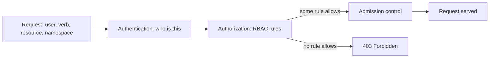

> [!info] Level: middle | Time: about 4 h | You need: [[learn/kubernetes-config-secrets-and-namespaces|Kubernetes 04: ConfigMaps, Secrets and namespaces]] | Lab: kind, from [[learn/kubernetes-architecture-and-kind|Kubernetes 01]] and [[learn/lab-setup|Start 01: Set up your lab]]

[[learn/kubernetes-config-secrets-and-namespaces|Kubernetes 04]] showed a minimal read-only Role and RoleBinding and said that permissions are additive. This lesson is the rest of RBAC: how the pieces fit, which built-in roles exist, how ServiceAccounts authenticate, which grants quietly give away more than they appear to, and how to audit a cluster for them. The skill you are building is **least privilege that you can prove**: for every identity, say what it may do, and show it with a command instead of reading YAML and hoping.

> [!note] Nothing here was run for this page
> The manifests, commands and sample output follow the Kubernetes documentation and are not verified. Output is illustrative. Check the documentation for your Kubernetes version, especially for the details marked "check the current docs".

## What you will learn

- The RBAC vocabulary: subjects, verbs, resources, subresources and API groups, and how Role and ClusterRole, RoleBinding and ClusterRoleBinding combine.
- What the built-in `view`, `edit`, `admin` and `cluster-admin` roles give, and how aggregation extends them.
- How ServiceAccounts authenticate, how to stop a Pod getting a token it does not need, and how to mint a short-lived token.
- How to prove a permission with `kubectl auth can-i`, `--as` and `--list`.
- Which grants are escalation paths in disguise, and how to find them with a short `jq` audit.

## The model in one page

RBAC answers one question for every API request: **may this subject do this verb on this resource, here?** The pieces:

- **Subject.** Who asks: a `User`, a `Group` or a `ServiceAccount`. Kubernetes has no user object; users and groups come from the authenticator (client certificate, OIDC token, a cloud identity). A ServiceAccount is a real object in a namespace.
- **Verb.** `get`, `list`, `watch`, `create`, `update`, `patch`, `delete`, `deletecollection`, plus the special `impersonate`, `bind` and `escalate`.
- **Resource and subresource.** `pods`, `deployments`, `secrets`, and subresources written `pods/log`, `pods/exec`, `pods/portforward`, `deployments/scale`. A rule on `pods` does **not** cover `pods/exec`.
- **API group.** `""` (the core group: pods, services, secrets, configmaps), `apps` (deployments, statefulsets), `batch` (jobs), `rbac.authorization.k8s.io` and so on. `kubectl api-resources -o wide` lists resources with their group and verbs.
- **Rule.** A set of verbs on a set of resources in a set of API groups; optionally restricted to named objects with `resourceNames`.

Two kinds of object hold rules, and two kinds attach them:

| Object               | Scope         | Holds or attaches                                                             |
| -------------------- | ------------- | ----------------------------------------------------------------------------- |
| `Role`               | One namespace | Rules for namespaced resources in its own namespace.                          |
| `ClusterRole`        | Whole cluster | Rules, including cluster-scoped resources (nodes) and non-resource URLs.      |
| `RoleBinding`        | One namespace | Attaches a Role **or a ClusterRole** to subjects, **in that namespace only**. |
| `ClusterRoleBinding` | Whole cluster | Attaches a ClusterRole to subjects, **in every namespace**.                   |

The row that confuses people: a **RoleBinding can point to a ClusterRole**. The ClusterRole is then granted only inside the RoleBinding's namespace. That lets you define a reusable rule set once (a ClusterRole named `pod-reader`) and hand it out per namespace, without copying a Role into every namespace. A `ClusterRoleBinding` to the same ClusterRole would grant it everywhere.

Two properties to keep in mind for the rest of the lesson:

- **RBAC is additive.** There are no deny rules. An identity's permissions are the union of every rule from every binding that matches it. You cannot remove a permission by adding a rule; you must remove the grant. This is why a broad grant is hard to repair later.
- **Anything not granted is denied.** The default for an identity with no binding is no access (apart from what the cluster grants to all authenticated users, such as discovery; check `kubectl get clusterrolebindings` for the `system:` ones).



Authorization is only one step; admission controllers and policies still run afterwards ([[patterns/pod-security-admission]]). RBAC says who may ask. It does not say what a Pod may do once it exists.

## Writing a Role

Do not hand-type YAML from memory. Generate it, read it, then commit it:

```bash title="generate a Role as YAML"
kubectl create namespace rbac-lab
kubectl create role pod-reader \
  --namespace rbac-lab \
  --verb=get,list,watch \
  --resource=pods,pods/log \
  --dry-run=client -o yaml
```

```yaml title="role-pod-reader.yaml"
apiVersion: rbac.authorization.k8s.io/v1
kind: Role
metadata:
  name: pod-reader
  namespace: rbac-lab
rules:
  - apiGroups: [""]
    resources: ["pods", "pods/log"]
    verbs: ["get", "list", "watch"]
```

`--dry-run=client -o yaml` prints the object without sending it to the cluster. `kubectl create rolebinding` and `kubectl create clusterrole` work the same way. The read-only starting point from Kubernetes 04 (a Role and RoleBinding for a ServiceAccount named `viewer`) is the model for this lesson; it is not repeated here, so go back to [[learn/kubernetes-config-secrets-and-namespaces#A minimal read-only Role and RoleBinding|that section]] if you need it.

A narrow rule can name objects. This grants updates to one specific ConfigMap and nothing else:

```yaml title="role-config-editor.yaml"
apiVersion: rbac.authorization.k8s.io/v1
kind: Role
metadata:
  name: web-config-editor
  namespace: rbac-lab
rules:
  - apiGroups: [""]
    resources: ["configmaps"]
    resourceNames: ["web-config"]
    verbs: ["get", "update", "patch"]
```

`resourceNames` cannot restrict `list`, `watch`, `create` or `deletecollection` to one name (a list returns many objects, and a create has no name yet), so do not use it for those verbs and expect it to bind.

## The built-in roles and aggregation

Kubernetes ships user-facing ClusterRoles. Know them before you write your own:

| ClusterRole     | What it allows (roughly)                                                                                                                        |
| --------------- | ----------------------------------------------------------------------------------------------------------------------------------------------- |
| `view`          | Read most namespaced objects. Does not include Secrets, and does not include Roles or RoleBindings.                                             |
| `edit`          | Read and write most namespaced objects, including Secrets, and run as any ServiceAccount in the namespace. Cannot change Roles or RoleBindings. |
| `admin`         | Everything in `edit`, plus Roles and RoleBindings in the namespace. Intended to be given through a RoleBinding.                                 |
| `cluster-admin` | Everything, everywhere. With a ClusterRoleBinding it is superuser; with a RoleBinding it grants full control inside that one namespace only.    |

The exact content changes between versions, so read it from your cluster instead of trusting a table: `kubectl get clusterrole edit -o yaml`. Check the current docs for the user-facing roles.

**Aggregation** lets a ClusterRole collect rules from other ClusterRoles by label. `view`, `edit` and `admin` use it: a custom resource's authors add a ClusterRole labelled `rbac.authorization.k8s.io/aggregate-to-view: "true"` and its rules appear in `view` automatically.

```yaml title="clusterrole-aggregate-widgets.yaml"
apiVersion: rbac.authorization.k8s.io/v1
kind: ClusterRole
metadata:
  name: widgets-view
  labels:
    rbac.authorization.k8s.io/aggregate-to-view: "true"
rules:
  - apiGroups: ["example.com"]
    resources: ["widgets"]
    verbs: ["get", "list", "watch"]
```

Aggregation is convenient and has a catch: installing an operator or CRD can **widen** `view`, `edit` and `admin` without any change to your bindings. Review what a new CRD adds to the aggregated roles.

## ServiceAccounts

A ServiceAccount is the identity of a workload. Its username, as the API server sees it, is:

```text
system:serviceaccount:<namespace>:<name>
```

and it belongs to the groups `system:serviceaccounts` and `system:serviceaccounts:<namespace>`. You need this exact string for `--as` and for audit logs.

Every namespace has a `default` ServiceAccount, and every Pod that does not name one uses it. Three habits keep ServiceAccounts safe:

1. **One ServiceAccount per workload.** Do not share `default`. A permission granted to `default` is granted to every Pod in the namespace that did not choose another account.
2. **Do not mount a token a Pod does not use.** Most application Pods never call the Kubernetes API. Turn the token off on the ServiceAccount, and on the Pod:

   ```yaml title="serviceaccount-web.yaml"
   apiVersion: v1
   kind: ServiceAccount
   metadata:
     name: web
     namespace: rbac-lab
   automountServiceAccountToken: false
   ```

   ```yaml title="pod-web.yaml"
   apiVersion: v1
   kind: Pod
   metadata:
     name: web
     namespace: rbac-lab
   spec:
     serviceAccountName: web
     automountServiceAccountToken: false
     containers:
       - name: web
         image: nginxinc/nginx-unprivileged:1.27-alpine # Change: a tag you have checked
   ```

   The Pod field wins over the ServiceAccount field. A workload that does need the API sets `automountServiceAccountToken: true` for itself.

3. **Prefer short-lived tokens.** Current Kubernetes gives a Pod a **projected token**: time-limited, bound to the Pod and to an audience, and refreshed by the kubelet. Older clusters created long-lived Secret-based tokens; since Kubernetes 1.24 these are not created automatically (check the current docs for your version). For a human or a script outside the cluster, ask for a token with an expiry instead of storing a permanent one:

   ```bash title="mint a short-lived token"
   kubectl create token web --namespace rbac-lab --duration=10m
   ```

   Treat the output as a credential: it is valid until it expires, from anywhere that can reach the API server. Do not paste it in chat or commit it.

Cloud identity adds a layer on top: [[patterns/gke-workload-identity]] and [[learn/gcp-iam-and-service-accounts|GCP 02]] cover how a Kubernetes ServiceAccount maps to a Google identity so that a Pod can call Google APIs without a key file.

## Proving permissions with kubectl auth can-i

`kubectl auth can-i` asks the API server the authorization question without doing the action. It is the test for your RBAC:

```bash title="test the permissions of a ServiceAccount"
SA="system:serviceaccount:rbac-lab:web"

kubectl auth can-i get pods --namespace rbac-lab --as "$SA"
kubectl auth can-i delete pods --namespace rbac-lab --as "$SA"
kubectl auth can-i get secrets --namespace rbac-lab --as "$SA"
kubectl auth can-i --list --namespace rbac-lab --as "$SA"
```

```text
yes
no
no
Resources                                       Non-Resource URLs   Resource Names   Verbs
selfsubjectaccessreviews.authorization.k8s.io   []                  []               [create]
selfsubjectrulesreviews.authorization.k8s.io    []                  []               [create]
pods                                            []                  []               [get list watch]
pods/log                                        []                  []               [get list watch]
...
```

_Illustrative._

- `--as USER` impersonates a user; `--as-group GROUP` adds groups (needed to test a binding that is made to a group). The `--as` check needs **your** account to hold the `impersonate` verb; a cluster admin does.
- `--list` prints everything the subject can do in the namespace. It shows the rules, so read it for surprises rather than only for what you intended.
- The answer is `yes` or `no`, with exit code 0 or 1, so it works in scripts and CI: `kubectl auth can-i ... || exit 1`.
- For a subresource: `kubectl auth can-i create pods/exec --as "$SA" -n rbac-lab`.

`can-i` tests authorization only. A `yes` does not mean the action will succeed: admission control or a missing object can still reject it.

## Grants that are escalation paths

Least privilege fails most often not because of a `*` in a rule, but because a harmless-looking rule is more powerful than its name. Read these as a checklist when you review a Role, from the Kubernetes "RBAC good practices" guide.

- **`list` or `watch` on Secrets.** They return the full objects, including the data, not just names. `get` on a Secret is not needed to read it if you can `list` them. Treat any Secret read access as access to the credentials inside. (Kubernetes 04 made the same point.)
- **`create` on `pods`.** Whoever can create a Pod in a namespace can run it **as any ServiceAccount in that namespace**, mount any Secret and any ConfigMap there, and run an arbitrary image. If that namespace holds a powerful ServiceAccount, `create pods` means the power of that account. Pod Security Admission limits what the Pod may do ([[patterns/pod-security-admission]]), but not which ServiceAccount or Secret it mounts. The same holds for anything that creates Pods: Deployments, Jobs, CronJobs and so on.
- **`pods/exec` and `pods/attach`.** They give a shell in a running container, with whatever that container's ServiceAccount and mounted Secrets allow. Often needed by humans for debugging; grant it narrowly and to people, not to automation.
- **`pods/portforward`.** Reaches services that are not meant to be exposed.
- **`escalate`, `bind` and `impersonate`.** These three verbs defeat the safety net described in the next section: `escalate` on roles lets you add permissions you do not hold, `bind` on roles lets you create bindings to roles you could not otherwise grant, and `impersonate` lets you act as any user, group or ServiceAccount you can name. Grant them to almost nobody.
- **Wildcards.** `verbs: ["*"]`, `resources: ["*"]` and `apiGroups: ["*"]` also cover resources created later, including CRDs from software you install tomorrow.
- **Write access to RBAC objects.** If you can create Roles and RoleBindings, you can usually grant yourself what you hold (see below) and often more.
- **Write access to a webhook configuration or a CRD.** These can intercept or reshape other people's requests.
- **Node access and `nodes/proxy`.** Reaches the kubelet API and, from there, containers on that node.

### Escalation prevention

The API server stops a user from creating or updating a Role or RoleBinding that grants permissions they do not hold themselves. You cannot give away what you do not have, unless you hold the `escalate` verb on the role (to write a role with more permissions) or the `bind` verb on the role (to create a binding to a role you have not been granted). That is why handing out `edit` is safer than handing out `admin`: the person with `edit` cannot write bindings at all.

This behaviour is the reason a delegated team lead can manage their own namespace's bindings through `admin` without being able to make anyone a cluster administrator. It holds only while nobody receives `escalate`, `bind` or `impersonate`.

## The groups that bypass RBAC

One group needs separate care: **`system:masters`**. Requests from this group skip RBAC authorization entirely, so no Role or binding can restrict it, and you cannot revoke it with a RoleBinding. A client certificate whose organisation is `system:masters` is cluster root, and it stays valid until the certificate expires.

kind's default admin kubeconfig uses such a credential for convenience. In newer kubeadm-based setups the admin credential's group may differ from older versions (the project has been moving the break-glass admin credential away from `system:masters`, check the current docs for your version). Do not hand `system:masters` certificates to people, and do not rely on a named `cluster-admin` binding as a safeguard against it.

On GKE, authorization has two layers that **both** apply: Google Cloud IAM (the roles on the project that decide whether you can reach the cluster API at all) and Kubernetes RBAC (what you may do in it). A permissive IAM role such as the Kubernetes Engine Admin gives cluster-level power that RBAC cannot narrow. Binding RBAC to Google Groups ("Google Groups for RBAC") is a GKE feature whose availability and setup have changed over time; check its status and requirements in the current docs before you design around it. See [[learn/gke-for-beginners]], [[learn/gcp-iam-and-service-accounts]] and the GKE RBAC guide in the sources.

## A first audit with jq

An audit answers three questions: who has `cluster-admin`, who has wildcard rules, and how far one stolen token could reach. `jq` is enough for a first pass. In kind, all of this is local and read-only.

**1. Who is bound to `cluster-admin`?**

```bash title="bindings to cluster-admin, cluster-wide and per namespace"
kubectl get clusterrolebindings -o json | jq -r '
  .items[]
  | select(.roleRef.name == "cluster-admin")
  | "\(.metadata.name)\t\([.subjects[]? | "\(.kind):\(.namespace // "-")/\(.name)"] | join(","))"'

kubectl get rolebindings -A -o json | jq -r '
  .items[]
  | select(.roleRef.name == "cluster-admin")
  | "\(.metadata.namespace)/\(.metadata.name)\t\([.subjects[]? | "\(.kind):\(.name)"] | join(","))"'
```

```text
cluster-admin           Group:-/system:masters
kind-admin-example      User:-/jane@example.com
```

_Illustrative._

The first row is the built-in binding. Every other row needs a name, an owner and a reason. A ServiceAccount in this list is a particularly important finding.

**2. Which roles use wildcards?**

```bash title="roles and cluster roles with a wildcard"
kubectl get clusterroles,roles -A -o json | jq -r '
  .items[]
  | select(any(.rules[]?; (.verbs // [] | index("*")) or (.resources // [] | index("*")) or (.apiGroups // [] | index("*"))))
  | "\(.kind)\t\(.metadata.namespace // "-")/\(.metadata.name)"'
```

Many `system:` roles legitimately use wildcards. Filter them out (`select(.metadata.name | startswith("system:") | not)`) and then explain each remaining one.

**3. Which roles can read Secrets or run exec?**

```bash title="who can read secrets or exec"
kubectl get clusterroles,roles -A -o json | jq -r '
  .items[]
  | select(any(.rules[]?;
      ((.resources // []) | map(select(. == "secrets" or . == "pods/exec" or . == "*")) | length > 0)
      and ((.verbs // []) | map(select(. == "get" or . == "list" or . == "watch" or . == "create" or . == "*")) | length > 0)))
  | "\(.kind)\t\(.metadata.namespace // "-")/\(.metadata.name)"'
```

**4. The blast radius of one token.** Pick a ServiceAccount and list what it can do everywhere it has a binding. `--list` is per namespace, so loop over namespaces:

```bash title="what can this ServiceAccount do, per namespace"
SA="system:serviceaccount:rbac-lab:web"
for ns in $(kubectl get ns -o name | cut -d/ -f2); do
  echo "== $ns"
  kubectl auth can-i --list --namespace "$ns" --as "$SA" 2>/dev/null | tail -n +2
done
kubectl auth can-i --list --as "$SA" | grep -v '^selfsubject'
```

A number of the `--list` lines are defaults available to every authenticated identity. The question is what **beyond** those lines the account holds, and whether any of it is `secrets`, `pods/exec`, `create pods` or `*`.

This is a first pass, not an audit program. It reads only the object definitions: it does not see what ServiceAccounts and groups the cluster's authenticator maps users into, aggregated rules in `view` and `edit` are visible only after aggregation, and it does not look at cloud IAM. Dedicated tools exist that cover more (for example `kubectl-who-can`, `rbac-tool` and `rakkess`), and the CIS checks in [[compliance/cis-benchmarks-with-kube-bench]] cover some RBAC items. They are third-party tools and are only mentioned here, not used in this lesson. Evidence for an audit trail is described in [[compliance/access-reviews-gcp-and-gke]].

## Fixing a binding

You found a binding that gives too much. The right move depends on what is wrong:

- **Wrong subjects.** `kubectl edit rolebinding` or a re-apply of the manifest can change `subjects`.
- **Wrong role.** `roleRef` is **immutable**. You cannot change which role a binding points to. Delete the binding and create it again, ideally in one step from a manifest in Git:

  ```bash title="replace a binding (roleRef cannot be edited)"
  kubectl delete rolebinding web-binding --namespace rbac-lab
  kubectl apply -f rolebinding-web.yaml
  ```

  There is a short window with no binding at all, and anything that depends on it fails during that time. Do it in a quiet period, or create the new correctly named binding first and delete the old one after.

- **Too broad a Role.** Edit the rules (a Role's rules are mutable). Because RBAC is additive, check every other binding that references the same role before you narrow it: `kubectl get rolebindings,clusterrolebindings -A -o json | jq ...` for its name.

If a credential may already be in the wrong hands, removing the binding is not enough: rotate the credential ([[runbooks/leaked-credential-rotation]]). Also read the general security habits in [[learn/security-basics-for-devops]].

## Hands-on exercises

Use a kind cluster. These exercises use only objects in the `rbac-lab` namespace, so deleting that namespace cleans up. Output is illustrative.

1. **Create the namespace and generate a Role.**

   ```bash
   kubectl create namespace rbac-lab
   kubectl create role pod-reader -n rbac-lab --verb=get,list,watch \
     --resource=pods,pods/log --dry-run=client -o yaml | tee role-pod-reader.yaml
   kubectl apply -f role-pod-reader.yaml
   ```

   Expected: YAML is printed, then `role.rbac.authorization.k8s.io/pod-reader created`.
   If you see something else: "Error from server (AlreadyExists)" means you ran it before; that is fine. If the namespace is stuck terminating from an earlier try, wait or pick another name.

2. **Create a ServiceAccount and bind the Role.**

   ```bash
   kubectl create serviceaccount web -n rbac-lab
   kubectl create rolebinding web-pod-reader -n rbac-lab --role=pod-reader \
     --serviceaccount=rbac-lab:web
   ```

   Expected: `serviceaccount/web created` and `rolebinding.rbac.authorization.k8s.io/web-pod-reader created`.
   If you see something else: the flag is `--serviceaccount=NAMESPACE:NAME`; a missing namespace part gives an error.

3. **Prove what it can and cannot do.**

   ```bash
   SA="system:serviceaccount:rbac-lab:web"
   kubectl auth can-i list pods -n rbac-lab --as "$SA"
   kubectl auth can-i delete pods -n rbac-lab --as "$SA"
   kubectl auth can-i list pods -n default --as "$SA"
   kubectl auth can-i list secrets -n rbac-lab --as "$SA"
   ```

   Expected: `yes`, `no`, `no`, `no`.
   If you see something else: a `yes` for the `default` namespace means a ClusterRoleBinding or a binding there also matches this account; find it with the audit queries.

4. **Show that a RoleBinding to a ClusterRole is namespace-scoped.**

   ```bash
   kubectl create namespace rbac-lab2
   kubectl create rolebinding web-view -n rbac-lab2 --clusterrole=view \
     --serviceaccount=rbac-lab:web
   kubectl auth can-i list deployments -n rbac-lab2 --as "$SA"
   kubectl auth can-i list deployments -n rbac-lab --as "$SA"
   ```

   Expected: `yes` for `rbac-lab2` (the ClusterRole `view` applies there), `no` for `rbac-lab`.
   If you see something else: if both say `yes`, check for a ClusterRoleBinding to `view` for this account with `kubectl get clusterrolebindings -o wide | grep view`.

5. **Test a subresource.**

   ```bash
   kubectl auth can-i create pods/exec -n rbac-lab --as "$SA"
   ```

   Expected: `no`. Now add `pods/exec` with `create` to the Role (edit the file, `kubectl apply`) and re-run: `yes`.
   If you see something else: remember that `pods` in a rule does not include `pods/exec`; the subresource must be listed on its own line or in the same `resources` list.

6. **Show that `create pods` is a path to another identity.** Create a ServiceAccount `admin-sa` in `rbac-lab` and give it a RoleBinding to the ClusterRole `edit`. Give `web` a Role that allows `create` on `pods`. Then:

   ```bash
   kubectl auth can-i create pods -n rbac-lab --as "$SA"
   kubectl auth can-i get secrets -n rbac-lab --as "system:serviceaccount:rbac-lab:admin-sa"
   ```

   Expected: both `yes`. Read both lines together: `web` itself cannot read Secrets, but it can create a Pod that runs as `admin-sa` (`spec.serviceAccountName`), and that Pod's token can. You do not need to run the Pod to see the point.
   If you see something else: if the second line says `no`, the `edit` binding did not apply; check `kubectl get rolebinding -n rbac-lab`.

7. **Turn off the token mount.** Apply `serviceaccount-web.yaml` and `pod-web.yaml` from the ServiceAccounts section (edit the image tag to one you have checked), then:

   ```bash
   kubectl get pod web -n rbac-lab -o jsonpath='{.spec.automountServiceAccountToken}{"\n"}'
   kubectl exec -n rbac-lab web -- ls /var/run/secrets/kubernetes.io/serviceaccount 2>&1 | head -2
   ```

   Expected: `false`, then an error that the directory does not exist.
   If you see something else: if the directory exists, the Pod spec did not carry the field or an admission policy added the mount. Check `kubectl get pod web -o yaml`.

8. **Mint a short token.**

   ```bash
   kubectl create token web -n rbac-lab --duration=10m | cut -c1-20
   ```

   Expected: the first 20 characters of a JWT (starting `eyJ`). Do not print the whole token.
   If you see something else: if the duration is refused, the API server limits the maximum; use a longer value within its limit or check the docs.

9. **Run the audit on your cluster.** Run the four queries from the audit section. Write down every `cluster-admin` binding other than the built-in one, and every non-`system:` role with a wildcard.
   Expected: on a fresh kind cluster the list is short and mostly built-in.
   If you see something else: `jq: command not found`: install `jq`. If `kubectl get ... -A` is forbidden, you are not using the admin context; check `kubectl config current-context`.

10. **Fix a roleRef.** Try to change the role of `web-pod-reader`:

    ```bash
    kubectl patch rolebinding web-pod-reader -n rbac-lab --type=json \
      -p '[{"op":"replace","path":"/roleRef/name","value":"edit"}]'
    ```

    Expected: an error saying the `roleRef` cannot be changed. Then delete and recreate the binding with the correct role.
    If you see something else: the exact message differs by version; the point is that the change is rejected.

Clean up: `kubectl delete namespace rbac-lab rbac-lab2` and remove the local YAML files.

## Common mistakes

- **Binding to `cluster-admin` "to make it work".** Why it bites: it grants everything, everywhere, and nobody removes it later. Fix: find the verb that is missing with the error message and `can-i`, and grant only that.
- **Using the `default` ServiceAccount.** Why it bites: permissions granted to it reach every Pod that did not pick another account. Fix: one ServiceAccount per workload, with `automountServiceAccountToken: false` when the API is not used.
- **Believing a `pods` rule covers `pods/exec`.** Why it bites: it does not, so a test fails; the opposite mistake, granting `pods/*`, gives exec and attach. Fix: list subresources explicitly.
- **Granting `list` on Secrets as "just names".** Why it bites: it returns the values. Fix: avoid it, or use `resourceNames` with `get` for a known Secret.
- **Giving `create pods` to a pipeline in a namespace with a strong ServiceAccount.** Why it bites: the pipeline can run as that account. Fix: keep powerful accounts out of namespaces where others can create Pods, or restrict with admission policy.
- **Granting `escalate`, `bind` or `impersonate` casually.** Why it bites: they remove the protection against self-granted power. Fix: review any rule containing them like a root grant.
- **Editing a Role that many bindings share.** Why it bites: RBAC is additive and shared, so a change hits every subject. Fix: find the bindings that reference it first.
- **Trying to change `roleRef`.** Why it bites: it is immutable and the apply fails. Fix: delete and recreate the binding.
- **Trusting only the YAML.** Why it bites: aggregation, group mappings and other bindings change the real result. Fix: test with `kubectl auth can-i --as`, in CI too.
- **Forgetting IAM on GKE.** Why it bites: a broad IAM role grants cluster power that RBAC does not limit. Fix: review both layers together ([[compliance/access-reviews-gcp-and-gke]]).

## Check your understanding

1. What is the effect of a RoleBinding that points to a ClusterRole?
2. Why can an identity with `list` on Secrets read their contents? Which verbs on which resource do you hold back from a team that only needs to read ConfigMaps?
3. A user with the `edit` role asks for `admin` "to manage permissions in their namespace". What does `admin` add, and what stops them from also becoming a cluster administrator?
4. What is the username of the ServiceAccount `web` in namespace `shop`, and how do you test its permission for creating Deployments?
5. Why is `create pods` an escalation path even when the Role grants no access to Secrets?
6. Why can you not fix a binding that points to the wrong role with `kubectl edit`?

> [!question]- Answers
>
> 1. The ClusterRole's rules apply only in the RoleBinding's namespace. It is a reusable definition that is granted per namespace; a ClusterRoleBinding would grant it everywhere.
> 2. `list` and `watch` return the full objects, so the data comes with them. Give the ConfigMap team `get`, `list` and `watch` on `configmaps` only, and nothing on `secrets`; avoid wildcards.
> 3. `admin` adds Roles and RoleBindings in the namespace. Escalation prevention stops them granting permissions they do not hold, and the `admin` binding is namespace-scoped, so they cannot reach cluster-wide rules. That protection breaks if they also hold `escalate`, `bind` or `impersonate`.
> 4. `system:serviceaccount:shop:web`. Test it with `kubectl auth can-i create deployments.apps -n shop --as system:serviceaccount:shop:web`.
> 5. Whoever can create a Pod can set its `serviceAccountName` to any ServiceAccount in that namespace, mount that namespace's Secrets and run any image. The Pod then acts with those permissions.
> 6. `roleRef` is immutable. Delete the binding and create it again with the right role, accepting a short gap, or create the new binding before you delete the old one.

## Next steps

Next lesson: [[learn/helm-chart-authoring-schema-dependencies-and-tests|Kubernetes 08: Authoring a reusable Helm chart]], or return to the main path through [[learn/index|the learning path]]. Previous lesson on Secrets and namespaces: [[learn/kubernetes-config-secrets-and-namespaces|Kubernetes 04]].

To go deeper:

- [[patterns/gke-workload-identity]] for giving Pods Google identities without key files.
- [[patterns/pod-security-admission]] for limiting what a Pod may do once RBAC lets it be created.
- [[compliance/access-reviews-gcp-and-gke]] for turning the audit queries into a periodic, evidenced review.
- [[compliance/cis-benchmarks-with-kube-bench]] for the benchmark checks that touch RBAC.
- [[runbooks/leaked-credential-rotation]] for what to do when a token escapes.
- [[learn/security-basics-for-devops]] for the wider habits.

## Sources

- Kubernetes documentation, "Using RBAC Authorization" (https://kubernetes.io/docs/reference/access-authn-authz/rbac/), for Roles, bindings, default roles, aggregation, `roleRef` immutability and escalation prevention.
- Kubernetes documentation, "Role Based Access Control Good Practices" (https://kubernetes.io/docs/concepts/security/rbac-good-practices/), for the escalation paths.
- Kubernetes documentation, "Service Accounts" (https://kubernetes.io/docs/concepts/security/service-accounts/), for the username format, projected tokens and `automountServiceAccountToken`.
- Kubernetes documentation, "Authorization" (https://kubernetes.io/docs/reference/access-authn-authz/authorization/), for `kubectl auth can-i` and the request attributes.
- Google Cloud documentation, "Configure role-based access control" for GKE (https://cloud.google.com/kubernetes-engine/docs/how-to/role-based-access-control), for IAM and RBAC together and Google Groups for RBAC.
- Not verified: all command output (illustrative), the contents of the built-in roles on your version, the `system:masters` handling of the admin credential in your kubeadm or kind version, token creation defaults and limits on your version, and the current status of Google Groups for RBAC on GKE. Check the current docs.
