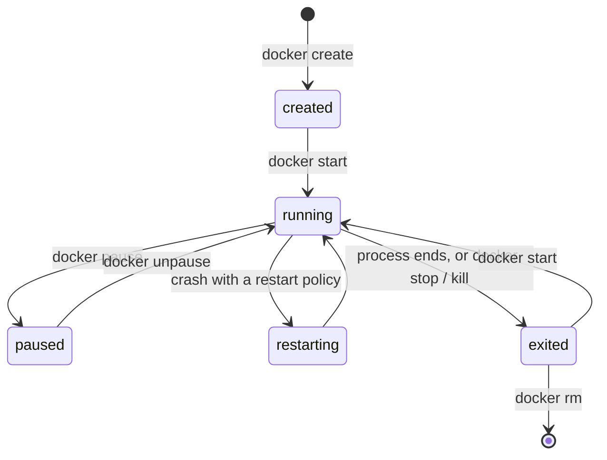

> [!info] Level: junior-middle | Time: about 6 h | You need: [[learn/containers-under-the-hood|Containers 01: What a container really is]] | Lab: Option A, the Ubuntu LTS VM from [[learn/lab-setup|Start 01: Set up your lab]], with Docker installed

Running a container takes one command. The skill is knowing what to do when it does not behave: it exits straight away, it will not stop, it dies with a number you do not recognise, or the image has no shell to log in to. This lesson has two parts. **Part 1 (junior)** covers the lifecycle and the everyday commands. **Part 2 (middle)** is a triage method for a container that will not start or keeps dying, with a table of the usual root causes, and ends with a short incident note.

## What you will learn

- The states a container moves through, and the `docker run` flags you use every day.
- How to read logs, `docker inspect` output and the exit code, and what 0, 1, 126, 127, 137 and 143 mean.
- Why `docker stop` sometimes takes ten seconds, and how PID 1 and the shell form of `CMD` cause it.
- A fixed triage order for a container that will not start: state, logs, config, reproduce, network, resources.
- How to recognise the common root causes, including `OOMKilled`, a missing command, Windows line endings and a port already in use.
- How to debug an image that has no shell, with a sidecar that shares the target's namespaces.

## Part 1 (junior): running containers

### The lifecycle

A container is created from an image, starts, runs, and ends. It does not disappear when it ends. A stopped container keeps its writable layer, logs and exit code until you remove it, which is exactly what lets you investigate after a crash.



`docker run` is `docker create` plus `docker start` in one step (and, without `-d`, an attach to the output). The status you see in `docker ps` is one of `created`, `running`, `paused`, `restarting`, `exited` or `dead`. The container runs exactly as long as its main process (PID 1) runs, as you saw in [[learn/containers-under-the-hood|Containers 01]]. When PID 1 ends, the container ends. That is why `docker run alpine` returns at once: the image's default command exits immediately.

### The `docker run` flags you use every day

| Flag                   | What it does                                                                                     |
| ---------------------- | ------------------------------------------------------------------------------------------------ |
| `-d`                   | Detached: run in the background and print the container ID.                                      |
| `-it`                  | `-i` keeps stdin open, `-t` gives a terminal. Use both for an interactive shell.                 |
| `--rm`                 | Delete the container when it exits. Good for one-off commands; bad when you need to investigate. |
| `--name web`           | A fixed name instead of a random one such as `quirky_turing`.                                    |
| `-p 8080:80`           | Publish container port 80 on host port 8080. Format: `host:container`.                           |
| `-p 127.0.0.1:8080:80` | Same, but reachable only from the host itself.                                                   |
| `-e KEY=value`         | Set an environment variable.                                                                     |
| `--env-file f.env`     | Read variables from a file (`KEY=value` per line, no quotes needed).                             |
| `--restart policy`     | `no` (default), `on-failure[:max]`, `always` or `unless-stopped`.                                |

Two details catch beginners.

**`EXPOSE` does not publish a port.** The `EXPOSE 80` line in a Dockerfile is documentation: it says which port the application listens on. Nothing on the host changes. Only `-p` (or `-P`, which publishes every exposed port to random host ports) makes a port reachable from outside.

**`-p 8080:80` listens on all host interfaces.** On a server this can expose the service to the network. Bind to `127.0.0.1` unless you mean it. Docker also writes its own firewall rules for published ports, which can bypass a host firewall tool such as `ufw`.

> [!warning] Check before relying on this
> How published ports interact with `ufw`, `firewalld` and `nftables` depends on the Docker version and firewall backend. Test from another machine (use `192.0.2.10` style documentation addresses in your notes, never real ones) before you decide a port is private.
>
> The image tags in this lesson (`nginx:1.27-alpine`, `alpine:3.20`) are examples. Replace them with currently supported tags before you use them for anything real.

### Listing containers and format strings

```bash
docker ps                    # running containers
docker ps -a                 # all, including exited
docker ps -a --filter status=exited
docker ps -a --format 'table {{.Names}}\t{{.Image}}\t{{.Status}}\t{{.Ports}}'
```

```text
NAMES    IMAGE             STATUS                      PORTS
c2-web   nginx:1.27-alpine Up 3 minutes                127.0.0.1:8080->80/tcp
c2-exit  alpine:3.20       Exited (3) 20 seconds ago
```

_Illustrative._

`--format` takes a Go template. `{{.Names}}` and `{{.Status}}` are fields. You will use the same idea in `docker inspect`. The `Exited (3)` part is the exit code. Read it first when you see a stopped container.

### Logs

Docker captures what the main process writes to **stdout and stderr**. A container that writes only to a file inside itself gives `docker logs` nothing. This is why container applications log to the console.

```bash
docker logs c2-web                       # everything
docker logs -f --tail 20 c2-web          # follow, starting from the last 20 lines
docker logs --since 10m --timestamps c2-web
```

Useful flags: `-f` follows (Ctrl+C stops following, not the container), `--tail N` limits history, `--since` and `--until` take a duration (`10m`) or a time, and `-t` (`--timestamps`) prefixes each line with its time.

The **logging driver** decides where the output goes. The default driver, `json-file`, stores it as JSON files on the host under `/var/lib/docker/containers/<id>/`. It does **not** rotate by default, so a chatty container can fill the disk. Set limits per container or in the daemon config:

```bash
docker run -d --name c2-logged \
  --log-driver json-file --log-opt max-size=10m --log-opt max-file=3 \
  alpine:3.20 sh -c 'while true; do echo tick; sleep 1; done'
```

> [!warning] Check before relying on this
> Which drivers support `docker logs`, and the default driver and rotation behaviour, change between Docker versions and with the `local` driver. Run `docker info --format '{{.LoggingDriver}}'` and read the "Configure logging drivers" page for your version.

### `exec`, `run` and `attach`

| Command         | What it does                                                                               |
| --------------- | ------------------------------------------------------------------------------------------ |
| `docker run`    | Creates a **new** container from an image and runs a command.                              |
| `docker exec`   | Starts an **extra process** inside an **already running** container (a debug shell).       |
| `docker attach` | Connects your terminal to the container's **main process**. Ctrl+C can stop the container. |

For a debug shell use `docker exec -it NAME sh` (many images have `sh` but not `bash`). `exec` needs a running container. To look inside a stopped one, start a new container from the same image, or `docker cp` files out of it. Avoid `attach` unless you know why you want it: leaving it with Ctrl+C can stop the container, and the detach keys are `Ctrl+P, Ctrl+Q`.

### `docker inspect`

`docker inspect NAME` prints a large JSON document: configuration, network settings, mounts and, most useful for debugging, the **State** block. A Go template pulls out the part you need:

```bash
docker inspect --format '{{.State.Status}} {{.State.ExitCode}} {{.State.OOMKilled}}' c2-web
docker inspect --format '{{json .State}}' c2-web | jq
docker inspect --format '{{json .Config.Env}}' c2-web | jq
docker inspect --format '{{range .NetworkSettings.Networks}}{{.IPAddress}} {{end}}' c2-web
```

```text
running 0 false
```

The `State` block holds `Status`, `Running`, `ExitCode`, `OOMKilled`, `Error`, `StartedAt`, `FinishedAt` and `Health`. Read `ExitCode`, `OOMKilled` and `Error` first for any container that has ended.

### Stopping: `stop` versus `kill`

`docker stop` is the polite version. It sends `SIGTERM` to PID 1, waits for a **grace period** (10 seconds by default, change it with `-t`), then sends `SIGKILL`. `docker kill` sends `SIGKILL` at once (or another signal with `-s`). It is the same TERM, wait, KILL order you met in [[learn/linux-processes-memory-and-disk|Linux 04]].

This is where PID 1 bites. If your application does not handle `SIGTERM`, the kernel ignores it for PID 1, and `docker stop` waits the full 10 seconds before killing it. You see slow stops, an exit code of 137 instead of 0, and half-finished work.

The most common cause is **shell form** versus **exec form** in the Dockerfile:

```dockerfile
# Shell form: Docker runs  /bin/sh -c "node server.js"
# With dash or busybox sh, sh is PID 1 and node is its child, and sh does not pass SIGTERM on.
# (Some shells replace themselves with a single command; verify with docker top.)
CMD node server.js

# Exec form: node is PID 1 and receives SIGTERM directly.
CMD ["node", "server.js"]
```

In shell form, `sh` is PID 1 and ignores `SIGTERM`; `docker stop` waits 10 seconds, then kills. The fix is exec form, or `exec node server.js` at the end of a shell script. Exercise 6 shows a 10-second stop and exercise 5 shows a clean one. The application must also handle `SIGTERM` itself: finish requests, close connections, then exit. For programs that cannot, or that start child processes, `docker run --init` puts a small init program (`tini`) in front.

### Exit codes

An exit code tells you how the main process ended. By convention, a process killed by signal N reports `128 + N`.

| Code | Meaning                              | Typical cause                                                                                                                                                                                 |
| ---- | ------------------------------------ | --------------------------------------------------------------------------------------------------------------------------------------------------------------------------------------------- |
| 0    | Finished successfully                | A one-shot job, or a clean shutdown after `SIGTERM`                                                                                                                                           |
| 1    | General error                        | The application failed; read the logs                                                                                                                                                         |
| 2    | Misuse of a shell command (often)    | A script or a CLI got bad arguments                                                                                                                                                           |
| 126  | Command found but cannot be executed | Missing execute bit, wrong file type                                                                                                                                                          |
| 127  | Command not found                    | Typo, wrong `PATH`, missing binary, or a missing interpreter                                                                                                                                  |
| 137  | 128 + 9: killed by `SIGKILL`         | OOM kill, `docker kill`, or `docker stop` after the timeout                                                                                                                                   |
| 143  | 128 + 15: ended by `SIGTERM`         | PID 1 handled or forwarded `SIGTERM` (a handler that exits 143, or `--init`), or a child was ended by `TERM`. A PID 1 with no handler ignores `TERM` and ends with 137 after the grace period |

Exit 137 does not prove an out-of-memory kill. Check `OOMKilled` in `docker inspect` before you say so. And 143 on a stop is usually fine: the process received `SIGTERM` and ended. A PID 1 without a handler ignores it and ends with 137 instead. A program that catches it can choose to exit 0.

### Cleaning up

Stopped containers, old images and unused networks and volumes pile up and use disk.

```bash
docker rm NAME                 # remove a stopped container
docker rm -f NAME              # stop and remove a running one
docker system df               # what uses space
docker container prune         # remove ALL stopped containers
docker image prune             # remove dangling (untagged) images
```

`docker system prune` removes stopped containers, unused networks and dangling images (`-a` also removes all unused images, and `--volumes` also removes volumes). **Read the confirmation prompt.** Never run a prune on a shared server without knowing what else is stored there, and never `--volumes` where data lives in named volumes.

## Part 2 (middle): a container that will not start

### The triage order

When a container exits, restarts in a loop or never becomes healthy, work in a fixed order. Each step is quick and rules out a class of causes. Resist the urge to change the Dockerfile first.

1. **State.** `docker ps -a`, then `docker inspect --format '{{json .State}}' NAME | jq`. Is it `exited`, `restarting` or `running` but unhealthy? What are `ExitCode`, `OOMKilled`, `Error`, and how long did it run (`StartedAt` to `FinishedAt`)? A container that dies in under a second failed at startup. One that runs for hours then dies failed under load or memory.
2. **Logs.** `docker logs --tail 100 -t NAME`. The last lines before the end usually name the cause. An empty log means the process died before writing, or writes elsewhere.
3. **Config.** `docker inspect` for the exact `Entrypoint`, `Cmd`, `Env`, `WorkingDir`, `User` and `Mounts`. Compare with what you think you passed. Missing variables and wrong paths show up here.
4. **Reproduce.** Run the same image with the entrypoint replaced by a shell, and start the program by hand: `docker run --rm -it --entrypoint sh IMAGE`. Now you can read files, check permissions and run the command yourself.
5. **Network.** Is the port published? Does the application listen on `0.0.0.0` and not `127.0.0.1`? Can the container resolve and reach its dependencies?
6. **Resources.** `docker stats --no-stream NAME`, the memory limit, `OOMKilled`, and disk space on the host (`df -h`, `docker system df`).

### Root causes and how to recognise them

| Symptom                                                             | Likely cause                                                                     | Check and fix                                                                                             |
| ------------------------------------------------------------------- | -------------------------------------------------------------------------------- | --------------------------------------------------------------------------------------------------------- |
| Exit 127, `executable file not found in $PATH`                      | The command is misspelled, or the binary is not in the image                     | `docker run --rm --entrypoint sh IMAGE -c 'command -v NAME'`; install it or fix the `CMD`/`ENTRYPOINT`    |
| Exit 126, `permission denied`                                       | File has no execute bit, or it is a directory                                    | `ls -l` the file in the image; `chmod +x` at build time (`COPY --chmod=755` where supported)              |
| `exec format error`                                                 | Binary or script built for another CPU architecture, or a script with no shebang | Compare `docker image inspect --format '{{.Architecture}}'` with `uname -m`; build for the right platform |
| `no such file or directory` for a script that exists                | Windows (CRLF) line endings: the shebang reads `/bin/sh\r`                       | `file script.sh`; convert with `sed -i 's/\r$//'`; set `.gitattributes` to `eol=lf`                       |
| Exits at once with an error about a missing variable or config      | Required environment variable not set                                            | `docker inspect --format '{{json .Config.Env}}'`; pass `-e` or `--env-file`                               |
| `permission denied` writing to a mounted directory                  | The container user's UID cannot write the host directory                         | Compare `id` in the container with `ls -ln` on the host; fix ownership or run with a matching `--user`    |
| `port is already allocated` or `address already in use`             | Another container or process holds the host port                                 | `docker ps --filter publish=PORT`; `ss -ltnp 'sport = :PORT'`; choose another host port                   |
| Runs, but `curl` from the host gets "connection reset" or "refused" | The app listens on `127.0.0.1` inside the container                              | Make it listen on `0.0.0.0`; check with `ss -ltn` inside                                                  |
| Binary "not found" on Alpine though the file exists                 | Built against glibc, but Alpine uses musl (the loader is missing)                | Use a glibc base (`-slim` Debian), or build statically, or build on Alpine                                |
| `Read-only file system` errors                                      | Started with `--read-only` and the app writes to its filesystem                  | Mount a `--tmpfs` for temp paths, or a volume for data                                                    |
| Exit 137 and `OOMKilled: true`                                      | Memory limit reached                                                             | Raise the limit, fix the leak, check `docker stats`                                                       |
| Exit 137 and `OOMKilled: false`                                     | `docker kill`, a stop timeout, or the host OOM killer                            | `dmesg -T \| grep -i -E 'killed process\|out of memory'` on the host                                      |

### Out of memory

If the container exceeds its memory limit (`-m`), the kernel's OOM killer ends a process in its cgroup (see [[learn/containers-under-the-hood|Containers 01]]). Docker records this in `State.OOMKilled`, and the exit code is usually 137.

```bash
docker inspect --format '{{.State.OOMKilled}} {{.State.ExitCode}}' NAME
docker stats --no-stream NAME
```

```text
true 137
```

Two cautions. `OOMKilled` is set when the kernel killed a process in the container, which may not be the main one, so the container can survive an OOM event with the flag showing `true`. And without a limit, a container is bounded by the host's memory, and the host OOM killer may pick **any** process, including one outside the container. Set a limit on anything that matters. The Kubernetes version of this is `OOMKilled` on a pod; see [[runbooks/kubernetes-pod-troubleshooting]].

### Health checks, run by hand

A `HEALTHCHECK` (or `--health-cmd` at run time) runs a command inside the container on a timer. Docker marks the container `starting`, `healthy` or `unhealthy`. Docker itself does not restart an unhealthy container; an orchestrator or you must act on the status. When it says `unhealthy`, run the same command yourself and read the output Docker saved:

```bash
docker inspect --format '{{.State.Health.Status}}' NAME
docker inspect --format '{{json .State.Health.Log}}' NAME | jq
docker exec NAME wget -qO- http://127.0.0.1:80/health; echo "exit=$?"
```

Common failures: the check calls a tool the image does not contain (`curl` on a slim image), it uses the wrong port or path, it starts before the app is ready (raise `--health-start-period`), or it tests something external so a dependency outage restarts your service. Keep the check cheap and local.

### Images without a shell

Minimal and "distroless" images contain only the application and its libraries: no `sh`, no `ps`, no `curl`. That is good for security and bad for debugging, because `docker exec -it NAME sh` fails with `executable file not found`. Do not rebuild the image with a shell in it for production. Use one of these instead, in this order:

1. **A debug sidecar that shares the target's namespaces.** Start a second container from a tools image and join the target's PID and network namespaces. This is free and works on any engine.

   ```bash
   docker run --rm -it \
     --pid=container:TARGET --network=container:TARGET \
     alpine:3.20 sh
   ```

   Inside, `ps` lists the target's processes (PID 1 is the target's main process) and `ip addr`, `ss -ltn` and `wget` use the target's network. The target's _filesystem_ is not shared; for files, try `ls /proc/1/root/` (this may need `--cap-add SYS_PTRACE`), or `docker cp`.

2. **`nsenter` from the host.** As root, enter chosen namespaces of the container's process with the host's tools: `PID=$(docker inspect --format '{{.State.Pid}}' TARGET); sudo nsenter -t "$PID" -n ss -ltn` for the network, add `-p -m` for PID and mount namespaces.

3. **`docker debug`.** Docker Desktop and some Docker subscription tiers offer a `docker debug` command that attaches a toolbox shell. Availability depends on your Docker edition and subscription, so do not build a team process on it.

> [!warning] Check before relying on this
> Whether `docker debug` is available to you depends on your Docker product and subscription tier; check the current Docker documentation. The sidecar and `nsenter` methods use only kernel features and the free engine. In Kubernetes the same idea is `kubectl debug` with an ephemeral container ([[learn/kubernetes-probes-resources-and-debugging|Kubernetes 05]]).

### Restart policies and crash loops

`--restart on-failure:3` restarts the container up to three times when it exits non-zero. `unless-stopped` and `always` restart it forever (except after a manual stop). Docker waits a short, growing delay between restarts, and the status shows `restarting`. A restart policy **hides** a crash: the service looks "Up" in a dashboard for a moment while it fails every few seconds. If `docker ps` shows `Restarting (1) 5 seconds ago` or a very short uptime, you have a crash loop. Read `docker logs` and `RestartCount`:

```bash
docker inspect --format '{{.RestartCount}} {{.State.Status}} {{.State.ExitCode}}' NAME
```

Do not fix a crash loop by adding retries. Fix the cause, then use a restart policy only to survive host reboots and rare faults.

### A short incident note

When you have found the cause, write it down in five lines. This is the habit that turns a fix into learning, and it is the seed of the blameless postmortem you will write in [[learn/on-call-incidents-and-postmortems|Incidents 02]].

```text
What happened:  api container exited 137 every ~40 minutes after the 14:00 deploy.
Impact:         requests failed for ~5 s per restart; no data lost.
Cause:          memory limit 256m, new cache grew past it (OOMKilled: true).
Fix:            raised limit to 512m; cache now capped at 100 MB (PR #123).
Follow-up:      alert on container restarts > 3 in 15 min; load-test before release.
```

_An example format with made-up details._

## Hands-on exercises

Do these in your Ubuntu VM with Docker. Names start with `c2-`. Image tags are examples.

> [!warning] Exercises are not verified
> The commands and outputs were written from the Docker documentation and not run for this page (no `verified` date). Output is illustrative; messages from Docker differ a little between versions. Read the "If you see something else" lines first.

1. **Run a web server and test it.**

   ```bash
   docker run -d --name c2-web -p 127.0.0.1:8080:80 nginx:1.27-alpine
   curl -s -o /dev/null -w '%{http_code}\n' http://127.0.0.1:8080/
   ```

   Expected: `200`.
   If you see something else: `curl: (7) Failed to connect` means it is not up yet (wait a second and retry) or the port mapping is wrong (`docker ps`). If port 8080 is taken, use another host port. If the image tag does not exist, pick a current `nginx` alpine tag from the Docker Hub page.

2. **Open a shell inside it and leave.**

   ```bash
   docker exec -it c2-web sh
   ```

   Inside run `hostname` and `ps` (or `ls /`), then `exit`.
   Expected: `hostname` prints the container's short ID, `ps` shows `nginx: master process`, and after `exit` the container is still running (`docker ps` lists it).
   If you see something else: `executable file not found: sh` means the image has no shell (see the sidecar exercise). If the container stops when you leave, you used `docker attach` or `docker run -it`, not `docker exec`.

3. **Follow the logs.** In one terminal run `docker logs -f --tail 5 c2-web`. In another run `curl -s http://127.0.0.1:8080/ > /dev/null` twice.
   Expected: two new access-log lines appear, ending in `"GET / HTTP/1.1" 200`.
   If you see something else: if nothing appears, check that you are following the right container (`docker ps`). Stop following with Ctrl+C; the container keeps running.

4. **Inspect the state.**

   ```bash
   docker inspect --format '{{.State.Status}} {{.State.ExitCode}} {{.State.OOMKilled}}' c2-web
   ```

   Expected: `running 0 false`.
   If you see something else: `exited 0 false` after a `docker stop` is also normal. `Error: No such object` means a typo in the name.

5. **Stop cleanly with a signal handler.**

   ```bash
   docker run -d --name c2-trap alpine:3.20 sh -c 'trap "echo got TERM; exit 0" TERM; echo ready; while true; do sleep 1; done'
   time docker stop c2-trap
   docker logs c2-trap
   docker inspect --format '{{.State.ExitCode}}' c2-trap
   ```

   Expected: `docker stop` returns in about a second, the log shows `ready` and then `got TERM`, and the exit code is `0`.
   If you see something else: if `docker stop` took about ten seconds, the trap did not run (check the quoting, and that the line is one command). Because `sleep` runs in the foreground, the trap runs when the current one-second sleep ends, so up to a second of delay is normal.

6. **See the 10-second stop.**

   ```bash
   docker run -d --name c2-notrap alpine:3.20 sh -c 'while true; do sleep 1; done'
   time docker stop c2-notrap
   docker inspect --format '{{.State.ExitCode}}' c2-notrap
   ```

   Expected: the stop takes about 10 seconds (`real 0m10...`) and the exit code is `137`.
   If you see something else: a quick stop with code `143` means something handled or forwarded the signal (for example a shell that execs the app, or `--init`); this can differ by image and shell. Use `docker stop -t 2 NAME` to shorten the wait while experimenting.

7. **Return a specific exit code.**

   ```bash
   docker run --name c2-exit alpine:3.20 sh -c 'exit 3'; echo "shell sees: $?"
   docker inspect --format '{{.State.ExitCode}}' c2-exit
   docker ps -a --filter name=c2-exit --format '{{.Status}}'
   ```

   Expected: `shell sees: 3`, then `3`, then `Exited (3) ...`.
   If you see something else: if the shell sees `0`, you piped the command into something else; run it alone.

8. **Drill: exit 127, command not found.**

   ```bash
   docker run --rm alpine:3.20 nosuchcmd; echo "exit=$?"
   ```

   Expected: an error such as `exec: "nosuchcmd": executable file not found in $PATH` and `exit=127`.
   If you see something else: the wording differs between versions, but the idea (not found, 127) holds. A `pull access denied` error is about the image, not the command: check the image name.

9. **Drill: exit 126, permission denied.**

   ```bash
   mkdir -p ~/c2 && cd ~/c2
   printf '#!/bin/sh\necho hello\n' > noexec.sh
   chmod 644 noexec.sh
   docker run --rm -v "$PWD/noexec.sh:/noexec.sh:ro" alpine:3.20 /noexec.sh; echo "exit=$?"
   chmod 755 noexec.sh
   docker run --rm -v "$PWD/noexec.sh:/noexec.sh:ro" alpine:3.20 /noexec.sh; echo "exit=$?"
   ```

   Expected: the first run reports `permission denied` and `exit=126`; after `chmod 755` the second prints `hello` and `exit=0`.
   If you see something else: if the first run prints `hello`, the file system you are on ignores the execute bit (some mounts do); try a path under your home directory on a normal Linux filesystem.

10. **Drill: Windows line endings.**

    ```bash
    cd ~/c2
    printf '#!/bin/sh\r\necho hello\r\n' > crlf.sh
    chmod 755 crlf.sh
    file crlf.sh
    docker run --rm -v "$PWD/crlf.sh:/crlf.sh:ro" alpine:3.20 /crlf.sh; echo "exit=$?"
    sed -i 's/\r$//' crlf.sh
    docker run --rm -v "$PWD/crlf.sh:/crlf.sh:ro" alpine:3.20 /crlf.sh; echo "exit=$?"
    ```

    Expected: `file` reports `with CRLF line terminators`. The first run fails with `no such file or directory` even though the file exists (the kernel looks for an interpreter called `/bin/sh` followed by a carriage return), with a non-zero exit code. After the `sed` fix it prints `hello` and `exit=0`.
    If you see something else: the exact exit code (127 is common) and message vary by runtime version, so not verified; the clue is "no such file" for a file that is there. If it prints `hello` the first time, the `printf` did not write `\r`; use `od -c crlf.sh` to check.

11. **Drill: out of memory.**

    ```bash
    docker run --name c2-oom -m 32m --memory-swap 32m alpine:3.20 dd if=/dev/zero of=/dev/null bs=1G count=1
    echo "exit=$?"
    docker inspect --format '{{.State.OOMKilled}} {{.State.ExitCode}}' c2-oom
    ```

    Expected: the command is killed, `exit=137`, and the inspect line prints `true 137`.
    If you see something else: `--memory-swap 32m` removes swap so the limit is hard. If the container finishes with `0`, your `dd` did not allocate a 1 GiB buffer; try `docker run -m 32m --memory-swap 32m alpine:3.20 tail /dev/zero`. If `OOMKilled` is `false` with 137, check `dmesg -T | grep -i killed` on the host. If the Docker engine reports a warning that your kernel does not support swap limits, drop `--memory-swap`.

12. **Drill: a port conflict.**

    ```bash
    docker run -d --name c2-a -p 127.0.0.1:8081:80 nginx:1.27-alpine
    docker run -d --name c2-b -p 127.0.0.1:8081:80 nginx:1.27-alpine
    docker ps -a --filter name=c2-b --format '{{.Names}} {{.Status}}'
    docker ps --filter publish=8081 --format '{{.Names}}'
    ```

    Expected: the second command fails with `Bind for 127.0.0.1:8081 failed: port is already allocated`. `c2-b` is left in the `Created` state (not running). The last command names `c2-a` as the holder.
    If you see something else: if both start, the first port was released; make sure you did not use different host ports. Remove the failed one with `docker rm c2-b` and run it on `8082`.

13. **Drill: debug an image that has no shell.** The Kubernetes `pause` image contains one program and no shell.

    ```bash
    docker run -d --name c2-nosh registry.k8s.io/pause:3.9
    docker exec -it c2-nosh sh; echo "exit=$?"
    docker run --rm -it --pid=container:c2-nosh --network=container:c2-nosh alpine:3.20 sh -c 'ps; ip addr show lo'
    ```

    Expected: `exec` fails with `executable file not found in $PATH` (a non-zero exit, commonly 126 or 127). The sidecar prints a process list whose PID 1 is `/pause`, and the loopback interface of the target.
    If you see something else: if the tag `3.9` does not exist or the registry is unreachable, use any image with no shell, for example one built `FROM scratch` with a single static binary. If `ps` shows only your own processes, the `--pid=container:` flag was left out.

14. **Drill: an unhealthy container.**

    ```bash
    docker run -d --name c2-hc \
      --health-cmd 'wget -qO- http://127.0.0.1:80/missing || exit 1' \
      --health-interval 5s --health-retries 2 \
      nginx:1.27-alpine
    sleep 15
    docker inspect --format '{{.State.Health.Status}}' c2-hc
    docker exec c2-hc wget -qO- http://127.0.0.1:80/missing; echo "exit=$?"
    ```

    Expected: `unhealthy`, then a `404` error from `wget` and a non-zero exit. The check fails because `/missing` does not exist. Changing the path to `/` would make it `healthy`.
    If you see something else: `starting` means you checked too early; wait a few more seconds. If the status is `healthy`, `wget` followed no error; check that the path really returns 404 in your image.

15. **Drill: a crash loop.**

    ```bash
    docker run -d --name c2-loop --restart on-failure:3 alpine:3.20 sh -c 'echo boom; exit 1'
    sleep 8
    docker inspect --format '{{.RestartCount}} {{.State.Status}} {{.State.ExitCode}}' c2-loop
    docker logs c2-loop
    ```

    Expected: `3 exited 1`, and the logs show `boom` four times (the first run plus three restarts).
    If you see something else: if the count is lower, the backoff delay has not elapsed; wait a few more seconds. If the status is `restarting`, the policy has not given up yet.

16. **Write the incident note for exercise 11** in five lines (what happened, impact, cause, fix, follow-up), using the format above.
    Expected: your note names `OOMKilled: true`, the memory limit you set and one follow-up that prevents a repeat (an alert, or a limit review).
    If you see something else: if the "cause" line only says "out of memory", add the evidence you used (`docker inspect` output). Evidence separates a cause from a guess.

17. **Clean up.**

    ```bash
    docker rm -f c2-web c2-logged c2-trap c2-notrap c2-exit c2-oom c2-a c2-b c2-nosh c2-hc c2-loop 2>/dev/null
    rm -rf ~/c2
    docker ps -a --filter name=c2-
    ```

    Expected: the final `docker ps -a` lists no containers.
    If you see something else: a name that remains is a typo in the list; remove it by name.

## Common mistakes

- **Using `--rm` while debugging.** The container, its logs and its exit code vanish when it ends. Leave `--rm` off until it works.
- **Reading the last line of the log only.** The cause is often several lines above a generic "exited" message. Read `--tail 100` and the exit code.
- **Blaming memory for every 137.** 137 means `SIGKILL`: it also comes from `docker kill` and from a stop that timed out. Check `OOMKilled`.
- **Using the shell form of `CMD` and `ENTRYPOINT`.** The shell becomes PID 1, `docker stop` waits ten seconds and the app never shuts down gracefully. Use the exec form (`["node", "server.js"]`).
- **Publishing to all interfaces by accident.** `-p 8080:80` is reachable from the network. Use `-p 127.0.0.1:8080:80` for local work.
- **Relying on a restart policy to "fix" a crash.** It hides the crash loop. Fix the cause; keep the policy for host restarts.
- **Letting logs grow without a limit.** The default `json-file` driver does not rotate. Set `max-size` and `max-file`.
- **Pruning with `--volumes` on a shared host.** You delete data. Run `docker system df` and read what the prune lists first.
- **Debugging in production by adding a shell to the image.** Use a sidecar or `nsenter` and leave the image as it is.

## Check your understanding

1. A container exits with 137 and `OOMKilled` is `false`. Name two things that could have sent `SIGKILL`.
2. A container exits with 143 after `docker stop`. Is that a failure?
3. Why does `docker stop` take ten seconds for a container started from `CMD node server.js`, and what changes it?
4. A script you copied from a Windows machine fails in a container with `no such file or directory`, yet `ls` shows the file. What is wrong, and what is the fix?
5. You must debug a distroless container in a test environment. Which two methods work without installing anything into the image?
6. What does `EXPOSE 8080` in a Dockerfile do?

> [!question]- Answers
>
> 1. `docker kill`, a `docker stop` whose grace period ran out, or the host's own OOM killer acting on a container with no memory limit (check `dmesg`). A manual `kill -9` from the host also fits.
> 2. Not by itself. 143 is 128 + 15: the process ended because of `SIGTERM`, which is what `docker stop` sends. A program that handles the signal may exit 0 instead, and a PID 1 with no handler would end with 137, not 143. It is a failure only if the program should have shut down cleanly with 0 and your alerts depend on it.
> 3. In shell form, `sh -c` is PID 1 and does not pass `SIGTERM` to `node`, so nothing reacts until `SIGKILL` after the 10-second grace period. Use exec form (`CMD ["node", "server.js"]`) and make the app handle `SIGTERM`. You can also use `--init` or `exec` in a wrapper script.
> 4. The file has CRLF line endings, so the kernel looks for an interpreter named `/bin/sh` plus a carriage return. Convert it (`sed -i 's/\r$//' script.sh`) and prevent a repeat with `.gitattributes` (`*.sh text eol=lf`).
> 5. A sidecar container started with `--pid=container:NAME --network=container:NAME` and a tools image, and `nsenter` from the host using the container's PID.
> 6. Nothing on the network. It documents the port the application uses and lets `-P` choose host ports. You publish a port with `-p` (or Compose `ports`).

## Next steps

Next lesson: [[learn/building-and-shipping-images|Containers 03: Building and shipping images]]. Previous lesson: [[learn/containers-under-the-hood|Containers 01: What a container really is]].

To go deeper:

- [[runbooks/kubernetes-pod-troubleshooting]] applies the same triage (state, logs, config, reproduce) to pods in Kubernetes, with `CrashLoopBackOff` and `OOMKilled`.
- [[patterns/dockerfile-hardening]] for running as non-root and read-only filesystems, which cause several of the failures above when done wrongly.
- [[learn/linux-processes-memory-and-disk|Linux 04]] for signals, exit codes and the OOM killer on a host.
- The whole path is mapped in [[learn/index|the learning path]].

## Sources

- Docker CLI reference: `docker run`, `docker logs`, `docker inspect`, `docker stop` and `docker system prune` (https://docs.docker.com/reference/cli/docker/). Not checked against a running engine for this page.
- Docker documentation, "Dockerfile reference", sections `CMD`, `ENTRYPOINT` and `HEALTHCHECK` (https://docs.docker.com/reference/dockerfile/), for shell form versus exec form.
- Docker documentation, "Resource constraints" (https://docs.docker.com/engine/containers/resource_constraints/) and "Configure logging drivers" (https://docs.docker.com/engine/logging/configure/).
- Linux man-pages: `nsenter(1)`, `pid_namespaces(7)` and `signal(7)` (https://man7.org/linux/man-pages/), for the debugging and PID 1 behaviour.
- Image tags (`nginx`, `alpine`, `registry.k8s.io/pause`) are examples and were not checked for existence on the day of writing.
