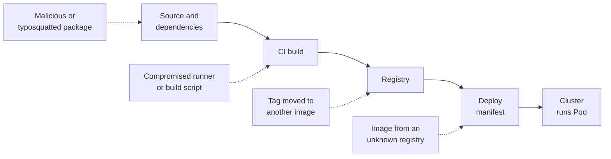

> [!info] Level: middle | Time: about 3.5 h | You need: [[learn/building-and-shipping-images|Containers 03: Building and shipping images]] and [[learn/security-basics-for-devops|Security 01: Security basics every DevOps engineer must know]] | Lab: Option A, the Ubuntu LTS VM from [[learn/lab-setup|Start 01: Set up your lab]], with Docker, `jq` and a local registry on 127.0.0.1; the admission step is a reading exercise

Containers 03 ended with "scan the image and pin it by digest". That protects you from one thing: a vulnerable package you know about. It does not tell you **what is inside** an image you did not build, whether the image in production is **the one your pipeline built**, or whether someone swapped a tag in the registry. Those are supply-chain questions, and they have three practical answers that this lesson builds by hand:

- an **SBOM** (software bill of materials): a machine-readable list of every package in the image;
- a **signature**: proof that a holder of a specific key signed one exact image digest;
- an **attestation**: a signed statement about an image, such as "this is its SBOM" or "this pipeline built it".

You will do all three against a registry on your own machine, then see how admission control turns "signed" into "only signed images run".

> [!note] What was run for this page
> A helper lab on 127.0.0.1 ran the registry, Syft, Trivy and cosign steps with these versions: registry 3.1.2, cosign v3.1.4, Syft 1.55.0, Trivy 0.76.1 and crane v0.22.1. Images were copied into the registry with crane because no Docker daemon was available, so the `docker build` and `docker push` steps were **not** run. Grype, kind and Kyverno were not run. Output marked "observed" came from that lab; everything else is illustrative. Cosign changed behaviour in v3 and changes often, so check `cosign version` and its `--help` for the version you pin.

## What you will learn

- How supply-chain attacks reach production, and why a tag is a pointer but a digest is an identity.
- What CycloneDX and SPDX SBOMs contain, how to generate one with Syft or Trivy, and how to query it with `jq`.
- How to scan from an SBOM, and why a scan result is only true for the day it ran.
- How to sign and verify an image by digest with a cosign key pair, what keyless signing adds, and how to keep a private key safe.
- How to attach an SBOM as a signed attestation and verify it, and where SLSA provenance and admission policies fit.

## How the supply chain gets attacked

Think of the path from source to a running Pod as a chain. Each link is a place to insert something:



- **Dependencies.** A package you pull is malicious, compromised or vulnerable. An SBOM tells you what you shipped so you can answer "are we affected?" in minutes.
- **The build.** A compromised runner or script injects code. Provenance (who built it, from which commit) and isolated builders are the defence; see [[compliance/slsa-build-provenance]].
- **The registry.** Tags are mutable: `app:1.4.2` can be pushed again with different content. Digests and signatures are the defence.
- **Deploy.** Someone runs an image from anywhere. Admission policies that require a valid signature are the defence.

[[architecture/software-supply-chain-end-to-end]] maps the full chain for this platform; this lesson is the hands-on version.

## Tags versus digests

A **tag** is a name that points at a manifest, and anyone with push rights can move it. A **digest** is the SHA-256 of the manifest bytes: change one byte and the digest changes. So `registry/app@sha256:...` always means the same image, which is why [[adr/0010-deploy-images-by-digest|ADR 0010]] deploys by digest and why cosign's documentation tells you to sign by digest, not by tag.

Multi-architecture images add one level: the tag points at an **image index** (a list of per-platform manifests), and the index has its own digest. Sign and deploy the index digest.

## Set up the lab

You need Docker, `jq`, and four tools installed from their release pages with checksums checked: cosign, Syft, Trivy and crane (Grype is optional). Pin each one; write the versions in your notes.

```bash
cosign version | grep -E 'GitVersion'
syft version | grep -E '^Version'
trivy --version | head -1
crane version
```

```text
GitVersion:    v<PINNED_VERSION>
Version:       <PINNED_VERSION>
Version: <PINNED_VERSION>
<PINNED_VERSION>
```

_Illustrative format. The lab for this page used cosign v3.1.4, Syft 1.55.0, Trivy 0.76.1 and crane v0.22.1._

Start a registry that listens **only on loopback**, so nothing outside your VM can push to it:

```bash
docker run -d --name lab-registry -p 127.0.0.1:5000:5000 registry:<PINNED_TAG>  # change: a current 3.x tag from the image's page
curl -s http://127.0.0.1:5000/v2/_catalog
```

```text
{"repositories":[]}
```

Docker Engine treats registries on `127.0.0.0/8` as insecure (plain HTTP) by default, and cosign, crane, Syft and Trivy all spoke plain HTTP to `127.0.0.1:5000` in the lab with no extra flag. Never use plain HTTP to any other registry. The `registry:2` series is no longer updated (2.8.3 was the last tag observed); use the 3.x series.

Build a tiny image and push it:

```bash
mkdir -p ~/sc-lab/app && cd ~/sc-lab/app
cat > Dockerfile <<'EOF'
FROM alpine:<PINNED_TAG>
RUN apk add --no-cache curl
COPY hello.sh /usr/local/bin/hello.sh
USER 65534
ENTRYPOINT ["/usr/local/bin/hello.sh"]
EOF
printf '#!/bin/sh\necho "hello from lab/app v1"\n' > hello.sh && chmod 755 hello.sh

docker build -t 127.0.0.1:5000/lab/app:1 .
docker push 127.0.0.1:5000/lab/app:1

export IMAGE="127.0.0.1:5000/lab/app@$(crane digest 127.0.0.1:5000/lab/app:1)"
echo "$IMAGE"
```

```text
127.0.0.1:5000/lab/app@sha256:3c1e9f0d...
```

_Illustrative digest._ Pick an Alpine tag that is still supported when you do this: Trivy warned in the lab that the 3.20 series used there "is no longer supported by the distribution". From here on, every command uses `$IMAGE`, the digest form.

## SBOMs: CycloneDX and SPDX

An SBOM lists components with names, versions, licences and **package URLs** (purls, such as `pkg:apk/alpine/musl@1.2.5-r3?arch=x86_64`), which scanners use to match advisories. Two formats dominate:

| Format    | Steward                       | Strengths                                                                                    |
| --------- | ----------------------------- | -------------------------------------------------------------------------------------------- |
| CycloneDX | OWASP; Ecma standard ECMA-424 | Security-focused; one model for SBOM, VEX, services and more; the default for most scanners. |
| SPDX      | Linux Foundation              | Licence compliance roots; widely required in procurement.                                    |

This platform standardises on CycloneDX ([[adr/0039-cyclonedx-as-canonical-sbom-format|ADR 0039]]) and stores SBOMs as described in [[compliance/sbom-generation-and-storage]]. Both formats carry a spec version; tools move to new versions over time, so record which one you produce rather than assuming it.

Generate one with Syft, by digest:

```bash
cd ~/sc-lab
export SYFT_CHECK_FOR_APP_UPDATE=false   # silences the update check when it cannot reach the internet
syft "$IMAGE" -o cyclonedx-json=sbom.cdx.json
syft "$IMAGE" -o spdx-json=sbom.spdx.json
jq -r '.specVersion, .metadata.component.type' sbom.cdx.json
jq -r '.components | group_by(.type) | map("\(.[0].type) \(length)") | .[]' sbom.cdx.json
jq -r '.spdxVersion, (.packages | length)' sbom.spdx.json
```

```text
1.7
container
file 77
library 14
operating-system 1
SPDX-2.3
15
```

_Observed for an `alpine` base image with Syft 1.55.0; your counts differ with the packages you add._

Notice Syft's CycloneDX output lists **files** as components too. A query that assumes every component is a package breaks on them, because file components have no `purl`. Filter by type:

```bash
jq -r '.components[] | select(.type=="library") | select(.name=="musl") | [.name, .version, .purl] | @tsv' sbom.cdx.json
```

```text
musl	1.2.5-r3	pkg:apk/alpine/musl@1.2.5-r3?arch=x86_64&distro=alpine-3.20.10
```

_Observed._ This one query is the incident-day superpower: "is `musl` 1.2.5-r3 in any image we ship?" becomes a loop over stored SBOMs instead of pulling every image.

Trivy can produce an SBOM too:

```bash
trivy image --format cyclonedx --output sbom-trivy.cdx.json "$IMAGE"
jq -r '.specVersion, (.components | length)' sbom-trivy.cdx.json
```

```text
1.7
15
```

_Observed with Trivy 0.76.1._ Trivy listed packages only (15) where Syft also listed files (92 components). Neither is wrong; they model different detail. Pick one generator per pipeline so SBOMs are comparable over time. Trivy's `--format cyclonedx` does not include vulnerabilities unless you add `--scanners vuln`.

## Scanning from an SBOM

A scanner can read the SBOM instead of the image, which is faster and works when the image is gone or the registry is unreachable:

```bash
trivy sbom sbom.cdx.json
# Optional, not run for this page:
grype sbom:./sbom.cdx.json
```

```text
INFO  Detected OS  family="alpine" version="3.20.10"
WARN  Third-party SBOM may lead to inaccurate vulnerability detection
WARN  Recommend using Trivy to generate SBOMs
...
Total: 0 (UNKNOWN: 0, LOW: 0, MEDIUM: 0, HIGH: 0, CRITICAL: 0)
```

_Partly observed: the detection and the two warnings appeared when Trivy scanned Syft's SBOM. Abridged._ Trivy's docs say SBOMs from other tools may give less accurate results, which is another reason to keep generator and scanner consistent, or test the pair.

Two lessons here:

- **A scan is true only for the day it ran.** The SBOM does not change; the advisory database does. Rescan stored SBOMs daily, not just at build time. [[tools/jfrog-xray-vs-trivy-vs-grype]] compares the scanners that do this continuously.
- **The database is big.** Trivy's first run downloaded its vulnerability database, about 1.6 GB on disk in the lab. Budget the download, cache it in CI, and plan for air-gapped mirrors.

## Signing with cosign

Cosign signs the **digest** of an image and stores the signature in the registry next to it. You can sign with a key pair you hold, or keylessly.

### A key pair for the lab

```bash
cd ~/sc-lab
umask 077
cosign generate-key-pair   # prompts for a password; writes cosign.key (encrypted) and cosign.pub
ls -l cosign.key cosign.pub
printf 'cosign.key\n*.key\n' >> .gitignore
```

The private key is encrypted with the password you type. In a lab script you may pass it through `COSIGN_PASSWORD`, but never put that variable in a CI file or a shell history on a shared machine. In production the key lives in a KMS, referenced by URI (`gcpkms://`, `awskms://`, `azurekms://`, `hashivault://` or `k8s://`), so it never touches disk; or there is no key at all (keyless, below).

### Sign offline, by digest

With cosign v3, even key-based signing first fetches a "signing configuration" from the public Sigstore infrastructure, and by default it may record the signature in a public transparency log. In the lab that was blocked, and the default sign failed with `error getting signing config from TUF`. The old `--tlog-upload=false` flag is deprecated in v3 and failed with an error saying it is not supported with a signing config. What worked was an explicit signing config with no public services:

```bash
cosign signing-config create \
  --no-default-fulcio --no-default-oidc --no-default-rekor --no-default-tsa \
  --out signing-config.json
cat signing-config.json

cosign sign --key cosign.key --yes --signing-config signing-config.json "$IMAGE"
```

```text
{"mediaType":"application/vnd.dev.sigstore.signingconfig.v0.2+json","rekorTlogConfig":{},"tsaConfig":{}}
Signing artifact...
Pushing signature to: 127.0.0.1:5000/lab/app
```

_Observed with cosign v3.1.4._

> [!warning] Do not publish private image names to a public log
> If you sign with cosign's defaults on a network that can reach the public Sigstore services, the signature may be recorded in the public, append-only transparency log, including your image reference. Entries cannot be removed. For a lab or a private registry, use a signing config without a log (as above) or your own Sigstore deployment. This default was not observed here, because the network was blocked; check `cosign sign --help` for your version.

### Verify

```bash
cosign verify --key cosign.pub --insecure-ignore-tlog "$IMAGE" | jq '.[0].critical.image'
```

```text
Verification for 127.0.0.1:5000/lab/app@sha256:3c1e9f0d... --
The following checks were performed on each of these signatures:
  - The cosign claims were validated
  - Existence of the claims in the transparency log was verified offline
  - The signatures were verified against the specified public key
{
  "docker-manifest-digest": "sha256:3c1e9f0d..."
}
```

_Observed format, abridged; digest illustrative._ Two things to notice:

- `--insecure-ignore-tlog` is needed because nothing was logged, and plain `cosign verify --key` failed offline trying to fetch the trusted root. It is a lab-only flag: in production you verify against a log.
- The second check line still says the transparency log was "verified offline" even with `--insecure-ignore-tlog`. It was not. Do not read that line as evidence.

The signed payload names the **digest**. That is why the next exercise works.

### Where the signature lives

In the lab registry there were no `.sig` tags. Cosign v3 stored a tag named `sha256-<digest>` holding an OCI index whose entries have `artifactType: application/vnd.dev.sigstore.bundle.v0.3+json`, one per signature or attestation. The registry did not support the OCI referrers API (it returned 404), and cosign fell back to that tag. Older cosign versions and other verifiers expect different layouts, which matters for admission controllers below.

```bash
crane ls 127.0.0.1:5000/lab/app
```

```text
1
sha256-3c1e9f0d...
```

_Illustrative digest._

### Keyless signing, in one section

Keyless signing removes the long-lived key. In CI:

1. The job gets an OIDC token from its platform (GitLab `id_tokens`, as in [[learn/gcp-keyless-ci-with-workload-identity-federation|GCP 05]]).
2. **Fulcio**, Sigstore's certificate authority, issues a certificate valid for minutes that binds a fresh key pair to that identity.
3. Cosign signs and records the signature and certificate in **Rekor**, the transparency log, so anyone can later prove the signature existed while the certificate was valid.

Verification then checks **who** signed, not which key:

```bash
cosign verify "$IMAGE" \
  --certificate-identity-regexp '<identity your CI platform puts in the certificate>' \
  --certificate-oidc-issuer 'https://gitlab.com'
```

The exact certificate identity for a GitLab job was not verified for this page; take it from the Sigstore and GitLab docs. Keyless with the public Sigstore instance records entries publicly and permanently, which is why [[adr/0037-keyless-cosign-image-signing|ADR 0037]] discusses where the platform signs. [[tools/cosign-vs-notation]] compares cosign with Notation.

## Attestations: signed statements about an image

A signature says "this digest was signed". An **attestation** says "this digest has this property", signed. The format is an in-toto statement: a `subject` (the image digest), a `predicateType` (what kind of statement), and the `predicate` (the SBOM, the provenance, a scan result).

```bash
cosign attest --key cosign.key --yes --signing-config signing-config.json \
  --type cyclonedx --predicate sbom.cdx.json "$IMAGE"

cosign verify-attestation --key cosign.pub --insecure-ignore-tlog --type cyclonedx "$IMAGE" \
  | jq -r '.payload' | head -n 1 | base64 -d \
  | jq '{_type, predicateType, subject, predicate_keys: (.predicate | keys)}'
```

```text
{
  "_type": "https://in-toto.io/Statement/v0.1",
  "predicateType": "https://cyclonedx.org/bom",
  "subject": [
    { "name": "127.0.0.1:5000/lab/app", "digest": { "sha256": "3c1e9f0d..." } }
  ],
  "predicate_keys": [ "$schema", "bomFormat", "components", "dependencies" ]
}
```

_Observed structure with cosign v3.1.4, abridged; digest illustrative._ `--type` accepts `cyclonedx`, `spdxjson`, `slsaprovenance`, `vuln`, `openvex` and others, or a URI for your own type; the default is `custom`. `verify-attestation --policy` can also evaluate the predicate with a CUE or Rego policy, for example "no critical vulnerabilities in the attached scan".

Now consumers can fetch the SBOM **from the registry, signed**, instead of trusting a file someone emailed.

### SLSA provenance, in one paragraph

SLSA (Supply-chain Levels for Software Artifacts) is a framework for how much you can trust how an artifact was built. Its central artifact is **provenance**: an attestation recording the builder, the source commit and the build parameters, ideally generated by the build platform rather than by the build script, so a compromised script cannot forge it. Attaching provenance uses the same `cosign attest` mechanics with a SLSA predicate type. The levels and their exact requirements change between SLSA versions, so read them on slsa.dev; [[compliance/slsa-build-provenance]] maps them to this platform.

## Admission: only signed images run

Signing is pointless if nothing checks. An **admission controller** checks every Pod's images when it is created and rejects or audits unsigned ones. This platform uses Kyverno ([[adr/0038-kyverno-verifies-image-signatures-at-admission|ADR 0038]]), with the full policy and rollout in [[patterns/image-signing-and-admission-verification]]. The shape of a Kyverno `verifyImages` rule:

```yaml
# Sketch only: not applied for this page. Check the current Kyverno docs for field placement and policy kinds.
apiVersion: kyverno.io/v1
kind: ClusterPolicy
metadata:
  name: require-signed-lab-images
spec:
  rules:
    - name: lab-images-are-signed
      match:
        any:
          - resources:
              kinds: [Pod]
      verifyImages:
        - imageReferences:
            - "registry.example.com/lab/*"
          failureAction: Audit # move to Enforce once audit shows no false positives
          mutateDigest: true # rewrite tags to the verified digest
          verifyDigest: true
          required: true
          attestors:
            - entries:
                - keys:
                    publicKeys: |-
                      -----BEGIN PUBLIC KEY-----
                      <the contents of cosign.pub>
                      -----END PUBLIC KEY-----
```

Three cautions that follow from this lesson:

- `mutateDigest` turns a tag into the verified digest, which closes the "tag moved after verification" gap.
- Kyverno's rule `type` can be `Cosign` (the default), `SigstoreBundle` or `Notary`, and it has an experimental `cosignOCI11` switch. Cosign v3 stores signatures as Sigstore bundles, so check that your Kyverno version verifies the format your cosign writes before you enforce, or every Pod is rejected.
- Start in `Audit`, read the reports, then `Enforce`; [[adr/0022-admission-policy-pod-security-vap-and-kyverno]] explains how the admission layers fit.

A kind cluster cannot pull from `127.0.0.1:5000` on your VM without extra registry wiring, so this lesson stops at reading the policy. The pattern note has the cluster steps.

## Hands-on exercises

Work in `~/sc-lab` with the registry running. Output is illustrative unless marked observed in the sections above.

1. **Push the image and record its digest.** Run the "Set up the lab" block.
   Expected: `echo "$IMAGE"` prints `127.0.0.1:5000/lab/app@sha256:` and 64 hex characters, and `crane manifest "$IMAGE" | jq -r .mediaType` prints a manifest or index media type.
   If you see something else: "connection refused" means the registry is not running or not on 127.0.0.1:5000 (`docker ps`). "http: server gave HTTP response to HTTPS client" means a tool did not treat loopback as insecure; check its flags for local registries.

2. **Generate both SBOM formats and find a package.** Run the Syft commands and the `musl` query.
   Expected: CycloneDX and SPDX files exist, the component types include `library`, and the query prints `musl`, its version and a `pkg:apk/...` purl.
   If you see something else: a `jq` error like "Cannot iterate over null" or "startswith cannot be applied" means you queried file components; keep the `select(.type=="library")` filter.

3. **Compare generators.** Run the Trivy SBOM command and compare component counts with Syft's.
   Expected: Syft's CycloneDX has more components (it includes files), Trivy's lists packages only.
   If you see something else: the counts depend on tool versions; the point is to see that they differ and to pick one.

4. **Scan from the SBOM.**

   ```bash
   trivy sbom sbom.cdx.json; echo "exit: $?"
   trivy sbom --exit-code 1 --severity CRITICAL sbom.cdx.json; echo "exit: $?"
   ```

   Expected: a findings table (possibly empty) and exit 0, then exit 1 only if there is a critical finding.
   If you see something else: a slow first run is the database download. "Third-party SBOM" warnings are expected for Syft SBOMs.

5. **Sign by digest and verify.** Generate the key pair, create the offline signing config, sign `$IMAGE` and verify it as in the signing section.
   Expected: `Pushing signature to: 127.0.0.1:5000/lab/app`, then a verify output with the three check lines and `docker-manifest-digest` equal to your digest.
   If you see something else: a TUF or `signing config` error means cosign tried to reach public services; use `--signing-config signing-config.json`. "no signatures found" on verify usually means you signed one reference and verified another; compare digests.

6. **Tamper with the tag.** Change `hello.sh` to print `v2`, rebuild and push it **as the same tag** `:1`, then verify by tag and by digest:

   ```bash
   cd ~/sc-lab/app && sed -i 's/v1/v2/' hello.sh
   docker build -t 127.0.0.1:5000/lab/app:1 . && docker push 127.0.0.1:5000/lab/app:1
   cd ~/sc-lab
   crane digest 127.0.0.1:5000/lab/app:1
   cosign verify --key cosign.pub --insecure-ignore-tlog 127.0.0.1:5000/lab/app:1; echo "exit: $?"
   cosign verify --key cosign.pub --insecure-ignore-tlog "$IMAGE" >/dev/null; echo "exit: $?"
   ```

   Expected: a new digest for `:1`; verifying the tag fails with `Error: no signatures found` and a non-zero exit; verifying the original digest still exits 0. This was observed in the lab (with crane doing the retag).
   If you see something else: if the tag still verifies, the build produced the same digest (nothing changed); check the `sed` edit.

7. **Attach and verify the SBOM attestation.** Run the attest and verify-attestation commands against `$IMAGE`.
   Expected: verify-attestation exits 0 and the decoded statement has `predicateType` `https://cyclonedx.org/bom` and your digest as its subject. `crane ls 127.0.0.1:5000/lab/app` shows the `sha256-...` tag (in the lab, its index then held two entries: the signature and the attestation).
   If you see something else: "none of the attestations matched the predicate type" means `--type` differs between attest and verify.

8. **Read the admission sketch against your key.** Put your `cosign.pub` into the Kyverno sketch, then answer: what happens to a Pod that uses `registry.example.com/lab/app:1` after exercise 6's retag, with `mutateDigest: true` and the policy in `Enforce`?
   Expected answer: Kyverno resolves the tag to the new digest, finds no valid signature for it, and rejects the Pod; a Pod that names the signed digest is admitted (if the policy can read the signature format, see the cautions).

9. **Clean up.**

   ```bash
   docker rm -f lab-registry
   rm -f ~/sc-lab/sbom*.json ~/sc-lab/signing-config.json
   shred -u ~/sc-lab/cosign.key && rm -f ~/sc-lab/cosign.pub
   ```

   Expected: the registry container is gone (`docker ps -a --filter name=lab-registry` prints only the header) and the lab key no longer exists.
   If you see something else: `shred` is not reliable on every filesystem (journaling, copy-on-write, SSDs); for a lab key, deleting it is enough, and real keys belong in a KMS anyway.

## Common mistakes

- **Signing or deploying by tag.** The tag can move after you sign. Sign the digest, deploy the digest, and let admission rewrite tags to digests.
- **Committing `cosign.key` or exporting `COSIGN_PASSWORD` in CI files.** An encrypted key plus its password in the same repository is a plain key. Use a KMS or keyless signing in CI.
- **Copying old cosign commands.** `--tlog-upload=false` and other v2-era flags fail or behave differently in v3. Pin a version and read its `--help`.
- **Assuming the default signing is private.** Default signing may write to a public, permanent log. Decide where signatures are recorded before signing anything with a private name.
- **Trusting the "verified offline" line.** With `--insecure-ignore-tlog` nothing was checked against a log, whatever the output says.
- **Treating an SBOM scan as permanent.** New advisories arrive daily. Rescan stored SBOMs on a schedule.
- **Querying SBOMs as if every component were a package.** Syft's CycloneDX includes files with no purl. Filter by `type`.
- **Enforcing an admission policy first.** A verifier that cannot read your signature format rejects every Pod. Audit first.

## Check your understanding

1. Why does verifying `app:1` fail after a retag, while verifying `app@sha256:<original>` still succeeds?
2. What does an SBOM let you answer during an incident that a scan report from build day does not?
3. What is the difference between a signature and an attestation?
4. In keyless signing, what do Fulcio and Rekor each provide?
5. Your lab verify needs `--insecure-ignore-tlog`. Why is that acceptable in the lab and not in production?
6. Why should an admission policy rewrite tags to digests?

> [!question]- Answers
>
> 1. The signature covers a digest. After the retag, the tag resolves to a new digest that nobody signed. The original digest still has its signature.
> 2. "Do we ship package X at version Y, and where?" across every image, even images no longer pullable, and it can be rescanned against today's advisories. A build-day scan only says what was known then.
> 3. A signature proves the holder of a key or identity signed a digest. An attestation is a signed statement about that digest with typed content, such as an SBOM, provenance or a scan result.
> 4. Fulcio issues a short-lived certificate binding a fresh key to the CI's OIDC identity. Rekor records the signature in a public append-only log, so it can be proven to have existed while the certificate was valid.
> 5. In the lab nothing was logged on purpose, so there is nothing to check. In production the log (public or your own) is part of the trust model: it detects signatures that should not exist and backs short-lived certificates.
> 6. So the image that runs is exactly the one that was verified. A tag could move between verification and the image pull.

## Next steps

Next lesson: [[learn/promql-for-alert-rules-and-recording-rules|Observability 04: PromQL for alert rules]], or continue with the Kubernetes and delivery lessons in [[learn/index|the learning path]]. Previous lesson: [[learn/security-basics-for-devops|Security 01: Security basics every DevOps engineer must know]].

To go deeper:

- [[patterns/image-signing-and-admission-verification]] for the production signing and Kyverno setup.
- [[adr/0037-keyless-cosign-image-signing]], [[adr/0038-kyverno-verifies-image-signatures-at-admission]] and [[adr/0039-cyclonedx-as-canonical-sbom-format]] for the decisions behind them.
- [[compliance/sbom-generation-and-storage]] and [[compliance/slsa-build-provenance]] for storing SBOMs and building provenance.
- [[architecture/software-supply-chain-end-to-end]] for the whole chain on this platform.
- [[adr/0005-xray-scanning-gates-promotion]] and [[adr/0015-no-privileged-image-builds-in-ci]] for the scan gate and build isolation.

## Sources

- Sigstore documentation (https://docs.sigstore.dev/) and the cosign repository (https://github.com/sigstore/cosign): `generate-key-pair`, `sign`, `verify`, `attest`, `verify-attestation`, `signing-config create`, keyless signing, KMS URIs, and the v3 changes in the changelog. Behaviour checked by running cosign v3.1.4 on 2026-10-21.
- Syft (https://github.com/anchore/syft) and Grype (https://github.com/anchore/grype) READMEs: output formats and SBOM input. Syft 1.55.0 was run; Grype was not.
- Trivy documentation (https://trivy.dev/): SBOM generation and `trivy sbom`. Trivy 0.76.1 was run.
- CycloneDX (https://cyclonedx.org/), SPDX (https://spdx.dev/) and SLSA (https://slsa.dev/): the formats and the framework.
- Distribution registry (https://github.com/distribution/distribution) and go-containerregistry's crane (https://github.com/google/go-containerregistry): the local registry and digest lookups. Registry 3.1.2 and crane v0.22.1 were run.
- Kyverno documentation (https://kyverno.io/docs/): `verifyImages`. Field names were checked against the Kyverno API source, not the docs, and nothing was applied.
- Not verified: the `docker build` and `docker push` steps (the lab used crane); Grype output; keyless signing end to end and the GitLab certificate identity; what default networked cosign signing writes to the public log; Kyverno behaviour, policy placement and support for cosign v3 bundles; SLSA level details; SPDX's standards status; the `shred` caveat on your filesystem. Check the current docs.
