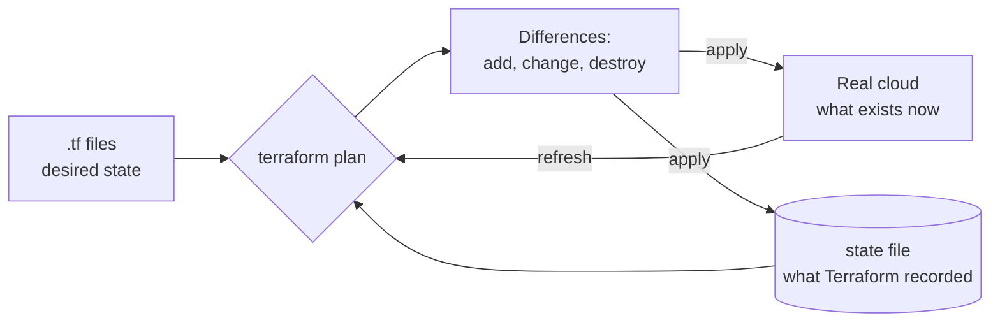

> [!info] Level: junior | Time: about 5 h | You need: [[learn/gcp-foundations|GCP 01: Google Cloud foundations]], [[learn/gcp-iam-and-service-accounts|GCP 02: IAM and service accounts]] and [[learn/pull-requests-and-code-review|Git 03: Pull requests and code review]] | Lab: Lab C, the GCP sandbox project from [[learn/lab-setup|Start 01: Set up your lab]], with `terraform` and `gcloud` installed on the Ubuntu VM

Clicking in a console is fine for learning and bad for anything you must repeat, review or rebuild. Two clicks the wrong way, nobody remembers what was set, and a second environment never quite matches the first. **Infrastructure as code** (IaC) fixes this by describing infrastructure in files, so it can be reviewed in a pull request, versioned in Git, and applied the same way every time.

This lesson teaches Terraform, the most common IaC tool, with the smallest useful GCP resource: a Cloud Storage bucket. You will write it, plan it, apply it, change it, see what drift looks like, and destroy it. The next lesson ([[learn/terraform-state-modules-and-pipelines|Delivery 05]]) moves state to a shared bucket, adds modules, and runs Terraform from a pipeline.

> [!note] What was run
> Nothing in the Terraform and `gcloud` parts of this lesson was run for this page: there was no Terraform binary or GCP project in the environment where it was written, so the files, commands and sample output follow the official documentation and are **not verified**. The only check made was a look at HashiCorp's releases index (`releases.hashicorp.com`) on 2026-10-17, but the newest version changes often, so read the index yourself for the current one; the provider version could not be checked because the registry was not reachable. All plan output, bucket names and timings are illustrative. Compare everything with the current documentation and with your own output.

## What you will learn

- What "declarative" means, and how Terraform compares the desired state in your files with the real state it recorded.
- How to install and pin Terraform and the Google provider, and how to authenticate without a key file.
- How resources, data sources, variables, locals and outputs fit together, and how a resource address names a thing.
- The loop `fmt`, `init`, `validate`, `plan`, `apply`, `destroy`, and how to read the plan symbols (`+`, `~`, `-`, `-/+`).
- Why the lock file is committed and the state file never is, and what drift is.

## Declarative IaC: desired state and real state

A script says **how**: create a bucket, then set a label, then enable versioning. Run it twice and the second run fails, or does something unexpected. A declarative tool says **what**: "there is a bucket with this name, in this region, with these labels." The tool works out the steps.

Terraform keeps three things apart:

- **Desired state**: your `.tf` files.
- **Real state**: what actually exists in the cloud.
- **State file**: Terraform's record of what it created and the IDs and attributes of those objects. It is the link between a name in your code and a real object.

`terraform plan` compares the desired state with the state file, refreshes the state file from the real world, and prints the difference. `terraform apply` makes that difference happen. If nothing differs, nothing happens: that property is called **idempotence**, and it is why you can run Terraform again and again without fear.



## Install and pin versions

Install Terraform from HashiCorp's official page (https://developer.hashicorp.com/terraform/install), then check:

```bash
terraform version
```

```text
Terraform v1.x.y
on linux_amd64
```

The output is illustrative: your version number will be different. Terraform and the providers (plugins that talk to a cloud, here `hashicorp/google`) change over time, and an upgrade can change behaviour. **Pin** both, so the same code gives the same result next month and on a colleague's machine.

```hcl title="versions.tf"
terraform {
  required_version = ">= 1.9"   # Change: the oldest Terraform version you have tested with.

  required_providers {
    google = {
      source  = "hashicorp/google"
      version = "~> 6.0"        # Change: the current major version from the Registry. See the warning below.
    }
  }
}
```

`required_version` limits which Terraform binaries may run the code. `version = "~> 6.0"` means "6.0 or newer, but below 7.0": the last number may go up, the major version may not. Major versions can contain breaking changes, so you choose when to move.

> [!warning] Check before relying on this
> The provider version in this example (`~> 6.0`) may be out of date. Open the provider page on the Terraform Registry (`registry.terraform.io/providers/hashicorp/google`), note the current major version, and put that in `version`. Do the same for `required_version`. If the major version has changed since this page was written, some resource arguments in this lesson may also have changed: run `terraform validate` and read the provider's `google_storage_bucket` documentation.

## Authenticate without a key file

Terraform needs credentials to call Google APIs. The rule from the IAM lesson applies: **no downloaded service account key files.** A key is a password that does not expire and that ends up in a repository or a chat.

- **On your laptop or lab VM:** use Application Default Credentials (ADC) from your own user.

  ```bash
  gcloud auth application-default login
  ```

  This opens a browser, and stores credentials in your home directory that Google client libraries, including Terraform's provider, find automatically. It is a separate login from `gcloud auth login`.

- **In CI:** use Workload Identity Federation so the pipeline gets short-lived credentials for a service account, or impersonate a service account with your own identity (`GOOGLE_IMPERSONATE_SERVICE_ACCOUNT`). The next lesson does this in a pipeline, and the pattern is in [[patterns/terraform-module-and-state-layout]].

The identity running Terraform needs permission for what it creates. In the lab you are the project owner, so it works. In real projects give Terraform's service account the **narrowest** roles that cover its job, not `Owner`.

If a call fails with an "API has not been used in project" error, enable the API once: `gcloud services enable storage.googleapis.com`.

## The language: resources, data sources, variables, locals and outputs

Terraform's language is HCL. A configuration is made of blocks.

- A **resource** declares an object Terraform manages: `resource "google_storage_bucket" "lab" { ... }`. The first word is the **type** (provider and kind of object), the second is the **local name** you choose. Together they form the **resource address**: `google_storage_bucket.lab`. You use the address to refer to the resource and in commands like `terraform state show google_storage_bucket.lab`.
- A **data source** reads something that already exists and that Terraform does not manage: `data "google_client_config" "current" {}`. You refer to it as `data.google_client_config.current`. A resource is _created and owned_; a data source is _looked up_.
- A **variable** is an input. A **local** is a named value computed inside the module. An **output** is a value shown after apply and available to other code.

### Variables

```hcl title="variables.tf"
variable "project_id" {
  type        = string
  description = "The GCP project that holds the bucket (your lab project)."
}

variable "region" {
  type        = string
  description = "Location of the bucket, for example europe-west4."
  default     = "europe-west4"   # Change: a region close to you.

  validation {
    condition     = can(regex("^[a-z]+-[a-z]+[0-9]+$", var.region))
    error_message = "The region must look like europe-west4: lowercase letters, a dash and a number."
  }
}

variable "bucket_name" {
  type        = string
  description = "Globally unique bucket name: 3 to 63 characters, lowercase letters, digits, dashes and underscores."

  validation {
    condition     = can(regex("^[a-z0-9][a-z0-9_-]{1,61}[a-z0-9]$", var.bucket_name))
    error_message = "The bucket name must be 3 to 63 characters of lowercase letters, digits, dashes or underscores, starting and ending with a letter or digit."
  }
}

variable "owner" {
  type        = string
  description = "A label value that says who owns the bucket."
  default     = "platform"
}
```

A variable has a `type`, an optional `default`, and an optional `validation` block that rejects bad input **before** anything is created. The `region` rule above stops a typo such as `Europe-West4` at plan time rather than at an API error halfway through.

Terraform takes variable values from these places, and later ones win: the `default`, then `TF_VAR_name` environment variables, then `terraform.tfvars`, then `*.auto.tfvars`, then `-var` and `-var-file` on the command line. Use one rule for your team (a `terraform.tfvars` file for non-secret values; environment variables or a secret store for secrets) so people are not surprised.

```hcl title="terraform.tfvars.example"
# Copy to terraform.tfvars and change the values. Do not commit terraform.tfvars.
project_id  = "lab-yourname-123456"   # Change: your lab project ID from Start 01.
bucket_name = "lab-yourname-123456-tf-first"   # Change: must be unique across all of Google Cloud.
```

> [!warning] Never put secrets in variables with a default or in `.tfvars` files you commit
> A value in a variable can end up in the plan, the state file and the logs. A variable can be marked `sensitive = true`, which hides it in the output, but it is still stored in state. Keep secrets in a secret manager ([[patterns/external-secrets-with-secret-manager]]).

### The resource, a data source, locals and outputs

```hcl title="main.tf"
provider "google" {
  project = var.project_id
  region  = var.region
}

data "google_client_config" "current" {}

locals {
  common_labels = {
    env     = "lab"
    owner   = var.owner
    managed = "terraform"
  }
}

resource "google_storage_bucket" "lab" {
  name                        = var.bucket_name
  location                    = var.region
  uniform_bucket_level_access = true
  public_access_prevention    = "enforced"
  force_destroy               = false
  labels                      = local.common_labels

  versioning {
    enabled = true
  }
}
```

```hcl title="outputs.tf"
output "bucket_url" {
  description = "The gs:// URL of the bucket."
  value       = google_storage_bucket.lab.url
}

output "project_in_use" {
  description = "The project the provider is using, read from a data source."
  value       = data.google_client_config.current.project
}
```

What the bucket arguments mean, and why they are set as they are:

- `uniform_bucket_level_access = true` turns off per-object ACLs, so access is controlled by IAM only. This is the secure default.
- `public_access_prevention = "enforced"` blocks making the bucket public, even by mistake.
- `force_destroy = false` makes `terraform destroy` fail if the bucket still holds objects, instead of deleting your data. Set it to `true` only for throwaway buckets.
- `labels` come from a `local`, so they are defined once. Labels reach billing reports ([[learn/lab-setup]]).
- The `name` is global. Changing it later **forces replacement** (exercise 5), which you will see in the plan.

> [!warning] Check before relying on this
> The arguments of `google_storage_bucket` (`uniform_bucket_level_access`, `public_access_prevention`, `force_destroy`, the `url` attribute) and their defaults depend on the provider version. Read the current resource page in the provider documentation, and let `terraform validate` tell you if an argument is unknown.

## The workflow: fmt, init, validate, plan, apply, destroy

| Command              | What it does                                                                                                               | Changes real things? |
| -------------------- | -------------------------------------------------------------------------------------------------------------------------- | -------------------- |
| `terraform fmt`      | Rewrites files into the standard style. `-check` only reports.                                                             | No                   |
| `terraform init`     | Downloads the providers, sets up the backend, and writes `.terraform.lock.hcl`. Run it first and after changing providers. | No                   |
| `terraform validate` | Checks the syntax and internal consistency. It does not call the cloud.                                                    | No                   |
| `terraform plan`     | Shows what would change, comparing code, state and the real world.                                                         | No (reads the cloud) |
| `terraform apply`    | Shows the plan, asks you to type `yes`, then makes the changes and updates the state.                                      | **Yes**              |
| `terraform destroy`  | Plans and removes everything in the state.                                                                                 | **Yes**              |

Make the habit: `fmt`, `validate`, `plan`, read it, then `apply`.

### Reading a plan

The plan uses symbols at the start of each line:

| Symbol | Meaning                                         |
| ------ | ----------------------------------------------- |
| `+`    | Will be created                                 |
| `~`    | Will be updated in place (the object stays)     |
| `-`    | Will be destroyed                               |
| `-/+`  | Will be destroyed and created again ("replace") |

Illustrative plan for the first run:

```text
Terraform will perform the following actions:

  # google_storage_bucket.lab will be created
  + resource "google_storage_bucket" "lab" {
      + force_destroy               = false
      + labels                      = {
          + "env"     = "lab"
          + "managed" = "terraform"
          + "owner"   = "platform"
        }
      + location                    = "EUROPE-WEST4"
      + name                        = "lab-yourname-123456-tf-first"
      + public_access_prevention    = "enforced"
      + uniform_bucket_level_access = true
      ...
    }

Plan: 1 to add, 0 to change, 0 to destroy.

Changes to Outputs:
  + bucket_url     = (known after apply)
  + project_in_use = "lab-yourname-123456"
```

The most important line is the last summary: `Plan: 1 to add, 0 to change, 0 to destroy.` Read it first. A `-` or a `-/+` on something you did not mean to touch is the signal to stop. For a replacement, the plan marks the argument that forces it:

```text
-/+ resource "google_storage_bucket" "lab" {
      ~ name = "old-name" -> "new-name" # forces replacement
```

For some resources a replacement destroys data. A bucket replaced with a new name is a new, empty bucket, and the old one is deleted (if `force_destroy` allows it).

### The plan as a review artifact

A plan is the thing a reviewer should read, more than the code diff. Two lines of HCL can destroy a database. In a pull request flow ([[learn/pull-requests-and-code-review]]) the pipeline runs `terraform plan` and posts the result, the reviewer reads the `Plan:` summary and every `-` and `-/+`, and only then does anyone merge and apply.

You can save a plan and apply exactly that plan:

```bash
terraform plan -out=tfplan
terraform show tfplan            # human-readable
terraform show -json tfplan      # machine-readable, for policy checks
terraform apply tfplan           # applies exactly this plan, no prompt
```

Applying a saved plan guarantees that what was reviewed is what runs. Treat the plan file as sensitive: it can contain values from variables and resources. Policy checks on the plan JSON are covered in [[patterns/terraform-plan-policy-checks]].

## State, the lock file and what to commit

After an apply, Terraform writes a **state file** (`terraform.tfstate` for the default local backend). It records every resource Terraform manages, with all of its attributes.

> [!danger] Never commit state
> State can hold passwords, tokens and private keys in plain text, whatever you marked as sensitive in the plan. Keep it out of Git: put `*.tfstate*` in `.gitignore`. For anything beyond a personal lab, state lives in a remote backend with access control, encryption and locking, which is the topic of the next lesson ([[runbooks/terraform-state-recovery]] covers the recovery case).

| Commit                     | Never commit                                               |
| -------------------------- | ---------------------------------------------------------- |
| `*.tf`                     | `terraform.tfstate`, `*.tfstate.backup`                    |
| `.terraform.lock.hcl`      | `.terraform/` (downloaded providers)                       |
| `terraform.tfvars.example` | `terraform.tfvars` with real values, plan files (`tfplan`) |

```gitignore title=".gitignore"
.terraform/
*.tfstate
*.tfstate.*
crash.log
tfplan
*.tfplan
terraform.tfvars
```

**`.terraform.lock.hcl` is committed.** `init` writes it. It records the exact provider versions selected and their checksums, so every machine and the pipeline use the same provider build, and a tampered download is detected. `terraform init -upgrade` updates it on purpose; the change then appears in a pull request where a person can review it. If your team uses several platforms, add checksums for each with `terraform providers lock -platform=linux_amd64 -platform=darwin_arm64`.

## Drift

**Drift** is the difference between what Terraform recorded and what exists, caused by a change made outside Terraform: someone edits a label in the console, a script changes a setting, an incident fix is applied by hand. Terraform finds drift during `plan` because it refreshes real state first. It then proposes to change the real thing back to match the code. That is usually what you want (the code is the source of truth), but read the plan: sometimes the manual fix was right and the code must change instead. Exercise 6 shows it.

## OpenTofu in one sentence

OpenTofu is an open-source fork of Terraform with almost the same commands (`tofu` instead of `terraform`); see [[tools/terraform-vs-opentofu]] for the differences and the choice. Everything in this lesson applies to both.

## Hands-on exercises

> [!warning] Costs money
> A Cloud Storage bucket with no objects costs next to nothing, but a billed project can still charge for anything you leave in it, and you must not leave lab resources behind. The cleanup is `terraform destroy` (exercise 7). To check that nothing is left, run `gcloud storage buckets list --project "$PROJECT_ID"`. Prices change: check the current Cloud Storage pricing page rather than relying on this page.

Set up a working folder once:

```bash
mkdir -p ~/tf-first && cd ~/tf-first
PROJECT_ID="lab-yourname-123456"   # Change: your lab project ID.
gcloud config set project "$PROJECT_ID"
gcloud auth application-default login
```

Create `versions.tf`, `variables.tf`, `main.tf`, `outputs.tf` and `.gitignore` exactly as shown above. Create `terraform.tfvars` from the example with your own project ID and a unique bucket name.

### Exercise 1: Plan and apply a bucket

1. Format, initialise, validate and plan:

   ```bash
   terraform fmt
   terraform init
   terraform validate
   terraform plan
   ```

   Expected (illustrative): `init` ends with `Terraform has been successfully initialized!` and creates `.terraform.lock.hcl`. `validate` prints `Success! The configuration is valid.` The plan ends with `Plan: 1 to add, 0 to change, 0 to destroy.`

2. Apply, and type `yes` when asked:

   ```bash
   terraform apply
   ```

   Expected (illustrative): `google_storage_bucket.lab: Creation complete after 1s [id=lab-yourname-123456-tf-first]` and `Apply complete! Resources: 1 added, 0 changed, 0 destroyed.`

3. Run `terraform plan` again.

   Expected: `No changes. Your infrastructure matches the configuration.` That is idempotence.

If you see something else: `Error: Failed to query available provider packages` means no network or a proxy problem. `Error 403` or "permission denied" means your identity cannot create buckets (check the project and your roles). `Error 409: ... bucket name is already in use` means the name is not unique: change `bucket_name` and plan again. "Storage API has not been used" means run the `gcloud services enable` command from above.

### Exercise 2: A label change is an update in place

1. In `main.tf`, add a label to `local.common_labels`, for example `purpose = "learning"`.
2. Run `terraform plan`.

Expected (illustrative):

```text
  # google_storage_bucket.lab will be updated in-place
  ~ resource "google_storage_bucket" "lab" {
      ~ labels = {
          + "purpose" = "learning"
            # (3 unchanged elements hidden)
        }
        id = "lab-yourname-123456-tf-first"
        # (... unchanged attributes hidden)
    }

Plan: 0 to add, 1 to change, 0 to destroy.
```

The `~` shows a change in place: the bucket stays, only the label changes. Apply it. Recent provider versions also show computed attributes such as `effective_labels` and `terraform_labels` changing along with `labels`; that is normal.

If you see something else: if the plan wants to replace the bucket (`-/+`), you changed `name` or `location` by accident. Undo it.

### Exercise 3: Read an output

1. Run:

   ```bash
   terraform output -raw bucket_url
   ```

   Expected (illustrative): `gs://lab-yourname-123456-tf-first` with no quotes and no trailing newline.

2. Use it in a command:

   ```bash
   gcloud storage buckets describe "$(terraform output -raw bucket_url)" --format='value(location)'
   ```

   Expected (illustrative): the bucket location in capital letters, such as `EUROPE-WEST4`.

If you see something else: `Warning: No outputs found` means you have not applied yet, or you are in the wrong folder. `-raw` only works for strings, numbers and booleans.

### Exercise 4: A validation rule rejects bad input

1. Run a plan with a region that breaks the rule:

   ```bash
   terraform plan -var 'region=Europe-West4'
   ```

   Expected (illustrative):

   ```text
   Error: Invalid value for variable

     on variables.tf line 8:
      8: variable "region" {
       ├────────────────
       │ var.region is "Europe-West4"

   The region must look like europe-west4: lowercase letters, a dash and a number.

   This was checked by the validation rule at variables.tf:12,3-13.
   ```

2. Run it again with `-var 'region=europe-west4'` to see that the plan works.

If you see something else: if the bad value is accepted, the `validation` block is not attached to the right variable, or your terraform.tfvars overrides the command line (it should not: `-var` wins).

### Exercise 5: A rename forces replacement (plan only)

1. Plan with a different bucket name, **but do not apply it**:

   ```bash
   terraform plan -var 'bucket_name=lab-yourname-123456-tf-renamed'
   ```

   Expected (illustrative):

   ```text
   -/+ resource "google_storage_bucket" "lab" {
         ~ id   = "lab-yourname-123456-tf-first" -> (known after apply)
         ~ name = "lab-yourname-123456-tf-first" -> "lab-yourname-123456-tf-renamed" # forces replacement
         ...
       }

   Plan: 1 to add, 0 to change, 1 to destroy.
   ```

2. Read it: a bucket name cannot be changed in place, so Terraform destroys the old bucket and creates a new, empty one. With data in it, that would be a disaster (and `force_destroy = false` would stop it, which is why it is the default).

If you see something else: if the plan shows an in-place update, the provider handles the name differently in your version; read the plan and the resource documentation.

### Exercise 6: Drift from an outside change

1. Change a label outside Terraform:

   ```bash
   gcloud storage buckets update "$(terraform output -raw bucket_url)" --update-labels=owner=someone-else
   ```

   (You can do the same in the Cloud Console, under the bucket's **Configuration** tab.)

2. Run `terraform plan`.

   Expected (illustrative):

   ```text
   Note: Objects have changed outside of Terraform

   Terraform detected the following changes made outside of Terraform since the last "terraform apply":

     # google_storage_bucket.lab has changed
     ~ resource "google_storage_bucket" "lab" {
         ~ labels = {
             ~ "owner" = "platform" -> "someone-else"
           }
       }
   ...
   Plan: 0 to add, 1 to change, 0 to destroy.
   ```

   Terraform found the drift and proposes to put `owner` back to `platform`.

3. Apply to repair it, then plan once more to see `No changes.`

If you see something else: if no drift is shown, the `gcloud` command did not take effect (check the bucket labels with `gcloud storage buckets describe`) or you ran it against another bucket. `terraform plan -refresh-only` shows only the drift and proposes no other change.

### Exercise 7: Destroy and clean up

1. Remove everything Terraform created:

   ```bash
   terraform destroy
   ```

   Type `yes`. Expected (illustrative): `Plan: 0 to add, 0 to change, 1 to destroy.` then `Destroy complete! Resources: 1 destroyed.`

2. Check that nothing is left:

   ```bash
   gcloud storage buckets list --project "$PROJECT_ID" --format='value(name)'
   ```

   Expected: no `lab-yourname-...-tf-first` in the list.

3. Keep the files in Git (without state), commit `.terraform.lock.hcl`, and open a small pull request for practice.

If you see something else: `Error 409: The bucket you tried to delete was not empty` means objects exist and `force_destroy = false` protected them. Empty the bucket on purpose (`gcloud storage rm --recursive` on the bucket's objects) only if they are yours to delete, then destroy again.

## Common mistakes

- **Applying without reading the plan.** Why it bites: a `-` or `-/+` you did not intend deletes real things. Fix: read the `Plan:` line and every destroy; use `apply tfplan` from a reviewed plan.
- **Committing state or `tfvars` with secrets.** Why it bites: state holds secrets in plain text, and Git history is permanent. Fix: `.gitignore`, a remote backend, and a secret manager.
- **Not pinning versions.** Why it bites: a new provider major can change behaviour, so the same code gives a different plan next month. Fix: `required_version`, `required_providers` with a constraint, and a committed lock file.
- **Not committing `.terraform.lock.hcl`.** Why it bites: each machine may pick a different provider build. Fix: commit it and update it deliberately with `init -upgrade`.
- **Using a service account key file.** Why it bites: the key does not expire and leaks easily. Fix: ADC for people, Workload Identity Federation or impersonation for CI.
- **Editing resources in the console.** Why it bites: drift; the next apply reverts it or an incident fix is lost. Fix: change code, review, apply; if you must fix by hand in an emergency, write the change back to the code afterwards.
- **Giving Terraform `Owner`.** Why it bites: a bug or a stolen credential can do anything. Fix: grant only the roles the configuration needs.
- **`force_destroy = true` on a bucket with real data.** Why it bites: a destroy or a replacement deletes the objects. Fix: leave it `false`, and protect the data with versioning and IAM.
- **Treating the plan as a preview that cannot be wrong.** Why it bites: the plan is made at one moment; the world can change before apply, and some values are only "known after apply". Fix: apply the saved plan soon after review, and read the result.

## Check your understanding

1. What does `terraform plan` compare, and what does it change in the cloud?
2. Why do you pin the provider version and commit the lock file?
3. What is the difference between a `resource` and a `data` source?
4. What does `-/+` in a plan mean, and why is it dangerous for a bucket or a database?
5. You changed a label in the console. What will the next `terraform plan` show, and what should you do before you apply?
6. Why is the state file kept out of Git while `.terraform.lock.hcl` is committed?

> [!question]- Answers
>
> 1. It compares the desired state in your `.tf` files with the state file and with the real objects (after refreshing them) and prints the difference. It changes nothing in the cloud; it only reads.
> 2. A new provider version can change behaviour or arguments, so unpinned code can give a different result on another day or machine. The version constraint limits the range, and the lock file records the exact version and checksums that were chosen, so everyone, including the pipeline, uses the same build.
> 3. A resource is created and managed by Terraform, and destroyed when removed from the code. A data source reads something that already exists and that Terraform does not own, for example the current client configuration.
> 4. It means destroy and create again (replace). For a bucket or a database, the new object is empty, so the data in the old one is lost unless it is protected or copied. Always read the reason (`# forces replacement`) and the attribute that causes it.
> 5. It shows drift: a note that the object changed outside Terraform and a proposed update that sets the label back to what the code says. Before applying, decide who is right: if the manual change was needed, change the code to match it, otherwise let Terraform revert it.
> 6. State contains the real attributes of your resources, possibly including secrets, and it changes on every apply, so it must be protected and shared through a remote backend with locking. The lock file contains no secrets, only provider versions and checksums, and it must be shared so every run uses the same providers.

## Next steps

Next lesson: [[learn/terraform-state-modules-and-pipelines|Delivery 05: Terraform state, modules and pipelines]]. Previous lesson: [[learn/environments-releases-and-rollbacks|Delivery 03: Environments, releases, approvals and rollbacks]].

To go deeper:

- [[tools/terraform-vs-opentofu]] compares the two tools and says when to choose which.
- [[patterns/terraform-module-and-state-layout]] shows how production Terraform is split into modules and state files.
- [[patterns/terraform-plan-policy-checks]] and [[patterns/terraform-testing]] add automatic checks before an apply.
- [[runbooks/terraform-state-recovery]] is what to do when state is damaged or lost.
- [[learn/gcp-iam-and-service-accounts]] explains the identities Terraform uses.
- The whole path is mapped in [[learn/index|the learning path]].

## Sources

Nothing in this lesson was run (see the note near the top). The commands and examples follow the sources below; pages change, so check them for the versions you use.

- HashiCorp Developer, "Get started with Terraform on Google Cloud" (https://developer.hashicorp.com/terraform/tutorials/gcp-get-started). Version not verified.
- HashiCorp Developer, Terraform language documentation (https://developer.hashicorp.com/terraform/language): resources, data sources, variables and validation, `locals`, outputs, `terraform` block and version constraints, and the dependency lock file.
- HashiCorp Developer, Terraform CLI documentation (https://developer.hashicorp.com/terraform/cli) for `init`, `plan`, `apply`, `destroy`, `output` and `providers lock`.
- Terraform Registry, `hashicorp/google` provider and the `google_storage_bucket` resource page (https://registry.terraform.io/providers/hashicorp/google/latest/docs). Not verified: the current major version, the resource arguments and defaults used here.
- Google Cloud, "Terraform on Google Cloud" and "Application Default Credentials" documentation (https://cloud.google.com/docs/terraform, https://cloud.google.com/docs/authentication/application-default-credentials). Not verified: the exact behaviour of user ADC in your `gcloud` version.
- Google Cloud, "Cloud Storage buckets: naming, uniform bucket-level access, public access prevention" (https://cloud.google.com/storage/docs). Not verified: `gcloud storage buckets update --update-labels` flags in your version.
- HashiCorp releases index (https://releases.hashicorp.com/terraform/): read on 2026-10-17 for the Terraform version line; read it yourself for the current version.
