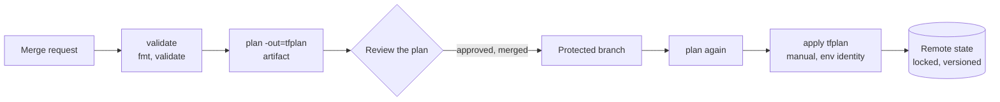

> [!info] Level: middle | Time: about 6 h | You need: [[learn/terraform-basics-on-gcp|Delivery 04: Terraform basics with a first GCP project]], [[learn/gcp-iam-and-service-accounts|GCP 02: IAM and service accounts]] and [[learn/first-pipeline-gitlab-ci-and-jenkins|Delivery 02: Your first pipeline in GitLab CI and Jenkins]] | Lab: Lab C, the GCP sandbox project from [[learn/lab-setup|Start 01: Set up your lab]], with `terraform` and `gcloud` installed

In the last lesson you ran Terraform alone, on one machine, against one bucket. That works for a lab and fails for a team. This lesson fixes the three things that break first: **where state lives**, **how code is reused** and **who is allowed to apply**. By the end you will have state in a shared locked bucket, a small module used for two environments, and a pipeline sketch where a person reviews a plan and a machine applies exactly that plan.

> [!note] What was run
> Nothing in this lesson was run for this page: there was no Terraform binary, `gcloud` or GCP project in the environment where it was written. The files, commands and sample output follow the official documentation and are **not verified**. All plan output, bucket names, IDs and timings are illustrative. Exact error texts and the version in which a feature appeared (especially `removed` blocks and the lock file name in the bucket) must be checked against the Terraform version you pin. Compare everything with the current documentation and with your own output.

## What you will learn

- What state is, what it contains (including secrets in plain text), and why it is the most sensitive file in a Terraform project.
- Why local state breaks for a team, and how to move to the Google Cloud Storage (GCS) backend with versioning and locking.
- How to inspect and change state safely: `state list`, `show`, `mv`, `rm`, then the better tools, `import`, `moved` and `removed` blocks.
- How to write a small module with a clear input and output contract, pin it, and call it once per environment.
- Why environments get separate state, and why directories usually beat workspaces.
- The pipeline pattern: `fmt` and `validate` and `plan` on the merge request, a saved plan, and an apply of that exact plan after approval, with one runner identity per environment.

## What state is

Terraform code says what you want. The real cloud holds what exists. In between sits **state**: a JSON document that maps each **resource address** in your code (`google_storage_bucket.lab`) to the **real object** (its ID, `lab-yourname-123456-tf-first`) and records all the attributes the provider read back.

Terraform needs that map for three jobs:

- To know which real object a block in your code owns. Without it, Terraform would try to create the bucket again.
- To compute a plan quickly. It compares code, state and the refreshed real attributes.
- To remember things that cannot be read back from the cloud, such as the order of dependencies and values that only exist at creation time.

You can read it. Do this in the folder from the last lesson (illustrative output):

```bash
terraform state pull | jq '{version, terraform_version, serial, lineage, resources: [.resources[] | {type, name}]}'
```

```json
{
  "version": 4,
  "terraform_version": "1.x.y",
  "serial": 3,
  "lineage": "7c5f8c0a-0000-0000-0000-000000000000",
  "resources": [{ "type": "google_storage_bucket", "name": "lab" }]
}
```

`serial` goes up on every change. `lineage` is an ID created with the state and never changed, so Terraform can refuse to mix two unrelated states. The format version and field names are internal; read them, never write them.

> [!danger] State contains secrets in plain text
> Anything a resource stores as an attribute ends up in state: database passwords created by Terraform, `random_password` results, private keys, service account keys, tokens. Marking an output or variable `sensitive = true` hides it from the console, **not** from the state file. Treat state like a credential: restrict who can read the state bucket, encrypt it, and never copy it to a laptop or a chat. Avoid creating secrets in Terraform at all when you can ([[patterns/external-secrets-with-secret-manager]]).

## Why local state fails a team

A local `terraform.tfstate` file is fine for one person on one machine. It fails the moment a second person or a pipeline appears:

- **Two copies.** You apply on your laptop, a colleague applies from theirs. Each has a different idea of what exists. One of you will plan to create something that already exists, or destroy something you cannot see.
- **No locking.** Two applies at the same time can corrupt the state or the real infrastructure.
- **No history.** A deleted or damaged file is gone. Git must not hold it (secrets), so there is no copy.
- **No access control.** The file sits wherever the laptop is.
- **Pipelines cannot use it.** A CI job starts on a clean runner with no state, so it would plan to create everything.

The fix is a **remote backend**: a shared place that stores state, locks it during a change, keeps old versions, and is protected by IAM.

## The GCS backend

On Google Cloud the natural backend is a Cloud Storage bucket. The `gcs` backend writes the state as an object, takes a lock while a plan or apply runs, and relies on the bucket for versioning and encryption.

### Create the state bucket first

The state bucket cannot be managed by the Terraform state it holds (a chicken-and-egg problem). Create it once, by hand or from a tiny separate "bootstrap" configuration, and protect it.

> [!warning] Costs money
> A state bucket holds a few kilobytes, so it costs next to nothing, but it is still a billed resource in your project. Prices and free quotas change: check the current Cloud Storage pricing page. Clean up at the end of the lesson (exercise 7 and the cleanup list), and check with `gcloud storage buckets list --project "$PROJECT_ID"`.

```bash
PROJECT_ID="lab-yourname-123456"          # Change: your lab project ID from Start 01.
STATE_BUCKET="${PROJECT_ID}-tfstate"      # Change if needed: bucket names are global and must be unique.
REGION="europe-west4"                     # Change: a region close to you.

gcloud storage buckets create "gs://${STATE_BUCKET}" \
  --project "$PROJECT_ID" \
  --location "$REGION" \
  --uniform-bucket-level-access \
  --public-access-prevention

gcloud storage buckets update "gs://${STATE_BUCKET}" --versioning
```

Why each flag matters: uniform bucket-level access means IAM alone decides who can read state. Public access prevention blocks making the bucket public by mistake. **Versioning** keeps every earlier version of the state object, so a bad apply or a deleted file can be rolled back ([[runbooks/terraform-state-recovery]]). Objects are encrypted at rest by default; if your policy requires your own key, see [[patterns/cloud-kms-key-management]].

> [!warning] Check before relying on this
> The `gcloud storage buckets create` and `update` flag names (`--public-access-prevention`, `--versioning`, `--uniform-bucket-level-access`) were not checked against your `gcloud` version. Run `gcloud storage buckets create --help` and `gcloud storage buckets update --help`. Whether a bucket also needs a lifecycle rule to expire old versions (to limit cost) is a policy choice for your team.

Who may use the bucket? The identity that runs Terraform needs to list, read, create and delete objects in it (the lock is an object that is created and removed). Grant a role **on this bucket only**, not on the project. `roles/storage.objectAdmin` on the state bucket is a common choice (verify in the current backend documentation which permissions your version needs):

```bash
gcloud storage buckets add-iam-policy-binding "gs://${STATE_BUCKET}" \
  --member="user:you@example.com" \
  --role="roles/storage.objectAdmin"      # Change: your own identity, then the CI service account later.
```

### Point Terraform at it

```hcl title="backend.tf"
terraform {
  backend "gcs" {
    bucket = "lab-yourname-123456-tfstate"   # Change: your STATE_BUCKET.
    prefix = "lesson/first"                  # Change: one prefix per configuration, for example envs/dev.
  }
}
```

The backend block cannot use variables or locals, because Terraform needs it before it evaluates anything. If you cannot hard-code a value, leave it out and pass it at init time: `terraform init -backend-config="bucket=..."` (a "partial configuration").

The `prefix` is a folder inside the bucket. With the default workspace the state object is named `<prefix>/default.tfstate`. Use a different prefix for every configuration, so two root modules never share a state object.

Run `terraform init -migrate-state` once. Terraform notices that the backend changed and offers to copy the existing local state to the new place. Exercise 1 walks through it.

### Locking

While `plan` or `apply` runs, Terraform writes a lock next to the state (for GCS, an object beside the state object, named like `default.tflock`; verify the name for your version). A second run that finds the lock stops with `Error acquiring the state lock` and shows who holds it. This is a feature: it prevents two applies from interleaving. Use `-lock-timeout=60s` in pipelines so a job waits a little instead of failing at once.

If a run is killed, the lock can be left behind. `terraform force-unlock <LOCK_ID>` removes it. Only do that after you are sure nobody is applying, because forcing a lock open during a live apply is exactly what locking exists to prevent.

> [!warning] Check before relying on this
> Native locking on the `gcs` backend, the name of the lock object, and the exact text of the lock error depend on your Terraform version. Read the `gcs` backend page for the version you pin, and confirm the behaviour yourself with exercise 6 before you rely on it in a pipeline.

## Looking at and changing state

Most of the time you never touch state: `plan` and `apply` keep it right. Sometimes you must inspect it or change what is recorded. These commands work on state without changing the cloud.

| Command                             | What it does                                                   | Changes real things? |
| ----------------------------------- | -------------------------------------------------------------- | -------------------- |
| `terraform state list`              | Lists every resource address in state.                         | No                   |
| `terraform state show ADDRESS`      | Shows all recorded attributes of one resource.                 | No                   |
| `terraform state mv OLD NEW`        | Renames an address in state (move it to a new name or module). | No (changes state)   |
| `terraform state rm ADDRESS`        | Forgets a resource: Terraform stops managing it.               | No (changes state)   |
| `terraform state pull` / `push`     | Prints or uploads the whole state. Push is a last resort.      | No (changes state)   |
| `terraform import` / `import` block | Starts managing an existing real object.                       | No (changes state)   |

```bash
terraform state list
terraform state show google_storage_bucket.lab
```

`state list` prints one address per line:

```text
google_storage_bucket.lab
```

`state show` prints the attributes of that one resource (illustrative, shortened):

```text
# google_storage_bucket.lab:
resource "google_storage_bucket" "lab" {
    location = "EUROPE-WEST4"
    name     = "lab-yourname-123456-first"
    # ... more attributes ...
}
```

`state show` prints the attributes the same way a plan does. It is the quickest way to answer "what does Terraform think this bucket looks like?".

### Rename, import, forget: use code, not commands

The commands above change state **immediately**, with no plan, no review and no record in Git. Recent Terraform versions have code-based alternatives that go through a plan and a pull request. Prefer them.

> [!warning] Check before relying on this
> The versions below were not checked against the release notes and are **not verified**: `moved` blocks (1.1), `import` blocks with `terraform plan -generate-config-out` (1.5), `removed` blocks (1.7). Check the Terraform changelog and the language documentation for the version you pin. If your `required_version` is older than a feature, the feature will not parse.

**Renaming a resource: `moved`.** If you rename `google_storage_bucket.lab` to `google_storage_bucket.main` in code, Terraform sees "one resource gone, one new" and plans to destroy the bucket and create another. A `moved` block tells it these are the same object:

```hcl title="main.tf"
resource "google_storage_bucket" "main" {   # renamed from "lab"
  name                        = var.bucket_name
  location                    = var.region
  uniform_bucket_level_access = true
  public_access_prevention    = "enforced"
  force_destroy               = false
  labels                      = local.common_labels

  versioning {
    enabled = true
  }
}

moved {
  from = google_storage_bucket.lab
  to   = google_storage_bucket.main
}
```

The plan then says `google_storage_bucket.lab has moved to google_storage_bucket.main` and `Plan: 0 to add, 0 to change, 0 to destroy.` The `moved` block is reviewed in the pull request and keeps working for everyone else who has the old state. Keep it in the code until every environment has applied it.

**Importing an existing object: `import`.** To start managing a bucket that was created by hand, describe it in code and add an `import` block:

```hcl title="import.tf"
import {
  to = google_storage_bucket.imported
  id = "lab-yourname-123456/lab-yourname-123456-imported"   # Change: PROJECT_ID/BUCKET_NAME (check the ID format on the resource's Import section).
}
```

`terraform plan` shows `1 to import`, and you read what it would change before anything is recorded. The older `terraform import ADDRESS ID` command does the same in one step, with no plan and no review, and was the only way before 1.5. `terraform plan -generate-config-out=generated.tf` can draft the resource block from the real object. Treat the draft as a starting point and clean it up.

**Forgetting without destroying: `removed`.** If you delete a resource block, Terraform plans to destroy the real object. To stop managing it but keep it, use a `removed` block:

```hcl title="main.tf"
removed {
  from = google_storage_bucket.old

  lifecycle {
    destroy = false   # forget it in state, do not delete the real bucket
  }
}
```

The older way is `terraform state rm google_storage_bucket.old`, followed by deleting the block. It works, but it is invisible to reviewers and you must remember to do it on every environment's state.

> [!tip] When is `state mv` or `state rm` still right?
> When the change is a one-off repair of a state that is already wrong, and you have a backup (`terraform state pull > backup.tfstate`, stored securely and deleted afterwards). For planned refactors use `moved`, `import` and `removed` instead.

## Modules

A **module** is a folder of `.tf` files you call with inputs. Every Terraform configuration is a module: the folder you run commands in is the **root module**. A **child module** is one that the root (or another module) calls with a `module` block. Modules let you write "a hardened bucket" once and use it many times.

### The contract: inputs, outputs, small scope

A good module has a small, clear contract:

- **Inputs** (`variable`): only what callers need to change. Defaults are the secure choice, so a caller who passes only a name gets a safe bucket.
- **Outputs** (`output`): only what callers need, such as the name and URL.
- **One job.** "A bucket with our standards" is a module. "The whole platform" is not. Small modules compose; large ones become impossible to change without breaking someone.
- **No provider configuration inside.** The root module configures the `google` provider. A module only declares which providers it needs.

```text
.
├── modules/
│   └── gcs-bucket/
│       ├── main.tf
│       ├── variables.tf
│       ├── outputs.tf
│       └── versions.tf
└── envs/
    ├── dev/
    │   ├── backend.tf
    │   ├── main.tf
    │   └── versions.tf
    └── stage/
        ├── backend.tf
        ├── main.tf
        └── versions.tf
```

```hcl title="modules/gcs-bucket/versions.tf"
terraform {
  required_version = ">= 1.9"   # Change: the oldest Terraform version you have tested with.

  required_providers {
    google = {
      source  = "hashicorp/google"
      version = "~> 6.0"        # Change: the current major version from the Registry (see the warning in Delivery 04).
    }
  }
}
```

```hcl title="modules/gcs-bucket/variables.tf"
variable "name" {
  type        = string
  description = "Globally unique bucket name: 3 to 63 characters, lowercase letters, digits, dashes and underscores."

  validation {
    condition     = can(regex("^[a-z0-9][a-z0-9_-]{1,61}[a-z0-9]$", var.name))
    error_message = "The bucket name must be 3 to 63 characters of lowercase letters, digits, dashes or underscores, starting and ending with a letter or digit."
  }
}

variable "location" {
  type        = string
  description = "Bucket location, for example europe-west4."
}

variable "labels" {
  type        = map(string)
  description = "Labels to put on the bucket."
  default     = {}
}

variable "versioning" {
  type        = bool
  description = "Keep old object versions. Leave on unless you have a reason."
  default     = true
}

variable "force_destroy" {
  type        = bool
  description = "Allow destroying the bucket while it still holds objects. Only for throwaway buckets."
  default     = false
}
```

```hcl title="modules/gcs-bucket/main.tf"
resource "google_storage_bucket" "this" {
  name                        = var.name
  location                    = var.location
  uniform_bucket_level_access = true
  public_access_prevention    = "enforced"
  force_destroy               = var.force_destroy
  labels                      = var.labels

  versioning {
    enabled = var.versioning
  }
}
```

```hcl title="modules/gcs-bucket/outputs.tf"
output "name" {
  description = "The bucket name."
  value       = google_storage_bucket.this.name
}

output "url" {
  description = "The gs:// URL of the bucket."
  value       = google_storage_bucket.this.url
}
```

The secure settings (`uniform_bucket_level_access`, `public_access_prevention`) are **not** inputs. A caller cannot turn them off. If a team needs a public bucket, that is a different module with a different review, not a flag that anyone can flip.

### Calling and pinning a module

```hcl title="envs/dev/main.tf"
provider "google" {
  project = var.project_id
  region  = var.region
}

module "assets" {
  source = "../../modules/gcs-bucket"   # A local path. Changes here apply to every caller on their next run.

  name     = "${var.project_id}-dev-assets"
  location = var.region
  labels   = { env = "dev", managed = "terraform" }
}

output "assets_url" {
  value = module.assets.url
}
```

The resource address now includes the module: `module.assets.google_storage_bucket.this`. Plans and `state list` show that full path.

**Pin what you do not control.** A local path is always "the code in this checkout", which is fine inside one repository where a pull request changes both. For a module shared between repositories, pin it:

- Registry modules: `version = "~> 1.2"` (the `version` argument works only for registry sources).
- Git modules: `source = "git::https://example.com/platform/terraform-modules.git//gcs-bucket?ref=v1.2.0"`, with a **tag**, never a branch name. A branch moves under you; a tag is a decision.

An unpinned shared module means a change merged by someone else alters your next plan without any change in your repository. The module layout used in production is in [[patterns/terraform-module-and-state-layout]].

## Environments and separate state

dev, stage and production must not share state. If they did, a plan for dev would have to refresh production, a mistake in one could damage the other, and you could not give a pipeline permission for dev without giving it permission for production.

There are two ways to split:

| Approach                    | How                                                                                                          | Good                                                             | Bad                                                                                                                                |
| --------------------------- | ------------------------------------------------------------------------------------------------------------ | ---------------------------------------------------------------- | ---------------------------------------------------------------------------------------------------------------------------------- |
| **Directories** (used here) | One folder per environment, each with its own backend `prefix`, calling shared modules.                      | Obvious in code review. Different IAM, backend and size per env. | Some repetition (small root modules that call the same modules).                                                                   |
| **CLI workspaces**          | One configuration, `terraform workspace select dev`. State objects are named `<prefix>/<workspace>.tfstate`. | Little repetition.                                               | Same backend, same permissions for all. Easy to be in the wrong workspace. Hard to see in review which environment a command hits. |

Workspaces are fine for short-lived copies of the same stack (a preview environment). For long-lived environments with different access rules, use directories, one state each. See also [[architecture/environment-separation-on-gcp]].

## The pipeline pattern

Applying from a laptop is the last thing to keep. The standard pattern moves it into CI:

1. A change is proposed as a **merge request** (MR).
2. CI runs `terraform fmt -check`, `terraform validate` and `terraform plan`, and saves the plan.
3. A reviewer reads the **plan** (and the code), not just the code diff ([[standards/code-review]]).
4. After approval the change is merged to the protected branch.
5. CI applies **the saved plan** after a manual approval step, with the credentials of that environment only.

Why apply the saved plan and not run `apply` again? Between the review and the apply the cloud or the code can change. A fresh `apply` could do something nobody reviewed. `terraform apply tfplan` applies exactly the reviewed actions, and refuses if the state has changed since the plan ("stale plan").



A sketch for GitLab CI. It shows the shape, not a drop-in file:

```yaml title=".gitlab-ci.yml"
stages: [validate, plan, apply]

default:
  image:
    name: hashicorp/terraform:1.x.y # Change: pin an exact tested version, ideally by digest.
    entrypoint: [""]

variables:
  TF_IN_AUTOMATION: "true"
  TF_INPUT: "false"
  TF_ROOT: envs/dev # Change per environment (one job set per env).

.terraform:
  before_script:
    - cd "$TF_ROOT"
    - terraform init -lock-timeout=60s

validate:
  stage: validate
  extends: .terraform
  script:
    - terraform fmt -check -recursive
    - terraform validate
  rules:
    - if: $CI_PIPELINE_SOURCE == "merge_request_event"
    - if: $CI_COMMIT_BRANCH == $CI_DEFAULT_BRANCH

plan:
  stage: plan
  extends: .terraform
  script:
    - terraform plan -out=tfplan -lock-timeout=60s
    - terraform show -no-color tfplan > plan.txt
  artifacts:
    paths:
      - $TF_ROOT/tfplan
      - $TF_ROOT/plan.txt
    expire_in: 1 day # The plan can hold secret values: keep it short-lived.
    access: developer # Check the artifact access options in your GitLab version.
  rules:
    - if: $CI_PIPELINE_SOURCE == "merge_request_event"
    - if: $CI_COMMIT_BRANCH == $CI_DEFAULT_BRANCH

apply:
  stage: apply
  extends: .terraform
  needs: [plan]
  script:
    - terraform apply -lock-timeout=60s tfplan
  environment:
    name: dev # A protected environment with its own approvers.
  resource_group: terraform-dev # One apply at a time per environment.
  rules:
    - if: $CI_COMMIT_BRANCH == $CI_DEFAULT_BRANCH
      when: manual
```

Things this sketch relies on, each of which you must set up and check:

- **Protected branch and protected environment.** Only the default branch can apply, and only named people can approve the manual job. Without protection, any branch could apply.
- **One identity per environment.** The dev job authenticates as `terraform-dev`, the production job as `terraform-prod`, each with only the roles its environment needs. Use Workload Identity Federation so the job gets short-lived credentials, not a key file ([[architecture/iam-groups-and-ci-workload-identity-federation]]). A stolen dev job must not be able to change production.
- **The plan artifact is sensitive.** It can contain secret values. Restrict who can download it and let it expire quickly.
- **The default-branch pipeline plans again.** The plan reviewed on the MR is not the one applied; the plan made on the merged commit is. The review of the MR plan is a review of intent; the saved plan on the default branch is what runs. If the two differ, stop and read why.
- **A plan can go stale.** If anything changes the state between plan and apply, `apply tfplan` fails and you plan again. That is the safe behaviour.
- **Plans are checked by policy.** Automatic checks on the plan JSON ([[patterns/terraform-plan-policy-checks]]) and tests ([[patterns/terraform-testing]]) add a machine reviewer.

> [!warning] Check before relying on this
> The GitLab keywords (`resource_group`, `environment`, `artifacts:access`, `rules`) and the `hashicorp/terraform` image tags and entrypoint behaviour change between versions. Check them against the GitLab and Terraform documentation for the versions you use. The sketch also leaves out the authentication step (the Workload Identity Federation credential file), which depends on your GitLab and GCP setup.

## Hands-on exercises

> [!warning] Costs money
> These exercises create small Cloud Storage buckets in your lab project. They cost next to nothing but are not free of charge, and you must not leave them behind. The cleanup list is at the end of exercise 7. Check with `gcloud storage buckets list --project "$PROJECT_ID"`.

Set up once. Use the folder and files from [[learn/terraform-basics-on-gcp|Delivery 04]] (`~/tf-first`, with its bucket still created; if you destroyed it in exercise 7 of that lesson, apply it again first) and create the state bucket as shown above.

```bash
cd ~/tf-first
PROJECT_ID="lab-yourname-123456"          # Change: your lab project ID.
STATE_BUCKET="${PROJECT_ID}-tfstate"
gcloud config set project "$PROJECT_ID"
```

### Exercise 1: Migrate local state to GCS

1. Record what the local state contains:

   ```bash
   terraform state list
   ```

   Expected: `google_storage_bucket.lab`.

2. Add `backend.tf` as shown above, with your `STATE_BUCKET` and `prefix = "lesson/first"`. Then:

   ```bash
   terraform init -migrate-state
   ```

   Terraform asks whether to copy the existing state to the new backend. Type `yes`. Expected (illustrative):

   ```text
   Successfully configured the backend "gcs"! Terraform will automatically
   use this backend unless the backend configuration changes.
   ```

3. Check that the state list is the same and that an object exists in the bucket:

   ```bash
   terraform state list
   gcloud storage ls "gs://${STATE_BUCKET}/lesson/first/"
   ```

   Expected: `google_storage_bucket.lab`, then a line like `gs://lab-yourname-123456-tfstate/lesson/first/default.tfstate`.

4. Run `terraform plan`. Expected: `No changes. Your infrastructure matches the configuration.`

If you see something else: `Error: Failed to get existing workspaces ... 403` means your identity has no permission on the state bucket (grant the role from above). `404 ... bucket doesn't exist` means a typo in `bucket`. If `plan` wants to create the bucket, the migration did not copy the state; do not apply. Run `terraform init -migrate-state` again, or see [[runbooks/terraform-state-recovery]].

Delete the local `terraform.tfstate` and `terraform.tfstate.backup` files once you have confirmed the remote object exists, and keep them out of Git.

### Exercise 2: Rename a resource with a `moved` block

1. In `main.tf`, rename `google_storage_bucket.lab` to `google_storage_bucket.main` everywhere (including `outputs.tf`) **without** a `moved` block, and run `terraform plan`.

   Expected (illustrative): the old address is destroyed and the new one is created:

   ```text
   Plan: 1 to add, 0 to change, 1 to destroy.
   ```

   Read why this is dangerous: a bucket with data would be deleted.

2. Add the `moved` block from above and run `terraform plan` again.

   Expected:

   ```text
   # google_storage_bucket.lab has moved to google_storage_bucket.main
   Plan: 0 to add, 0 to change, 0 to destroy.
   ```

3. Apply it (nothing in the cloud changes, only the address in state) and run `terraform state list`. Expected: `google_storage_bucket.main`.

If you see something else: if the plan still shows a destroy and a create, the `from` or `to` address does not match (check spelling and the `resource` label). If Terraform says `moved` is not expected, your Terraform version is older than 1.1.

### Exercise 3: A module for two environments

1. In a new folder `~/tf-modules`, create the module files and the two environment folders shown in "Modules". In each `envs/<env>/main.tf` use a different bucket name (`...-dev-assets`, `...-stage-assets`). Give each a `backend.tf` with a different prefix (`envs/dev`, `envs/stage`), the same `STATE_BUCKET`, and a `variables.tf` for `project_id` and `region` with a `terraform.tfvars` of your own.

2. Plan and apply each environment on its own:

   ```bash
   cd ~/tf-modules/envs/dev   && terraform init && terraform apply
   cd ~/tf-modules/envs/stage && terraform init && terraform apply
   ```

   Expected (illustrative), for each: `Plan: 1 to add, 0 to change, 0 to destroy.` and `Apply complete! Resources: 1 added, 0 changed, 0 destroyed.`

3. Check the two separate state objects and the two buckets:

   ```bash
   gcloud storage ls "gs://${STATE_BUCKET}/envs/**"
   terraform -chdir=$HOME/tf-modules/envs/dev state list
   ```

   Expected: `.../envs/dev/default.tfstate` and `.../envs/stage/default.tfstate`, and `module.assets.google_storage_bucket.this` in each state.

If you see something else: `Error 409 ... name is already in use` means a bucket name is not unique across Google Cloud. `Module not installed` means you skipped `terraform init` in that folder. If dev and stage both show the other's resources, they share a `prefix`: fix the backend and migrate carefully.

### Exercise 4: Import an existing bucket with an `import` block

1. Create a bucket by hand, as a colleague might have in the console:

   ```bash
   gcloud storage buckets create "gs://${PROJECT_ID}-imported" \
     --project "$PROJECT_ID" --location europe-west4 \
     --uniform-bucket-level-access
   ```

2. In `~/tf-first`, add a resource that matches it, and the `import` block shown above:

   ```hcl title="import.tf"
   resource "google_storage_bucket" "imported" {
     name                        = "lab-yourname-123456-imported"   # Change: PROJECT_ID-imported.
     location                    = "EUROPE-WEST4"
     uniform_bucket_level_access = true
     public_access_prevention    = "inherited"
     force_destroy               = false
   }

   import {
     to = google_storage_bucket.imported
     id = "lab-yourname-123456/lab-yourname-123456-imported"        # Change: PROJECT_ID/BUCKET_NAME.
   }
   ```

3. Run `terraform plan`. Expected (illustrative): `Plan: 1 to import, 0 to add, 0 to change, 0 to destroy.`

4. Apply, then run `terraform plan` again. Expected: `No changes.`

If you see something else: if the plan shows `1 to change`, read what changes. A real difference (a label, a location) means your code does not describe the real bucket yet: edit the code until the import plan shows 0 to change, because applying would change the real bucket. An in-place change that only touches an argument that Google does not store (such as `force_destroy`) is a known provider habit; verify it in the provider docs, apply it, and confirm the next plan is clean. `Cannot import non-existent remote object` means the ID is wrong.

### Exercise 5: Forget a resource without destroying it

1. Delete the `resource "google_storage_bucket" "imported"` block and the `import` block, and add a `removed` block:

   ```hcl title="import.tf"
   removed {
     from = google_storage_bucket.imported

     lifecycle {
       destroy = false
     }
   }
   ```

2. Run `terraform plan`. Expected (illustrative): the resource `will no longer be managed by Terraform, but will not be destroyed`, with `Plan: 0 to add, 0 to change, 0 to destroy.`

3. Apply. Check the real bucket is still there:

   ```bash
   gcloud storage buckets describe "gs://${PROJECT_ID}-imported" --format='value(name)'
   ```

   Expected: the bucket name.

If you see something else: if the plan says it will **destroy** the bucket, the `lifecycle { destroy = false }` part is missing or your version does not support `removed` blocks (it would then be a syntax error; check the version). Do not apply a plan that destroys something you meant to keep.

### Exercise 6: Two concurrent applies and the state lock

1. In terminal 1, in `~/tf-first`, change a label in `main.tf` and run `terraform apply`. **Do not type `yes`.** Leave it at the prompt. Terraform holds the lock while it waits.

2. In terminal 2, in the same folder, run:

   ```bash
   terraform plan
   ```

   Expected (illustrative; the exact text depends on your version):

   ```text
   Error: Error acquiring the state lock

   Error message: writing "gs://lab-yourname-123456-tfstate/lesson/first/default.tflock" failed: ... conditionNotMet
   Lock Info:
     ID:        1760000000000000
     Path:      gs://lab-yourname-123456-tfstate/lesson/first/default.tflock
     Operation: OperationTypeApply
     Who:       you@your-host
     Version:   1.x.y
     Created:   2026-10-17 10:00:00 +0000 UTC
   ```

3. In terminal 1, type `no` to cancel. In terminal 2, run `terraform plan` again. Expected: it works now.

4. Optional: run `terraform plan -lock-timeout=30s` in terminal 2 while terminal 1 waits, and watch it retry for 30 seconds before it fails.

If you see something else: if the second command did not stop, the lock is not working. Check you are in the same folder with the same backend `prefix`, and read the `gcs` backend documentation for the version you pin. Do not rely on locking in a pipeline until this exercise passes.

### Exercise 7: A pipeline sketch, then clean up

1. Treat this step as a read-through unless you have set up the identity part. Put the module repository in a GitLab project (a practice one) and add the `.gitlab-ci.yml` sketch with `TF_ROOT: envs/dev`. The sketch has no authentication step, so on shared runners `init` and `plan` fail with a credentials error against the GCS backend; that is the point at which the identity setup is required. To finish the exercise, add Workload Identity Federation for a lab-only service account with the minimum roles for the dev bucket and the state bucket ([[learn/gcp-iam-and-service-accounts]], [[architecture/iam-groups-and-ci-workload-identity-federation]]; the GitLab side of it is not verified here). Then open a merge request that adds a label to the dev bucket.

   Expected without WIF configured: `init` fails with a credentials error. Expected (illustrative) with a working WIF setup: the `validate` and `plan` jobs pass, and `plan.txt` shows `Plan: 0 to add, 1 to change, 0 to destroy.` After you merge, the `apply` job waits as `manual`; after you start it, it ends with `Apply complete! Resources: 0 added, 1 changed, 0 destroyed.`

2. Clean up everything, in this order:

   ```bash
   cd ~/tf-modules/envs/dev   && terraform destroy
   cd ~/tf-modules/envs/stage && terraform destroy
   cd ~/tf-first              && terraform destroy
   gcloud storage buckets delete "gs://${PROJECT_ID}-imported"
   gcloud storage rm --recursive --all-versions "gs://${STATE_BUCKET}"
   ```

   The last command deletes the state bucket with its versions (check `gcloud storage rm --help` for the flags in your version). Do it last: Terraform needs the state bucket to destroy the others. Then run `gcloud storage buckets list --project "$PROJECT_ID"` and expect none of your lesson buckets.

If you see something else: if a job fails with a permission error, check which identity it used and which roles it has on the bucket. If `destroy` fails with `bucket not empty`, objects exist and `force_destroy = false` protected them. If you have no GitLab, read the sketch and do steps 2 only.

## Common mistakes

- **Editing the state file by hand.** Why it bites: one wrong character or a missed `serial` can make Terraform believe real objects are gone, and it will create duplicates or destroy things. Fix: use `moved`, `import`, `removed` and, as a last resort, `terraform state` commands with a backup.
- **Applying production from a laptop.** Why it bites: it bypasses review, approvals and the audit trail, and uses a personal credential with wide access. Fix: apply only from the pipeline, with the environment's own identity; keep human access read-only or break-glass.
- **Unpinned modules and providers.** Why it bites: a change elsewhere alters your next plan with no change in your repository. Fix: pin modules by tag or version, providers by constraint plus the committed `.terraform.lock.hcl`.
- **`state rm` without understanding it.** Why it bites: Terraform forgets the object, and the next apply tries to create it again (and fails with "already exists") or, if you also deleted the code, leaves it unmanaged and unpatched. Fix: prefer a `removed` block; if you use `state rm`, write down why and fix the code in the same change.
- **Sharing one state for all environments.** Why it bites: one bad apply can touch all of them, and one pipeline needs permission for all of them. Fix: separate state and a separate identity per environment.
- **Running `force-unlock` to "get unstuck".** Why it bites: if the lock belongs to a live apply, you now have two writers. Fix: find who holds the lock (the `Who` and `Created` lines), confirm the run is dead, then unlock.
- **Forgetting versioning on the state bucket.** Why it bites: one bad `state push` or a deleted object destroys the only copy. Fix: versioning on from the day you create the bucket.
- **Reading state access as harmless.** Why it bites: state holds secrets in plain text. Fix: grant read on the state bucket as carefully as you would grant read on a password store.
- **Leaving the plan artifact open for weeks.** Why it bites: the plan can hold secret values. Fix: short expiry and restricted access.

## Check your understanding

1. Why should the state bucket have versioning turned on?
2. You renamed a resource in code. What is the difference between adding a `moved` block and running `terraform state mv`?
3. Why does each environment get its own state, and why are directories usually preferred to workspaces for long-lived environments?
4. Why does the pipeline apply the saved plan instead of running `apply` again after approval?
5. A teammate says "state is just metadata, so it is fine to share the file in chat". What is wrong with that?
6. A pipeline job fails with `Error acquiring the state lock`. What do you check before you consider `force-unlock`?

> [!question]- Answers
>
> 1. Versioning keeps earlier versions of the state object. If a bad apply, a bad `state push` or an accidental deletion damages the current state, you can restore a previous version ([[runbooks/terraform-state-recovery]]). Without it there is no other copy, because state must not go into Git.
> 2. Both end with the same state. `state mv` changes state immediately, by hand, with no plan, no review and no record in Git, and every other environment's state needs the same manual command. A `moved` block is code: it appears in the plan (`has moved to`), is reviewed in the pull request and is applied by every environment's pipeline when its turn comes.
> 3. Separate state limits the damage of a mistake and lets each pipeline have permissions for its own environment only. Directories make the target environment visible in the code review and allow different backends, IAM and sizes; workspaces share one backend and permission set and make it easy to run a command in the wrong workspace without noticing.
> 4. Between review and apply the code or the real infrastructure can change, so a fresh `apply` could do something nobody reviewed. `apply tfplan` does exactly the reviewed actions, and fails as stale if the state changed since the plan.
> 5. State holds the attributes of resources, which can include passwords, keys and tokens in plain text, even when they are marked sensitive in the output. Sharing it is sharing credentials. Restrict access, never paste it, and prefer not to create secrets in Terraform at all.
> 6. Read the lock info: who holds it, what operation, and when it was created. Check whether a pipeline run or a colleague's apply is really still running. Only when you are sure the holder is dead (for example a cancelled job that left the lock), and nobody else is applying, use `terraform force-unlock <ID>`.

## Next steps

Next lesson: [[learn/security-basics-for-devops|Security 01: Security basics every DevOps engineer must know]]. Previous lesson: [[learn/terraform-basics-on-gcp|Delivery 04: Terraform basics with a first GCP project]].

To go deeper:

- [[patterns/terraform-module-and-state-layout]] shows how production Terraform splits modules and state across teams and environments.
- [[runbooks/terraform-state-recovery]] is what to do when state is damaged, lost or locked by a dead run.
- [[patterns/terraform-plan-policy-checks]] and [[patterns/terraform-testing]] add automatic checks to the plan stage.
- [[architecture/iam-groups-and-ci-workload-identity-federation]] sets up the per-environment CI identities without key files.
- [[tools/terraform-vs-opentofu]]: both tools use the same state ideas; read it before you choose.
- The whole path is mapped in [[learn/index|the learning path]].

## Sources

Nothing in this lesson was run (see the note near the top). The commands and examples follow the sources below; pages change, so check them for the versions you use.

- HashiCorp Developer, "State" and "Backend type: gcs" documentation (https://developer.hashicorp.com/terraform/language/state, https://developer.hashicorp.com/terraform/language/backend/gcs). Not verified: native locking and the lock object name for your version.
- HashiCorp Developer, "Modules" documentation (https://developer.hashicorp.com/terraform/language/modules), including module sources and version constraints.
- HashiCorp Developer, "Refactoring" (`moved` blocks), "Import" (`import` blocks and `-generate-config-out`) and the `removed` block (https://developer.hashicorp.com/terraform/language). Not verified: the Terraform version in which each block first appeared.
- HashiCorp Developer, CLI documentation for `terraform state`, `plan -out`, `apply`, `force-unlock` and `init -migrate-state` (https://developer.hashicorp.com/terraform/cli).
- Terraform Registry, `hashicorp/google` provider, `google_storage_bucket` resource and its import section (https://registry.terraform.io/providers/hashicorp/google/latest/docs). Not verified: the current major version and the import ID format.
- Google Cloud, Cloud Storage "Object Versioning" and `gcloud storage` reference (https://cloud.google.com/storage/docs/object-versioning, https://cloud.google.com/sdk/gcloud/reference/storage). Not verified: flag names in your `gcloud` version.
- GitLab documentation, "CI/CD YAML syntax reference" for `rules`, `environment`, `resource_group` and `artifacts` (https://docs.gitlab.com/ci/yaml/). Not verified for your GitLab version.
