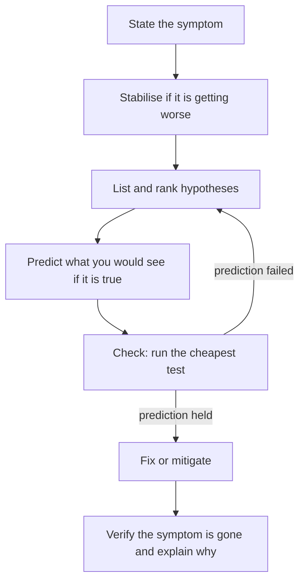

> [!info] Level: junior-middle | Time: about 4 h | You need: [[learn/first-prometheus-alert|Observability 03: Your first Prometheus alert]], and the troubleshooting parts of [[learn/linux-processes-memory-and-disk|Linux 04]], [[learn/load-balancers-firewalls-and-network-troubleshooting|Networking 05]], [[learn/running-and-debugging-containers|Containers 02]] and [[learn/kubernetes-probes-resources-and-debugging|Kubernetes 05]] | Lab: Lab A for the Git exercise, Lab B (the kind cluster `lab`) for the Kubernetes exercise, both from [[learn/lab-setup|Start 01: Set up your lab]]

The earlier lessons gave you tools: `top`, `dig`, `curl`, `kubectl describe`. This lesson is about the part that no tool does for you: deciding **what to look at next**. People who troubleshoot well are not faster typists. They follow a method that keeps them from chasing the first thing they see.

## What you will learn

- How to state a problem as one precise sentence, and why that comes first.
- Why you stabilise before you diagnose, and when a rollback beats an investigation.
- How to list and rank hypotheses, and how to make predictions that could prove you wrong.
- How to narrow a search by time, layer, component and change, including `git bisect` for a change in code.
- Which thinking traps cost the most time, and how to keep notes that protect you from them.
- When to stop, time-box and escalate.

## The loop

Troubleshooting is a loop, not a list of commands.



Every step has a reason. Skipping one is how a ten-minute problem becomes a three-hour one.

## Step 1: State the symptom in one sentence

Before you touch anything, write what is wrong in a sentence that answers four questions.

- **What** is failing, and how? (an error code, a slow response, wrong data)
- **Who** is affected? (all users, one region, one customer, one service calling another)
- **Since when**? (a time, in UTC, and what was happening then)
- **How much**? (every request, 5%, one in a hundred)

Compare:

- Vague: "the checkout is broken".
- Precise: "About 40% of `POST /checkout` requests have returned 502 since 09:10 UTC; read requests and other services are normal."

A precise sentence already removes most hypotheses. "Since 09:10" points at what changed at 09:10. "40%, not 100%" says some part works, which suggests one bad instance, one bad version or one bad dependency path, not "everything is down". If you cannot write the sentence yet, your first task is to measure until you can: a dashboard, a log query, a `curl` loop.

## Step 2: Stabilise first

If the problem is getting worse or users are hurting right now, reduce the damage before you understand it. This is called **mitigation**, and it is not the same as fixing.

| Mitigation           | Use when                                                          |
| -------------------- | ----------------------------------------------------------------- |
| Roll back            | The problem started right after a change, and the change is known |
| Turn off a feature   | A feature flag exists and the symptom is tied to one feature      |
| Scale out            | The cause is load and capacity is available                       |
| Shift traffic away   | One region, zone or instance is bad and others are fine           |
| Restart one instance | Only as a stop-gap, after you have saved logs and state           |

The test is simple. Ask: "Is it getting worse, and is there a safe action that makes it better without knowing the cause?" If yes, do it, write down what you did, then investigate while the pressure is lower. **When rollback beats diagnosis:** when the last change is the obvious suspect, the rollback is tested and cheap, and every minute costs users. You can still find the real cause afterwards, on the old version in a lab or on the failed one in a safe place. The incident side of this is in [[runbooks/incident-response]] and the rollback procedure for Helm in [[runbooks/helm-release-rollback]].

> [!warning] Save the evidence before you restart
> A restart clears in-memory state, logs on the container filesystem and the `Last State` field of a Pod. Capture `kubectl describe`, `kubectl logs --previous` and the metrics you were looking at first, or you destroy the clue you need.

## Step 3: List and rank hypotheses

A hypothesis is a specific, testable statement about the cause: "the new version listens on a different port than the Service targets". "Something is wrong with the network" is not a hypothesis.

Write three to five. Then rank them on two scales.

- **Likelihood:** how probable is it given the symptom and what you know?
- **Cost to check:** how long does the test take and how risky is it?

Test cheap and likely first. A check that takes ten seconds and has a one-in-five chance beats one that takes an hour and has a one-in-two chance. For each hypothesis also write the **prediction**: what you would see if it were true, and what you would see if it were false.

| #   | Hypothesis                                     | Likelihood | Cost to check | If true, I will see...                        | If false, I will see...                 |
| --- | ---------------------------------------------- | ---------- | ------------- | --------------------------------------------- | --------------------------------------- |
| 1   | The 09:04 deploy broke something               | high       | seconds       | Errors begin right after the rollout finishes | Errors began before 09:04               |
| 2   | The database is slow or down                   | medium     | seconds       | Latency and errors on other users of the DB   | Other services using the DB are healthy |
| 3   | A certificate or DNS record expired or changed | low        | minutes       | Errors for all clients, TLS or lookup errors  | Mixed results, plain HTTP status codes  |
| 4   | The nodes are out of capacity                  | low        | seconds       | Pods Pending, nodes at pressure               | All Pods Running, nodes healthy         |

Common source of hypotheses, in this order: **what changed recently** (deploy, config, feature flag, Terraform apply, certificate, dependency, traffic pattern), then resource limits (disk, memory, connections, quota), then dependencies, then the platform.

## Step 4: Narrow down by bisecting

Bisecting means cutting the search space in half again and again. You can cut along four axes.

- **By time.** Find the exact minute the symptom started on a graph, then list every event at that minute: deploys, config changes, cron jobs, certificate expiries, traffic changes.
- **By layer.** Walk the path of a request and find where it breaks: client, DNS, load balancer, ingress, Service, Pod, application, database. Does `curl` to the Pod IP work? To the Service? To the load balancer? The first hop that fails is your layer ([[learn/load-balancers-firewalls-and-network-troubleshooting|Networking 05]]).
- **By component.** Compare a failing instance with a healthy one: same image? same node? same zone? same config? The difference is the suspect.
- **By change.** If a change caused it, find which one. With many changes in the range, bisect them: test the middle, discard the half that does not contain the bad change, repeat. Git automates this.

### `git bisect`

`git bisect` finds the first commit that made a test fail, in about log2(N) steps. For 16 commits that is 4 tests. You tell Git one good commit and one bad commit, and it checks out the middle. You say whether it is good or bad, and it halves the range again. With `git bisect run SCRIPT` it does the whole thing itself: a script that exits `0` means good, an exit code from `1` to `127` other than `125` means bad (a code above `127` aborts the bisect), and `125` means "cannot test this commit, skip it".

```bash
git bisect start HEAD <known-good-commit>
git bisect run ./check.sh
git bisect reset
```

The same idea works without Git: bisect a list of Terraform changes by applying them one at a time in a lab, or bisect the hours of a day on a graph.

## Step 5: Verify with predictions that could prove you wrong

A check is only useful if it can **fail**. "I looked at the logs and they look fine" is not a test. "If the Service targets the wrong port, then `curl` to a Pod IP on the real port will answer and `curl` through the Service will be refused" is a test: it says in advance what each result means.

The habit is: before you run a command, say out loud what output would support the hypothesis and what would kill it. Then run it. If the result is neither, the question was badly formed. Write a sharper one.

This also protects you from yourself. If you only run checks that can confirm your favourite idea, you will always feel right.

## Keep a running notes file

Open a text file at the start and add a line for every thing you look at, with a timestamp in UTC. It costs a few seconds per line and pays back three ways: you do not repeat checks, a colleague who joins can read what you tried, and the notes become the timeline of the postmortem ([[learn/on-call-incidents-and-postmortems|Incidents 02]]).

```bash
note() { printf '%s %s\n' "$(date -u +%H:%M:%SZ)" "$*" >> ~/incident-notes.md; }
note "symptom: ~40% of POST /checkout return 502 since 09:10Z"
note "hypothesis 1: deploy at 09:04Z. Prediction: errors only on the new version"
```

Record what you **saw**, what you **did** and what you **believe**, and keep them apart ("saw: 502 in ingress logs", "believe: the new Pods refuse connections"). The next lesson uses that split.

## Thinking traps

| Trap                         | What it looks like                                                         | Defence                                                               |
| ---------------------------- | -------------------------------------------------------------------------- | --------------------------------------------------------------------- |
| Confirmation bias            | Only running checks that support your first idea                           | Write the prediction that would prove you wrong, then run that check  |
| Anchoring on the first error | The first error in the log becomes "the cause"; it may be a symptom or old | Check when it first appeared, and whether it appears in healthy times |
| Correlation vs causation     | "The errors started when the deploy finished, so the deploy did it"        | Look for a mechanism, and test it: does the old version also fail?    |
| Fixing the symptom           | Restarting makes it go away, and you stop                                  | Ask "why did it fail?" and "why did the restart help?"                |
| Changing many things at once | You cannot tell which change helped                                        | One change at a time, and note each                                   |
| Tunnel vision                | An hour on one theory with no new evidence                                 | Time-box it; ask a second person to look with fresh eyes              |

An error that is old noise is a common anchor: many systems log a warning on every request all day. If it also appears at 08:00, before the problem began, it is not your cause.

## Time-box and escalate

Decide how long you will spend before you ask for help, and say it in the notes: "if no progress by 09:45Z, I page the platform lead". Asking for help is part of the method, not a failure. After 15 to 30 minutes with no new evidence, or at once when the impact is severe or data may be at risk, bring in a second pair of eyes. When you escalate, give the symptom sentence, what you checked, what you ruled out and what you need. [[learn/on-call-incidents-and-postmortems|Incidents 02]] covers escalation during an incident.

## A worked example: checkout returns 502 since 09:10

> [!note] Illustrative
> Everything in this example is made up for teaching: the names, the times, the output and the notes. Use it as a pattern, not as evidence of how any real system behaves.

**The page.** At 09:18 UTC an alert for the checkout error ratio fires. The first notes:

```text
09:18Z alert ApiHighErrorRatio (checkout) fired. Ack.
09:19Z dashboard: 502s from the ingress started at 09:10Z. ~40% of POST /checkout. GET traffic normal.
09:20Z symptom sentence: ~40% of POST /checkout return 502 since 09:10Z; other routes and other services normal.
09:21Z deploy history: checkout v1.8 rolled out 09:04Z to 09:09Z by the pipeline. Nothing else in the last 2 h.
```

**Stabilise?** The error rate is steady, not rising, and a rollback is available. The team lead can approve a rollback within minutes, but first the hypotheses (two minutes of thinking):

```text
09:22Z hypotheses:
  H1 the v1.8 Pods do not accept connections where the Service sends them (port/selector). Cost: low.
     If true: Pod IP on the old port refuses, new port answers. 502 only from new Pods.
  H2 v1.8 needs a new config/secret that is missing, app returns errors. Cost: low.
     If true: app logs show the error and a 5xx (not 502) from the app itself.
  H3 database slow. Cost: low. If true: other services on the DB also slow. (they are not, per dashboard)
  H4 node/capacity. Cost: low. If true: Pods Pending. (will check: kubectl get pods)
```

**Narrow down, by layer and by component.** A 502 from an ingress means the ingress could not get a valid answer from the upstream, so the fault is between the ingress and the Pod, or in the Pod's reply. The checks:

```bash
kubectl -n shop get pods -l app=checkout -o wide
kubectl -n shop get endpointslices -l kubernetes.io/service-name=checkout
kubectl -n shop describe svc checkout | grep -E 'Selector|Port|TargetPort|Endpoints'
```

```text
09:25Z all 5 checkout Pods are Running and Ready: 3 on v1.7, 2 on v1.8 (the canary replaced 2 of 5, so 2/5 = 40%). Not Pending: H4 dead.
09:27Z Service checkout: TargetPort 8080. EndpointSlice lists 5 Pod IPs, all ready.
09:28Z from a debug Pod, against a v1.8 Pod: curl -sS -m 3 http://<pod-ip>:8080/ -> curl: (7) Failed to connect ... Connection refused.
         curl http://<pod-ip>:8081/ -> HTTP/1.1 200 OK
```

The prediction of H1 held (connection refused on 8080, an answer on 8081), and it could have failed: if 8080 had answered, H1 would be dead. The "40%, not 100%" in the symptom follows from the setup: 2 of the 5 Pods run v1.8 and refuse connections on 8080, and the 3 v1.7 Pods are healthy. A number is a hint, not proof, and the notes below record the cause as a belief.

```text
09:30Z cause (believed): v1.8 listens on 8081 (PORT env changed in the chart), Service targets 8080. Readiness probe uses the admin port 9000, so Pods are "Ready".
09:31Z action: rollback to v1.7 approved by lead; helm rollback checkout 41 (the previous revision).
09:36Z 502 rate back to baseline. Mitigated. Follow-up: fix the port in the chart, add a smoke test that goes through the Service.
```

What the example shows: a precise sentence, one change to suspect, predictions that could fail, a rollback to mitigate and a follow-up to prevent. It also shows the weak point the team must fix: a readiness probe on a different port than the traffic port says "ready" while the app cannot be reached, which is a Kubernetes lesson ([[learn/kubernetes-probes-resources-and-debugging|Kubernetes 05]]). A Service with a wrong port still resolves in DNS, so the symptom is "connection refused" or a timeout, not a lookup error ([[learn/kubernetes-services-and-ingress|Kubernetes 03]]).

## Hands-on exercises

1. **Write the symptom, hypotheses and predictions for the example.** Without scrolling up, take this one-line report: "Users say the checkout page shows a bad gateway error, started around nine." On paper, write: (a) a precise symptom sentence that names what, who, since when and how much, and the three questions you would answer first to complete it; (b) four hypotheses with likelihood and cost; (c) for the top two, the prediction that would prove each wrong.

   Expected: a table like the one above. A good answer includes "what changed at about 09:00" as hypothesis one and a cheap, falsifiable check for it (for example "the deploy history shows no rollout, so H1 is dead").
   If you see something else: if a hypothesis is "the network", split it by layer into something you can test, such as "DNS for `checkout` fails from the ingress Pod".

2. **Find the bad commit with `git bisect run`.** This creates a repository with 16 commits where commit 11 breaks a setting, and finds it automatically.

   ```bash
   mkdir ~/bisect-lab && cd ~/bisect-lab
   git init -q -b main .
   git config user.name "Lab User"
   git config user.email "lab@example.com"
   for i in $(seq 1 16); do
     if [ "$i" -ge 11 ]; then echo "mode=broken" > app.conf; else echo "mode=ok" > app.conf; fi
     echo "change $i" >> CHANGELOG.txt
     git add .
     git commit -q -m "change $i"
   done
   git log --oneline | wc -l
   printf '#!/usr/bin/env bash\n# exit 0 = good commit, 1 to 127 (not 125) = bad commit\ngrep -q "^mode=ok$" app.conf\n' > ~/check.sh
   chmod +x ~/check.sh
   ```

   The script lives in your home folder, outside the repository, so that Git does not remove it when it checks out old commits. Now bisect:

   ```bash
   git bisect start HEAD "$(git rev-list --max-parents=0 HEAD)"
   git bisect run ~/check.sh
   git bisect reset
   ```

   Expected: the count `16`, and four test runs (`running '...'` four times), ending as follows. The hashes differ on your machine, and the script path shows your home folder:

   ```text
   Bisecting: 7 revisions left to test after this (roughly 3 steps)
   [e37a9b6b9de45cb5ec8c469a3ac8a17c1bda41b4] change 8
   running '/home/you/check.sh'
   Bisecting: 3 revisions left to test after this (roughly 2 steps)
   [73758dfab5cacdfcb92bd21377823dda7fda79d3] change 12
   running '/home/you/check.sh'
   Bisecting: 1 revision left to test after this (roughly 1 step)
   [0b68f51fc1606cac5601577e8de26f2cc21577b8] change 10
   running '/home/you/check.sh'
   Bisecting: 0 revisions left to test after this (roughly 0 steps)
   [077ceaba2b4c4556521af36bb274ed415dcb18a0] change 11
   running '/home/you/check.sh'
   077ceaba2b4c4556521af36bb274ed415dcb18a0 is the first bad commit
   commit 077ceaba2b4c4556521af36bb274ed415dcb18a0
   Author: Lab User <lab@example.com>
   Date:   Sat Oct 17 17:35:22 2026 +0000

       change 11

    CHANGELOG.txt | 1 +
    app.conf      | 2 +-
    2 files changed, 2 insertions(+), 1 deletion(-)
   bisect found first bad commit
   ```

   If you see something else: `bisect found first bad commit` must name "change 11". If it names another commit, your good/bad boundary is wrong; check that `check.sh` exits 0 on `mode=ok`. If you see `error: ... local changes would be overwritten`, you left an edit in the working tree; run `git bisect reset` and `git status`. Four tests for sixteen commits is the log2 you expect. Remember that `git bisect reset` is what returns you to `main`; skipping it leaves the repository on a detached commit.

3. **Diagnose a broken image tag with `kubectl` only.** This exercise runs on the kind cluster `lab` (Lab B). The Deployment sets `progressDeadlineSeconds: 60`; the default is 600 seconds, which would make you wait ten minutes for the rollout to be declared failed. First create a healthy version:

   ```yaml title="tm-web.yaml"
   apiVersion: apps/v1
   kind: Deployment
   metadata:
     name: tm-web
   spec:
     replicas: 2
     progressDeadlineSeconds: 60
     selector:
       matchLabels:
         app: tm-web
     template:
       metadata:
         labels:
           app: tm-web
       spec:
         containers:
           - name: web
             image: nginxinc/nginx-unprivileged:1.27-alpine # example tag; pin the one you use
             ports:
               - containerPort: 8080
             resources:
               requests:
                 cpu: 20m
                 memory: 32Mi
               limits:
                 memory: 64Mi
             securityContext:
               runAsNonRoot: true
               runAsUser: 101
               allowPrivilegeEscalation: false
               capabilities:
                 drop: ["ALL"]
               seccompProfile:
                 type: RuntimeDefault
   ```

   ```bash
   kubectl apply -f tm-web.yaml
   kubectl rollout status deployment/tm-web
   ```

   Expected (illustrative): `deployment "tm-web" successfully rolled out`.

   Now break it with a tag that does not exist and watch:

   ```bash
   kubectl set image deployment/tm-web web=nginxinc/nginx-unprivileged:no-such-tag
   sleep 15
   kubectl get pods -l app=tm-web
   ```

   Expected (illustrative; the Pod names and ages differ). The old Pods keep serving while the new one cannot start, which is exactly why the rolling update protects you:

   ```text
   NAME                      READY   STATUS             RESTARTS   AGE
   tm-web-5c9d7b8f6d-4k2jq   1/1     Running            0          2m
   tm-web-5c9d7b8f6d-m8x7z   1/1     Running            0          2m
   tm-web-7f6b9c4d58-xk2lp   0/1     ImagePullBackOff   0          15s
   ```

   Find the cause from events, not from guessing. State your prediction first: "if the tag is wrong, the events will say the image could not be pulled or was not found".

   ```bash
   kubectl describe pod -l app=tm-web | grep -A12 '^Events'
   ```

   Expected (illustrative wording; it depends on the runtime and registry):

   ```text
   Events:
     Type     Reason     Age   From               Message
     ----     ------     ----  ----               -------
     Normal   Scheduled  18s   default-scheduler  Successfully assigned default/tm-web-7f6b9c4d58-xk2lp to lab-worker
     Normal   Pulling    17s   kubelet            Pulling image "nginxinc/nginx-unprivileged:no-such-tag"
     Warning  Failed     15s   kubelet            Failed to pull image "nginxinc/nginx-unprivileged:no-such-tag": ... not found
     Warning  Failed     15s   kubelet            Error: ErrImagePull
     Normal   BackOff    3s    kubelet            Back-off pulling image "nginxinc/nginx-unprivileged:no-such-tag"
     Warning  Failed     3s    kubelet            Error: ImagePullBackOff
   ```

   Stabilise first, then fix. The rollout will be declared failed after the 60-second deadline. Check, then undo, then confirm:

   ```bash
   kubectl rollout status deployment/tm-web --timeout=90s
   kubectl rollout undo deployment/tm-web
   kubectl rollout status deployment/tm-web
   kubectl get deployment tm-web -o jsonpath='{.spec.template.spec.containers[0].image}'; echo
   ```

   Expected (illustrative):

   ```text
   error: deployment "tm-web" exceeded its progress deadline
   deployment.apps/tm-web rolled back
   deployment "tm-web" successfully rolled out
   nginxinc/nginx-unprivileged:1.27-alpine
   ```

   If you see something else: `ErrImagePull` first, then `ImagePullBackOff`, is the normal order (the second state means Kubernetes is waiting longer between tries). If the Pod is `Running`, your cluster already had a tag by that name; use a different obviously fake tag. If `rollout status` waits longer than 90 seconds, check that `progressDeadlineSeconds: 60` is in the applied object: `kubectl get deployment tm-web -o jsonpath='{.spec.progressDeadlineSeconds}'`. This exercise was **not run** for this page; the output above is illustrative and the wording differs between container runtimes.

4. **Keep a notes file with six timed entries.** Do exercise 3 again if you like, and write the notes as you go. Define the helper and add entries:

   ```bash
   note() { printf '%s %s\n' "$(date -u +%H:%M:%SZ)" "$*" >> ~/incident-notes.md; }
   note "symptom: tm-web rollout stuck, new Pod 0/1 ImagePullBackOff"
   note "hypothesis: wrong image tag. Prediction: Events say not found"
   note "saw: Events show 'not found' for tag no-such-tag"
   note "action: kubectl rollout undo deployment/tm-web"
   note "saw: rollout status says successfully rolled out; image is 1.27-alpine"
   note "believe: cause was the typo in the tag from kubectl set image. Follow-up: pin tags in Git, not by hand"
   cat ~/incident-notes.md
   ```

   Expected (the times are the current UTC time; the lines are what you typed):

   ```text
   17:35:22Z symptom: tm-web rollout stuck, new Pod 0/1 ImagePullBackOff
   17:35:22Z hypothesis: wrong image tag. Prediction: Events say not found
   ...
   ```

   If you see something else: if the file is empty, the function was not defined in the current shell (define it again in the same terminal). If two entries show the same second, that is fine when you run them back to back; real notes spread out over minutes.

5. **Clean up.**

   ```bash
   kubectl delete -f tm-web.yaml --ignore-not-found
   rm -rf ~/bisect-lab ~/check.sh ~/incident-notes.md
   ```

   Expected: `deployment.apps "tm-web" deleted` and the lab files are gone.
   If you see something else: if `kubectl` cannot reach a cluster, start the kind cluster `lab` first (see [[learn/lab-setup|Start 01]]).

## Common mistakes

- **Starting to type commands before the symptom is precise.** Why it bites: you search a huge space and cannot tell if you are making progress. Fix: write the one-sentence symptom first, with what, who, since when and how much.
- **Diagnosing while users suffer when a rollback is ready.** Why it bites: every extra minute is customer pain. Fix: mitigate first when the last change is the obvious suspect and the rollback is tested.
- **One hypothesis, defended.** Why it bites: if it is wrong you have nothing else and you start to bend facts. Fix: write three to five and rank them.
- **Checks that cannot fail.** Why it bites: "the logs look fine" confirms everything. Fix: say in advance what result would kill the idea.
- **Changing several things at once.** Why it bites: if the problem goes away you do not know why, and the cause can return. Fix: one change at a time, noted.
- **Calling a restart a fix.** Why it bites: the cause is still there and returns at a worse time. Fix: ask why it failed and why the restart helped; keep the evidence before restarting.
- **No notes.** Why it bites: you repeat checks, lose the order of events and cannot hand over. Fix: a timestamped notes file from the first minute.
- **Staying stuck alone.** Why it bites: tunnel vision grows with time. Fix: a time-box, and escalate with a clear summary.

## Check your understanding

1. Why do you write down predictions before running a check?
2. Is a fix you cannot explain done? What should you do?
3. When does a rollback beat diagnosis?
4. What are the four axes along which you can narrow a search, and which one fits "it broke after somebody changed something last night"?
5. `git bisect` is testing 16 commits. About how many commits do you have to test, and what exit code from your script marks a commit as bad?
6. The error rate is steady at 40% and a rollback is ready. A colleague wants to look at the logs for an hour first. What do you say?

> [!question]- Answers
>
> 1. A prediction says in advance what each result means, so the check can prove you wrong. Without it you read the result through your favourite theory and always find confirmation (confirmation bias).
> 2. No. If you cannot explain why it works, you do not know that the cause is gone, and it may return. Keep investigating (possibly after the mitigation), find the mechanism and write it down; if you cannot find it, record that honestly and add monitoring.
> 3. When users are being hurt now, the last change is the obvious suspect, and the rollback is tested, cheap and reversible. You mitigate first and diagnose afterwards, on the old version in a safe place.
> 4. By time, by layer, by component and by change. "Broke after somebody changed something" is narrowing by change: list the changes in that window and bisect them (for code, `git bisect`).
> 5. About four (log2 of 16). An exit code from 1 to 127, other than 125, marks the commit bad; 0 marks it good, and 125 skips it.
> 6. Roll back now if the last change is the likely cause, and investigate afterwards with the pressure off. Keep the evidence (logs, `describe`, graphs) before the rollback so the investigation is not harmed.

## Next steps

Next lesson: [[learn/on-call-incidents-and-postmortems|Incidents 02: On-call, incidents and postmortems]]. Previous lesson: [[learn/first-prometheus-alert|Observability 03: Your first Prometheus alert]].

To go deeper:

- [[runbooks/incident-response]] for how a team runs the incident around the troubleshooting.
- [[runbooks/kubernetes-pod-troubleshooting]] for the Kubernetes-specific checks, by symptom.
- [[learn/running-and-debugging-containers|Containers 02]] and [[learn/kubernetes-probes-resources-and-debugging|Kubernetes 05]] for the tools used in the example.
- The whole path is mapped in [[learn/index|the learning path]].

## Sources

- Google SRE book, "Effective Troubleshooting" (https://sre.google/sre-book/effective-troubleshooting/) and "Managing Incidents" (https://sre.google/sre-book/managing-incidents/).
- Git documentation, `git-bisect` (https://git-scm.com/docs/git-bisect).
- Kubernetes documentation, "Troubleshooting Applications" and "Debug Pods" (https://kubernetes.io/docs/tasks/debug/debug-application/), and "Deployments", including `progressDeadlineSeconds` (https://kubernetes.io/docs/concepts/workloads/controllers/deployment/).
- Run for this page: the `git bisect run` exercise and the `note` helper, with Git 2.43.0 on Ubuntu 24.04.5 LTS.
- Not verified: the whole `kubectl` and kind exercise (no cluster was available), the exact event wording for your container runtime and registry, and the worked example, which is invented for teaching.
