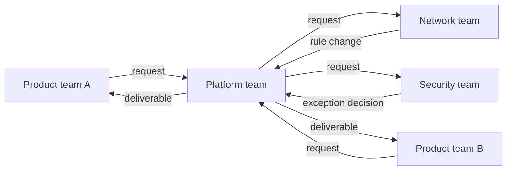

Platform teams sit in the middle of most dependency chains. Product teams wait for a pipeline template, a cluster feature or a chart change, and the platform team waits for security, networking or a vendor. A dependency that nobody wrote down slips silently, and the first anyone hears of it is a missed date. This note gives you a register, a request format and an escalation path that keep dependencies visible. [[stakeholder-communication]] covers how to tell people; this note covers how to keep track of what to tell them.

> [!info] Scope and what is not verified
> The note is a practical process, not a standard. The Team Topologies interaction mode names and any Google SRE book chapter references were not checked, so they are not quoted here. Adjust the service levels to your own capacity.

## Inbound versus outbound dependencies

Be clear which direction you are looking in, because the actions differ.

| Direction | Meaning                                     | Your job                                                                                  | Typical example                                            |
| --------- | ------------------------------------------- | ----------------------------------------------------------------------------------------- | ---------------------------------------------------------- |
| Inbound   | Other teams need something from your team   | Intake, size, schedule, say yes or no early, tell people when it changes                  | A product team needs a new ingress annotation in the chart |
| Outbound  | Your team needs something from another team | Ask clearly, state the impact and the date, follow up, build a fallback, escalate in time | You need a firewall rule from the network team             |

Inbound dependencies are a capacity problem: you cannot say yes to everything. Outbound dependencies are a risk problem: you cannot control the date, so you track and plan around it. Both go in the same register with a direction column.



Draw this for your own team once a quarter. The arrows into your team show who you can block; the arrows out show who can block you. A team with many arrows in and few out is a bottleneck, and the [[platform-team-operating-model]] is the place to fix that structurally.

## The register

One table, one owner (usually the engineering manager or a delivery lead), reviewed weekly. Keep it where everybody can read it: a wiki page or a tracker board. Every row needs a name, a date and an escalation contact, because a row without them is only a hope.

| ID     | Requesting team | Providing team | Deliverable                          | Needed by  | Status   | Owners (requester / provider) | Escalation contact     |
| ------ | --------------- | -------------- | ------------------------------------ | ---------- | -------- | ----------------------------- | ---------------------- |
| DEP-14 | Payments        | Platform       | `extraEnv` support in shared chart   | 2026-11-06 | At risk  | A. Rivera / J. Okafor         | Platform EM            |
| DEP-15 | Search          | Platform       | Same chart change as DEP-14          | 2026-11-13 | At risk  | M. Chen / J. Okafor           | Platform EM            |
| DEP-16 | Platform        | Network        | Firewall rule for new GKE node range | 2026-11-20 | On track | J. Okafor / S. Duarte         | Head of infrastructure |

Names, ids and dates are examples. Use these statuses and define them once:

- **Requested**: sent, not yet accepted.
- **Accepted**: the provider confirmed the scope and a date.
- **On track**: work is under way and the date holds.
- **At risk**: the date may slip, and a mitigation is being tried.
- **Blocked**: cannot progress without a decision or help; escalate.
- **Done**: delivered and the requester confirmed it works.
- **Declined**: the provider said no, with a reason the requester can plan around.

> [!tip] Link to the plan
> Each active dependency should appear in the plan of both teams, with the same date. If it is only in the register, nobody is working on it. See [[planning-and-prioritization]].

## Request intake and service levels

Inbound requests need a front door. A team that accepts requests in direct messages has no register, no queue and no way to say no.

1. Requesters use one form or ticket type. The platform team triages it weekly, or twice a week when volume is high.
2. Every request gets one of four answers within a stated time: **accepted with a date**, **accepted, date to be set**, **needs more information**, or **declined with a reason**.
3. Requests that need more than a few days of work become planned work, sized and ranked with everything else ([[planning-and-prioritization]]).
4. Requests of the same kind (the third team asking for the same chart option) become a product feature, not three favours.

State the service levels in the team charter ([[team-charter]]) so they are a commitment and not a courtesy. Example levels, to be replaced with what your team can honestly keep:

| Item                                     | Commitment                             |
| ---------------------------------------- | -------------------------------------- |
| Acknowledge a new request                | Within 2 working days                  |
| Answer: accepted, date, more info, or no | Within 5 working days                  |
| Tell a requester the date has changed    | The same day you know, before the date |
| Review the register with both teams      | Weekly for active items                |

Copy this request template into the ticket form.

```text title="Dependency request template"
Title:               <short name of the deliverable>
Requesting team:     <team> (contact: <name>)
Providing team:      <team>

Context
  What are you trying to achieve, and why does it need the other team?
  <two to four sentences>

What you need
  <the specific deliverable, in terms the provider can test>
  Done means: <acceptance check, e.g. "chart renders extraEnv, documented in README">

Impact if it is late or refused
  <what is blocked, which release or customer, how many people>

Dates
  Needed by:               <date>
  Minimum acceptable date: <the latest date that still lets you ship a reduced version>
  Why that date:           <fixed event, release train, contract, quarter end>

Alternatives you already considered
  <workarounds, and why they are worse>

Links
  <design doc, ticket, repo, dashboard>
```

The "minimum acceptable date" matters most. It tells the provider how much room they have and lets you agree a smaller deliverable when the full one cannot make it.

## At-risk signals

Do not wait for the date to pass. Watch for these in the weekly review.

- No acknowledgement of the request within the agreed time.
- The provider has no named owner, or the owner changed.
- The date moved once already without a reason.
- The work depends on a third team that has not been asked.
- Status updates say "in progress" for two weeks in a row with no visible artefact (a branch, a draft, a design).
- The provider's own plan or on-call load has grown; check [[on-call-health]] if pages are climbing.
- The requester has not tested an early version, so feedback arrives late.
- The remaining time is shorter than the provider's usual review and release cycle.

Mark a dependency **At risk** as soon as two signals are present, and write the mitigation next to it. Marking early costs nothing; marking late costs the date.

## Escalation path

Escalate the problem, not the person, and escalate with a proposal. Give each step a time limit so escalation is a routine and not an accusation.

1. **Owners talk** (day 0). Requester and provider owners agree on scope, date and blockers. Most issues end here.
2. **Team leads** (within 2 working days of an unresolved risk). Both engineering managers look at capacity and priority, and decide together what to move.
3. **Shared manager or head of department** (within 5 working days, or sooner when a fixed date is at stake). Present the options and ask for a decision, not for sympathy.
4. **Leadership forum** (only for dependencies that threaten a quarterly objective). One page: what is blocked, the cost of waiting, options A and B, your recommendation.

Write the escalation message in the same shape as a status update: the point first, the impact, the options, the ask.

```text title="Escalation message"
Subject: DEP-14 needs a decision by <date>: shared chart change blocks two teams

Point:    The shared chart change (DEP-14, DEP-15) is at risk of missing <date>.
Impact:   Payments and Search cannot ship <feature> before <event> without it.
Cause:    Platform capacity is committed to the <upgrade> until <date>.
Options:  A. Move the <upgrade> by one week. B. Ship a minimal chart change now
          and the full one later. C. Both teams use the workaround for one release.
Recommend: B, because <reason>.
Ask:      Decision by <date>. Reply to this message or join the 15 minute sync.
```

Always tell the other team's manager before you escalate above them. A surprise escalation destroys trust and is slower in the end. See [[stakeholder-communication]] for wording and [[managing-conflict]] when the disagreement is about priority between teams.

## Interim workarounds

Plan the fallback while the dependency is still on track. A workaround is not a failure of the dependency; it is what lets the requester keep their date.

- **Smaller scope**: deliver the part that unblocks the requester, finish the rest later.
- **Requester builds it**: the requesting team makes the change in the provider's repo with the provider's review ([[inner-source-platform]] describes this model).
- **Local override**: a documented, temporary override in the requester's own config that is removed once the dependency lands.
- **Manual step with an owner and an end date**: a person runs a command until automation exists.
- **Reorder the plan**: move the blocked work later and pull in unblocked work.

Every workaround gets an owner, a removal date and a ticket to remove it. A workaround without an end date becomes permanent and shows up later as [[tech-debt-management|tech debt]].

## Worked example: shared Helm chart change

Two product teams (Payments and Search) each need the shared platform chart to support extra environment variables from a ConfigMap. The chart is owned by the platform team ([[helm-chart-conventions]]). The platform team is busy with a cluster upgrade until mid-November.

1. **Day 0.** Payments files a request with the template. Needed by 6 November for a release train; the minimum acceptable date is 13 November, since the release can ship one train later with reduced scope. The platform team acknowledges within two days and registers DEP-14.
2. **Day 3.** Search files the same request for 13 November. The platform team notices it is the same change, merges the two into one deliverable, and records DEP-14 and DEP-15 as linked.
3. **Day 5.** The platform lead answers: accepted, but not before 20 November because of the upgrade. That is later than both teams' needed-by date. Status moves to **At risk** for both rows. Signals: the date is after the requester's minimum, and the owner has no spare capacity.
4. **Day 6.** The owners meet. Platform proposes a workaround; Payments and Search accept it in a short meeting. Escalation to the managers is not needed, but both teams tell their own managers that the register shows at risk.
5. **The agreed workaround.** Payments and Search each use a post-render step in their own pipelines, a small `kustomize` patch applied after `helm template`, that injects the ConfigMap reference. It lives in each team's repo with a comment naming DEP-14 and the removal date. Platform builds the real chart option in the week of 20 November, with a test and a README entry, reviewed by one engineer from each product team.
6. **Day 20 (after the chart release).** Both teams remove the patch in a small merge request, confirm in staging, and mark DEP-14 and DEP-15 **Done**. The platform team closes the removal tickets.

What made it work: the request had a minimum acceptable date, the platform team saw both requests together, the status changed early, and the workaround had an owner and an end date. What would have gone wrong without the register: two teams would have discovered the slip in the week of the release.

## Review cadence

| Cadence     | What                                                                                                  | Who                            |
| ----------- | ----------------------------------------------------------------------------------------------------- | ------------------------------ |
| Weekly      | Walk through every At risk, Blocked and due-soon row; update status and dates                         | Register owner, team leads     |
| Fortnightly | Sync with each team you have more than two open items with                                            | Engineering managers           |
| Monthly     | Look at trends: which team is the most common provider, which requests repeat, how many dates slipped | Engineering managers           |
| Quarterly   | Update the dependency map, feed the repeated requests into the roadmap and the team charter           | Engineering manager, tech lead |

Close the loop: when a dependency is done, ask the requester if it worked, and write down anything the next request should know. A register that only grows is not being used; archive rows older than a quarter.

## Related

- [[stakeholder-communication]]
- [[planning-and-prioritization]]
- [[platform-team-operating-model]]
- [[team-charter]]
- [[helm-chart-conventions]]
- [[inner-source-platform]]
- [[tech-debt-management]]
