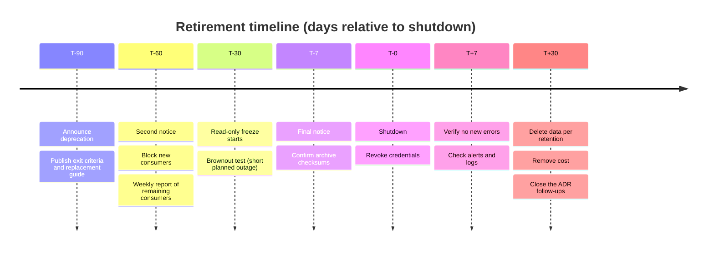

Adding a platform service is celebrated; removing one is postponed forever. Old tools keep consuming money, patching effort and attack surface, and every year of delay makes the shutdown harder because consumers multiply and the people who knew the service leave. Decommissioning is a skill with a repeatable process: decide with criteria, find every consumer, announce, freeze, archive, shut down, remove the cost and verify.

## Retirement is a decision

Do not retire a service because someone is tired of it. Make the decision on the record, as an ADR, with the reason, the alternative that replaces it and the exit criteria. See [[adr/index|the ADR index]]. For tools that are replaced by another tool, the replacement decision and the retirement decision are two records; the second one links to the first. Fit it into the roadmap, see [[tech-debt-management]], and tell the people it affects early, see [[stakeholder-communication]].

## Measurable exit criteria

"Nobody uses it" is not a criterion until you can measure it. Write criteria before the deprecation announcement, so the finish line cannot be moved afterwards.

```markdown title="exit-criteria.md"
## Exit criteria: <service>

- Active jobs or pipelines depending on it: 0 (source: inventory dated ____)
- Named owners of remaining integrations: 0 outstanding
- Requests in the last release cycle: below ____ per day (source: access logs)
- Distinct client identities in the last ____ days: 0 (source: audit logs)
- Open exceptions: 0, or each has an expiry before the shutdown date
- Data required by policy is archived and verified (see retention table)
- Credentials issued by or held by the service are revoked
- Replacement service has been in production for one full release cycle
- Cost lines tagged to the service: identified and scheduled for removal
```

"One full release cycle" means your usual release cadence, so monthly or quarterly processes get a chance to show up. A service used once a year (a year-end job, for example) will not appear in a two-week log search.

## Consumer discovery

Find consumers from several directions, because each source misses something.

```bash title="discovery.sh"
#!/usr/bin/env bash
# Consumer discovery for a legacy registry host. Run against checked-out repositories.
set -euo pipefail

OLD_HOST="registry-old.example.com"
SEARCH_ROOT="${1:?usage: discovery.sh <dir-with-repository-checkouts>}"

# 1. Pipelines, Helm values and Terraform that still mention the host
grep -rIn --include='.gitlab-ci.yml' --include='Jenkinsfile*' \
  --include='values*.yaml' --include='*.tf' --include='Dockerfile*' \
  -F "${OLD_HOST}" "${SEARCH_ROOT}" || true

# 2. Cloud resources still labelled with the service (GCP; label key is an example)
gcloud asset search-all-resources \
  --scope="organizations/${GCP_ORG_ID:?export GCP_ORG_ID}" \
  --query="labels.service=legacy-registry" \
  --format="table(name,assetType,project)"
```

For Jenkins, list the jobs that use a given plugin by fetching the job configurations read-only and searching them, or use the plugin's own usage report if one exists; check the current Jenkins documentation for how to read job configuration through the API with read-only credentials. For servers and VMs, look at network flow logs and access logs for client addresses, then map addresses to owners. For SaaS and registries, use audit logs for distinct users and tokens. Finally, announce and wait: some consumers only appear when you say the date out loud.

## Deprecation timeline and communication

Fix the timeline from the shutdown date backwards, and send each message through every channel that consumers actually read.



A brownout (switching the service off for a short, announced period) flushes out hidden consumers while it is still easy to switch back. Run one, announce it, and watch the consumer list again. Match the lengths of T-90 and T-30 to your release cadence; a quarterly consumer needs more than 90 days.

## Read-only freeze

Before the shutdown, make the service read-only: no new writes, no new projects, no new users. The read-only phase reveals dependents that need writes (they fail loudly) without risking data loss, and it stops new dependencies from forming. Take a final backup at the start of the freeze, and test that you can restore it.

## Data retention and archive

Decide what must be kept and for how long, before anything is deleted. Check with legal, security and the data owner; retention requirements vary by data type, contract and jurisdiction. This note is not legal advice.

| Data                           | Reason to keep             | Retention period (owner decides) | Location of archive   | Verified (date, by) | Deleted (date, by) |
| ------------------------------ | -------------------------- | -------------------------------- | --------------------- | ------------------- | ------------------ |
| Build and deploy audit logs    | Audit evidence             | per policy                       | locked archive bucket |                     |                    |
| Release artifacts              | Reproducing past releases  | per policy                       | replacement registry  |                     |                    |
| Configuration (jobs, projects) | Reference and recreation   | until replacement is stable      | repository            |                     |                    |
| Access and change history      | Incident and audit lookups | per policy                       | locked archive bucket |                     |                    |

Verify an archive by restoring a sample and comparing checksums, not by checking that the copy job exited cleanly. Link retention rules to [[audit-evidence-collection-and-retention]] and artifact rules to [[artifact-retention-policy]].

> [!danger] Deleting data is irreversible
> Do not delete disks, buckets, databases or backups until the archive is verified, the retention table is signed off by the data owner, and the rollback window has passed. Prefer scheduling deletion (for example a lifecycle rule or a delayed deletion job) so there is a last chance to stop it.

## Shutdown and cost removal

Shut down in stages that can be undone for as long as possible: stop traffic (DNS, load balancer), stop the workloads (scale to zero), snapshot, then delete. Change windows and approvals follow [[production-change-checklist]]. Revoke every credential the service held or issued, see [[leaked-credential-rotation]] for the method.

Cost removal is part of the work, not a favour to finance. Search billing data for leftover spend tagged to the service. The query below is a sketch; the export table name and schema depend on your billing export configuration, so check the export schema in the current documentation before using it.

```sql title="leftover-spend.sql"
-- Check the billing export schema in the current docs before running.
-- Replace the table with your own export table.
SELECT
  invoice.month AS invoice_month,
  service.description AS service_name,
  l.value AS service_label,
  ROUND(SUM(cost), 2) AS cost
FROM `example-billing.billing_export.gcp_billing_export_v1_EXAMPLE`,
  UNNEST(labels) AS l
WHERE l.key = 'service'
  AND l.value = 'legacy-registry'
  AND usage_start_time >= TIMESTAMP('2026-01-01')
GROUP BY invoice_month, service_name, service_label
ORDER BY invoice_month DESC, cost DESC;
```

Resources without the label will not appear, which is why the labelling model in [[finops-cost-allocation-and-guardrails]] matters. Compare spend with the month before shutdown, and again two months later, because some charges (storage, snapshots, reserved capacity) lag behind.

## Post-shutdown verification

- Alerts and error rates for former consumers for at least a week.
- Ticket queue for "it stopped working" reports.
- Access logs on the replacement for unexpected new load.
- Billing export: the service's spend line is zero or explained.
- Inventory: no resources with the service's labels remain.
- Documentation, runbooks, dashboards and alerts for the service are removed or archived.
- Licences and support contracts are cancelled by the renewal decide-by date, see [[devops-vendor-and-licence-management]].

## Rollback point

Define the last moment you can return to service and keep that path alive until then. Typically: the freeze snapshot restored into a fresh instance and DNS pointed back, valid until the first deletion step. Write the rollback in the ADR, say who may trigger it, and record when it expires. After the expiry, rollback means rebuild from the archive.

## Definition of done

The service is decommissioned when all of these hold: exit criteria met, consumers migrated or excepted with expiry, archive verified, resources deleted, credentials revoked, documentation updated, cost removed and confirmed in billing data, and the ADR updated with the outcome and date. If the cost is still there, you are not done.

## Example: retiring Chef

Chef is a typical long-lived dependency: cookbooks, run lists, nodes registered to a server, data bags and vault secrets. Consumer discovery means nodes still checking in, cookbooks still referenced and pipelines that run `knife`. The migration path and image build approach are in [[chef-to-immutable-images-migration]]. For the retirement: criteria are zero nodes checked in during a full release cycle, secrets rotated and moved, and cookbooks archived in version control; the Chef server is then frozen, archived and shut down following the timeline above. The same process applied to the Jenkins controllers is in [[jenkins-to-gitlab-migration-programme]].

## Common mistakes

- **No owner for the shutdown.** Name a person per service and date.
- **Criteria invented after the fact.** Write them first.
- **Missing the rare consumer.** Quarterly and yearly jobs do not show in short log windows.
- **Deleting before archiving.** Verify the archive by restoring.
- **Forgetting the cost.** Leftover disks, IP addresses and licences keep billing.
- **Skipping credentials.** An unrevoked token is an open door to a system nobody watches.
- **Team changes mid-way.** Reorganisations drop owners; see [[team-reorg-runbook]].

## Sources

- [Export Cloud Billing data to BigQuery](https://cloud.google.com/billing/docs/how-to/export-data-bigquery): export setup and schema. Check the current docs.
- [Jenkins documentation: managing Jenkins](https://www.jenkins.io/doc/book/): administration and API. Check the current docs.

## Related

- [[tech-debt-management]]
- [[stakeholder-communication]]
- [[team-reorg-runbook]]
- [[chef-to-immutable-images-migration]]
- [[finops-cost-allocation-and-guardrails]]
- [[audit-evidence-collection-and-retention]]
- [[production-change-checklist]]
- [[adr/index|The ADR index]]
- [[jenkins-to-gitlab-migration-programme]]
