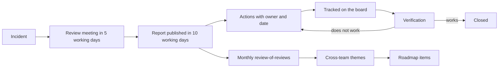

A single good postmortem teaches one team. A programme of reviews teaches the organisation: it finds themes that no single incident shows, makes sure actions get finished, and keeps the practice honest. Without a programme, reviews depend on whoever has the energy, the action items vanish into a backlog, and the process decays into a form that people fill in to satisfy a rule.

> [!info] Scope
> [[blameless-postmortems]] defines the template, the blameless principles and the timeline for one review. This note covers running reviews across many teams: triggers, cadence, facilitators, action tracking, trends and metrics. It reuses the standard's service levels unchanged rather than defining new ones.

## Why a programme

- **Consistency.** Teams apply different thresholds and quality; leaders cannot compare or learn.
- **Follow-through.** Reviews end with actions; someone must care whether the actions finish.
- **Cross-team themes.** The same contributing factor (a config change without a canary, a missing runbook) appears in separate incidents. Only a view across teams sees it.
- **Capacity.** Facilitation is a skill and a time cost. Sharing it prevents the same two people doing every review.
- **Trust.** People share honestly only if reviews are consistently blameless. A programme protects that norm. See also [[managing-conflict]] for when a review turns into a dispute.

## Severity thresholds that trigger a review

Define in advance which incidents get a review, so it is not a negotiation after the stress.

| Trigger                                                | Review                                 |
| ------------------------------------------------------ | -------------------------------------- |
| SEV1 or SEV2                                           | Always; full review                    |
| SEV3 with customer impact or an error-budget breach    | Short review; at the team's discretion |
| Near miss with high potential impact                   | Optional; encouraged                   |
| Repeated minor incidents with the same cause           | Review the pattern as one item         |
| Any incident the on-call or the manager asks to review | Yes; no justification needed           |

Tie error-budget breaches to the policy in [[error-budget-policy]], and use [[slo-burn-rate-alerting]] to define which burn events count as incidents. For the response itself see [[incident-response]].

The service levels from the standard apply unchanged: for SEV1 and SEV2 the review meeting takes place within 5 working days of the incident, and the final report is published within 10 working days. Do not invent a second set.

## Cadence and review-of-reviews

Reviews happen per incident, within the service levels. In addition, hold a **monthly review-of-reviews** across teams:

1. Sample a fixed number of reports from the month (for example, all SEV1 and SEV2 plus a random few lower-severity ones; the number is yours to set).
2. Check each against a short quality list: timeline present, contributing factors rather than a single root cause, no blame language, actions with owners and dates, customer impact stated, what went well noted.
3. Look for themes across the sample: shared contributing factors, tooling gaps, repeated runbook failures.
4. Record the themes and decide which become roadmap items, see [[planning-and-prioritization]].
5. Give feedback to the authors, privately and kindly.

Keep it to one hour. The audience is the incident commanders, facilitators and engineering managers, not the whole company.

## Facilitator pool and the facilitator's script

The owner of the incident is rarely the best facilitator, because they are close to it. A small pool of trained facilitators from outside the affected team keeps the discussion neutral. Train them by shadowing; give them a script, so quality does not depend on personality.

```text title="facilitator-agenda.txt"
Before (facilitator, 30 min)
  - Read the draft timeline. Note gaps and unclear steps.
  - Check that the attendees include those who made the key decisions.
  - Remind the owner: the review is about the system, not individuals.

Opening (5 min)
  - State the purpose: understand how the system and our practices
    allowed this, and decide what to change.
  - State the ground rules: blameless, no interrupting, no side meetings,
    questions start with "what" and "how", not "why did you".

Timeline (15 min)
  - Walk the timeline. At each decision point ask: what did you know at
    the time? what did the tools show? what options did you see?

Contributing factors (20 min)
  - List factors across: detection, response, change process, design,
    people and tools. Resist a single root cause.

What went well (5 min)
  - Name what worked: alerts, runbooks, people, luck. Keep what worked.

Actions (15 min)
  - Propose actions that change the system. For each: an owner, a date,
    a way to verify it worked, a priority.
  - Cap the list. A short list of real actions beats a long list of wishes.

Close (5 min)
  - Confirm owners and dates. Agree who publishes and when.
```

## Blame language and blameless replacements

The facilitator rewrites blame in real time. The standard has the principles; keep these replacements to hand.

| Blaming phrase                           | Blameless replacement                                               |
| ---------------------------------------- | ------------------------------------------------------------------- |
| "Ana forgot to run the migration."       | "The deploy process did not require or check the migration step."   |
| "Ben should have noticed the alert."     | "The alert was one of many that night and did not stand out."       |
| "The team was careless with the change." | "The change process had no automated check for this failure mode."  |
| "Why did you restart the database?"      | "What information led to restarting the database as the next step?" |
| "Human error caused the outage."         | "The tooling made this error easy and gave no warning."             |
| "They didn't follow the runbook."        | "The runbook was out of date or hard to find in the moment."        |

A person's action is a data point about the system. Ask what would make the safe action the easy one.

## Action item tracking and service levels

The review is wasted if actions do not finish. Track them like work.

- **Every action has an owner and a date.** No owner means no action. "The team" is not an owner.
- **One action, one verifiable outcome.** "Improve monitoring" is not an action. "Add a burn-rate alert for checkout latency, linked to the runbook" is.
- **Prioritise by effect.** Prefer actions that remove the cause class over those that detect it faster.
- **Track in the normal tracker**, with a label scheme so the programme can query it.
- **Service level for actions:** agree when high-priority actions are due (for example, a team-set number of working days) and escalate when overdue.
- **Verify, don't just close.** Someone confirms the fix works, for instance in a game day or in later incident data.

```text title="gitlab-labels.txt"
Labels for incident actions (scoped labels, GitLab):

incident::postmortem-action        # marks every action item issue
severity::sev1 | severity::sev2 | severity::sev3
action-type::prevent | action-type::detect | action-type::mitigate | action-type::process
action-status::open | action-status::in-progress | action-status::verifying | action-status::done
action-priority::p1 | action-priority::p2 | action-priority::p3
theme::<kebab-name>                # cross-team theme, set at the review-of-reviews
incident-id::<id>                  # links back to the incident ticket

Board columns: open -> in-progress -> verifying -> done
Filter for overdue: label incident::postmortem-action, due date before today, not done
```



## Cross-team themes and trend reporting

Once a quarter, look across all reports. Group contributing factors into categories: change management, capacity, dependency failure, detection gaps, runbook gaps, configuration, access. Report counts by category with the incidents behind each, not just counts. A theme becomes a roadmap item when it recurs and its fix is a platform capability: a safer rollout mechanism, a better alert, a standard runbook format. Feed the findings into [[quarterly-engineering-review]] and into the platform roadmap, see [[platform-roadmap-multi-quarter]].

Share a short digest of lessons with all engineers each quarter: three themes, one story, one thing that is changing. Anonymise as required, and keep reports accessible in a searchable place.

## Metrics that do not reward gaming

Any metric changes behaviour. Choose measures that do not make hiding incidents attractive.

- **Do not measure incident counts per team as a score.** Teams will under-report or downgrade severity.
- **Do measure the review service levels:** share of SEV1 and SEV2 reviewed within 5 working days and published within 10.
- **Action closure rate and age.** Report the share of actions closed on time and the age of open ones, with context: how many were large, how many were cancelled for good reason, what blocks the oldest. A low closure rate may mean too many low-value actions. Do not rank teams on it.
- **Repeat incidents.** Count recurrences of the same contributing factor after an action was marked done; this is the best signal of effectiveness.
- **Detection source.** The share of incidents first detected by monitoring rather than by customers.
- **Time to detect and time to recover,** read next to [[dora-metrics]] and treated as trends, not targets.
- **Participation.** Survey facilitators and attendees about whether the review felt blameless.

Watch for Goodhart effects: when closure rate becomes a target, actions get smaller and weaker; when review speed is a target, reviews get shallow. Always show the numbers with a short written reading.

## Common mistakes

- **Theatre.** A review is held, a document is filed, nothing changes. Cure: action tracking and verification.
- **Single root cause.** Looking for one cause ends the inquiry early.
- **Actions that blame in disguise.** "Retrain the engineer" and "be more careful" are not system changes.
- **Too many actions.** Twenty items means none are done. Cap them.
- **Facilitator as judge.** The facilitator guides; they do not assign fault.
- **Leaders attending to find someone responsible.** Brief leaders beforehand, and remove them if needed.
- **Ignoring people costs.** Long incidents harm people; see [[on-call-compensation-and-recovery]] for fatigue and recovery rules.
- **Publishing late.** A report two months later is a historical document.

## Sources

- [Google SRE book: Postmortem culture](https://sre.google/sre-book/postmortem-culture/): blameless postmortem practice.
- [Atlassian incident management handbook](https://www.atlassian.com/incident-management/handbook/postmortems): postmortem guidance. Check the current page before relying on it.

## Related

- [[blameless-postmortems]]
- [[incident-response]]
- [[slo-burn-rate-alerting]]
- [[error-budget-policy]]
- [[dora-metrics]]
- [[managing-conflict]]
- [[on-call-compensation-and-recovery]]
