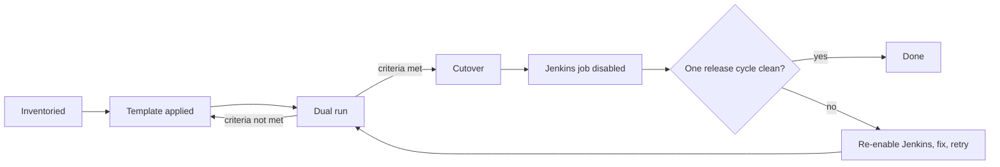

Migrating one pipeline from Jenkins to GitLab CI is a technical task. Migrating hundreds across many teams, while builds keep shipping, is a programme: it has an inventory, a sequence, staffing, communication, exceptions, a stop-the-line rule and an end date. Most failed migrations were technically fine and managerially open-ended; the old system lingered for years because nobody owned the shutdown.

> [!info] Scope
> [[gitlab-ci-vs-jenkins]] compares the tools and the technical path. This note covers how to run the migration across teams. The decision to retire a platform in general, and the post-shutdown checks, are in [[decommissioning-platform-services]]. The tool decision is recorded in [[0012-gitlab-ci-for-new-pipelines]].

## Why a programme and not a project

A project has a team and a deadline. A programme coordinates work that other teams carry out, so you depend on their capacity and priorities. Three consequences:

- **You do not own the pipelines.** Product teams do. The platform team provides templates, tooling and help; the teams do the cutover for their own repositories, with support. Compare with the ownership model in [[platform-team-operating-model]].
- **Progress is political.** Teams have roadmaps. The programme needs executive backing for the end date and an exception process, otherwise the long tail never finishes.
- **The end date is a feature.** The date the controllers are shut down, with a named owner per controller, is what keeps the effort from fading. Put it on the roadmap, see [[platform-roadmap-multi-quarter]].

## Inventory

Start with facts. For each controller list jobs, triggers, plugins, shared-library consumers, agents, credentials and downstream dependencies. Use read-only credentials, and prefer the REST API over the script console; the script console runs arbitrary code on the controller and should not be handed out for inventory. The endpoints below are examples; the JSON tree syntax and available fields depend on the Jenkins version and plugins, so check the current docs.

```bash title="jenkins-inventory.sh"
#!/usr/bin/env bash
# Read-only inventory of a Jenkins controller. Use a dedicated read-only user.
set -euo pipefail

JENKINS_URL="${JENKINS_URL:-https://jenkins.example.com}"
OUT_DIR="${OUT_DIR:-./jenkins-inventory}"
: "${JENKINS_USER:?export JENKINS_USER}"
: "${JENKINS_API_TOKEN:?export JENKINS_API_TOKEN}"

mkdir -p "$OUT_DIR"

# Note: -u puts the token in the process list; on a shared host use curl -n with a mode 600 ~/.netrc.
# Jobs: names, URLs and last result. Folder nesting may need a deeper tree.
curl -fsS -u "${JENKINS_USER}:${JENKINS_API_TOKEN}" \
  "${JENKINS_URL}/api/json?tree=jobs[name,url,color,lastBuild[number,timestamp,result]]" \
  >"${OUT_DIR}/jobs.json"

# Plugins and versions. Check the current docs for the plugin manager API.
curl -fsS -u "${JENKINS_USER}:${JENKINS_API_TOKEN}" \
  "${JENKINS_URL}/pluginManager/api/json?depth=1&tree=plugins[shortName,version,enabled]" \
  >"${OUT_DIR}/plugins.json"

jq -r '.jobs[] | [.name, (.lastBuild.result // "never"), (.lastBuild.timestamp // 0)] | @tsv' \
  "${OUT_DIR}/jobs.json" | sort > "${OUT_DIR}/jobs.tsv"
echo "Jobs: $(wc -l < "${OUT_DIR}/jobs.tsv")"
```

Complete the picture with a search of repositories for `Jenkinsfile`, references to shared libraries (see [[jenkins-shared-libraries]]), and the credentials list from the controller's credential store, noting scope and owner. The inventory will reveal dead jobs (no build for a year), which are deleted from scope after an announcement, not migrated.

## Wave planning

Do not migrate in alphabetical order. Group by risk and by learning value.

| Wave              | Who                                              | Goal                                               | Exit criterion                                     |
| ----------------- | ------------------------------------------------ | -------------------------------------------------- | -------------------------------------------------- |
| 0: Pilot          | Two or three willing, representative repos       | Prove templates, runners and the cutover checklist | Dual-run exit criteria met; docs corrected         |
| 1: Early adopters | Teams that volunteered, varied stacks            | Harden templates, find missing plugin replacements | No open blocker; support load acceptable           |
| 2: Main body      | Most teams, in batches sized to support capacity | Move volume                                        | Wave table shows all repos cut over or excepted    |
| 3: Long tail      | Awkward, risky or unowned pipelines              | Finish; retire or rewrite                          | Each has an owner, a date or an approved exception |

Put release-critical pipelines (production deployments, signing) in the middle, after the templates are proven but before the deadline pressure. Never make the last week the first time a critical pipeline moves. Build the shared pipeline templates first, see [[gitlab-ci-pipeline-structure]], and size the runner capacity for the extra load, see [[gitlab-runners-on-gke]].

## Capacity and team sequencing

Count the platform team's hours honestly: office hours, review of migrated pipelines, template changes, runner work and incidents. Decide how many repositories can be supported per week and set the wave size to that. Ask each product team for a named engineer and a time window; do not rely on "when you have time". Where a team cannot take part, record an exception with a date, see below. Track the cross-team dependencies explicitly, per [[cross-team-dependencies]].

## Parallel run and comparison criteria

Run the new pipeline alongside the old one, with the old one still authoritative, until both produce the same results. Set the criteria in advance.

- Artifact digests match for N consecutive releases, where N is set by the team (for reproducible builds). Where builds are not bit-for-bit reproducible, compare contents, versions and metadata.
- Test results match, and the set of tests executed is the same.
- Deployment behaviour matches in a non-production environment.
- Build duration and failure rate are within an agreed range.
- Secrets used are the new ones, scoped to the new project.

When the criteria are met, the old job is switched off in the per-repo cutover. For artifact handling during the overlap, keep one source of truth for promotion, see [[artifact-promotion-artifactory]].

## Per-repo cutover checklist

```markdown title="cutover-checklist.md"
## Cutover: <repository>

- [ ] Pipeline merged using the shared templates; no copied Jenkins logic left
- [ ] Triggers recreated (webhooks, schedules, upstream/downstream)
- [ ] Credentials re-created as GitLab CI/CD variables or via OIDC; none copied in clear text
- [ ] Dual-run exit criteria met for N releases (N: ____)
- [ ] Release owner and on-call told of the cutover date
- [ ] Jenkins job disabled (not deleted); note the date and the reason in the job description
- [ ] Rollback: how to re-enable the Jenkins job, and who decides
- [ ] After one release cycle: confirm no builds on Jenkins; mark row done in the tracker
```



## Tracking dashboard

Keep a single tracker (a spreadsheet, issue board or small page) with fields only; avoid long prose. One row per repository or pipeline.

| Field               | Example                                                                 |
| ------------------- | ----------------------------------------------------------------------- |
| Repository          | `payments-api`                                                          |
| Owning team         | payments                                                                |
| Wave                | 2                                                                       |
| Status              | not started / template applied / dual run / cut over / done / exception |
| Cutover date        | planned or actual                                                       |
| Dual-run releases   | 3 of N                                                                  |
| Blockers            | missing plugin equivalent                                               |
| Credentials rotated | yes / no                                                                |
| Exception expiry    | date or none                                                            |

Report counts per status weekly using the style in [[stakeholder-communication]]: one chart, three risks, one ask.

## Communication and the exception process

Announce the plan early: the wave schedule, the support model, the end date, and what teams must do. Repeat reminders at 90, 60 and 30 days before each wave and before the controller shutdown. Keep a public channel for questions and a short FAQ.

Some pipelines cannot move in time. Allow exceptions, but make them expensive to ignore:

- the team files a request with the reason, the plan and a date;
- the programme owner approves, with the engineering manager informed;
- every exception expires; an unrenewed exception becomes an escalation;
- exceptions are listed in the programme report.

## Retirement gate and credential rotation

The gate is a checklist that must pass before a controller is shut down:

1. No builds on the controller in the last N days (team-defined).
2. Every row in the tracker is done, or has an approved exception that does not depend on this controller.
3. Archived data: job configurations, build history that must be kept, and audit-relevant logs are exported and recorded, see [[decommissioning-platform-services]].
4. Every credential that Jenkins held is rotated or revoked: cloud keys, registry tokens, SSH keys, webhook secrets, API tokens. Use [[leaked-credential-rotation]] as the method, since a controller's credential store is a concentrated secret.
5. Agents, disks and network rules are scheduled for removal and the cost removal is verified.
6. A named owner and date exist for each controller's shutdown.

Hardening the controllers while they remain, see [[jenkins-controller-and-agent-hardening]], is worth the effort: migrations run longer than planned, and the controllers are exposed throughout.

## Risks and rollback

| Risk                                       | Mitigation                                                     |
| ------------------------------------------ | -------------------------------------------------------------- |
| Missing plugin features                    | Catalogue in the inventory; design replacements in wave 0 or 1 |
| Hidden dependencies (jobs triggering jobs) | Inventory triggers; test downstream effects in dual run        |
| Runner capacity shortfall                  | Load test; autoscaling limits; stagger waves                   |
| Migration fatigue and stalled long tail    | End date, exception expiry, executive sponsor                  |
| Regression in production releases          | Dual run, release freeze rules, tested rollback                |
| Leaked or copied secrets                   | Re-create, do not copy; rotate at the gate                     |

Rollback is local and simple while the gate has not passed: the Jenkins job stays disabled, not deleted, so re-enabling it is one action. Deleting jobs and the controller happens only after the gate. After the gate, rollback means rebuilding from the archive, which is why the gate is strict.

## Sources

- [GitLab CI/CD documentation](https://docs.gitlab.com/ci/): pipelines, runners and migration guidance. Check the current docs for the Jenkins migration page path.
- [Jenkins documentation](https://www.jenkins.io/doc/): remote access API and administration. Check the current docs for your version.

## Related

- [[gitlab-ci-vs-jenkins]]
- [[jenkins-controller-and-agent-hardening]]
- [[jenkins-shared-libraries]]
- [[gitlab-ci-pipeline-structure]]
- [[gitlab-runners-on-gke]]
- [[leaked-credential-rotation]]
- [[stakeholder-communication]]
- [[cross-team-dependencies]]
- [[decommissioning-platform-services]]
- [[0012-gitlab-ci-for-new-pipelines]]
