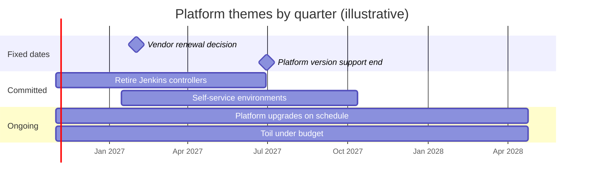

A platform team that plans only one quarter at a time is reactive: it cannot show leadership why a three-quarter migration needs to start now, and it cannot warn product teams about a change that lands in nine months. A twelve to eighteen month roadmap fixes that, provided it is honest about uncertainty. It is a set of outcomes with decreasing confidence, not a Gantt chart of promises.

> [!info] Scope
> [[quarterly-engineering-review]] covers the Now/Next/Later view and the quarterly review meeting. This note covers the longer view that feeds it: how to build themes, set capacity bands, map dependencies, state confidence and change the roadmap without losing trust. For ranking individual items use [[planning-and-prioritization]].

## Outcomes, not features

A roadmap line that says "Build a deployment portal" commits you to a solution. A line that says "Product teams can ship a new service to production in a day without a platform ticket" commits you to a result, leaves room to learn, and can be measured.

Write every theme as: outcome, metric, baseline, target and date. Choose metrics from data you already have; the delivery measures in [[dora-metrics]] are a good source, as are ticket counts and onboarding time. Where you are not sure the problem is real, run discovery first, see [[platform-product-discovery]], and put only the discovery in the near horizon.

## Themes and capacity bands

Group work into three to five themes for the whole period. More than five themes means no priorities.

Reserve capacity bands per theme so urgent work does not eat everything. A common starting split is a majority for committed outcomes, a smaller band for reliability and toil reduction, and a small band for unplanned work. The numbers below are illustrative only; derive yours from last year's actual time split, and revisit each quarter.

| Band                     | Share of capacity (illustrative) | Examples                                          |
| ------------------------ | -------------------------------- | ------------------------------------------------- |
| Committed outcome themes | 60%                              | Migration, self-service, golden path improvements |
| Reliability and toil     | 25%                              | Alert hygiene, upgrades, toil budget work         |
| Unplanned and support    | 15%                              | Incidents, urgent requests, interrupts            |

If your support and incident load is 30% in practice, a roadmap that assumes 15% is fiction. See [[toil-budget]] for measuring that load.

## Inputs

A roadmap is assembled from known sources. Collect them before drafting:

- **Discovery results:** bets with a "build" decision, from [[platform-product-discovery]].
- **End-of-life calendar:** forced work with fixed dates, see [[end-of-life-tracking-platform-versions]].
- **Debt register:** high-interest items from [[tech-debt-management]].
- **Vendor renewals:** dates where a tool decision must be made, see [[engineering-budget-planning]].
- **Incident and postmortem themes:** repeating contributing factors.
- **Company goals:** what leadership has stated for the period.

Keep fixed-date items visibly separate from estimates. A support deadline is not a forecast; it is a constraint, and the roadmap should show it as one.

## Dependency mapping

For each theme list what it needs from other teams (security review, network changes, a data team's schema) and what other teams need from it. Missed dependencies are the main cause of quiet slippage. Record them in the roadmap table and manage them using [[cross-team-dependencies]]: name an owner on both sides and agree a date, not an intention.

## Confidence by horizon

State confidence by horizon so readers do not treat month fourteen like month two.

| Horizon        | Detail level                           | Confidence              |
| -------------- | -------------------------------------- | ----------------------- |
| 0 to 3 months  | Epics with owners and dates            | High; we plan to hit it |
| 3 to 9 months  | Outcomes with rough sizes              | Medium; dates move      |
| 9 to 18 months | Themes and fixed-date constraints only | Low; direction only     |

## The roadmap table

One table is the source of truth. Keep it in the repository next to the team charter so changes are reviewed and dated.

| Theme                         | Outcome                            | Metric (baseline to target)            | Horizon  | Confidence | Dependencies                        | Owner     |
| ----------------------------- | ---------------------------------- | -------------------------------------- | -------- | ---------- | ----------------------------------- | --------- |
| Retire Jenkins controllers    | All services build on GitLab CI    | Jobs on Jenkins: current count to zero | Q1 to Q3 | Medium     | Security (credential rotation)      | Team lead |
| Self-service environments     | New service in production in a day | Median lead time for a new service     | Q2 to Q4 | Medium     | Network team (DNS), discovery       | Staff eng |
| Platform upgrades on schedule | No component past end of support   | Components past EOL: current to zero   | Ongoing  | High       | Product teams (maintenance windows) | SRE lead  |
| Toil under budget             | Team toil within the agreed cap    | Toil share of time, quarterly          | Ongoing  | Medium     | None                                | Team lead |

Add a "Fixed dates" section under it with items such as support end dates and contract renewals, each with its source link, never mixed with estimates.



The dates in the chart are examples. Replace them with your own and keep fixed dates as milestones, not bars.

## The cut line

Most roadmaps are over-full. Draw an explicit line: everything above it is funded by the capacity bands, everything below it is not planned. Show the line to stakeholders so the conversation becomes "what do we trade?" and not "why can't you do both?". Items below the line are not promises, and it is better to say that than to hide them.

## Worked theme: retire Jenkins controllers

Outcome: all builds run on GitLab CI and the Jenkins controllers are shut down by a stated date. Metric: number of active Jenkins jobs, plus credentials still held by Jenkins. Inputs: the plugin and EOL calendar, vendor support renewal, and the incident history of controller outages. The theme breaks into inventory, a pilot wave, early adopters, the long tail and a retirement gate, each with its own confidence. The programme mechanics are in [[jenkins-to-gitlab-migration-programme]], and the technical comparison is in [[gitlab-ci-vs-jenkins]]. On the roadmap it appears as one theme with three to four quarterly milestones, not 40 repository tasks.

## Changing the roadmap without losing trust

The roadmap will change. Trust is lost when changes are silent, not when they happen. Publish a change log with the roadmap and announce meaningful changes in the same channel as the roadmap.

```markdown title="roadmap-change-log.md"
## 2026-10-19: Moved "Self-service environments" from Q2 to Q3

**Why:** Discovery found data seeding is harder than assumed; two pilot teams
need a database snapshot process first.
**What it replaces in Q2:** Additional capacity for the Jenkins retirement theme.
**Who is affected:** Product teams waiting for preview environments; they
keep using the shared staging environment.
**Confidence change:** Medium to Low for the new date.
**Decision owner:** Team lead, agreed with the engineering manager.
```

Review the roadmap monthly for changes and quarterly for themes. Re-state the fixed-date list at each review.

## Failure modes

- **Feature list in disguise.** Themes without outcomes or metrics.
- **False precision.** Exact dates in month twelve.
- **No capacity model.** The sum of the plan exceeds what the team can do.
- **Hidden dependencies.** The security review is not scheduled.
- **No cut line.** Everything is a priority.
- **Silent edits.** The roadmap changes without a log, and stakeholders stop believing it.
- **Ignoring fixed dates.** A forced upgrade arrives as an emergency instead of a planned theme.

## Sources

- [DORA research programme](https://dora.dev/): delivery performance metrics for outcome measures. Check the current guidance on the site.

## Related

- [[quarterly-engineering-review]]
- [[planning-and-prioritization]]
- [[cross-team-dependencies]]
- [[tech-debt-management]]
- [[engineering-budget-planning]]
- [[platform-product-discovery]]
- [[end-of-life-tracking-platform-versions]]
- [[jenkins-to-gitlab-migration-programme]]
