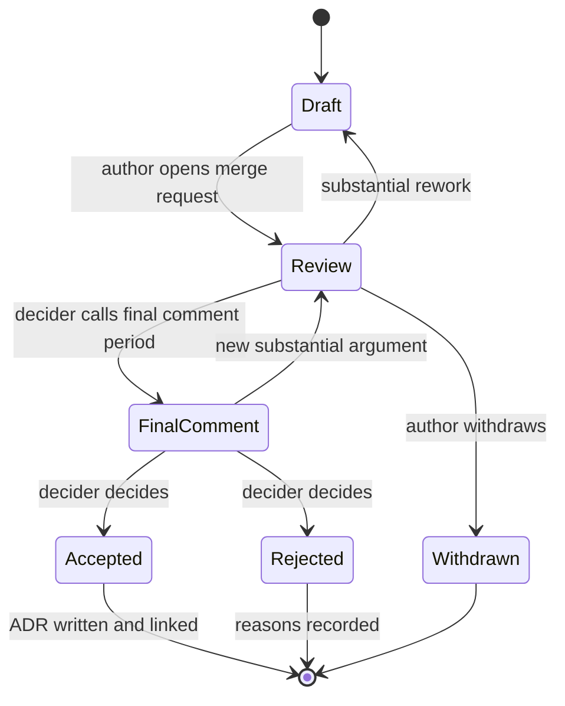

Platform changes affect teams who did not ask for them: a new ingress controller, a CI template rewrite, a change to how secrets reach pods. Without a process, these changes are either decided in a hallway and announced as done, or debated in a chat thread for six weeks until whoever is most senior, or most persistent, wins. An RFC (request for comments) process gives a proposal a fixed shape, a fixed review window and one named person who decides. The decision itself is then recorded as an ADR ([[adr/index|the ADR index]]), so the RFC is the conversation and the ADR is the outcome.

> [!info] Scope and what is not verified
> This is a team practice, not a standard; the timeboxes and thresholds below are examples to set locally. GitLab Code Owners (used for required reviewers) is a Premium and Ultimate feature per the GitLab docs read on 2026-10-21; approval rules on other tiers were **not verified**. The Kubernetes KEP and Rust RFC processes are linked as public examples only; their details change, so read them at the source.

## When an RFC is required

An RFC costs the author a day or two and the reviewers an hour each. Ask for one only when a wrong decision is expensive to reverse or affects people outside the team.

| Trigger                                                                                           | RFC?                  | Example                                                     |
| ------------------------------------------------------------------------------------------------- | --------------------- | ----------------------------------------------------------- |
| Changes a contract other teams depend on (API, CI template major version, chart values)           | Yes                   | New major version of the central CI templates               |
| Introduces or retires a platform tool or managed service                                          | Yes                   | Replace the ingress controller; retire the old registry     |
| Changes the security model or a trust boundary                                                    | Yes                   | Move CI to keyless auth; change how secrets reach workloads |
| Expected cost change above a threshold you set (for example a few percent of the platform budget) | Yes                   | A new observability backend                                 |
| Needs more than one team to change their repositories                                             | Yes                   | A fleet-wide migration ([[fleet-wide-change-campaigns]])    |
| Reversible within a day, inside one team's own systems                                            | No: a merge request   | Tune autoscaler settings on a platform-owned cluster        |
| Already covered by an accepted ADR or standard                                                    | No: follow the record | Add another service to an existing golden path              |
| Incident remediation needed now                                                                   | No: fix, then record  | Write the ADR afterwards if the fix changes a design        |

When in doubt, write a half-page "pre-RFC" in the team channel and ask whether it needs the full process. The cost of asking is low.

## Lifecycle



- **Draft.** The author writes alone or with one or two collaborators. Not yet open for comment from everybody.
- **Review.** The merge request is open, required reviewers are assigned, and the review window starts. Discussion happens on the merge request, not in chat, so it stays with the proposal.
- **Final comment period.** The decider states the intended outcome ("accept with the changes in comment X", "reject because Y") and opens a short last window. The Rust RFC process uses the same idea: a motion for final comment period with a disposition, which is cancelled and returned to discussion if substantial new arguments appear. Rust's period is ten calendar days; choose your own, for example five working days.
- **Decided.** Accepted, rejected or withdrawn. Accepted RFCs produce an ADR; rejected ones keep their reasons, which saves the next person from proposing the same thing without new facts.

## Roles

| Role               | Who                                                                                       | Responsibility                                                                          |
| ------------------ | ----------------------------------------------------------------------------------------- | --------------------------------------------------------------------------------------- |
| Author             | Anyone, inside or outside the platform team                                               | Writes the RFC, answers comments, updates the text (not only the thread)                |
| Decider            | **One** named person, usually the owner of the affected area or the platform lead         | Calls the final comment period and makes the decision. Not a committee.                 |
| Required reviewers | Named per area: security, SRE, a representative consuming team, finance for cost triggers | Review within the window; say "approve", "approve with conditions" or "object, because" |
| Scribe             | Anyone except the author, for the live review                                             | Writes the decision record and open questions into the merge request                    |

One decider matters more than anything else in this note. Consensus is the goal, but when it does not come, the decider decides and writes down why, and objections are recorded rather than resolved by attrition. Disagreement on the people side is covered in [[managing-conflict]].

## RFC template

The template asks the questions that otherwise come up in week three of a thread. It borrows from the Kubernetes KEP template, which makes production readiness, rollout and rollback first-class sections, not an afterthought.

```markdown title="rfcs/0000-template.md"
# RFC NNNN: <short title>

Status: draft
Author: @handle
Decider: @handle
Required reviewers: @security-handle, @sre-handle, @consumer-team-handle
Review window ends: YYYY-MM-DD
Related: <issues, ADRs, prior RFCs>

## Context

What is true today, with numbers. Why this matters now.

## Goals and non-goals

Goals: what success looks like, measurably.
Non-goals: what this RFC deliberately does not solve.

## Proposal

The design. Diagrams welcome. Enough detail that a reviewer could spot
a mistake, not a full implementation spec.

## Alternatives considered

At least two, one of which is "do nothing". For each: why not.

## Rollout and rollback

Phases, who changes what and when, how consumers migrate,
how we go back at each phase, and when going back stops being possible.

## Security and threat model

New trust boundaries, credentials, data flows. Link a threat model if one exists.

## Cost

Run cost, licence cost and engineering time, now and in a year.

## Operability

Who is on call for it, what alerts and dashboards exist on day one,
which runbooks are needed, what the failure modes are.

## Open questions

## Decision

Filled in by the decider: outcome, date, conditions, and the ADR link.
```

The security section feeds [[platform-threat-modelling]]; the operability section is the early version of [[production-readiness-review]], which the change still passes before launch. If the RFC changes or removes an interface, the deprecation rules in [[api-deprecation-policy]] apply.

## Docs as code: storage and review

Keep RFCs in a repository as Markdown, numbered, one file per RFC (`rfcs/0007-keyless-ci-auth.md`). Review them through merge requests, exactly as code is reviewed ([[code-review]]).

- **Required reviewers.** On GitLab Premium or Ultimate, a `CODEOWNERS` file can require approval from named owners per path, but only when the target branch is protected and "Require approval from code owners" is enabled. A path with no matching rule needs no Code Owner approval, so put a default `*` entry at the top. GitLab also warns that users allowed to push and merge directly can skip the merge request and so skip Code Owner approval: do not give that permission on the RFC repository.
- **On the Free tier,** use the template's `Required reviewers` line and the lint below, and have the decider check approvals before calling the final comment period.
- **Do not squash or rewrite history** of an RFC merge request while it is under review. Rust's process asks for the same, because reviewers lose track of what changed.

```text title="CODEOWNERS"
# Default owner for everything in the RFC repository.
* @platform-leads

# The lint and the pipeline decide how review works: leads only.
/scripts/ @platform-leads
/.gitlab-ci.yml @platform-leads
```

CODEOWNERS matches paths, not topics, so it can guarantee that a platform lead approves every RFC but not that security reviews the security-relevant ones. Name those area reviewers in the RFC header, and have the decider confirm their approval before the final comment period.

A small CI job keeps the shape honest. It checks that every RFC has the required sections, a valid status and a named decider.

```bash title="scripts/lint-rfcs.sh"
#!/usr/bin/env bash
# Fails when an RFC is missing a required section, a valid status line or a decider.
set -euo pipefail

RFC_DIR="${1:-rfcs}"
REQUIRED=(
  "## Context"
  "## Goals and non-goals"
  "## Proposal"
  "## Alternatives considered"
  "## Rollout and rollback"
  "## Security and threat model"
  "## Cost"
  "## Operability"
  "## Decision"
)
STATUSES="draft|review|final-comment|accepted|rejected|withdrawn|superseded"

fail=0
shopt -s nullglob
for f in "$RFC_DIR"/[0-9][0-9][0-9][0-9]-*.md; do
  for h in "${REQUIRED[@]}"; do
    if ! grep -qxF "$h" "$f"; then
      echo "ERROR ${f}: missing section '${h}'" >&2
      fail=1
    fi
  done
  if ! grep -qE "^Status: (${STATUSES})$" "$f"; then
    echo "ERROR ${f}: missing or invalid 'Status:' line (one of ${STATUSES//|/, })" >&2
    fail=1
  fi
  if ! grep -qE '^Decider: @[A-Za-z0-9_.-]+$' "$f"; then
    echo "ERROR ${f}: missing 'Decider: @handle' line" >&2
    fail=1
  fi
done
exit "$fail"
```

The template file `0000-template.md` matches the glob too, so keep its placeholders valid (`Status: draft`, a real handle such as `@platform-leads` as decider) or rename it outside the pattern.

```yaml title=".gitlab-ci.yml"
rfc-lint:
  stage: test
  image: "${CI_TOOLS_IMAGE}" # any image with bash and grep, pinned by digest
  rules:
    - changes:
        - rfcs/**/*
        - scripts/lint-rfcs.sh
  script:
    - bash scripts/lint-rfcs.sh rfcs
```

Validate locally before pushing:

```bash
bash scripts/lint-rfcs.sh rfcs && echo "RFCs OK"
# Expected on a broken file, exit code 1:
# ERROR rfcs/0008-new-registry.md: missing section '## Rollout and rollback'
```

## Running the live review

Most RFCs never need a meeting. Hold one only when the written review has stalled or the topic is contentious, and run it so that the document, not the loudest voice, drives it.

1. **Pre-read.** The RFC is final for the meeting 48 hours before (example, set your own). Comments from the written review are answered in the text.
2. **Silent reading first.** Start with ten minutes of everyone reading the document and adding comments, even if they read it before. People who did not prepare are no longer at a disadvantage, and the discussion starts from the same text.
3. **Walk the open comments,** not the document. The author answers; the decider steers to decisions.
4. **Close with the decider.** Either "final comment period starts today, intended outcome X" or "back to draft, because Y, with these changes". No meeting ends with "let's keep discussing".
5. **The scribe writes the record** into the merge request within the day: outcome, conditions, objections and who raised them, open questions with owners.

Invite the required reviewers and at most a few others. A consuming team's representative is worth more than a fourth platform engineer; the discovery work in [[platform-product-discovery]] tells you whose voice is missing.

## Timeboxes, stale RFCs and deadlock

| Situation                                         | Rule (example values, set your own)                                                                                    |
| ------------------------------------------------- | ---------------------------------------------------------------------------------------------------------------------- |
| Review window                                     | Ten working days from the merge request opening, stated in the RFC header                                              |
| Final comment period                              | Five working days                                                                                                      |
| Required reviewer silent at the end of the window | Decider pings once; silence after two more days counts as no objection, and the record says so                         |
| RFC in Draft or Review with no activity           | After 30 days a scheduled job (not provided here) labels it stale; after 60 days it is closed as withdrawn, reopenable |
| Decider and a required reviewer cannot agree      | Escalate once, to the decider's manager or the architecture forum, with both positions in writing                      |
| Security objection on a security trigger          | Blocks until resolved or formally accepted as a risk by its owner                                                      |

Escalation is a normal path, not a failure. Put both positions in the RFC and ask the escalation owner for a decision by a date. Cross-team dependencies that block an RFC's rollout belong in [[cross-team-dependencies]].

## From RFC to ADR

The RFC is long, discursive and full of options. The ADR is short and records one decision ([[adr/template|the ADR template]]).

1. On acceptance, the author (or scribe) writes the ADR: context in a paragraph, the decision, consequences, alternatives in one line each, and a link to the RFC merge request.
2. The ADR goes through its own short review and merges with status `accepted`.
3. The RFC's `Decision` section links the ADR. The RFC file is then frozen apart from status and links.
4. Rejected RFCs do not produce an ADR unless the rejection itself is a decision others need, for example "we will not run our own service mesh".

ADRs capture a single decision and its rationale, and the collection forms the decision log; that is why the long RFC and the short ADR are worth keeping separately.

## Measuring the process

Track a few numbers, quarterly, in the [[quarterly-engineering-review]]:

- **Lead time to decision**: merge request opened to Decision filled in. Rising lead time means reviewers are overloaded or deciders avoid deciding.
- **Share decided in the window**: RFCs decided before their stated review window ended.
- **Outcome mix**: accepted, rejected, withdrawn. An RFC process where everything is accepted is a rubber stamp; one where most are withdrawn is too costly.
- **Who writes RFCs**: if only the platform lead writes them, the process is a broadcast channel, not a review.
- **Reversals**: accepted RFCs later superseded within a year, as a rough signal of decision quality, not a target.

```bash title="rfc-lead-time.sh"
# Lead time per accepted RFC from git history: first commit of the file to the
# commit that set "Status: accepted". Run in the RFC repository.
for f in rfcs/[0-9][0-9][0-9][0-9]-*.md; do
  grep -qx "Status: accepted" "$f" || continue
  first="$(git log --diff-filter=A --format=%as -- "$f" | tail -1)"
  decided="$(git log -S'Status: accepted' --format=%as -- "$f" | tail -1)"
  echo "${f}  opened ${first}  accepted ${decided}"
done
```

## Common mistakes

- **No named decider.** The RFC waits for consensus that never arrives. Name the decider in the header before review starts.
- **RFCs for everything.** People stop reading them, or route around the process. Use the trigger table.
- **Discussion in chat.** Arguments get lost and the text never changes. Point every chat thread back to the merge request.
- **Decided before written.** An RFC written after the work started is a press release. If the decision was made, write an ADR and be honest about it.
- **No "do nothing" alternative.** Without it, nobody checks whether the problem is worth solving.
- **Rollback missing.** The section that saves you most often is the one most often left as "revert the change". Ask how, and until when.
- **Silent reviewers treated as approval forever.** Say in the rule how long silence counts, and record it.

## Sources

- [GitLab: Code Owners](https://docs.gitlab.com/user/project/codeowners/): tiers, file locations, protected-branch requirement and the push-and-merge caveat.
- [Kubernetes Enhancement Proposals](https://github.com/kubernetes/enhancements/blob/master/keps/README.md): when a KEP is required and the KEP template, as a public example.
- [Rust RFCs](https://github.com/rust-lang/rfcs/blob/master/README.md): the final comment period and the advice not to rewrite history during review, as a public example.
- [Architectural Decision Records](https://adr.github.io/): ADR definition and the decision log.
- [Documenting Architecture Decisions, Michael Nygard](https://cognitect.com/blog/2011/11/15/documenting-architecture-decisions.html): the original ADR post.

## Related

- [[adr/index|ADR index]] and [[adr/template|ADR template]]: where decisions end up.
- [[stakeholder-communication]]: announcing the decision to the people it affects.
- [[managing-conflict]]: when the disagreement is between people, not designs.
- [[platform-threat-modelling]] and [[production-readiness-review]]: the security and operability follow-ups.
- [[api-deprecation-policy]]: rules for changes that remove or change interfaces.
- [[code-review]]: review norms that apply to RFC merge requests too.
- [[cross-team-dependencies]]: rollouts that need other teams.
- [[platform-product-discovery]]: finding the consumers who should review.
- [[security-champions-programme]]: champions as reviewers for their teams.
