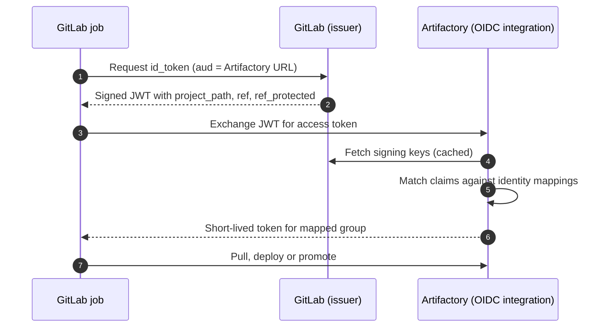

The common starting point is one Artifactory admin user, or one long-lived API key, stored as a CI variable and shared by every pipeline. Any job in any project, on any branch, can then read, overwrite and delete anything, and one leaked log line compromises the whole artefact store. The goal here: each pipeline type gets **only the permissions it needs**, for **only as long as it needs them**, and the credential is **minted per job** where possible.

> [!info] Not checked against live docs
> The OIDC integration and identity-mapping API names, token expiry limits, token scope syntax and which JFrog editions support OIDC were not checked against the live documentation. Check the current JFrog Platform administration documentation before copying any REST call, and confirm that your edition and hosting model support OIDC integrations. Command names for the JFrog CLI should be confirmed with `jf --help` on the version your runners use.

## The permission model

Artifactory authorises through three pieces:

- **Users and groups.** Identities. Use groups as the unit of access, never individual users.
- **Permission targets.** A set of repositories, include and exclude path patterns, and the actions granted to groups: read, annotate, deploy or cache, delete or overwrite, manage.
- **Access tokens.** Credentials bound to a user or scoped to a group, with an expiry and an optional audience.

Design principle: separate **reading dependencies** from **writing artefacts** from **promoting artefacts**, because those are different risks. This matches the build once, promote later layout in [[artifact-promotion-artifactory]].

## Identities per pipeline type

| Group             | Repositories                          | Actions                     | Who can use it                       |
| ----------------- | ------------------------------------- | --------------------------- | ------------------------------------ |
| `ci-read`         | virtual repositories for dependencies | read                        | every pipeline, including MR jobs    |
| `ci-deploy-dev`   | `*-dev-local`                         | read, deploy (no overwrite) | branch and MR pipelines in the group |
| `ci-promote-prod` | `*-staging-local`, `*-prod-local`     | read, deploy, annotate      | protected branches and tags only     |
| `ci-cleanup`      | cache and snapshot repositories       | delete                      | scheduled maintenance pipeline only  |
| `platform-admin`  | all                                   | manage                      | humans, through SSO, never CI        |

Rules of thumb:

1. Merge request pipelines, especially from forks, get `ci-read` at most. A job that runs code from an untrusted contribution must never hold a deploy credential.
2. Deploy to dev does not grant overwrite or delete. Immutability of released versions is a property of the repository settings and the permission target.
3. The group that can write to the production repository is reachable only from protected refs. Section on OIDC below shows how to enforce that on the Artifactory side, not just in GitLab.

## Short-lived access tokens

If OIDC is not available, mint a token per pipeline from a long-lived bootstrap credential kept outside the project, or at least use scoped tokens with a short expiry.

```bash title="create-scoped-token.sh"
set -euo pipefail
: "${ARTIFACTORY_URL:?}" "${ADMIN_TOKEN:?}"

# Field names and scope syntax: check the current JFrog access token REST documentation.
curl -fsS -X POST "${ARTIFACTORY_URL}/access/api/v1/tokens" \
  -H "Authorization: Bearer ${ADMIN_TOKEN}" \
  -d "username=ci-deploy-dev" \
  -d "scope=applied-permissions/groups:ci-deploy-dev" \
  -d "expires_in=3600" \
  -d "refreshable=false" \
  -d "description=gitlab pipeline ${CI_PIPELINE_ID:-manual}"
```

Practical guidance:

- Expiry slightly above the longest expected job. Non-refreshable.
- Description carries the pipeline ID so audit logs map a token to a run.
- List and revoke by description or ID in the incident procedure ([[leaked-credential-rotation]]).
- The bootstrap credential that can mint tokens is itself the most sensitive secret you have. Keep it in the secret manager used by a dedicated broker job, not in project variables.

## OIDC from GitLab CI

OIDC removes the stored secret altogether. GitLab issues a signed JWT for the job, Artifactory validates it against GitLab's published keys, applies an **identity mapping** that matches claims, and returns a short-lived Artifactory token for a mapped user or group. It is the same idea as keyless cloud authentication in [[iam-groups-and-ci-workload-identity-federation]] and [[0026-keyless-ci-auth-with-workload-identity-federation]].



### The GitLab job

```yaml title=".gitlab-ci.yml"
promote-prod:
  stage: release
  image: releases-docker.jfrog.io/jfrog/jfrog-cli-v2-jf:latest
  id_tokens:
    ARTIFACTORY_ID_TOKEN:
      aud: https://artifactory.example.com
  variables:
    JF_URL: https://artifactory.example.com
    OIDC_PROVIDER_NAME: gitlab-ci
  script:
    - >
      jf eot "${OIDC_PROVIDER_NAME}" "${ARTIFACTORY_ID_TOKEN}"
      --oidc-audience "https://artifactory.example.com"
    - jf rt ping
    - jf rt build-promote "${CI_PROJECT_NAME}" "${CI_PIPELINE_ID}" prod-local
  rules:
    - if: '$CI_COMMIT_TAG && $CI_COMMIT_REF_PROTECTED == "true"'
```

Do not pin a floating `latest` image tag in production pipelines; pin a version or digest ([[dockerfile-hardening]]). The exact CLI command for the exchange (shown here as `jf eot`) and its flags differ by version: confirm with `jf --help` and the CLI documentation before use.

### The identity mapping

The mapping is where least privilege is actually enforced. It must say "this claim set gets this group", and nothing broader. Illustrative claims, using GitLab's documented claim names:

```json title="identity-mapping-promote.json"
{
  "name": "gitlab-promote-prod",
  "provider_name": "gitlab-ci",
  "priority": 1,
  "claims": {
    "iss": "https://gitlab.example.com",
    "aud": "https://artifactory.example.com",
    "project_path": "platform/payments-api",
    "ref_protected": "true"
  },
  "token_spec": {
    "username": "ci-promote-prod",
    "scope": "applied-permissions/groups:ci-promote-prod",
    "expires_in": 600
  }
}
```

Field names above are illustrative; check the current JFrog docs for the real schema and for how claim matching works (exact, wildcard, regex).

Conditions to put in mappings:

| Mapping          | Claim conditions                                                                           | Result group      |
| ---------------- | ------------------------------------------------------------------------------------------ | ----------------- |
| Read             | `iss`, `aud`, `namespace_path` is your group                                               | `ci-read`         |
| Deploy to dev    | `project_path` is a known project, any ref                                                 | `ci-deploy-dev`   |
| Promote and prod | `project_path` known, `ref_protected == "true"`, and `ref` matching release tags or `main` | `ci-promote-prod` |

The `ref_protected` condition is what stops an arbitrary branch from promoting. A mapping that matches on `project_path` alone means any developer who can push a branch can mint a production-capable token.

## Jenkins

Jenkins has no built-in per-job JWT that Artifactory trusts the same way, unless you install an OIDC provider plugin for it. Check the current plugin options before choosing that route. Without it:

- Store tokens as **folder-scoped credentials**, not global credentials, so only jobs in that folder can bind them. One folder per team, one credential per permission level.
- Bind with `withCredentials` so Jenkins masks the value, and never `echo` it or pass it on a command line that shows up in the process list.
- Keep the deploy token only on the controller-managed credential store of the folder that builds protected branches. Multibranch jobs for pull requests use the read credential.
- Rotate on a schedule, and on any change of folder ownership.

Agent and controller hardening is in [[jenkins-controller-and-agent-hardening]].

## Protect the credentials in GitLab

For anything that is not OIDC:

- Mark variables **masked** (hides the value in logs when it matches) and **protected** (available only to protected branches and tags).
- Scope variables to environments when the CI tier allows it, so production credentials never appear in a dev job.
- Do not write tokens into files committed to the repository, artefacts or cache.
- Disable debug tracing (`CI_DEBUG_TRACE`) on pipelines holding credentials, because it can print variable values.

Structure for the pipeline layout lives in [[gitlab-ci-pipeline-structure]].

## Rotation and revocation

| Credential              | Rotation                                    | Revocation                                             |
| ----------------------- | ------------------------------------------- | ------------------------------------------------------ |
| OIDC-minted token       | Not needed; expires in minutes              | Remove or disable the identity mapping                 |
| Scoped token (minted)   | Expires with the job                        | Revoke by ID; list by description                      |
| Stored read token       | Regular schedule, and on suspected exposure | Revoke, issue a new one, update the variable           |
| Bootstrap/minting token | Shortest schedule you can keep up with      | Revoke immediately on exposure; audit tokens it minted |

After any exposure: revoke, review the Artifactory audit and request logs for the token's use, and check for artefacts deployed or overwritten in the window. The full procedure is [[leaked-credential-rotation]].

## Failure modes

- **Token expires mid-pipeline.** Long builds with a short expiry fail on the deploy step. Mint the token in the job that uses it, not in an early stage that other jobs inherit, and size expiry to the job.
- **Over-broad mapping.** Wildcard `project_path` or missing `ref_protected` lets any branch deploy. Test with a negative case (below).
- **Token in logs.** Masking only hides exact matches; a base64 or URL-encoded form leaks. Pass tokens through stdin or an env var consumed by the tool, and never `set -x` around the call.
- **Clock or issuer drift.** Validation fails after a GitLab URL or key change. Alert on failed exchanges.
- **One shared mapping for everything.** Defeats the point; the first compromised MR job holds the prod group.
- **Artifactory unavailable.** Both read and write pipelines stop. See the availability trade-off in [[artifactory-remote-repo-caching-for-ci]].

## Verify

```bash title="verify access"
# Authenticated and reachable
jf rt ping

# Positive: protected tag pipeline can promote
# Negative: the same job on an unprotected branch must be refused
git switch -c test/unprotected-oidc
git push origin test/unprotected-oidc
# Expect the exchange or the promote step to fail with 401/403 and no token minted.
```

Also confirm in the Artifactory audit log that tokens carry the expected username and short expiry, and that `ci-read` cannot deploy: try a deploy with the read credential and expect 403.

## Rollback

1. Keep the old stored credential in place, but unreferenced, until OIDC works on a canary project.
2. Migrate one project at a time: add its mapping, switch its pipeline, run the positive and negative tests.
3. If exchange fails across the fleet, restore the stored-token variable on the affected projects (revoke it again after the incident) and disable the faulty mapping.
4. Remove the old shared credential only after every project has moved, then revoke it.

## Related

- [[artifact-promotion-artifactory]]
- [[artifactory-remote-repo-caching-for-ci]]
- [[iam-groups-and-ci-workload-identity-federation]]
- [[leaked-credential-rotation]]
- [[jenkins-controller-and-agent-hardening]]
- [[gitlab-ci-pipeline-structure]]
- [[secret-rotation-without-downtime]]

## Sources

- https://jfrog.com/help/r/jfrog-platform-administration-documentation
- https://docs.jfrog-applications.jfrog.io/jfrog-applications/jfrog-cli
- https://docs.gitlab.com/ci/secrets/id_token_authentication/
