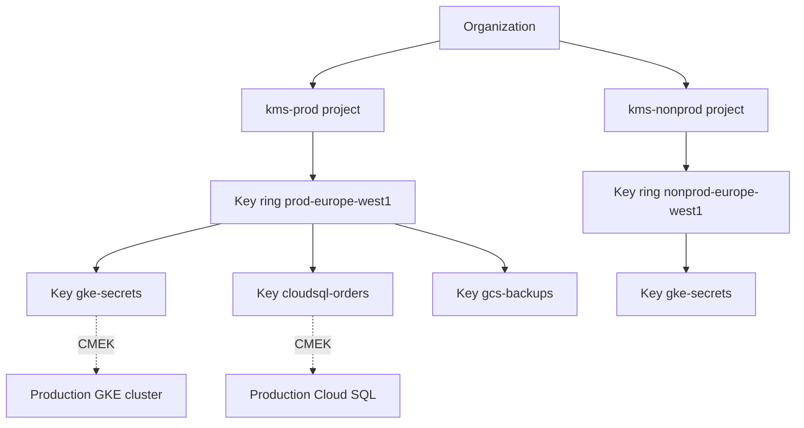

Cloud KMS holds the keys that protect other keys and data. When you use customer-managed encryption keys (CMEK), a destroyed or disabled key makes the data it protects unreadable, so key lifecycle is a reliability concern as well as a security one. This note sets out a layout, a rotation rule, a safe destroy procedure and the guardrails around them.

> [!info] Scope and what is not verified
> The commands and Terraform follow the `gcloud kms` and Terraform Google provider interfaces as known; nothing here was run against a live project, and the note is not marked `verified`. Not verified, check before relying on this: the allowed values and default of the destroy-scheduled-duration, the org policy constraint names and the format of their parameters, and which key type, protection level and location each service supports for CMEK. Run `gcloud kms keys create --help` and `gcloud org-policies list-custom-constraints` or the constraint reference for your versions.

## Key rings and keys per environment

A key ring is a grouping that cannot be deleted, and key names cannot be reused once created, so plan names before creating anything. Keep the layout boring and predictable.

- **One KMS project per environment tier**, separate from the projects that use the keys (for example `kms-prod` and `kms-nonprod`). A compromise of a workload project then cannot also change its keys. See [[gcp-resource-hierarchy-and-landing-zone]].
- **One key ring per environment and location**, for example `prod-europe-west1`. A key can only protect resources in a matching location, so the ring location follows the resource location.
- **One key per purpose**: `gke-secrets`, `cloudsql-orders`, `gcs-backups`. Do not share one key across unrelated services; revoking one use then breaks nothing else.
- **Never reuse a key between production and non-production.**



Create the key ring and a key with a 90 day rotation period. Variables go first; change each marked value.

```bash
# CHANGE: project that owns the keys, location, ring and key names.
KMS_PROJECT=kms-prod-example
LOCATION=europe-west1
RING=prod-europe-west1
KEY=gke-secrets

gcloud kms keyrings create "$RING" \
  --project "$KMS_PROJECT" \
  --location "$LOCATION"

# The first rotation is 90 days from now (GNU date; on macOS use: date -u -v+90d +%Y-%m-%dT%H:%M:%SZ).
NEXT_ROTATION="$(date -u -d '+90 days' +%Y-%m-%dT%H:%M:%SZ)"

gcloud kms keys create "$KEY" \
  --project "$KMS_PROJECT" \
  --location "$LOCATION" \
  --keyring "$RING" \
  --purpose encryption \
  --rotation-period 90d \
  --next-rotation-time "$NEXT_ROTATION"
```

Manage the same objects in Terraform and keep the state layout from [[terraform-module-and-state-layout]]: the KMS project gets its own state so that a mistake in an application stack cannot touch a key.

```hcl title="kms.tf"
resource "google_kms_key_ring" "env" {
  project  = var.kms_project
  name     = "prod-europe-west1"
  location = "europe-west1"
}

resource "google_kms_crypto_key" "gke_secrets" {
  name            = "gke-secrets"
  key_ring        = google_kms_key_ring.env.id
  purpose         = "ENCRYPT_DECRYPT"
  rotation_period = "7776000s" # 90 days

  # Set at creation and not changeable afterwards (not verified); 30 days here.
  destroy_scheduled_duration = "2592000s"

  version_template {
    algorithm        = "GOOGLE_SYMMETRIC_ENCRYPTION"
    protection_level = "SOFTWARE" # CHANGE to HSM if your policy requires it.
  }

  lifecycle {
    prevent_destroy = true # a key must never be removed by an accidental plan
  }
}
```

`rotation_period` in Terraform is in seconds; 7,776,000 seconds is 90 days. Destroying a `google_kms_crypto_key` in Terraform removes it from state and schedules every key version for destruction (check the provider documentation for your version). Once the scheduled period ends, the key is unusable and the data it protects is lost. `prevent_destroy` guards the plan, not the API.

## Rotation

Automatic rotation creates a new key **version** and makes it the primary on the schedule you set. New data is encrypted with the new primary. Rotation limits how much data one version protects and how long a leaked version stays useful.

> [!warning] Rotation does not re-encrypt existing data
> Data already encrypted stays under the version that encrypted it. The old version must remain enabled to decrypt it. Rotation is not a cure for a leaked key: if a version is compromised, you must re-encrypt the data under a new version and then disable and destroy the old one. How re-encryption works depends on the service (Cloud SQL, GKE, Cloud Storage objects, your own application envelopes).

A rotation period is a floor on hygiene, not a compliance claim. Some frameworks set their own limits; confirm with your auditors ([[audit-evidence-collection-and-retention]]).

To rotate by hand, for example after a suspected exposure, create a version and make it primary.

```bash
gcloud kms keys versions create \
  --project "$KMS_PROJECT" --location "$LOCATION" \
  --keyring "$RING" --key "$KEY" \
  --primary
```

If your `gcloud` version does not accept `--primary` on this command, create the version and then run `gcloud kms keys set-primary-version`. Check `--help`.

## Disable and destroy with a scheduled duration

Destroying a key version makes everything encrypted by it permanently unreadable. KMS protects you with a **scheduled destruction** period: a destroyed version first moves to a pending state and can be restored until the period ends. Never destroy in one step if you can avoid it.

Follow the same order every time.

1. **Re-encrypt or retire the data** that uses the version. Confirm with usage tracking and the service's own tooling that nothing still depends on it.
2. **Disable the version** and wait. Watch for decryption errors, failed backups and failing pods for a full cycle (at least a week, longer if you have monthly jobs).
3. **Schedule destruction.** The version moves to `DESTROY_SCHEDULED`.
4. **Restore it** if anything breaks during the scheduled period.
5. **Let the period end.** The key material is destroyed and cannot be recovered.

```bash
VERSION=1   # CHANGE: the version number you retire

# 1. Disable; this is reversible with "enable"
gcloud kms keys versions disable "$VERSION" \
  --project "$KMS_PROJECT" --location "$LOCATION" \
  --keyring "$RING" --key "$KEY"

# 2. If anything breaks, bring it back
gcloud kms keys versions enable "$VERSION" \
  --project "$KMS_PROJECT" --location "$LOCATION" \
  --keyring "$RING" --key "$KEY"

# 3. After the observation period, schedule destruction
gcloud kms keys versions destroy "$VERSION" \
  --project "$KMS_PROJECT" --location "$LOCATION" \
  --keyring "$RING" --key "$KEY"

# 4. During the scheduled period, a destroy can be undone
gcloud kms keys versions restore "$VERSION" \
  --project "$KMS_PROJECT" --location "$LOCATION" \
  --keyring "$RING" --key "$KEY"
```

The length of the scheduled period is set when the key is created (the `--destroy-scheduled-duration` option on key creation, to be confirmed with `--help`) and, as far as known, cannot be changed for that key afterwards. Not verified: the allowed range, the default, and whether a different value can be set later. Set it explicitly instead of trusting the default, and enforce a minimum with org policy (next section).

> [!danger] Destruction ends recovery
> When the scheduled period ends, the key material is gone. Backups, snapshots and database replicas encrypted by that version cannot be read, by you or by Google. Treat step 3 as a change that needs approval and a second reviewer ([[production-change-checklist]]).

## IAM separation

Split who can **use** a key from who can **manage** it. Nobody holds both roles on the same key in production.

| Role                                                                   | Held by                                                  | Can do                                                                              |
| ---------------------------------------------------------------------- | -------------------------------------------------------- | ----------------------------------------------------------------------------------- |
| Key admin (`roles/cloudkms.admin`)                                     | A small security or platform group, via approved changes | Create, rotate, disable, schedule destroy; cannot use the key to encrypt or decrypt |
| Encrypter and decrypter (`roles/cloudkms.cryptoKeyEncrypterDecrypter`) | The service agent or service account that needs the key  | Encrypt and decrypt with the key; cannot change it                                  |
| Viewer (`roles/cloudkms.viewer`)                                       | Auditors, security tooling                               | List and read metadata; no key use                                                  |

Grant roles on the individual key, not on the project. Grant them to groups for humans and to service agents for services. Pipelines that apply Terraform in the KMS project use a dedicated identity through workload identity federation ([[iam-groups-and-ci-workload-identity-federation]]), with no standing human admin. Role names above are the predefined KMS roles as known; confirm them in the IAM roles reference. Access reviews for these groups belong in [[access-reviews-gcp-and-gke]].

```bash
# CHANGE: the service agent that needs the key. See "CMEK per service".
SERVICE_AGENT="service-123456789012@container-engine-robot.iam.gserviceaccount.com"

gcloud kms keys add-iam-policy-binding "$KEY" \
  --project "$KMS_PROJECT" --location "$LOCATION" --keyring "$RING" \
  --member "serviceAccount:${SERVICE_AGENT}" \
  --role roles/cloudkms.cryptoKeyEncrypterDecrypter
```

## Org policy constraints

Guardrails stop one wrong command from becoming a data loss. Two constraints matter here: a minimum scheduled destroy duration, and a requirement that a version is disabled before it can be destroyed. They are set at organization or folder level, in the org policy layer described in [[gcp-organization-policy-guardrails]].

```hcl title="org-policy-kms.tf"
variable "org_id" {
  type        = string
  description = "Organization ID that the policy applies to. CHANGE for your org."
}

# Not verified: constraint name and value format. As far as known this is a
# list constraint that takes values such as `in:30d`, not a boolean with
# `parameters` (those are for managed or custom constraints). Check it in the
# organization policy constraints reference and with
# `gcloud org-policies describe` before applying.
resource "google_org_policy_policy" "kms_min_destroy_duration" {
  name   = "organizations/${var.org_id}/policies/cloudkms.minimumDestroyScheduledDuration"
  parent = "organizations/${var.org_id}"

  spec {
    rules {
      values {
        # CHANGE: a minimum that leaves time to notice a mistake.
        # Format and allowed values: not verified.
        allowed_values = ["in:30d"]
      }
    }
  }
}

resource "google_org_policy_policy" "kms_disable_before_destroy" {
  name   = "organizations/${var.org_id}/policies/cloudkms.disableBeforeDestroy"
  parent = "organizations/${var.org_id}"

  spec {
    rules {
      enforce = "TRUE"
    }
  }
}
```

Roll these out in the order the [[policy-rollout-audit-to-enforce]] runbook describes, and exempt nothing without a recorded waiver ([[policy-exception-and-waiver-process]]). Test on a folder with a throwaway key first: the constraint may apply only to keys created after enforcement, which you should confirm. Add a related policy, `constraints/gcp.restrictNonCmekServices` or the CMEK organisation policies, to require CMEK for the services that must have it. Not verified: exact constraint names and which services each covers.

## CMEK per service

Services take a key reference at creation time. Each service has its own service agent, which needs `roles/cloudkms.cryptoKeyEncrypterDecrypter` on the key. The key's location must match the resource location; check each service's CMEK page for restrictions. Not verified: the key types and protection levels each service accepts.

### GKE application-layer secrets encryption

This encrypts Kubernetes Secrets in `etcd` with your key, in addition to Google's default encryption at rest. It protects the cluster database, not what a pod can read.

```bash
CLUSTER=prod-gke
PROJECT=workloads-prod-example
KEY_ID="projects/${KMS_PROJECT}/locations/${LOCATION}/keyRings/${RING}/cryptoKeys/${KEY}"

# Grant the GKE service agent of the workload project (see IAM separation above),
# then enable on an existing cluster:
gcloud container clusters update "$CLUSTER" \
  --project "$PROJECT" --location "$LOCATION" \
  --database-encryption-key "$KEY_ID"
```

```hcl title="gke.tf (excerpt)"
resource "google_container_cluster" "prod" {
  name     = "prod-gke"
  location = "europe-west1"

  database_encryption {
    state    = "ENCRYPTED"
    key_name = google_kms_crypto_key.gke_secrets.id
  }
  # ...rest of the cluster definition
}
```

Disabling or destroying this key can stop the control plane from reading Secrets, which breaks the cluster. Treat this key as the most protected one. Keep the application secrets themselves in Secret Manager ([[external-secrets-with-secret-manager]]); this setting is defence in depth for the Secrets that do exist in `etcd`. Cluster design context: [[gke-platform-topology-and-tenancy]].

### Cloud SQL

CMEK on Cloud SQL is chosen when the instance is created and, as far as known, cannot be added to an existing instance later; confirm in the current Cloud SQL documentation. Create the service identity, grant the role, then reference the key.

```hcl title="cloudsql.tf (excerpt)"
# google_kms_crypto_key.cloudsql_orders is defined like gke_secrets above, with its own name.
resource "google_project_service_identity" "sqladmin" {
  provider = google-beta
  project  = var.workload_project
  service  = "sqladmin.googleapis.com"
}

resource "google_kms_crypto_key_iam_member" "sql_use_key" {
  crypto_key_id = google_kms_crypto_key.cloudsql_orders.id
  role          = "roles/cloudkms.cryptoKeyEncrypterDecrypter"
  member        = "serviceAccount:${google_project_service_identity.sqladmin.email}"
}

resource "google_sql_database_instance" "orders" {
  name                = "orders-prod"
  region              = "europe-west1"
  database_version    = "POSTGRES_16" # CHANGE to the version you run
  encryption_key_name = google_kms_crypto_key.cloudsql_orders.id
  deletion_protection = true

  settings {
    tier = "db-custom-2-7680" # CHANGE to your sizing
  }

  depends_on = [google_kms_crypto_key_iam_member.sql_use_key]
}
```

Backups and replicas of a CMEK instance follow the key too, so key loss affects the backups. Plan this with [[backup-architecture-gke-cloud-sql-gcs]] and [[disaster-recovery-tiers-rpo-rto]], and test a restore after any key change.

## Detection and audit

Admin Activity audit logs for Cloud KMS are always on. Data access logs for KMS (encrypt and decrypt calls) are off by default and can be very large; turn them on for the production KMS project only if you need them, and weigh the cost ([[gcp-audit-logs-siem]]). Alert on the changes that cost you data or weaken protection.

```text title="Logs Explorer / log sink filter"
protoPayload.serviceName="cloudkms.googleapis.com"
protoPayload.methodName=~"DestroyCryptoKeyVersion|UpdateCryptoKeyVersion|UpdateCryptoKey|UpdateCryptoKeyPrimaryVersion|SetIamPolicy"
```

Disabling a version is an `UpdateCryptoKeyVersion` call with the state set to `DISABLED`, so that method covers it. Page on `DestroyCryptoKeyVersion` in production and open a ticket for `SetIamPolicy` on a key. Method name strings are written as known; confirm them in an entry from your own logs.

Check for keys that are not rotated at least every 90 days. This reads key metadata; the output below is illustrative only.

```bash
KMS_PROJECT=kms-prod-example   # CHANGE
LOCATION=europe-west1          # CHANGE: repeat per location you use

for RING_PATH in $(gcloud kms keyrings list --project "$KMS_PROJECT" --location "$LOCATION" --format='value(name)'); do
  gcloud kms keys list --keyring "$RING_PATH" --location "$LOCATION" --project "$KMS_PROJECT" --format=json
done |
  jq -r '.[]
    | select(.purpose == "ENCRYPT_DECRYPT")
    | select((.rotationPeriod // "") == ""
             or ((.rotationPeriod | rtrimstr("s") | tonumber) > 7776000))
    | .name'
```

```text title="Illustrative output"
projects/kms-prod-example/locations/europe-west1/keyRings/prod-europe-west1/cryptoKeys/legacy-app
```

The loop lists every key ring in one location; repeat it per location. Run the check on a schedule (a GitLab CI scheduled pipeline works well), page on any output, and keep the results as audit evidence. Asymmetric keys and keys with a manual rotation policy do not rotate automatically; list them separately and record why.

## Related

- [[external-secrets-with-secret-manager]]
- [[terraform-module-and-state-layout]]
- [[gcp-organization-policy-guardrails]]
- [[backup-architecture-gke-cloud-sql-gcs]]
- [[0059-cmek-where-data-classification-requires-it]]
- [[gcp-audit-logs-siem]]
- [[policy-rollout-audit-to-enforce]]
- [[access-reviews-gcp-and-gke]]
