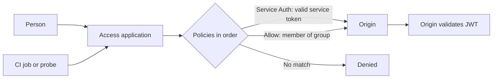

Cloudflare Access puts a login (or a machine credential) in front of an internal site, such as a stage environment, an admin tool or a dashboard, without a VPN. The configuration is easy to click together and hard to review, so keep it in Terraform: applications, policies and service tokens become a reviewed diff with a history. This note shows the model, the policies for people and for machines, how CI and probes get in, how to rotate the tokens, and how the origin checks the identity token Access sends, so a request that skips Access is still refused.

> [!warning] Not verified: provider resource names, attributes and token scopes
> The Terraform below was not planned or applied for this note. The Cloudflare provider changed its resource syntax between major versions, and these items are **not verified**: the v5 resource and attribute names (the examples use the `cloudflare_zero_trust_access_*` names with v4 style blocks; older v4 releases used `cloudflare_access_*`), whether policies are inline in the application or separate resources in your provider version, the API token scopes needed (the Access permissions for applications and policies, and for service tokens, must be read from the Cloudflare documentation), the `duration` and renewal attributes of the service token, and the exact claims in the service token's JWT. Run `terraform plan` and read the provider documentation for the version you pin before relying on any block here.

## When Access versus IAP

Both products put identity in front of an application. Pick by where the application is served and who uses it.

| Question                 | Cloudflare Access                                                                  | Identity-Aware Proxy (IAP)                                                         |
| ------------------------ | ---------------------------------------------------------------------------------- | ---------------------------------------------------------------------------------- |
| Where is the app?        | Anything reachable through Cloudflare: Workers, Pages, a tunnel, a proxied origin. | Behind a Google Cloud load balancer (GKE Ingress, Cloud Run, App Engine, Compute). |
| Identity providers       | Many (Google Workspace, Okta, GitHub, one-time PIN, and others).                   | Google identities (Cloud Identity and Workspace), with IAM roles for access.       |
| Policy language          | Access policies (groups, emails, IdP groups, device posture).                      | IAM bindings on the backend service plus access levels.                            |
| Machine access           | Service tokens (`non_identity` policy).                                            | Service accounts with OIDC tokens (`roles/iap.httpsResourceAccessor`).             |
| Needs a Cloudflare zone? | Yes.                                                                               | No, but it needs a Google load balancer.                                           |

Use Access for the Cloudflare-fronted stage sites and tools. Use IAP for services inside GKE that are published through a Google load balancer and whose users already live in Google identity. If one service needs both, keep one in front and do not stack them. The wider design (IAP, VPC Service Controls, private access) is in [[zero-trust-access-iap-and-vpc-service-controls]].

## Application and policy model

An Access **application** is a hostname (and optional path) that Access protects. **Policies** attach to it and say who gets in. **Groups** are reusable sets of rules. A **service token** is a client ID and secret pair for machines.



Design rules:

- **One application per hostname.** Do not protect a whole zone with one wildcard application unless every host really has the same audience.
- **Groups, not people.** Policies reference a group (`engineering`, `sre`); a person joins or leaves the group, and no policy changes. Back the group with an identity provider group where you can.
- **Short sessions on sensitive apps.** `session_duration` is how long a login lasts before the next prompt. Use a shorter value for admin tools than for read-only dashboards.
- **Allow list, never "everyone".** The last decision for people is a default deny: no matching policy means no access.

## Decision order

Access evaluates policies by action. The commonly documented behaviour is that `bypass` and service-auth (`non_identity`) policies are checked before `allow` and `block` policies, and within the same kind the `precedence` number decides, lowest first. Confirm the exact order for your version in the Cloudflare documentation (**not verified**), then design so the result does not depend on it:

- Do not use `bypass` on a stage or internal application. It turns the protection off for the matching requests, and a broad rule is an open door. If a health check needs unauthenticated access, put it on a separate hostname or path application.
- Keep `non_identity` policies narrow: one service token per use, not a shared token.
- Give every policy an explicit `precedence`, so a review shows the order.

## Terraform layout

Keep the Access resources in their own Terraform root module or folder, separate from the Worker deploy and from DNS, so a change to who can reach stage does not ride with an application release. State layout and module conventions are in [[terraform-module-and-state-layout]].

```text
access/
  versions.tf        # provider and Terraform versions, pinned
  variables.tf       # account_id, zone, team domain, group emails
  groups.tf          # cloudflare_zero_trust_access_group
  stage_app.tf       # application and policies for stage
  service_tokens.tf  # service tokens and their policies
  outputs.tf         # sensitive outputs for CI
```

```hcl title="access/versions.tf"
terraform {
  required_version = ">= 1.6"

  required_providers {
    cloudflare = {
      source  = "cloudflare/cloudflare"
      version = "~> 4.0" # Pin the major version you tested. v5 uses different syntax (not verified).
    }
  }
}

variable "cloudflare_account_id" {
  type        = string
  description = "Cloudflare account ID that owns the Access configuration."
}

variable "stage_hostname" {
  type        = string
  description = "Hostname of the protected stage site, for example stage.example.com."
}

variable "engineer_emails" {
  type        = list(string)
  description = "Emails allowed to open stage. Prefer an identity provider group when you have one."
}

# The API token comes from the CLOUDFLARE_API_TOKEN environment variable, set by the pipeline.
# Do not put it in a variable or a file. Give it only the Access permissions it needs, with an expiry.
provider "cloudflare" {}
```

```hcl title="access/stage_app.tf"
resource "cloudflare_zero_trust_access_group" "engineers" {
  account_id = var.cloudflare_account_id
  name       = "engineers"

  include {
    email = var.engineer_emails
  }
}

resource "cloudflare_zero_trust_access_application" "stage" {
  account_id       = var.cloudflare_account_id
  name             = "Stage site"
  domain           = var.stage_hostname
  type             = "self_hosted"
  session_duration = "8h" # Change: shorter for admin tools, longer for read-only dashboards.

  # Hide the app launcher tile for a machine-facing app; keep the session cookie HTTP-only.
  app_launcher_visible       = false
  http_only_cookie_attribute = true
}

# People: members of the engineers group. Decision "allow".
resource "cloudflare_zero_trust_access_policy" "stage_engineers" {
  account_id     = var.cloudflare_account_id
  application_id = cloudflare_zero_trust_access_application.stage.id
  name           = "Engineers"
  precedence     = 10
  decision       = "allow"

  include {
    group = [cloudflare_zero_trust_access_group.engineers.id]
  }
}
```

In recent provider versions policies can be reusable resources that the application references instead of one per application (**not verified**). If yours does, keep the same intent: one allow policy for the group and one `non_identity` policy for the token, and read the plan before applying.

## Service tokens for CI and probes

A pipeline or an uptime probe cannot log in through a browser. A service token gives it a client ID and a client secret, which it sends as headers. Access then runs a policy with the `non_identity` decision (shown as **Service Auth** in the dashboard) that names that token.

```hcl title="access/service_tokens.tf"
# One token per consumer. Never share a token between CI and a monitoring probe.
resource "cloudflare_zero_trust_access_service_token" "ci_stage" {
  account_id = var.cloudflare_account_id
  name       = "ci-stage-screenshots"
  duration   = "8760h" # About one year. Change: shorter is safer; attribute name and format not verified.
}

# Only this token may use the machine path to stage.
resource "cloudflare_zero_trust_access_policy" "stage_ci" {
  account_id     = var.cloudflare_account_id
  application_id = cloudflare_zero_trust_access_application.stage.id
  name           = "CI service token"
  precedence     = 20
  decision       = "non_identity"

  include {
    service_token = [cloudflare_zero_trust_access_service_token.ci_stage.id]
  }
}
```

```hcl title="access/outputs.tf"
# The secret is shown only when the token is created. Mark both outputs sensitive so they
# do not appear in plan output or CI logs, and read them once with `terraform output -raw`.
output "ci_stage_client_id" {
  value     = cloudflare_zero_trust_access_service_token.ci_stage.client_id
  sensitive = true
}

output "ci_stage_client_secret" {
  value     = cloudflare_zero_trust_access_service_token.ci_stage.client_secret
  sensitive = true
}
```

Sensitive outputs are still stored in the Terraform state in plain text. Keep that state in an encrypted bucket with tight access, as described in [[terraform-module-and-state-layout]]. Do not print the values in a job, and do not commit them.

Store the pair as an **environment secret** of the environment that runs the stage job (for example the `staging` environment in GitHub, or a masked, protected variable scoped to the stage environment in GitLab CI), never as a repository-wide secret. Set it once from a trusted workstation or a protected job:

```bash
# GitHub: environment "staging" of this repository. Replace OWNER/REPO.
terraform -chdir=access output -raw ci_stage_client_id \
  | gh secret set CF_ACCESS_CLIENT_ID --env staging --repo OWNER/REPO
terraform -chdir=access output -raw ci_stage_client_secret \
  | gh secret set CF_ACCESS_CLIENT_SECRET --env staging --repo OWNER/REPO
```

The client ID is not secret by itself, but treat the pair as one credential. Call the application with the two headers:

```bash
STAGE_URL="https://stage.example.com"   # Change: your stage hostname.

curl --fail --silent --show-error \
  -H "CF-Access-Client-Id: ${CF_ACCESS_CLIENT_ID}" \
  -H "CF-Access-Client-Secret: ${CF_ACCESS_CLIENT_SECRET}" \
  "${STAGE_URL}/healthz"
```

If the call is redirected to a login page or returns an Access denial page instead of the app, the headers did not match a policy: check the token ID in the policy, the application hostname, and that the policy action is `non_identity`.

### CI screenshot runs against stage

The pipeline for a site like this one deploys to stage and then takes screenshots or runs a smoke test against it. Those jobs need the two headers on every request, and only for the stage origin. In Playwright, set them on the browser context for the stage URL:

```ts title="playwright.config.ts (excerpt)"
import { defineConfig } from "@playwright/test"

const clientId = process.env.CF_ACCESS_CLIENT_ID
const clientSecret = process.env.CF_ACCESS_CLIENT_SECRET

export default defineConfig({
  use: {
    baseURL: process.env.STAGE_URL ?? "https://stage.example.com",
    // Sent with every request from this context. Only set them when running against stage.
    extraHTTPHeaders:
      clientId && clientSecret
        ? {
            "CF-Access-Client-Id": clientId,
            "CF-Access-Client-Secret": clientSecret,
          }
        : {},
  },
})
```

Rules for these runs:

- Run the job only on the stage environment, so the secret is not available to jobs on other branches or to pull requests from forks.
- Keep the headers off requests to third-party origins. `extraHTTPHeaders` applies to every request of the context, including to other hosts that the page loads, so for a page that loads external assets, restrict the header to the stage host with request routing instead.
- Preview deployments of a Worker on another hostname are a separate surface. If a preview URL should be protected, it needs its own application (or a destination in the same one); whether that is possible for your preview hostnames is **not verified**. Deploy and rollback steps for the Worker are in [[cloudflare-workers-deploy-and-rollback]].

## Rotation and expiry

A service token with no expiry is a password that never changes. Give each one a lifetime and a rotation routine.

1. **Pick a lifetime.** Use `duration` on the token (**not verified**: attribute name and accepted values). Shorter is better; match it to how often you are willing to rotate. Cloudflare can send an expiry notice to account contacts (**not verified**), so make sure the contact is a shared mailbox, not one person.
2. **Rotate with overlap.** Create a second token and add it to the `non_identity` policy next to the old one. Update the CI environment secret to the new pair. Run the stage job once. Then remove the old token from the policy and delete it. Because both are valid during the change, there is no outage.
   ```hcl
   # During rotation, list both tokens in the policy include block.
   include {
     service_token = [
       cloudflare_zero_trust_access_service_token.ci_stage.id,      # new
       cloudflare_zero_trust_access_service_token.ci_stage_old.id,  # remove after CI is updated
     ]
   }
   ```
3. **Calendar it.** Put the expiry date in the team calendar or the secrets inventory. An expired token fails the stage job with an Access denial, which looks like an application outage.
4. **A leaked token is an incident.** If the secret appears in a log, a chat or a screenshot, rotate it immediately and follow [[leaked-credential-rotation]]. The scope of damage is whatever the token's policy reaches, which is why one token per consumer matters.
5. **Provider-driven renewal.** Some provider versions can renew a token automatically on apply when it is close to expiry (an attribute such as `min_days_for_renewal`, **not verified**). If you use it, remember that renewal creates a new secret that CI must receive, so wire the output to the secret update, or the next job fails.

## Validating the JWT at the origin

Access adds a signed JSON Web Token to every request it lets through, in the `Cf-Access-Jwt-Assertion` header. The origin should verify it and refuse requests without a valid one. Without this check, anything that reaches the origin by another route (a direct `workers.dev` hostname, an origin IP, a different Cloudflare zone, a misconfigured application) bypasses Access completely. Whether such alternate routes exist for your Worker or origin depends on the setup; check each one.

What to verify:

| Check            | Value                                                                                                                          |
| ---------------- | ------------------------------------------------------------------------------------------------------------------------------ |
| Signature        | RS256 signature against the public keys at `https://TEAM.cloudflareaccess.com/cdn-cgi/access/certs`.                           |
| `iss` (issuer)   | `https://TEAM.cloudflareaccess.com`, your team domain.                                                                         |
| `aud` (audience) | The application's AUD tag, shown on the application in the dashboard and available from the API. Each application has its own. |
| `exp`            | Not expired. Reject on clock skew beyond a small allowance.                                                                    |

A person's token carries identity claims such as `email`. A service token's JWT does not represent a person; it carries an identifier of the token instead (the claim name, such as `common_name`, is **not verified**), so authorisation in the app should not require `email` for machine paths.

```python title="access_jwt.py"
"""Verify the Cloudflare Access JWT on incoming requests. Requires PyJWT with the crypto extra."""
import os

import jwt
from jwt import PyJWKClient

TEAM_DOMAIN = os.environ["CF_ACCESS_TEAM_DOMAIN"]  # for example "myteam.cloudflareaccess.com"
APP_AUD = os.environ["CF_ACCESS_AUD"]  # the application's AUD tag
ISSUER = f"https://{TEAM_DOMAIN}"

# Caches the keys; Cloudflare rotates them, so do not hard-code a key.
_jwks = PyJWKClient(f"{ISSUER}/cdn-cgi/access/certs", cache_keys=True)


def verify(token: str) -> dict:
    """Return the claims or raise jwt.PyJWTError. Never fall back to 'allow' on error."""
    signing_key = _jwks.get_signing_key_from_jwt(token)
    return jwt.decode(
        token,
        signing_key.key,
        algorithms=["RS256"],
        audience=APP_AUD,
        issuer=ISSUER,
        options={"require": ["exp", "iat", "aud", "iss"]},
    )


def handle(headers: dict) -> int:
    """Return an HTTP status for the request. 401 when the header is missing or invalid."""
    token = headers.get("Cf-Access-Jwt-Assertion")
    if not token:
        return 401
    try:
        verify(token)
    except jwt.PyJWTError:
        return 401
    return 200
```

On a Worker the same checks apply, using the Web Crypto API or a small JOSE library to verify the RS256 signature against the same certs URL. The checks (signature, `iss`, `aud`, `exp`) do not change. Do not log the token; it is a bearer credential for its short lifetime.

## Related

- [[zero-trust-access-iap-and-vpc-service-controls]] for the Google side and the wider design.
- [[cloudflare-workers-deploy-and-rollback]] for how this site reaches Cloudflare and how to undo a release.
- [[leaked-credential-rotation]] when a service token or an API token leaks.
- [[terraform-module-and-state-layout]] and [[terraform-plan-policy-checks]] for state layout and review of the plan.
- [[edge-waf-rate-limiting]] for the WAF and rate limits that sit next to Access on the same zone.
