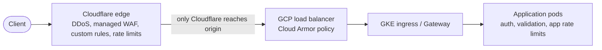

Internet-facing services need filtering before requests reach the application: known attack signatures, abusive request rates, and floods. In this stack that happens in two places: **Cloudflare** at the edge, and **Cloud Armor** on the GCP load balancer. This note shows how to manage both as code with Terraform and how to roll rules out safely: **log first, tune, then enforce**. A rule that blocks real customers on day one is an outage you caused.

> [!warning] Field names and limits are not verified
> The Terraform below follows the Cloudflare provider (v4 block syntax) and the Google provider as known, and was not applied or planned for this note. All Cloudflare field names, actions and per-plan limits (which actions, periods, counting characteristics and mitigation timeouts your plan allows) are **not verified**: check the Cloudflare documentation and run `terraform plan` before relying on any of it. Version 5 of the Cloudflare provider changed the resource syntax, so adapt the examples if you use it. Also not verified: whether the CRS 4.x preconfigured rule sets are generally available in Cloud Armor (the example uses the older rule set name), and the request body inspection limit of either product.

## Layering

Use the layers for what each does best. None of them replaces secure application code.



| Layer           | Good at                                                                                           | Does not stop                                                                                   |
| --------------- | ------------------------------------------------------------------------------------------------- | ----------------------------------------------------------------------------------------------- |
| Cloudflare edge | Volumetric floods, known exploit signatures, bot scoring, per-IP rate limits, geo and ASN rules   | Logic flaws, valid-but-abusive logged-in users, traffic that bypasses Cloudflare to your origin |
| Cloud Armor     | Same checks again at the origin, lets you lock the origin to Cloudflare, Google-side DDoS signals | Anything in an encrypted body it cannot inspect, application logic, abuse spread over many IPs  |
| Ingress and app | Authentication, authorisation, per-user and per-tenant limits, input validation                   | Nothing is left to catch if the app trusts the edge blindly                                     |

Why two edge layers: Cloudflare absorbs most junk cheaply and far from your network. Cloud Armor is the safety net if someone finds the origin address, if Cloudflare is misconfigured, or if you need Google-side signals. Keep them consistent: rules that exist at only one layer become gaps.

Things that every WAF and rate limit still misses: low-and-slow credential stuffing spread over thousands of addresses, abuse by authenticated users, business logic abuse, and anything inside a payload larger than the inspection limit. Keep per-account throttles and anomaly detection in the application.

**Lock the origin to Cloudflare.** If clients can reach the load balancer directly, all of the edge rules can be skipped. Allow only Cloudflare's published address ranges at Cloud Armor or the firewall (fetch them from the official Cloudflare IP list rather than hard-coding a stale copy), or use authenticated origin pulls. Cloudflare Access protects internal applications in a similar way, see [[cloudflare-access-service-tokens]].

## Rollout

Every new rule, and every change to a rule's expression, follows the same path:

1. **Log or preview.** Deploy the rule so it records matches but takes no action. Cloudflare uses a `log` action (availability of `log` for custom and rate limiting rules depends on your plan and is not verified); Cloud Armor uses `preview = true`.
2. **Observe for a full traffic cycle.** At least a week that includes your busiest day and your batch jobs, so peak and rare callers show up. Record matches per rule.
3. **Tune.** Read samples of matched requests. For each false positive, narrow the expression, add an exclusion or lower sensitivity. Repeat until matches are what you intended.
4. **Enforce on a slice if you can.** For example block only on one hostname or path first, then widen.
5. **Enforce, and keep watching.** Switch the action to `block` (or `managed_challenge`, `deny(403)`, throttle). Watch blocked counts and the error rate for the next hour and day.
6. **Review.** After a month, remove rules that never match and re-check the thresholds against traffic.

Treat changes as normal changes: a merge request, a Terraform plan reviewed by a second person, applied through the pipeline, see [[production-change-checklist]]. Rule changes are quick to apply and quick to cause damage.

## Cloudflare phases

Cloudflare evaluates rules in **phases**, each with its own purpose. With the Rulesets API or Terraform you manage one ruleset per phase per zone. The three used here:

| Phase                           | Purpose                                               |
| ------------------------------- | ----------------------------------------------------- |
| `http_request_firewall_custom`  | Your own WAF rules (block, challenge, log, skip)      |
| `http_request_firewall_managed` | Cloudflare managed rulesets (execute, with overrides) |
| `http_ratelimit`                | Rate limiting rules                                   |

Rule order inside a ruleset matters: rules run top to bottom, and a `skip` rule must come before the rules it skips. Keep the IP list resource and the rulesets in one Terraform module so the order and references stay together; see [[terraform-module-and-state-layout]].

Provider and variables (change `zone_id` and the account to yours; keep the token in the pipeline's secret store, never in code, see [[external-secrets-with-secret-manager]]):

```hcl title="edge/cloudflare.tf"
terraform {
  required_providers {
    cloudflare = {
      source  = "cloudflare/cloudflare"
      version = "~> 4.0" # v5 uses a different ruleset syntax; pin and review upgrades
    }
  }
}

variable "zone_id" {
  type        = string
  description = "Cloudflare zone ID for example.com. Change to your zone."
}

variable "account_id" {
  type        = string
  description = "Cloudflare account ID that owns the IP list. Change to your account."
}

# Uptime-probe source addresses. These are documentation addresses; replace them with the
# real addresses published by your uptime provider, and review them on a schedule.
resource "cloudflare_list" "uptime_probes" {
  account_id  = var.account_id
  name        = "uptime_probes"
  kind        = "ip"
  description = "Synthetic monitoring probes that must never be rate limited or blocked"

  item {
    value {
      ip = "198.51.100.10"
    }
    comment = "Probe A (documentation address, replace)"
  }
  item {
    value {
      ip = "198.51.100.11"
    }
    comment = "Probe B (documentation address, replace)"
  }
}
```

### Custom rules in log mode, and the skip rule

The first rule is a **skip** for the uptime probes, so monitoring keeps working whatever else you add. The second is a custom rule that starts in `log`. When the log shows only what you intended, change `action` to `block`.

```hcl title="edge/cloudflare-waf-custom.tf"
resource "cloudflare_ruleset" "waf_custom" {
  zone_id     = var.zone_id
  name        = "Custom WAF rules"
  description = "Managed by Terraform. Skip rule first, then log-first custom rules."
  kind        = "zone"
  phase       = "http_request_firewall_custom"

  # 1. Never filter the uptime probes. Order matters: this rule must stay first.
  rules {
    action      = "skip"
    description = "Skip WAF custom rules for uptime probes"
    enabled     = true
    expression  = "(ip.src in $uptime_probes)"
    action_parameters {
      ruleset = "current"
    }
  }

  # 2. Example custom rule, starting in log mode.
  #    Change action to "block" only after the log shows no legitimate matches.
  rules {
    action      = "log"
    description = "Admin paths from outside the allowed country (log first)"
    enabled     = true
    expression  = "(starts_with(http.request.uri.path, \"/admin\") and ip.geoip.country ne \"GB\")"
  }

  depends_on = [cloudflare_list.uptime_probes]
}
```

Change `"GB"` and `/admin` to your own policy; a country rule is a blunt tool and a VPN user or a traveller is a false positive. Prefer authentication (Cloudflare Access) for admin paths and use the WAF as a second layer.

To run Cloudflare's managed rulesets, add a rule that executes one in the managed phase. Look up the ruleset ID in the Cloudflare documentation or the API; the value below is a placeholder variable, and the `overrides` structure is not verified:

```hcl title="edge/cloudflare-waf-managed.tf"
variable "cloudflare_managed_ruleset_id" {
  type        = string
  description = "ID of the Cloudflare managed ruleset to execute. Look it up in the Cloudflare docs or API."
}

resource "cloudflare_ruleset" "waf_managed" {
  zone_id = var.zone_id
  name    = "Managed WAF rules"
  kind    = "zone"
  phase   = "http_request_firewall_managed"

  rules {
    action      = "execute"
    description = "Execute managed ruleset, log only while tuning"
    enabled     = true
    expression  = "true"
    action_parameters {
      id = var.cloudflare_managed_ruleset_id
      overrides {
        action = "log" # remove this override to use each rule's default action when enforcing
      }
    }
  }
}
```

### Rate limit for the login path

Ten attempts a minute per source address is a reasonable first limit for a login endpoint, since people rarely fail ten times a minute. Choose your own number from real traffic, and use the log phase of this rollout to check it. The characteristics, period and mitigation timeout values that your plan allows are not verified.

```hcl title="edge/cloudflare-ratelimit.tf"
resource "cloudflare_ruleset" "rate_limit" {
  zone_id     = var.zone_id
  name        = "Rate limiting"
  description = "Managed by Terraform"
  kind        = "zone"
  phase       = "http_ratelimit"

  rules {
    action      = "block" # start with "log" if your plan supports it, then change to "block"
    description = "Login: 10 requests per minute per IP"
    enabled     = true
    expression  = "(http.request.uri.path eq \"/api/login\" and http.request.method eq \"POST\" and not ip.src in $uptime_probes)"

    ratelimit {
      characteristics     = ["ip.src"] # some plans need "cf.colo.id" as well; check the docs
      period              = 60         # seconds
      requests_per_period = 10
      mitigation_timeout  = 600 # seconds blocked after the limit is hit; allowed values depend on plan
    }
  }

  depends_on = [cloudflare_list.uptime_probes]
}
```

Notes:

- The rate limit counts per source IP. Offices and mobile carriers put many users behind one address (carrier-grade NAT), so a low limit can block a whole site. If you can, count by an authenticated identifier (an API key header) instead of, or in addition to, the IP.
- Return a clear status (`429`) and a `Retry-After` where the product allows it, so well-behaved clients back off, see [[timeouts-retries-load-shedding]].
- Rate-limit costly endpoints too: search, password reset, signup, export.

## Cloud Armor policies and Adaptive Protection

Cloud Armor policies attach to a backend service behind the Google load balancer. A policy is an ordered list of rules by priority (lower number first), and every policy needs a default rule at the highest priority number.

```hcl title="edge/cloud-armor.tf"
resource "google_compute_security_policy" "edge" {
  name        = "edge-policy"
  description = "WAF and rate limiting for the public load balancer. Managed by Terraform."
  project     = var.project_id
  type        = "CLOUD_ARMOR"

  # Layer 7 adaptive protection: learns normal traffic and raises alerts on anomalies.
  # Availability by tier/subscription is not verified.
  adaptive_protection_config {
    layer_7_ddos_defense_config {
      enable = true
    }
  }

  # SQL injection rules, in preview: matches are logged, nothing is blocked.
  # Remove "preview = true" to enforce after tuning.
  rule {
    action      = "deny(403)"
    priority    = 1000
    preview     = true
    description = "SQLi preconfigured rule set, sensitivity 1 (preview)"
    match {
      expr {
        expression = "evaluatePreconfiguredWaf('sqli-v33-stable', {'sensitivity': 1})"
      }
    }
  }

  # Rate limit per client. Behind Cloudflare, the connecting address is Cloudflare's, so key on
  # the header Cloudflare sets. Only trust this header if the origin accepts traffic from Cloudflare only.
  rule {
    action      = "throttle"
    priority    = 2000
    preview     = true
    description = "Throttle to 100 requests per minute per client (preview)"
    match {
      versioned_expr = "SRC_IPS_V1"
      config {
        src_ip_ranges = ["*"]
      }
    }
    rate_limit_options {
      conform_action      = "allow"
      exceed_action       = "deny(429)"
      enforce_on_key      = "HTTP_HEADER"
      enforce_on_key_name = "CF-Connecting-IP"
      rate_limit_threshold {
        count        = 100
        interval_sec = 60
      }
    }
  }

  # Required default rule: allow everything not matched above.
  rule {
    action      = "allow"
    priority    = 2147483647
    description = "Default rule"
    match {
      versioned_expr = "SRC_IPS_V1"
      config {
        src_ip_ranges = ["*"]
      }
    }
  }
}

variable "project_id" {
  type        = string
  description = "GCP project that owns the load balancer. Change to your project."
}
```

`sqli-v33-stable` is the name of an older OWASP Core Rule Set based group. Newer CRS versions use different names; whether the CRS 4.x sets are generally available in your tier is not verified, so look up the current names in the Cloud Armor documentation before choosing. Sensitivity 1 is the least aggressive level and gives the fewest false positives; raise it only with evidence.

Attach the policy to the backend. For GKE Ingress, use a `BackendConfig` referenced from the Service:

```yaml title="backendconfig.yaml"
apiVersion: cloud.google.com/v1
kind: BackendConfig
metadata:
  name: web-backendconfig
  namespace: shop # change to your namespace
spec:
  securityPolicy:
    name: edge-policy
```

```yaml title="service.yaml"
apiVersion: v1
kind: Service
metadata:
  name: web
  namespace: shop
  annotations:
    cloud.google.com/backend-config: '{"default": "web-backendconfig"}'
spec:
  type: ClusterIP
  selector:
    app: web
  ports:
    - port: 80
      targetPort: 8080
```

For Gateway API, a separate policy resource attaches the security policy; its exact kind and fields are not covered here, so check the GKE Gateway documentation. For Terraform-managed backends set `security_policy` on the `google_compute_backend_service`.

Adaptive Protection reports suspected attacks and can suggest a rule. Treat the suggestion as a draft to review in preview, not as something to apply automatically.

## Skip rules for probes

Health checks and uptime probes should not be blocked, challenged or rate limited, or you will page yourself with false outages.

- **Cloudflare:** the `skip` rule at the top of the custom ruleset, and an exclusion in the rate limit expression, as in the examples above. Keep the IP list in Terraform with a comment saying who owns each probe, and review it when the monitoring provider changes its ranges.
- **Cloud Armor:** Google's own load balancer health checks are not subject to the policy in the way client traffic is, but verify this for your setup; this is not verified. For third-party synthetic checks, add an `allow` rule with a low priority number (processed first) that matches the probe addresses.
- **Do not skip by a header or user agent.** An attacker can copy those. Skip by source address, or better, by a secret header value that only your probe knows, kept out of the repository.
- Probes should call a path that exercises the real stack, but do not exempt a path that attackers can also reach.

## False positives

Expect them, and plan the response before the first block.

1. **Find the rule.** In Cloudflare, the security events view or the firewall events log shows the rule ID for a blocked request. In Cloud Armor, the load balancer log entry names the policy and rule that matched.
2. **Reproduce and classify.** Is it a real attack the rule correctly caught, or a legitimate request that looks like one (a JSON field containing SQL words, a markdown editor, a large form)?
3. **Narrow, do not disable.** Prefer, in this order: exclude the specific parameter or path from that one rule, lower the sensitivity, add a precise skip for a known-good source, and only then disable the single rule. Never turn off a whole rule set because of one rule.
4. **For Cloud Armor,** you can opt specific rule IDs out of a preconfigured set in the expression (the syntax below is not verified; check the documentation for your rule set):

```text
evaluatePreconfiguredWaf('sqli-v33-stable', {'sensitivity': 1, 'opt_out_rule_ids': ['<rule-id-from-the-log>']})
```

5. **Record the exclusion in Git** with the ticket, the reason and a review date. An exclusion without a reason lasts forever.
6. **Give support a path.** Customer support needs a way to report "I was blocked", with the request ID (Cloudflare Ray ID) in the error page, and an on-call who can look it up.

## Rollback

Edge rules take effect globally in seconds, so rollback must be as quick as rollout.

- **Normal path:** revert the merge request and apply through the pipeline. Rule changes should be small enough that a revert is clean.
- **Fast path during an incident:** set the offending rule to `log` (Cloudflare) or `preview = true` (Cloud Armor), or disable it, in the console or API. Then put the same change into Terraform immediately, or the next apply will undo it or drift will hide it. Record who did it and when.
- **Last resort:** remove the whole policy attachment or ruleset. This leaves the origin unprotected, so do it only knowingly, with the incident commander's agreement, and for the shortest time.
- Know where the Terraform state and the pipeline credentials are before you need them, see [[terraform-module-and-state-layout]].

Cloudflare itself can also be the failing component. For Cloudflare deployment issues and rollbacks of Workers, see [[cloudflare-workers-deploy-and-rollback]].

## Metrics

You cannot tune what you cannot count. Track, per rule: how many requests matched, how many were actually blocked, and the rate of the success status codes behind them.

**Cloud Armor, matched versus blocked.** Requests that matched a rule in preview are recorded in the load balancer log, separately from enforced decisions. The field names are not verified; check a real log entry first.

```bash
PROJECT=my-project
POLICY=edge-policy

# Would have been blocked (preview matches), last 24 hours, counted by rule.
gcloud logging read \
  "resource.type=\"http_load_balancer\" AND jsonPayload.previewSecurityPolicy.name=\"$POLICY\" AND jsonPayload.previewSecurityPolicy.outcome=\"DENY\"" \
  --project "$PROJECT" --freshness=1d --limit=5000 \
  --format="value(jsonPayload.previewSecurityPolicy.priority)" | sort | uniq -c | sort -rn

# Actually blocked (enforced), same window.
gcloud logging read \
  "resource.type=\"http_load_balancer\" AND jsonPayload.enforcedSecurityPolicy.name=\"$POLICY\" AND jsonPayload.enforcedSecurityPolicy.outcome=\"DENY\"" \
  --project "$PROJECT" --freshness=1d --limit=5000 \
  --format="value(jsonPayload.enforcedSecurityPolicy.priority)" | sort | uniq -c | sort -rn
```

The `--limit` caps the sample; for exact counts, use a log-based metric or export to BigQuery, see [[gcp-audit-logs-siem]] for routing logs.

**Cloudflare, events by action and rule.** The GraphQL Analytics API groups security events. The dataset and field names are not verified; check the schema in Cloudflare's documentation. The token needs analytics read access on the zone and comes from the environment, never the command line history or the repository.

```bash
# Requires CF_API_TOKEN (read-only analytics scope) in the environment.
ZONE_TAG=0123456789abcdef0123456789abcdef   # example value; use your zone ID
FROM=2026-10-16T00:00:00Z
TO=2026-10-17T00:00:00Z

curl -sS https://api.cloudflare.com/client/v4/graphql \
  -H "Authorization: Bearer ${CF_API_TOKEN}" \
  -H "Content-Type: application/json" \
  --data @- <<JSON
{
  "query": "query (\$zoneTag: string, \$from: Time, \$to: Time) { viewer { zones(filter: {zoneTag: \$zoneTag}) { firewallEventsAdaptiveGroups(limit: 50, filter: {datetime_geq: \$from, datetime_leq: \$to}, orderBy: [count_DESC]) { count dimensions { action ruleId source } } } } }",
  "variables": { "zoneTag": "${ZONE_TAG}", "from": "${FROM}", "to": "${TO}" }
}
JSON
```

Example of the shape of the answer (illustrative, not real output): rows of `count`, `action` (`log`, `block`) and `ruleId`. A rule with many `log` rows and a plausible source mix is ready to be enforced after review; a rule with `log` rows from your own monitoring is not.

Dashboards and alerts to build:

- Matched versus blocked, per rule, per hour.
- Share of 403 and 429 responses against total requests, with an alert when it jumps after a rule change.
- Origin 5xx rate and latency alongside, so you can tell protection from damage.
- Requests reaching the origin without passing Cloudflare (a direct-origin hit rate), which should be zero.

Feed security events into the incident process, see [[incident-response]], and review the rules on a schedule.
