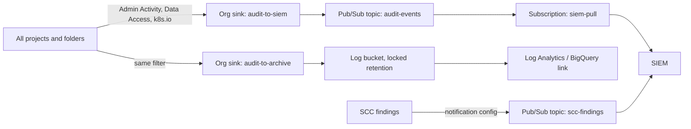

Detective controls only work if the records exist, reach one place that attackers and administrators cannot edit, and are read by something that raises an alert. This note covers the plumbing for Google Cloud: which audit logs exist, an organization-level sink into a central logging project, a Pub/Sub feed to a SIEM for near-real-time detection, a locked bucket for retention, how to keep the cost under control, and a first set of detection filters. It is for senior engineers who own the platform and work with a security team.

How to write application logs is in [[structured-logging-conventions]]. Personal data in logs is in [[pci-dss-and-gdpr-for-devops-logs-and-data]]. What an auditor wants to see and how to collect it is in [[audit-evidence-collection-and-retention]]. Key events are only useful if keys are managed well, see [[cloud-kms-key-management]]. When a detection fires on a real compromise, follow [[compromised-cloud-cluster-containment]].

> [!warning] Not legal or audit advice
> This is general engineering guidance. Your auditor, assessor or legal counsel decides which logs, which retention period and which controls satisfy a framework or a law. Check control wording against the current edition.

> [!info] Scope and assumptions
> Google Cloud with an organization, GKE, Terraform and a SIEM that can read from Pub/Sub or BigQuery. Project IDs, the organization ID, regions and retention periods are placeholders. Example addresses use the documentation ranges and `example.com`.

> [!note] Not verified
> Written from documentation knowledge, not checked against a live organization or the current docs. Check before relying on this: which Data Access log types are on by default for each service and for GKE, the default and maximum retention of log buckets and of Pub/Sub messages, cost per GiB of ingestion and storage, what Security Command Center can export and at which tier, the exact GKE audit `methodName` strings, and the Terraform provider argument names (they change between provider versions).

## Which logs are on by default and which need enabling

Cloud Audit Logs has four kinds of entry. Know which are free of effort and which you must switch on.

| Log type       | What it records                                                    | State                                                            | Notes                                                                          |
| -------------- | ------------------------------------------------------------------ | ---------------------------------------------------------------- | ------------------------------------------------------------------------------ |
| Admin Activity | API calls that change configuration or metadata                    | Always on, cannot be disabled                                    | Includes IAM changes, firewall changes, cluster create and delete              |
| System Event   | Changes made by Google systems, not by a user action               | Always on                                                        | Useful for live migration and automatic actions                                |
| Data Access    | Reads of configuration (`ADMIN_READ`), reads and writes of data    | Off by default for most services (BigQuery is a known exception) | You enable it per service with an audit config. It is the large and costly one |
| Policy Denied  | Requests refused by a security policy such as VPC Service Controls | On by default (check)                                            | A strong signal when something probes a perimeter                              |

For GKE there are two sources to keep apart:

- **Cloud Audit Logs for the GKE API** (`container.googleapis.com`): creating, updating and deleting clusters and node pools. Admin Activity, always on.
- **Kubernetes audit logs** (`k8s.io`, resource type `k8s_cluster`): API server requests such as `pods/exec`, `secrets` reads, RBAC changes. Admin Activity entries for Kubernetes writes are on by default. Reads of Kubernetes objects are Data Access entries, which depend on the audit config. The control-plane audit policy is managed by Google; you choose whether Data Access entries are recorded and routed, not the policy rules. Check which request types land in which log for your GKE version.

Other sources that belong in the same pipeline:

- **Security Command Center (SCC) findings**: misconfigurations and threat detections. Which detectors you get depends on the tier. Export them as findings through a notification config, not as logs.
- **VPC flow logs, firewall logs, load balancer logs**: network evidence. Keep them out of this audit-grade path; they are high volume and belong in a cheaper sink.
- **Cloudflare audit logs** for the edge: a separate feed, not covered here.
- **Application and pipeline logs**: a different retention class, see [[structured-logging-conventions]].

### Turn on the Data Access logs that matter

Enable Data Access logging narrowly. Start with the services where reads are the event you care about: Cloud KMS (who decrypted), Secret Manager (who read a secret) and IAM (who read policy).

```hcl title="audit-config.tf"
# CHANGE: var.org_id is your numeric organization ID.
# Why: an organization-level audit config applies to every project
# and cannot be turned off by a project owner.
variable "org_id" {
  type        = string
  description = "Numeric organization ID."
}

resource "google_organization_iam_audit_config" "kms" {
  org_id  = var.org_id
  service = "cloudkms.googleapis.com"

  audit_log_config {
    log_type = "ADMIN_READ"
  }
  audit_log_config {
    log_type = "DATA_READ"
  }
}

resource "google_organization_iam_audit_config" "secrets" {
  org_id  = var.org_id
  service = "secretmanager.googleapis.com"

  audit_log_config {
    log_type = "ADMIN_READ"
  }
  audit_log_config {
    log_type = "DATA_READ"
  }
}
```

Do not use `allServices` at the organization level without a volume estimate and an exclusion plan. `DATA_READ` on storage or on a busy API can multiply your log volume. Avoid `exempted_members` unless a noisy service account is proven harmless; every exemption is a blind spot.

> [!warning] Enabling Data Access logs changes your bill
> Data Access entries are billed as ingested log data like any other entry. Estimate first (see the sizing table below), enable for one service, and compare the volume for a week.

## Org-level aggregated sinks

A sink at the organization with `include_children = true` catches every project and folder, including ones created tomorrow. A project-level sink in each project is easy to forget or delete. Put the sinks and their destinations in a dedicated, locked-down project, for example `example-security-logs`, owned by the security team with the platform team as a reader.



The sink filter decides what leaves each project. Keep the SIEM filter narrow (the events you can act on) and the archive filter wide (everything an auditor may ask for). Two sinks with different filters are cheaper than one wide feed into an expensive SIEM.

```hcl title="sinks.tf"
# CHANGE: var.log_project_id is the central logging project.
# CHANGE: the filter. This one is a starting point, not a standard.
variable "log_project_id" {
  type        = string
  description = "Central logging project, for example example-security-logs."
}

locals {
  # Kubernetes API audit entries, plus IAM and KMS administrative methods.
  siem_filter = <<-EOT
    (
      LOG_ID("cloudaudit.googleapis.com/activity")
      OR LOG_ID("cloudaudit.googleapis.com/data_access")
      OR LOG_ID("cloudaudit.googleapis.com/policy")
    )
    AND (
      protoPayload.serviceName="k8s.io"
      OR protoPayload.methodName:"SetIamPolicy"
      OR protoPayload.methodName:"CreateServiceAccountKey"
      OR protoPayload.methodName:"CreateRole"
      OR protoPayload.methodName:"UpdateRole"
      OR protoPayload.serviceName="cloudkms.googleapis.com"
    )
  EOT
}

resource "google_logging_organization_sink" "siem" {
  name             = "audit-to-siem"
  org_id           = var.org_id
  include_children = true
  destination      = "pubsub.googleapis.com/projects/${var.log_project_id}/topics/${google_pubsub_topic.audit_events.name}"
  filter           = local.siem_filter
  description      = "Audit events the SIEM alerts on."
}

# The sink writes with its own identity. Grant it publish rights on the topic only.
resource "google_pubsub_topic_iam_member" "sink_publisher" {
  project = var.log_project_id
  topic   = google_pubsub_topic.audit_events.name
  role    = "roles/pubsub.publisher"
  member  = google_logging_organization_sink.siem.writer_identity
}
```

The parentheses around the `LOG_ID` group are deliberate. Mixing `AND` and `OR` without them is a common way to route far more, or far less, than intended. Test the filter before applying it (see the tip below).

> [!tip] Test a filter before it becomes a sink
> Run the same text with `gcloud logging read` against a project and count the results. A sink with a typo in the filter silently routes nothing.
>
> ```bash
> PROJECT_ID=example-prod-1
> gcloud logging read 'protoPayload.serviceName="k8s.io" AND protoPayload.methodName:"pods.exec"' \
>   --project="$PROJECT_ID" --freshness=7d --limit=5 --format=json
> ```

## Pub/Sub for near-real-time versus BigQuery or GCS batch

Pick the destination by how fast someone must react.

| Destination      | Latency                | Good for                                                 | Cost and caveats                                                                           |
| ---------------- | ---------------------- | -------------------------------------------------------- | ------------------------------------------------------------------------------------------ |
| Pub/Sub          | Seconds                | SIEM alerting, automated response                        | Messages are held only for the retention you set. Back-pressure lasts as long as retention |
| Log bucket       | Minutes                | Search in Logs Explorer, locked retention, Log Analytics | Billed for ingestion and storage; you control retention per bucket                         |
| BigQuery dataset | Minutes                | Investigations and reports with SQL                      | Storage plus query cost; partitioned tables keep scans small                               |
| Cloud Storage    | Batched (about hourly) | Cheap long-term archive, legal hold                      | Cheapest; not searchable without loading it elsewhere                                      |

Rule of thumb: Pub/Sub for what you will page on, a log bucket for what you will search for the next year, Cloud Storage for what you keep because a rule says so.

```hcl title="siem-pubsub.tf"
# CHANGE: names, and the SIEM service account in var.siem_pull_member.
# Why: the SIEM reads with a dedicated identity that can only pull.
variable "siem_pull_member" {
  type        = string
  description = "IAM member for the SIEM collector, for example serviceAccount:siem-reader@example-security-logs.iam.gserviceaccount.com."
}

resource "google_pubsub_topic" "audit_events" {
  project = var.log_project_id
  name    = "audit-events"

  # Keep messages briefly even with no subscription attached.
  message_retention_duration = "86400s"
}

resource "google_pubsub_topic" "audit_events_dead_letter" {
  project = var.log_project_id
  name    = "audit-events-dead-letter"
}

resource "google_pubsub_subscription" "siem" {
  project = var.log_project_id
  name    = "siem-pull"
  topic   = google_pubsub_topic.audit_events.id

  ack_deadline_seconds       = 60
  message_retention_duration = "604800s" # 7 days: time to fix a broken SIEM connector

  # Never let an idle subscription expire. The default expiry would delete it
  # after a period without activity and the feed would stop silently.
  expiration_policy {
    ttl = ""
  }

  dead_letter_policy {
    dead_letter_topic     = google_pubsub_topic.audit_events_dead_letter.id
    max_delivery_attempts = 10
  }

  retry_policy {
    minimum_backoff = "10s"
    maximum_backoff = "600s"
  }
}

resource "google_pubsub_subscription_iam_member" "siem_subscriber" {
  project      = var.log_project_id
  subscription = google_pubsub_subscription.siem.name
  role         = "roles/pubsub.subscriber"
  member       = var.siem_pull_member
}
```

Alert on the feed itself. Create an alert on `pubsub.googleapis.com/subscription/oldest_unacked_message_age` for `siem-pull` and another when the sink's exported count (`logging.googleapis.com/exports/log_entry_count`) drops to zero. A SIEM with an empty feed looks the same as a quiet day.

The dead-letter policy needs its own IAM grants for the Pub/Sub service agent (publisher on the dead-letter topic, subscriber on the source subscription). Check the Pub/Sub documentation for the exact roles in your provider version.

For an SCC feed, use a notification config to a separate topic so findings and audit events keep their own schema.

```hcl title="scc-export.tf"
# CHANGE: var.org_id. The filter keeps the export to active findings.
resource "google_pubsub_topic" "scc_findings" {
  project = var.log_project_id
  name    = "scc-findings"
}

resource "google_scc_notification_config" "active_findings" {
  config_id    = "active-findings-to-siem"
  organization = var.org_id
  description  = "Active SCC findings to the SIEM."
  pubsub_topic = google_pubsub_topic.scc_findings.id

  streaming_config {
    filter = "state = \"ACTIVE\""
  }
}
```

The notification config creates a service account that needs publish rights on the topic. The resource exports a service account email; grant it `roles/pubsub.publisher` on `scc_findings`. Which resource version your provider and SCC tier support is not verified.

## Retention and Bucket Lock

Retention has two parts: how long the data stays, and who can shorten that. For a log bucket and for Cloud Storage a **lock** makes the retention period permanent for the life of the bucket.

```hcl title="archive-bucket.tf"
# CHANGE: location, retention_days, and set locked = true only after review.
# Why: a locked bucket cannot be unlocked, and its retention cannot be shortened.
resource "google_logging_project_bucket_config" "audit_archive" {
  project        = var.log_project_id
  location       = "europe-west3"
  bucket_id      = "audit-archive"
  retention_days = 400
  description    = "Org audit logs, locked retention."

  # Start with false. Flip to true in a reviewed change when the period is agreed.
  locked = false
}

resource "google_logging_organization_sink" "archive" {
  name             = "audit-to-archive"
  org_id           = var.org_id
  include_children = true
  destination      = "logging.googleapis.com/projects/${var.log_project_id}/locations/europe-west3/buckets/${google_logging_project_bucket_config.audit_archive.bucket_id}"
  filter           = "LOG_ID(\"cloudaudit.googleapis.com/activity\") OR LOG_ID(\"cloudaudit.googleapis.com/data_access\") OR LOG_ID(\"cloudaudit.googleapis.com/policy\") OR LOG_ID(\"cloudaudit.googleapis.com/system_event\")"
  description      = "Everything an auditor may ask for."
}

resource "google_project_iam_member" "archive_writer" {
  project = var.log_project_id
  role    = "roles/logging.bucketWriter"
  member  = google_logging_organization_sink.archive.writer_identity
}
```

For an export to Cloud Storage, use a retention policy with a lock:

```hcl title="gcs-archive.tf"
# CHANGE: bucket name (globally unique), location, retention_period in seconds.
# 31536000 seconds is 365 days.
resource "google_storage_bucket" "audit_gcs" {
  project                     = var.log_project_id
  name                        = "example-audit-archive-gcs"
  location                    = "EUROPE-WEST3"
  uniform_bucket_level_access = true
  public_access_prevention    = "enforced"

  retention_policy {
    retention_period = 31536000
    is_locked        = false # set true only after the period is agreed
  }
}
```

> [!danger] Locking is irreversible
> A locked log bucket or locked retention policy cannot be unlocked or shortened, and a locked log bucket can only be deleted when the project is deleted after the period ends (check the current rule). Locking a bucket with personal data and a 10-year period creates a legal problem, not only a cost. Agree the period with legal and the data protection owner first, and test the whole path on a throwaway bucket.

Retention periods are policy, not engineering: take them from your framework mapping, as described in [[audit-evidence-collection-and-retention]], and from the data protection limits in [[pci-dss-and-gdpr-for-devops-logs-and-data]]. The 400 days above is an example. Common practice is a short searchable window (about 90 days, hot) plus a longer archive, but your policy sets the numbers.

Also protect the project itself. Restrict who holds `roles/logging.admin` and `roles/owner` there, put the project in a folder under organization policy guardrails ([[gcp-organization-policy-guardrails]]), and consider VPC Service Controls for the logging and storage APIs ([[zero-trust-access-iap-and-vpc-service-controls]]).

## Cost control and exclusions

Log volume is the largest cost driver and the usual reason someone turns audit logging off. Design the cost in rather than discovering it.

### Sizing

Estimate before enabling, then measure. The figures below are **assumptions to replace**, not Google numbers; replace them with values from your own `logging.googleapis.com/billing/bytes_ingested` metric.

| Source                       | What drives volume                            | How to estimate                                                      | Illustrative size (assumption)           |
| ---------------------------- | --------------------------------------------- | -------------------------------------------------------------------- | ---------------------------------------- |
| Admin Activity, all projects | Number of configuration changes               | Count entries over 7 days in Logs Explorer, multiply by average size | Small: a few GiB per month for a mid org |
| Data Access, KMS and Secrets | Reads by workloads (every decrypt, every get) | Entries per request times request rate; sample for a day first       | Can be large for chatty workloads        |
| GKE `k8s.io` audit, writes   | Controllers updating objects                  | Count per cluster for a day, multiply by cluster count               | Medium; grows with controller churn      |
| GKE `k8s.io` audit, reads    | `get` and `list` by operators and controllers | Count per cluster for a day, only if Data Access is enabled for GKE  | Large; filter to secrets only            |
| SCC findings                 | Number of active findings                     | Count active findings                                                | Small                                    |

Worked example with made-up numbers: 20 workloads each decrypt about 5 times a second with KMS Data Access enabled is 100 entries per second, about 8.6 million entries a day. At an assumed 1 KiB per entry that is about 8 GiB a day, around 250 GiB a month. Multiply by your price per GiB, which you must look up (not verified here). If the workloads cache data keys, the number drops by orders of magnitude. The cheapest fix is often in the application, not in the log filter.

### Exclusions and routing

- **Exclude noise at the sink, not by turning logs off.** An exclusion filter on a sink drops matching entries from that sink only; the entry is still ingested into `_Default` unless that sink excludes it too.
- **Exclude known benign callers** when you have proof, for example a health-checking system account that reads a specific resource thousands of times an hour. Document each exclusion and review it quarterly.
- **Never exclude** `SetIamPolicy`, key destruction, service account key creation, or anything a detection in this note uses.
- **Reduce at the source** by caching, by reading secrets once at start-up (see [[external-secrets-with-secret-manager]]), and by not polling.

```hcl title="exclusion-example.tf"
# CHANGE: the caller and method. Add only after you have shown the traffic is benign.
resource "google_logging_organization_sink" "siem_with_exclusion" {
  name             = "audit-to-siem-v2"
  org_id           = var.org_id
  include_children = true
  destination      = "pubsub.googleapis.com/projects/${var.log_project_id}/topics/${google_pubsub_topic.audit_events.name}"
  filter           = local.siem_filter

  exclusions {
    name        = "exclude-known-health-checker"
    description = "Health checker reads one secret every second. Reviewed 2026-10-17."
    filter      = "protoPayload.authenticationInfo.principalEmail=\"health-checker@example-prod-1.iam.gserviceaccount.com\" AND protoPayload.methodName:\"AccessSecretVersion\""
  }
}
```

Review cost monthly: volume by log name and by project, top callers, and the ratio of audit data to total logging. A sudden jump is both a cost incident and a possible security signal.

## Useful detection filters

These are filters you can paste into Logs Explorer or into a SIEM rule as a starting point. They assume Data Access logging is enabled where noted. Test each one on historical data to see how noisy it is.

```text title="GKE: exec into a pod"
resource.type="k8s_cluster"
protoPayload.serviceName="k8s.io"
protoPayload.methodName="io.k8s.core.v1.pods.exec.create"
```

```text title="GKE: reading Secrets (needs Data Access for GKE)"
resource.type="k8s_cluster"
protoPayload.serviceName="k8s.io"
protoPayload.methodName="io.k8s.core.v1.secrets.get"
-protoPayload.authenticationInfo.principalEmail=~"^system:"
```

```text title="IAM: policy changes and new service account keys"
protoPayload.methodName:("SetIamPolicy" OR "CreateServiceAccountKey" OR "CreateRole" OR "UpdateRole")
```

```text title="KMS: key destruction, disable and cryptographic reads (needs DATA_READ)"
protoPayload.serviceName="cloudkms.googleapis.com"
protoPayload.methodName:("DestroyCryptoKeyVersion" OR "DisableCryptoKeyVersion" OR "UpdateCryptoKeyPrimaryVersion")
```

```text title="Audit pipeline tampering"
protoPayload.methodName:("DeleteSink" OR "UpdateSink" OR "DeleteBucket" OR "UpdateBucket" OR "DeleteLog")
protoPayload.serviceName="logging.googleapis.com"
```

```text title="Break-glass or privileged group use (CHANGE the principal)"
protoPayload.authenticationInfo.principalEmail="break-glass@example.com"
```

What to do with a hit:

1. Is the actor expected (a named human with a change ticket, or a known pipeline identity)? See [[change-management-controls-and-pipeline-evidence]].
2. If not, treat it as an incident and start with [[incident-response]]. For a suspected compromised workload or cluster, [[compromised-cloud-cluster-containment]] has the containment steps.
3. A secret read by an unexpected identity means rotation, see [[leaked-credential-rotation]].

Pair every rule with an owner and a test: trigger it once in a non-production project each quarter and confirm an alert reaches a human. An untested detection is an assumption.

## Checklist

1. Admin Activity routed from the whole organization with `include_children = true`.
2. Data Access enabled for KMS and Secret Manager at least, with a volume estimate.
3. A narrow SIEM sink to Pub/Sub and a wide archive sink to a log bucket or Cloud Storage.
4. Subscription never expires, has a dead-letter topic, and alerts on `oldest_unacked_message_age`.
5. Retention agreed with legal and the auditor; lock applied in a reviewed change.
6. Sink changes and deletes themselves generate an alert.
7. SCC findings exported to a separate topic.
8. Each detection has an owner, a test and a runbook link.
9. Cost reviewed monthly, exclusions documented and reviewed quarterly.

## See also

- [[structured-logging-conventions]]
- [[pci-dss-and-gdpr-for-devops-logs-and-data]]
- [[audit-evidence-collection-and-retention]]
- [[cloud-kms-key-management]]
- [[compromised-cloud-cluster-containment]]
- [[gcp-organization-policy-guardrails]]
- [[observability-pipeline-opentelemetry]]
