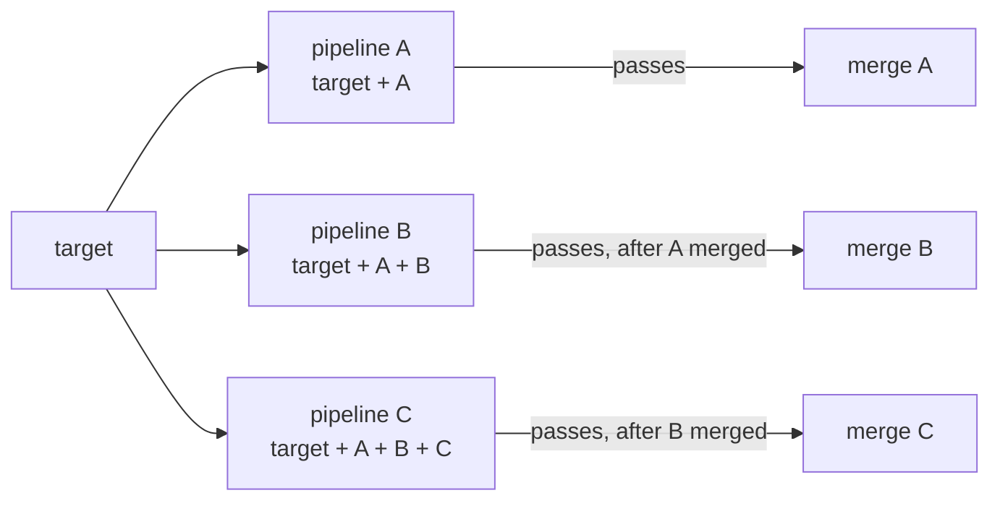

Every merge request was green, and the default branch is red. Merge request A renamed a function; merge request B, branched earlier, added a new call to the old name. Each pipeline tested its own branch, both passed, both merged, and the build broke. Git saw no conflict because the two changes touched different lines: it is a **semantic** conflict. GitLab has two features for this. **Merged results pipelines** test the merge request combined with the current target branch, and **merge trains** queue merges so that each one is tested together with every merge ahead of it.

> [!info] What was checked
> The behaviour, settings, variables, limits and API endpoints below come from the GitLab documentation read on 2026-10-21. Those pages describe GitLab 19.x, so features marked with a version may not exist on your instance: check the docs for your version. Both features need **Premium or Ultimate** (GitLab.com, Self-Managed and Dedicated) per those pages. **Not verified**: how trains interact with `resource_group`, protected environments and deploy jobs (the advice here is design guidance, not documented behaviour), the UI labels that distinguish pipeline types, what happens to queued merge requests when trains are turned off, the parallel limit before GitLab 19.0, merged results behaviour for merge requests from forks, and the runner capacity estimates.

## Pipeline types compared

| Pipeline                | What commit it tests                                                          | `CI_PIPELINE_SOURCE`  | `CI_MERGE_REQUEST_EVENT_TYPE` |
| ----------------------- | ----------------------------------------------------------------------------- | --------------------- | ----------------------------- |
| Branch pipeline         | The branch head, alone                                                        | `push` (and others)   | not set                       |
| Merge request pipeline  | The source branch head, alone (often called detached)                         | `merge_request_event` | `detached`                    |
| Merged results pipeline | A temporary merge commit of source and target, which exists in neither branch | `merge_request_event` | `merged_result`               |
| Merge train pipeline    | The target plus every merge request ahead in the train plus this one          | `merge_request_event` | `merge_train`                 |

Notes from the docs:

- A merged results pipeline cannot run when the source branch conflicts with the target; GitLab then runs a standard merge request pipeline.
- `CI_MERGE_REQUEST_SOURCE_BRANCH_SHA` and `CI_MERGE_REQUEST_TARGET_BRANCH_SHA` are set only in merged results pipelines (empty in plain merge request pipelines).
- A train pipeline runs on a ref like `refs/merge-requests/59/train` (from the API example).

A merged results pipeline still only tests "this merge request plus the target as it is now". If two merge requests are tested at the same time and both merge, they were never tested together. That gap is what merge trains close.

## How a merge train works



- The first merge request's pipeline is a merged results pipeline. Each later merge request's pipeline runs on the changes of every merge request ahead of it, plus its own, plus the target. Pipelines run in parallel.
- A merge request merges only when its own pipeline passed **and** every merge request ahead of it merged.
- **If a pipeline fails**, that merge request is removed from the train, and GitLab starts new pipelines for every merge request queued after it (they were testing a combination that will no longer exist). Redundant pipelines are cancelled.
- Each train runs up to a limit of parallel pipelines: **20 by default**; further merge requests wait for a slot, and the queue itself is unlimited. A per-project **Maximum parallel pipelines per merge train** setting (minimum 1, which means sequential) was introduced in GitLab 19.0 and cannot exceed the instance limit.

The trade-off in one line: the default branch stays green, and you pay for it with more pipelines and with restarts whenever something on the train fails.

## When to use which

| Situation                                                                   | Recommendation                                                                                               |
| --------------------------------------------------------------------------- | ------------------------------------------------------------------------------------------------------------ |
| A few merges a day, rarely at the same time                                 | Merged results pipelines are enough                                                                          |
| Many merges a day, several merge requests often ready together              | Merge trains                                                                                                 |
| A rule that the default branch must always pass (it deploys on every merge) | Merge trains, with enforcement where your version supports it                                                |
| Pipelines longer than about 30 minutes, or flaky                            | Fix speed and flakiness first; a train amplifies both (see below)                                            |
| Free tier                                                                   | Not available; require "branch is up to date" with fast-forward merges instead, and accept the serialisation |

## Prerequisites and enabling

From the docs:

1. The project's `.gitlab-ci.yml` must run **merge request pipelines**: job rules or `workflow:rules` that match `$CI_PIPELINE_SOURCE == "merge_request_event"`. **Rules that come from an `include:`, including `include:component`, do not satisfy this requirement**: define the matching rules directly in the project's `.gitlab-ci.yml` (see [[gitlab-ci-components-and-includes]]). Enabling merged results without merge request pipelines can leave merge requests stuck in an unresolved state.
2. The repository must be hosted on GitLab (not an external repository with CI only).
3. With the Maintainer or Owner role: **Settings > Merge requests > Merge options**, select **Enable merged results pipelines**, then **Enable merge trains**, and save.

The same settings through the projects API (`merge_pipelines_enabled`, `merge_trains_enabled`; also `max_pipelines_per_merge_train`, `merge_trains_skip_train_allowed` and `merge_train_enforcement` on versions that have them):

```bash title="enable through the API"
GITLAB=https://gitlab.example.com
PROJECT_ID=1234
# A token with api scope for a Maintainer of the project, from your secret store; never hard-code it.
: "${GITLAB_TOKEN:?set GITLAB_TOKEN}"

curl --fail --silent --show-error --request PUT \
  --header "PRIVATE-TOKEN: ${GITLAB_TOKEN}" \
  --data "merge_pipelines_enabled=true" \
  --data "merge_trains_enabled=true" \
  "${GITLAB}/api/v4/projects/${PROJECT_ID}" \
  | jq '{merge_pipelines_enabled, merge_trains_enabled, max_pipelines_per_merge_train, merge_train_enforcement}'
```

Manage project settings like this in code where you can (a settings job, or the GitLab Terraform provider), so they are reviewed and reproducible.

## workflow:rules for merge request pipelines

The documented pattern: merge request pipelines when a merge request is open, branch pipelines otherwise, and never both:

```yaml title=".gitlab-ci.yml (workflow)"
workflow:
  rules:
    # Skip draft merge requests (CI_MERGE_REQUEST_DRAFT exists from GitLab 17.10).
    - if: $CI_PIPELINE_SOURCE == "merge_request_event" && $CI_MERGE_REQUEST_DRAFT == "true"
      when: never
    - if: $CI_PIPELINE_SOURCE == "merge_request_event"
    # A push to a branch with an open merge request: the MR pipeline covers it.
    - if: $CI_COMMIT_BRANCH && $CI_OPEN_MERGE_REQUESTS && $CI_PIPELINE_SOURCE == "push"
      when: never
    - if: $CI_COMMIT_TAG
    - if: $CI_COMMIT_BRANCH == $CI_DEFAULT_BRANCH
    - if: $CI_COMMIT_BRANCH
```

- The `$CI_PIPELINE_SOURCE == "push"` condition keeps triggered pipelines (source `trigger` or `pipeline`) from being blocked, as the docs recommend.
- Skipping drafts saves train-sized amounts of CI. Whether to skip them is a team choice; [[branching-and-merge-standard]] sets ours.
- Rule syntax in depth is in [[gitlab-ci-rules-dag-matrix-and-includes]]; the stage layout is in [[gitlab-ci-pipeline-structure]].

## Keeping train pipelines short

Every minute of a train pipeline is multiplied by the number of merge requests waiting behind it, and by every restart. Decide per job where it runs, using `CI_MERGE_REQUEST_EVENT_TYPE`. Which jobs to keep on the train is an engineering judgement, not something the GitLab docs prescribe:

```yaml title=".gitlab-ci.yml (job placement)"
build:
  stage: build
  script: ["make build"]
  rules:
    - if: $CI_PIPELINE_SOURCE == "merge_request_event"
    - if: $CI_COMMIT_BRANCH == $CI_DEFAULT_BRANCH

unit-tests:
  stage: test
  script: ["make test"]
  retry:
    max: 2
    when: [runner_system_failure, stuck_or_timeout_failure]
  rules:
    - if: $CI_PIPELINE_SOURCE == "merge_request_event"
    - if: $CI_COMMIT_BRANCH == $CI_DEFAULT_BRANCH

full-e2e:
  stage: test
  script: ["make e2e"]
  rules:
    # Ran on the merge request already; also runs on the default branch and nightly.
    - if: $CI_MERGE_REQUEST_EVENT_TYPE == "merge_train"
      when: never
    - if: $CI_PIPELINE_SOURCE == "merge_request_event"
    - if: $CI_COMMIT_BRANCH == $CI_DEFAULT_BRANCH

review-app:
  stage: deploy
  script: ["make review-app"]
  rules:
    - if: $CI_MERGE_REQUEST_EVENT_TYPE == "merge_train"
      when: never
    - if: $CI_PIPELINE_SOURCE == "merge_request_event"
```

Guidance:

- **Keep on the train** what catches integration breakage cheaply: compile, unit tests, contract tests, linters that see the whole tree, the SonarQube gate if it blocks merges ([[sonarqube-quality-gates]]).
- **Move off the train** what is slow and already ran on the merge request: the long end-to-end suite, review apps, performance tests. Run them again on the default branch after merge and nightly, and alert when they fail there. Accept that a semantic conflict inside that suite's area is then caught after merge instead of before.
- **Retry only infrastructure failures** on train jobs. A failed train pipeline cannot be retried: the merge request is dropped and everything behind it restarts. The docs suggest the `retry` keyword for jobs that fail intermittently; limit it to `runner_system_failure` and similar, and quarantine flaky tests instead of retrying `script_failure` ([[test-sharding-flaky-tests]]).
- **Shard** what must stay on the train ([[test-sharding-flaky-tests]]).

## Deployments, environments and auto-merge

These are design recommendations; the merge train pages do not document the interaction with `resource_group` or protected environments:

- **Never deploy from a train pipeline.** It tests a combination that may never exist on the default branch. Deploy jobs run only on default-branch or tag pipelines, with `resource_group` serialising them as described in [[ci-pipeline-standard]].
- **Protected variables and runners** are available to merge request pipelines only in limited cases (the docs list the conditions; fork pipelines never get them). Train jobs should not need production credentials anyway.
- **Auto-merge** is how merge requests join the train while their pipeline is still running: **Set to auto-merge** adds them when checks pass (GA for merge trains in GitLab 17.7). With trains enabled, auto-merge cannot be used to bypass the train.
- **Merge immediately** skips the train, merges at once, cancels every train pipeline and restarts the train; the docs warn it can use a lot of CI/CD resources. Reserve it for incidents.
- **Enforcement** (introduced in 19.2, generally available in 19.3): levels **Allow bypass** (default), **Enforce for all users** and **Enforce with Owner override**. When enforced, the **Merge immediately** options disappear and direct merges through the REST or GraphQL API return **405 Method Not Allowed** unless the call passes `auto_merge=true`. Update bots before you enforce: Renovate needs `platformAutomerge` ([[automated-dependency-updates]]).
- **"Pipelines must succeed"**: a successful merged results pipeline can override a failed branch pipeline, and a merge request whose latest pipeline failed cannot be added to the train until a pipeline passes.

## Cost and runner capacity

A rough model (derived, not documented): with `N` merge requests on the train and a failure at position `k`, every pipeline from `k+1` to `N` restarts. With a failure rate `f` per pipeline, expected pipelines per merge grow with both the train length and `f`. In practice:

- Watch the pending-job queue during peak hours ([[gitlab-runner-jobs-stuck-pending]]) and size runner autoscaling for the parallel limit times the jobs per train pipeline ([[gitlab-runners-on-gke]]).
- Lower the per-project parallel limit (where available) if runners saturate; a slower train is better than one where every pipeline waits for a runner.
- Track the train's own health: merge requests dropped per day and why, median time from "added to train" to merged. Rising drops mean flaky tests or long pipelines, not a train problem.

## Merge requests from forks

Per the merge request pipeline docs, a pipeline for a merge request from a fork runs **in the fork** by default, with the fork's CI/CD settings and runners, and cannot use the parent project's protected variables or runners. A project member can run it in the parent project after accepting a warning; the projects API setting `ci_allow_fork_pipelines_to_run_in_parent_project` can disable that option. Running a fork's pipeline in the parent runs the fork's `.gitlab-ci.yml` with the parent's resources, so review the change first. How merged results and trains behave for fork merge requests was **not verified**; test it before relying on it for an open-source project.

## Verify

```bash title="inspect trains and pipeline types"
GITLAB=https://gitlab.example.com
PROJECT_ID=1234
: "${GITLAB_TOKEN:?set GITLAB_TOKEN}"
H="PRIVATE-TOKEN: ${GITLAB_TOKEN}"

# All trains of the project, and the merge requests on the main train.
curl -sS --header "$H" "${GITLAB}/api/v4/projects/${PROJECT_ID}/merge_trains" | jq '.[] | {target_branch, status, merge_request: .merge_request.iid, pipeline: .pipeline.ref}'
curl -sS --header "$H" "${GITLAB}/api/v4/projects/${PROJECT_ID}/merge_trains/main" | jq 'length'

# Train status of one merge request.
MR_IID=59
curl -sS --header "$H" "${GITLAB}/api/v4/projects/${PROJECT_ID}/merge_trains/merge_requests/${MR_IID}" | jq '{status, pipeline: .pipeline.ref}'
```

Add a tiny job that prints the pipeline type, so job logs show which kind of pipeline ran:

```yaml title=".gitlab-ci.yml (debug job)"
pipeline-type:
  stage: .pre
  script:
    - echo "source=${CI_PIPELINE_SOURCE} event=${CI_MERGE_REQUEST_EVENT_TYPE:-none} ref=${CI_COMMIT_REF_NAME}"
  rules:
    - if: $CI_PIPELINE_SOURCE == "merge_request_event"
```

Expected: a merge request pipeline logs `event=merged_result` once merged results are on (or `detached` when the branches conflict), and a train pipeline logs `event=merge_train`. The JSON field names in the `jq` filters follow the API docs' examples; adjust them if your version differs.

## Troubleshooting

| Symptom                                                          | Likely cause                                                                                                                               | Fix                                                                                                                                                 |
| ---------------------------------------------------------------- | ------------------------------------------------------------------------------------------------------------------------------------------ | --------------------------------------------------------------------------------------------------------------------------------------------------- |
| No merge request pipeline is created; the merge request is stuck | No rule matches `merge_request_event`, or the only matching rules come from an `include:component`                                         | Add the `workflow:rules` above to the project's own `.gitlab-ci.yml`.                                                                               |
| Two pipelines for every push                                     | Both a branch pipeline and a merge request pipeline run                                                                                    | The `CI_OPEN_MERGE_REQUESTS` rule above.                                                                                                            |
| Merge request dropped from the train                             | Pipeline failed, draft, closed, source branch updated, merge checks failed, could not combine with earlier merge requests, merge timed out | Read the system note in the merge request's **Activity**. For "could not be prepared ... conflicting files", rebase on the target and add it again. |
| "Retry" is not offered for the failed train pipeline             | Train pipelines cannot be retried once the merge request is dropped                                                                        | Add the merge request to the train again; use `retry` only for infrastructure failures.                                                             |
| Cannot add to the train                                          | "Pipelines must succeed" is on and the latest pipeline failed                                                                              | Retry the failed job or push a fix so a pipeline passes, then add it.                                                                               |
| Bot merges fail with 405                                         | Train enforcement is on and the bot merges directly                                                                                        | Call the merge endpoint with `auto_merge=true`; Renovate: `platformAutomerge`.                                                                      |
| Jobs with `rules:changes:compare_to` run unexpectedly            | The merged results commit contains changes from both branches                                                                              | Remove `compare_to` or narrow the paths, as the docs suggest.                                                                                       |
| Train is slow and restarts constantly                            | Flaky tests or long pipelines                                                                                                              | Quarantine flaky tests, move slow jobs off the train, lower the parallel limit if runners saturate.                                                 |

## Rollback

1. **Empty the train first.** Remove queued merge requests with **Cancel auto-merge** on each merge request (in the API: the merge requests API's cancel auto-merge endpoint, as the merge trains API page directs). Tell authors their merge requests need to be merged again.
2. **Turn trains off:** clear **Enable merge trains** in **Settings > Merge requests > Merge options**, or `merge_trains_enabled=false` through the projects API. If enforcement was on, set it back to **Allow bypass** first so direct merges work again.
3. **Keep merged results on** unless they are the problem: they cost little and still catch conflicts with the current target.
4. What GitLab does with merge requests still queued when trains are turned off was **not verified**; that is why step 1 comes first. Try the whole procedure on a test project before you need it.

Branch protection, review and merge-method rules stay as defined in [[branching-and-merge-standard]]; none of them change when trains are switched off.

## Related

- [[gitlab-ci-pipeline-structure]]
- [[test-sharding-flaky-tests]]
- [[branching-and-merge-standard]]
- [[gitlab-ci-rules-dag-matrix-and-includes]]
- [[automated-dependency-updates]]
- [[gitlab-runner-jobs-stuck-pending]]
- [[gitlab-pipeline-or-job-did-not-run]]
- [[change-management-controls-and-pipeline-evidence]]

## Sources

- [GitLab: Merge trains](https://docs.gitlab.com/ci/pipelines/merge_trains/)
- [GitLab: Merged results pipelines](https://docs.gitlab.com/ci/pipelines/merged_results_pipelines/)
- [GitLab: Merge request pipelines](https://docs.gitlab.com/ci/pipelines/merge_request_pipelines/)
- [GitLab: Predefined CI/CD variables](https://docs.gitlab.com/ci/variables/predefined_variables/)
- [GitLab: workflow keyword](https://docs.gitlab.com/ci/yaml/workflow/)
- [GitLab API: Merge trains](https://docs.gitlab.com/api/merge_trains/) and [Projects](https://docs.gitlab.com/api/projects/)
