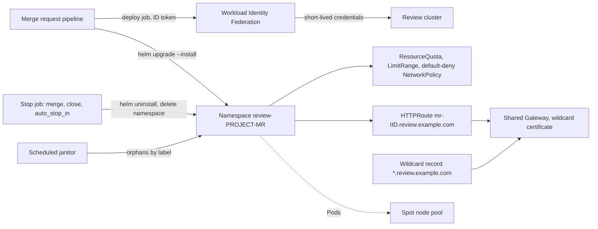

A review environment is a short-lived copy of the application, deployed from a merge request, with its own URL. Reviewers click a link instead of pulling the branch, product people see the change before it merges, and end-to-end tests run against something real. The cost is a pile of namespaces, DNS names and compute that someone has to clean up, plus a new path from unreviewed code into a cluster. This note gives the full GitLab CI implementation; the reference design behind it, including the Argo CD pull model and the trade-offs, is in [[architecture/ephemeral-preview-environments-on-gke]]. It covers one namespace per merge request, the GitLab CI jobs, DNS and TLS, a least-privilege deploy identity, cleanup that does not depend on the happy path, and Spot capacity to keep the bill small.

> [!info] Scope and sources
> GitLab behaviour (environment keywords, predefined variables, stop jobs, fork and protected-variable rules, the Environments API) was checked against the GitLab documentation source on 2026-10-21. Kubernetes naming and quota rules were checked against the Kubernetes documentation source the same day. Nothing was run against a live GitLab instance or cluster.

> [!note] Not verified
> GKE-specific parts were not checked against current Google Cloud documentation: the Workload Identity Federation principal format for a cluster RBAC subject, GKE RBAC for federated identities, the GKE Gateway class names and the Spot node pool details (see [[gke-spot-vms-for-workloads]]). Also not verified: whether `resource_group` expands CI/CD variables in your GitLab version, the GitLab tier and minimum version of the protected-variable controls for merge request pipelines, the `ValidatingAdmissionPolicy` API version for your control plane, and any quota on namespaces or DNS records. Check them for your versions before adopting the design.

## When review environments pay off

They are worth it when:

- The change is visible behaviour (UI, API contracts, a user flow) that a reviewer cannot judge from the diff.
- End-to-end or contract tests need a real deployment and a shared staging environment is a queue.
- The application starts in minutes on a few hundred millicores, with fake or seeded data.

They are not worth it when the application needs production data to be meaningful, depends on a dozen stateful services that cannot be faked, or takes half an hour to start. Then a shared staging environment with feature flags is cheaper and more honest. A half-working review environment that reviewers learn to ignore costs money and buys nothing.

## Design at a glance



Decisions behind the picture:

- **A separate cluster, or at least a separate node pool and project, for review workloads.** Merge request pipelines run code that nobody has reviewed yet. Whatever the review deploy identity can reach, any developer who can push a branch can reach. Keep production clusters, data and secrets out of that blast radius entirely.
- **One namespace per merge request**, named from the project ID and the merge request IID, never from the branch name.
- **One wildcard DNS record and one wildcard certificate** on a shared Gateway. Per-merge-request DNS records and certificates add moving parts that leak.
- **Three independent cleanup paths**: the GitLab stop job, `auto_stop_in`, and a scheduled janitor that works from Kubernetes labels.

## Naming: namespaces, hosts and environments

Kubernetes namespace names must be RFC 1123 DNS labels: at most 63 characters, lowercase alphanumerics and `-`, starting with a letter and ending with an alphanumeric. Branch names do not fit that reliably:

- `CI_COMMIT_REF_SLUG` is the branch name lowercased, shortened to 63 bytes, with everything except `0-9` and `a-z` replaced by `-`. `review-` plus a 63-byte slug is 70 characters, and a branch such as `123-fix` gives a slug that starts with a digit.
- `CI_ENVIRONMENT_SLUG` is truncated to 24 characters and can get a random suffix, so it is not the branch slug and cannot be recomputed from the branch name.

Use identifiers that are short, unique and known in every job of the merge request pipeline:

| Thing              | Value                                                        | Example                         |
| ------------------ | ------------------------------------------------------------ | ------------------------------- |
| GitLab environment | `review/$CI_COMMIT_REF_SLUG`                                 | `review/feature-new-checkout`   |
| Namespace          | `review-$CI_PROJECT_ID-$CI_MERGE_REQUEST_IID`                | `review-4211-87`                |
| Hostname           | `mr-$CI_PROJECT_ID-$CI_MERGE_REQUEST_IID.review.example.com` | `mr-4211-87.review.example.com` |
| Helm release       | `app` (one release per namespace)                            | `app`                           |

The project ID keeps several projects from colliding on one cluster. The hostname stays a single label under `review.example.com`, because a wildcard certificate covers exactly one label. Define these once as job variables and use the same variable in the deploy and stop jobs; never derive the namespace differently in two places.

## The namespace baseline

Every review namespace gets the same guardrails before the chart is installed. Apply them from a fixed file in the CI image or a platform repository, not from the merge request's own tree, so a branch cannot loosen them.

```yaml title="review-namespace-baseline.yaml"
# Created by the deploy job in every review namespace; each deploy re-creates any object that is missing.
# NAMESPACE is substituted with envsubst before kubectl create.
apiVersion: v1
kind: ResourceQuota
metadata:
  name: review-quota
  namespace: ${NAMESPACE}
spec:
  hard:
    requests.cpu: "2" # change: what one review copy really needs
    requests.memory: 4Gi
    limits.memory: 6Gi
    pods: "30"
    services.loadbalancers: "0" # traffic enters only through the shared Gateway
    services.nodeports: "0"
    persistentvolumeclaims: "4"
    requests.storage: 20Gi
---
apiVersion: v1
kind: LimitRange
metadata:
  name: review-defaults
  namespace: ${NAMESPACE}
spec:
  limits:
    - type: Container
      defaultRequest:
        cpu: 50m
        memory: 128Mi
      default:
        memory: 512Mi
---
apiVersion: networking.k8s.io/v1
kind: NetworkPolicy
metadata:
  name: default-deny
  namespace: ${NAMESPACE}
spec:
  podSelector: {}
  policyTypes:
    - Ingress
    - Egress
---
apiVersion: networking.k8s.io/v1
kind: NetworkPolicy
metadata:
  name: allow-dns-and-gateway
  namespace: ${NAMESPACE}
spec:
  podSelector: {}
  policyTypes:
    - Ingress
    - Egress
  ingress:
    # In-cluster Gateway data plane (an Envoy-based implementation): allow its namespace.
    # A Google-managed load balancer does not send traffic from a namespace: see the note below.
    - from:
        - namespaceSelector:
            matchLabels:
              kubernetes.io/metadata.name: gateway-review # change: the namespace of your Gateway's proxies
  egress:
    - to:
        - namespaceSelector:
            matchLabels:
              kubernetes.io/metadata.name: kube-system
      ports:
        - protocol: UDP
          port: 53
        - protocol: TCP
          port: 53
    - to:
        - podSelector: {} # within the same review namespace
```

Why each object:

- **ResourceQuota.** One runaway merge request (a replica count typo, a memory leak) cannot starve the others. Once a quota covers CPU or memory, every Pod must declare requests and limits or it is rejected; the LimitRange fills in defaults so charts without them still deploy. See [[kubernetes-resource-requests-and-limits]] and [[adr/0021-mandatory-resource-requests]].
- **No LoadBalancer or NodePort Services.** Each one would be a new external IP and a cost line.
- **Default-deny NetworkPolicy**, then allow DNS, the Gateway and traffic inside the namespace. With a Google-managed Gateway (a `gke-l7-*` class), requests reach Pods from the load balancer's proxy and health-check address ranges, not from a namespace, so the ingress rule needs `ipBlock` entries for those ranges instead; take them from the GKE load balancer documentation for your class (not verified here) and test with a real request after applying. Review copies must not talk to each other or to shared services they were not meant to reach. The pattern and its pitfalls are in [[kubernetes-network-policies]] and [[adr/0020-default-deny-network-policies]]. If the application needs egress to the internet or to a fake third-party API, add a narrow rule for it.

Data and secrets: review environments use seeded or synthetic data and sandbox credentials only. Never mount a production database, production API keys or a copy of production data "just for a realistic demo". A review namespace runs unreviewed code; anything it can read, the branch author can exfiltrate.

## The CI jobs

The jobs run in merge request pipelines only. Avoid duplicate branch and merge request pipelines with `workflow:rules`, as in [[gitlab-ci-pipeline-structure]]; with merge trains, GitLab documents that the stop job runs only when duplicate pipelines are avoided.

```yaml title=".gitlab-ci.yml (fragment)"
variables:
  REVIEW_DOMAIN: review.example.com # change: the delegated review zone
  GCP_PROJECT_NUMBER: "123456789012" # change: project number of the WIF pool
  GCP_WIF_POOL: gitlab-ci
  GCP_WIF_PROVIDER: gitlab-oidc
  GCP_SERVICE_ACCOUNT: review-deployer@review-project.iam.gserviceaccount.com # change
  GKE_CLUSTER: review # change
  GKE_LOCATION: europe-west1 # change: region of the review cluster
  GKE_PROJECT: review-project # change

.review-auth:
  image: registry.example.com/platform/deploy-tools:2026.10.1 # change: pinned image with gcloud, kubectl, helm, envsubst, jq
  id_tokens:
    GCP_ID_TOKEN:
      aud: gcp-wif-my-org # must match allowed_audiences on the provider
  before_script:
    - umask 077
    - export CRED_DIR="${CI_BUILDS_DIR}/${CI_JOB_ID}"
    - mkdir -p "$CRED_DIR"
    - printf '%s' "$GCP_ID_TOKEN" > "$CRED_DIR/token.jwt"
    - >
      gcloud iam workload-identity-pools create-cred-config
      "projects/${GCP_PROJECT_NUMBER}/locations/global/workloadIdentityPools/${GCP_WIF_POOL}/providers/${GCP_WIF_PROVIDER}"
      --service-account="$GCP_SERVICE_ACCOUNT"
      --credential-source-file="$CRED_DIR/token.jwt"
      --credential-source-type=text
      --output-file="$CRED_DIR/cred.json"
    - gcloud auth login --cred-file="$CRED_DIR/cred.json" --quiet
    - gcloud container clusters get-credentials "$GKE_CLUSTER" --location "$GKE_LOCATION" --project "$GKE_PROJECT"
  after_script:
    - rm -rf "${CI_BUILDS_DIR}/${CI_JOB_ID}"

.review:
  extends: .review-auth
  variables:
    NAMESPACE: review-$CI_PROJECT_ID-$CI_MERGE_REQUEST_IID
    REVIEW_HOST: mr-$CI_PROJECT_ID-$CI_MERGE_REQUEST_IID.$REVIEW_DOMAIN
  resource_group: review-$CI_PROJECT_ID-$CI_MERGE_REQUEST_IID # serialises deploy and stop per MR; check variable expansion in your version

deploy-review:
  extends: .review
  stage: deploy
  rules:
    - if: $CI_PIPELINE_SOURCE == "merge_request_event"
  environment:
    name: review/$CI_COMMIT_REF_SLUG
    url: https://$REVIEW_HOST
    on_stop: stop-review
    auto_stop_in: 3 days
  script:
    - |
      set -euo pipefail
      if ! kubectl get namespace "$NAMESPACE" >/dev/null 2>&1; then
        # Create the namespace with its labels in one request, so the janitor can always find it.
        kubectl create namespace "$NAMESPACE" --dry-run=client -o yaml \
          | kubectl label --local -f - -o yaml \
              review.example.com/managed=true \
              review.example.com/project-id="$CI_PROJECT_ID" \
              review.example.com/mr-iid="$CI_MERGE_REQUEST_IID" \
              review.example.com/expose=true \
          | kubectl create -f -
      fi
      # Reconcile the baseline on every deploy, so a retry after a partial failure still gets it.
      # Create only what is missing: the deployer may not update quotas (see RBAC below), so no apply.
      baseline="$(NAMESPACE="$NAMESPACE" envsubst < /opt/platform/review-namespace-baseline.yaml)"
      printf '%s\n' "$baseline" | kubectl create -f - 2>&1 | grep -v 'AlreadyExists' || true
      # Fail the job unless every baseline object now exists.
      printf '%s\n' "$baseline" | kubectl get -f - -o name
    - >
      helm upgrade --install app ./chart
      --namespace "$NAMESPACE"
      --values ./chart/values-review.yaml
      --set image.tag="$CI_COMMIT_SHA"
      --set route.hostname="$REVIEW_HOST"
      --atomic --timeout 10m
      --history-max 3
    - echo "Review app at https://$REVIEW_HOST"

stop-review:
  extends: .review
  stage: deploy # same stage as the deploy job, see Troubleshooting
  rules:
    - if: $CI_PIPELINE_SOURCE == "merge_request_event"
      when: manual
  allow_failure: true # a manual job in rules must not block the pipeline
  variables:
    GIT_STRATEGY: none # the branch may already be deleted
  environment:
    name: review/$CI_COMMIT_REF_SLUG
    action: stop
  script:
    - |
      set -euo pipefail
      helm uninstall app --namespace "$NAMESPACE" --wait --timeout 5m --ignore-not-found
      kubectl delete namespace "$NAMESPACE" --ignore-not-found --wait=false
```

How the GitLab side behaves, as documented:

- `on_stop` names the job that runs when the environment stops. Deploy and stop jobs must have the same `rules`; the stop job needs `when`, `environment:name` and `environment:action: stop`. With `rules` and `when: manual`, `allow_failure: true` lets the pipeline finish.
- The docs say "GitLab automatically stops environments when the associated branch is deleted or merged", and stopping from the Environments page runs the stop job too. A separate section, "Stop an environment when a merge request is merged or closed", says that with merge request pipelines "the `stop` trigger is automatically enabled". Whether closing a merge request while its branch stays runs the stop job is therefore worth testing on your GitLab version; either way `auto_stop_in` and the janitor below are the backstops.
- `auto_stop_in` accepts natural language (`3 days`, `one week`, `never`), is reset by every deploy, and is processed by a background worker that runs about once an hour. It is a safety net, not a timer to the minute.
- `GIT_STRATEGY: none` stops the runner from trying to check out a branch that no longer exists. The price: the stop job cannot call a script from the repository, so the stop logic lives inline (as above) or in the job image. If it must live in the repository, use merge request pipelines, which GitLab can still fetch after the source branch is deleted.
- The documentation says the stop job and deploy job must share a `resource_group` for the Environments page to trigger `on_stop`. The `resource_group` also stops a deploy and a stop for the same merge request from running at the same time, which otherwise ends in Helm's "another operation is in progress".

Helm notes: `--atomic` rolls back a failed upgrade and, on a failed first install, removes the release; it implies `--wait`. In Helm 4 the flag is renamed `--rollback-on-failure` and the old name prints a deprecation warning. Check `helm upgrade --help` for the client in your image. `--history-max 3` keeps release Secrets from piling up across dozens of pushes. Chart layout and the review values file follow [[helm-chart-conventions]].

## DNS and TLS

The simplest robust setup has no per-merge-request DNS or certificates at all:

1. Delegate `review.example.com` to a Cloud DNS zone in the review project.
2. Create one wildcard record, `*.review.example.com`, pointing at the Gateway's address, in Terraform.
3. Issue one wildcard certificate, `*.review.example.com`, with cert-manager and the DNS-01 solver ([[cert-manager-dns01-cloud-dns]]); DNS-01 is required for wildcards.
4. Terminate TLS on a shared Gateway in its own namespace. Review namespaces attach `HTTPRoute`s to it.

```yaml title="gateway-review.yaml"
apiVersion: gateway.networking.k8s.io/v1
kind: Gateway
metadata:
  name: review
  namespace: gateway-review
spec:
  gatewayClassName: gke-l7-global-external-managed # change: the GatewayClass you use; check the GKE docs
  listeners:
    - name: https
      protocol: HTTPS
      port: 443
      hostname: "*.review.example.com"
      tls:
        mode: Terminate
        certificateRefs:
          - name: wildcard-review-example-com-tls
      allowedRoutes:
        namespaces:
          from: Selector
          selector:
            matchLabels:
              review.example.com/expose: "true"
```

<!-- prettier-ignore -->
```yaml title="chart/templates/httproute.yaml"
apiVersion: gateway.networking.k8s.io/v1
kind: HTTPRoute
metadata:
  name: {{ include "app.fullname" . }}
spec:
  parentRefs:
    - name: review
      namespace: gateway-review
  hostnames:
    - {{ .Values.route.hostname | quote }}
  rules:
    - backendRefs:
        - name: {{ include "app.fullname" . }}
          port: 80
```

The certificate Secret stays in one namespace, so it never has to be copied into review namespaces, and deleting a review namespace removes its route with it. The north-south design this sits in is in [[edge-and-ingress-cloudflare-gclb-gateway-api]].

If each review environment needs its own record (different addresses, or no wildcard allowed), use ExternalDNS with the `gateway-httproute` source ([[external-dns-on-gke]]). Then mind the policy: with `--policy=upsert-only` ExternalDNS never deletes records, so every review hostname lives forever in the zone; with `--policy=sync` it removes records whose source disappears, which is what review cleanup needs, scoped by `--domain-filter=review.example.com` and its own `--txt-owner-id` so it can never touch other zones. Current ExternalDNS releases use the `external-dns.kubernetes.io/` annotation prefix; older ones used `external-dns.alpha.kubernetes.io/`. Check the version you run.

Protect review URLs from the internet with an identity-aware proxy or Cloudflare Access ([[cloudflare-access-service-tokens]]) unless the application is public anyway. Unreleased features and seeded admin accounts on a guessable hostname are a leak.

## The deploy identity

The review deploy job authenticates with a GitLab ID token through Workload Identity Federation, so no service account key or kubeconfig is stored in GitLab. The pool, provider and attribute condition are described in [[iam-groups-and-ci-workload-identity-federation]] and decided in [[adr/0026-keyless-ci-auth-with-workload-identity-federation]].

The review identity is different from the production deploy identity:

- It is bound to the **project on any ref** (`attribute.project_path/<group>/<project>`), because review deploys come from unprotected feature branches. The production identity requires a protected ref. Never reuse one for the other.
- In Google Cloud IAM it gets only what `get-credentials` needs on the review cluster (for example `roles/container.clusterViewer` on the review project). Everything else is Kubernetes RBAC.
- In Kubernetes it gets a ClusterRole that can create, list and delete namespaces, plus the namespaced verbs the chart needs. RBAC cannot scope namespace creation by name, so an admission policy limits which namespaces this identity may create or delete.

```yaml title="review-deployer-rbac.yaml"
apiVersion: rbac.authorization.k8s.io/v1
kind: ClusterRole
metadata:
  name: review-deployer
rules:
  - apiGroups: [""]
    resources: ["namespaces"]
    verbs: ["get", "list", "create", "delete", "patch"]
  - apiGroups:
      [
        "",
        "apps",
        "batch",
        "networking.k8s.io",
        "gateway.networking.k8s.io",
        "policy",
        "autoscaling",
      ]
    resources:
      - configmaps
      - secrets
      - services
      - serviceaccounts
      - pods
      - pods/log
      - deployments
      - statefulsets
      - jobs
      - networkpolicies
      - httproutes
      - poddisruptionbudgets
      - horizontalpodautoscalers
      - persistentvolumeclaims
    verbs: ["get", "list", "watch", "create", "update", "patch", "delete"]
  - apiGroups: [""]
    resources: ["resourcequotas", "limitranges"]
    verbs: ["get", "list", "create"] # create once; no update or delete, so a branch cannot lift its quota
---
apiVersion: rbac.authorization.k8s.io/v1
kind: ClusterRoleBinding
metadata:
  name: review-deployer
roleRef:
  apiGroup: rbac.authorization.k8s.io
  kind: ClusterRole
  name: review-deployer
subjects:
  - kind: User
    name: review-deployer@review-project.iam.gserviceaccount.com # change: the impersonated service account
```

```yaml title="review-namespace-guard.yaml"
# The deployer may create, update or delete only namespaces named review-* and labelled as managed.
apiVersion: admissionregistration.k8s.io/v1
kind: ValidatingAdmissionPolicy
metadata:
  name: review-namespace-guard
spec:
  failurePolicy: Fail
  matchConstraints:
    resourceRules:
      - apiGroups: [""]
        apiVersions: ["v1"]
        operations: ["CREATE", "UPDATE", "DELETE"]
        resources: ["namespaces"]
  matchConditions:
    - name: only-the-review-deployer
      expression: request.userInfo.username == "review-deployer@review-project.iam.gserviceaccount.com"
  validations:
    - expression: >-
        request.operation == "DELETE"
        ? (oldObject.metadata.name.startsWith("review-")
           && has(oldObject.metadata.labels)
           && oldObject.metadata.labels[?"review.example.com/managed"].orValue("") == "true")
        : (object.metadata.name.startsWith("review-")
           && has(object.metadata.labels)
           && object.metadata.labels[?"review.example.com/managed"].orValue("") == "true")
      message: The review deployer may only manage review-* namespaces labelled review.example.com/managed=true.
---
apiVersion: admissionregistration.k8s.io/v1
kind: ValidatingAdmissionPolicyBinding
metadata:
  name: review-namespace-guard
spec:
  policyName: review-namespace-guard
  validationActions: ["Deny"]
```

The ClusterRoleBinding still lets the identity write Deployments and Secrets in every namespace of the review cluster, including `gateway-review` and `kube-system`. That is acceptable only because the cluster holds nothing but review copies and platform add-ons whose own namespaces are guarded the same way (extend the policy to deny writes to non-`review-` namespaces for this user), or protected by a policy engine ([[gatekeeper-vs-kyverno]]). Test the CEL expressions with `kubectl apply --dry-run=server` as the deployer before relying on them; the optional-field syntax (`[?...]`, `orValue`) needs a recent control plane.

## Forks and protected variables

- A pipeline for a merge request from a fork runs in the **fork** project, with the fork's CI configuration, runners and variables. It has no access to the parent project's variables, so it cannot deploy a review environment into your cluster. That is the safe default.
- A parent-project member can run a fork merge request's pipeline **in the parent project**. That pipeline uses the fork branch's CI configuration with the parent's runners and variables, and GitLab warns that such code can try to steal secrets. Treat that button as "give this stranger my review deploy identity". Read the full diff, including `.gitlab-ci.yml`, first, or disable it with the project setting `ci_allow_fork_pipelines_to_run_in_parent_project`.
- Protected variables are only exposed to pipelines on protected branches and tags. Merge request pipelines get them only when both source and target branches are protected and in the same project, the triggering user can push or merge to the target, and the project allows it (a setting introduced in GitLab 18.1). A normal feature branch merge request does not. That is another reason the review deploy uses an ID token with a project-on-any-ref binding instead of a protected secret.

## Cleanup: the janitor

The stop job is the main cleanup path, but it fails in known ways (see Troubleshooting), environments can be force-stopped without running it, and a crashed runner can leave a namespace behind. A scheduled pipeline on the default branch deletes review namespaces whose merge request is no longer open or that are too old, using the labels set at creation, not by parsing names.

GitLab's `stop_stale` API is not a replacement: it only accepts a cutoff at least one week in the past. The janitor below works from Kubernetes and the merge request API instead.

```bash title="scripts/review-janitor.sh"
#!/usr/bin/env bash
# Deletes review namespaces whose merge request is merged or closed, or that are older than MAX_AGE_HOURS.
# Runs in a scheduled pipeline on the default branch, authenticated to the review cluster.
# Needs: kubectl, curl, jq; GITLAB_API_TOKEN (masked, protected; a project access token with read_api).
set -euo pipefail

GITLAB_URL="${CI_SERVER_URL:?}"            # set by GitLab
MAX_AGE_HOURS="${MAX_AGE_HOURS:-120}"     # change: hard upper bound on any review copy
DRY_RUN="${DRY_RUN:-true}"                # set to false once the output looks right

now_epoch="$(date -u +%s)"
mr_json="$(mktemp)"
trap 'rm -f "$mr_json"' EXIT

kubectl get namespaces -l review.example.com/managed=true -o json \
  | jq -r '.items[] | [
      .metadata.name,
      .metadata.labels["review.example.com/project-id"],
      .metadata.labels["review.example.com/mr-iid"],
      .metadata.creationTimestamp,
      (.status.phase // "")
    ] | @tsv' \
  | while IFS=$'\t' read -r ns project_id mr_iid created phase; do
      [[ "$phase" == "Terminating" ]] && { echo "skip $ns: already terminating"; continue; }
      [[ "$project_id" =~ ^[0-9]+$ && "$mr_iid" =~ ^[0-9]+$ ]] || { echo "skip $ns: project-id or mr-iid label missing"; continue; }

      created_epoch="$(date -u -d "$created" +%s)"   # GNU date; the job image is Linux
      age_hours=$(( (now_epoch - created_epoch) / 3600 ))

      http_code="$(curl -sS -o "$mr_json" -w '%{http_code}' \
        --header "PRIVATE-TOKEN: ${GITLAB_API_TOKEN:?}" \
        "${GITLAB_URL}/api/v4/projects/${project_id}/merge_requests/${mr_iid}")"

      if [[ "$http_code" == "200" ]]; then
        state="$(jq -r '.state' "$mr_json")"
      elif [[ "$http_code" == "404" ]]; then
        # GitLab also answers 404 for a project the token cannot see: only the age limit applies.
        state="not-visible"
      else
        echo "skip $ns: GitLab API returned $http_code"; continue
      fi

      reason=""
      [[ "$state" != "opened" && "$state" != "not-visible" ]] && reason="merge request is $state"
      (( age_hours > MAX_AGE_HOURS )) && reason="${reason:+$reason, }age ${age_hours}h"

      if [[ -n "$reason" ]]; then
        echo "delete $ns ($reason)"
        if [[ "$DRY_RUN" == "false" ]]; then
          kubectl delete namespace "$ns" --wait=false
        fi
      fi
    done
```

```yaml title=".gitlab-ci.yml (fragment)"
review-janitor:
  extends: .review-auth # authentication only; no environment, no resource_group
  stage: deploy
  rules:
    - if: $CI_PIPELINE_SOURCE == "schedule" && $JANITOR == "review"
  variables:
    DRY_RUN: "false"
  script:
    - bash scripts/review-janitor.sh
```

Notes:

- A namespace deleted by the janitor leaves its GitLab environment `available`. Either stop it through the API (`POST /projects/:id/environments/:environment_id/stop`, after finding it with `GET /projects/:id/environments?states=available&search=review`) or let `auto_stop_in` catch it; its stop job then finds nothing to delete, which the `--ignore-not-found` flags handle.
- Deleting stopped environments from GitLab's list is separate: `DELETE /projects/:id/environments/review_apps` schedules deletion of stopped review environments and defaults to a dry run.
- Schedule the janitor every few hours. Run it with `DRY_RUN=true` for a week first and read what it would delete.

## Capacity and cost

Review copies are idle most of the time and disposable all of the time, which makes them a good fit for Spot capacity. Put them on a tainted Spot node pool and give the review chart a matching toleration and node selector; the trade-offs and the fallback design are in [[gke-spot-vms-for-workloads]].

```yaml title="chart/values-review.yaml (fragment)"
replicaCount: 1
resources:
  requests:
    cpu: 50m
    memory: 128Mi
  limits:
    memory: 512Mi
nodeSelector:
  cloud.google.com/gke-spot: "true"
tolerations:
  - key: workload
    operator: Equal
    value: review
    effect: NoSchedule
```

The toleration targets a dedicated review Spot pool with its own taint `workload=review:NoSchedule`, not the shared `workload-class=spot` pool from [[gke-spot-vms-for-workloads]], so unreviewed merge request code never shares nodes with other workloads.

Other levers:

- One replica, no HPA, no PodDisruptionBudget in review values. A PDB with `minAvailable: 1` on a single replica blocks node drains and scale-down.
- `auto_stop_in` short enough to matter (two to three days), reset by each push.
- Scale review Deployments to zero overnight with a scheduled job if they must live for days.
- Label the namespace with the team and the merge request so cost allocation can attribute spend ([[finops-cost-allocation-and-guardrails]]).
- A cluster autoscaler minimum of zero on the review pool, so an idle evening costs only the control plane and the Gateway.

## Verify

```bash
set -euo pipefail

PROJECT_ID="4211"   # change: the GitLab project ID
MR_IID="87"         # change: a merge request with a review environment
NS="review-${PROJECT_ID}-${MR_IID}"
HOST="mr-${PROJECT_ID}-${MR_IID}.review.example.com"   # change: your review domain

kubectl get namespace "$NS" --show-labels
kubectl -n "$NS" get resourcequota,limitrange,networkpolicy
kubectl -n "$NS" describe resourcequota review-quota
kubectl -n "$NS" get pods -o wide
kubectl -n "$NS" get httproute -o yaml | grep -A3 'parents:'
helm -n "$NS" status app

curl -sS -o /dev/null -w '%{http_code} %{ssl_verify_result}\n' "https://${HOST}/"
```

Expected: the namespace carries the `review.example.com/*` labels; quota, LimitRange and both NetworkPolicies exist; Pods run on Spot nodes; the route reports `Accepted` and `ResolvedRefs` as `True`; `curl` prints `200 0` (or a redirect to your access proxy).

Then test the cleanup paths deliberately:

1. Merge a test merge request (or delete its branch). Shortly after, the stop job should run and the namespace should go to `Terminating`.
2. Deploy a test branch with `auto_stop_in: 1 hour` and wait up to two hours.
3. Delete a review namespace's environment with a force stop and confirm the janitor removes the namespace on its next run.
4. As the deployer identity, try `kubectl create namespace prod-test --dry-run=server`. Expected: denied by `review-namespace-guard`.

## Troubleshooting

**The stop job never runs.** The documented causes:

- The stop job sits in a later stage than a job that failed, so GitLab never reaches it. Put deploy and stop in the same stage.
- Its `needs:` chain cannot run. Give the stop job no `needs`.
- Its `rules` differ from the deploy job's, so it was not created in the pipeline at all.
- The environment was force-stopped, which skips `on_stop` by design.
- The branch was deleted and the job tried to check out code. Use `GIT_STRATEGY: none` (or `empty`) or merge request pipelines.
- With merge trains, duplicate pipelines prevent the stop job from running.

Check the merge request's latest pipeline for a `stop-review` job; if it is missing, the rules are the problem.

**An environment is stuck in `stopping`.** Usually the stop job failed or never got a runner. Fix the cause, then stop it again; as a last resort force-stop it, then remove the namespace yourself or let the janitor do it.

**`metadata.name: Invalid value` when creating the namespace.** The name is longer than 63 characters or not a valid DNS label: you derived it from the branch. Use the project ID and merge request IID as above.

**The namespace is stuck in `Terminating`.** Something in it has a finalizer whose controller is gone, or an unavailable APIService blocks discovery. Follow [[namespace-stuck-terminating]]; do not strip finalizers before you know which controller owns them.

**`exceeded quota` on deploy.** Read `kubectl describe resourcequota`. Either the chart's review values ask for more than the quota, or Pods lack requests and the LimitRange is missing.

**`another operation (install/upgrade/rollback) is in progress`.** Two jobs for the same merge request ran at once, or a job was killed mid-upgrade. Check the `resource_group`, then recover the release as in [[helm-release-rollback]].

**Pods pending.** The Spot pool has no capacity, or the toleration or node selector does not match the pool. See [[gke-spot-vms-for-workloads]].

**The URL returns 404 from the Gateway.** The route was not accepted: the namespace lacks the `review.example.com/expose=true` label, or the hostname is not under the listener's wildcard.

## Rollback and switching it off

- A bad review deploy: push a fix, or re-run the previous pipeline's deploy job. Nothing in production depends on review environments, so there is no rollback urgency.
- A bad baseline or RBAC change: revert it in the platform repository and re-apply. Existing namespaces keep their objects until recreated.
- Switching review environments off: remove `deploy-review` and `stop-review` from the CI configuration, stop all review environments from the Environments page, then run the janitor with `MAX_AGE_HOURS=0` and `DRY_RUN=false`, and finally delete the review node pool. Delete the wildcard DNS record last.

## Related

- [[ephemeral-preview-environments-on-gke]]: the reference design, the push and pull delivery models and their trade-offs.
- [[gitlab-runners-on-gke]]: the runners these jobs execute on.
- [[iam-groups-and-ci-workload-identity-federation]]: the keyless authentication used by the deploy job.
- [[gke-spot-vms-for-workloads]]: Spot node pools and the fallback design.
- [[kubernetes-network-policies]]: default-deny and the allow rules.
- [[cert-manager-dns01-cloud-dns]]: issuing the wildcard certificate.
- [[namespace-stuck-terminating]]: when cleanup hangs.
- [[adr/0019-namespace-per-team-tenancy]]: the namespace tenancy model this extends.

## Sources

- [GitLab: Environments](https://docs.gitlab.com/ci/environments/): `on_stop`, stopping behaviour, auto-stop worker, force stop, stop job troubleshooting, `resource_group` requirement.
- [GitLab: Review apps](https://docs.gitlab.com/ci/review_apps/)
- [GitLab: CI/CD YAML syntax reference](https://docs.gitlab.com/ci/yaml/): `environment:name`, `url`, `action`, `auto_stop_in`.
- [GitLab: Predefined CI/CD variables](https://docs.gitlab.com/ci/variables/predefined_variables/): `CI_COMMIT_REF_SLUG`, `CI_ENVIRONMENT_SLUG`, `CI_MERGE_REQUEST_IID`.
- [GitLab: Merge request pipelines](https://docs.gitlab.com/ci/pipelines/merge_request_pipelines/): fork pipelines and protected variables.
- [GitLab: Environments API](https://docs.gitlab.com/api/environments/): list, stop, `stop_stale`, delete review apps.
- [Kubernetes: Object names and IDs](https://kubernetes.io/docs/concepts/overview/working-with-objects/names/)
- [Kubernetes: Resource quotas](https://kubernetes.io/docs/concepts/policy/resource-quotas/)
- [Kubernetes: Validating admission policy](https://kubernetes.io/docs/reference/access-authn-authz/validating-admission-policy/)
- [Gateway API: Gateway and route attachment](https://gateway-api.sigs.k8s.io/)
- [Helm: helm upgrade](https://helm.sh/docs/helm/helm_upgrade/)
- [ExternalDNS: annotations](https://github.com/kubernetes-sigs/external-dns/blob/master/docs/annotations/annotations.md)
