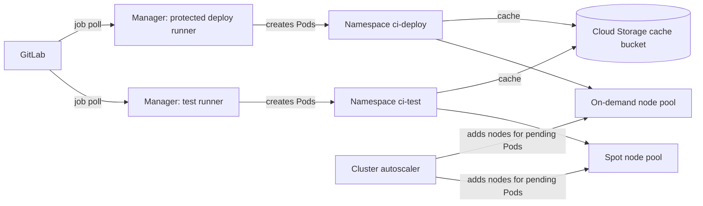

This note covers running self-managed GitLab runners on GKE with the Kubernetes executor: the Helm install, the executor settings, isolation between job classes, node pools, a Cloud Storage cache and capacity. It is written for senior DevOps engineers who already run GKE and GitLab CI. Cache key design and pipeline layout stay in [[patterns/gitlab-ci-pipeline-structure]]; Workload Identity itself is explained in [[patterns/gke-workload-identity]]; the Jenkins equivalent of the trade-offs is in [[tools/gitlab-ci-vs-jenkins]].

> [!info] Scope and sources
> Written against the GitLab Runner Kubernetes executor and the `gitlab-runner` Helm chart as described in the GitLab Runner documentation on docs.gitlab.com and the GKE documentation on cloud.google.com. No chart version is pinned here on purpose: pin the one you tested.

> [!note] Not verified
> The claims below were written from documentation knowledge and were not checked against a running system or the current docs: the current runner registration flow (runner authentication tokens created in the UI or API), `config.toml` key names, Helm chart value names, and whether the Cloud Storage cache works with Workload Identity and no key file in your runner version. Check them before relying on them.

## Architecture

A runner manager is one long-running Pod. It polls GitLab for jobs and, for each job, creates a short-lived Pod in a target namespace. The job Pod holds a build container, a helper container (clones the repository, handles artifacts and cache) and any service containers. When the job ends, the Pod is deleted.



Design rules that follow from this:

- One runner manager per job class, each with its own namespace, service account, node pool and tags. A test runner and a deploy runner are different trust levels and are never the same runner.
- The deploy runner is protected: it only picks up jobs from protected branches and tags. Merge requests from forks and unreviewed branches never reach it.
- The runner does not add nodes. It creates Pods; Pods that do not fit stay `Pending`, and the cluster autoscaler (or node auto-provisioning) adds nodes. See [[patterns/kubernetes-autoscaling]].
- The cluster should be private with controlled egress. Job Pods run arbitrary build code, so the network path matters: [[architecture/private-gke-and-controlled-egress]].

## Installing with Helm

The runner token comes from a Kubernetes Secret, never from a values file in Git. Create the runner in GitLab (a project, group or instance runner) and store the authentication token it shows once. The Secret name is referenced by the chart; the key names the chart expects are in its documentation.

```yaml title="values-test.yaml"
# Helm values for the test runner (spot pool, namespace ci-test).
gitlabUrl: https://gitlab.example.com/ # change: your GitLab URL

# Secret with the runner authentication token. Create it out of band
# (for example External Secrets) and never commit the token.
runners:
  secret: gitlab-runner-test-token
  # The [[runners]] block comes from config.toml via --set-file.

concurrent: 20 # change: upper bound of simultaneous job Pods for this manager

rbac:
  create: true
  # The manager creates job Pods in its own namespace only.

serviceAccount:
  create: true
  name: gitlab-runner-test
  annotations:
    iam.gke.io/gcp-service-account: gitlab-runner-test@my-project.iam.gserviceaccount.com # change: your GSA

resources:
  requests:
    cpu: 100m
    memory: 128Mi
  limits:
    memory: 256Mi

securityContext:
  allowPrivilegeEscalation: false
  readOnlyRootFilesystem: false
  runAsNonRoot: true
  capabilities:
    drop:
      - ALL

metrics:
  enabled: true
```

```bash
set -euo pipefail

RELEASE="gitlab-runner-test"
NAMESPACE="ci-test"                 # change: one namespace per runner
CHART_VERSION="0.0.0"               # change: the gitlab-runner chart version you tested
VALUES_FILE="values-test.yaml"
CONFIG_FILE="config-test.toml"      # the [[runners]] block, see below

helm repo add gitlab https://charts.gitlab.io
helm repo update

kubectl create namespace "$NAMESPACE" --dry-run=client -o yaml | kubectl apply -f -

helm upgrade --install "$RELEASE" gitlab/gitlab-runner \
  --namespace "$NAMESPACE" \
  --version "$CHART_VERSION" \
  --values "$VALUES_FILE" \
  --set-file runners.config="$CONFIG_FILE"
```

Run the same command with a second values file, config file and namespace (`ci-deploy`) for the deploy runner.

## Executor configuration

The `[[runners]]` block below is the test runner. It sets requests and limits for every job Pod, targets a spot node pool and runs the build container as a non-root user without privilege escalation.

```toml title="config-test.toml"
[[runners]]
  executor = "kubernetes"
  # name, url and token are filled in by the chart from values and the Secret.
  [runners.kubernetes]
    namespace = "ci-test"
    service_account = "ci-test-jobs"        # job Pods use this, not the manager's account
    image = "alpine:3.20"                   # default image; pin a tag you control
    privileged = false
    allow_privilege_escalation = false
    poll_timeout = 600

    cpu_request = "500m"
    cpu_limit = "2"
    memory_request = "1Gi"
    memory_limit = "2Gi"
    helper_cpu_request = "100m"
    helper_memory_request = "128Mi"
    helper_memory_limit = "256Mi"
    ephemeral_storage_request = "2Gi"
    ephemeral_storage_limit = "10Gi"

    [runners.kubernetes.node_selector]
      "ci-pool" = "spot-test"

    [runners.kubernetes.node_tolerations]
      "ci-pool=spot-test" = "NoSchedule"

    [runners.kubernetes.pod_security_context]
      run_as_non_root = true
      run_as_user = 1000
      fs_group = 1000

    [runners.kubernetes.container_security_context]
      allow_privilege_escalation = false
      [runners.kubernetes.container_security_context.capabilities]
        drop = ["ALL"]

  [runners.cache]
    Type = "gcs"
    Shared = true
    Path = "runner-cache"
    [runners.cache.gcs]
      BucketName = "my-org-gitlab-runner-cache"  # change: your cache bucket
```

Notes on the settings:

- Job Pods run under `service_account`, not under the manager's service account. Give that account only what jobs need, and bind the cache access to it (see the cache section).
- Set requests and limits for the helper container too. The default helper is small, but a large artifact upload can push it over a default limit and the job dies with an OOM kill that looks like a runner bug.
- Memory limit equal to request is a safe default; CPU limits can throttle compilers, so many teams set a CPU request without a tight limit. Use [[patterns/kubernetes-resource-requests-and-limits]] to decide.
- Per-job overrides (for example a bigger memory for one build job) are possible through job variables only when the runner config allows overwrites. Keep overwrites disabled on the deploy runner.

## Isolation and security

The job container runs code from the repository, including code from merge requests. Treat it as hostile enough to contain.

- **Separate runners by trust.** Test and build jobs from any merge request go to the test runner. Deploy jobs run on a protected runner that only accepts protected refs, with a different namespace, service account and node pool. An untrusted merge request must never be able to schedule onto a runner that holds cloud credentials.
- **Namespace per runner**, with a `ResourceQuota` and a `LimitRange` so one noisy pipeline cannot starve the cluster.
- **No privileged containers.** `privileged = false`, no Docker socket mounts, no `hostPath`. Enforce it with [[patterns/pod-security-admission]] (at least `baseline`, `restricted` where builds allow it) on both runner namespaces.
- **Network policy.** Deny ingress to job Pods and restrict egress to what builds need: your package mirror, Artifactory, the registry, GitLab. See [[patterns/kubernetes-network-policies]].
- **No credentials in the build container by default.** The deploy runner's service account is the only place with deploy rights, and it should use Workload Identity, not a key file.

```yaml title="ci-namespace-quota.yaml"
apiVersion: v1
kind: ResourceQuota
metadata:
  name: ci-test-quota
  namespace: ci-test
spec:
  hard:
    pods: "40" # change: about 2x the runner concurrency
    requests.cpu: "40"
    requests.memory: 80Gi
    limits.memory: 120Gi
---
apiVersion: v1
kind: Namespace
metadata:
  name: ci-test
  labels:
    pod-security.kubernetes.io/enforce: baseline
    pod-security.kubernetes.io/warn: restricted
```

Apply the `Namespace` before the quota in practice (the Helm command above already creates the namespace; labels can be added with `kubectl label`). The manifest is shown as one file only to keep the two objects together.

## Cache bucket

The distributed cache lets job Pods on different nodes share dependency caches. Create a private bucket with a lifecycle rule (caches are disposable) and give the job service account object access through Workload Identity.

```hcl title="runner-cache.tf"
variable "project_id" {
  type        = string
  description = "Project that hosts the cache bucket and the runner service account." # change: your project ID
}

variable "cluster_project_id" {
  type        = string
  description = "Project of the GKE cluster; its workload pool is CLUSTER_PROJECT.svc.id.goog."
}

resource "google_storage_bucket" "runner_cache" {
  name                        = "my-org-gitlab-runner-cache" # change: globally unique name
  project                     = var.project_id
  location                    = "EU" # change: keep it close to the cluster
  uniform_bucket_level_access = true
  public_access_prevention    = "enforced"

  lifecycle_rule {
    condition {
      age = 7 # days; cache entries are rebuilt on a miss
    }
    action {
      type = "Delete"
    }
  }
}

resource "google_service_account" "runner_cache" {
  project      = var.project_id
  account_id   = "gitlab-runner-cache"
  display_name = "GitLab runner cache access"
}

# Only this bucket, only object access.
resource "google_storage_bucket_iam_member" "cache_objects" {
  bucket = google_storage_bucket.runner_cache.name
  role   = "roles/storage.objectAdmin"
  member = "serviceAccount:${google_service_account.runner_cache.email}"
}

# Let the Kubernetes service account used by job Pods act as the Google service account.
resource "google_service_account_iam_member" "cache_workload_identity" {
  service_account_id = google_service_account.runner_cache.name
  role               = "roles/iam.workloadIdentityUser"
  member             = "serviceAccount:${var.cluster_project_id}.svc.id.goog[ci-test/ci-test-jobs]"
}
```

Then annotate the `ci-test-jobs` Kubernetes service account with `iam.gke.io/gcp-service-account: gitlab-runner-cache@PROJECT_ID.iam.gserviceaccount.com`. Do not mount a JSON key into the runner to make the cache work; if your runner version cannot use Workload Identity for the cache, treat that as a reason to check the documentation or to use the S3-compatible fallback with short-lived credentials, not to add a long-lived key.

## Capacity and autoscaling

- `concurrent` in the chart is the manager's global cap; `limit` inside `[[runners]]` caps one runner entry. Set them from what the node pool and your quotas can hold, not from the number of developers.
- Job Pods that do not fit are `Pending`. The cluster autoscaler adds nodes for them; scale-up latency (often a few minutes) is added to every cold job. Keep a small warm baseline on the on-demand pool if deploy latency matters.
- Use a **spot node pool for tests and builds**: jobs are short and retryable, and the cost is much lower. Use an **on-demand pool for deploy jobs** so a spot preemption never kills a release in the middle of a rollout.
- Taint both pools (`ci-pool=spot-test:NoSchedule` above) so only runner Pods land there and normal workloads do not.
- A spot preemption fails the job with a system error. Retry only that class of failure:

```yaml title=".gitlab-ci.yml (fragment)"
default:
  retry:
    max: 2
    when:
      - runner_system_failure
      - stuck_or_timeout_failure
```

- Scale-down: set `cluster-autoscaler.kubernetes.io/safe-to-evict: "false"` on job Pods only if you cannot tolerate eviction; otherwise a long idle node can be removed under a running job. Check how your autoscaler profile treats Pods with local storage.

## Building images without privileged Docker

`docker:dind` needs `privileged = true`, which gives the job root-equivalent access to the node. Do not enable it on shared runners. Alternatives that build images in an unprivileged Pod:

- Rootless BuildKit (`buildctl-daemonless.sh`), which needs user namespaces and sometimes relaxed seccomp or AppArmor profiles depending on the node image. Check that your node image supports it before committing to it.
- Kaniko-style builders that run in userspace. Check the current maintenance status of the project you pick before standardising on it.
- A build service outside the cluster (for example Cloud Build) called from the job, so the runner never builds images at all.

> [!note] Not verified
> The rootless BuildKit job below was not run against a current runner or node image. Test it on your own cluster, including the registry login step, before you adopt it.

```yaml title=".gitlab-ci.yml (fragment)"
build-image:
  stage: build
  image:
    name: moby/buildkit:rootless@sha256:REPLACE_WITH_DIGEST # change: pin the digest you tested
    entrypoint: [""]
  variables:
    BUILDKITD_FLAGS: --oci-worker-no-process-sandbox
    DOCKER_CONFIG: /tmp/.docker
    IMAGE: registry.example.com/team/app:$CI_COMMIT_SHORT_SHA # change: your registry path
  script:
    - mkdir -p "$DOCKER_CONFIG"
    - AUTH="$(printf '%s:%s' "$REGISTRY_USER" "$REGISTRY_TOKEN" | base64 | tr -d '\n')"
    - printf '{"auths":{"registry.example.com":{"auth":"%s"}}}' "$AUTH" > "$DOCKER_CONFIG/config.json"
    - >
      buildctl-daemonless.sh build
      --frontend dockerfile.v0
      --local context=.
      --local dockerfile=.
      --output type=image,name=$IMAGE,push=true
  tags:
    - gke
    - test
```

`REGISTRY_USER` and `REGISTRY_TOKEN` are masked CI variables holding a scoped Artifactory (or registry) account; see [[patterns/artifact-promotion-artifactory]] for how images move on from there.

## Pitfalls

- **Same runner for tests and deploys.** One compromised merge request pipeline then holds deploy credentials. Split runners and protect the deploy one.
- **Job Pods use the manager's permissions.** Check which service account the job Pod actually runs as (`kubectl get pod -o yaml`); do not rely on the chart's `serviceAccount`.
- **Cold nodes look like a slow runner.** A job waits in `Pending` for a node. Look at the Pod events before tuning the runner.
- **Preemption retries hide flaky tests.** Retry only `runner_system_failure`, never `script_failure`.
- **Cache bucket without a lifecycle rule.** It grows forever and costs more than the CPU time it saves.
- **Token in a values file.** Runner tokens in Git are leaked credentials; rotate with [[runbooks/leaked-credential-rotation]].
- **Mounting the Docker socket "just for one job".** It is the same as privileged. Use the unprivileged builders above.

## Verify

```bash
set -euo pipefail

NAMESPACE="ci-test"   # change: the runner namespace to check

kubectl -n "$NAMESPACE" get pods
kubectl -n "$NAMESPACE" logs deploy/gitlab-runner-test --tail=50   # change: your release name
```

Expected: the manager Pod is `Running` and the log shows it checking for jobs. Then run a pipeline with a job like this and read its output:

```yaml title=".gitlab-ci.yml (fragment)"
runner-smoke:
  stage: test
  image: alpine:3.20 # pin the tag you use
  tags:
    - gke
    - test
  script:
    - id -u
    - cat /proc/1/status | grep -i '^Cap'
    - echo "node: ${KUBERNETES_NODE_NAME:-unknown}"
```

Expected: `id -u` prints `1000`, not `0`; effective capabilities are all zero; during the job `kubectl -n ci-test get pod -o wide` shows the Pod on a node of the spot pool, and after the job it is gone. Also check that the cache works: run a job that writes to the cache path twice and confirm the second run reports restoring from the cache, and that objects appear in the bucket.

## Rollback

- Helm: `helm -n ci-test rollback gitlab-runner-test` returns the manager to the previous release. Running jobs fail and are retried by GitLab.
- A bad runner config: pause the runner in the GitLab UI or API first so no new jobs are picked up, then roll back.
- Node pool changes: keep the old pool until the new one has run a full day of pipelines, then delete it.

## Related

- [[patterns/gitlab-ci-pipeline-structure]]: pipeline layout, cache keys and templates that run on these runners.
- [[patterns/gke-workload-identity]]: how the job service account reaches Google Cloud without keys.
- [[architecture/private-gke-and-controlled-egress]]: the cluster and egress design the runner pool sits in.
- [[patterns/kubernetes-autoscaling]]: how the cluster autoscaler reacts to pending job Pods.
- [[tools/gitlab-ci-vs-jenkins]]: when GitLab runners are the better fit than Jenkins agents.
- [[patterns/external-secrets-with-secret-manager]]: how to deliver the runner token Secret without committing it.
