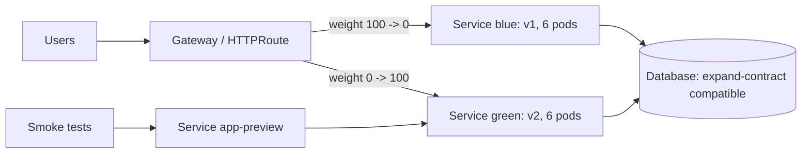

In a blue-green release, two complete copies of a service run side by side. One ("blue") serves users. The other ("green") runs the new version, receives no user traffic, and is tested in place. Cutover is a single switch of where traffic goes; rollback is switching back. The old stack stays warm for a window, so rollback takes seconds and does not depend on pulling images or scheduling Pods under pressure.

The short comparison with rolling updates and canaries is in the "Canary and blue-green" section of [[zero-downtime-deployments-kubernetes]]; this note is the full pattern for GKE.

> [!info] Not checked against live docs
> Which GKE GatewayClasses support weighted `backendRefs`, and how load balancers drain connections during a switch, were not checked against the live docs. Check the current GKE Gateway API documentation for the GatewayClass you use, and test the switch in a non-production cluster. The YAML below is illustrative until applied with `kubectl apply --dry-run=server`.

## When blue-green beats rolling or canary

| Choose blue-green when                                                      | Prefer something else when                                                                                    |
| --------------------------------------------------------------------------- | ------------------------------------------------------------------------------------------------------------- |
| You need to test the exact production configuration before any user sees it | A gradual, metric-driven exposure fits: [[spinnaker-canary-analysis]], [[progressive-delivery-argo-rollouts]] |
| Rollback must be near instant and independent of the registry               | Capacity is tight and double capacity is not available                                                        |
| The change is risky but atomic (runtime upgrade, config rewrite)            | Many small changes ship daily; rolling is cheaper                                                             |
| You need a clean cutover at a known time                                    | Sessions or long-lived connections cannot be moved cleanly                                                    |

The price is **double capacity** while both stacks run: CPU, memory, node pool headroom and, with a backing service per stack, licences and connections. Include the second stack in quota planning and cost.

## Layout: two Deployments, one label

Both Deployments share the app label and differ in a `track` label.

```yaml title="deploy-blue.yaml"
apiVersion: apps/v1
kind: Deployment
metadata:
  name: app-blue
  namespace: payments
spec:
  replicas: 6
  selector:
    matchLabels: { app: app, track: blue }
  template:
    metadata:
      labels: { app: app, track: blue }
    spec:
      containers:
        - name: app
          image: artifactory.example.com/docker-prod-local/payments/app@sha256:REPLACE_WITH_LIVE_DIGEST
          ports: [{ name: http, containerPort: 8080 }]
          readinessProbe:
            httpGet: { path: /ready, port: http }
          resources:
            requests: { cpu: 500m, memory: 512Mi }
            limits: { memory: 512Mi }
```

`app-green` is identical except for `track: green` and the new image digest. Deploy by digest ([[0010-deploy-images-by-digest]]) so what you tested is what you switch to.

Two Services:

```yaml title="services.yaml"
apiVersion: v1
kind: Service
metadata:
  name: app # live traffic
  namespace: payments
spec:
  selector: { app: app, track: blue }
  ports: [{ name: http, port: 80, targetPort: http }]
---
apiVersion: v1
kind: Service
metadata:
  name: app-preview # smoke tests only
  namespace: payments
spec:
  selector: { app: app, track: green }
  ports: [{ name: http, port: 80, targetPort: http }]
```

Expose `app-preview` on a separate internal hostname or only through `kubectl port-forward` and CI test runners. Smoke tests hit `app-preview` and exercise real dependencies (database, queues, downstream services) with test data. Do not run write tests against shared state unless they are designed for it.

## Cutover option A: patch the Service selector

The simplest switch. The `app` Service's selector changes from blue to green:

```bash title="cutover to green"
kubectl -n payments patch service app -p '{"spec":{"selector":{"app":"app","track":"green"}}}'
kubectl -n payments get endpointslices -l kubernetes.io/service-name=app -o wide
```

Rollback is the same command with `blue`. Properties:

- All-or-nothing: 100 percent moves at once.
- Fast: the endpoints change as soon as the EndpointSlice controller and the load balancer update.
- Existing connections are not moved. Established TCP connections stay with the old Pods until they close; the old stack must keep running until they drain.

On GKE with container-native load balancing (NEGs), the load balancer updates its backends from the Service endpoints, and removal is gradual because of connection draining. Do not scale the old stack to zero immediately; wait for the drain period you have configured. Details of draining behind GCP load balancers are in [[zero-downtime-deployments-kubernetes]].

## Cutover option B: HTTPRoute weights

With Gateway API ([[0023-gateway-api-for-north-south-traffic]]), the switch is a change to `backendRefs` weights on an `HTTPRoute`, which also allows a staged switch.

```yaml title="httproute.yaml"
apiVersion: gateway.networking.k8s.io/v1
kind: HTTPRoute
metadata:
  name: app
  namespace: payments
spec:
  parentRefs:
    - name: external-gw
      namespace: gateway-system
  hostnames: ["app.example.com"]
  rules:
    - matches:
        - path: { type: PathPrefix, value: / }
      backendRefs:
        - name: app-blue
          port: 80
          weight: 100
        - name: app-green
          port: 80
          weight: 0
```

Here each stack has its own Service (`app-blue`, `app-green`, selecting its track). Switching is two edits:

1. `blue: 100, green: 0` (before)
2. `blue: 0, green: 100` (after), optionally with `10/90` in between to watch error rate for a few minutes.

Check the weight semantics (weights are relative, a weight of 0 sends nothing) and whether your GKE GatewayClass supports weighted routing; check the docs. Headers-based matching on a second rule gives testers a way to reach green on the production hostname before the switch (`x-track: green`), an alternative to the preview Service.

A service mesh offers the same with richer rules ([[service-mesh-on-gke]]), but is not needed for this pattern.



## Database compatibility

Both versions run against the same database during the window, and rollback means v1 runs against whatever v2 left behind. So schema changes must be **backward compatible**: expand first (add columns and tables, dual-write), deploy, then contract in a later release. See [[postgres-expand-contract-migrations]]. A migration that drops or renames a column breaks blue-green rollback. Run migrations as a separate step before the green deploy, not on green's startup.

Also look at: message formats on queues (v1 must read v2's messages), cache key formats, and background jobs that would run twice (one scheduler per stack). Use a leader election or scale the scheduler to one stack only.

## Keep the old stack for a rollback window

1. After cutover, keep blue at full size for a window sized to your risk (long enough to see a full traffic cycle and a typical failure delay).
2. Watch SLO burn on the new stack ([[slo-burn-rate-alerting]]).
3. At the end of the window, scale blue to the minimum or zero, and keep its Deployment manifest in Git for a quick scale-up.
4. The next release reverses roles: blue becomes the idle track.

## Failure modes

- **Long-lived connections and NEG draining.** WebSockets, gRPC streams and keep-alive connections stay on the old Pods. Set a connection draining timeout on the backend, send `Connection: close` at shutdown, and keep the old stack until streams end.
- **Cold caches.** Green has empty caches and cold JIT, so the first minutes after the switch are slower. Warm green by sending replayed or synthetic traffic through `app-preview`, or use the staged weights.
- **HPA minimum on the idle side.** The idle stack scales down to its HPA minimum and cannot absorb 100 percent at once. Set green's `minReplicas` to blue's current replica count before the switch ([[kubernetes-autoscaling]]).
- **PodDisruptionBudgets.** Each stack needs its own PDB for its own selector; a PDB that selects both tracks (only `app: app`) blocks drains of the wrong stack. See [[pod-disruption-budgets-for-stateless-services]].
- **Sticky sessions.** Session affinity pins users to old Pods, and a switch resets sessions. Keep session state in a shared store, not in Pod memory.
- **Shared side effects.** Both stacks consume the same queue or run the same cron, so work is done twice or messages go to the wrong version. Assign consumers per stack deliberately.
- **Config drift between tracks.** Configuration or secrets exist for blue but not for green. Generate both from the same chart with a `track` value.
- **Capacity.** Not enough quota or node headroom for double capacity: Pods Pending. Check before deploying green.

## Verify

```bash title="pre-checks and post-checks"
# Pre: green is fully ready and healthy
kubectl -n payments rollout status deployment/app-green --timeout=300s
kubectl -n payments get pods -l app=app,track=green -o wide

# Smoke test against the preview Service
kubectl -n payments run smoke --rm -it --restart=Never --image=curlimages/curl:CURL_TAG -- \
  curl -fsS http://app-preview.payments.svc.cluster.local/ready

# Post: endpoints now point at green, and error rate is steady
kubectl -n payments get endpointslices -l kubernetes.io/service-name=app -o wide
```

Replace `CURL_TAG` with the curl image tag your team has approved, pinned by version or digest.

## GitOps: the switch as a reviewed commit

With Argo CD ([[0001-gitops-with-argocd]]), do not run `kubectl patch` by hand. Make the switch a commit: change `selector.track` in the Service, or the weights in the HTTPRoute, in the environment overlay, open a merge request, get approval, merge. Argo CD syncs it, and rollback is `git revert`. Disable auto-prune for the idle Deployment during the window so it is not removed. The branch flow is described in [[gitops-repo-topology-and-promotion]]. A manual `kubectl patch` during an incident is fine if you reconcile Git straight afterwards, or Argo CD will revert it.

## Rollback

1. Switch the selector or weights back to blue (revert the commit).
2. Confirm endpoints and error rate recovered.
3. Leave green running for debugging, or scale it down once logs and traces are saved.
4. If the database was changed in the window, confirm v1 still works with it; if not, the fix is forward, not back. See [[helm-release-rollback]] for chart-level rollback of the Deployments themselves.

## Related

- [[zero-downtime-deployments-kubernetes]]
- [[progressive-delivery-argo-rollouts]]
- [[postgres-expand-contract-migrations]]
- [[service-mesh-on-gke]]
- [[spinnaker-canary-analysis]]
- [[pod-disruption-budgets-for-stateless-services]]
- [[0023-gateway-api-for-north-south-traffic]]

## Sources

- https://cloud.google.com/kubernetes-engine/docs/concepts/gateway-api
- https://gateway-api.sigs.k8s.io/guides/traffic-splitting/
- https://kubernetes.io/docs/concepts/services-networking/service/
