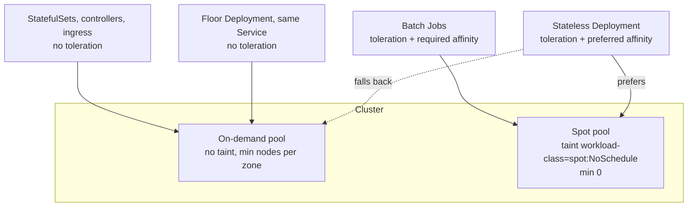
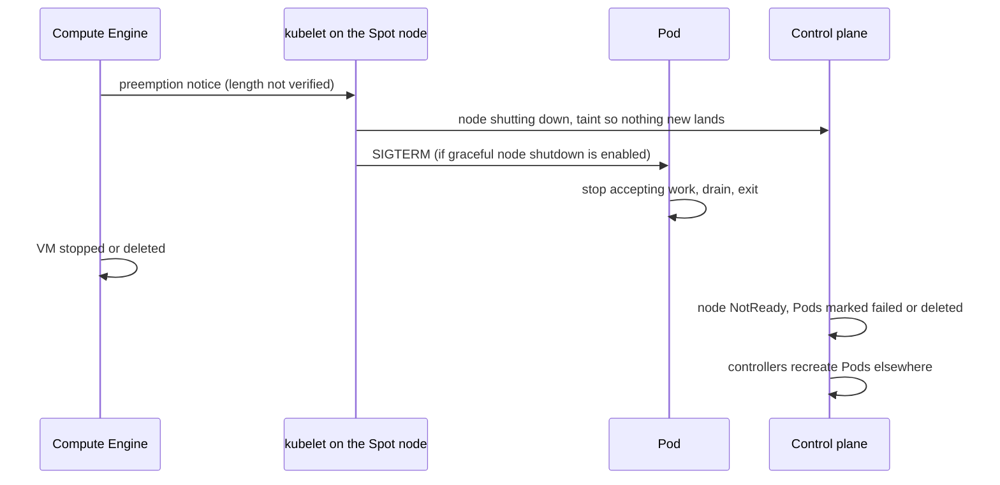

Spot VMs are spare Compute Engine capacity at a discount that Google can reclaim at any time. On GKE that means a node can disappear with very little warning, taking every Pod on it. Workloads that are built to lose a replica at any moment get a large compute saving almost for free; workloads that are not get outages that look random. This note is the general pattern: what fits, how to set up Spot pools on GKE Standard and Spot Pods on Autopilot, how to fall back to on-demand capacity, and what preemption actually does to Pods. The CI-specific case is in [[gitlab-runners-on-gke]].

> [!info] Scope and sources
> Kubernetes behaviour (disruptions, PodDisruptionBudgets, graceful node shutdown, node affinity, taints) was checked against the Kubernetes documentation source on 2026-10-21. The Terraform fields were checked against the Google provider's documentation source and the `gcloud` flags against Google Cloud SDK 570.0.0 help on the same day. Nothing was run on a cluster.

> [!warning] Not verified: Google Cloud Spot pages
> The GKE Spot VMs, Autopilot Spot Pods and Compute Engine Spot pages could not be read when this note was written. So the following are **not verified**: the length of the preemption notice and the signal the VM receives; whether GKE enables kubelet graceful node shutdown on Spot nodes by default and with which period; whether Standard Spot nodes carry an automatic taint; the exact Autopilot Spot Pod syntax and any required toleration; maximum Spot VM lifetime; eligible machine types and GPUs; quota behaviour; how the cluster autoscaler reacts to a Spot stockout; and every price or discount. Read those pages before you rely on any of it. This note gives no prices on purpose.

## What fits on Spot and what never does

The test is simple: if every node in the pool vanished at once, would users notice, and would anything be lost?

| Fits well                                                                                   | Fits with care                                                                  | Never on Spot                                                                           |
| ------------------------------------------------------------------------------------------- | ------------------------------------------------------------------------------- | --------------------------------------------------------------------------------------- |
| Stateless replicas behind a Service, with enough replicas on on-demand nodes to carry load | Queue workers that ack only after the work is durable                           | Quorum stores: etcd, ZooKeeper, Kafka brokers, database primaries and replicas          |
| Batch Jobs that checkpoint and are idempotent ([[patterns/kubernetes-jobs-and-cronjobs]])           | Long batch runs without checkpoints (only with short work units)                | Singleton controllers and operators (one leader, slow re-election hurts)               |
| CI job Pods ([[gitlab-runners-on-gke]])                                                     | Caches that can be rebuilt (Redis as a pure cache)                              | Ingress controllers and Gateway data planes that hold every user connection            |
| Review and preview environments ([[gitlab-review-environments-on-gke]])                    | ML training with frequent checkpoints to Cloud Storage                          | Anything with a local PersistentVolume, or a zonal disk that must reattach fast        |
| Dev and test namespaces                                                                     | Services with long-lived connections (WebSockets, gRPC streams), with a drain plan | Cluster add-ons that everything depends on (DNS, policy webhooks, cert-manager)       |

Two rules sit behind the "never" column:

- **A PodDisruptionBudget does not protect against preemption.** PDBs only limit voluntary disruptions that go through the Eviction API. A Spot reclaim is a VM disappearing, which the Kubernetes docs list as involuntary. A PDB still matters on a Spot pool for drains, upgrades and autoscaler scale-down, but it will not keep a single replica alive. See [[pod-disruption-budgets-for-stateless-services]].
- **Correlated loss.** Spot capacity is reclaimed when Google needs it, which can mean many nodes in one zone at once. A service with all its replicas on Spot can lose all of them together, so "three replicas" is not redundancy on Spot alone.

Stateful workloads and how to keep them on stable capacity are covered in [[stateful-workloads-gke]].

## Design: opt-in Spot pools with an on-demand floor



- **Spot is opt-in.** The Spot pool carries a taint you define, so only workloads that tolerate it can land there. An untainted Spot pool turns every team's Deployment into a Spot workload the first time the scheduler finds room there, including the database someone forgot to pin.
- **An on-demand floor** carries the minimum load for the service on capacity that does not vanish. How to keep that floor is the main design choice; see below.
- **Batch work** that is fine with waiting requires Spot (hard affinity), so it never consumes on-demand capacity.

Whether GKE already adds its own taint to Spot nodes on Standard clusters is not verified (Google's sample Job manifests select Spot nodes by label without a toleration, which suggests it does not). Adding your own taint makes the behaviour explicit either way.

## GKE Standard: the node pools in Terraform

```hcl title="node-pools.tf"
variable "project_id" {
  type = string
}

variable "cluster_id" {
  type        = string
  description = "ID of the regional cluster, for example projects/p/locations/europe-west1/clusters/prod."
}

variable "node_service_account" {
  type        = string
  description = "Least-privilege node service account email."
}

# On-demand pool: carries the floor, system add-ons and stateful workloads.
resource "google_container_node_pool" "on_demand" {
  name    = "on-demand"
  cluster = var.cluster_id

  autoscaling {
    total_min_node_count = 3  # change: one per zone for a three-zone regional cluster
    total_max_node_count = 30 # change
    location_policy      = "BALANCED"
  }

  node_config {
    machine_type    = "e2-standard-4" # change: what your workloads need
    service_account = var.node_service_account
    oauth_scopes    = ["https://www.googleapis.com/auth/cloud-platform"]
    labels = {
      "capacity-type" = "on-demand"
    }
    workload_metadata_config {
      mode = "GKE_METADATA"
    }
  }

  management {
    auto_repair  = true
    auto_upgrade = true
  }
}

# Spot pool: opt-in through a taint, scales to zero when idle.
resource "google_container_node_pool" "spot" {
  name    = "spot"
  cluster = var.cluster_id

  autoscaling {
    total_min_node_count = 0
    total_max_node_count = 60  # change
    location_policy      = "ANY" # favours zones with capacity; see below
  }

  node_config {
    spot            = true
    machine_type    = "e2-standard-4" # change: several pools of different shapes widen the capacity you can get
    service_account = var.node_service_account
    oauth_scopes    = ["https://www.googleapis.com/auth/cloud-platform"]
    labels = {
      "capacity-type" = "spot"
    }
    taint {
      key    = "workload-class"
      value  = "spot"
      effect = "NO_SCHEDULE"
    }
    workload_metadata_config {
      mode = "GKE_METADATA"
    }
    # Optional: a kubelet graceful shutdown period for Spot nodes (10 to 10000 seconds,
    # only allowed on Spot or Preemptible pools). Check that your provider version has it.
    # kubelet_config {
    #   shutdown_grace_period_seconds               = 30
    #   shutdown_grace_period_critical_pods_seconds = 10
    # }
  }

  management {
    auto_repair  = true
    auto_upgrade = true
  }
}
```

What the provider documentation says about these fields:

- `node_config.spot` is a boolean that makes the node VMs Spot; it defaults to `false`. The older `preemptible` field is a different, older model; do not set both.
- `location_policy = "ANY"` tells the autoscaler to prioritise unused reservations and reduce preemption risk for Spot VMs; `BALANCED` tries to keep zones even. `total_min_node_count` and `total_max_node_count` (instead of per-zone counts) and `location_policy` need cluster version 1.24.1 or later.
- `kubelet_config.shutdown_grace_period_seconds` (10 to 10000) and `shutdown_grace_period_critical_pods_seconds` (not more than the first) are only allowed on Spot or Preemptible pools.
- The `taint` block reports drift only for keys the provider manages; GKE-managed taints show up in `effective_taints`.
- Changing `node_config` fields generally replaces the pool. Whether flipping `spot` on an existing pool forces recreation was not checked: plan it as a new pool, move workloads, then delete the old one.

The CLI equivalent for a quick test pool:

```bash
set -euo pipefail

CLUSTER="prod"               # change
LOCATION="europe-west1"      # change: the cluster's region
PROJECT="my-project"         # change

gcloud container node-pools create spot \
  --cluster "$CLUSTER" --location "$LOCATION" --project "$PROJECT" \
  --spot \
  --machine-type e2-standard-4 \
  --enable-autoscaling --total-min-nodes 0 --total-max-nodes 20 \
  --location-policy ANY \
  --node-labels capacity-type=spot \
  --node-taints workload-class=spot:NoSchedule
```

`--spot` makes every new node in the pool, including ones created by resize or recreate, a Spot VM. Check `gcloud container node-pools create --help` for the autoscaling flags in your SDK version.

Use more than one Spot pool with different machine families when you can. A stockout usually hits a machine shape in a zone, so a second shape is a second chance at capacity.

## Placing workloads

### Prefer Spot, fall back to on-demand

```yaml title="deployment-spot-preferred.yaml"
apiVersion: apps/v1
kind: Deployment
metadata:
  name: catalog
  namespace: shop
spec:
  replicas: 6
  selector:
    matchLabels:
      app.kubernetes.io/name: catalog
      capacity: spot
  template:
    metadata:
      labels:
        app.kubernetes.io/name: catalog # matched by the Service selector
        capacity: spot
    spec:
      terminationGracePeriodSeconds: 25 # keep it below the node's shutdown period, see Preemption
      tolerations:
        - key: workload-class
          operator: Equal
          value: spot
          effect: NoSchedule
      affinity:
        nodeAffinity:
          preferredDuringSchedulingIgnoredDuringExecution:
            - weight: 100
              preference:
                matchExpressions:
                  - key: cloud.google.com/gke-spot
                    operator: In
                    values: ["true"]
      topologySpreadConstraints:
        - maxSkew: 1
          topologyKey: topology.kubernetes.io/zone
          whenUnsatisfiable: ScheduleAnyway
          labelSelector:
            matchLabels:
              app.kubernetes.io/name: catalog
          matchLabelKeys:
            - pod-template-hash
        - maxSkew: 2
          topologyKey: capacity-type
          whenUnsatisfiable: ScheduleAnyway
          labelSelector:
            matchLabels:
              app.kubernetes.io/name: catalog
          matchLabelKeys:
            - pod-template-hash
      containers:
        - name: app
          image: registry.example.com/shop/catalog:1.8.2 # change: pin your image
          resources:
            requests:
              cpu: 250m
              memory: 256Mi
            limits:
              memory: 512Mi
```

How this behaves:

- The toleration allows Spot; the weighted preference asks the scheduler to pick Spot nodes when both fit. A preference is not a guarantee: if no Spot node has room, the Pod goes to an on-demand node.
- `IgnoredDuringExecution` means nothing moves Pods back to Spot when Spot capacity returns. After a stockout the service stays on on-demand nodes until Pods are recreated, for example by the next rollout. A descheduler can rebalance, but it is another component to run.
- The second spread constraint uses the `capacity-type` label set on **both** pools. Spreading on `cloud.google.com/gke-spot` would not work for this, because on-demand nodes do not carry that key and nodes without the topology key are not part of any domain.
- `ScheduleAnyway` keeps spread a soft goal, so a Spot outage does not leave Pods pending. Spread rules are covered in [[topology-spread-constraints-gke]].

> [!warning] The autoscaler does not share your preference
> The scheduler honours the preferred affinity when it places Pods on **existing** nodes. When Pods are pending and the cluster autoscaler adds a node, which pool it grows is decided by the autoscaler, not by the preference weight, so a scale-up can add on-demand nodes even when Spot capacity exists. How GKE's autoscaler chooses between pools was not verified. If you need "Spot first, on-demand only on stockout" for new capacity, look at GKE custom compute classes (below) or use separate Deployments.

### A guaranteed on-demand floor: two Deployments

The most predictable way to keep a minimum share on on-demand nodes is two Deployments behind one Service. This is a design choice, not a GKE feature:

```yaml title="deployment-floor.yaml"
# Same Pod template and labels as catalog, minus the toleration, so it can only run on on-demand nodes.
apiVersion: apps/v1
kind: Deployment
metadata:
  name: catalog-floor
  namespace: shop
spec:
  replicas: 3 # change: enough to carry peak load alone, at degraded latency if you accept that
  selector:
    matchLabels:
      app.kubernetes.io/name: catalog
      capacity: floor
  template:
    metadata:
      labels:
        app.kubernetes.io/name: catalog # matched by the Service selector
        capacity: floor
    spec:
      affinity:
        nodeAffinity:
          requiredDuringSchedulingIgnoredDuringExecution:
            nodeSelectorTerms:
              - matchExpressions:
                  - key: capacity-type
                    operator: In
                    values: ["on-demand"]
      containers:
        - name: app
          image: registry.example.com/shop/catalog:1.8.2 # keep in lockstep with the Spot Deployment
          resources:
            requests:
              cpu: 250m
              memory: 256Mi
            limits:
              memory: 512Mi
```

The `capacity` label (`spot` on the first Deployment, `floor` here) keeps the two Deployments from selecting each other's Pods; the Service selects only `app.kubernetes.io/name: catalog` and reaches both. Put an HPA on the Spot Deployment for burst and keep the floor fixed (or a second HPA with a high minimum). Size the floor to survive the loss of every Spot replica at the same time. The cost is two objects to keep in step: render both from one Helm chart with a shared template ([[helm-chart-conventions]]). Autoscaling interactions are in [[kubernetes-autoscaling]].

### Batch Jobs that must run on Spot

```yaml title="job-spot-only.yaml (fragment)"
spec:
  backoffLimit: 6
  podFailurePolicy:
    rules:
      - action: Ignore           # node loss does not count against backoffLimit
        onPodConditions:
          - type: DisruptionTarget
  template:
    spec:
      restartPolicy: Never
      tolerations:
        - key: workload-class
          operator: Equal
          value: spot
          effect: NoSchedule
      nodeSelector:
        cloud.google.com/gke-spot: "true"
```

The `DisruptionTarget` rule keeps preempted Pods from using up `backoffLimit`; the field details and caveats are in [[patterns/kubernetes-jobs-and-cronjobs]]. The Job must checkpoint, or each preemption restarts it from zero.

### Priority on mixed pools

When the on-demand pool is full, a Pod that fell back from Spot competes with Pods that must be on on-demand nodes. Give the stateful and floor workloads a higher PriorityClass than Spot-preferring workloads so the scheduler preempts the right ones; see [[priority-classes-and-preemption]].

## GKE Autopilot: Spot Pods

Autopilot has no node pools to configure. A workload asks for Spot capacity in its Pod spec and Autopilot provisions matching nodes. Google's own sample manifests select Spot with a node selector:

```yaml title="autopilot-spot-pod (fragment)"
spec:
  nodeSelector:
    cloud.google.com/gke-spot: "true"
  terminationGracePeriodSeconds: 25
```

> [!note] Not verified
> Whether Autopilot also requires a toleration, how it handles a Spot request combined with a compute class, and what limit it puts on `terminationGracePeriodSeconds` for Spot Pods were not checked. Follow the Autopilot Spot Pods page for your cluster version. Autopilot is the default for new clusters on this site ([[adr/0018-gke-autopilot-for-new-clusters]]).

On current GKE, custom compute classes (`kind: ComputeClass`, `apiVersion: cloud.google.com/v1`) let a platform team express "try these machine types on Spot first, then on-demand" as an ordered priority list that the autoscaler follows when it creates nodes. Google's samples show `spec.priorities` entries with `spot: true`, node pool auto-creation and `whenUnsatisfiable`, and mention built-in classes named `autopilot` and `autopilot-spot`. The fields and their availability on Standard and Autopilot were not verified here: read the GKE compute classes documentation before adopting them. If they fit, they solve the "autoscaler ignores my preference" problem above more cleanly than affinity weights.

## What preemption does to a Pod



What the Kubernetes documentation states about graceful node shutdown:

- The kubelet delays shutdown by `shutdownGracePeriod` and spends it in two phases: regular Pods first, then critical Pods (`shutdownGracePeriodCriticalPods`). Both default to zero upstream, which disables the feature; GKE's setting for Spot nodes is not verified.
- Pods terminated this way get a status that says they were terminated in response to imminent node shutdown, and the node is tainted so no new Pods start.
- A Pod's `terminationGracePeriodSeconds` cannot buy more time than the node grants. If the node gives regular Pods N seconds, a Pod asking for 60 still gets at most N. Set `terminationGracePeriodSeconds` below the node's regular-Pod budget and make shutdown fit inside it.

In practice, design every Spot workload as if it gets SIGTERM and only seconds to finish, and as if it might get no signal at all:

- Readiness fails fast on SIGTERM so the endpoint is removed; a short `preStop` sleep helps Services and load balancers stop routing first ([[zero-downtime-deployments-kubernetes]]).
- Workers stop pulling new work, finish or requeue the current item, and exit.
- Batch work checkpoints regularly to durable storage, not on SIGTERM only.
- Clients retry idempotent calls with backoff, because in-flight requests on a preempted node fail ([[timeouts-retries-load-shedding]]).

## Capacity stockouts

Spot capacity can be unavailable in a zone or for a machine type. Then Spot node pool scale-ups fail and Pods that require Spot stay pending. Defences:

- Several Spot pools with different machine shapes, and a regional cluster so three zones are in play.
- `location_policy = "ANY"` on Spot pools.
- Spot-preferring (not Spot-requiring) workloads for anything user-facing, plus the on-demand floor.
- An alert on Pods pending for longer than a few minutes, so a stockout is visible before it becomes an outage.

The exact backoff and retry behaviour of the GKE cluster autoscaler during a stockout is not verified. Watch the autoscaler events (`kubectl get events -A --field-selector reason=FailedScaleUp`, or the cluster autoscaler visibility logs in Cloud Logging) during your first stockout and tune from what you see.

## Measuring savings and preemption rate

- **Savings.** Use the billing export with GKE cost allocation and compare spend per namespace or label before and after moving a workload, over the same traffic. Do not estimate from list prices; the discount varies. See [[finops-cost-allocation-and-guardrails]].
- **Preemption rate.** Count Spot node replacements. A simple start is node age: Spot nodes that keep being recreated show up as young nodes.

```bash
set -euo pipefail

# Age of every Spot node, youngest first.
kubectl get nodes -l cloud.google.com/gke-spot=true \
  --sort-by=.metadata.creationTimestamp \
  -o custom-columns=NAME:.metadata.name,ZONE:.metadata.labels.topology\\.kubernetes\\.io/zone,CREATED:.metadata.creationTimestamp

# Pods terminated by a node shutdown that have not been cleaned up yet.
kubectl get pods -A -o json \
  | jq -r '.items[] | select(.status.message? // "" | test("node shutdown"; "i")) | "\(.metadata.namespace)/\(.metadata.name): \(.status.message)"'
```

Compute Engine also records preemptions in the instance's system event audit logs; the exact log method name and filter are not verified, so build the Cloud Logging query from an actual preemption event in your project. With kube-state-metrics, node creation timestamps (`kube_node_created`) give a churn rate per pool if you expose the `capacity-type` label through its label allowlist; check the metric and flag names for your kube-state-metrics version.

Drills: drain a Spot node in staging during peak traffic and watch error rate and latency. That is the closest safe imitation of a preemption; [[game-day-chaos-gke]] has the drill format.

## Verify

```bash
set -euo pipefail

NS="shop"                         # change
APP="catalog"                     # change

# Spot nodes carry the label and your taint.
kubectl get nodes -l cloud.google.com/gke-spot=true -L capacity-type,topology.kubernetes.io/zone
kubectl get nodes -l cloud.google.com/gke-spot=true \
  -o jsonpath='{range .items[*]}{.metadata.name}{"\t"}{.spec.taints}{"\n"}{end}'

# Where the replicas run: count per capacity type and zone.
kubectl -n "$NS" get pods -l app.kubernetes.io/name="$APP" \
  -o jsonpath='{range .items[*]}{.spec.nodeName}{"\n"}{end}' \
  | while read -r node; do
      kubectl get node "$node" --no-headers -L capacity-type,topology.kubernetes.io/zone | awk '{print $(NF-1), $NF}'
    done | sort | uniq -c

# Every Pod on a Spot node with its owner kind: StatefulSets and singletons should not appear.
for node in $(kubectl get nodes -l cloud.google.com/gke-spot=true -o jsonpath='{.items[*].metadata.name}'); do
  kubectl get pods -A --field-selector spec.nodeName="$node" -o json \
    | jq -r --arg node "$node" '.items[] | "\(.metadata.ownerReferences[0].kind // "none")\t\(.metadata.namespace)/\(.metadata.name)\t\($node)"'
done | sort | grep -v '^DaemonSet' || true
```

Expected: Spot nodes show `capacity-type=spot` and the `workload-class=spot:NoSchedule` taint; the Spot-preferring Deployment has most replicas on Spot and the floor Deployment's replicas all on on-demand nodes, spread across zones; the last list holds only ReplicaSet and Job owners (plus workloads you deliberately allowed on Spot), never `StatefulSet` or a Pod without an owner.

## Troubleshooting

**Pods pending, events say `node(s) had untolerated taint`.** The workload has no toleration for your Spot taint and the on-demand pool is full. Either add capacity to the on-demand pool or decide that this workload may use Spot.

**Pods pending, autoscaler events show failed scale-up on the Spot pool.** A Spot stockout or a quota limit. Check the event message; add another Spot machine shape or zone, and let Spot-preferring workloads fall back.

**All replicas ended up on one pool.** On Spot: the zone and capacity-type spread is missing or `ScheduleAnyway` lost to resource pressure; add the floor Deployment. On on-demand: Spot capacity returned after a stockout but nothing rescheduled; trigger a rollout (`kubectl rollout restart deployment/<name>`) in a quiet period.

**Requests fail in bursts every few days.** Preemptions without a drain path. Check that readiness fails on SIGTERM, that `terminationGracePeriodSeconds` fits within the node's shutdown budget, and that clients retry idempotent calls.

**A Job restarts from scratch after each preemption.** It does not checkpoint. Split it into smaller work units (an Indexed Job) or move it to on-demand.

**A PDB blocks a drain of the Spot pool.** Expected: PDBs apply to voluntary drains. Scale the workload up first or relax the PDB; see [[pod-disruption-budgets-for-stateless-services]].

**Nodes keep showing `NotReady` briefly.** That may be preemption or something else; follow [[gke-node-notready-triage]].

## Rollback

To move a workload off Spot: remove the toleration (and the Spot affinity) from its template and roll it out. New Pods can only land on on-demand nodes; make sure that pool can grow first.

To retire a Spot pool:

```bash
set -euo pipefail

CLUSTER="prod"            # change
LOCATION="europe-west1"   # change
PROJECT="my-project"      # change
POOL="spot"

# 1. Stop new Pods landing there.
for node in $(kubectl get nodes -l cloud.google.com/gke-nodepool="$POOL" -o name); do
  kubectl cordon "$node"
done

# 2. Evict Pods, respecting PDBs. Repeat until it completes; investigate PDBs that block.
for node in $(kubectl get nodes -l cloud.google.com/gke-nodepool="$POOL" -o name); do
  kubectl drain "$node" --ignore-daemonsets --delete-emptydir-data --timeout=10m
done

# 3. Delete the pool once it is empty. Remove it from Terraform in the same change if Terraform owns it.
gcloud container node-pools delete "$POOL" --cluster "$CLUSTER" --location "$LOCATION" --project "$PROJECT"
```

`--delete-emptydir-data` discards `emptyDir` contents on those nodes; that is the point of draining stateless workloads, but check that nothing depends on it. If Terraform manages the pool, delete it through Terraform instead of `gcloud` so state stays correct.

## Related

- [[gitlab-runners-on-gke]]: the CI case, with its own tainted Spot pool.
- [[kubernetes-autoscaling]]: HPA and the cluster autoscaler that grows the pools.
- [[topology-spread-constraints-gke]]: zone and node spread for the replicas.
- [[pod-disruption-budgets-for-stateless-services]]: what PDBs do and do not cover.
- [[priority-classes-and-preemption]]: who wins when on-demand capacity is short.
- [[patterns/kubernetes-jobs-and-cronjobs]]: retry policy for batch work that may be preempted.
- [[finops-cost-allocation-and-guardrails]]: measuring the saving.
- [[gke-node-pool-upgrade-strategies]]: upgrades on the same pools.
- [[stateful-workloads-gke]]: the workloads that stay on on-demand capacity.

## Sources

- [GKE: Spot VMs](https://cloud.google.com/kubernetes-engine/docs/concepts/spot-vms) (not readable when written; see the warning above)
- [GKE: Run fault-tolerant workloads at lower costs in Spot Pods (Autopilot)](https://cloud.google.com/kubernetes-engine/docs/how-to/autopilot-spot-pods) (not readable when written)
- [Compute Engine: Spot VMs](https://cloud.google.com/compute/docs/instances/spot) (not readable when written)
- [Terraform google provider: google_container_node_pool](https://registry.terraform.io/providers/hashicorp/google/latest/docs/resources/container_node_pool): `node_config.spot`, `taint`, `kubelet_config`, `autoscaling.location_policy`, total node counts.
- [gcloud container node-pools create](https://cloud.google.com/sdk/gcloud/reference/container/node-pools/create): `--spot`.
- [Kubernetes: Disruptions](https://kubernetes.io/docs/concepts/workloads/pods/disruptions/): voluntary and involuntary disruptions, PDB scope.
- [Kubernetes: Node shutdowns](https://kubernetes.io/docs/concepts/cluster-administration/node-shutdown/): graceful node shutdown.
- [Kubernetes: Assigning Pods to nodes](https://kubernetes.io/docs/concepts/scheduling-eviction/assign-pod-node/): preferred and required node affinity.
- [Kubernetes: Taints and tolerations](https://kubernetes.io/docs/concepts/scheduling-eviction/taint-and-toleration/)
- [GoogleCloudPlatform/kubernetes-engine-samples](https://github.com/GoogleCloudPlatform/kubernetes-engine-samples): Spot node selector and ComputeClass examples.
