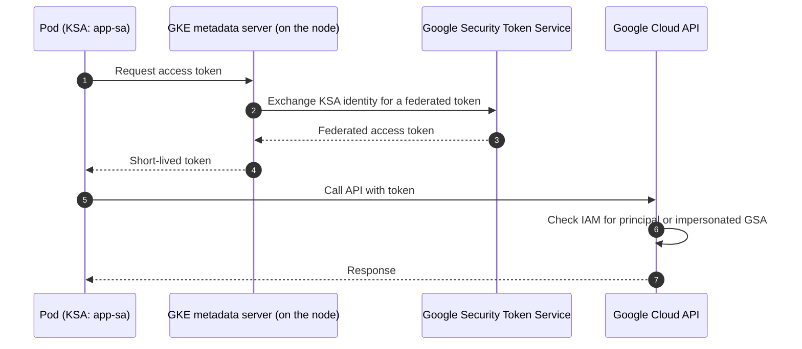

Workload Identity Federation for GKE lets a Kubernetes ServiceAccount (KSA) act as an identity in Google Cloud, so Pods call Google APIs with short-lived tokens instead of mounted service account keys. No key file is created, stored, rotated or leaked.

There are two ways to grant access. **Prefer the direct principal method**; use the service account impersonation method only when something requires a Google service account (GSA).

| Method                    | IAM identity that receives roles                           | KSA annotation needed | Use when                                                     |
| ------------------------- | ---------------------------------------------------------- | --------------------- | ------------------------------------------------------------ |
| Direct principal (modern) | `principal://` identifier of the KSA                       | No                    | The target API accepts federated principals. Default choice. |
| GSA impersonation (older) | A Google service account the KSA is allowed to impersonate | Yes                   | The API or tool needs a real service account identity.       |

> [!warning] Not every API accepts federated principals
> Some Google Cloud services do not support granting roles to the `principal://` identity. If a call fails with a permission error even though the role is bound, check the product's documentation for Workload Identity Federation support, or fall back to the GSA method.

## How it works



Requests to the standard metadata server address from a Pod are intercepted by the GKE metadata server running on the node, which is what makes this work. Nodes must therefore run with the GKE metadata server enabled.

## Prerequisites

Set the variables used below:

```bash
export PROJECT_ID="my-project"
export PROJECT_NUMBER="$(gcloud projects describe "${PROJECT_ID}" --format='value(projectNumber)')"
export LOCATION="europe-west1"          # region or zone of the cluster
export CLUSTER="platform-1"
export NODE_POOL="default-pool"
export NAMESPACE="payments"
export KSA="app-sa"
```

> [!info] Autopilot
> GKE Autopilot clusters have Workload Identity Federation enabled and need no cluster or node pool changes. Skip to [[#Grant access to the Kubernetes ServiceAccount|granting access]]. The steps below are for Standard clusters.

## Enable it on the cluster

New cluster:

```bash
gcloud container clusters create "${CLUSTER}" \
  --location="${LOCATION}" \
  --workload-pool="${PROJECT_ID}.svc.id.goog"
```

Existing cluster:

```bash
gcloud container clusters update "${CLUSTER}" \
  --location="${LOCATION}" \
  --workload-pool="${PROJECT_ID}.svc.id.goog"
```

The workload pool is always `PROJECT_ID.svc.id.goog`. Confirm it:

```bash
gcloud container clusters describe "${CLUSTER}" \
  --location="${LOCATION}" \
  --format='value(workloadIdentityConfig.workloadPool)'
```

## Enable the metadata server on node pools

The cluster setting alone is not enough: each node pool must expose the GKE metadata server.

```bash
gcloud container node-pools update "${NODE_POOL}" \
  --cluster="${CLUSTER}" \
  --location="${LOCATION}" \
  --workload-metadata=GKE_METADATA
```

> [!note] Nodes are recreated
> Changing the workload metadata mode on an existing node pool recreates its nodes (a rolling update), so Pods are evicted. Plan for the disruption, and set sensible PodDisruptionBudgets first (see [[zero-downtime-deployments-kubernetes]]). Enabling the workload pool on an existing cluster can also roll node pools on Standard clusters, so do both in one maintenance window.

## Create the Kubernetes ServiceAccount

```bash
kubectl create namespace "${NAMESPACE}"
kubectl create serviceaccount "${KSA}" --namespace "${NAMESPACE}"
```

Pods must run under this ServiceAccount (`spec.serviceAccountName`). The GKE metadata server identifies the Pod itself, so Workload Identity Federation does not depend on the KSA token being mounted into the Pod.

## Grant access to the Kubernetes ServiceAccount

### Method 1: direct principal (preferred)

Grant the role straight to the KSA. The principal identifier is built from the **project number**, not the project ID:

```bash
gcloud projects add-iam-policy-binding "${PROJECT_ID}" \
  --role="roles/storage.objectViewer" \
  --member="principal://iam.googleapis.com/projects/${PROJECT_NUMBER}/locations/global/workloadIdentityPools/${PROJECT_ID}.svc.id.goog/subject/ns/${NAMESPACE}/sa/${KSA}" \
  --condition=None
```

To grant to every ServiceAccount in a namespace, use a `principalSet` instead:

```text
principalSet://iam.googleapis.com/projects/PROJECT_NUMBER/locations/global/workloadIdentityPools/PROJECT_ID.svc.id.goog/namespace/NAMESPACE
```

Prefer binding on the specific resource (a bucket, a topic) over the whole project whenever the product supports resource-level IAM.

### Method 2: GSA impersonation (older)

Create a GSA, give it the roles the workload needs, then allow the KSA to impersonate it with `roles/iam.workloadIdentityUser`:

```bash
export GSA="app-gsa"

gcloud iam service-accounts create "${GSA}" --project="${PROJECT_ID}"

gcloud projects add-iam-policy-binding "${PROJECT_ID}" \
  --role="roles/storage.objectViewer" \
  --member="serviceAccount:${GSA}@${PROJECT_ID}.iam.gserviceaccount.com" \
  --condition=None

gcloud iam service-accounts add-iam-policy-binding \
  "${GSA}@${PROJECT_ID}.iam.gserviceaccount.com" \
  --role="roles/iam.workloadIdentityUser" \
  --member="serviceAccount:${PROJECT_ID}.svc.id.goog[${NAMESPACE}/${KSA}]"
```

Then annotate the KSA so GKE knows which GSA to impersonate:

```bash
kubectl annotate serviceaccount "${KSA}" \
  --namespace "${NAMESPACE}" \
  iam.gke.io/gcp-service-account="${GSA}@${PROJECT_ID}.iam.gserviceaccount.com"
```

Declaratively:

```yaml
apiVersion: v1
kind: ServiceAccount
metadata:
  name: app-sa
  namespace: payments
  annotations:
    iam.gke.io/gcp-service-account: app-gsa@my-project.iam.gserviceaccount.com
```

> [!tip] Migrating from GSA to direct principal
> Bind the same roles to the `principal://` identity, remove the annotation, roll the Deployment, then delete the `roles/iam.workloadIdentityUser` binding and the GSA once nothing else uses it.

## Verify

Run a throwaway Pod with the KSA and ask who it is:

```yaml
apiVersion: v1
kind: Pod
metadata:
  name: wi-check
  namespace: payments
spec:
  serviceAccountName: app-sa
  restartPolicy: Never
  containers:
    - name: gcloud
      image: gcr.io/google.com/cloudsdktool/google-cloud-cli:stable
      command: ["sleep", "3600"]
```

```bash
kubectl apply -f wi-check.yaml
kubectl wait --for=condition=Ready pod/wi-check --namespace payments --timeout=120s

# With the GSA method this prints the GSA email. With the direct principal method the
# token is a federated token and no service account email is shown.
kubectl exec --namespace payments wi-check -- gcloud auth list

# End-to-end check: call an API the role allows (replace the bucket).
kubectl exec --namespace payments wi-check -- gcloud storage ls gs://my-bucket

kubectl delete pod wi-check --namespace payments
```

If `gcloud auth list` shows the node's Compute Engine default service account, the Pod is **not** using Workload Identity Federation. Go to troubleshooting.

## Troubleshooting

| Symptom                                                                   | Likely cause and fix                                                                                                                                                      |
| ------------------------------------------------------------------------- | ------------------------------------------------------------------------------------------------------------------------------------------------------------------------- |
| Pod authenticates as the node's default service account                   | Node pool is not on `GKE_METADATA`, or the Pod runs on a node pool that was not updated. Re-check the node pool mode.                                                     |
| `403 Permission 'iam.serviceAccounts.getAccessToken' denied` (GSA method) | Missing or wrong `roles/iam.workloadIdentityUser` binding. Namespace and KSA name in `PROJECT_ID.svc.id.goog[ns/ksa]` are case-sensitive.                                 |
| `403` on the target API (direct principal method)                         | Role not bound to the `principal://` identifier, wrong project number, or the product does not support federated principals.                                              |
| It worked a minute ago, now fails after a change                          | IAM changes can take a few minutes to propagate. Retry with backoff.                                                                                                      |
| First call after a Pod or node starts fails, later calls succeed          | The metadata server can be briefly unavailable on a new node. Retry in the client, or have the entrypoint wait for the first token.                                       |
| Calls time out only when a NetworkPolicy or default-deny egress is active | The Pod must still reach the GKE metadata server. Allow that egress explicitly; check the current GKE docs for the address and port. See [[kubernetes-network-policies]]. |
| No credentials at all inside the Pod                                      | The Pod uses `hostNetwork: true`, which bypasses the GKE metadata server. Run it on the Pod network.                                                                      |
| Pod uses the wrong KSA                                                    | `spec.serviceAccountName` unset, so the Pod uses `default` in its namespace.                                                                                              |
| Client library ignores metadata and uses a key file                       | `GOOGLE_APPLICATION_CREDENTIALS` is set. Unset it so Application Default Credentials fall through to the metadata server.                                                 |

Useful checks:

```bash
# Which identity does the binding grant to?
gcloud projects get-iam-policy "${PROJECT_ID}" \
  --flatten="bindings[].members" \
  --filter="bindings.members:principal://" \
  --format="table(bindings.role, bindings.members)"

# Is the annotation what you expect (GSA method)?
kubectl get serviceaccount "${KSA}" --namespace "${NAMESPACE}" -o yaml
```

## Related

- [[0001-gitops-with-argocd]]: apply the ServiceAccount and annotation through Git rather than by hand.
- [[external-secrets-with-secret-manager]]: use this identity to read Secret Manager instead of mounting keys.
- [[kubernetes-network-policies]]: egress rules must still allow the metadata server.
- [[leaked-credential-rotation]]: what to do if a service account key already leaked, the case this pattern avoids.
- [[writing-notes]]: how these notes are structured.
