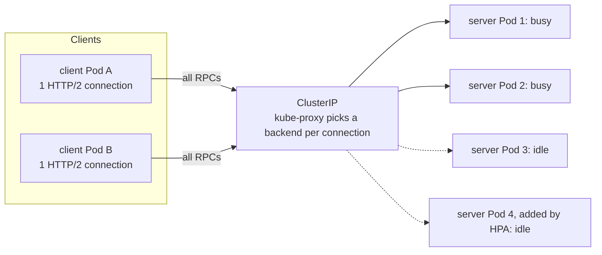

A gRPC service behind a normal Kubernetes Service often shows a strange load picture: two Pods at 90% CPU, four Pods idle, and an HPA scale-out that adds more idle Pods without helping. Nothing is broken in Kubernetes. gRPC runs on HTTP/2, which multiplexes every request over one long-lived TCP connection, and a ClusterIP Service balances **connections**, not requests. Once a client has connected, every call goes to the same Pod until the connection closes. This note explains the mechanism and the fixes, from the cheapest (a server-side connection age) to client-side balancing and L7 proxies, plus the keepalive, health-checking and shutdown settings that make any of them work in production.

> [!info] Scope and sources
> gRPC behaviour (load-balancing policies, name resolution, keepalive, health checking) was checked against the gRPC documentation in the grpc/grpc and grpc/grpc-go repositories and the grpc-go package documentation on 2026-10-21. Kubernetes probe behaviour and Gateway API `GRPCRoute` status were checked against the Kubernetes and Gateway API documentation sources the same day. Nothing was run.

> [!warning] Not verified: GKE load balancers and tools
> This note was not checked against the GKE Gateway and load balancer pages. So these are **not verified**: whether the GKE Gateway controller supports `GRPCRoute` (Gateway API's own conformance reports for GKE show only the HTTP profile), the annotation or `appProtocol` value GKE needs to talk HTTP/2 or h2c to Pods, health check requirements for HTTP/2 backends, and every idle or request timeout on Google Cloud load balancers and Cloud NAT. Also not verified: how often each gRPC language's DNS resolver re-resolves, the Prometheus metric names of gRPC middleware, the `ghz` flags, and Cloud Service Mesh proxyless gRPC setup. Values for `MaxConnectionAge` and keepalive below are examples to tune, not defaults.

## Why L4 balancing fails for HTTP/2



- A ClusterIP Service is a virtual IP. kube-proxy (or the dataplane that replaces it) picks a backend when a **connection** is opened and keeps every packet of that connection on it.
- HTTP/1.1 clients open and recycle many connections, so per-connection balancing averages out. A gRPC client opens one HTTP/2 connection per target and multiplexes every call over it for hours. The gRPC documentation puts it plainly: load balancing in gRPC happens per call, not per connection, and the Service never sees calls.
- Result: load follows the number of clients, not requests. A few chatty clients pin a few Pods. New replicas from a rollout or an HPA scale-out get traffic only from clients that connect after they appear. During a rolling update, clients reconnect to whichever Pods are up at that moment and stay there.

There is nothing to tune in the Service to fix this. The fix is one of: make connections shorter, let the client balance calls across Pods, or put an L7 proxy that understands HTTP/2 in the path.

## The options

| Option                                          | Effort                          | Balances                                  | Costs and limits                                                          |
| ----------------------------------------------- | ------------------------------- | ----------------------------------------- | ------------------------------------------------------------------------- |
| Server `MaxConnectionAge`                       | Server config only              | Over time, by reconnects                  | Coarse; long streams are cut at the age plus grace                        |
| Client-side `round_robin` with headless Service | Client config, DNS change       | Per call, across all Pods                 | Every client connects to every Pod; resolver refresh behaviour varies     |
| L7 proxy: mesh sidecar, ambient waypoint, Envoy | Platform component              | Per call, with retries, outlier detection | Extra hop, extra component to run; see [[service-mesh-on-gke]]            |
| Gateway API route through an L7 load balancer   | Gateway config                  | Per call for north-south traffic          | Only for traffic entering through the gateway; GKE specifics not verified |
| Proxyless gRPC with xDS (Cloud Service Mesh)    | Client libraries, control plane | Per call, centrally managed policy        | Not verified here; language support varies                                |

For most teams: start with `MaxConnectionAge` on every gRPC server (it helps every client, including ones you do not control), add `round_robin` with a headless Service for your own clients, and adopt a mesh only when you also want its mTLS, retries and telemetry.

## Option 1: a server-side maximum connection age

The server sends HTTP/2 GOAWAY once a connection reaches `MaxConnectionAge`, then gives in-flight calls `MaxConnectionAgeGrace` to finish before closing. The client reconnects, and through a ClusterIP that new connection lands on a backend kube-proxy picks again, so over a few cycles the load evens out and new Pods start receiving traffic. grpc-go adds a random jitter of plus or minus 10% to the age so that clients do not all reconnect at once. Both settings default to infinity.

```go title="server.go"
package main

import (
	"log"
	"net"
	"os"
	"os/signal"
	"syscall"
	"time"

	"google.golang.org/grpc"
	"google.golang.org/grpc/health"
	healthpb "google.golang.org/grpc/health/grpc_health_v1"
	"google.golang.org/grpc/keepalive"
)

func main() {
	lis, err := net.Listen("tcp", ":50051")
	if err != nil {
		log.Fatalf("listen: %v", err)
	}

	srv := grpc.NewServer(
		grpc.KeepaliveParams(keepalive.ServerParameters{
			MaxConnectionAge:      5 * time.Minute,  // example: forces reconnects so load rebalances
			MaxConnectionAgeGrace: 30 * time.Second, // example: in-flight RPCs get this long after GOAWAY
			Time:                  2 * time.Minute,  // server pings an idle client after this
			Timeout:               20 * time.Second, // and closes the connection if no ack
		}),
		grpc.KeepaliveEnforcementPolicy(keepalive.EnforcementPolicy{
			MinTime:             30 * time.Second, // allow client pings this often (default 5 minutes)
			PermitWithoutStream: true,             // allow pings with no active RPC
		}),
	)

	hs := health.NewServer()
	healthpb.RegisterHealthServer(srv, hs)
	// Register your own services here, for example catalogpb.RegisterCatalogServer(srv, impl).
	hs.SetServingStatus("", healthpb.HealthCheckResponse_SERVING)

	go func() {
		if err := srv.Serve(lis); err != nil {
			log.Fatalf("serve: %v", err)
		}
	}()

	stop := make(chan os.Signal, 1)
	signal.Notify(stop, syscall.SIGTERM, syscall.SIGINT)
	<-stop

	// 1. Fail readiness so the Pod leaves the endpoints and clients stop picking it.
	hs.SetServingStatus("", healthpb.HealthCheckResponse_NOT_SERVING)
	time.Sleep(10 * time.Second) // example: longer than readiness period x failure threshold

	// 2. Stop accepting new RPCs, send GOAWAY, wait for in-flight RPCs, with a hard limit.
	done := make(chan struct{})
	go func() {
		srv.GracefulStop()
		close(done)
	}()
	select {
	case <-done:
	case <-time.After(20 * time.Second): // keep the total below terminationGracePeriodSeconds
		srv.Stop()
	}
}
```

What the API documents: `GracefulStop` stops accepting new connections and RPCs and blocks until pending RPCs finish; `Stop` closes all connections and cancels active RPCs at once. That is why the hard limit falls back to `Stop`.

Choosing the age: short enough that a new Pod gets a fair share within a few minutes of starting, long enough that reconnect cost (TCP and TLS handshakes) is negligible. A few minutes is a common starting point; measure. Streams that must live longer than `MaxConnectionAge` plus the grace are cut, so streaming clients must reconnect and resume.

## Option 2: client-side balancing with a headless Service

A headless Service (`clusterIP: None`) has no virtual IP. Its DNS name returns one A record per ready Pod. A gRPC client with the `dns` resolver and the `round_robin` policy opens a subchannel to every address and sends calls to the ready ones in turn.

```yaml title="service-headless.yaml"
apiVersion: v1
kind: Service
metadata:
  name: catalog-grpc
  namespace: shop
spec:
  clusterIP: None # headless: DNS returns Pod IPs
  selector:
    app.kubernetes.io/name: catalog
  ports:
    - name: grpc
      port: 50051
      targetPort: 50051
      appProtocol: kubernetes.io/h2c # plaintext HTTP/2; check what your mesh or load balancer expects
```

```go title="client.go (fragment)"
import (
	"time"

	"google.golang.org/grpc"
	"google.golang.org/grpc/credentials/insecure"
	"google.golang.org/grpc/keepalive"
)

const serviceConfig = `{
  "loadBalancingConfig": [{"round_robin": {}}],
  "methodConfig": [{
    "name": [{"service": "shop.catalog.v1.Catalog"}],
    "timeout": "2s",
    "retryPolicy": {
      "maxAttempts": 3,
      "initialBackoff": "0.1s",
      "maxBackoff": "1s",
      "backoffMultiplier": 2,
      "retryableStatusCodes": ["UNAVAILABLE"]
    }
  }]
}`

func dialCatalog() (*grpc.ClientConn, error) {
	return grpc.NewClient(
		"dns:///catalog-grpc.shop.svc.cluster.local:50051",
		grpc.WithTransportCredentials(insecure.NewCredentials()), // in-cluster plaintext; use TLS or mesh mTLS where required
		grpc.WithDefaultServiceConfig(serviceConfig),
		grpc.WithKeepaliveParams(keepalive.ClientParameters{
			Time:                60 * time.Second, // must be >= the server's EnforcementPolicy.MinTime
			Timeout:             20 * time.Second,
			PermitWithoutStream: false,
		}),
	)
}
```

How it works and where it bites:

- Without a service config, the default policy is `pick_first`: connect to the first reachable address and send everything there. That is the pinning problem again, even with a headless Service. `round_robin` must be configured.
- `WithDefaultServiceConfig` applies when the resolver provides no service config (DNS normally does not) or service config lookup is disabled. `grpc.NewClient` is the current grpc-go constructor; older code uses `grpc.Dial`, whose default resolver differs, so always write the `dns:///` scheme explicitly.
- Retries on `UNAVAILABLE` cover the window in which a client still holds a subchannel to a Pod that just went away. Retry only idempotent methods, and keep the retry budget consistent with [[timeouts-retries-load-shedding]].
- **New Pods are discovered only when the client re-resolves DNS.** When and how often that happens depends on the language and version; it is not a fixed interval you can rely on. Pair `round_robin` with a server `MaxConnectionAge`: the GOAWAY makes the client reconnect and refresh its view. Check your language's resolver documentation.
- Every client opens a connection to every server Pod. With 200 client Pods and 100 server Pods that is 20,000 connections, each with its own keepalive pings and memory. At that scale prefer an L7 proxy or a subsetting policy.
- Kubernetes DNS returns only ready Pods for a headless Service by default, so readiness controls which Pods clients see, subject to DNS caching. DNS problems now affect load balancing directly; see [[gke-dns-failures-kube-dns-and-nodelocal]].

The same applies to every gRPC client you run, not only your services: an OpenTelemetry SDK exporting OTLP over gRPC to a collector Deployment pins to one collector Pod in exactly the same way ([[adr/0043-opentelemetry-collector-gateway]]).

## Option 3: an L7 proxy in the path

An HTTP/2-aware proxy terminates the client's connection and balances each call across upstream Pods. Clients need no changes.

- **Service mesh sidecars** (Envoy-based) do this for every meshed workload, with retries, outlier detection and per-call metrics. **Ambient mode** in Istio-based meshes moves L7 handling into waypoint proxies; L4-only ambient (ztunnel) does not balance per call. Which mesh options fit GKE is compared in [[service-mesh-on-gke]]; configuration is out of scope here.
- **A standalone Envoy** (or another HTTP/2 proxy) Deployment in front of a service works when only one service has the problem, at the cost of operating it.
- **Proxyless gRPC** uses the gRPC library itself as the data plane, configured over xDS by a control plane such as Cloud Service Mesh. It avoids the sidecar hop but needs library support in every client language and a bootstrap configuration. It was not verified for this note; read the Cloud Service Mesh documentation before choosing it.

### North-south: Gateway API

For traffic that enters through a gateway, the gateway's proxy balances per call. Gateway API offers two route kinds:

- `GRPCRoute` is GA and part of the Standard channel since Gateway API v1.1.0. It matches on gRPC service and method and enables gRPC-aware features where the implementation supports them.
- `HTTPRoute` is enough for basic routing and load balancing of gRPC; match the path `/package.Service/Method` or a prefix of it.
- Use separate hostnames for gRPC and plain HTTP: implementations may reject routes when an `HTTPRoute` and a `GRPCRoute` attach to the same listener with overlapping hostnames.

```yaml title="grpcroute.yaml"
apiVersion: gateway.networking.k8s.io/v1
kind: GRPCRoute
metadata:
  name: catalog
  namespace: shop
spec:
  parentRefs:
    - name: external
      namespace: gateway
  hostnames:
    - grpc.example.com
  rules:
    - matches:
        - method:
            service: shop.catalog.v1.Catalog
      backendRefs:
        - name: catalog-grpc-lb # a ClusterIP Service: the gateway balances per call
          port: 50051
```

On GKE, check that your GatewayClass supports `GRPCRoute` before you depend on it; if it does not, use an `HTTPRoute` with a path match on the gRPC service prefix. The backend Service must be marked as HTTP/2 (or h2c) in whatever way the current GKE documentation requires, and the load balancer's health check must be able to reach a health endpoint; neither was verified here. The platform's gateway choice is [[adr/0023-gateway-api-for-north-south-traffic]], and the edge layout is [[edge-and-ingress-cloudflare-gclb-gateway-api]].

## Keepalive without `too_many_pings`

Keepalive pings detect dead connections and keep idle connections from being dropped silently by NAT, firewalls or load balancers with idle timeouts ([[kubernetes-node-sysctls]] describes that failure). They have to be agreed between client and server:

| Setting (grpc-go)                       | Side   | Default                                | Meaning                                                  |
| --------------------------------------- | ------ | -------------------------------------- | -------------------------------------------------------- |
| `ClientParameters.Time`                 | client | keepalive off unless set; minimum 10 s | Ping after this much inactivity                          |
| `ClientParameters.Timeout`              | client | 20 s when keepalive is on              | Close if the ping is not acknowledged                    |
| `ClientParameters.PermitWithoutStream`  | client | false                                  | Ping even with no active RPC                             |
| `EnforcementPolicy.MinTime`             | server | 5 minutes                              | Minimum interval between client pings the server accepts |
| `EnforcementPolicy.PermitWithoutStream` | server | false                                  | Accept pings with no active RPC                          |
| `ServerParameters.MaxConnectionAge`     | server | infinity                               | Send GOAWAY after this age (with jitter)                 |

If a client pings more often than the server accepts, or pings without active calls when the server does not permit it, the server closes the connection with a GOAWAY whose debug data is `too_many_pings` (HTTP/2 error `ENHANCE_YOUR_CALM`), and grpc-go clients double their ping interval afterwards. The rule: client `Time` at least the server's `MinTime`, and client `PermitWithoutStream: true` only if the server sets `PermitWithoutStream: true`. Other languages use channel arguments with the same meaning (`GRPC_ARG_KEEPALIVE_TIME_MS`, `GRPC_ARG_KEEPALIVE_PERMIT_WITHOUT_CALLS`, `GRPC_ARG_HTTP2_MIN_RECV_PING_INTERVAL_WITHOUT_DATA_MS` and others).

Set the client ping interval below the shortest idle timeout on the path, which you have to look up for each hop (load balancer, Cloud NAT, firewall, conntrack). No such values are given here because they were not verified.

## Health checking

- gRPC defines a standard health service, `grpc.health.v1.Health`, with `Check` and a streaming `Watch`; statuses are `SERVING`, `NOT_SERVING`, `UNKNOWN` and (for `Watch`) `SERVICE_UNKNOWN`. An empty service name means the server as a whole. grpc-go ships it in `google.golang.org/grpc/health`, as used in the server above.
- Kubernetes has a native `grpc` probe, stable since v1.27. It calls that health service on the Pod IP, in plaintext by default; named ports are not supported, and every error counts as a failure. Before it existed, the usual approach was an exec probe running the `grpc-health-probe` binary.

```yaml title="deployment.yaml (fragment)"
containers:
  - name: catalog
    image: registry.example.com/shop/catalog:2.4.0 # change: pin your image
    ports:
      - name: grpc
        containerPort: 50051
    readinessProbe:
      grpc:
        port: 50051 # a number: named ports are not supported for grpc probes
      periodSeconds: 5
      failureThreshold: 2
    livenessProbe:
      grpc:
        port: 50051
      periodSeconds: 10
      failureThreshold: 6
    lifecycle:
      preStop:
        sleep:
          seconds: 5 # extra time for endpoint removal; or sleep in the app as above
terminationGracePeriodSeconds: 45 # above readiness delay + GracefulStop limit + margin
```

Probe semantics and defaults are explained in [[kubernetes-probes-resources-and-debugging]]. Check that your cluster supports the `preStop` `sleep` action (`kubectl explain pod.spec.containers.lifecycle.preStop`); otherwise rely on the in-application delay shown in `server.go`. A probe mode that uses TLS exists behind a feature gate; check `kubectl explain pod.spec.containers.readinessProbe.grpc` for the fields your version has. Clients can also health-check backends themselves through the service config (`healthCheckConfig` with a `serviceName`; in grpc-go this needs the `google.golang.org/grpc/health` package imported in the client), which removes a `NOT_SERVING` Pod from `round_robin` without waiting for DNS.

## Graceful shutdown and rollouts

During a rolling update, the order of events decides whether clients see errors:

1. The Pod gets SIGTERM; the application marks itself `NOT_SERVING`, readiness fails and the Pod leaves the endpoints and DNS.
2. After a delay long enough for that to propagate, the server calls `GracefulStop`: GOAWAY to every client, no new RPCs, in-flight RPCs finish.
3. Clients reconnect to the remaining Pods; well-behaved clients retry calls that failed with `UNAVAILABLE`.
4. A hard limit (`Stop`) fires before `terminationGracePeriodSeconds` runs out.

`terminationGracePeriodSeconds` must cover the readiness delay plus the graceful-stop limit plus a margin; that is design advice, not a documented formula. Rollout settings (`maxSurge`, `maxUnavailable`, PDBs) are in [[zero-downtime-deployments-kubernetes]], and the same thinking for blue-green cutovers with long-lived connections is in [[gke-blue-green-releases]].

## Verify

Look at requests per Pod, not CPU per Pod. If your servers export gRPC server metrics (from a gRPC middleware or OpenTelemetry instrumentation; the metric name below is an example, not verified), compare per-Pod rates:

```promql
# Requests per second per server Pod.
sum by (pod) (rate(grpc_server_handled_total{namespace="shop", job="catalog"}[5m]))

# Imbalance: busiest Pod divided by the average. Close to 1 is balanced; 3 means one Pod does three times its share.
max(sum by (pod) (rate(grpc_server_handled_total{namespace="shop", job="catalog"}[5m])))
/
avg(sum by (pod) (rate(grpc_server_handled_total{namespace="shop", job="catalog"}[5m])))
```

Then check the mechanics:

```bash
set -euo pipefail

NS="shop"                 # change
SVC="catalog-grpc"        # change

# The headless Service returns one address per ready Pod.
kubectl -n "$NS" get svc "$SVC" -o jsonpath='{.spec.clusterIP}{"\n"}'     # expect: None
kubectl -n "$NS" run dns-check --rm -i --restart=Never --image=busybox:1.36 -- \
  nslookup "${SVC}.${NS}.svc.cluster.local"
kubectl -n "$NS" get endpointslices -l kubernetes.io/service-name="$SVC" -o wide

# Connections per server Pod (needs ss in the image, or use an ephemeral debug container).
for pod in $(kubectl -n "$NS" get pods -l app.kubernetes.io/name=catalog -o name); do
  printf '%s ' "$pod"
  # A missing or failing ss fails the exec instead of printing a misleading 0.
  kubectl -n "$NS" exec "$pod" -- sh -c 'out=$(ss -tn state established "( sport = :50051 )") || exit 1; printf "%s\n" "$out" | tail -n +2 | wc -l'
done
```

Load test before and after a change with a gRPC load generator such as `ghz`, from several client Pods (one client process alone hides the problem, because one client is one connection). The command below shows the shape; flags were not verified, so check `ghz --help`:

```bash
ghz --insecure \
  --proto ./proto/catalog.proto \
  --call shop.catalog.v1.Catalog/GetItem \
  -d '{"id":"42"}' \
  -c 50 -z 2m \
  catalog-grpc.shop.svc.cluster.local:50051
```

During the test, scale the server Deployment up by a few replicas and watch the per-Pod rate: with a working setup the new Pods pick up traffic within about one `MaxConnectionAge` (or one DNS refresh for `round_robin`). Load test planning is in [[load-and-performance-testing]].

## Troubleshooting

**Uneven load, new Pods idle after scale-out.** Classic connection pinning. Check whether servers set `MaxConnectionAge`, whether clients use `round_robin` (the default `pick_first` pins even with a headless Service), and whether clients target the headless name with the `dns:///` scheme. The HPA cannot fix this ([[kubernetes-autoscaling]]).

**`UNAVAILABLE` errors right after every deploy.** Clients still send calls to Pods that are shutting down. Make readiness fail before `GracefulStop`, add a shutdown delay, make sure `terminationGracePeriodSeconds` is long enough that `Stop` is not reached, and retry idempotent calls on `UNAVAILABLE` with backoff.

**`GOAWAY` with `too_many_pings`, connections dropping every few minutes.** Client keepalive is more aggressive than the server's enforcement policy: client `Time` below the server's `MinTime` (5 minutes by default), or client pings without active calls while the server does not permit it. Align the two settings; a packet capture shows the GOAWAY frames ([[kubernetes-packet-capture]]).

**Long streams cut every few minutes.** That is `MaxConnectionAge` plus grace doing its job. Make the stream client reconnect and resume, or raise the age for the streaming service only.

**Idle connections hang, then fail after a long timeout.** Something on the path dropped the idle connection without telling either side. Enable client keepalive below the shortest idle timeout on the path; diagnose with [[network-troubleshooting-dns-mtu-tls-load-balancers]].

**The grpc probe fails although the server works.** The server listens on `localhost` only (the probe connects to the Pod IP), the port is named instead of numbered, the health service is not registered, or the server requires TLS while the probe uses plaintext.

**Gateway returns 502 or protocol errors for gRPC.** The load balancer talks HTTP/1.1 to the backend. Mark the backend as HTTP/2 or h2c as the current GKE documentation requires, and check the health check configuration.

## Rollback

- `MaxConnectionAge` is a server setting: remove it and redeploy. Clients are unaffected apart from fewer reconnects.
- Client `round_robin`: remove the service config and point clients back at the ClusterIP Service name. Keep both Services (headless and ClusterIP) during the migration so either client version works.
- A mesh or proxy: remove the workload from the mesh (namespace label or injection annotation) and restart it; clients fall back to direct connections, with the pinning behaviour back.
- Gateway routes: revert the route in Git; keep the old hostname working until clients have moved.

## Related

- [[timeouts-retries-load-shedding]]: deadlines, retry budgets and what to do under overload.
- [[zero-downtime-deployments-kubernetes]]: rollout settings and shutdown order.
- [[kubernetes-autoscaling]]: why scale-out does not help pinned connections.
- [[service-mesh-on-gke]]: when a mesh is worth running for L7 balancing.
- [[edge-and-ingress-cloudflare-gclb-gateway-api]]: where gRPC enters the platform.
- [[load-and-performance-testing]]: testing the fix with realistic client counts.
- [[adr/0023-gateway-api-for-north-south-traffic]]: the Gateway API decision.
- [[synthetic-monitoring-blackbox-and-uptime-checks]]: probing gRPC health from outside.

## Sources

- [gRPC: Load balancing (blog)](https://grpc.io/blog/grpc-load-balancing/) and the [load-balancing design document](https://github.com/grpc/grpc/blob/master/doc/load-balancing.md): per-call balancing, `pick_first`, `round_robin`.
- [gRPC: Name resolution](https://github.com/grpc/grpc/blob/master/doc/naming.md) and [service config](https://github.com/grpc/grpc/blob/master/doc/service_config.md)
- [gRPC: Keepalive guide](https://grpc.io/docs/guides/keepalive/) and the [keepalive design document](https://github.com/grpc/grpc/blob/master/doc/keepalive.md): defaults, `too_many_pings`.
- [gRPC: Health checking protocol](https://github.com/grpc/grpc/blob/master/doc/health-checking.md)
- [grpc-go keepalive package](https://pkg.go.dev/google.golang.org/grpc/keepalive): `ServerParameters`, `ClientParameters`, `EnforcementPolicy` and their defaults.
- [grpc-go package](https://pkg.go.dev/google.golang.org/grpc): `KeepaliveParams`, `WithDefaultServiceConfig`, `GracefulStop`, `Stop`.
- [Kubernetes blog: gRPC load balancing on Kubernetes without tears](https://kubernetes.io/blog/2018/11/07/grpc-load-balancing-on-kubernetes-without-tears/): the connection pinning mechanism (2018; the product recommendation is dated).
- [Kubernetes: Configure liveness, readiness and startup probes](https://kubernetes.io/docs/tasks/configure-pod-container/configure-liveness-readiness-startup-probes/): the `grpc` probe.
- [Gateway API: GRPCRoute](https://gateway-api.sigs.k8s.io/api-types/grpcroute/)
- [GKE: Gateway API](https://cloud.google.com/kubernetes-engine/docs/concepts/gateway-api) (not readable when written; see the warning above)
