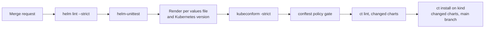

This note covers the CI checks a Helm chart should pass before a release: linting, rendering against several values files, template unit tests, a values schema, manifest validation against target Kubernetes versions, and install tests on changed charts only. It is for senior DevOps engineers who own shared charts. The chart structure, naming and values rules are in [[patterns/helm-chart-conventions]]; policy rules on the rendered manifests are in [[patterns/conftest-policy-gate-for-manifests]].

> [!info] Scope and sources
> Written against Helm 3, GitLab CI and a kind-based install test. Based on the Helm documentation for `helm lint` and `values.schema.json`, and the project documentation of kubeconform, helm-unittest and chart-testing (`ct`). The tool image in the examples is a placeholder for an image you build and pin yourself.

> [!note] Not verified
> The claims below were written from documentation knowledge and were not checked against a running system or the current docs: the `ct` flag and config key names, how helm-unittest is installed in your Helm version, and the location of the kubeconform CRD schema catalogue. Check them before relying on them.

## Gate layers

Each layer catches a different class of mistake. Run the cheap ones first and fail fast.

| Check                     | Catches                                                           | Cost                                  |
| ------------------------- | ----------------------------------------------------------------- | ------------------------------------- |
| `helm lint --strict`      | Chart metadata errors, template syntax, warnings treated as fails | Seconds                               |
| Render with values matrix | Templates that break for a non-default values file                | Seconds per values file               |
| helm-unittest             | Template logic: conditionals, loops, helper output                | Seconds                               |
| `values.schema.json`      | Wrong types, missing required values, bad digests, typos          | Seconds, runs in lint and install     |
| kubeconform               | Manifests invalid for a Kubernetes version or a CRD schema        | Seconds per version                   |
| `ct lint`                 | Missing version bump, maintainers, lint across changed charts     | Seconds, needs git history            |
| `ct install` on kind      | Charts that render but do not start, hooks, RBAC, probes          | Minutes, needs Docker and a kind node |

Skip a layer only on purpose. A chart without CRDs does not need CRD schemas, but it still needs a Kubernetes version matrix.

## Pipeline



Put the first six on every merge request. Run the kind install on merge requests that touch a chart if your runners allow it, otherwise on the default branch and nightly.

## Lint and render

`helm lint --strict` turns warnings into errors. Run it with each values file you ship, because some template paths only run with specific values.

```bash
set -euo pipefail

CHART_DIR="charts/app"  # change: path of the chart

helm dependency build "$CHART_DIR"
helm lint --strict "$CHART_DIR"
for VALUES_FILE in "$CHART_DIR"/ci/*-values.yaml; do
  helm lint --strict "$CHART_DIR" -f "$VALUES_FILE"
done
```

Keep one values file per supported shape under `ci/`: default, high availability, minimal, with ingress, with autoscaling. These files are test fixtures. They are not examples for users.

## Unit tests

helm-unittest tests the rendered output of single templates against `set` values. It is the right place for conditionals such as "the HPA exists only when autoscaling is on".

```yaml title="charts/app/tests/hpa_test.yaml"
suite: horizontal pod autoscaler
templates:
  - hpa.yaml
tests:
  - it: renders nothing when autoscaling is disabled
    set:
      autoscaling.enabled: false
    asserts:
      - hasDocuments:
          count: 0

  - it: renders an HPA with the configured bounds when enabled
    set:
      autoscaling.enabled: true
      autoscaling.minReplicas: 2
      autoscaling.maxReplicas: 6
    asserts:
      - isKind:
          of: HorizontalPodAutoscaler
      - equal:
          path: spec.minReplicas
          value: 2
      - equal:
          path: spec.maxReplicas
          value: 6
```

helm-unittest is a Helm plugin. Install it with the method in its README for your Helm version, ideally pinned to a version in the CI image build, then run:

```bash
set -euo pipefail

CHART_DIR="charts/app"  # change: path of the chart

helm unittest "$CHART_DIR"
```

Test decisions and edge cases. Do not write a test that repeats the template.

## Schema validation

A `values.schema.json` file next to `Chart.yaml` makes Helm validate values on `lint`, `template`, `install` and `upgrade`. It is the cheapest way to reject typos and wrong types, and it can enforce policy such as "images are pinned by digest".

```json title="charts/app/values.schema.json"
{
  "$schema": "https://json-schema.org/draft-07/schema#",
  "type": "object",
  "additionalProperties": false,
  "required": ["image"],
  "properties": {
    "image": {
      "type": "object",
      "additionalProperties": false,
      "required": ["repository", "digest"],
      "properties": {
        "repository": {
          "type": "string",
          "minLength": 1
        },
        "digest": {
          "type": "string",
          "pattern": "^sha256:[a-f0-9]{64}$"
        },
        "pullPolicy": {
          "type": "string",
          "enum": ["IfNotPresent", "Always", "Never"]
        }
      }
    },
    "replicaCount": {
      "type": "integer",
      "minimum": 1
    },
    "autoscaling": {
      "type": "object",
      "properties": {
        "enabled": { "type": "boolean" },
        "minReplicas": { "type": "integer", "minimum": 1 },
        "maxReplicas": { "type": "integer", "minimum": 1 }
      }
    }
  }
}
```

`additionalProperties: false` at the top level catches misspelled keys, but it also rejects subchart values and global values unless you list them. Add `global` and each subchart name as properties.

## Manifest validation

Render the chart and validate the output against the Kubernetes schemas for every version you run, including the next version you upgrade to. CRDs need their own schemas, otherwise kubeconform fails on unknown kinds or you skip them silently.

```yaml title=".gitlab-ci.yml"
stages:
  - test

helm-render-and-validate:
  stage: test
  image: registry.example.com/ci/helm-tools:1.0.0 # change: your image with helm, helm-unittest and kubeconform, pinned by tag or digest
  variables:
    CHART_DIR: charts/app
  parallel:
    matrix:
      - VALUES: [default, ha, minimal]
        K8S_VERSION: ["1.30.0", "1.31.0"] # change: the Kubernetes versions of your clusters and the next upgrade target
  script:
    - helm dependency build "$CHART_DIR"
    - helm lint --strict "$CHART_DIR" -f "$CHART_DIR/ci/${VALUES}-values.yaml"
    - |
      helm template release-under-test "$CHART_DIR" \
        --namespace ci \
        -f "$CHART_DIR/ci/${VALUES}-values.yaml" \
      | kubeconform -strict -summary \
          -kubernetes-version "$K8S_VERSION" \
          -schema-location default \
          -schema-location 'https://raw.githubusercontent.com/datreeio/CRDs-catalog/main/{{.Group}}/{{.ResourceKind}}_{{.ResourceAPIVersion}}.json'
  rules:
    - changes:
        - charts/**/*
```

`-strict` fails on unknown fields, which catches misspelled keys inside manifests. `-summary` prints counts, which helps when a job reports "0 resources" because a template rendered nothing. The CRD catalogue location is a community project, so mirror the schemas you rely on into your own repository or an Artifactory generic repository instead of fetching from the internet on every run.

If a chart installs its own CRDs, keep their schemas next to the chart and add a second `-schema-location` pointing at that directory.

## chart-testing

`ct` (chart-testing) works across a repository of charts. It checks that the chart version was bumped when files changed, validates `Chart.yaml`, runs `helm lint`, and installs the chart into a cluster. It needs the git history of the target branch to know what changed.

```yaml title="ct.yaml"
remote: origin
target-branch: main # change: the branch merge requests target
chart-dirs:
  - charts
check-version-increment: true
validate-maintainers: false
helm-extra-args: --timeout 300s
```

`validate-maintainers: false` is deliberate for an internal repository where `Chart.yaml` has no maintainers list. The key names are from the project documentation; check them against the `ct` version you pin.

## Running only for changed charts

In a monorepo with many charts, test only those that changed.

```bash
set -euo pipefail

TARGET_BRANCH="main"  # change: the branch merge requests target

# GitLab clones shallow by default. ct needs the target branch to diff against.
git fetch --no-tags origin "$TARGET_BRANCH"

CHANGED="$(ct list-changed --config ct.yaml)"
if [ -z "$CHANGED" ]; then
  echo "No chart changes, skipping chart tests."
  exit 0
fi

echo "Changed charts:"
echo "$CHANGED"

ct lint --config ct.yaml
```

In GitLab, set `GIT_DEPTH: "0"` on the job (or a depth large enough to include the merge base), otherwise `ct list-changed` sees no history and reports nothing. For the install test, add `ct install --config ct.yaml` in a job that has a Docker daemon and a kind cluster. That usually means Docker-in-Docker, which needs a privileged runner. That is a real risk on a shared runner: use a dedicated, isolated runner pool for it, or run the install test in a cluster namespace you create per pipeline instead of kind.

## Pitfalls

- Only testing the default values file. Most template bugs sit behind `if` branches that default values never reach.
- Kubernetes versions that do not match production. Validate against the version your clusters run and the one you upgrade to next, see [[runbooks/gke-cluster-upgrade]].
- Removed or deprecated APIs. kubeconform with the target version fails on an API that no longer exists, which is the early warning you want.
- Fetching schemas from the internet on every run. It is slow, flaky and a supply-chain dependency. Mirror them.
- A strict schema that blocks subchart or global values. Test the schema with the values files of the real consumers.
- A version bump check that fails on documentation-only changes. Use `ct` exclusion settings for README changes, or accept a patch bump.
- Install tests that pass because the chart has no probes or the image is a stub. Use the real image or a minimal one that actually listens.
- Mutating `Chart.lock` in CI. Run `helm dependency build`, which respects the lock file, not `helm dependency update`.

## Verify

Run the same gates locally before opening a merge request:

```bash
set -euo pipefail

CHART_DIR="charts/app"  # change: path of the chart
K8S_VERSION="1.31.0"    # change: Kubernetes version to validate against

helm lint --strict "$CHART_DIR"
helm unittest "$CHART_DIR"
helm template release-under-test "$CHART_DIR" -f "$CHART_DIR/ci/default-values.yaml" \
  | kubeconform -strict -summary -kubernetes-version "$K8S_VERSION"
```

Expected: lint reports `0 chart(s) failed`, helm-unittest reports all tests passed, and kubeconform reports `Invalid: 0, Errors: 0`. Then prove the gate works: set `image.digest` to `latest` in a values file and confirm the schema rejects it.

## Rollback

The gates only block merges. If a new gate fails on existing charts and blocks unrelated work, set `allow_failure: true` on that job, fix the charts, and remove it. A chart that passed the gates and still fails in a cluster is rolled back with [[runbooks/helm-release-rollback]].

## Related

- [[patterns/helm-chart-conventions]]: the chart structure and values rules the gates enforce.
- [[patterns/conftest-policy-gate-for-manifests]]: policy checks on the rendered manifests, after validation.
- [[tools/helm-vs-kustomize]]: when a chart is the right packaging and when overlays are simpler.
- [[runbooks/helm-release-rollback]]: what to do when a released chart misbehaves in a cluster.
- [[patterns/gitlab-ci-pipeline-structure]]: where these jobs fit in the pipeline.
