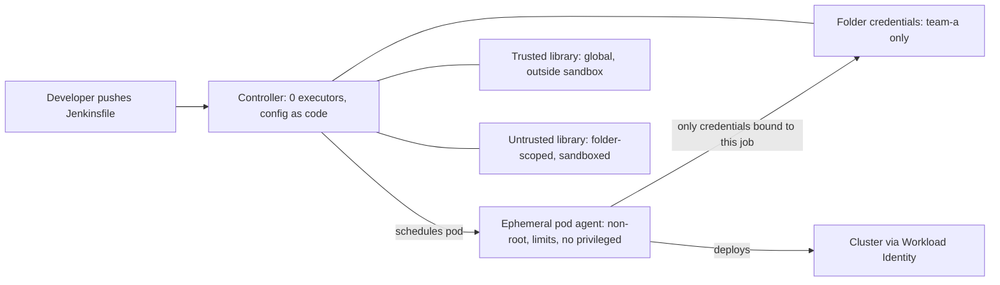

This note covers the controls that make a Jenkins installation safe to run for many teams: no builds on the controller, ephemeral pod agents, the Script Security sandbox, folder-scoped credentials, trusted and untrusted shared libraries, plugin hygiene and approvals that leave evidence. It is for senior DevOps engineers who operate Jenkins next to GKE. Library structure and testing stay in [[patterns/jenkins-shared-libraries]]; the wider question of who may approve what is in [[compliance/separation-of-duties-in-deployments]].

> [!info] Scope and sources
> Written against the Jenkins documentation on jenkins.io (Securing Jenkins, Script Security, Configuration as Code, the Kubernetes plugin) and the Jenkins security advisories. No Jenkins or plugin version is pinned here; pin and test the ones you run.

> [!note] Not verified
> The claims below were written from documentation knowledge and were not checked against a running system or the current docs: JCasC key names (especially for the security realm, role-based authorization and folder credentials), Script Security behaviour details, and the Jenkins version that turned agent-to-controller protection on by default. Check them before relying on them.

## Trust boundaries

Everything that runs a build is code someone wrote. The controller holds the keys: credentials, job configuration, the ability to start any agent. The hardening goal is that build code never runs on the controller and can never reach credentials it was not given.



Four rules sit behind the diagram:

- The controller does not build. It orchestrates.
- Agents are disposable: one pod per build, deleted afterwards.
- Credentials are scoped to the smallest folder that needs them.
- Anything that changes how every pipeline behaves (global libraries, script approvals, plugins, security settings) is reviewed like production code.

## Controller settings with JCasC

Configuration as code (the Configuration as Code plugin) keeps the controller reproducible and reviewable: settings live in Git, changes are merge requests and a UI edit is overwritten on reload. Store secrets in the file as `${ENV_VAR}` references fed from a Kubernetes Secret, never as literals.

```yaml title="jenkins.yaml"
jenkins:
  systemMessage: "Managed by configuration as code. Change the repository, not the UI."
  numExecutors: 0 # no builds on the controller
  mode: EXCLUSIVE
  scmCheckoutRetryCount: 2
  disableRememberMe: true
  securityRealm:
    oic: # change: your identity provider; this is a placeholder shape, check the plugin docs
      clientId: "${OIDC_CLIENT_ID}"
      clientSecret: "${OIDC_CLIENT_SECRET}"
      wellKnownOpenIDConfigurationUrl: "https://idp.example.com/.well-known/openid-configuration"
      userNameField: "email"
      groupsFieldName: "groups"
  authorizationStrategy:
    roleBased: # Role-based Authorization Strategy plugin; check the key names for your version
      roles:
        global:
          - name: "admin"
            description: "Jenkins administrators"
            permissions:
              - "Overall/Administer"
            entries:
              - group: "jenkins-admins"
          - name: "authenticated-read"
            description: "Everyone signed in can see that Jenkins exists"
            permissions:
              - "Overall/Read"
            entries:
              - group: "authenticated"
        items:
          - name: "team-a-developers"
            description: "Build and read jobs in the team-a folder"
            pattern: "team-a(/.*)?"
            permissions:
              - "Job/Build"
              - "Job/Read"
              - "Job/Cancel"
            entries:
              - group: "team-a"
          - name: "team-a-maintainers"
            description: "Configure jobs and manage credentials in the team-a folder"
            pattern: "team-a(/.*)?"
            permissions:
              - "Job/Configure"
              - "Job/Create"
              - "Credentials/View"
              - "Credentials/Create"
              - "Credentials/Update"
            entries:
              - group: "team-a-maintainers"
security:
  globalJobDslSecurityConfiguration:
    useScriptSecurity: true
unclassified:
  location:
    url: "https://jenkins.example.com/" # change: the public URL of the controller
```

Points to check in the running controller:

- Anonymous users have no permissions. Signup is off. Use a real identity provider with groups, and map groups to roles, not individual users.
- `numExecutors: 0` and `mode: EXCLUSIVE` on the built-in node. Verify in **Manage Jenkins > Nodes**.
- The agent-to-controller access protection is enabled. Current Jenkins versions have it on by default and the legacy switch is gone; confirm in **Manage Jenkins > Security** for the version you run rather than trusting a version number from a note.
- The controller runs as a non-root user with a read-only root filesystem where possible, and `JENKINS_HOME` is on a persistent disk with snapshots.
- CSRF protection is on, the agent port is fixed or disabled (WebSocket agents avoid an extra open port), and the controller is not reachable from the internet except through your access proxy.

## Pod agents

Use the Kubernetes plugin so each build gets a fresh pod. Put the agent definition in the Jenkinsfile (or in the shared library) as a pod template and keep the controller's cloud configuration minimal: namespace, a default service account without cluster rights and a pod retention policy of "never".

```groovy title="Jenkinsfile"
// Build image and tools image: pin tags or digests you control.
def buildPod = '''
apiVersion: v1
kind: Pod
spec:
  securityContext:
    runAsNonRoot: true
    runAsUser: 1000
    runAsGroup: 1000
    fsGroup: 1000
    seccompProfile:
      type: RuntimeDefault
  containers:
    - name: build
      image: registry.example.com/ci/build-tools:1.4.2
      command: ["sleep"]
      args: ["infinity"]
      securityContext:
        allowPrivilegeEscalation: false
        privileged: false
        capabilities:
          drop: ["ALL"]
      resources:
        requests:
          cpu: "500m"
          memory: 1Gi
        limits:
          cpu: "2"
          memory: 2Gi
'''

pipeline {
  agent none
  options {
    timeout(time: 45, unit: 'MINUTES')
    buildDiscarder(logRotator(numToKeepStr: '30'))
    disableConcurrentBuilds()
  }
  stages {
    stage('Build and test') {
      agent {
        kubernetes {
          yaml buildPod
          defaultContainer 'build'
          retries 1
        }
      }
      steps {
        sh 'make test'
      }
    }
    stage('Approve production') {
      when { branch 'main' }
      steps {
        // No agent here: waiting for a human must not hold an executor or a pod.
        script {
          def approver = input(
            message: 'Deploy this build to production?',
            ok: 'Deploy',
            submitter: 'release-managers',
            submitterParameter: 'APPROVER'
          )
          currentBuild.description = "Approved by ${approver}"
          echo "Production deploy approved by ${approver}"
        }
      }
    }
    stage('Deploy production') {
      when { branch 'main' }
      agent {
        kubernetes {
          yaml buildPod
          defaultContainer 'build'
          serviceAccount 'jenkins-deployer-prod' // Kubernetes SA bound to a deploy-only Google SA
        }
      }
      steps {
        withCredentials([string(credentialsId: 'team-a-registry-token', variable: 'REGISTRY_TOKEN')]) {
          sh 'make deploy ENV=production'
        }
      }
    }
  }
}
```

Notes:

- `agent none` at the top and an `agent` per stage means the approval wait runs without a pod and without an executor.
- The deploy stage uses its own Kubernetes service account that has the deploy rights through [[patterns/gke-workload-identity]]. The build stage uses the default account that has none.
- `submitter` limits who can press the button to a group (or user list). `submitterParameter` records who did it.
- A pod agent that mounts the Docker socket or runs `privileged: true` defeats this whole note. Build images with an unprivileged builder, as described in [[patterns/gitlab-runners-on-gke]] (the same options apply).

## Script approval

Pipelines run in the Script Security sandbox. When a script calls a method the sandbox does not allow, Jenkins queues a signature for an administrator in **Manage Jenkins > In-process Script Approval**.

- Treat approval as code review of a capability, not of one script. Approving a signature allows it for every sandboxed script on the controller. Approving something like arbitrary script evaluation, process execution or reflection removes the sandbox in practice.
- Read the exact signature. Prefer to fix the script (use a pipeline step, or move the logic into a trusted library method) over approving a generic method.
- Do not tick "Use Groovy Sandbox" off on a job to make the prompt go away. That turns the job into trusted code that runs outside the sandbox and only an administrator may save it.
- Keep approvals in version control: export the approved signatures regularly and review the diff. Route approvals through the same reviewers as security changes.

## Credentials scoping

Credentials can live in the system store, the global domain or a folder. Prefer the smallest scope.

- **System scope** is for the controller itself (agent connections, cloud configuration). Pipelines cannot read it.
- **Global scope** is visible to every job on the controller. Keep it nearly empty.
- **Folder scope**: create team credentials in the team folder's own store (the folder's **Credentials** page). Only jobs under that folder, and only people with `Credentials/View` there, can use them.
- Use the narrowest type: a deploy token with one repository scope, not a personal account; a short-lived token minted by Workload Identity where you can, not a stored JSON key.
- Reference credentials only through `withCredentials` (or the `credentials()` helper) so Jenkins masks the value in logs. Never echo, `set -x` or write them to files in the workspace.

Credential IDs are part of a pipeline's interface, so use a convention that tells a reader the scope, for example `team-a-registry-token`. A pipeline in another folder cannot resolve it, which is the point.

If a credential does leak into a log or an artifact, follow [[runbooks/leaked-credential-rotation]]; deleting the build log is not rotation.

## Shared libraries trust

Libraries come in two trust levels:

- **Trusted (global)** libraries are configured under **Manage Jenkins > System**. Their code runs outside the sandbox and can call anything. Only the platform team may change them, through a protected branch and a reviewed merge, and the library repository must restrict who can push tags.
- **Untrusted (folder-scoped)** libraries are configured on a folder, run inside the sandbox and are the right place for team-owned helpers.

Rules that follow:

- Pin the version in the Jenkinsfile with a tag (`@Library('platform-lib@v2.3.0') _`). Do not load a mutable branch by default.
- Turn off "Allow default version to be overridden" for trusted libraries, otherwise a job can load any branch of the trusted library from a branch build.
- Be careful with "Load implicitly" on a trusted library: it runs in every pipeline.
- Do not let a pipeline load an arbitrary library from an arbitrary repository on a controller that holds shared credentials.

## Plugins

Plugins are most of Jenkins' attack surface and most of its upgrade risk.

- Keep an approved list with versions. Build the controller image with the plugin installer CLI from a pinned `plugins.txt`, so a restart does not silently change the plugin set.
- Subscribe to the Jenkins security advisories feed and patch on a schedule: a weekly window for advisories, a monthly one for everything else is a reasonable starting point.
- Remove plugins nobody uses. Deprecated or unmaintained plugins are a finding.
- Test updates on a staging controller restored from a recent backup of `JENKINS_HOME`.

The script below compares installed plugins against the approved list and fails if they differ.

> [!note] Not verified
> The REST path and field names in this script come from memory of the plugin manager API. Run it once against your controller and check the output shape before wiring it into a job.

```bash
set -euo pipefail

JENKINS_URL="https://jenkins.example.com"   # change: your controller URL
JENKINS_USER="plugin-audit"                 # change: a read-only API user
APPROVED_FILE="approved-plugins.json"       # {"git": "1.2.3", ...} maintained in Git
# JENKINS_API_TOKEN comes from the environment (CI secret variable).

# Keep the credentials out of the process list by using a curl config on a pipe.
curl -fsS -K <(printf 'user = "%s:%s"\n' "$JENKINS_USER" "$JENKINS_API_TOKEN") \
  "${JENKINS_URL}/pluginManager/api/json?depth=1&tree=plugins%5BshortName,version,enabled%5D" \
  | jq '.plugins | map(select(.enabled)) | map({key: .shortName, value: .version}) | from_entries' \
  > current-plugins.json

jq -n -r --slurpfile a "$APPROVED_FILE" --slurpfile c current-plugins.json '
  ($a[0]) as $approved | ($c[0]) as $current |
  ( $current | to_entries[] | select($approved[.key] == null)
    | "UNAPPROVED \(.key) \(.value)" ),
  ( $current | to_entries[] | select($approved[.key] != null and $approved[.key] != .value)
    | "VERSION \(.key) approved=\($approved[.key]) installed=\(.value)" ),
  ( $approved | to_entries[] | select($current[.key] == null)
    | "MISSING \(.key)" )
' > plugin-drift.txt

cat plugin-drift.txt
test ! -s plugin-drift.txt
```

## Approvals as evidence

A production approval is evidence only if it records who, what and when, and if the approver is not the author.

- Use `input` with `submitter` and `submitterParameter`, as above, and write the approver and the build's commit SHA into the build description or an archived JSON file.
- Pair it with a protected main branch so the code that was approved is the code that was reviewed. See [[standards/code-review]].
- Keep build records for as long as your retention policy says, and keep the controller's audit trail plugin output if you use one. Retention is a policy decision for your organisation, not a Jenkins default.
- Provenance of what was built is a separate question: see [[compliance/slsa-build-provenance]] for what to record about the build itself.

An approval that the author can click, or that any logged-in user can click, is a button, not a control.

## Pitfalls

- **Executors left on the built-in node "for small jobs".** Those jobs read `JENKINS_HOME`, including credentials files. Set zero executors.
- **UI changes under JCasC.** They are lost on the next reload or look "random" to the team. Make the UI read-only in practice by reviewing drift.
- **Global credentials by default.** One leaked token is then valid for every team.
- **Approving signatures to end the noise.** Every approval widens the sandbox for all scripts.
- **Trusted library overridable from a branch.** A branch build can then run unreviewed code with full rights.
- **Long `input` waits on an agent.** The pod or executor stays reserved while a human sleeps.
- **Plugin updates applied on the production controller first.** Test on a restored copy.

## Verify

```bash
set -euo pipefail

JENKINS_URL="https://jenkins.example.com"   # change: your controller URL
# JENKINS_AUTH_FILE holds "user:api-token" for an administrator and is not committed.
JENKINS_AUTH_FILE="${HOME}/.jenkins-auth"   # change: path of your credentials file

# 1. Executors on the built-in node must be 0 (script console, read-only check).
curl -fsS -K <(printf 'user = "%s"\n' "$(cat "$JENKINS_AUTH_FILE")") \
  --data-urlencode "script=println(Jenkins.instance.numExecutors)" \
  "${JENKINS_URL}/scriptText"

# 2. Anonymous access must be denied: expect 403 (or a redirect to login).
curl -s -o /dev/null -w '%{http_code}\n' "${JENKINS_URL}/api/json"
```

Expected: `0` from the first command and `403` (or `302` to the login page) from the second. Then run a test pipeline and confirm the pod appears and is deleted afterwards (`kubectl get pods -n jenkins-agents -w`), `id -u` inside it is `1000`, and a job in `team-b` cannot resolve a credential ID that exists only in `team-a`.

## Rollback

Controller settings are in Git, so roll back by reverting the merge request and reloading the configuration (**Manage Jenkins > Configuration as Code > Reload existing configuration**). For a plugin update that broke the controller, restart from the previous image tag with the previous `plugins.txt`; restore `JENKINS_HOME` from the snapshot only if job data was damaged. An approved script signature is revoked in the In-process Script Approval page.

## Related

- [[patterns/jenkins-shared-libraries]]: library layout, versioning and testing, the content this note's trust rules apply to.
- [[compliance/separation-of-duties-in-deployments]]: who may build, approve and deploy, and how to show it.
- [[compliance/slsa-build-provenance]]: recording what was built, by what, from which source.
- [[tools/gitlab-ci-vs-jenkins]]: the trade-offs behind running Jenkins at all.
- [[runbooks/leaked-credential-rotation]]: what to do when a credential escapes a build.
