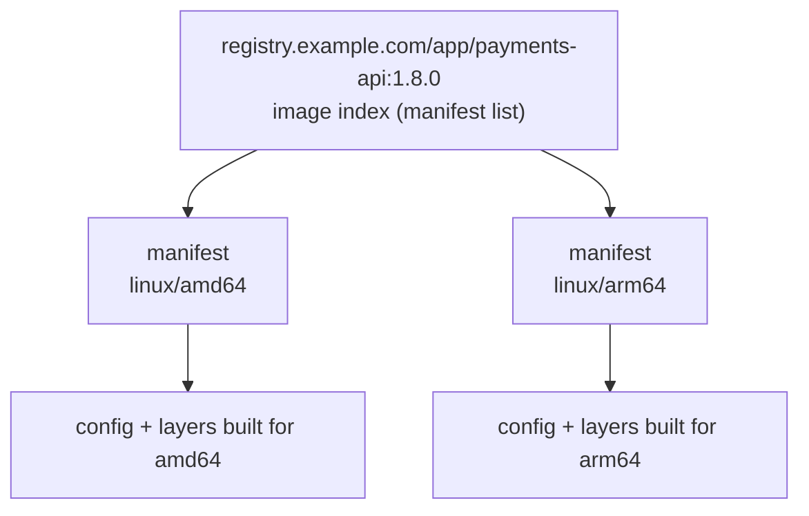

The first Arm node pool, or the first developer on an Arm laptop, finds every `amd64`-only image the hard way: the container starts and dies with `exec format error`. The fix is to publish **one image reference that works on both architectures**: an image index (manifest list) that points to one image per platform. This note shows how to build those images in CI under the site's rules (rootless builders, deploy by digest, signed images): native builds per architecture, a merge step, signing the index, and scheduling on mixed GKE pools.

> [!info] What was checked
> The Docker multi-platform concepts and the `docker buildx imagetools create` and `inspect` flags come from the Docker docs and local help of buildx v0.37.1, the image index fields from the OCI image spec, and the `cosign sign --recursive` flag from the cosign docs, all read on 2026-10-21. **Not verified**: anything on the GKE Arm pages (which machine series offer Arm, whether Arm nodes carry a default taint and its key, Autopilot support and minimum versions), image index support and cleanup behaviour in Artifactory and Artifact Registry, the GitLab `parallel:matrix` and Jenkins agent syntax below, the `buildctl` platform flag, the `kubernetes.io/arch` label page (the label itself is the usual well-known one), rootless BuildKit requirements on your nodes, and whether SBOM and provenance attestations survive the merge. Nothing was run on a real runner or cluster.

## How a multi-architecture image works



- The **index** is a small JSON document with a `manifests` array. Each entry points by digest to one platform's image manifest and carries a `platform` object whose `architecture` and `os` fields are required by the OCI spec (`variant`, such as `v8` for arm64, is optional).
- The client (containerd on the node, Docker on a laptop) fetches the index, picks the entry matching its own platform and pulls only that image.
- The index has **its own digest**. That digest is what you sign, attest and deploy, so one reference is immutable for every architecture ([[0010-deploy-images-by-digest]]).
- `exec format error` means the binary in the container does not match the host CPU: the node pulled an image (or a platform entry) built for another architecture, typically because the reference is a single-platform image, not an index.

## Three ways to build the second architecture

| Strategy                                       | How                                                                                                                         | Speed                                                                  | Fits the no-privileged rule?                                                                                                                       |
| ---------------------------------------------- | --------------------------------------------------------------------------------------------------------------------------- | ---------------------------------------------------------------------- | -------------------------------------------------------------------------------------------------------------------------------------------------- |
| **Native builders per architecture** (default) | One build job per platform on a runner of that architecture, then a merge job that creates the index                       | Native speed for each                                                  | Yes: each job is an ordinary rootless build                                                                                                        |
| **Cross-compilation in the Dockerfile**        | Build stage runs on the builder's platform (`FROM --platform=$BUILDPLATFORM`) and compiles for `$TARGETOS/$TARGETARCH`; final stage copies the binary | Fast; only the final stage is per platform | Yes, as long as no `RUN` in the final stage needs the target CPU                                                                    |
| **QEMU emulation**                             | One builder builds every platform, running foreign `RUN` steps through user-mode emulation                                  | The Docker docs warn it "can be much slower"; compile-heavy steps can take many times longer | Usually no: registering the emulators is done with `docker run --privileged --rm tonistiigi/binfmt --install all`, which [[0015-no-privileged-image-builds-in-ci]] does not allow on shared runners |

Use native builders for images whose final stage runs package managers or compilers (`apt-get`, `pip install` with native wheels, `npm ci` with native modules). Use cross-compilation for Go, Rust or Java services whose final stage only copies artifacts, and you can then build both platforms on one builder without emulation. Keep QEMU for local experiments.

Cross-compilation, following the pattern in the Docker docs:

```dockerfile title="Dockerfile (Go service, cross-compiled)"
# syntax=docker/dockerfile:1
FROM --platform=$BUILDPLATFORM golang:1.23-bookworm AS build
ARG TARGETOS
ARG TARGETARCH
WORKDIR /src
COPY go.mod go.sum ./
RUN go mod download
COPY . .
RUN CGO_ENABLED=0 GOOS=$TARGETOS GOARCH=$TARGETARCH go build -trimpath -o /out/payments-api ./cmd/payments-api

FROM gcr.io/distroless/static-debian12:nonroot
COPY --from=build /out/payments-api /payments-api
ENTRYPOINT ["/payments-api"]
```

Replace both base images with the pinned, platform-owned base images from your catalogue ([[0040-golden-base-images-owned-by-platform]]); the tags above are examples, and **every base image must itself be a multi-architecture index** that includes all your target platforms. Check with `docker buildx imagetools inspect <base>`. Hardening rules are in [[dockerfile-hardening]].

## GitLab CI: native jobs per architecture, then merge

```yaml title=".gitlab-ci.yml"
variables:
  IMAGE: $CI_REGISTRY_IMAGE/payments-api
  CACHE_REF: $CI_REGISTRY_IMAGE/cache/payments-api

.registry-auth: &registry-auth
  - mkdir -p ~/.docker
  - printf '{"auths":{"%s":{"auth":"%s"}}}' "$CI_REGISTRY" "$(printf '%s:%s' "$CI_REGISTRY_USER" "$CI_REGISTRY_PASSWORD" | base64 | tr -d '\n')" > ~/.docker/config.json

build-image:
  stage: build
  image:
    name: moby/buildkit:rootless
    entrypoint: [""]
  parallel:
    matrix:
      - ARCH: [amd64, arm64]
  tags:
    - k8s-${ARCH} # one runner fleet per architecture; tag names are yours
  variables:
    BUILDKITD_FLAGS: --oci-worker-no-process-sandbox
  before_script: *registry-auth
  script:
    - |
      CACHE_TO=""
      if [ "$CI_COMMIT_REF_PROTECTED" = "true" ]; then
        CACHE_TO="--export-cache type=registry,ref=${CACHE_REF}:${CI_COMMIT_REF_SLUG}-${ARCH},mode=max"
      fi
      buildctl-daemonless.sh build \
        --frontend dockerfile.v0 --local context=. --local dockerfile=. \
        --opt platform=linux/${ARCH} \
        --import-cache type=registry,ref=${CACHE_REF}:main-${ARCH} \
        ${CACHE_TO} \
        --output type=image,name=${IMAGE}:${CI_COMMIT_SHA}-${ARCH},push=true

create-index:
  stage: publish
  image: registry.example.com/platform/ci-tools@sha256:REPLACE_WITH_TOOLS_IMAGE_DIGEST # docker CLI with buildx, jq, cosign
  needs: ["build-image"]
  before_script: *registry-auth
  script:
    - |
      docker buildx imagetools create \
        --tag "${IMAGE}:${CI_COMMIT_SHA}" \
        --metadata-file index.json \
        "${IMAGE}:${CI_COMMIT_SHA}-amd64" \
        "${IMAGE}:${CI_COMMIT_SHA}-arm64"
      INDEX_DIGEST=$(jq -r '."containerimage.descriptor".digest' index.json)
      echo "IMAGE_REF=${IMAGE}@${INDEX_DIGEST}" > image.env
      docker buildx imagetools inspect "${IMAGE}@${INDEX_DIGEST}"
  artifacts:
    reports:
      dotenv: image.env
```

Why it is built this way:

- **One job per architecture** runs on a runner of that architecture, so every `RUN` executes natively and the build stays rootless ([[0015-no-privileged-image-builds-in-ci]]). Runner setup on GKE, including separate node pools, is in [[gitlab-runners-on-gke]]; the Arm fleet needs its own runner registration and tag.
- **The per-architecture tags** (`<sha>-amd64`, `<sha>-arm64`) are intermediate: `imagetools create` requires its sources to exist in the registry already. Nobody deploys them. Exclude them from promotion and give them a short retention.
- **`--metadata-file`** writes the index digest (`containerimage.descriptor.digest`) to JSON, so the pipeline passes on a digest, not a tag. Later jobs sign and deploy `IMAGE_REF`.
- **Cache refs per architecture** (`main-amd64`, `main-arm64`): a cache exported by one platform is of little use to the other, and separate refs keep each one small and its retention simple. Who may write the cache is explained in [[buildkit-registry-cache-in-ci]].
- `--opt platform=` is the `buildctl` spelling for the target platform with the Dockerfile frontend; with `docker buildx build` it is `--platform linux/arm64`. Check `buildctl build --help` on your BuildKit version.
- The `parallel:matrix` variable in `tags` and the shape of the dotenv hand-off follow the GitLab docs as generally documented but were **not verified** in this review; [[gitlab-ci-rules-dag-matrix-and-includes]] covers matrix jobs.

If `docker buildx imagetools` is not available in your tools image, other registry-side tools can assemble an index from existing manifests (for example `crane`, `regctl` or `manifest-tool`). Their syntax was not checked here.

## Jenkins: parallel stages on per-architecture agents

With the Kubernetes plugin, pin each build Pod to a node of the right architecture with `nodeSelector` on the well-known `kubernetes.io/arch` label:

```groovy title="Jenkinsfile"
def buildkitPod(String arch) {
  return """
apiVersion: v1
kind: Pod
spec:
  nodeSelector:
    kubernetes.io/arch: ${arch}
  containers:
    - name: buildkit
      image: moby/buildkit:rootless
      command: ["cat"]
      tty: true
      env:
        - name: BUILDKITD_FLAGS
          value: "--oci-worker-no-process-sandbox"
      securityContext:
        runAsUser: 1000
        seccompProfile: { type: Unconfined }
        appArmorProfile: { type: Unconfined }
"""
}

pipeline {
  agent none
  environment {
    IMAGE = 'registry.example.com/app/payments-api'
  }
  stages {
    stage('Build per architecture') {
      parallel {
        stage('amd64') {
          agent { kubernetes { yaml buildkitPod('amd64') } }
          steps {
            container('buildkit') {
              sh '''
                buildctl-daemonless.sh build \
                  --frontend dockerfile.v0 --local context=. --local dockerfile=. \
                  --opt platform=linux/amd64 \
                  --output type=image,name=${IMAGE}:${GIT_COMMIT}-amd64,push=true
              '''
            }
          }
        }
        stage('arm64') {
          agent { kubernetes { yaml buildkitPod('arm64') } }
          steps {
            container('buildkit') {
              sh '''
                buildctl-daemonless.sh build \
                  --frontend dockerfile.v0 --local context=. --local dockerfile=. \
                  --opt platform=linux/arm64 \
                  --output type=image,name=${IMAGE}:${GIT_COMMIT}-arm64,push=true
              '''
            }
          }
        }
      }
    }
    stage('Create index') {
      agent { kubernetes { inheritFrom 'ci-tools' } } // a pod template with docker CLI + buildx, jq, cosign
      steps {
        sh '''
          docker buildx imagetools create \
            --tag "${IMAGE}:${GIT_COMMIT}" \
            --metadata-file index.json \
            "${IMAGE}:${GIT_COMMIT}-amd64" "${IMAGE}:${GIT_COMMIT}-arm64"
          jq -r '."containerimage.descriptor".digest' index.json > index.digest
        '''
        archiveArtifacts artifacts: 'index.digest'
      }
    }
  }
}
```

Registry credentials are omitted for brevity: inject them from the Kubernetes Secret or OIDC exchange described in [[artifactory-access-tokens-and-oidc-for-ci]], never from a Jenkins global variable. Agent hardening and the Unconfined profiles' trade-off are in [[jenkins-controller-and-agent-hardening]]. The plugin syntax (`inheritFrom`, `yaml`) and the Unconfined profiles that rootless BuildKit may need were **not verified** for your plugin and node versions.

## Registries

Both JFrog Artifactory and Google Artifact Registry are expected to store OCI indexes and Docker manifest lists, but this was **not verified** here. Before you rely on either ([[0009-container-images-artifactory-or-artifact-registry]], [[artifactory-vs-nexus-vs-artifact-registry]]), test:

1. Push an index, pull it on an amd64 and an arm64 machine, and compare `uname -m` in each container.
2. **Cleanup policies.** The per-platform manifests behind an index are often untagged. A policy that deletes "untagged images" can delete them and break the index. Confirm that your retention rules treat manifests referenced by an index as in use.
3. **Scanning.** Check that vulnerability scanning reports each platform, not only the first one or none.
4. **Promotion.** Copying an image between repositories ([[artifact-promotion-artifactory]]) must copy the index and every child manifest, keeping the digests.

## Sign and attest the index

Sign the index digest, and use `--recursive` so each per-platform manifest is signed too (cosign's flag help: "if a multi-arch image is specified, additionally sign each discrete image"):

```bash title="sign by digest (keyless, in CI)"
# IMAGE_REF comes from the create-index job, for example registry.example.com/app/payments-api@sha256:...
cosign sign --yes --recursive "${IMAGE_REF}"
cosign verify "${IMAGE_REF}" \
  --certificate-identity-regexp '^https://gitlab\.example\.com/platform/payments-api//' \
  --certificate-oidc-issuer 'https://gitlab.example.com'
```

The identity flags depend on your OIDC issuer and how the signing identity is formed; take them from [[0037-keyless-cosign-image-signing]] and [[image-signing-and-admission-verification]] rather than from this example. Always sign by digest, never by tag.

SBOM and provenance attestations are produced per platform by each build job. Whether they stay attached after `imagetools create` merges the per-platform images was **not verified**; after the merge, list what the index contains (`docker buildx imagetools inspect --raw` shows every manifest, including attestation manifests if present) and confirm your admission policy ([[0038-kyverno-verifies-image-signatures-at-admission]]) and SBOM storage ([[sbom-generation-and-storage]]) find what they expect.

## Scheduling on mixed GKE node pools

Once every image a workload uses is a multi-architecture index, the workload can run on either pool. Until then, keep it off Arm explicitly:

```yaml title="deployment fragment: amd64 only, during migration"
spec:
  template:
    spec:
      nodeSelector:
        kubernetes.io/arch: amd64
```

```yaml title="deployment fragment: allowed on Arm nodes"
spec:
  template:
    spec:
      # Only needed if your Arm node pools are tainted; check with kubectl describe node.
      tolerations:
        - key: kubernetes.io/arch
          operator: Equal
          value: arm64
          effect: NoSchedule
```

Whether GKE taints Arm nodes by default, with which key, and which machine series and modes (Standard, Autopilot) offer Arm is **not verified** here: read the GKE Arm workloads page for your cluster version and confirm on a real node with `kubectl get nodes -L kubernetes.io/arch` and `kubectl describe node <arm-node> | grep -A3 Taints`. Every sidecar, init container and DaemonSet image in the Pod must be multi-architecture as well, including mesh proxies, log agents and security agents.

Roll out per service: canary a few replicas onto the Arm pool, compare latency and error rate, then widen. Performance per core differs between architectures, so revisit CPU requests and HPA targets ([[kubernetes-resource-requests-and-limits]]).

## Verify

```bash title="verify an index"
REF=registry.example.com/app/payments-api@sha256:REPLACE_WITH_INDEX_DIGEST

# Media type must be an index, with one entry per platform.
docker buildx imagetools inspect "$REF"
docker buildx imagetools inspect --raw "$REF" | jq '.mediaType, [.manifests[] | .platform]'

# Run each platform (on an amd64 machine, arm64 needs local emulation, which is fine on a laptop).
docker run --rm --platform linux/amd64 "$REF" --version
docker run --rm --platform linux/arm64 "$REF" --version

# In the cluster: which node architecture each Pod landed on.
kubectl -n payments get pods -o wide
kubectl get nodes -L kubernetes.io/arch
```

Expected: an index media type (`application/vnd.oci.image.index.v1+json` or the Docker manifest list type), one entry each for `linux/amd64` and `linux/arm64` (plus attestation entries if you attach them), and both `docker run` commands printing the version. Replace `--version` with whatever your entrypoint accepts.

## Troubleshooting

| Symptom                                                          | Cause                                                                                           | Fix                                                                                                                                                             |
| ---------------------------------------------------------------- | ----------------------------------------------------------------------------------------------- | --------------------------------------------------------------------------------------------------------------------------------------------------------------- |
| `exec format error` in the container log                         | The reference is a single-platform image of the wrong architecture, or a sidecar image is       | Inspect every image in the Pod spec with `imagetools inspect`; rebuild as an index or pin the Pod to `amd64`.                                                   |
| Build fails on arm64 at `FROM`: no matching manifest              | A base image has no arm64 entry                                                                 | Pick a base image that publishes arm64, or ask the platform team to add it to the catalogue.                                                                   |
| arm64 job builds amd64 binaries                                  | Hard-coded `GOARCH`, a downloaded binary for one architecture, or a missing `TARGETARCH` arg    | Use `TARGETOS` and `TARGETARCH`; download architecture-specific tools by `$TARGETARCH`.                                                                         |
| Cache hits are rare after adding arm64                           | Both platforms share one cache ref and overwrite each other's cache                             | One cache ref per platform, as in the GitLab job above.                                                                                                         |
| `imagetools create` fails: source not found                      | A per-architecture job failed or pushed elsewhere                                               | The merge job must `need` all build jobs; check both pushes.                                                                                                    |
| Index works today, breaks next week                              | Registry cleanup removed untagged child manifests                                               | Fix the retention rule (see Registries), rebuild.                                                                                                               |
| Admission rejects the image after the switch                     | The policy verifies the per-platform digest but only the index was signed, or the other way round | Sign with `--recursive`; check what digest the policy resolves.                                                                                                |
| Arm Pods stay Pending                                            | Missing toleration for a tainted Arm pool, or no Arm capacity                                    | `kubectl describe pod` events; add the toleration or capacity.                                                                                                   |

## Rollback

1. Deploy the **previous single-architecture digest** you know works (from the release record), with `nodeSelector: kubernetes.io/arch: amd64`, so it can only land on amd64 nodes.
2. If the Arm pool caused the problem, cordon its nodes (`kubectl cordon`) and let workloads move back; keep the pool for testing.
3. Leave the multi-architecture pipeline in place but stop promoting its output until the cause is fixed. The amd64 entry of the index is a normal amd64 image; its digest (from `imagetools inspect`) can also be deployed directly.

## Kaniko

Kaniko's repository README says, as of 2026-10-21, that the project "is archived and no longer developed or maintained", and that Kaniko does not support creating multi-arch manifests. Do not start new multi-architecture work on it; see [[kaniko-vs-buildkit-vs-cloud-build]].

## Related

- [[building-and-shipping-images]] for the basics of digests and indexes
- [[dockerfile-hardening]]
- [[buildkit-registry-cache-in-ci]]
- [[image-signing-and-admission-verification]]
- [[gitlab-runners-on-gke]]
- [[0010-deploy-images-by-digest]]
- [[0015-no-privileged-image-builds-in-ci]]
- [[kaniko-vs-buildkit-vs-cloud-build]]
- [[gke-image-pull-registry-failures]]

## Sources

- [Docker: Multi-platform builds](https://docs.docker.com/build/building/multi-platform/)
- [Docker: buildx imagetools create](https://docs.docker.com/reference/cli/docker/buildx/imagetools/create/) and [imagetools inspect](https://docs.docker.com/reference/cli/docker/buildx/imagetools/inspect/)
- [OCI image spec: Image index](https://github.com/opencontainers/image-spec/blob/main/image-index.md)
- [cosign sign](https://github.com/sigstore/cosign/blob/main/doc/cosign_sign.md)
- [Kubernetes: well-known label kubernetes.io/arch](https://kubernetes.io/docs/reference/labels-annotations-taints/#kubernetes-io-arch)
- [GKE: Arm workloads](https://cloud.google.com/kubernetes-engine/docs/concepts/arm-on-gke) (not verified in this review)
- [Kaniko repository](https://github.com/GoogleContainerTools/kaniko)
