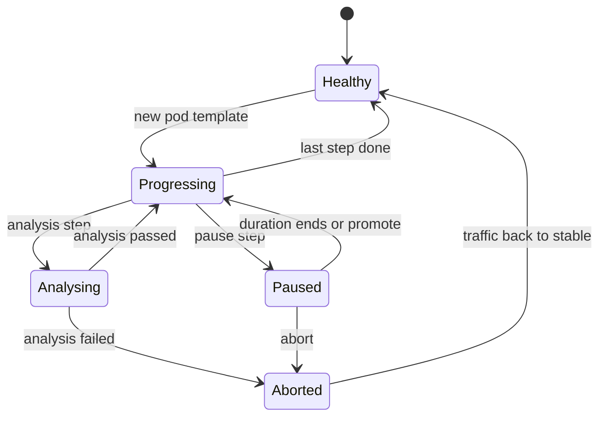

Progressive delivery sends a new version to a small share of traffic, measures it, and only then widens the rollout. This note shows canary releases with Argo Rollouts, managed by Argo CD, with automated analysis against Prometheus. It is for senior DevOps engineers who already deploy with Deployments and want a measured release step. The mechanics of plain rolling updates, probes and disruption budgets stay in [[patterns/zero-downtime-deployments-kubernetes]], and the repository and promotion flow is in [[architecture/gitops-repo-topology-and-promotion]].

> [!info] Scope and sources
> Written against Argo Rollouts as described in the official documentation at [argo-rollouts.readthedocs.io](https://argo-rollouts.readthedocs.io/en/stable/), Argo CD at [argo-cd.readthedocs.io](https://argo-cd.readthedocs.io/en/stable/) and Prometheus at [prometheus.io](https://prometheus.io/docs/). Metric names in the queries are examples and must match your own instrumentation.

> [!note] Not verified
> The claims below were written from documentation knowledge and were not checked against a running system or the current docs: current Argo Rollouts CRD fields, the status of the traffic-router plugin for Gateway API, and the health behaviour Argo CD shows for Rollouts. Check them before relying on them.

## When canaries pay off

A canary needs enough traffic on the small slice to tell good from bad. It pays off when:

- the service handles steady, meaningful traffic, so 10 percent still yields many requests per minute;
- you have service level indicators you trust (error ratio, latency), as defined in [[patterns/slo-burn-rate-alerting]];
- a bad release costs real money or trust, and the extra release time is acceptable;
- you can route a share of traffic: through an ingress controller, a service mesh or a Gateway.

It does not pay off for low-traffic internal services, batch jobs, or releases where the main risk is a schema change. With a handful of requests per minute, the analysis has no signal and either passes everything or fails on noise. Use a plain rolling update plus good probes for those, or blue-green with a manual check.

## How it works

A `Rollout` replaces the `Deployment`. It keeps a stable ReplicaSet and creates a canary ReplicaSet for the new version. The controller walks through the `steps`, shifts traffic, runs analysis, and either promotes to 100 percent or aborts and returns to the stable version.



Blue-green is the other built-in strategy. It starts the full new version next to the old one, runs analysis against a preview Service, then switches the active Service. It needs double capacity during the switch and gives a clean cut-over, which suits services where a mixed fleet is not acceptable. This note uses canary because it needs less capacity and gives gradual evidence.

## Rollout manifest

The Rollout below uses two Services and an ingress controller for weighted routing. Weights are applied by the traffic router, and the steps put the analysis between the first and second increase.

```yaml title="apps/payments/base/rollout.yaml"
apiVersion: argoproj.io/v1alpha1
kind: Rollout
metadata:
  name: payments
  namespace: payments
spec:
  replicas: 6
  revisionHistoryLimit: 3
  selector:
    matchLabels:
      app: payments
  template:
    metadata:
      labels:
        app: payments
    spec:
      containers:
        - name: payments
          image: europe-docker.pkg.dev/my-project/apps/payments:1.8.0 # change: pin by digest in the overlay
          ports:
            - containerPort: 8080
          readinessProbe:
            httpGet:
              path: /healthz
              port: 8080
          resources:
            requests:
              cpu: 250m
              memory: 256Mi
            limits:
              memory: 256Mi
  strategy:
    canary:
      canaryService: payments-canary
      stableService: payments-stable
      trafficRouting:
        nginx:
          stableIngress: payments
      steps:
        - setWeight: 10
        - pause: { duration: 5m }
        - analysis:
            templates:
              - templateName: payments-success-rate
            args:
              - name: service-name
                value: payments
        - setWeight: 50
        - pause: { duration: 10m }
```

After the last step the controller promotes the canary to 100 percent and the old ReplicaSet scales down after its delay. A `pause` with no duration waits for a human to promote, which is how you add an approval gate.

## Services and ingress

Both Services select the same Pods. The controller adds a pod-template-hash to each Service selector so that one points at the stable ReplicaSet and the other at the canary.

```yaml title="apps/payments/base/services.yaml"
apiVersion: v1
kind: Service
metadata:
  name: payments-stable
  namespace: payments
spec:
  selector:
    app: payments
  ports:
    - name: http
      port: 80
      targetPort: 8080
---
apiVersion: v1
kind: Service
metadata:
  name: payments-canary
  namespace: payments
spec:
  selector:
    app: payments
  ports:
    - name: http
      port: 80
      targetPort: 8080
---
apiVersion: networking.k8s.io/v1
kind: Ingress
metadata:
  name: payments
  namespace: payments
spec:
  ingressClassName: nginx
  rules:
    - host: payments.example.com # change: your hostname
      http:
        paths:
          - path: /
            pathType: Prefix
            backend:
              service:
                name: payments-stable
                port:
                  number: 80
```

The Ingress points at the stable Service. During a rollout the controller creates a second, canary Ingress with weight annotations. Do not create that one yourself.

## Analysis template

The analysis queries Prometheus and compares the canary with an error budget. It uses a burn-rate style ratio, as in [[patterns/slo-burn-rate-alerting]]: the observed error ratio divided by the budget (one minus the SLO). A burn rate of 1 consumes the budget exactly over the SLO window; the canary threshold below is deliberately strict, because the canary is short-lived.

```yaml title="apps/payments/base/analysis-template.yaml"
apiVersion: argoproj.io/v1alpha1
kind: AnalysisTemplate
metadata:
  name: payments-success-rate
  namespace: payments
spec:
  args:
    - name: service-name
  metrics:
    - name: canary-traffic
      interval: 1m
      count: 5
      failureLimit: 0
      successCondition: result[0] >= 1
      provider:
        prometheus:
          address: http://prometheus.monitoring.svc.cluster.local:9090 # change: your Prometheus or query frontend
          query: |
            sum(rate(http_requests_total{service="{{args.service-name}}-canary"}[5m]))
    - name: canary-burn-rate
      interval: 1m
      count: 5
      failureLimit: 1
      inconclusiveLimit: 2
      successCondition: result[0] < 2
      provider:
        prometheus:
          address: http://prometheus.monitoring.svc.cluster.local:9090 # change: your Prometheus or query frontend
          query: |
            (
              (
                sum(rate(http_requests_total{service="{{args.service-name}}-canary", code=~"5.."}[5m]))
                or vector(0)
              )
              / sum(rate(http_requests_total{service="{{args.service-name}}-canary"}[5m]))
            )
            / 0.001
```

Reading it:

- `canary-traffic` fails the rollout if the canary receives less than one request per second. This turns "no signal" into a visible failure, not a silent pass. Choose a threshold that matches your traffic; for a service where this is too strict, use a longer pause, not a laxer check.
- `canary-burn-rate` divides the 5xx ratio by `0.001`, the error budget of a 99.9 percent SLO. Change the divisor to match your SLO. `or vector(0)` makes a zero-error canary evaluate to 0 and not to an empty result.
- `failureLimit` is the number of failed measurements tolerated; `inconclusiveLimit` covers measurements that match neither success nor failure, such as empty results.
- The service label and metric name depend on your instrumentation. Check the query in the Prometheus UI before using it.

Add a latency metric next to the error metric for services where slow is as bad as failing. If you use Google Cloud Managed Service for Prometheus, point the address at your query frontend and check the authentication it needs; the tool choice is discussed in [[tools/prometheus-vs-cloud-monitoring]].

## Traffic routing options

| Router                     | How weights are applied                           | Notes                                                                                |
| -------------------------- | ------------------------------------------------- | ------------------------------------------------------------------------------------ |
| No router (replica-based)  | Ratio of canary to stable Pods                    | Coarse: 10 percent needs 10 or more Pods. Fine for small steps on large deployments. |
| NGINX ingress              | Canary Ingress with weight annotations            | Simple; needs the NGINX ingress controller.                                          |
| Service mesh (Istio, etc.) | VirtualService or similar weights                 | Precise, also supports header matching; adds the mesh.                               |
| Gateway API                | HTTPRoute weights through a traffic-router plugin | Fits GKE Gateway; plugin maturity and supported controllers were not verified.       |

GKE's built-in external Ingress does not do weighted routing between two Services on its own, which is why the examples use NGINX. Check the current Gateway API support in both Argo Rollouts and GKE before choosing it.

## Running with Argo CD

Argo CD deploys the Rollout like any other resource. A few things to know:

- Argo CD reports the Rollout health from its status. A paused rollout shows as `Suspended` (or a similar progressing state), and an aborted one as `Degraded`. Treat both as meaningful, not as sync errors. The exact mapping is documented by both projects and was not verified here.
- The controller modifies Services (selectors) and the canary Ingress. If Argo CD shows `OutOfSync` on those fields, add `ignoreDifferences` for them in the Application.
- Automated sync with `selfHeal` can fight a manual abort. Abort changes status, not spec, so it usually does not, but a manual `kubectl edit` of the Rollout would be reverted.
- For a human approval, prefer a `pause: {}` step over a manual Argo CD sync, so the approval sits next to the evidence.
- Image promotion remains a commit to the config repository, as described in [[architecture/gitops-repo-topology-and-promotion]]. The new image makes the Rollout start a canary; nothing else triggers it.

## Operating a rollout

Install the kubectl plugin from the Argo Rollouts releases and check its checksum before you use it. Then:

```bash
set -euo pipefail

NAMESPACE="payments"  # change: your namespace
ROLLOUT="payments"    # change: your Rollout name

# Watch steps, weights, ReplicaSets and analysis runs.
kubectl argo rollouts get rollout "${ROLLOUT}" -n "${NAMESPACE}" --watch

# Skip the current pause and continue with the next step.
kubectl argo rollouts promote "${ROLLOUT}" -n "${NAMESPACE}"

# Skip all remaining steps and analysis. Use only when you have other evidence.
kubectl argo rollouts promote "${ROLLOUT}" -n "${NAMESPACE}" --full

# Stop the rollout and send traffic back to stable.
kubectl argo rollouts abort "${ROLLOUT}" -n "${NAMESPACE}"

# Go back to the previous revision of the pod template.
kubectl argo rollouts undo "${ROLLOUT}" -n "${NAMESPACE}"
```

In a GitOps setup `undo` changes live state and not Git. Follow it with a revert in the config repository, otherwise Argo CD will bring the bad version back on the next sync. After an abort, the Rollout stays degraded until the pod template changes or you retry.

## Pitfalls

- **Schema and API changes that are not backward compatible.** During a canary, old and new versions run at the same time against the same database and queue. Use expand and contract: add the new column, deploy code that works with both, and only later remove the old one. Never put an incompatible migration inside the canary.
- **HPA and replica counts.** Point the HorizontalPodAutoscaler at the Rollout (`scaleTargetRef` kind `Rollout`), and leave `replicas` to the autoscaler in production to avoid fights with Git. With traffic routing, canary Pods scale with the weight unless configured otherwise; check how your version handles that. See [[patterns/kubernetes-autoscaling]].
- **Analysis on too little traffic.** A pass on ten requests means nothing. Keep the traffic check, lengthen the pause, or use a synthetic load for low-traffic services.
- **Argo CD showing `Suspended` or `Progressing` for a long time.** A pause without a duration waits forever. Alert on rollouts stuck longer than expected.
- **Metrics that include the stable version.** Query only the canary series; with a mesh, label by version. A query on the whole service dilutes a bad canary.
- **Readiness probes that lie.** The canary receives traffic when ready. A shallow probe sends real users to a broken Pod.
- **Sticky sessions and caches.** Users may see both versions. Make clients tolerate that, or use header-based routing for internal testing first.

## Verify

1. Apply the manifests and confirm the first revision becomes `Healthy`: `kubectl argo rollouts get rollout payments -n payments`.
2. Change the image, watch the canary reach 10 percent, and confirm the AnalysisRun appears: `kubectl get analysisrun -n payments`.
3. Run the analysis query by hand in Prometheus and compare it with the AnalysisRun result.
4. Release a deliberately broken build in a non-production environment (for example one that returns 500 on a path). Confirm the rollout aborts and traffic returns to stable without manual action.
5. Confirm Argo CD shows the Application as `Healthy` after promotion and `Degraded` after an abort.

## Rollback

- **During a rollout:** `kubectl argo rollouts abort payments -n payments`. Traffic goes back to the stable version; the canary scales down.
- **After promotion:** revert the promotion commit in the config repository and let Argo CD sync it, as in [[architecture/gitops-repo-topology-and-promotion]]. The revert goes through a canary again, which is the safe path; use `promote --full` on the revert only in an incident, with the risk understood.
- **Rollout controller itself broken:** the controller is a single dependency for every Rollout. Keep a documented way to convert a Rollout to a Deployment, and for Helm-managed releases see [[runbooks/helm-release-rollback]].

## Related

- [[patterns/zero-downtime-deployments-kubernetes]]: probes, disruption budgets and the rolling update baseline this pattern builds on.
- [[tools/argo-rollouts-vs-spinnaker]]: when a CD platform with pipelines is the better fit.
- [[architecture/gitops-repo-topology-and-promotion]]: how the new image reaches the Rollout through Git.
- [[patterns/slo-burn-rate-alerting]]: the burn-rate maths behind the analysis query.
- [[runbooks/helm-release-rollback]]: rolling back releases managed by Helm.
- [[patterns/kubernetes-autoscaling]]: HPA behaviour while a canary runs.
