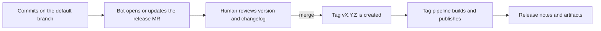

This note describes how to turn commit messages into version numbers, tags and changelogs, and the two common ways to run it: a reviewed release merge request, or a release on every push to the default branch. It is for senior DevOps engineers who own pipelines and release flow. Pipeline layout stays in [[patterns/gitlab-ci-pipeline-structure]]; moving the released artifact between repositories is in [[patterns/artifact-promotion-artifactory]]. The two models are presented neutrally: both work, and the choice depends on how much human review you want before a version number exists.

> [!info] Scope and sources
> Written against the Conventional Commits and Semantic Versioning specifications, the Keep a Changelog format, and the documentation of release-please, semantic-release and commitlint. No tool versions are pinned; pin the ones you adopt.

> [!note] Not verified
> The claims below were written from documentation knowledge and were not checked against a running system or the current docs: release-please support for GitLab, release-please manifest and config keys, the behaviour that releases created with a default CI token do not trigger further pipelines (documented for GitHub's built-in token; not checked for GitLab job tokens), and semantic-release GitLab plugin names. Check them before relying on them.

## Inputs and rules

The automation is only as good as the commit messages. The contract is Conventional Commits: `type(scope): subject`, an optional body, and optional footers.

| Commit                                                  | SemVer effect (after 1.0) | Changelog section |
| ------------------------------------------------------- | ------------------------- | ----------------- |
| `fix: handle empty config`                              | patch                     | Fixed             |
| `feat: add retry budget`                                | minor                     | Added             |
| `feat!: drop the v1 API` or a `BREAKING CHANGE:` footer | major                     | Changed, flagged  |
| `docs:`, `test:`, `chore:`, `ci:`, `refactor:`          | none                      | usually hidden    |
| `perf:`, `revert:`                                      | tool-dependent            | Changed or Fixed  |

SemVer rules to agree on once:

- Major for incompatible changes to the public interface, minor for backwards-compatible features, patch for backwards-compatible fixes. Define the public interface: for a service, the API and the config schema; for a Helm chart, the values schema; for a library, its exported symbols.
- **0.x versions** make no stability promise. Many tools can be configured so that a breaking change in 0.x bumps the minor, and a feature bumps the patch. Decide whether you want that, and when to cut 1.0.
- Pre-release identifiers (`1.5.0-rc.1`) are for release candidates, not for every merge.
- A version is immutable. Never re-tag; publish a new patch.

## Two release models

| Concern                | Release merge request (release-please style)                    | Release on push (semantic-release style)                     |
| ---------------------- | --------------------------------------------------------------- | ------------------------------------------------------------ |
| When is a version made | When a person merges the release MR                             | On every qualifying merge to the default branch              |
| Human review           | Version and changelog are reviewed and editable before release  | None between merge and release, except the commit messages   |
| Changelog              | Committed in the release MR                                     | Generated at release time; committed back only with a plugin |
| Noise                  | One long-lived MR that accumulates changes                      | One tag per qualifying merge                                 |
| Batching               | Natural: merge the MR when you want to ship                     | Needs release channels or branches                           |
| Token                  | Needs a token that can open and update MRs and create tags      | Needs a token that can push tags and create releases         |
| Failure mode           | Release MR forgotten, drifts from the default branch            | A bad commit message ships a wrong version immediately       |
| Fit                    | Teams that want a deliberate release moment and a reviewed text | Libraries and services shipped continuously                  |

Neither is the default for every team. If production releases need an approval anyway (see [[standards/production-change-checklist]]), the release MR is a natural place for it.

## Release MR flow



The release MR contains only the version bump and the changelog entry. Every new qualifying commit on the default branch updates the same MR. Merging it creates the tag, and the tag pipeline does the build, publish and promotion.

release-please is built around GitHub. Whether your version supports GitLab natively is not verified here; check its documentation before choosing it for a GitLab-only organisation. If it does not, the same model can be built with a different tool or a small pipeline job, and the rest of this note still applies.

## Configuration

A manifest-based release-please setup for a repository with a service and a Helm chart. Each path is its own package with its own version.

```json title="release-please-config.json"
{
  "separate-pull-requests": true,
  "bump-minor-pre-major": true,
  "bump-patch-for-minor-pre-major": false,
  "include-component-in-tag": true,
  "packages": {
    "services/api": {
      "release-type": "node",
      "package-name": "api",
      "component": "api",
      "changelog-path": "CHANGELOG.md"
    },
    "charts/web": {
      "release-type": "helm",
      "component": "web-chart",
      "changelog-path": "CHANGELOG.md"
    }
  }
}
```

```json title=".release-please-manifest.json"
{
  "services/api": "1.4.2",
  "charts/web": "0.9.0"
}
```

The manifest records the last released version of each package; the tool updates it in each release MR. Start it at the versions you have already released, or the first release will be computed from the beginning of history.

For the other model, `semantic-release` runs in a job on the default branch. It reads the commits since the last tag, decides the version, tags, publishes release notes and, with plugins, commits the changelog back.

```json title=".releaserc.json"
{
  "branches": ["main"],
  "plugins": [
    "@semantic-release/commit-analyzer",
    "@semantic-release/release-notes-generator",
    "@semantic-release/changelog",
    [
      "@semantic-release/git",
      { "assets": ["CHANGELOG.md"], "message": "chore(release): ${nextRelease.version} [skip ci]" }
    ],
    "@semantic-release/gitlab"
  ]
}
```

```yaml title=".gitlab-ci.yml (fragment)"
release:
  stage: release
  image: node:22 # change: pin the tag or digest your team has approved
  rules:
    - if: $CI_COMMIT_BRANCH == $CI_DEFAULT_BRANCH
  variables:
    GIT_DEPTH: "0" # tags and full history are needed to compute the version
  script:
    - npm ci --ignore-scripts
    - npx --no-install semantic-release
  # GITLAB_TOKEN is a project access token with the api and write_repository scopes
  # (role Maintainer or the lowest role that may push to the default branch),
  # stored as a masked and protected CI/CD variable. Protect the default branch so
  # the variable is only exposed to pipelines on protected refs.
```

Keep `semantic-release` and its plugins in `devDependencies` with a lockfile, so the release job runs the versions you reviewed. The plugin names above are from memory; check them against the current documentation.

## Commit and MR title linting

The release tool trusts the messages, so enforce them. With squash merges, the **MR title** becomes the commit subject, so lint the title, not only the individual commits.

```js title="commitlint.config.js"
// If package.json sets "type": "module", rename this file to commitlint.config.cjs.
module.exports = {
  extends: ["@commitlint/config-conventional"],
  rules: {
    "header-max-length": [2, "always", 72],
    "body-max-line-length": [0], // allow long URLs in bodies
    "type-enum": [
      2,
      "always",
      [
        "build",
        "chore",
        "ci",
        "docs",
        "feat",
        "fix",
        "perf",
        "refactor",
        "revert",
        "style",
        "test",
      ],
    ],
  },
}
```

```yaml title=".gitlab-ci.yml (fragment)"
commitlint:
  stage: test
  image: node:22 # change: pin the tag or digest your team has approved
  rules:
    - if: $CI_PIPELINE_SOURCE == "merge_request_event"
  variables:
    GIT_DEPTH: "0"
  script:
    - npm ci --ignore-scripts
    - printf '%s\n' "$CI_MERGE_REQUEST_TITLE" | npx --no-install commitlint
    - npx --no-install commitlint --from "$CI_MERGE_REQUEST_DIFF_BASE_SHA" --to "$CI_COMMIT_SHA"
```

If your project squashes on merge, the second command can be dropped, because the individual commits disappear. If it uses merge commits or fast-forward, keep it. Explain the format once in the contributing guide and in [[standards/code-review]] so reviewers fix titles in review instead of blocking on a failed job.

## Monorepos

- One package, one version, one tag. Tags carry the component name (`api-v1.5.0`, `web-chart-v0.10.0`) so tags do not collide.
- Scope commits to a package by path, not by a scope word in the message: release-please-style tools decide a package's version from the files a commit touches. A commit touching two packages affects both.
- Dependent packages (a chart that pins the service image) need a rule: either the chart's `appVersion` is bumped by the release of the service, or the chart is released separately and the image tag is a values input. Choose one and write it down.
- Use `separate-pull-requests` when teams own packages independently, one combined MR when packages ship together.
- Keep `chore(deps)` commits from the dependency bot hidden from the changelog but not from versioning rules: see [[patterns/automated-dependency-updates]] for how those updates arrive.

## Tokens and downstream CI

The release automation needs to push tags and, for the MR model, to open and update merge requests.

- Use a **project access token** (or a dedicated bot user) with the minimum scopes and an expiry, stored as a masked and protected CI/CD variable. Never a personal token, never in the repository.
- Pipelines created by a default job token may not trigger other pipelines, to avoid loops. On GitHub this is documented for the built-in token; check the behaviour for your GitLab version and token type. If a tag created by the release job must start the build-and-publish pipeline, either use a token that triggers pipelines or have the publish step in the same pipeline.
- Rotate the release token on a schedule and whenever the person who created it leaves the team; the process is in [[runbooks/leaked-credential-rotation]].
- Run the publish job only for protected tags that match a version pattern, so a developer cannot create a release by pushing a tag:

```yaml title=".gitlab-ci.yml (fragment)"
publish:
  stage: release
  image: registry.example.com/ci/build-tools:1.4.2 # change: your pinned tools image
  rules:
    - if: $CI_COMMIT_TAG =~ /^v\d+\.\d+\.\d+$/
  script:
    - ./scripts/publish.sh "$CI_COMMIT_TAG"
```

Mark `v*` as a protected tag pattern in the project settings, and allow only the release role to create it.

## Reviewing changelog text before publishing

Generated changelogs repeat commit subjects. Users read them as release notes.

- In the MR model, edit the release MR: fix unclear lines, add a migration note under any breaking change, and remove internal noise.
- In the push model, review the commit messages before merge, since there is no later gate. Keep a human-written "Upgrade notes" section for breaking changes.
- Follow the Keep a Changelog sections: Added, Changed, Deprecated, Removed, Fixed, Security. Put the newest release first and link each version to its comparison.

```text
## [1.5.0] - 2026-10-17

### Added

- Retry budget for outbound calls, configurable with `retry.budget` (#412).

### Changed

- **Breaking:** the `legacy_auth` option is removed; use `auth.mode` instead. See the upgrade notes below.

### Fixed

- Empty configuration files no longer crash the startup check (#409).

### Security

- Update the base image to the current patched tag.

[1.5.0]: https://gitlab.example.com/team/service/-/compare/v1.4.2...v1.5.0
```

## Pitfalls

- **Squash merge with a free-text title.** The release tool sees one commit with a meaningless subject. Lint the title.
- **Wrong 0.x expectations.** Teams assume a breaking change bumps the major; in 0.x the tool setting decides. Agree on the rule and document it.
- **Release MR left open for weeks.** It collects unrelated changes and becomes risky to merge. Merge it regularly or close it deliberately.
- **Tags created by hand.** They bypass the changelog and may break the next computed version.
- **Release token with write access to everything.** Scope it to the one repository and rotate it.
- **Release job on unprotected refs.** The protected variable is not available there, or worse, a developer can trigger a release from a branch.
- **No upgrade notes for breaking changes.** The changelog line "drop v1 API" is not enough for the users who have to migrate.

## Verify

Test the contract on a scratch branch before you enable the job on the default branch.

```bash
set -euo pipefail

# A message that must pass and one that must fail the lint rules.
echo "feat(api): add retry budget" | npx --no-install commitlint && echo "valid message accepted"
echo "added stuff" | npx --no-install commitlint && echo "UNEXPECTED: invalid message accepted" || echo "invalid message rejected"

# Dry run of the push model: prints the next version and notes without tagging or pushing.
npx --no-install semantic-release --dry-run
```

Expected: the first message is accepted, the second is rejected, and the dry run reports the version you expect from the commits since the last tag (or "no release" if there are none). For the MR model, merge a `fix:` commit on a test repository and confirm the release MR proposes a patch bump with the right changelog line. Dry runs may need a token with read access to the repository.

## Rollback

A published version is not withdrawn. If a release is wrong, publish a fixed patch and mark the bad one in the changelog. If the release job misbehaves, disable it (remove the schedule or the rule) and fix the configuration; delete a bad tag only if nothing has consumed it, and say so in the release notes.

## Related

- [[patterns/gitlab-ci-pipeline-structure]]: where the lint, release and publish jobs sit in the pipeline.
- [[patterns/artifact-promotion-artifactory]]: promoting the released artifact between repositories after the tag.
- [[patterns/automated-dependency-updates]]: how dependency update commits fit the commit contract.
- [[standards/code-review]]: reviewing MR titles and changelog text as part of the review.
- [[standards/production-change-checklist]]: the approvals a production release still needs.
