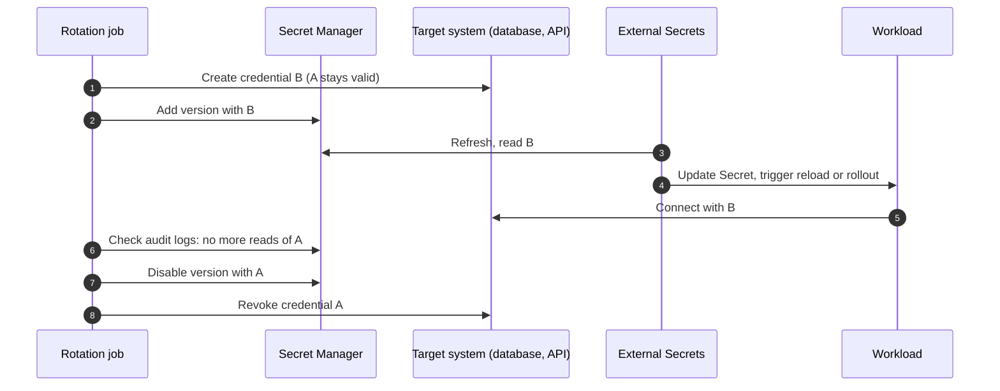

Rotation is easy to schedule and hard to do safely. Replacing a password in one place breaks every consumer that still holds the old one, and replacing it in two places is never atomic. The way out is **overlap**: for a while both the old and the new credential are valid, consumers move over at their own pace, and only then is the old one revoked.

> [!info] Source-reviewed on 2026-10-20
> The Secret Manager, External Secrets, Kubernetes and PostgreSQL claims were checked against vendor documentation, and the `gcloud` syntax against the installed `gcloud` help. Only helper steps were run, in a throwaway lab: secret generation, stdin versus argv, and the printf-built JSON. Nothing was run against Google Cloud, a cluster or a database. The Evidence section before Sources lists the sources, what was not verified and the lab output.

> [!danger] Some steps here are irreversible
> Destroying a Secret Manager version, revoking the old credential at the target and terminating old database sessions cannot be undone. Disable first, wait, and read the Cleanup and rollback part of the Evidence section.

Scope: this is planned rotation. The response to a leaked secret is the runbook [[leaked-credential-rotation]]. KMS key rotation, which protects keys rather than application secrets, is in [[cloud-kms-key-management]].

## The overlap model



The order is the whole pattern. Three rules follow from it:

1. **The target accepts both** credentials before consumers see the new one.
2. **Consumers move before the old one is revoked.** Disable, wait, then revoke, never the other way round.
3. **Revoking is the last, separate step**, and it is reversible for as long as possible (disable a Secret Manager version before destroying it).

If the target system can only hold one valid credential per account, changing that account's password invalidates the old one at once, so rotating it in place cannot be zero downtime. PostgreSQL is the common case: a role has exactly one password. Use two accounts and swap between them (see [[#Database users|Database users]]). For third-party APIs that allow only one key, plan a maintenance window or put a retry layer in the client.

## Secret Manager versions

A secret in Secret Manager holds immutable **versions**. Adding a value creates a new version; old ones can be disabled (reversibly) or destroyed (not reversible).

```bash title="rotation commands"
export PROJECT_ID="example-prod"
export SECRET="payments-db-password"

# 1. Generate the new value into a variable (never echo it).
NEW_PW="$(openssl rand -base64 32 | tr -d '\n')"

# 2. Make the target accept it first, WITHOUT invalidating the old credential:
#    a second account (database two-user swap, see Database users), or a second
#    key or secret on a target that supports two valid ones (check its docs).
#    Do not change the password of the account that consumers use right now.

# 3. Then add it as a new Secret Manager version. Read it from stdin, not from the command line.
#    (A database secret holds a JSON object with username and password, see Database users.)
printf '%s' "${NEW_PW}" | \
  gcloud secrets versions add "${SECRET}" --project="${PROJECT_ID}" --data-file=-
unset NEW_PW

gcloud secrets versions list "${SECRET}" --project="${PROJECT_ID}"

# 4. Later, after consumers have moved: disable the old version (reversible)
gcloud secrets versions disable 3 --secret="${SECRET}" --project="${PROJECT_ID}"

# 5. Rollback if something still needed it
gcloud secrets versions enable 3 --secret="${SECRET}" --project="${PROJECT_ID}"
```

> [!warning] Disabling breaks any consumer still reading that version
> A disabled version cannot be accessed, but its data is kept and `enable` restores it. Re-enable at once if errors appear. Do not skip ahead to `gcloud secrets versions destroy`, which is irreversible (see Rollback).

Replace version `3` with the version number that holds the old value. Piping from stdin keeps the value out of shell history and the process list. `openssl rand -base64 32` prints one 44-character line; longer requests wrap at 64 characters, so keep `tr -d '\n'`. In a lab the generated value used only the base64 alphabet (`A-Z a-z 0-9 + / =`). The order matters: the target system accepts the new credential (step 2) before the new version exists (step 3), and the old credential stays valid until consumers have moved, so a consumer that reads `latest` never gets a credential that does not work yet. For a database, step 2 is the inactive user of the two-user swap. See [Database users](#database-users).

### The `latest` alias pitfall

Consumers can read a specific version number or the alias `latest`. Each has a failure mode:

- **`latest`** moves the instant a version is added. A Pod that starts in the middle of a rotation, before the database knows the new password, picks up a credential that does not work yet. A rollout that happens for an unrelated reason can break a service.
- **A pinned number** never changes by itself. Rotation then needs a Git change (bump the number) and so gives you a reviewed, deliberate rollout, and an easy rollback by re-pinning.

Google's Secret Manager best practices say the same: reference secrets by version number rather than `latest`, because a faulty new version can leave the workload unable to use the secret, whereas a pinned version can be validated and rolled back through your release process. For high-impact secrets, pin the version and rotate with a commit. For low-impact ones, `latest` with the overlap rule (the target accepts the new credential **before** the new version is added) is fine.

## External Secrets and refresh

[[external-secrets-with-secret-manager]] copies the value into a Kubernetes Secret. Two settings matter for rotation:

```yaml title="externalsecret.yaml"
apiVersion: external-secrets.io/v1
kind: ExternalSecret
metadata:
  name: db-credentials
  namespace: payments
spec:
  refreshInterval: 15m
  secretStoreRef:
    kind: ClusterSecretStore
    name: gcp-secret-manager
  target:
    name: db-credentials
    creationPolicy: Owner
  data:
    - secretKey: username
      remoteRef:
        key: payments-db-password
        version: "4"
        property: username
    - secretKey: password
      remoteRef:
        key: payments-db-password
        version: "4"
        property: password
```

For a database the Secret Manager value is a JSON object holding both fields, for example `{"username":"app_b","password":"..."}`, because the login name changes every cycle (see [Database users](#database-users)). `property` selects one key of a JSON value. The External Secrets docs list `key`, `version` and `property` as general `remoteRef` fields, but their Google provider page shows only `key`, so confirm in your installed version that the Google provider honours `version` and `property` the way this example assumes, and test it on a non-production secret. A secret with a single value (an API key) needs only one entry without `property`.

- `refreshInterval` bounds how long after a change the cluster notices it. The rotation job must wait at least this long before it assumes every cluster has the new value. An interval of `0` means a single fetch and no later updates.
- `refreshPolicy` on the ExternalSecret takes `Periodic` (the default: polls at `refreshInterval`), `OnChange` (syncs only when the ExternalSecret itself changes or you set the force-sync annotation, so a change in Secret Manager does not reach the cluster) or `CreatedOnce` (one sync, never again). Only `Periodic` follows a rotation on its own. The `apiVersion` above is `external-secrets.io/v1`; check the API reference for the version your operator serves.
- Pinned `version: "4"` as above moves on a Git commit; `latest` moves on the next refresh.

A shorter interval lowers rotation latency and raises API usage; check the Secret Manager quotas.

## Getting the new value into the Pod

The Kubernetes Secret updates, but the process may not look at it again. Three ways to close the gap:

**1. Mounted file, application re-reads.** Mount the Secret as a volume. The kubelet updates the file after a delay. The app watches the file or handles SIGHUP and rebuilds its connections. This is the only approach without a restart, and it requires application support. Do not use `subPath` mounts, which do not receive updates. Note that environment variables never change in a running container. The Kubernetes docs say a whole-volume Secret mount updates eventually, after the kubelet notices the change, so the delay is not a fixed number of seconds and Pods on different nodes can update at different times.

**2. Rolling restart on change.** Put a checksum of the Secret in a Pod template annotation, or run a controller such as Reloader that restarts workloads when a Secret changes. A rolling update with readiness gates moves Pods one at a time, in line with [[zero-downtime-deployments-kubernetes]]. This is the simplest option for most services. In Helm, a checksum looks like this:

```yaml title="deployment.yaml (fragment)"
spec:
  template:
    metadata:
      annotations:
        checksum/secret: '{{ include (print $.Template.BasePath "/externalsecret.yaml") . | sha256sum }}'
```

That checksum hashes the ExternalSecret _template_, which changes only when the reference changes, i.e. with a pinned version bump. It will not detect a changed value behind `latest`. A controller such as Reloader watches the generated Secret instead (its behaviour and annotations are documented by the project, not by the sources reviewed here). Choose one and test it.

**3. Fetch at runtime.** The app reads Secret Manager directly with [[gke-workload-identity]] and refreshes on a timer. No Kubernetes Secret at all, no restart, but more application code and an API dependency on the hot path.

## Scheduling rotation

Secret Manager can send a **rotation notification** to a Pub/Sub topic on a schedule you configure on the secret (a rotation period and next rotation time; check the docs for the field names). The notification is only a message (event type `SECRET_ROTATE`), it does not rotate anything. A subscriber you write (a Cloud Run job or Cloud Function) must create the new credential in the target and add the new version. Per the Secret Manager docs, the rotation period must be at least one hour, the next rotation time must be at least five minutes in the future, a rotation is skipped while a previous one is in flight, and failed deliveries are retried for up to seven days before the rotation is cancelled. The Secret Manager service agent needs permission to publish to the topic; check the rotation docs for the exact role.

```bash title="configure rotation schedule"
gcloud secrets update payments-db-password --project=example-prod \
  --add-topics=projects/example-prod/topics/secret-rotation \
  --next-rotation-time=2026-12-01T03:00:00Z \
  --rotation-period=2592000s
```

The flags `--add-topics`, `--next-rotation-time` and `--rotation-period` appear in `gcloud secrets update --help` for Google Cloud SDK 570.0.0. Alternatively, Cloud Scheduler can trigger a rotation job directly. Whichever you use:

- Make the job idempotent: running it twice must not create two new passwords and lose one.
- Give it its own service account with `secretmanager.secretVersionAdder` on the one secret (it carries `secretmanager.versions.add` and `secretmanager.secrets.rotate`, not read access) and only the rights it needs on the target.
- Alert when the rotation job fails or when a secret is older than its rotation period.

## Database users

Two options for databases:

**Two-user swap (use this for PostgreSQL).** Do not run `ALTER ROLE ... PASSWORD` on the account the application is using right now. A PostgreSQL role has one password, so the old one stops working for new connections at once, while External Secrets has not refreshed and the workloads still hold the old value. Every reconnect in that window fails. Instead keep two login roles, `app_a` and `app_b`, that share privileges through a group role. One is active; rotation prepares the inactive one.

```sql title="one-time setup (run as an admin role)"
-- Privileges live on the group role, so both login roles always match.
CREATE ROLE app_users NOLOGIN;
GRANT CONNECT ON DATABASE payments TO app_users;
GRANT USAGE ON SCHEMA public TO app_users;
GRANT SELECT, INSERT, UPDATE, DELETE ON ALL TABLES IN SCHEMA public TO app_users;
-- serial/bigserial columns call nextval(); without this inserts fail with
-- "permission denied for sequence". Identity columns do not need it.
GRANT USAGE, SELECT ON ALL SEQUENCES IN SCHEMA public TO app_users;
-- Tables created later by the migration role (here: migrator) get the same grants.
ALTER DEFAULT PRIVILEGES FOR ROLE migrator IN SCHEMA public
  GRANT SELECT, INSERT, UPDATE, DELETE ON TABLES TO app_users;
ALTER DEFAULT PRIVILEGES FOR ROLE migrator IN SCHEMA public
  GRANT USAGE, SELECT ON SEQUENCES TO app_users;

CREATE ROLE app_a LOGIN;
CREATE ROLE app_b LOGIN;
GRANT app_users TO app_a, app_b;
```

Run schema changes as a separate owner role (`migrator` above), not as `app_a` or `app_b`, so objects are not owned by whichever login created them. Grant the roles `INHERIT` (the default) so they receive the group's privileges.

The rotation sequence, with `app_a` active and `app_b` inactive:

1. Set a new password on the **inactive** role, `app_b`. Nothing uses it, so nothing breaks.
2. Add a new Secret Manager version holding **both the username `app_b` and the new password**. The username changes every cycle, so the Secret carries both (two keys, or one JSON value) and the application reads both.
3. Wait for External Secrets to refresh (at least `refreshInterval`), then roll the workloads and recycle the pooler. Make sure the pooler accepts both `app_a` and `app_b` (a pooler that authenticates clients from its own user list, such as PgBouncer's `auth_file`, must know `app_b` too; use an auth file or auth query, check the pooler docs). `app_a` still works, so Pods that have not moved yet keep running.
4. Verify that no connection uses `app_a` (see [Verify](#verify)) and that the old Secret Manager version is unread.
5. Disable the old Secret Manager version, wait, and only then lock the old role: `ALTER ROLE app_a NOLOGIN;`. At the next cycle `app_a` becomes the inactive one and gets the new password.

```bash title="step 1: new password on the inactive role (psql)"
# An exported variable is not in argv, but it is in the process environment (readable by the same user and root).
export NEW_PW="$(openssl rand -base64 32 | tr -d '\n')"
# The value reaches psql through the environment, so it is not in the psql arguments
# (and so not in ps or /proc/<pid>/cmdline). \getenv needs psql 15 or newer.
# psql then substitutes :'pw' with a correctly quoted literal; this works from stdin, not with -c.
psql "host=10.0.0.5 dbname=payments user=admin sslmode=verify-full" <<'SQL'
\getenv pw NEW_PW
ALTER ROLE app_b WITH LOGIN PASSWORD :'pw';
SQL

# Add username and password together as one JSON version (the base64 alphabet needs no JSON escaping).
# printf is a shell builtin, so the value stays off the command line.
# This form is only safe for base64 values: a quote or backslash in the value makes invalid JSON.
printf '{"username":"app_b","password":"%s"}' "${NEW_PW}" | \
  gcloud secrets versions add "${SECRET}" --project="${PROJECT_ID}" --data-file=-
unset NEW_PW
```

Check your psql version first (`psql --version`); `\getenv` was added in PostgreSQL 15, so on older clients use a client 15 or newer, or a pre-hashed SCRAM verifier. The PostgreSQL docs caution that a cleartext password in `ALTER ROLE` can be exposed, and statements are logged when `log_statement` covers DDL, so check the logging settings, or send a pre-computed SCRAM verifier instead of the plaintext password. If a generated value could ever contain a quote or backslash, build the JSON with Python instead of `printf`: `PW="$value" python3 -I -c 'import json,os,sys; sys.stdout.write(json.dumps({"username":"app_b","password":os.environ["PW"]}))'`. `SECRET` and `PROJECT_ID` are the variables from the commands above.

Replace the host, database name and admin user with your own. Keep the admin credentials out of the rotation job's reach where you can: give the job a role that may alter only `app_a` and `app_b` (`CREATEROLE` plus membership with admin option on those roles, check the PostgreSQL docs for the version you run). A password change is not documented here to close existing sessions, and in my understanding neither does `NOLOGIN` (it blocks new logins), so check `pg_stat_activity` and end leftover connections deliberately. `VALID UNTIL` on the old role can expire its password automatically as a safety net; it applies to password logins only.

> [!warning] Locking or terminating the old role cuts live connections
> `ALTER ROLE app_a NOLOGIN;` is reversible with `ALTER ROLE app_a LOGIN;`. Ending sessions with `pg_terminate_backend` is not: the client loses its connection and any open transaction. Do it only after the Verify checks show nothing needs `app_a`, and expect superuser or `pg_signal_backend` rights to be required (check the docs for your version).

Rollback follows the same shape: while `app_a` is still valid (not yet set to `NOLOGIN`), re-enable the old Secret Manager version if step 5 already disabled it (`gcloud secrets versions enable`; External Secrets cannot read a disabled version), then re-pin the ExternalSecret to it and the workloads go back to `app_a`. Mind connection limits and poolers: [[postgres-connection-pooling-gke]] explains why pools hold old credentials until connections are recycled, so the pooler needs a reload or restart too.

**In-place change, only where two credentials are valid at once.** If the database or service lets one account hold two valid secrets at the same time, you can add the second one in place and skip the account swap. Do not assume it: PostgreSQL does not do this for a role password, and for other systems check the vendor docs for dual-password or multiple-key support before relying on it.

**IAM authentication, no password.** For Cloud SQL, applications can authenticate with a short-lived token tied to an identity instead of a password. The rotation problem disappears because there is no long-lived secret to rotate. Cloud SQL's docs describe the requirements: the `cloudsql.iam_authentication` flag for PostgreSQL, an IAM user or service account as the database user, the `cloudsql.instances.login` permission, and no database privileges until you grant them. Check the current pages for connector or proxy support and token lifetime for your engine version before committing to this. See [[0027-cloud-sql-for-production-postgres]] for the platform decision on production Postgres.

## Failure modes

| Symptom                                         | Cause                                                                               | Fix                                                                          |
| ----------------------------------------------- | ----------------------------------------------------------------------------------- | ---------------------------------------------------------------------------- |
| Auth failures right after rotation              | Old version disabled too early, or the target never got the new one                 | Re-enable the old version, finish the rollout, then disable                  |
| Pods fail to start during a rotation            | `latest` was read before the target accepted the new credential                     | Add the credential to the target first, or pin versions                      |
| Some Pods work, some do not                     | Env var secrets never reloaded                                                      | Restart on change (checksum, Reloader), or use files                         |
| New value in the Secret, app still uses the old | App caches credentials or keeps long-lived connections                              | Reload on SIGHUP, recycle the pool, set a max connection lifetime            |
| Rotation job ran twice                          | Not idempotent                                                                      | Use a lock or check the current version first                                |
| Refresh never picks up changes                  | `refreshPolicy` is `CreatedOnce` or `OnChange`, or the interval is very long or `0` | Set `Periodic` with a sensible interval, or force a sync with the annotation |
| Old credential still in use weeks later         | A forgotten consumer (cron job, other cluster, laptop)                              | Audit logs before disabling, see Verify                                      |

## Verify

Before you disable the old version, prove nothing reads it. Data Access audit logs for Secret Manager record `AccessSecretVersion` calls, if you enabled them for the project (they are not on by default for all services; check the audit logging docs).

```bash title="who read the old version"
gcloud logging read '
  protoPayload.serviceName="secretmanager.googleapis.com"
  AND protoPayload.methodName="google.cloud.secretmanager.v1.SecretManagerService.AccessSecretVersion"
  AND protoPayload.resourceName:"secrets/payments-db-password/versions/3"
' --project=example-prod --freshness=2d \
  --format='table(timestamp, protoPayload.authenticationInfo.principalEmail)'
```

Consumers that read `latest` may appear under `versions/latest` rather than the number; also check those reads and the target system's login signal before disabling.

An empty result for a period longer than the longest refresh interval plus restart time means the old version is unused by anything that goes through Secret Manager. The target database also has its own signal: check the login events or connection list for the old user before revoking. On PostgreSQL, `SELECT usename, count(*) FROM pg_stat_activity WHERE usename = 'app_a' GROUP BY usename;` must return no rows (behind a pooler, check the pooler's own client and server connection lists too). Forward logs to your SIEM, see [[gcp-audit-logs-siem]].

After the disable, watch error rates and the readiness of every consumer for at least one full refresh cycle.

## Rollback

- **Before disabling.** Nothing to roll back; both credentials work. Stop the rollout and fix the consumer.
- **After disabling.** `gcloud secrets versions enable OLD`, force a sync on the ExternalSecret, restart consumers. This works only if the old credential still exists in the target. Therefore **disable the Secret Manager version first, wait, revoke at the target later, destroy the version last**.
- **After destroying.** No rollback. Destroy is irreversible, so keep the destroy step separate and late. Secret Manager can add the delay for you: set `--version-destroy-ttl` on the secret (the docs give 1 to 1000 days, and only a Secret Manager Admin can set it). Destroying a version then disables it and schedules the destruction, and enabling or disabling the version during the delay cancels it. The delay does not apply if the whole secret is deleted or expires.

- **Bad new credential.** Re-pin the ExternalSecret to the previous version number in Git and let GitOps apply it.

> [!danger] Destroy is permanent without a delay
> `gcloud secrets versions destroy VERSION --secret=SECRET` removes the secret data at once unless the secret has a destroy delay. Check the secret's settings for a version destroy TTL, and only destroy after the old credential has been revoked at the target and confirmed unused.

## Checklist

- Target system accepts both credentials during the overlap. For a database that means two accounts (two-user swap), never an in-place password change on the active account.
- Pinned versions for critical secrets, rotation by commit; `latest` only with a safe order of operations.
- A defined reload path for every consumer: file reload, checksum rollout or Reloader.
- Audit evidence that the old version is unused before it is disabled.
- Disable, wait, revoke, and only later destroy.
- Rotation job idempotent, alerting on failure and on overdue secrets.

## Related

- [[external-secrets-with-secret-manager]]
- [[leaked-credential-rotation]]
- [[cloud-kms-key-management]]
- [[gke-workload-identity]]
- [[secrets-architecture-gcp-and-gke]]
- [[postgres-connection-pooling-gke]]
- [[artifactory-access-tokens-and-oidc-for-ci]]
- [[cert-manager-dns01-cloud-dns]]

## Evidence

Source-reviewed on 2026-10-20. Only helper steps were run, in a disposable lab. Read this section before using the note.

### Sources checked

Each bullet gives the page, the claims it backs and the check date.

- [Secret Manager best practices](https://docs.cloud.google.com/secret-manager/docs/best-practices): reference versions by number rather than `latest`; enable Data Access logs to capture `AccessSecretVersion`. Checked 2026-10-20.
- [Delay destruction of secret versions](https://docs.cloud.google.com/secret-manager/docs/delay-destruction-of-secret-versions): destroy is immediate and permanent by default; delay of 1 to 1000 days set by a Secret Manager Admin; destroy then disables and schedules destruction; enabling or disabling cancels it; not applied on secret deletion or expiry. Checked 2026-10-20.
- [Disable a secret version](https://cloud.google.com/secret-manager/docs/disable-secret-version) and [Destroy a secret version](https://cloud.google.com/secret-manager/docs/destroy-secret-version): disabled versions cannot be accessed but can be enabled again; destroyed versions cannot. Checked 2026-10-20. The `gcloud secrets versions add|access|disable|enable|destroy|list` and `gcloud secrets update` synopses, `--data-file=-` and `--version-destroy-ttl` were also read from the installed `gcloud` 570.0.0 help.
- [Create rotation schedules](https://docs.cloud.google.com/secret-manager/docs/secret-rotation) and [About rotation schedules](https://docs.cloud.google.com/secret-manager/docs/rotation-recommendations): `SECRET_ROTATE` notification to Pub/Sub, subscriber required, one-hour minimum period, five-minute minimum lead, retries for seven days. Checked 2026-10-20.
- [Secret Manager roles and permissions](https://docs.cloud.google.com/iam/docs/roles-permissions/secretmanager): `secretmanager.secretVersionAdder` permissions. Checked 2026-10-20.
- [Secret Manager audit logging](https://docs.cloud.google.com/secret-manager/docs/audit-logging): `google.cloud.secretmanager.v1.SecretManagerService.AccessSecretVersion` is a DATA_READ method. Checked 2026-10-20.
- [ExternalSecret API](https://external-secrets.io/latest/api/externalsecret/): `external-secrets.io/v1`, `refreshInterval`, `refreshPolicy` values `Periodic`, `OnChange`, `CreatedOnce`, interval `0`. Checked 2026-10-20.
- [Secrets (Kubernetes)](https://kubernetes.io/docs/concepts/configuration/secret/): `subPath` mounts and environment variables do not update; whole-volume mounts update eventually. Checked 2026-10-20.
- [ALTER ROLE](https://www.postgresql.org/docs/current/sql-alterrole.html), [PostgreSQL 15 release notes](https://www.postgresql.org/docs/release/15.0/) and the logging settings page: cleartext-password caution, `VALID UNTIL`, `ADMIN OPTION` for `CREATEROLE` roles, `\getenv` added in 15. Checked 2026-10-20.
- [Log in using IAM database authentication](https://docs.cloud.google.com/sql/docs/postgres/iam-logins): `cloudsql.iam_authentication`, IAM database users, `cloudsql.instances.login`. Checked 2026-10-20.

### Not verified

- Direct page fetches of `docs.cloud.google.com` were blocked in the review environment. The claims above were checked against search results that summarise the official pages, plus the installed `gcloud` help. Re-read the linked pages before relying on exact wording.
- Whether the External Secrets Google provider honours `remoteRef.version` and `property` as the example assumes; their Google provider page shows only `key`. The example is kept but flagged in the text.
- How `latest` behaves when the latest version is disabled or destroyed; the docs reached say only that it names the newest version.
- Reloader and Cloud Scheduler behaviour; the role the Secret Manager service agent needs on the Pub/Sub topic.
- That a password change or `NOLOGIN` leaves existing PostgreSQL sessions open (stated as understanding, not as a documented fact), the privileges `pg_terminate_backend` needs, and the `\getenv` plus `:'pw'` heredoc form against a real server (psql 16.15 was installed but no server was).
- PgBouncer `auth_file` and `auth_query` behaviour, and the ownership and default-privilege SQL in the one-time setup.
- Every Secret Manager, External Secrets, Kubernetes and PostgreSQL action in a real environment. No step of this pattern was run against a real system.

### Environment

- Commands assume bash or zsh, `gcloud` (checked against Google Cloud SDK 570.0.0 help), `psql` 15 or newer for `\getenv`, and an External Secrets Operator that serves `external-secrets.io/v1`.
- Lab host: see the Lab run below.

### Prerequisites

A target that accepts two credentials during the overlap (for PostgreSQL, the two-user swap), a list of every consumer, Data Access audit logs enabled for Secret Manager, and a defined reload path for each workload. Permissions: add and disable versions on the secret, alter the inactive role, and sync the ExternalSecret.

### Expected results

Both credentials work during the overlap. After the rollout, the audit query for the old version and the `pg_stat_activity` query return no rows, error rates stay flat for one refresh cycle, and only then is the old version disabled. See Verify.

### Failure conditions

Stop and re-enable the old version if auth errors appear after the disable, if a Pod reads `latest` before the target accepts the new credential, if the ExternalSecret never refreshes (`refreshPolicy`), or if the old role still shows connections. See Failure modes.

### Cleanup and rollback

See Rollback. Disabled Secret Manager versions and `NOLOGIN` roles can be restored; destroyed versions and terminated sessions cannot. Unset `NEW_PW` after use and delete temporary files that held a generated value.

### Lab run

Date: 2026-10-20. Host: `Linux 6.18.44-fc-v139` (`uname -sr`). Tools as printed: `OpenSSL 3.0.13 30 Jan 2024`, `Python 3.13.16`, `GNU bash, version 5.2.21(1)-release`, `psql (PostgreSQL) 16.15`. Only fake values were used in a temporary directory that the script deletes.

Generator, stdin versus argv, and the printf-built JSON:

```bash
D="$(mktemp -d)"; cd "$D"
# 1 the note's generator: length and character set (three runs)
for i in 1 2 3; do
  NEW_PW="$(openssl rand -base64 32 | tr -d '\n')"
  echo "length=${#NEW_PW} outside-base64-alphabet=$(printf '%s' "$NEW_PW" | tr -d 'A-Za-z0-9+/=' | wc -c)"
done
echo "lines of openssl rand -base64 32: $(openssl rand -base64 32 | wc -l); of -base64 64: $(openssl rand -base64 64 | wc -l)"

# 2 stdin versus argv
cat > stub.py <<'PY'
import sys
data = sys.stdin.buffer.read() if not sys.stdin.isatty() else b""
print("cmdline:", open("/proc/self/cmdline", "rb").read().replace(b"\0", b" ").decode().strip(), "| stdin bytes:", len(data))
PY
V='fakeSecret+/Abc123=='
printf '%s' "$V" | python3 -I stub.py --data-file=-
python3 -I stub.py "--data=$V" </dev/null

# 3 the note's printf-built JSON, with a base64 value
NEW_PW="$(openssl rand -base64 32 | tr -d '\n')"
printf '{"username":"app_b","password":"%s"}' "$NEW_PW" | python3 -I -c 'import json,sys; json.load(sys.stdin); print("valid JSON")'

# 4 the same printf form with a value containing a quote and a backslash
W='pa"ss\word'
printf '{"username":"app_b","password":"%s"}' "$W" | python3 -I -c 'import json,sys; json.load(sys.stdin); print("valid JSON")' 2>&1 | tail -1

# 5 safer form: let Python do the escaping; the value comes from the environment, not argv
PW="$W" python3 -I -c 'import json,os,sys; sys.stdout.write(json.dumps({"username":"app_b","password":os.environ["PW"]}))' \
  | python3 -I -c 'import json,sys; d=json.load(sys.stdin); print("valid JSON, round trip equal:", d["password"]==sys.argv[1])' "$W"
cd /; rm -rf "$D"
```

```text
length=44 outside-base64-alphabet=0
length=44 outside-base64-alphabet=0
length=44 outside-base64-alphabet=0
lines of openssl rand -base64 32: 1; of -base64 64: 2
cmdline: python3 -I stub.py --data-file=- | stdin bytes: 20
cmdline: python3 -I stub.py --data=fakeSecret+/Abc123== | stdin bytes: 0
valid JSON
json.decoder.JSONDecodeError: Expecting ',' delimiter: line 1 column 36 (char 35)
valid JSON, round trip equal: True
```

The `printf` form is valid for base64 values and breaks on a quote or backslash. The note now says so and shows the `json.dumps` form.

psql meta-command and environment checks:

```bash
# psql version and the \getenv meta-command (no server needed to read the help)
psql --version
psql -X --help=commands | grep -E 'getenv|password'

# an exported variable is not in argv but is in the process environment
export NEW_PW='fakeSecret+/Abc123=='
python3 -I -c 'import os; print("argv:", open("/proc/self/cmdline","rb").read().replace(b"\0",b" ").decode().strip()); print("in /proc/self/environ:", b"NEW_PW=" in open("/proc/self/environ","rb").read())'
unset NEW_PW
```

```text
psql (PostgreSQL) 16.15 (Ubuntu 16.15-0ubuntu0.24.04.1)
  \password [USERNAME]   securely change the password for a user
  \getenv PSQLVAR ENVVAR fetch environment variable
argv: python3 -I -c import os; print("argv:", open("/proc/self/cmdline","rb").read().replace(b"\0",b" ").decode().strip()); print("in /proc/self/environ:", b"NEW_PW=" in open("/proc/self/environ","rb").read())
in /proc/self/environ: True
```

## Sources

- [cloud.google.com/secret-manager/docs/secret-rotation](https://cloud.google.com/secret-manager/docs/secret-rotation)
- [cloud.google.com/secret-manager/docs/manage-secret-versions](https://cloud.google.com/secret-manager/docs/manage-secret-versions)
- [external-secrets.io/latest](https://external-secrets.io/latest/)
- [external-secrets.io/latest/api/externalsecret](https://external-secrets.io/latest/api/externalsecret/)
- [cloud.google.com/secret-manager/docs/best-practices](https://docs.cloud.google.com/secret-manager/docs/best-practices)
- [cloud.google.com/secret-manager/docs/delay-destruction-of-secret-versions](https://docs.cloud.google.com/secret-manager/docs/delay-destruction-of-secret-versions)
- [kubernetes.io/docs/concepts/configuration/secret](https://kubernetes.io/docs/concepts/configuration/secret/)
- [postgresql.org/docs/current/sql-alterrole](https://www.postgresql.org/docs/current/sql-alterrole.html)
- [cloud.google.com/sql/docs/postgres/iam-authentication](https://cloud.google.com/sql/docs/postgres/iam-authentication)
