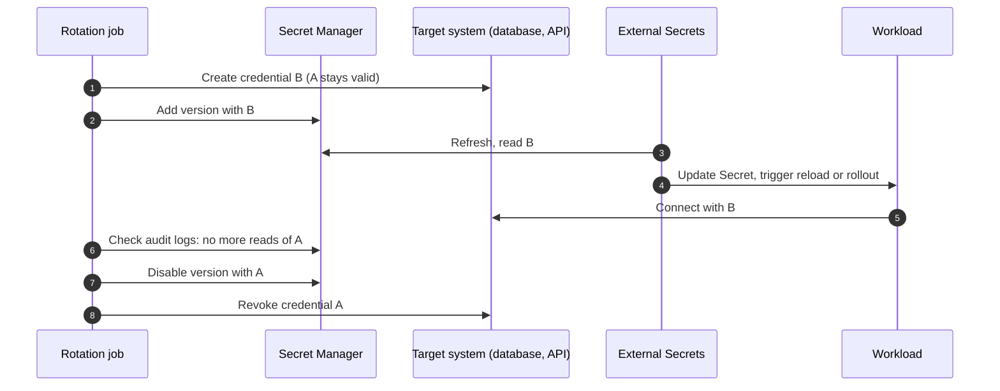

Rotation is easy to schedule and hard to do safely. Replacing a password in one place breaks every consumer that still holds the old one, and replacing it in two places is never atomic. The way out is **overlap**: for a while both the old and the new credential are valid, consumers move over at their own pace, and only then is the old one revoked.

> [!info] Not checked against live docs
> Nothing here was run against Google Cloud. Check the Secret Manager docs for the rotation configuration fields and the Pub/Sub notification message format, and check the External Secrets docs for refresh policy names and the `version` semantics in your installed version. Verify the Cloud SQL IAM authentication requirements for your database version and connection method.

Scope: this is planned rotation. The response to a leaked secret is the runbook [[leaked-credential-rotation]]. KMS key rotation, which protects keys rather than application secrets, is in [[cloud-kms-key-management]].

## The overlap model



The order is the whole pattern. Three rules follow from it:

1. **The target accepts both** credentials before consumers see the new one.
2. **Consumers move before the old one is revoked.** Disable, wait, then revoke, never the other way round.
3. **Revoking is the last, separate step**, and it is reversible for as long as possible (disable a Secret Manager version before destroying it).

If the target system can only hold one valid credential at a time (some third-party APIs), you cannot get zero downtime from rotation alone. Plan a maintenance window or put a retry layer in the client.

## Secret Manager versions

A secret in Secret Manager holds immutable **versions**. Adding a value creates a new version; old ones can be disabled (reversibly) or destroyed (not reversible).

```bash title="rotation commands"
export PROJECT_ID="example-prod"
export SECRET="payments-db-password"

# 1. Generate the new value into a variable (never echo it).
NEW_PW="$(openssl rand -base64 32 | tr -d '\n')"

# 2. Set it in the target system first (database ALTER USER, or the API of the target),
#    so the target accepts the credential before any consumer can see it.

# 3. Then add it as a new Secret Manager version. Read it from stdin, not from the command line.
printf '%s' "${NEW_PW}" | \
  gcloud secrets versions add "${SECRET}" --project="${PROJECT_ID}" --data-file=-
unset NEW_PW

gcloud secrets versions list "${SECRET}" --project="${PROJECT_ID}"

# 4. Later, after consumers have moved: disable the old version (reversible)
gcloud secrets versions disable 3 --secret="${SECRET}" --project="${PROJECT_ID}"

# 5. Rollback if something still needed it
gcloud secrets versions enable 3 --secret="${SECRET}" --project="${PROJECT_ID}"
```

Replace version `3` with the version number that holds the old value. Piping from stdin keeps the value out of shell history and the process list. The order matters: the target system accepts the new password (step 2) before the new version exists (step 3), so a consumer that reads `latest` never gets a credential that does not work yet. See [Database users](#database-users).

### The `latest` alias pitfall

Consumers can read a specific version number or the alias `latest`. Each has a failure mode:

- **`latest`** moves the instant a version is added. A Pod that starts in the middle of a rotation, before the database knows the new password, picks up a credential that does not work yet. A rollout that happens for an unrelated reason can break a service.
- **A pinned number** never changes by itself. Rotation then needs a Git change (bump the number) and so gives you a reviewed, deliberate rollout, and an easy rollback by re-pinning.

For high-impact secrets, pin the version and rotate with a commit. For low-impact ones, `latest` with the overlap rule (the target accepts the new credential **before** the new version is added) is fine.

## External Secrets and refresh

[[external-secrets-with-secret-manager]] copies the value into a Kubernetes Secret. Two settings matter for rotation:

```yaml title="externalsecret.yaml"
apiVersion: external-secrets.io/v1
kind: ExternalSecret
metadata:
  name: db-credentials
  namespace: payments
spec:
  refreshInterval: 15m
  secretStoreRef:
    kind: ClusterSecretStore
    name: gcp-secret-manager
  target:
    name: db-credentials
    creationPolicy: Owner
  data:
    - secretKey: password
      remoteRef:
        key: payments-db-password
        version: "4"
```

- `refreshInterval` bounds how long after a change the cluster notices it. The rotation job must wait at least this long before it assumes every cluster has the new value.
- There is also a refresh policy setting on the ExternalSecret (for example refreshing periodically versus only on creation); names vary by version, so check the docs. A secret that is only read on creation never rotates.
- Pinned `version: "4"` as above moves on a Git commit; `latest` moves on the next refresh.

A shorter interval lowers rotation latency and raises API usage; check the Secret Manager quotas.

## Getting the new value into the Pod

The Kubernetes Secret updates, but the process may not look at it again. Three ways to close the gap:

**1. Mounted file, application re-reads.** Mount the Secret as a volume. The kubelet updates the file after a delay. The app watches the file or handles SIGHUP and rebuilds its connections. This is the only approach without a restart, and it requires application support. Do not use `subPath` mounts, which do not receive updates. Note that environment variables never change in a running container.

**2. Rolling restart on change.** Put a checksum of the Secret in a Pod template annotation, or run a controller such as Reloader that restarts workloads when a Secret changes. A rolling update with readiness gates moves Pods one at a time, in line with [[zero-downtime-deployments-kubernetes]]. This is the simplest option for most services. In Helm, a checksum looks like this:

```yaml title="deployment.yaml (fragment)"
spec:
  template:
    metadata:
      annotations:
        checksum/secret: '{{ include (print $.Template.BasePath "/externalsecret.yaml") . | sha256sum }}'
```

That checksum hashes the ExternalSecret _template_, which changes only when the reference changes, i.e. with a pinned version bump. It will not detect a changed value behind `latest`. Reloader watches the generated Secret instead. Choose one and test it.

**3. Fetch at runtime.** The app reads Secret Manager directly with [[gke-workload-identity]] and refreshes on a timer. No Kubernetes Secret at all, no restart, but more application code and an API dependency on the hot path.

## Scheduling rotation

Secret Manager can send a **rotation notification** to a Pub/Sub topic on a schedule you configure on the secret (a rotation period and next rotation time; check the docs for the field names). The notification is only a message, it does not rotate anything. A subscriber you write (a Cloud Run job or Cloud Function) must create the new credential in the target and add the new version.

```bash title="configure rotation schedule"
gcloud secrets update payments-db-password --project=example-prod \
  --add-topics=projects/example-prod/topics/secret-rotation \
  --next-rotation-time=2026-12-01T03:00:00Z \
  --rotation-period=2592000s
```

Check `gcloud secrets update --help` for the current flags. Alternatively, Cloud Scheduler can trigger a rotation job directly. Whichever you use:

- Make the job idempotent: running it twice must not create two new passwords and lose one.
- Give it its own service account with `secretmanager.secretVersionAdder` on the one secret and only the rights it needs on the target.
- Alert when the rotation job fails or when a secret is older than its rotation period.

## Database users

Two options for databases:

**Two-user swap.** Keep two database roles, `app_a` and `app_b`, with identical privileges. Only one is "active" for the application at a time. Rotation: reset the password of the **inactive** user, add that to Secret Manager as the new version, roll consumers to it, then mark it active. The old user's password is not touched until the next cycle, so it stays valid throughout the overlap and for rollback. Mind connection limits and poolers: [[postgres-connection-pooling-gke]] explains why pools hold old credentials until connections are recycled, so the pooler needs a reload or restart too.

**IAM authentication, no password.** For Cloud SQL, applications can authenticate with a short-lived token tied to an identity instead of a password. The rotation problem disappears because there is no long-lived secret to rotate. Check the Cloud SQL IAM authentication requirements (database flags, connector or proxy support, token lifetime) for your engine version before committing to this. See [[0027-cloud-sql-for-production-postgres]] for the platform decision on production Postgres.

## Failure modes

| Symptom                                         | Cause                                                               | Fix                                                               |
| ----------------------------------------------- | ------------------------------------------------------------------- | ----------------------------------------------------------------- |
| Auth failures right after rotation              | Old version disabled too early, or the target never got the new one | Re-enable the old version, finish the rollout, then disable       |
| Pods fail to start during a rotation            | `latest` was read before the target accepted the new credential     | Add the credential to the target first, or pin versions           |
| Some Pods work, some do not                     | Env var secrets never reloaded                                      | Restart on change (checksum, Reloader), or use files              |
| New value in the Secret, app still uses the old | App caches credentials or keeps long-lived connections              | Reload on SIGHUP, recycle the pool, set a max connection lifetime |
| Rotation job ran twice                          | Not idempotent                                                      | Use a lock or check the current version first                     |
| Refresh never picks up changes                  | Refresh policy is "on creation" only, or interval very long         | Fix the ExternalSecret, force a sync with an annotation           |
| Old credential still in use weeks later         | A forgotten consumer (cron job, other cluster, laptop)              | Audit logs before disabling, see Verify                           |

## Verify

Before you disable the old version, prove nothing reads it. Data Access audit logs for Secret Manager record `AccessSecretVersion` calls, if you enabled them for the project (they are not on by default for all services; check the audit logging docs).

```bash title="who read the old version"
gcloud logging read '
  protoPayload.serviceName="secretmanager.googleapis.com"
  AND protoPayload.methodName="google.cloud.secretmanager.v1.SecretManagerService.AccessSecretVersion"
  AND protoPayload.resourceName:"secrets/payments-db-password/versions/3"
' --project=example-prod --freshness=2d \
  --format='table(timestamp, protoPayload.authenticationInfo.principalEmail)'
```

Consumers that read `latest` may appear under `versions/latest` rather than the number; also check those reads and the target system's login signal before disabling.

An empty result for a period longer than the longest refresh interval plus restart time means the old version is unused by anything that goes through Secret Manager. The target database also has its own signal: check the login events or connection list for the old user (`pg_stat_activity` on Postgres) before revoking. Forward logs to your SIEM, see [[gcp-audit-logs-siem]].

After the disable, watch error rates and the readiness of every consumer for at least one full refresh cycle.

## Rollback

- **Before disabling.** Nothing to roll back; both credentials work. Stop the rollout and fix the consumer.
- **After disabling.** `gcloud secrets versions enable OLD`, force a sync on the ExternalSecret, restart consumers. This works only if the old credential still exists in the target. Therefore **disable the Secret Manager version first, wait, revoke at the target later, destroy the version last**.
- **After destroying.** No rollback. Destroy is irreversible, so keep the destroy step separate and late, with a calendar delay.
- **Bad new credential.** Re-pin the ExternalSecret to the previous version number in Git and let GitOps apply it.

## Checklist

- Target system accepts both credentials during the overlap.
- Pinned versions for critical secrets, rotation by commit; `latest` only with a safe order of operations.
- A defined reload path for every consumer: file reload, checksum rollout or Reloader.
- Audit evidence that the old version is unused before it is disabled.
- Disable, wait, revoke, and only later destroy.
- Rotation job idempotent, alerting on failure and on overdue secrets.

## Related

- [[external-secrets-with-secret-manager]]
- [[leaked-credential-rotation]]
- [[cloud-kms-key-management]]
- [[gke-workload-identity]]
- [[secrets-architecture-gcp-and-gke]]
- [[postgres-connection-pooling-gke]]
- [[artifactory-access-tokens-and-oidc-for-ci]]
- [[cert-manager-dns01-cloud-dns]]

## Sources

- [cloud.google.com/secret-manager/docs/secret-rotation](https://cloud.google.com/secret-manager/docs/secret-rotation)
- [cloud.google.com/secret-manager/docs/manage-secret-versions](https://cloud.google.com/secret-manager/docs/manage-secret-versions)
- [external-secrets.io/latest](https://external-secrets.io/latest/)
- [cloud.google.com/sql/docs/postgres/iam-authentication](https://cloud.google.com/sql/docs/postgres/iam-authentication)
