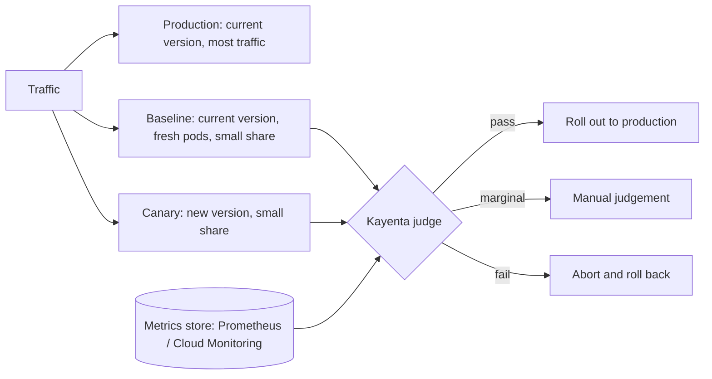

A canary release sends a small share of traffic to the new version and asks a question: is it measurably worse than what is running now? **Kayenta** is Spinnaker's automated canary analysis service. It pulls metrics for a canary and a baseline from a metrics store, compares them statistically per metric, and produces a score and a pass, marginal or fail judgement that a pipeline stage can act on.

> [!info] Not checked against live docs
> Canary configuration field names, stage names and judge settings depend on the Spinnaker and Kayenta versions you run. The JSON below is illustrative: field names: check your Spinnaker version and the canary configuration reference before use. Also check the current release cadence of Spinnaker and Kayenta before adopting; project activity has varied over time, and this repository's default choice for delivery is Argo CD with Rollouts ([[0017-argo-cd-and-rollouts-not-spinnaker]]).

## When this fits

Use Spinnaker with Kayenta when you already run Spinnaker for multi-stage, multi-cluster delivery and want statistical comparison of many metrics rather than a fixed threshold. If your delivery is GitOps with Argo CD, the same idea is available through analysis templates in [[progressive-delivery-argo-rollouts]]; the trade-offs are in [[argo-rollouts-vs-spinnaker]]. A plain threshold on one SLI is often enough, and burn-rate alerting ([[slo-burn-rate-alerting]]) can serve as the abort signal for either.

## Baseline, canary and production

Kayenta compares a **canary** against a **baseline**. The baseline is not production itself. It is a **fresh copy of the current production version**, deployed next to the canary at the same scale and receiving the same share of traffic.



Why not compare against production directly:

- Production pods are old. They have warm caches, JIT-compiled code and long-lived connections, so a fresh canary looks worse for reasons unrelated to the change.
- Production traffic is a mix of everything and its size differs from the canary's, which skews rates and percentiles.
- A fresh baseline has the same age, scale and traffic share. Differences between baseline and canary are then attributable to the code change.

Cost: the baseline needs capacity. Plan for it in quota and in the node pool headroom.

## Selecting metrics

Pick a few metrics that represent user-visible harm, not everything you can graph.

| Group      | Examples                              | Direction for "bad" | Criticality                                   |
| ---------- | ------------------------------------- | ------------------- | --------------------------------------------- |
| Errors     | HTTP 5xx rate, gRPC error rate        | Increase            | Critical (fail on any significant difference) |
| Latency    | p95 and p99 request latency           | Increase            | Critical or high weight                       |
| Saturation | CPU, memory, restarts, queue depth    | Increase            | Normal                                        |
| Business   | checkout success rate, jobs processed | Decrease            | High weight if reliable                       |

Each metric has a **direction** (is an increase, a decrease or either bad) and can be marked **critical**, meaning a failure on that metric fails the whole canary regardless of score. Use latency percentiles carefully: p99 over a short window with low traffic is noisy. Use rates and ratios, not raw counts, because the canary and baseline may serve different request volumes.

## Canary configuration

The canary config defines metric groups, queries, weights and scoring thresholds.

```json title="canary-config.json (illustrative)"
{
  "name": "payments-api-canary",
  "applications": ["payments"],
  "judge": { "name": "NetflixACAJudge-v1.0" },
  "metrics": [
    {
      "name": "http_5xx_ratio",
      "query": {
        "type": "prometheus",
        "customInlineTemplate": "sum(rate(http_requests_total{namespace=\"payments\", status=~\"5..\", ${scope}}[1m])) / sum(rate(http_requests_total{namespace=\"payments\", ${scope}}[1m]))"
      },
      "groups": ["errors"],
      "analysisConfigurations": {
        "canary": { "direction": "increase", "critical": true }
      }
    },
    {
      "name": "latency_p95_seconds",
      "query": {
        "type": "prometheus",
        "customInlineTemplate": "histogram_quantile(0.95, sum by (le) (rate(http_request_duration_seconds_bucket{namespace=\"payments\", ${scope}}[1m])))"
      },
      "groups": ["latency"],
      "analysisConfigurations": {
        "canary": { "direction": "increase" }
      }
    }
  ],
  "classifier": {
    "groupWeights": { "errors": 50, "latency": 40, "saturation": 10 }
  }
}
```

(field names: check your Spinnaker version; the judge name and the template keys vary.)

**Scope by label.** The query must select only the canary's or only the baseline's series. The `${scope}` placeholder is replaced per run with a label matcher for each side, for example `version="canary"` and `version="baseline"`. For this to work, the canary and baseline Pods must carry a label that your metrics pipeline turns into a metric label (`version`, `track`, or the pod name regex). Configure the scrape or relabeling in Prometheus accordingly, or use the managed metric labels in Cloud Monitoring. See [[prometheus-vs-cloud-monitoring]] for the choice between those stores.

### Scoring thresholds

The analysis stage takes two numbers:

- **Pass** threshold: a score at or above it is a pass.
- **Marginal** threshold: a score at or above it but below pass is marginal. Below marginal is a fail.

A good start is a strict pass and a wider marginal band, then tune using history: replay known good and known bad releases and see where they score.

## The canary analysis stage

In the pipeline, a typical sequence is:

1. Deploy baseline and canary (clusters, server groups or manifests) at the same size.
2. Optionally a warm-up period before analysis starts, to skip cold-start effects.
3. Run **Canary Analysis** with a lifetime and an interval.
4. Branch on the result.

Stage parameters (names: check your version):

| Setting            | Meaning                                               | Guidance                                                           |
| ------------------ | ----------------------------------------------------- | ------------------------------------------------------------------ |
| Lifetime           | Total duration of analysis                            | Long enough to see several metric points and typical load cycles   |
| Interval           | How often a judgement is made over the growing window | Several intervals per lifetime, so one noisy point does not decide |
| Warm-up / delay    | Time before first data is used                        | Cover startup, cache warming, HPA settling                         |
| Scoring thresholds | Pass and marginal                                     | See above                                                          |
| Metric scope       | Baseline and canary location and labels               | Must match the labels in the queries                               |

### Outcomes

- **Pass:** the pipeline scales the canary to full rollout (or promotes it to the production server group) and tears down baseline and canary.
- **Marginal:** wait for a person. Add a manual judgement stage with the score report link and a timeout that defaults to abort.
- **Fail:** automatic rollback: delete the canary, keep production on the current version, notify the owning team, and fail the pipeline.

Always clean up the baseline and canary in a `finally`-style stage so failed runs do not leave extra workloads. Application-side safety (graceful shutdown, probes, PDBs) is described in [[zero-downtime-deployments-kubernetes]]; the stage should not substitute for those.

## Failure modes

- **Too little traffic.** The canary receives a handful of requests; rates are noise and everything "passes". Fix: raise the traffic share, lengthen the window, or generate synthetic load for low-traffic services. Check the minimum data points your metrics need.
- **Too short a window.** Latency or memory leaks show up after longer than the lifetime. Combine canary analysis with a post-rollout watch on SLO burn.
- **Noisy metrics.** A flaky metric causes random marginals. Drop it from the config or aggregate it over a longer rate window.
- **Labels differ between baseline and canary.** The query matches nothing for one side; Kayenta returns "no data". Treat "no data" as a failure, not as a pass. Validate the scope labels in a test run.
- **Wrong baseline.** Using production as baseline gives false failures. Use a fresh copy.
- **Metric store delay.** Scrape or export lag means the window analysed is behind real time. Add that lag to the warm-up.
- **Pass on irrelevant metrics.** CPU is fine while error rate rises. Mark the user-facing metrics critical.
- **State changes.** Database migrations are not covered by traffic analysis; use expand and contract ([[postgres-expand-contract-migrations]]).

## Testing the configuration

Do not first run a new canary config on production. In a non-production pipeline:

1. Run a **known good** release against itself (canary and baseline the same version). It should pass. If it does not, your metrics are too noisy or your scopes are wrong.
2. Run a **known bad** build (inject errors or latency using a fault flag) and expect fail, and a critical metric failure to fail the whole run.
3. Check the score report and the actual PromQL results for each side.
4. Review the config in version control like code, and keep it with the application's pipeline definition.

## Rollback

Automatic rollback on fail is only the canary part. Keep the general rollback path too: redeploy the previous artefact from the artefact store (see [[artifact-promotion-artifactory]]), or use the blue-green switch described in [[gke-blue-green-releases]]. For Helm-based deployments, [[helm-release-rollback]] applies. If Kayenta or the metrics store is down, the canary stage must fail closed (abort), not open.

## Related

- [[argo-rollouts-vs-spinnaker]]
- [[progressive-delivery-argo-rollouts]]
- [[zero-downtime-deployments-kubernetes]]
- [[slo-burn-rate-alerting]]
- [[prometheus-vs-cloud-monitoring]]
- [[gke-blue-green-releases]]
- [[0017-argo-cd-and-rollouts-not-spinnaker]]

## Sources

- https://spinnaker.io/docs/guides/user/canary/
- https://spinnaker.io/docs/guides/user/canary/config/
- https://github.com/spinnaker/kayenta
