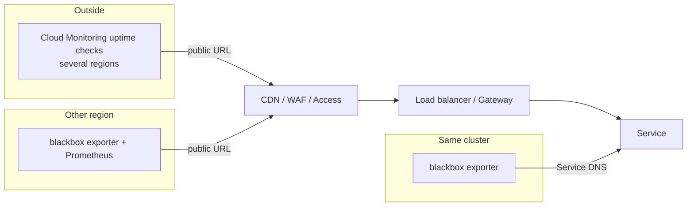

White-box metrics tell you what a service thinks it is doing: request rates, error ratios, latency as the server measures it. They say nothing when DNS points at the wrong address, the certificate expired, the load balancer has no healthy backend, the WAF blocks a whole country, or the service is down so hard that it emits no metrics at all. Black-box probes close that gap. They make real requests from outside, the way a user or a client would, and record whether the answer was right. This note covers where to probe from, Prometheus blackbox exporter modules and scrape configuration, Cloud Monitoring uptime checks in Terraform, probing endpoints behind Cloudflare Access or IAP, and alerts that catch real failures without paging on a single blip.

> [!info] Scope and sources
> Blackbox exporter behaviour, configuration keys and metric names were checked against the exporter's README, configuration reference and source on GitHub on 2026-10-21 (master branch: confirm options against the version you run). Prometheus Operator `Probe` fields were checked against its API reference source. Cloud Monitoring uptime check fields were checked against the Terraform provider's resource definition and Google Cloud SDK 570.0.0 help on the same day. Nothing was run.

> [!note] Not verified
> This note was not checked against the Cloud Monitoring uptime check documentation page. So these are **not verified**: the metric types used to alert on uptime checks (`monitoring.googleapis.com/uptime_check/check_passed` and `.../time_until_ssl_cert_expires` below), how many regions must fail before a check counts as failed, the roles and audience for the `OIDC_TOKEN` authentication mode, the behaviour of `VPC_CHECKERS`, uptime check pricing and per-project limits, and whether Google Cloud Managed Service for Prometheus supports the `Probe` resource. The PromQL rules are this note's own; validate them with `promtool` as shown.

## White box, black box and SLOs

| Signal                  | Answers                                            | Misses                                                     |
| ----------------------- | -------------------------------------------------- | ---------------------------------------------------------- |
| White-box (app metrics) | How many requests failed, how slow, why            | Requests that never arrived: DNS, TLS, edge, load balancer |
| Black-box (probes)      | Can a client reach it and get a correct answer now | Volume: a probe is a handful of requests, not your traffic |
| Real-user monitoring    | What users actually experienced                    | Needs traffic; silent at 3 a.m. when nobody is using it    |

Probes do not replace SLO alerts. On this site, pages come from SLO burn-rate alerts ([[adr/0045-page-only-on-slo-burn-rate]], [[slo-burn-rate-alerting]]). Probes fit in three ways:

- **As a ticket-level signal**: a probe failing for a sustained period, a certificate close to expiry, DNS returning the wrong answer.
- **As an SLI for low-traffic services**, where request-based burn rates are too noisy. A probe every 30 seconds from several locations is a steady stream of synthetic requests; its success ratio can feed a burn-rate alert like any other SLI.
- **As the alert that still works when the metrics pipeline is down**: an uptime check run by Cloud Monitoring does not depend on your Prometheus at all.

## Where to probe from



| Vantage point                           | Catches                                                                    | Blind to                                                                  |
| --------------------------------------- | -------------------------------------------------------------------------- | ------------------------------------------------------------------------- |
| Inside the cluster, to Service DNS      | Broken Pods and Services, internal dependencies                            | Public DNS, certificates, edge, load balancer, everything users hit first |
| Another region or cluster, public URL   | Most user-facing failures, including your edge and TLS                     | A failure of the region your probes run in; shares your network provider  |
| Outside, Cloud Monitoring uptime checks | Everything a user hits, from several continents; independent of your stack | Internal-only services (unless private checkers fit), detailed debugging  |

Use at least two: in-cluster probes for internal dependencies and fast debugging, and external checks (uptime checks or a probe in another region) for every public endpoint. An in-cluster probe of a public hostname often resolves and routes differently from a real user (split-horizon DNS, hairpin routing), so it is not a substitute for an outside view.

What to probe: the path a user takes, not only `/healthz`. A health endpoint that returns 200 while the login page throws 500 makes the probe useless. Pick one cheap, read-only user path per service (a product page, a public API `GET`) and check the body, not just the status code.

## Blackbox exporter

The exporter runs probes on demand. Prometheus scrapes `/probe?target=<target>&module=<module>`, the exporter makes the request, and returns metrics about it; `probe_success` is 1 or 0. The exporter's own metrics are on `/metrics`.

### Modules

```yaml title="blackbox.yml"
modules:
  # Public HTTPS page: 2xx, TLS required, body must contain a marker that only a real page has.
  http_2xx_body:
    prober: http
    timeout: 10s
    http:
      method: GET
      valid_http_versions: ["HTTP/1.1", "HTTP/2.0"]
      follow_redirects: true
      fail_if_not_ssl: true
      fail_if_body_not_matches_regexp:
        - 'data-page="catalog"' # change: a marker from the real page
      headers:
        Cache-Control: no-cache
        User-Agent: synthetic-probe
      preferred_ip_protocol: ip4 # the default is ip6; see Troubleshooting
      ip_protocol_fallback: false

  # JSON health endpoint of an API.
  http_api_ok:
    prober: http
    timeout: 5s
    http:
      method: GET
      valid_status_codes: [200]
      fail_if_body_not_matches_regexp:
        - "\"status\"\\s*:\\s*\"ok\""
      preferred_ip_protocol: ip4

  # TLS handshake only: certificate expiry for non-HTTP endpoints.
  tls_connect:
    prober: tcp
    timeout: 5s
    tcp:
      tls: true
      preferred_ip_protocol: ip4

  # Public DNS answer: the record must resolve with NOERROR and at least one A record.
  dns_a:
    prober: dns
    timeout: 5s
    dns:
      query_name: www.example.com # change
      query_type: A
      valid_rcodes: [NOERROR]
      validate_answer_rrs:
        fail_if_not_matches_regexp:
          - ".*\tIN\tA\t.*" # RR text format; inspect it with debug=true first
      preferred_ip_protocol: ip4

  # gRPC health checking protocol (grpc.health.v1.Health/Check).
  grpc_health:
    prober: grpc
    timeout: 5s
    grpc:
      tls: true
      service: "" # empty means overall server health
      preferred_ip_protocol: ip4
```

Points the exporter documentation makes that matter here:

- The probe timeout comes from the Prometheus scrape timeout (slightly reduced) and the module `timeout`, whichever applies; with neither it is 120 seconds. Prometheus never lets the scrape timeout exceed the scrape interval.
- Only one connection attempt is made, to one resolved address. `preferred_ip_protocol` defaults to `ip6`, so a host with a broken AAAA record fails the probe while IPv4 users are fine (and the reverse). If both families matter, run an `ip4` and an `ip6` module.
- The exporter resolves the target on every probe and does not cache DNS.
- `insecure_skip_verify` exists in `tls_config`. Do not set it: a probe that ignores certificate errors cannot catch the certificate failures users see.
- ICMP probes need extra privileges (`CAP_NET_RAW` or a ping group range). Prefer TCP or HTTP probes.
- The `/probe` endpoint will probe any target it is given. Keep the exporter on a ClusterIP Service, restrict who can reach it with a NetworkPolicy, and use `--web.config.file` for TLS and authentication if it must be reachable more widely.
- Configuration reloads on `SIGHUP` or an HTTP `POST` to `/-/reload`.

Newer options such as CEL matchers on JSON bodies (`fail_if_body_json_matches_cel`), `http_headers` and the `websocket` prober exist on the master branch; check that the version you deploy has them before using them.

### Scraping with plain Prometheus

```yaml title="prometheus.yml (fragment)"
scrape_configs:
  - job_name: blackbox-public
    metrics_path: /probe
    scrape_interval: 30s
    scrape_timeout: 15s
    params:
      module: [http_2xx_body]
    static_configs:
      - targets:
          - https://www.example.com/catalog # change
          - https://shop.example.com/ # change
        labels:
          team: storefront
    relabel_configs:
      - source_labels: [__address__]
        target_label: __param_target
      - source_labels: [__param_target]
        target_label: instance
      - target_label: __address__
        replacement: blackbox-exporter.monitoring.svc:9115 # the exporter Service
```

The relabelling moves the real target into the `target` URL parameter, keeps it as the `instance` label, and points the scrape at the exporter. One job per module keeps it readable.

### Scraping with the Prometheus Operator: the `Probe` resource

```yaml title="probe-public.yaml"
apiVersion: monitoring.coreos.com/v1
kind: Probe
metadata:
  name: storefront-public
  namespace: monitoring
spec:
  jobName: blackbox-public
  interval: 30s
  scrapeTimeout: 15s # must not exceed interval, or the operator rejects the resource
  module: http_2xx_body
  prober:
    url: blackbox-exporter.monitoring.svc:9115 # address:port, no scheme
    path: /probe
  targets:
    staticConfig:
      static:
        - https://www.example.com/catalog
      labels:
        team: storefront
```

`targets` can also select `Ingress` objects (`targets.ingress` with a selector and namespace selector), giving one target per host and path; if both are set, `staticConfig` wins. Probe resources live next to the service's other monitoring objects in Git ([[adr/0046-dashboards-and-alert-rules-as-code]]).

If you use Google Cloud Managed Service for Prometheus with managed collection ([[adr/0042-managed-prometheus-for-application-metrics]]), the `Probe` resource belongs to the Prometheus Operator and may not be available; check the managed collection documentation for how it scrapes a multi-target exporter, or run the probing Prometheus as a self-deployed collector. Not verified here.

## Cloud Monitoring uptime checks

Uptime checks run from Google's checkers in several regions and do not depend on anything you operate. They are the outside view, and the alert that still fires when your cluster or your Prometheus is down.

```hcl title="uptime-checks.tf"
variable "project_id" {
  type = string
}

variable "notification_channel_ids" {
  type        = list(string)
  description = "Notification channels for ticket-level alerts (not paging)."
}

resource "google_monitoring_uptime_check_config" "storefront" {
  project            = var.project_id
  display_name       = "storefront catalog page"
  timeout            = "10s"  # 1 to 60 seconds
  period             = "60s"  # one of 60s, 300s, 600s, 900s
  checker_type       = "STATIC_IP_CHECKERS"
  log_check_failures = true
  # selected_regions omitted: all regions. If set, it must cover at least three locations.

  monitored_resource {
    type = "uptime_url"
    labels = {
      project_id = var.project_id
      host       = "www.example.com" # change
    }
  }

  http_check {
    request_method = "GET"
    path           = "/catalog"     # change
    port           = 443
    use_ssl        = true
    validate_ssl   = true           # applies to uptime_url checks
    accepted_response_status_codes {
      status_class = "STATUS_CLASS_2XX"
    }
  }

  content_matchers {
    content = "data-page=\"catalog\"" # only the first matcher is used; max 1024 bytes
    matcher = "CONTAINS_STRING"
  }

  user_labels = {
    team = "storefront"
  }
}
```

Field notes from the provider schema:

- Exactly one of `monitored_resource`, `resource_group` or `synthetic_monitor` is required. `uptime_url` with `host` and `project_id` labels is the usual choice for a public hostname.
- `period` accepts only 60, 300, 600 or 900 seconds; the default is 300 seconds.
- `content_matchers` supports `CONTAINS_STRING`, `NOT_CONTAINS_STRING`, regex and JSONPath matchers, but only the first entry is used.
- `checker_type` is `STATIC_IP_CHECKERS` (public checkers) or `VPC_CHECKERS` (private endpoints, required for Service Directory targets) and cannot be changed after creation.
- `synthetic_monitor` runs a Cloud Functions (2nd gen) function as a scripted check, for multi-step synthetic transactions.

The checkers' source addresses are published and can change: list them with `gcloud monitoring uptime list-ips` and feed them into WAF skip rules instead of copying them by hand ([[edge-waf-rate-limiting]] has the skip-rule pattern).

### Alerting on an uptime check

> [!warning] Not verified: metric names and semantics
> The metric type, the `check_id` label, the provider's `uptime_check_id` attribute and the aggregation below follow the commonly used pattern for uptime check alerts, but were not confirmed against current documentation. Open Metrics Explorer, find the uptime check metrics for your check and adjust the filter before applying.

```hcl title="uptime-alert.tf"
resource "google_monitoring_alert_policy" "storefront_uptime" {
  project      = var.project_id
  display_name = "storefront catalog page failing from several regions"
  combiner     = "OR"

  conditions {
    display_name = "uptime check failing"
    condition_threshold {
      filter          = "metric.type=\"monitoring.googleapis.com/uptime_check/check_passed\" AND resource.type=\"uptime_url\" AND metric.label.check_id=\"${google_monitoring_uptime_check_config.storefront.uptime_check_id}\""
      comparison      = "COMPARISON_GT"
      threshold_value = 1   # more than one region failing
      duration        = "300s"
      aggregations {
        alignment_period     = "300s"
        per_series_aligner   = "ALIGN_NEXT_OLDER"
        cross_series_reducer = "REDUCE_COUNT_FALSE"
        group_by_fields      = ["resource.label.host"]
      }
    }
  }

  notification_channels = var.notification_channel_ids

  documentation {
    content   = "Synthetic check failing from more than one region. Runbook: network troubleshooting for DNS, TLS and load balancers."
    mime_type = "text/markdown"
  }

  user_labels = {
    severity = "ticket"
    team     = "storefront"
  }
}
```

The idea: count regions where the check failed, and alert only when more than one region fails for five minutes. One checker region with a bad network path is not an outage.

## Probing endpoints behind Cloudflare Access or IAP

Stage environments and internal tools often sit behind an identity proxy. A probe cannot log in through a browser, so it needs a machine credential.

- **Cloudflare Access**: give the probe its own service token and send it as the `CF-Access-Client-Id` and `CF-Access-Client-Secret` headers, with an Access policy that allows that token for that application only. The token model, rotation and policies are in [[cloudflare-access-service-tokens]] (its Access specifics are marked not verified there too). One token per probe system; never share it with CI.
- **IAP**: uptime checks have a `service_agent_authentication` block with type `OIDC_TOKEN`, which authenticates as the Cloud Monitoring service agent. Which IAP roles that identity needs and what audience it sends were not verified; test it against a staging backend first. The access model is in [[zero-trust-access-iap-and-vpc-service-controls]].

Secrets in probe configuration:

- Blackbox exporter: put the module file that holds the headers in a Kubernetes Secret (or deliver it with External Secrets) and mount it, instead of a ConfigMap. Anyone who can read the ConfigMap can otherwise read the token.
- Uptime checks: header values in `http_check.headers` end up in Terraform state. Set `mask_headers = true` so they are hidden in the console and API responses, keep the state bucket locked down, and rotate the token on the same schedule as other service tokens.

## Alerts that do not page on a blip

Three rules for probe alerts:

1. **Ratio over a window, not a single failure.** One failed probe is noise: a dropped packet, a GC pause, a deploy.
2. **Several locations must agree** before you call it an outage.
3. **Route by severity**: probe failures and certificate warnings open tickets; pages come from SLO burn rate, which a probe-based SLI can feed.

```yaml title="probe-alerts.yaml"
groups:
  - name: synthetic-probes
    rules:
      # Failure ratio per target over 10 minutes, per probing location.
      - record: probe:failure_ratio:10m
        expr: 1 - avg_over_time(probe_success{job="blackbox-public"}[10m])

      # Ticket: a target fails half its probes from at least two locations.
      # Evaluate where all locations meet (a central store or ruler), with each
      # location's series carrying a probe_location label.
      - alert: SyntheticProbeFailing
        expr: count by (instance) (probe:failure_ratio:10m > 0.5) >= 2
        for: 5m
        labels:
          severity: ticket
        annotations:
          summary: "{{ $labels.instance }} failing synthetic probes from {{ $value }} locations"
          runbook: "network-troubleshooting-dns-mtu-tls-load-balancers"

      # Ticket: certificate (earliest in the presented chain) expires within 14 days.
      - alert: ProbeCertificateExpiresSoon
        expr: (probe_ssl_earliest_cert_expiry{job=~"blackbox-.*"} - time()) / 86400 < 14
        for: 1h
        labels:
          severity: ticket
        annotations:
          summary: "Certificate for {{ $labels.instance }} expires in {{ $value | humanize }} days"
          runbook: "tls-certificate-renewal"

      # Ticket: probes are slow, close to their timeout.
      - alert: SyntheticProbeNearTimeout
        expr: avg_over_time(probe_duration_seconds{job="blackbox-public"}[15m]) / avg_over_time(probe_timeout_seconds{job="blackbox-public"}[15m]) > 0.8
        for: 15m
        labels:
          severity: ticket

      # The probing itself is broken: no results at all.
      - alert: BlackboxExporterDown
        expr: up{job="blackbox-public"} == 0 or absent(probe_success{job="blackbox-public"})
        for: 10m
        labels:
          severity: ticket
```

Notes on these rules:

- `probe_ssl_earliest_cert_expiry` is a Unix timestamp of the earliest expiry in the certificate chain the server presented, intermediates included. An expiring intermediate fires it too, which is what you want.
- The multi-location rule assumes several probing Prometheus servers (or agents) writing to one store, each adding a `probe_location` external label. External labels are attached when data leaves a server (remote write, federation, alerts), not during that server's own rule evaluation, so evaluate this rule in the central store's ruler. With a single probing location, use the ratio alone and accept that it cannot tell a local network problem from an outage; the external uptime check covers that gap.
- A probe-based SLI for a burn-rate alert is `avg_over_time(probe_success[...])` per service, with the windows from [[slo-burn-rate-alerting]].
- Every alert links to a runbook, per [[alert-and-runbook-standard]]; certificate alerts go to [[tls-certificate-renewal]].

Synthetic transactions (log in, add to cart, check out) catch more than single requests but are more code to maintain and need test accounts that must never touch real money or data. Start with single-request probes on the critical paths; add a scripted transaction (a Cloud Functions synthetic monitor, or a scheduled browser test) only for the one or two flows whose failure would not show up any other way. A probe is not a load test: for capacity, see [[load-and-performance-testing]].

## Verify

```bash
set -euo pipefail

NS="monitoring"                                      # change
TARGET="https://www.example.com/catalog"             # change
MODULE="http_2xx_body"

kubectl -n "$NS" port-forward svc/blackbox-exporter 9115:9115 >/dev/null 2>&1 &
PF_PID=$!
trap 'kill "$PF_PID"' EXIT
sleep 2

# One probe, with the full debug log: resolution, TLS, status, body match.
curl -sS -G "http://127.0.0.1:9115/probe" \
  --data-urlencode "target=${TARGET}" --data-urlencode "module=${MODULE}" --data-urlencode "debug=true"

# The metrics Prometheus would scrape.
curl -sS -G "http://127.0.0.1:9115/probe" \
  --data-urlencode "target=${TARGET}" --data-urlencode "module=${MODULE}" \
  | grep -E '^probe_(success|duration_seconds|http_status_code|ssl_earliest_cert_expiry) '

# Rules are valid.
promtool check rules probe-alerts.yaml

# Uptime checks and their source IPs.
gcloud monitoring uptime list-configs --project my-project   # change: your project
gcloud monitoring uptime list-ips | head
```

Expected: the debug output ends with the probe succeeding and shows which address and IP family were used; `probe_success 1`; `promtool` reports the rules as valid. Then break it on purpose: point a module at a path that returns 404, or change the body marker, and confirm `probe_success 0` and that the alert fires after its `for` window in a test Prometheus. Learning the PromQL side step by step is in [[first-prometheus-alert]].

## Troubleshooting

**Probes pass while users see errors.**

- The probe hits `/healthz`, not the user path. Probe a real page and check its body.
- The probe runs inside the cluster and skips the edge, public DNS and load balancer. Add an external check.
- A CDN serves a cached copy. Send `Cache-Control: no-cache` (as in the module above), add a cache-busting query parameter, or probe a path that bypasses the cache ([[cloudflare-cache-strategy]]).
- Users are on IPv6 (or IPv4) and the probe uses the other family. Run one module per family.

**Probes fail while users are fine.**

- `preferred_ip_protocol` defaults to `ip6` and the target's AAAA record or IPv6 path is broken for the probe's network. Set `ip4` explicitly, and fix the AAAA record if users are affected too.
- The WAF or rate limiter blocks the probe. Add a skip rule for the probe source addresses (`gcloud monitoring uptime list-ips` for uptime checks; your egress IPs for self-hosted probes), as in [[edge-waf-rate-limiting]].
- The identity proxy redirects to a login page. The probe's service token or OIDC token is missing, expired or not allowed by the policy; with `follow_redirects: true` the body match fails on the login page.

**`probe_success 0` with `context deadline exceeded` in the debug output.** The module timeout or the scrape timeout is too short for the target, or the network path drops packets. Compare `probe_duration_seconds` with `probe_timeout_seconds`; remember the scrape timeout caps the probe whatever the module says.

**Uptime check fails from one region only.** A regional network issue between that checker and your edge. That is why the alert counts regions; investigate only if it persists.

**Certificate expiry alert for a certificate you just renewed.** The probe reached a different endpoint (another load balancer, an old IP in DNS, a different SNI name) or an intermediate in the chain is the one expiring. The debug output lists the presented chain.

**Everything is red at once.** Check the exporter (`up`), its network policy and DNS from the exporter Pod before declaring an outage; then check the uptime checks, which do not share your cluster. Network-level diagnosis is in [[network-troubleshooting-dns-mtu-tls-load-balancers]].

## Rollback

Probes are additive and read-only. To back out:

- Remove a Probe resource or scrape job; `probe_*` series stop and `absent()`-based alerts fire, so remove or silence those rules in the same change.
- Delete an uptime check and its alert policy together in Terraform. Deleting the check first leaves a policy watching nothing.
- If a probe causes harm (it hits an expensive endpoint, trips rate limits, pollutes analytics), lower its frequency or point it at a cheaper path; tag probe traffic with a `User-Agent` so analytics can exclude it.

## Related

- [[slo-burn-rate-alerting]]: how a probe-based SLI turns into pages.
- [[adr/0045-page-only-on-slo-burn-rate]]: why probe failures open tickets, not pages.
- [[prometheus-vs-cloud-monitoring]]: the two monitoring stacks these checks live in.
- [[edge-waf-rate-limiting]]: skip rules so the WAF never blocks probes.
- [[cloudflare-access-service-tokens]]: machine access for probes behind Access.
- [[tls-certificate-renewal]]: what to do when the expiry alert fires.
- [[alert-and-runbook-standard]]: severity labels and runbook links.
- [[grpc-load-balancing-on-kubernetes]]: gRPC health checking, which the `grpc` prober uses.

## Sources

- [Prometheus blackbox exporter: README and configuration](https://github.com/prometheus/blackbox_exporter): modules, `/probe`, `debug=true`, timeouts, IP protocol selection, metric names.
- [Blackbox exporter configuration reference](https://github.com/prometheus/blackbox_exporter/blob/master/CONFIGURATION.md)
- [Prometheus Operator API reference: Probe](https://prometheus-operator.dev/docs/api-reference/api/): `ProbeSpec`, `prober`, `targets`, `scrapeTimeout` rule.
- [Cloud Monitoring: Uptime checks](https://cloud.google.com/monitoring/uptime-checks) (not readable when written; see the callout above)
- [Terraform google provider: google_monitoring_uptime_check_config](https://registry.terraform.io/providers/hashicorp/google/latest/docs/resources/monitoring_uptime_check_config): fields, periods, matchers, checker types.
- [Terraform google provider: google_monitoring_alert_policy](https://registry.terraform.io/providers/hashicorp/google/latest/docs/resources/monitoring_alert_policy)
- [gcloud monitoring uptime](https://cloud.google.com/sdk/gcloud/reference/monitoring/uptime): `create`, `list-configs`, `list-ips`.
- [Prometheus: Defining recording rules and promtool](https://prometheus.io/docs/prometheus/latest/configuration/recording_rules/)
