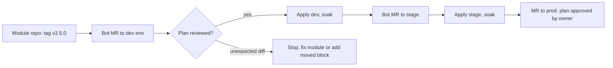

A shared Terraform module is an API. Consumers call it with inputs, read its outputs, and depend on the addresses of the resources inside it, because those addresses are keys in state. If the module changes under them without a version, `terraform plan` shows a surprise: a changed default, a renamed resource that means destroy and recreate, a new required variable. Versioning makes module changes explicit, reviewable and reversible.

> [!info] Not checked against live docs
> Terraform language features depend on the version you run. Availability of the `moved` block, and especially the `removed` block, differs by Terraform and OpenTofu version, and the lock file behaviour has changed over time. Check the current Terraform documentation for your version before relying on any block below, and validate every snippet with `terraform validate` and a plan.

## Why version modules

- Reproducible plans: the same code produces the same plan next week.
- Controlled blast radius: a module change reaches dev first, then stage, then prod, not all at once.
- A rollback target: re-pinning the previous tag is a reviewed one-line change.
- A review surface: a version bump pull request shows the changelog and a plan per environment.

Repository layout for modules and state is in [[terraform-module-and-state-layout]].

## Pin the source

**Git source with a tag.** Common for internal modules in GitLab:

```hcl title="envs/prod/gke.tf"
module "gke_cluster" {
  source = "git::https://gitlab.example.com/platform/tf-modules.git//gke-cluster?ref=v3.4.1"

  project_id = "example-prod"
  name       = "platform-1"
  location   = "europe-west1"
}
```

- `?ref=` accepts a tag, a branch or a commit SHA. Use a **tag** for readability, or a **full commit SHA** when you need immutability (tags can be moved by anyone with push rights unless tags are protected).
- `//gke-cluster` selects a subdirectory in a monorepo of modules.
- Protect `v*` tags in the module repository, so a published version cannot be rewritten.

**Registry source with a constraint.** Works with a private module registry, or the public one:

```hcl title="envs/prod/network.tf"
module "network" {
  source  = "app.terraform.io/example/network/google"
  version = "~> 2.3"
}
```

Constraints give a range, which means a plan can change without any commit in your repository when a new matching version is published. For production, pin an exact version (`version = "2.3.1"`) and let automation propose upgrades. The `version` argument works only with registry sources; git sources are pinned through `ref`.

Whichever you use, never point at a moving branch:

```hcl title="bad: do not do this"
source = "git::https://gitlab.example.com/platform/tf-modules.git//gke-cluster?ref=main"
```

## Semver for modules: what is breaking

Decide the rules once and write them in the module README.

| Change                                                         | Bump                                                         | Why                                                    |
| -------------------------------------------------------------- | ------------------------------------------------------------ | ------------------------------------------------------ |
| Remove or rename a variable or output                          | Major                                                        | Consumers fail at plan time                            |
| Add a required variable (no default)                           | Major                                                        | Every consumer must edit                               |
| Change a default that alters existing resources                | Major                                                        | Plan shows changes with no code change in the consumer |
| Rename or restructure a resource without a `moved` block       | Major                                                        | Plan shows destroy and create                          |
| Raise the minimum Terraform or provider version                | Major, or minor if the range still covers what consumers run | Consumers cannot init                                  |
| Add an optional variable defaulting to the old behaviour       | Minor                                                        | No effect unless used                                  |
| Add an output or a new optional resource behind a flag (off)   | Minor                                                        | Additive                                               |
| Fix a bug, documentation, internal refactor with `moved` block | Patch                                                        | Same plan                                              |

The test: **run the previous consumer config against the new module and expect an empty plan.** If it is not empty, it is not a patch or a minor.

### Refactoring without recreating: `moved`

When a resource is renamed or put into a nested module, a `moved` block tells Terraform that the object in state is the same one:

```hcl title="modules/gke-cluster/moved.tf"
moved {
  from = google_container_node_pool.default
  to   = google_container_node_pool.pools["default"]
}
```

Keep `moved` blocks for at least a full major version cycle, so consumers who skip a minor still migrate cleanly. Removing them early reintroduces the destroy and recreate.

### Removing something from management: `removed`

To stop managing a resource without destroying the real object, a `removed` block with a `lifecycle { destroy = false }` setting exists in newer Terraform versions. Availability depends on your version; check the docs. On versions without it, use `terraform state rm` manually per environment, which is far riskier because it is outside review. This is a reason to pin the Terraform version across the fleet ([[terraform-vs-opentofu]] covers the fork's differences).

## Changelog and release tagging

Generate the changelog from commit messages and tag from CI, the same way as for applications ([[release-versioning-and-changelog-automation]]). A module changelog differs in what it must say: **migration steps** (new variables, `moved` already included or not), **plan impact** (expected diffs on upgrade) and the **minimum provider versions**.

```text title="CHANGELOG.md excerpt"
## 3.4.1
- Fix: node pool taint `effect` was not applied for NO_EXECUTE.

## 3.4.0
- Add: optional `enable_private_endpoint` (default false, no plan change).

## 3.0.0
- Breaking: `master_authorized_networks` is now a map; see migration section.
- Breaking: requires hashicorp/google >= (check module `versions.tf`).
```

Tag from the default branch only, after tests pass ([[terraform-testing]]), and make the tag job the only way to create `v*` tags.

## Pin the providers

A module version pins its own code but providers are chosen by version constraints and by the lock file.

```hcl title="versions.tf"
terraform {
  required_version = ">= 1.6.0, < 2.0.0"
  required_providers {
    google = {
      source  = "hashicorp/google"
      version = ">= 5.0, < 7.0"
    }
  }
}
```

Modules should declare **ranges** (minimums that they need), and root configurations should pin the exact result through `.terraform.lock.hcl`, committed to Git. The lock file records the exact provider version and checksums. Generate hashes for every platform your team and CI use, because a lock file made on one platform contains only that platform's hashes by default:

```bash title="lock all platforms"
terraform providers lock \
  -platform=linux_amd64 \
  -platform=darwin_arm64
```

(The example version numbers above are constraints chosen to be illustrative. Set your own ranges from `terraform version` and the provider changelog.) Upgrading providers is a deliberate step: `terraform init -upgrade` rewrites the lock file, so do it in its own reviewed pull request, never as a side effect of a module bump.

## Upgrade flow, environment by environment

Automate proposals with Renovate or Dependabot-like tooling ([[automated-dependency-updates]]). Each proposal is a merge request that changes only a `ref` or `version`.



Rules for the pipeline:

1. The pull request shows the plan for that environment as a comment or artefact, and it must be read. Policy checks run on the plan ([[terraform-plan-policy-checks]]).
2. Promote one environment at a time; prod's MR is opened only after stage applied cleanly.
3. A plan containing `destroy` or `replace` for stateful resources (databases, clusters, disks) blocks the merge without a named owner approval.
4. Group consumers: upgrading many root modules to a new major version is a project, with a tracking issue.

A CI check that fails on floating references keeps the pins honest:

```bash title="scripts/check-module-refs.sh"
set -euo pipefail
if grep -rEn --include='*.tf' 'source *= *"git::.*\?ref=(main|master|develop|HEAD)"' .; then
  echo "ERROR: module source pinned to a moving branch. Use a tag or commit SHA." >&2
  exit 1
fi
if grep -rEn --include='*.tf' 'source *= *"git::' . | grep -v '?ref='; then
  echo "ERROR: git module source without ?ref=." >&2
  exit 1
fi
echo "module refs OK"
```

## Failure modes

- **Floating `main`.** Any merge to the module changes every consumer's next plan. Fixed by the check above and by protected tags.
- **Unreviewed `init -upgrade`.** Provider versions jump with the module bump, and the diff hides in the lock file. Separate the two changes.
- **Address changes destroy and recreate.** A resource renamed without `moved`. Always read the plan for `must be replaced`; run the old config against the new module before tagging.
- **Lock file missing hashes.** CI on another platform reports a checksum mismatch. Run `providers lock` with all platforms.
- **Diamond dependency.** Two modules require incompatible provider ranges. Keep ranges wide and tested, and avoid nesting modules deeply.
- **State moved on.** After apply, state records new objects, attributes and sometimes a state format version. The old module may not understand it.

## Rollback

Rollback is re-pinning the previous tag in a new pull request, then `terraform plan` to see exactly what it would do. It works when the old module can read what the new one wrote to state, and when the apply did not create or destroy things that the old version does not know about.

It does not work when:

- the new version applied a destructive change (the database is gone: use backups, [[terraform-state-recovery]] and [[backup-architecture-gke-cloud-sql-gcs]]);
- state was migrated by a newer Terraform version;
- the apply renamed objects via `moved` and the old module lacks the block. Re-pinning shows a plan that moves things back, which is usually fine but must be read.

So: take a state backup (versioned remote state bucket) before each production apply, apply to dev and stage first, and treat prod rollback as a forward fix when state has changed.

## Related

- [[terraform-module-and-state-layout]]
- [[terraform-testing]]
- [[terraform-plan-policy-checks]]
- [[release-versioning-and-changelog-automation]]
- [[automated-dependency-updates]]
- [[terraform-vs-opentofu]]
- [[terraform-state-recovery]]
- [[0030-terraform-manages-gcp-infrastructure]]

## Sources

- https://developer.hashicorp.com/terraform/language/modules/sources
- https://developer.hashicorp.com/terraform/language/modules/develop/refactoring
- https://developer.hashicorp.com/terraform/language/files/dependency-lock
- https://semver.org
