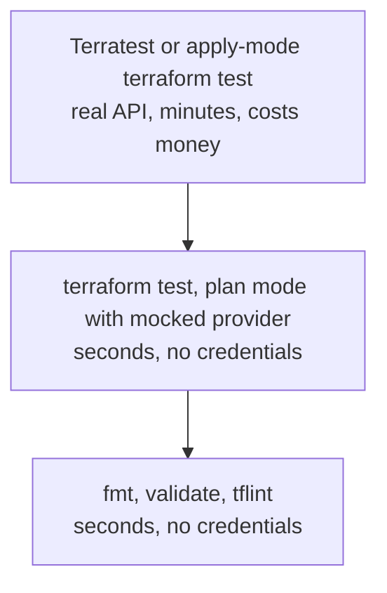

This note covers how to test Terraform modules at three levels: static checks, the native `terraform test` command, and real-infrastructure tests with Terratest. It is written for senior DevOps engineers who already publish shared modules and want a test setup that catches regressions without a large bill. The plan and apply flow, state layout and module structure stay in [[patterns/terraform-module-and-state-layout]]. Policy checks on the plan output are a separate gate: see [[patterns/terraform-plan-policy-checks]].

> [!info] Scope and sources
> Written against Terraform 1.x with the Google provider, GitLab CI and a dedicated sandbox GCP project. Based on the Terraform documentation for `terraform test` on developer.hashicorp.com, the TFLint project documentation and the Terratest documentation. OpenTofu uses the same file layout in most cases, see [[tools/terraform-vs-opentofu]].

> [!note] Not verified
> The claims below were written from documentation knowledge and were not checked against a running system or the current docs: the Terraform version that introduced `mock_provider` and override blocks, whether OpenTofu behaves the same for tests, and the TFLint ruleset plugin names and versions. Check them before relying on them.

## Problem and when it applies

A module is code that many stacks depend on. A bad change to a default, a variable validation or an output name breaks every consumer at the next plan, usually in a pipeline you do not own. `terraform plan` in a consumer is too late and too noisy to act as a test.

Testing modules pays off when:

- the module has more than one consumer or is versioned and published,
- it contains logic: `for_each`, `dynamic` blocks, conditionals, validations, computed locals,
- it enforces security defaults you do not want to lose by accident (uniform bucket access, no external IPs).

A stack that only wires three resources together and has one consumer needs `fmt`, `validate` and a reviewed plan, not a test suite.

## Test pyramid for IaC

Cheap tests run on every commit. Expensive ones run less often and against a sandbox.



| Level            | Catches                                                                 | Cost                         | When it runs           |
| ---------------- | ----------------------------------------------------------------------- | ---------------------------- | ---------------------- |
| Static           | Syntax, formatting, deprecated syntax, unused variables, bad arguments  | Seconds, no credentials      | Every commit           |
| `terraform test` | Variable validations, conditionals, output wiring, secure defaults      | Seconds with a mock provider | Every commit           |
| Apply-mode tests | Provider-side rejections, IAM propagation, real defaults, destroy order | Minutes, real resources      | Merge to main, nightly |
| Terratest        | The same, plus checks through other APIs (HTTP, `gcloud`, SDK)          | Minutes, real resources      | Merge to main, nightly |

## Static checks

Run these first. They need no credentials and no backend.

```bash
set -euo pipefail

MODULE_DIR="modules/gcs-bucket"  # change: path of the module under test

ROOT="$(git rev-parse --show-toplevel)"  # .tflint.hcl lives at the repository root

cd "$MODULE_DIR"
terraform fmt -check -recursive
terraform init -backend=false -input=false
terraform validate
tflint --init --config "$ROOT/.tflint.hcl"
tflint --config "$ROOT/.tflint.hcl"
```

`-backend=false` matters: the test job must never touch the state backend of a real environment.

TFLint reads `.tflint.hcl`. The Google ruleset is a plugin that `tflint --init` downloads.

```hcl title=".tflint.hcl"
plugin "terraform" {
  enabled = true
  preset  = "recommended"
}

plugin "google" {
  enabled = true
  version = "0.30.0" # change: check the current release of the ruleset
  source  = "github.com/terraform-linters/tflint-ruleset-google"
}
```

The plugin name, source and version above are from documentation knowledge. Pin whichever version you verify.

## terraform test basics

`terraform test` finds files named `*.tftest.hcl` (and `*.tftest.json`) in the module directory and in a `tests/` subdirectory, not in deeper folders. Each file holds `run` blocks that execute in order and share state within the file.

- `command = plan` evaluates the configuration and the plan without creating anything. Values that depend only on inputs are known, values the provider computes are unknown.
- `command = apply` (the default) creates real resources and destroys them at the end of the file.
- `assert` blocks hold a `condition` and an `error_message`.
- `expect_failures` lists the variables, checks or resources that must fail in that run. The run passes only if they fail.

The module declares its provider requirement; the mocked tests need it to know which provider to replace.

```hcl title="modules/gcs-bucket/versions.tf"
terraform {
  required_version = ">= 1.9" # change: the minimum your modules support

  required_providers {
    google = {
      source  = "hashicorp/google"
      version = ">= 6.0" # change: the provider range you have tested
    }
  }
}
```

A module with a validated variable and secure defaults:

```text
modules/gcs-bucket/
  main.tf
  variables.tf
  outputs.tf
  versions.tf
  tests/
    bucket.tftest.hcl          # mocked, runs on every commit
    integration/
      bucket_apply.tftest.hcl  # real provider, run only with -test-directory
test/
  bucket_test.go
  go.mod
.tflint.hcl
.gitlab-ci.yml
```

```hcl title="modules/gcs-bucket/variables.tf"
variable "project_id" {
  description = "Project that owns the bucket."
  type        = string
}

variable "name" {
  description = "Bucket name. Lowercase letters, digits, dashes and underscores, 3 to 63 characters."
  type        = string

  validation {
    condition     = can(regex("^[a-z0-9][a-z0-9_-]{1,61}[a-z0-9]$", var.name))
    error_message = "The bucket name must be 3 to 63 characters of lowercase letters, digits, dashes or underscores, starting and ending with a letter or digit."
  }
}

variable "location" {
  description = "Bucket location, for example EUROPE-WEST1."
  type        = string
  default     = "EUROPE-WEST1"
}

variable "versioning_enabled" {
  description = "Keep noncurrent object versions."
  type        = bool
  default     = false
}

variable "force_destroy" {
  description = "Allow deleting a bucket that still has objects. Keep false outside sandboxes."
  type        = bool
  default     = false
}
```

```hcl title="modules/gcs-bucket/main.tf"
resource "google_storage_bucket" "this" {
  project  = var.project_id
  name     = var.name
  location = var.location

  uniform_bucket_level_access = true
  public_access_prevention    = "enforced"
  force_destroy               = var.force_destroy

  versioning {
    enabled = var.versioning_enabled
  }
}
```

```hcl title="modules/gcs-bucket/outputs.tf"
output "bucket_name" {
  description = "Name of the bucket."
  value       = google_storage_bucket.this.name
}

output "bucket_url" {
  description = "gs:// URL of the bucket."
  value       = google_storage_bucket.this.url
}
```

The test file, using plan mode and a mocked provider so it needs no credentials:

```hcl title="modules/gcs-bucket/tests/bucket.tftest.hcl"
mock_provider "google" {
  mock_resource "google_storage_bucket" {
    defaults = {
      url = "gs://mocked-bucket"
    }
  }
}

variables {
  project_id = "my-project" # test value only, plan mode creates nothing
  name       = "orders-exports-dev"
  location   = "EUROPE-WEST1"
}

run "secure_defaults_in_plan" {
  command = plan

  assert {
    condition     = google_storage_bucket.this.uniform_bucket_level_access == true
    error_message = "Uniform bucket-level access must stay enabled."
  }

  assert {
    condition     = google_storage_bucket.this.public_access_prevention == "enforced"
    error_message = "Public access prevention must be enforced."
  }

  assert {
    condition     = output.bucket_name == "orders-exports-dev"
    error_message = "bucket_name must echo the name input."
  }
}

run "versioning_follows_the_variable" {
  command = plan

  variables {
    versioning_enabled = true
  }

  assert {
    condition     = google_storage_bucket.this.versioning[0].enabled == true
    error_message = "Versioning must be enabled when versioning_enabled is true."
  }
}

run "rejects_an_invalid_name" {
  command = plan

  variables {
    name = "Orders_Exports"
  }

  expect_failures = [
    var.name,
  ]
}
```

Run it:

```bash
set -euo pipefail

cd modules/gcs-bucket  # change: path of the module under test
terraform init -backend=false -input=false
terraform test -verbose  # tests/ only: the mocked files
```

The first run proves the assertions can fail. Flip one `condition` and confirm the run goes red before you trust the suite.

## Mocking providers

`mock_provider "google" {}` replaces the real provider with generated data. No credentials, no network, no cost, and it runs in a few seconds. Resources in a mocked run get generated values for computed attributes, which is why the file above sets a `defaults` block for the one attribute an assertion reads. Override blocks (`override_resource`, `override_data`, `override_module`) let a single run replace the result of one object. Check the current docs for their exact syntax and the minimum Terraform version.

What a mock proves: your expressions, conditionals, validations and output wiring behave as written. What it does not prove: that the real API accepts the configuration. A mocked apply of a bucket with an invalid location passes.

## Apply-mode tests in a sandbox

When the question is "does GCP accept this", drop the mock and use a real provider in a throwaway project.

The file lives in `tests/integration/`, which plain `terraform test` does not read, so a merge request never creates real resources by accident. The bucket name is not in the file: pass a unique one per run with `-var`.

```hcl title="modules/gcs-bucket/tests/integration/bucket_apply.tftest.hcl"
provider "google" {
  project = "my-sandbox-project" # change: a dedicated sandbox project, never a shared or prod project
}

variables {
  project_id    = "my-sandbox-project" # change: same sandbox project
  force_destroy = true
  # name comes from -var "name=tftest-<unique>" on the command line
}

run "bucket_is_created_with_secure_defaults" {
  command = apply

  assert {
    condition     = startswith(output.bucket_url, "gs://tftest-")
    error_message = "The bucket URL should start with gs://tftest-."
  }
}
```

Rules for apply-mode tests:

- A dedicated sandbox project with a budget alert and a low quota, owned by the platform team and used for nothing else.
- Credentials from workload identity federation or a short-lived impersonated service account with only the roles the module needs. See [[patterns/gke-workload-identity]] for the in-cluster side.
- Unique names per run (`-var "name=tftest-${CI_PIPELINE_ID}"`), so parallel pipelines do not collide.
- `force_destroy = true` only inside the test, never as a module default.
- State stays local to the test run. Never point a test at the real backend.

## Terratest

Use Terratest when the check goes beyond Terraform: call an HTTP endpoint, run `gcloud`, read the resource through the Google API client, or test several modules together. It is Go code, so it adds a toolchain to the repository.

```go title="test/bucket_test.go"
package test

import (
	"os"
	"strings"
	"testing"

	"github.com/gruntwork-io/terratest/modules/random"
	"github.com/gruntwork-io/terratest/modules/terraform"
	"github.com/stretchr/testify/assert"
	"github.com/stretchr/testify/require"
)

func TestBucketModule(t *testing.T) {
	t.Parallel()

	projectID := os.Getenv("SANDBOX_PROJECT_ID")
	require.NotEmpty(t, projectID, "SANDBOX_PROJECT_ID must point at the sandbox project")

	name := "tt-bucket-" + strings.ToLower(random.UniqueId())

	opts := terraform.WithDefaultRetryableErrors(t, &terraform.Options{
		TerraformDir: "../modules/gcs-bucket",
		Vars: map[string]interface{}{
			"project_id":    projectID,
			"name":          name,
			"force_destroy": true,
		},
	})

	// Destroy runs even when an assertion fails.
	defer terraform.Destroy(t, opts)

	terraform.InitAndApply(t, opts)

	assert.Equal(t, name, terraform.Output(t, opts, "bucket_name"))
	assert.Equal(t, "gs://"+name, terraform.Output(t, opts, "bucket_url"))
}
```

The module has no backend block, so state is local and lives in the module directory. Add `.terraform/`, `terraform.tfstate*` to `.gitignore`, or copy the module to a temp directory in the test.

## CI job

Fast tests on every merge request (mocked, no credentials), with the Terraform image pinned. The sandbox tests live in their own job so a flaky API does not block ordinary changes.

```yaml title=".gitlab-ci.yml"
stages:
  - test

variables:
  MODULE_DIR: modules/gcs-bucket

terraform-static-and-test:
  stage: test
  # Pin the tag you actually use, and prefer a digest: image: hashicorp/terraform:1.9.8@sha256:<digest>
  image:
    name: hashicorp/terraform:1.9.8 # change: the Terraform version your modules require
    entrypoint: [""]
  rules:
    - changes:
        - modules/**/*
        - .tflint.hcl
  script:
    - cd "$MODULE_DIR"
    - terraform fmt -check -recursive
    - terraform init -backend=false -input=false
    - terraform validate
    - terraform test # reads tests/ only; the apply tests in tests/integration are not run

terraform-sandbox-apply:
  stage: test
  image:
    name: hashicorp/terraform:1.9.8 # change: same pinned version as above
    entrypoint: [""]
  rules:
    - if: $CI_COMMIT_BRANCH == $CI_DEFAULT_BRANCH
      changes:
        - modules/**/*
  resource_group: terraform-sandbox
  script:
    - cd "$MODULE_DIR"
    - terraform init -backend=false -input=false
    - terraform test -test-directory=tests/integration -var "name=tftest-${CI_PIPELINE_ID}"
```

The sandbox job needs credentials for the sandbox project only, injected through your CI identity setup, never as a long-lived key in a CI variable. `resource_group` serialises runs so two pipelines do not fight over the same sandbox. Keep tflint in the same job if the image has it, or add a second job with a TFLint image pinned the same way. For the layout of the pipeline as a whole see [[patterns/gitlab-ci-pipeline-structure]].

## Pitfalls

- Mocks prove expressions, not the real API. Pair them with at least one apply-mode test for anything that talks to a provider in a non-trivial way.
- Cost and cleanup. A failed destroy leaves resources behind. Use unique prefixes (`tftest-`, `tt-`), a sandbox project with a budget alert and a nightly job that deletes anything with that prefix older than a day.
- Never run tests against the production backend or project. `-backend=false` in the job and a hard-coded sandbox project in the test file make that structural.
- Tests that depend on each other. `run` blocks share state inside a file by design, but keep each file independent so you can run one alone.
- Asserting on unknown values. In plan mode a computed attribute is unknown, and an assertion on it errors or fails. Assert on values derived from inputs, or use an apply-mode run.
- Over-testing. Do not assert that Terraform copies a variable into an argument unchanged. Test decisions: validations, conditionals, defaults you must not lose.
- Provider and Terraform version drift. Pin versions in `versions.tf`, and run the suite on the oldest and newest Terraform version you support.

## Verify

```bash
set -euo pipefail

cd modules/gcs-bucket  # change: path of the module under test
terraform init -backend=false -input=false
terraform test -verbose
```

Expected: every `run` block reports `pass`. Then break one rule on purpose, for example set `uniform_bucket_level_access = false` in `main.tf`, and confirm `secure_defaults_in_plan` fails with your error message. Revert the change.

## Rollback

Tests are additive. If a new suite blocks merges for reasons unrelated to the change, set `allow_failure: true` on the job while you fix it, then remove it again. If an apply-mode run leaves resources behind, delete them in the sandbox project by prefix, and if state is damaged follow [[runbooks/terraform-state-recovery]].

## Related

- [[patterns/terraform-module-and-state-layout]]: where the modules, environments and state live, and the plan and apply flow.
- [[patterns/terraform-plan-policy-checks]]: policy gates on the plan output, the next layer after module tests.
- [[tools/terraform-vs-opentofu]]: check whether your engine supports the same test syntax.
- [[runbooks/terraform-state-recovery]]: what to do when a test run or a pipeline damages state.
- [[patterns/gitlab-ci-pipeline-structure]]: how the test jobs fit into the wider pipeline.
