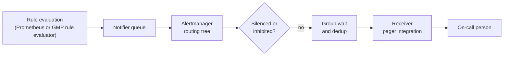

A page has to survive five hops: the rule must fire, Prometheus must deliver it to Alertmanager, Alertmanager must route it to the paging receiver, nothing may silence or inhibit it, and the receiver must accept the notification. Each hop fails silently by default, and nobody notices until a postmortem asks why the on-call engineer heard about the outage from a customer. This runbook checks the hops in order, finds the one that dropped the alert, and ends with a test that proves the whole path.

Under [[0045-page-only-on-slo-burn-rate]], the burn-rate alerts are the **only** pages, so a broken path means no pages at all.



> [!info] Scope and verification
> Checked on 2026-10-21 against the documentation source of the Prometheus alerting rules and Alertmanager configuration pages, the Alertmanager README for `amtool`, and the Prometheus, Alertmanager and Managed Service for Prometheus source for metric names, CLI flags and CRD fields. Nothing was run against a live system, and the note is not marked `verified`. **Not verified:**
>
> - the Managed Service for Prometheus namespaces and object names used in step 6, and the Cloud Monitoring notification channel test feature;
> - the values of the `reason` label on `alertmanager_notifications_failed_total` and any receiver-specific error text;
> - Alertmanager HTTP API paths other than through `amtool`, and Prometheus's notification queue settings;
> - the meaning of the internal `ALERTS_FOR_STATE` series.
>
> Avoid configuration fields that appear only in the newest Alertmanager docs (route `labels`, inhibit rule `name`) unless your version has them.

## When to use

- A postmortem finds an incident where an alert should have paged and did not.
- An alert shows as firing in Prometheus or Grafana, but the pager has nothing.
- Pages arrive late (minutes after the alert fired), or only some of them arrive.
- After any change to rules, routing, receivers or pager integrations, as the check that the path still works.

If you are running the incident itself, page manually and follow [[incident-response]] first; debug the alerting path afterwards.

## Preconditions

- Read access to the Prometheus (or Managed Service for Prometheus) UI and API, and to Alertmanager. For self-managed Alertmanager on Kubernetes a port-forward is enough.
- `amtool` (it ships with Alertmanager releases) and `promtool`, at versions close to the server's.
- The rule files and `alertmanager.yml` from Git, as required by [[0046-dashboards-and-alert-rules-as-code]]. Debug against the version that was **deployed at the time of the incident**, not today's.
- The alert's name, its full label set, and the time window you expected the page in.

```bash
PROM=http://127.0.0.1:9090        # port-forwarded Prometheus; example only
AM=http://127.0.0.1:9093          # port-forwarded Alertmanager; example only
ALERT=CheckoutErrorBudgetBurn
SINCE="2026-10-20T09:00:00Z"
# kubectl -n monitoring port-forward svc/prometheus 9090 &
# kubectl -n monitoring port-forward svc/alertmanager 9093 &
```

## Steps

### 1. Did the rule actually fire?

An alert is `pending` from its first true evaluation until its `for` duration has held, and only then `firing`. Without `for` it fires on the first evaluation. Only `firing` alerts are sent to Alertmanager.

```bash
# Current state, with the full label set
curl -s "$PROM/api/v1/alerts" | jq --arg a "$ALERT" '.data.alerts[] | select(.labels.alertname == $a) | {state, activeAt, labels}'

# History over the incident window: ALERTS is 1 while the alert is pending or firing
curl -s "$PROM/api/v1/query_range" \
  --data-urlencode "query=ALERTS{alertname=\"$ALERT\"}" \
  --data-urlencode "start=$SINCE" --data-urlencode "end=$(date -u +%Y-%m-%dT%H:%M:%SZ)" \
  --data-urlencode "step=60" | jq '.data.result[] | {state: .metric.alertstate, points: (.values | length)}'
```

`ALERTS{alertname, alertstate}` is the synthetic series Prometheus writes for every pending or firing alert; it goes stale when the alert stops. If it shows only `pending`, the condition never held for the whole `for` duration: a flapping expression, or a `for` longer than the incident. `keep_firing_for` on the rule helps with flapping. (`ALERTS_FOR_STATE` is an internal series that also exists; its exact use is not described in the docs.)

If `ALERTS` is empty for the window, the rule did not fire. Check that it was evaluated:

```promql
# Rule group health; non-zero rates mean broken or late evaluation
rate(prometheus_rule_evaluation_failures_total[15m]) > 0
increase(prometheus_rule_group_iterations_missed_total[1h]) > 0
time() - prometheus_rule_group_last_evaluation_timestamp_seconds > 3 * prometheus_rule_group_interval_seconds
```

Then check the expression itself: run it in the UI over the incident window. Common causes are a renamed metric or label after a deploy (the expression returns nothing, so it never fires), a missing series that should have been caught by an `absent()` rule, a recording rule that stopped producing data, or a cardinality limit dropping series ([[prometheus-high-cardinality-triage]]). See [[promql-for-alert-rules-and-recording-rules]] for writing rules that fail loudly, and run the rule unit tests with `promtool test rules` from [[first-prometheus-alert]].

### 2. Did Prometheus deliver it to Alertmanager?

```promql
prometheus_notifications_alertmanagers_discovered                  # must be > 0 (and match your HA replica count)
rate(prometheus_notifications_errors_total[5m]) > 0                # sends to an Alertmanager failed
increase(prometheus_notifications_dropped_total[1h]) > 0           # alerts dropped due to errors when sending
prometheus_notifications_queue_length / prometheus_notifications_queue_capacity
```

- **Zero Alertmanagers discovered.** The `alerting.alertmanagers` section of the Prometheus configuration does not find any: a renamed Service, a changed namespace, a service discovery permission, or `alert_relabel_configs` dropping everything. This is a total outage of paging from that Prometheus.
- **Errors or drops.** Network policy, TLS or authentication between Prometheus and Alertmanager, or an Alertmanager that is down. The notification queue settings and the exact drop behaviour were not verified here; check the Prometheus configuration reference for your version.
- **Delivered**: confirm Alertmanager has the alert, with the labels you expect:

```bash
amtool --alertmanager.url="$AM" alert query alertname="$ALERT"
amtool --alertmanager.url="$AM" -o extended alert query alertname="$ALERT"   # shows labels, annotations, start time
```

If several Prometheus replicas or Alertmanager replicas run, check each. The Alertmanager README says not to load balance traffic between Prometheus and its Alertmanagers: point Prometheus at the list of **all** Alertmanager replicas, and the Alertmanager cluster deduplicates over its gossip port, which needs both TCP and UDP open (default port 9094). A blocked UDP port between replicas causes duplicate or missing notifications.

### 3. Where did Alertmanager route it?

Test the routing tree with the **exact** label set from step 2, against the configuration that was deployed:

```bash
amtool check-config alertmanager.yml
amtool config routes test --config.file=alertmanager.yml --tree --verify.receivers=pager \
  alertname="$ALERT" severity=page team=team-orders service=checkout
echo "exit code: $?"   # 1 when the labels do not route to the receivers named in --verify.receivers
```

`--config.file` takes precedence over `--alertmanager.url`, so this tests the file in hand. Without `--config.file`, `amtool config routes` shows the tree of the running Alertmanager.

How routing goes wrong:

- **The alert fell through to the root receiver.** Every alert enters at the root route; it goes to the first matching child, and if no child matches, the root's receiver handles it. In the [[alert-and-runbook-standard]] layout the root receiver sends nowhere, so an alert with `severity: critical` instead of `severity: page`, or with no `severity` at all, is silently dropped. Fix the rule's labels, and add a rule test that checks them.
- **An earlier sibling matched first.** `continue` defaults to `false`, so the first matching child wins. A broad route above the paging route (for example everything for `team-orders` to a chat channel) catches the alert before it reaches the pager. Reorder, narrow the matcher, or set `continue: true` on the earlier route.
- **Matcher syntax.** `matchers` is the current syntax; `match` and `match_re` are deprecated. A regex matcher that is accidentally anchored or a label value with different case does not match.
- **Grouping and timing.** `receiver`, `group_by` and the timing values are inherited from the parent. Defaults are `group_wait: 30s`, `group_interval: 5m` and `repeat_interval: 4h`. A new alert joining an existing group is sent only at the next `group_interval`, and an alert that resolves before `group_wait` ends sends no notification at all. Large values on the paging route delay pages; `group_by: ['...']` disables grouping entirely, which is noisy but never delays.
- **Time intervals.** `mute_time_intervals` and `active_time_intervals` are not inherited by child routes, and a route outside its active interval sends nothing. A business-hours interval on a parent that you assumed applied only to tickets does not apply below it, and one set on the paging route by mistake mutes pages at night.

### 4. Was it silenced or inhibited?

```bash
amtool --alertmanager.url="$AM" silence query                         # active silences
amtool --alertmanager.url="$AM" silence query --expired | head -40    # expired ones, for the incident window; check the flag with --help
```

```promql
increase(alertmanager_notifications_suppressed_total[1h])              # by reason: silenced, inhibited, time intervals
```

- **A silence matched.** A silence created for maintenance with a broad matcher (`team="team-orders"`) or a long duration mutes real pages too. Silences should name the alert and the instance, and carry an author and comment; set `comment_required` in the `amtool` configuration for your team.
- **An inhibition rule matched.** A target alert is muted when a source alert is firing and both have the same values for every label in `equal`. A label missing on both counts as equal (empty), so an `equal` list naming labels your alerts do not carry makes the rule inhibit across everything. With the standard's `ClusterUnreachable` rule, a stuck `ClusterUnreachable` alert inhibits every page from that cluster: check what the source alert is doing.

### 5. Did the receiver deliver it?

```promql
sum by (integration, reason) (increase(alertmanager_notifications_failed_total[1h]))
sum by (integration) (increase(alertmanager_notifications_total[1h]))
histogram_quantile(0.99, sum by (le, integration) (rate(alertmanager_notification_latency_seconds_bucket[15m])))
```

Then read the Alertmanager logs for notify errors around the incident time. Typical causes, generically (receiver-specific error text not verified here):

- **The integration key, routing key or webhook URL is wrong, revoked or expired.** Rotations are the usual trigger. Treat these keys as credentials: store them as secrets, rotate them with [[leaked-credential-rotation]], and test the page after every rotation.
- **TLS or proxy problems** from Alertmanager to the paging provider: an expired corporate proxy certificate, or egress rules after a network change ([[tls-certificate-renewal]]).
- **The provider accepted it, but nobody was notified.** Escalation policy with an empty rota, a person on leave without an override, notification rules on the phone. That is outside Alertmanager: check the provider's incident log for the time window, and the rota health practices in [[on-call-health]].
- **Rate limits** on chat or pager integrations during an alert storm: too many un-grouped alerts. Fix `group_by` so one incident is one notification.

### 6. Managed variants

With [[0042-managed-prometheus-for-application-metrics|Managed Service for Prometheus]] (GMP) and managed rule evaluation, the hops are the same but run in Google-managed components:

- Rules are `Rules`, `ClusterRules` or `GlobalRules` resources, evaluated by the managed rule evaluator. The `OperatorConfig` resource names where alerts go: `rules.alerting.alertmanagers` lists Alertmanager endpoints, and `managedAlertmanager.configSecret` points at a single-key Secret holding the configuration for the managed Alertmanager.
- The namespaces and object names (commonly `gmp-public` for the `OperatorConfig` named `config` and `gmp-system` for the managed components) are not verified here; check the GMP managed rule evaluation page, then for example:

```bash
kubectl get operatorconfig -A -o yaml | grep -A20 -E 'alerting:|managedAlertmanager:'
kubectl get rules,clusterrules,globalrules -A
kubectl -n gmp-system get pods          # namespace not verified: look for the rule evaluator and Alertmanager Pods
```

- Read the rule evaluator's and the managed Alertmanager's logs for evaluation and send errors, and use `amtool` against the managed Alertmanager through a port-forward as in steps 2 to 5.

With Cloud Monitoring alerting policies instead of Alertmanager, the routing hop is the policy's notification channels: check the policy's incidents for the window, and that the channel is still valid. The channel test feature and verification states were not verified here; see the Cloud Monitoring notification channel docs and [[prometheus-vs-cloud-monitoring]].

### 7. Prevent the next silent failure

Two controls, both owned by the observability team:

1. **A dead man's switch.** An alert that always fires (conventionally `Watchdog`), routed to an external heartbeat service that pages when the heartbeat **stops**. It proves rule evaluation, Prometheus to Alertmanager delivery and the Alertmanager to outside path every few minutes. This is a common pattern, not a Prometheus feature. The rule, the heartbeat route (placed **first**, so no other route catches it), the `url_file` receiver that keeps the ping URL out of the configuration, and one heartbeat check per cluster are in [[architecture/alerting-and-paging-pipeline#Meta-monitoring|the alerting pipeline's meta-monitoring]]. Set the heartbeat service's expected interval to a few multiples of the route's `repeat_interval`.

2. **A synthetic page after every routing change.** Every MR that changes rules, routes, receivers or integration keys includes a `amtool config routes test` for each paging alert in CI, and after deployment a real test alert on a dedicated test route (Validation below).

## Validation

Send a test alert through the real path, to a **test route** that pages only the person running the test, never the live rota:

```bash
END=$(date -u -d '+10 minutes' +%Y-%m-%dT%H:%M:%SZ)   # macOS / zsh: date -u -v+10M +%Y-%m-%dT%H:%M:%SZ
amtool --alertmanager.url="$AM" alert add alertname=PagingPathTest severity=page team=platform-test \
  --annotation=summary="Paging path test, ignore" --end="$END"
amtool --alertmanager.url="$AM" alert query alertname=PagingPathTest
```

> [!warning] `amtool alert add` against production really pages
> The alert goes through the same routing as any other. With `severity=page` and a real team label it pages the live on-call. Add a route that matches `team="platform-test"` above the normal paging routes and points to a receiver for the tester only, and confirm it with `amtool config routes test --verify.receivers` before sending.

- The test alert reaches the tester's device within `group_wait` plus the provider's delivery time, and the provider's log shows it.
- `alertmanager_notifications_failed_total` does not increase for the paging integration.
- The heartbeat service shows recent check-ins, and a deliberate pause of the heartbeat (for example by silencing `Watchdog` for 15 minutes) pages the observability on-call.
- The rule that missed the incident now has a unit test with the incident's labels, and `amtool config routes test` for it is in CI.

## Rollback

Alerting configuration is code ([[0046-dashboards-and-alert-rules-as-code]]): revert the MR that changed rules, routes or receivers, and let the pipeline redeploy. Alertmanager reloads its configuration on `POST /-/reload` or `SIGHUP`, or when the operator rolls it out; check that the running configuration changed with `amtool config routes`. Expire silences created during debugging (`amtool silence expire <id>`), remove the test route once the test is done, and if an integration key was rotated, keep the old one valid until the new one has delivered a test page.

## Troubleshooting

| Symptom                                                   | Likely cause and fix                                                                                                         |
| --------------------------------------------------------- | ---------------------------------------------------------------------------------------------------------------------------- |
| `ALERTS` shows only `pending`                             | The condition never held for the full `for`. Shorten `for`, add `keep_firing_for`, or fix a flapping expression.             |
| `ALERTS` empty, expression returns data now               | Rule not evaluated (evaluation failures, missed iterations) or the metric was renamed during the incident.                   |
| `prometheus_notifications_alertmanagers_discovered` is 0  | Alertmanager discovery broken: Service name, namespace, RBAC or `alert_relabel_configs`.                                     |
| Notification errors or drops in Prometheus                | Network, TLS or auth between Prometheus and Alertmanager, or Alertmanager down.                                              |
| Alert in Alertmanager, routes to the root receiver        | Wrong or missing `severity` or `team` label. Fix the rule; add a routing test.                                               |
| Alert routes to a chat receiver, not the pager            | An earlier sibling route matched; `continue` is false by default. Reorder or narrow.                                         |
| Page arrives minutes late                                 | Alert joined an existing group and waited for `group_interval`, or large `group_wait`. Tune the paging route.                |
| `notifications_suppressed_total` rose                     | A silence, an inhibition or a time interval muted it. Step 4.                                                                |
| `notifications_failed_total` rose for the pager           | Revoked or rotated integration key, or TLS/proxy egress. Step 5.                                                             |
| Duplicate or missing pages with HA Alertmanager           | Gossip port blocked (TCP and UDP needed), or Prometheus not sending to every replica.                                        |
| Provider received it, nobody was notified                 | Escalation policy or rota problem outside Alertmanager. Check the provider's log and the rota.                               |

## Related

- [[architecture/alerting-and-paging-pipeline]] for the target design this runbook checks against: routing tree, HA Alertmanager and meta-monitoring.
- [[tools/pagerduty-vs-opsgenie-vs-grafana-irm]] for the receiver side: choosing, configuring and testing the paging tool.
- [[slo-burn-rate-alerting]] and [[0045-page-only-on-slo-burn-rate]] for which alerts page.
- [[alert-and-runbook-standard]] for required labels, severity routing and the inhibition layout used above.
- [[0046-dashboards-and-alert-rules-as-code]] for how alerting changes are reviewed and deployed.
- [[0042-managed-prometheus-for-application-metrics]] and [[multi-tenant-prometheus-architecture]] for where rules are evaluated.
- [[first-prometheus-alert]] and [[promql-for-alert-rules-and-recording-rules]] for writing and testing rules.
- [[prometheus-high-cardinality-triage]] when series limits drop the data a rule needs.
- [[on-call-health]] and [[incident-response]] for the human side of the page.

## Sources

Checked 2026-10-21 against the documentation source on the default branch:

- [Prometheus: Alerting rules](https://prometheus.io/docs/prometheus/latest/configuration/alerting_rules/): `pending` and `firing`, `for`, `keep_firing_for`, the `ALERTS` series.
- [Alertmanager: Configuration](https://prometheus.io/docs/alerting/latest/configuration/): routing tree, `continue`, inheritance, timing defaults, time intervals, `matchers`, inhibition rules and `equal` semantics.
- [Alertmanager README](https://github.com/prometheus/alertmanager): `amtool` commands, flags and configuration file; HA gossip over TCP and UDP.
- [Prometheus source](https://github.com/prometheus/prometheus) (`notifier`, `rules`) and [Alertmanager source](https://github.com/prometheus/alertmanager) (`notify`, `cli`): metric names and `amtool` flags; read in source.
- [Managed Service for Prometheus API reference](https://github.com/GoogleCloudPlatform/prometheus-engine/blob/main/doc/api.md): `OperatorConfig`, `rules.alerting.alertmanagers`, `managedAlertmanager.configSecret`, rule resources.
- [Alertmanager concepts](https://prometheus.io/docs/alerting/latest/alertmanager/), [GMP managed rule evaluation](https://cloud.google.com/stackdriver/docs/managed-prometheus/rules-managed) and [Cloud Monitoring notification channels](https://docs.cloud.google.com/monitoring/support/notification-options): not read; check them for your setup.
