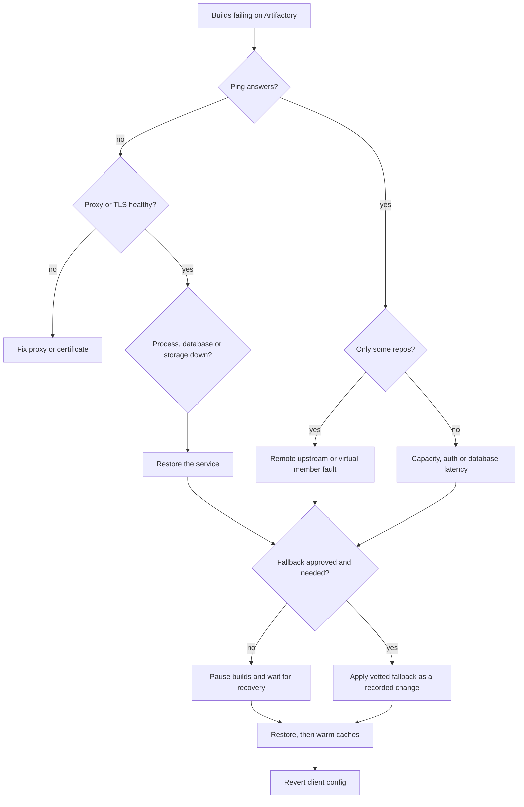

Artifactory sits in the path of almost every build: dependencies, base images, plugins and the artifacts that deployments pull. When it stops answering, every pipeline fails at once and the instinct is to point builds at "anything that works". This runbook is about resisting that instinct: confirm what is actually broken, decide whether a fallback is worth the risk, use only a pre-approved one, and put everything back in a controlled order.

> [!info] Scope and verification
> The commands and paths below were not run against a live instance when this note was written, and they are not marked `verified`. Endpoint paths, repository behaviour and edition differences change between releases. Check the current JFrog Artifactory documentation before relying on any path or setting, and rehearse the fallback on a non-production client first.

## When to use

- Builds fail on dependency resolution, image pulls or uploads, and `artifactory.example.com` times out, returns 5xx, or shows a login error for everyone.
- Only some repositories fail (a remote repository whose upstream is unreachable, a virtual repository with a broken member).
- You are about to restore Artifactory after an incident and need to bring clients back without overloading it.

If the failure is a full disk, go to [[artifactory-storage-full-recovery]]. If the incident is broad (more than CI is affected), open [[incident-response]] first and run this as one workstream.

## Preconditions

- The **fallback is decided in advance**, not at 03:00: which clients may use which alternative source, who approves it, and how it is reverted. If no fallback is approved, the right answer in step 3 is to pause builds.
- Admin access to Artifactory (or to whoever runs it), the reverse proxy or load balancer, the database and the filestore.
- Client configuration is in version control or in a central place (a shared CI template, a runner image, a Helm values file), so a fallback and its revert are one reviewed change and not a hand edit on forty runners.
- A change record per [[production-change-checklist]]. A temporary fallback is a change.

```bash
ART_URL=https://artifactory.example.com
# Token comes from the environment or a secret store, never from the command line history.
: "${ART_TOKEN:?set ART_TOKEN from your secret store}"
```

## Steps



### 1. Confirm scope

Start from the outside in. A health ping that answers while the UI does not is a different problem from no answer at all.

```bash
# The system ping REST endpoint. Verify the exact path for your version in the docs.
curl -sS -o /dev/null -w "ping: %{http_code} in %{time_total}s\n" \
  "$ART_URL/artifactory/api/system/ping"

# Through the reverse proxy and directly on the node, to separate the two layers
curl -sS -o /dev/null -w "ui: %{http_code}\n" "$ART_URL/ui/"
curl -sS -o /dev/null -w "repo: %{http_code}\n" \
  -H "Authorization: Bearer $ART_TOKEN" "$ART_URL/artifactory/api/repositories"
```

Record which of these fail. Then check each layer: the load balancer or ingress health, the Artifactory process or Pod, the database, and the filestore mount.

### 2. Classify the failure

| Class                    | Typical signs                                                          | Next step                                          |
| ------------------------ | ---------------------------------------------------------------------- | -------------------------------------------------- |
| Proxy or TLS             | Ping fails through the proxy but works on the node; certificate errors | Fix the proxy; see [[tls-certificate-renewal]]     |
| Artifactory process      | Pod or service restarting, out of memory, failed start                 | Read the service logs, restore the process         |
| Database                 | Slow or failing logins, errors about connections in the logs           | Restore the database or its connection capacity    |
| Storage                  | Write errors, mount missing, disk full                                 | [[artifactory-storage-full-recovery]] or the mount |
| One upstream remote only | Only one remote repository fails; local repositories fine              | Treat as an upstream fault, see step 4             |

Do not change client configuration yet. Most outages are fixed faster at the server than by touching every client.

### 3. Decide whether to fall back at all

Pausing is often the safest choice. Consider a fallback only when all of these hold:

- The outage will outlast the business tolerance for stopped builds, and a hotfix cannot wait.
- There is a pre-approved alternative source for the specific artifacts needed.
- The build can still prove what it fetched (lock files with hashes, pinned image digests).

> [!warning] Never point builds at an unvetted public mirror
> Switching resolution to an arbitrary public registry bypasses the controls Artifactory enforces for you: allowed sources, curation, scanning and the internal-before-public resolution order. That is how dependency confusion and typosquatted packages reach builds. Do not use `--no-verify`, disable checksum or signature verification, or relax TLS checks to make a fallback work. If the fallback cannot verify what it serves, it is not a fallback, it is a risk.

If you pause builds, say so in the incident channel, disable scheduled pipelines, and keep a short list of what is waiting.

### 4. What keeps working without the upstream

Remote repositories cache what they have already downloaded. When the upstream (npm, PyPI, Maven Central, a container registry) is unreachable but Artifactory is healthy, artifacts already in the cache can still be served. How metadata is handled, and what happens to cache entries that have expired, depends on the repository type and its retrieval cache and offline settings, so check the current docs before assuming that a given build will succeed. A new dependency version that was never cached will fail.

Virtual repositories resolve members in the order configured, so that order is also the failover order inside Artifactory. Check it before an incident and keep the internal repositories first:

```bash
curl -sS -H "Authorization: Bearer $ART_TOKEN" \
  "$ART_URL/artifactory/api/repositories/libs-virtual" | jq '{key, repositories}'
```

Replace `libs-virtual` with your virtual repository key. If a single broken member slows every request to a timeout, removing it from the virtual repository temporarily is a smaller change than touching clients. Record it and restore it afterwards.

### 5. Apply the fallback per client

Only to the pre-approved mirror, as a reviewed change with a revert time written in the commit message or change record. The examples show the shape; `mirror.example.com` stands for your vetted mirror.

```xml title="settings.xml (Maven)"
<mirrors>
  <mirror>
    <id>fallback-mirror</id>
    <mirrorOf>*</mirrorOf>
    <url>https://mirror.example.com/maven/</url>
  </mirror>
</mirrors>
```

```ini title=".npmrc"
registry=https://mirror.example.com/npm/
```

```ini title="pip.conf"
[global]
index-url = https://mirror.example.com/simple/
```

For container images, change the registry host in the image reference through your deploy tooling, and prefer pinned digests so the image content is the same on either side:

```bash
# Confirm the digest you are about to pull is the one your pipeline recorded.
IMAGE=mirror.example.com/team/app
DIGEST=sha256:<digest-recorded-by-the-pipeline>
docker pull "$IMAGE@$DIGEST"
```

Replace `DIGEST` with the digest recorded at build time. It is a value you must supply, not a placeholder to leave in. Only artifacts that existed before the outage can be served from a mirror that is kept in sync; anything new built during the outage must wait or be built from sources you can verify.

### 6. Restore the service

Work the layer from step 2: restart or reschedule the Artifactory process, restore the database connection, remount storage, repair the proxy. For an HA deployment, check the node membership page or API and confirm that all nodes rejoin before declaring recovery. Check the JFrog high availability documentation for the correct order of node restarts.

### 7. Revert clients, then warm the cache

Revert the client configuration through the same reviewed path that applied it. Do not leave "temporary" fallbacks in place; stale mirror settings are a common source of builds that silently skip scanning.

Releasing every blocked pipeline at once creates a stampede: thousands of resolution requests, cold remote caches and downstream rate limits. Stagger the restart:

1. Re-enable one team's or one project's pipelines and watch Artifactory latency and error rate.
2. Run a few representative builds first (a Java build, a Node build, an image build) so common dependencies are cached.
3. Release the remaining queues in batches, for example by pipeline schedule or project group, over a period you choose, increasing only while latency stays flat.

See [[gitlab-ci-vs-jenkins]] for where concurrency limits live in each system.

## Validation

```bash
curl -sS -o /dev/null -w "ping: %{http_code}\n" "$ART_URL/artifactory/api/system/ping"
# A real resolution through each package type you use, from a clean client cache
mvn -q -U dependency:resolve
npm ci --prefer-online
pip download --no-cache-dir -r requirements.txt -d /tmp/pipcheck
```

Confirm:

- The ping and an authenticated API call succeed through the real hostname.
- A clean build for each package type resolves from Artifactory and not from the mirror (check the resolved URLs in the build logs).
- Client configuration no longer references the fallback (search the repositories for the mirror hostname).
- Error rate and latency on Artifactory are back to baseline for the agreed observation period, and the retention and promotion jobs from [[artifact-promotion-artifactory]] and [[artifact-retention-policy]] ran as scheduled.

## Rollback

Reverting the fallback is the rollback. The change that applied it must be revertible in one step: a single commit in the shared CI template, a values file or a runner image tag. If a revert fails halfway:

1. Prefer the version control revert over hand edits.
2. For clients that cache their configuration (long-lived runners, developer machines), restart the runner or remove the override file.
3. If Artifactory is flapping after recovery, put the clients back on the fallback or pause builds again, rather than letting every pipeline retry into a struggling server.
4. Restore any virtual repository member you removed, in its original position.

## Troubleshooting

| Symptom                                            | Likely cause and fix                                                                                       |
| -------------------------------------------------- | ---------------------------------------------------------------------------------------------------------- |
| Ping works, builds time out                        | Slow database, exhausted connections or thread pools. Check Artifactory logs and database load.            |
| One package type fails, others fine                | A remote upstream is down or its credentials expired. Check the remote repository's test connection.       |
| Cached dependency resolves, new version fails      | Expected during an upstream outage; the new version was never cached. Wait or use an approved source.      |
| Fallback works but builds fail checksum validation | The mirror is out of sync or modified. Stop and investigate; do not disable verification.                  |
| After recovery, latency spikes                     | Stampede from released queues. Pause and release in batches (step 7).                                      |
| Image pulls fail with 401 after switching registry | The pull secret or credentials are for the old host. Use the credentials for the mirror, scoped read-only. |
| Builds still hit the mirror after revert           | A cached or overridden client config. Search for the mirror hostname and restart the runner.               |

## Related

- [[incident-response]] for roles, updates and the post-incident review.
- [[artifact-promotion-artifactory]] for how artifacts move between repositories, and [[artifact-retention-policy]] for the cleanup that keeps storage under control.
- [[artifactory-storage-full-recovery]] when the cause is a full disk.
- [[gitlab-ci-vs-jenkins]] for where pipeline concurrency is controlled.
- [[production-change-checklist]] for recording the temporary fallback and its revert time.

## Sources

- [JFrog Artifactory documentation](https://jfrog.com/help/r/jfrog-artifactory-documentation): the pages on remote repositories, virtual repositories, the system ping REST API and high availability. Check the page for your Artifactory version.
