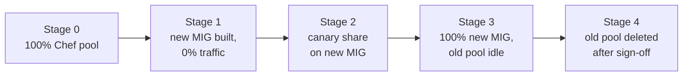

This runbook moves a Chef-managed VM estate to immutable images: a machine image is built once (Packer), deployed by Terraform as an instance template and a managed instance group (MIG), and never changed in place. It is for senior DevOps engineers who run a fleet that converges with Chef today and migrate one service at a time (strangler fig). Host hardening and InSpec profiles are in [[patterns/linux-host-hardening-with-chef-and-inspec]]; Terraform layout is in [[patterns/terraform-module-and-state-layout]].

> [!info] Scope and sources
> Written for GCP (Compute Engine), Packer with the googlecompute builder, Terraform with the Google provider, and Chef Infra with InSpec for verification. Based on the Packer, Terraform Google provider, Chef and InSpec documentation, and the Google Cloud documentation for instance templates and managed instance groups.

> [!note] Not verified
> The claims below were written from documentation knowledge and were not checked against a running system or the current docs: the Chef Infra licensing and support lifecycle, whether the Packer Chef provisioners are available and what they are called in your Packer version, the googlecompute builder field names, the `knife` output shape on your server version and the regional MIG surge rule. Check them before relying on them.

## When to use

- The estate has VMs that drift because Chef runs fail silently, or because people change nodes by hand.
- Scale-out is slow because a new node converges for tens of minutes.
- You want the same artifact in test and production, and a rollback that is a traffic switch.
- Chef Infra's licensing or support terms no longer fit your organisation. Check the current terms before using that as a reason.

Keep Chef for a service when it is a long-lived stateful host that cannot be rebuilt cheaply (a primary database VM, a licensed appliance), when it has fewer than a few nodes and no scaling need, or when the team has no capacity for the move. A half-migrated estate with two systems is worse than one stable system. Where possible, prefer containers on GKE for stateless services and use baked VMs for what cannot be containerised.

## Preconditions

- An inventory owner per service, and a named person who can sign off each cutover.
- A load balancer or DNS name in front of each service, so traffic can move between pools. Services reached by node IP need that fixed first.
- Spare quota and budget to run old and new pools side by side for the whole migration window.
- A Terraform project, state backend and CI that can create instance templates and MIGs, see [[patterns/terraform-module-and-state-layout]].
- A test project or environment where new images can run before production.
- The Chef server credentials and a read-only `knife` configuration for the census.
- A change record per cutover, see [[standards/production-change-checklist]].

## Steps



### 1. Census nodes and cookbooks

Know what you have before you choose. The census gives you nodes per platform and environment, stale nodes to delete, and which cookbooks and recipes are in use.

```bash
set -euo pipefail

OUT_DIR="census"          # change: where to write the census files
STALE_DAYS=7              # change: nodes silent for longer than this count as stale
KNIFE_CONFIG="$HOME/.chef/config.rb"  # change: your read-only knife config

mkdir -p "$OUT_DIR"

# One row per node with the attributes that drive the classification.
knife search node '*:*' -c "$KNIFE_CONFIG" -F json \
  -a platform -a platform_version -a chef_environment -a roles -a recipes -a ohai_time \
  > "$OUT_DIR/nodes.json"

# Summary: how many nodes per platform, version and environment.
jq -r '.rows[] | to_entries[] |
  [.value.platform, .value.platform_version, .value.chef_environment] | @tsv' \
  "$OUT_DIR/nodes.json" | sort | uniq -c | sort -rn

# Stale nodes: no Chef run for STALE_DAYS days (candidates for deletion, not migration).
CUTOFF="$(date -d "${STALE_DAYS} days ago" +%s)"
jq -r --argjson cutoff "$CUTOFF" '.rows[] | to_entries[] |
  select((.value.ohai_time // 0) < $cutoff) | .key' "$OUT_DIR/nodes.json" \
  > "$OUT_DIR/stale-nodes.txt"

# Roles and cookbooks defined on the server.
knife role list -c "$KNIFE_CONFIG" > "$OUT_DIR/roles.txt"
knife cookbook list -c "$KNIFE_CONFIG" > "$OUT_DIR/cookbooks.txt"
```

`date -d` is GNU date. On macOS use `gdate` from coreutils. Confirm the JSON shape of `knife search ... -a` on your server version before trusting the `jq` filters.

Record per service: owner, node count, run list, cookbooks, data bags it reads, ports and dependencies, state on disk, and how it is reached. Keep this as a table in the migration ticket.

### 2. Classify services

Decide per service, using the census:

| Class               | Fits                                                              | Target                                                |
| ------------------- | ----------------------------------------------------------------- | ----------------------------------------------------- |
| Container candidate | Stateless, already has or can get a Dockerfile, 12-factor config  | GKE Deployment, see [[patterns/dockerfile-hardening]] |
| Baked VM            | Needs the OS (agents, kernel settings, licensed software)         | Packer image, instance template, MIG                  |
| Keep                | Stateful, tiny, scheduled for retirement, or too risky to rebuild | Stays on Chef, with an owner and an end date          |

Move container candidates first. They shrink the estate with the least new machinery.

### 3. Bake an image that runs the existing cookbook once

Reuse the cookbook in the first version. Run it once at build time instead of on every node forever. This changes where convergence happens without rewriting logic.

```hcl title="packer/web.pkr.hcl"
packer {
  required_plugins {
    googlecompute = {
      source  = "github.com/hashicorp/googlecompute"
      version = ">= 1.1.0" # change: pin the plugin version you have tested
    }
  }
}

variable "project_id" {
  type    = string
  default = "my-project" # change: the project where images are built and stored
}

variable "zone" {
  type    = string
  default = "europe-west1-b" # change: any zone in your region
}

variable "image_version" {
  type = string # example: 2026-10-17-1, set by CI
}

source "googlecompute" "web" {
  project_id          = var.project_id
  zone                = var.zone
  source_image_family = "debian-12" # change: your base OS family, pin a dated image for reproducible builds
  ssh_username        = "packer"
  machine_type        = "e2-standard-2"
  subnetwork          = "build-subnet" # change: a subnet with Cloud NAT or private access
  omit_external_ip    = true
  use_internal_ip     = true
  image_name          = "web-${var.image_version}"
  image_family        = "web"
  image_labels = {
    service = "web"
    managed = "packer"
  }
}

build {
  sources = ["source.googlecompute.web"]

  # Provisioner name and arguments: check the Packer documentation for the Chef
  # provisioner available in your Packer version, or replace this block with a
  # shell provisioner that runs chef-client in local mode.
  provisioner "chef-solo" {
    cookbook_paths = ["cookbooks"]
    run_list       = ["recipe[web::default]"]
  }

  # The image must not carry a node identity or a Chef server key.
  provisioner "shell" {
    inline = [
      "sudo rm -f /etc/chef/client.pem /etc/chef/client.rb /etc/chef/first-boot.json",
      "sudo rm -rf /var/chef /etc/chef/trusted_certs",
      "sudo cloud-init clean --logs || true",
    ]
  }
}
```

Name images with a version and keep a family (`web`) for convenience, but deploy by exact image name so a deployment is reproducible and a rollback is a variable change. Delete the node identity: an image that boots with a copy of `client.pem` registers as the node it was baked from.

Build in CI, not on laptops, and keep the pipeline's service account scoped to creating images in the image project.

### 4. Deploy with an instance template and MIG

```hcl title="terraform/web/main.tf"
variable "project_id" {
  type    = string
  default = "my-project" # change: the project that runs the service
}

variable "region" {
  type    = string
  default = "europe-west1" # change: your region
}

variable "image_name" {
  type        = string
  description = "Exact image name built by Packer, for example web-2026-10-17-1."
}

variable "subnetwork" {
  type        = string
  description = "Self link of the subnet for the instances."
}

variable "service_account_email" {
  type        = string
  description = "Dedicated service account for this service, with only the roles it needs."
}

data "google_compute_image" "web" {
  project = var.project_id
  name    = var.image_name
}

resource "google_compute_instance_template" "web" {
  project        = var.project_id
  name_prefix    = "web-"
  machine_type   = "e2-standard-2"
  region         = var.region
  tags           = ["web"]
  can_ip_forward = false

  disk {
    source_image = data.google_compute_image.web.self_link
    boot         = true
    auto_delete  = true
    disk_type    = "pd-balanced"
    disk_size_gb = 30
  }

  # No access_config block, so no external IP.
  network_interface {
    subnetwork = var.subnetwork
  }

  shielded_instance_config {
    enable_secure_boot          = true
    enable_vtpm                 = true
    enable_integrity_monitoring = true
  }

  service_account {
    email  = var.service_account_email
    scopes = ["cloud-platform"] # access is limited by the service account's IAM roles
  }

  metadata = {
    enable-oslogin         = "TRUE"
    block-project-ssh-keys = "TRUE"
  }

  lifecycle {
    create_before_destroy = true
  }
}

resource "google_compute_health_check" "web" {
  project             = var.project_id
  name                = "web-http"
  check_interval_sec  = 10
  timeout_sec         = 5
  healthy_threshold   = 2
  unhealthy_threshold = 3

  http_health_check {
    port         = 8080
    request_path = "/healthz"
  }
}

resource "google_compute_region_instance_group_manager" "web" {
  project            = var.project_id
  name               = "web"
  region             = var.region
  base_instance_name = "web"
  target_size        = 3

  version {
    instance_template = google_compute_instance_template.web.self_link_unique
  }

  named_port {
    name = "http"
    port = 8080
  }

  auto_healing_policies {
    health_check      = google_compute_health_check.web.id
    initial_delay_sec = 120
  }

  update_policy {
    type                  = "PROACTIVE"
    minimal_action        = "REPLACE"
    replacement_method    = "SUBSTITUTE"
    max_surge_fixed       = 3 # regional MIGs may require a surge of at least the zone count, check the docs
    max_unavailable_fixed = 0
  }
}
```

A new image means a new `image_name`, which means a new template, which means a rolling replacement with no instance down (`max_unavailable_fixed = 0`). Apply to a test project first, through the normal plan review. The firewall rule that lets the health checker reach port 8080 is part of the same change.

### 5. Shift traffic and retire nodes

Attach the new MIG as a second backend of the existing load balancer, with the old pool still serving. Shift a canary share first, then raise it in steps, watching error rate and latency at each step. Use the capacity or weighting mechanism your load balancer type supports; check which one that is in the Google Cloud documentation, because it differs by load balancer.

```bash
set -euo pipefail

PROJECT_ID="my-project"        # change: your project ID
REGION="europe-west1"          # change: your region
BACKEND_SERVICE="web-backend"  # change: the backend service behind the load balancer

gcloud compute backend-services get-health "$BACKEND_SERVICE" \
  --project "$PROJECT_ID" --global
gcloud compute instance-groups managed list-instances web \
  --project "$PROJECT_ID" --region "$REGION"
```

Move to the next share only after a soak period that covers a full traffic cycle (a day for a daily peak). When the new MIG serves everything and the old pool has been idle for the agreed period, stop and remove old nodes in two steps: stop the instances first, and delete them only after sign-off.

When deleting, remove the node and client objects from the Chef server so they do not appear as stale nodes:

```bash
set -euo pipefail

NODE_NAME="web-old-01"  # change: the retired node

knife node delete "$NODE_NAME" -y
knife client delete "$NODE_NAME" -y
```

### 6. Move secrets from data bags to Secret Manager

Cookbooks often read secrets from encrypted data bags. In the new world the secret lives in Secret Manager and the instance reads it at boot with its service account. For Kubernetes workloads see [[patterns/external-secrets-with-secret-manager]].

```bash
set -euo pipefail

PROJECT_ID="my-project"                   # change: your project ID
SECRET_NAME="web-db-password"             # change: the Secret Manager secret to create
DATA_BAG="secrets"                        # change: data bag name
DATA_BAG_ITEM="web"                       # change: data bag item name
SECRET_FILE="/secure/path/encrypted_data_bag_secret"  # change: path to the data bag key, outside the repo
SERVICE_ACCOUNT="web-sa@my-project.iam.gserviceaccount.com"  # change: the service account that reads it

gcloud secrets create "$SECRET_NAME" --project "$PROJECT_ID" --replication-policy=automatic

# The value goes through a pipe, never through arguments, files or shell history.
knife data bag show "$DATA_BAG" "$DATA_BAG_ITEM" -F json --secret-file "$SECRET_FILE" \
  | jq -j '.db_password' \
  | gcloud secrets versions add "$SECRET_NAME" --project "$PROJECT_ID" --data-file=-

gcloud secrets add-iam-policy-binding "$SECRET_NAME" --project "$PROJECT_ID" \
  --member "serviceAccount:${SERVICE_ACCOUNT}" \
  --role roles/secretmanager.secretAccessor
```

A secret that lived in the Chef server was readable by every admin and every node that could decrypt the bag. Treat it as exposed: rotate it after the move, following [[runbooks/leaked-credential-rotation]]. The startup script or application then reads it at boot with `gcloud secrets versions access latest --secret=web-db-password`.

### 7. Remove the cookbook from convergence

For each migrated service:

1. Confirm no node in the Chef server still has the service's run list (`knife search node 'roles:web'`).
2. Remove the role and its environment constraints from the repository, and tag the last commit that contained the cookbook so you can find it.
3. Keep cookbooks that Chef-managed services still use. Delete the rest after the last service is migrated.
4. Keep InSpec: the same profile that verified the Chef nodes now verifies the baked image in CI, see [[patterns/linux-host-hardening-with-chef-and-inspec]].
5. Update the runbooks and on-call docs to say "rebuild and replace" instead of "converge".

When the last node leaves, decommission the Chef server and its backups according to your retention rules.

## Validation

Verify the image before it takes traffic, and again at each traffic step.

```bash
set -euo pipefail

TARGET_HOST="10.0.0.12"                       # change: internal IP of a test instance built from the new image
SSH_USER="inspecuser"                         # change: a user allowed to log in (OS Login or your bastion)
SSH_KEY="$HOME/.ssh/inspec_ed25519"           # change: the private key for that user
PROFILE_DIR="profiles/web-baseline"           # change: your InSpec profile

mkdir -p reports
inspec exec "$PROFILE_DIR" \
  -t "ssh://${SSH_USER}@${TARGET_HOST}" -i "$SSH_KEY" --sudo \
  --reporter cli json:reports/web-baseline.json
```

Expected: the CLI reporter ends with a summary such as `Profile Summary: N successful controls, 0 control failures, 0 controls skipped`. Reach a private instance through an IAP tunnel or a bastion, not a public IP.

Also check:

- `gcloud compute instance-groups managed list-instances web --region <region>` shows every instance `RUNNING` with `HEALTHY` autohealing status.
- `gcloud compute backend-services get-health <backend> --global` shows the new instances `HEALTHY`.
- Error rate, latency and saturation on the new pool match the old pool during the soak period.
- A reboot of one instance returns it to service without manual steps, and a replaced instance does not register in the Chef server.

## Rollback

Until sign-off, the old pool stays running and registered. Rolling back is a traffic change:

1. Return the backend weights or capacity to 100% on the old pool. This takes effect as soon as the load balancer config propagates.
2. Leave the new MIG running at zero traffic for investigation, or scale it down.
3. If the problem is the image, set `image_name` back to the last good image and apply. The MIG replaces instances with the previous template.

After sign-off and deletion of the old pool, a rollback means rebuilding it from the tagged cookbook commit and a Chef run, which is slow. That is why the old pool is stopped before it is deleted, and why deletion needs a sign-off in the change record. Deleting secrets from data bags is not undoable at all: export them to Secret Manager first.

## Troubleshooting

| Symptom                                                  | Cause                                                            | Fix                                                                                         |
| -------------------------------------------------------- | ---------------------------------------------------------------- | ------------------------------------------------------------------------------------------- |
| Packer build hangs at SSH                                | Build subnet has no route or firewall rule for the builder       | Allow SSH from the IAP range or the CI runner, use `use_internal_ip` with Cloud NAT         |
| Packer cannot find the Chef provisioner                  | Provisioner name or availability differs by Packer version       | Check the Packer docs, or run `chef-client --local-mode` from a shell provisioner           |
| Booted instance appears in the Chef server as a new node | `client.pem` or `client.rb` left in the image                    | Remove them in the image build and rebuild                                                  |
| Instances restart in a loop in the MIG                   | Health check fails, so autohealing replaces them                 | Check the firewall rule for health check ranges, the path and port, and `initial_delay_sec` |
| Rolling update stalls                                    | Surge or unavailable limits cannot be met, or quota is exhausted | Check `update_policy` values and quota, then retry                                          |
| Service works on old nodes but not on the image          | Cookbook relied on a data bag, search result or node attribute   | Find the dependency in the census, move the value to image config or Secret Manager         |
| New instance cannot read the secret                      | Service account lacks `secretAccessor` on that secret            | Grant the role on the secret, not the project                                               |
| Terraform wants to recreate the template on every plan   | Image looked up by family, so the resolved image changes         | Look up by exact `image_name`                                                               |

## Related

- [[patterns/linux-host-hardening-with-chef-and-inspec]]: the hardening and InSpec profiles that verify the baked image.
- [[patterns/terraform-module-and-state-layout]]: where the template and MIG code lives and how it is applied.
- [[patterns/external-secrets-with-secret-manager]]: the Kubernetes side of moving secrets to Secret Manager.
- [[runbooks/leaked-credential-rotation]]: rotate secrets that lived in data bags after the move.
- [[standards/production-change-checklist]]: the checklist for each cutover step.
- [[tools/terraform-vs-opentofu]]: engine choice for the Terraform code in this migration.
