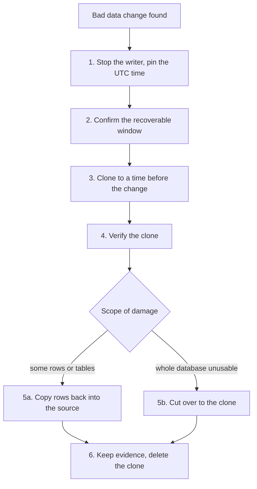

How to recover from logical damage in a Cloud SQL for PostgreSQL database: a migration that dropped a column, an `UPDATE` without a `WHERE`, a job that deleted the wrong customer's rows. High availability does not help here, because the standby replicates the bad write within moments. Point-in-time recovery (PITR) does: Cloud SQL creates a **new instance**, a clone, from the source's backups and write-ahead log, as it was at a timestamp you choose. You then copy the good rows back into production, or, in the worst case, move production onto the clone.

The safe shape of this procedure is that the source instance is never overwritten. Everything happens on a clone until you decide, with evidence, what to change in production.

> [!info] Scope and verification
> The commands were not run against a live instance and the note is not marked `verified`. The clone and PITR flags, the retention values and the API fields were checked against the `gcloud` help (SDK 570.0.0), the Cloud SQL Admin API reference and the Terraform provider documentation sources on 2026-10-21. No Cloud SQL documentation page could be read. What a clone copies, permission names, timing and error messages are marked **not verified**; check the current Cloud SQL PITR documentation for your edition before relying on them.

## When to use

- Data is wrong or missing because of a write, not because the database is down.
- The damage has a known or findable start time.
- A restore from the last automated backup would lose too much: you need a point between backups.

If the instance is unreachable or failing over, that is an availability incident: see [[cloud-sql-ha-failover-recovery]]. If the damage came from a schema migration, also read [[postgres-expand-contract-migrations]] for how to avoid the next one.

## Preconditions

- **PITR was enabled before the damage.** It cannot be turned on retroactively for the past. Check it in step 2.
- **An incident is declared,** with an incident lead and a scribe; see [[incident-response]]. Data recovery decisions (which rows, which time, whether to cut over) need an accountable owner and a record.
- **Permissions:** to clone the instance and create a new one (Cloud SQL Admin, or a narrower custom role that includes the clone permission; the exact permission name is **not verified**), and database credentials that can read the affected tables on both instances and write them on the source.
- **Budget and quota** for a second instance of the same size for a few hours.
- A tested restore procedure. If restores are drilled as in [[0051-backups-proven-by-quarterly-restore-drills]], this runbook is the drill; follow it as rehearsed.

```bash title="variables"
PROJECT=example-project
REGION=europe-west1
SOURCE=prod-db
CLONE=prod-db-pitr-$(date -u +%Y%m%d%H%M)
DB=app
gcloud config set project "$PROJECT"
```

## Steps



### 1. Stop the damage and pin the timestamp

First stop whatever is still writing bad data: pause the job, scale the faulty service to zero, disable the cron, or revoke the role it uses. Damage that keeps growing during the recovery makes every later step harder.

```bash
kubectl -n app scale deploy/billing-sync --replicas=0      # example: the job that did the damage
kubectl -n app get cronjob -o name | xargs -r -n1 kubectl -n app patch --type=merge -p '{"spec":{"suspend":true}}'
```

Suspending every CronJob in the namespace is a blunt example; suspend only the ones that touch the damaged data, and write down what you suspended so you can resume exactly those.

Then find **when** the bad change committed, in UTC. Sources, best first:

- The migration or deploy log with its start and end time (CI job log, Argo CD sync history).
- PostgreSQL logs in Cloud Logging, if statement logging or an audit extension was on.
- Application logs or audit trails that show the first wrong result.
- `updated_at` style columns on the damaged rows, read from production.

```bash
gcloud logging read \
  "resource.type=\"cloudsql_database\" AND resource.labels.database_id=\"$PROJECT:$SOURCE\" AND timestamp>=\"2026-10-21T09:00:00Z\" AND timestamp<=\"2026-10-21T10:00:00Z\"" \
  --limit=200 --order=asc --format="value(timestamp,textPayload)" | grep -Ei 'drop|delete|update|truncate|alter' | head -50
```

The label format in the filter (`project:instance`) was not checked here; if the query returns nothing, copy the resource labels from a real entry in Logs Explorer.

Pick a target time **before** the bad transaction committed, with a margin of a few seconds, and write it down in RFC 3339 UTC, for example `2026-10-21T09:41:30.000Z`. Every transaction committed after the target time is missing from the clone, including good ones; that is fine, because you will copy back only the damaged rows (step 5a).

### 2. Confirm PITR is on and the time is inside the window

```bash
gcloud sql instances describe "$SOURCE" \
  --format="yaml(databaseVersion,settings.edition,settings.availabilityType,settings.backupConfiguration)"

gcloud sql instances get-latest-recovery-time "$SOURCE"
```

Check:

- `settings.backupConfiguration.enabled` and `pointInTimeRecoveryEnabled` are `true`.
- `transactionLogRetentionDays` covers your target time. Per the `gcloud` help (SDK 570.0.0) the allowed range is 1 to 35 days: for Enterprise edition the default and maximum are 7, for Enterprise Plus the default is 14 and the maximum 35. Other references still say 1 to 7 for some editions, so check the current limits for yours.
- `transactionalLogStorageState` shows where the logs are kept (`DISK` or `CLOUD_STORAGE`).
- The recovery time response: the API reference documents both `latestRecoveryTime` and `earliestRecoveryTime`. Your target must fall between them. The exact output of the `gcloud` command was not run here; if it shows only the latest time, use the retention days as a guide to the earliest.

If PITR was off, or the target is older than the retained logs, PITR cannot help. The fallback is a restore of the last automated or on-demand backup **to a new instance**, then the same row copy as step 5a, accepting more data loss. See [[backup-architecture-gke-cloud-sql-gcs]].

### 3. Clone to the target time, never over the source

```bash
TARGET='2026-10-21T09:41:30.000Z'

gcloud sql instances clone "$SOURCE" "$CLONE" --point-in-time "$TARGET" --async
gcloud sql operations list --instance "$CLONE" --limit 5 \
  --format="table(name,operationType,status,startTime,endTime,error)"
```

Per the `gcloud` help, the clone is an independent copy of the source with the same data and settings, in the same project. Other flags you may need:

- `--preferred-zone` (and `--preferred-secondary-zone` for a regional clone) to place it.
- `--restore-database-name` restores only one database into the clone. The help lists it with `--point-in-time` without an engine restriction; whether it applies to PostgreSQL in your version is **not verified**, so test before relying on it.

> [!warning] Clone safely
> Use a new instance name for the destination. The API reference warns that a clone operation might cause the instance to restart; check the current documentation for when that applies to the source, and do this during the incident with the incident lead aware. There is no in-place PITR for ordinary Cloud SQL for PostgreSQL instances in the API reference (the separate `point-in-time-restore` command is only for instances managed by the Backup and DR service); do not use `gcloud sql backups restore` against the production instance to "go back in time", because it overwrites the target with a backup.

How long a clone takes depends on database size and the length of log to replay; there is no figure here. Track it with the operations list and plan communications accordingly.

### 4. Verify the clone before you touch production

Connect to the clone, for example through the Cloud SQL Auth Proxy (v2 syntax) on a separate local port, from a workstation or bastion that is allowed to reach it:

```bash
CLONE_CONN=$(gcloud sql instances describe "$CLONE" --format="value(connectionName)")
SOURCE_CONN=$(gcloud sql instances describe "$SOURCE" --format="value(connectionName)")
cloud-sql-proxy --port 6543 "$CLONE_CONN" &
cloud-sql-proxy --port 6544 "$SOURCE_CONN" &
```

Then compare the damaged data on both sides. Counts and a checksum over the affected rows, ordered by primary key:

```sql title="verify.sql"
-- Run on the clone (port 6543) and on the source (port 6544), compare the output
SELECT count(*) AS rows,
       md5(string_agg(t::text, '|' ORDER BY t.id)) AS checksum
FROM public.invoices AS t
WHERE t.customer_id = 4711;

-- Spot check the newest rows that should exist at the target time
SELECT id, status, updated_at
FROM public.invoices
WHERE customer_id = 4711
ORDER BY updated_at DESC
LIMIT 20;
```

```bash
psql "host=127.0.0.1 port=6543 dbname=$DB user=recovery_ro sslmode=disable" -f verify.sql
psql "host=127.0.0.1 port=6544 dbname=$DB user=recovery_ro sslmode=disable" -f verify.sql
```

`sslmode=disable` applies only to the local hop to the proxy, which encrypts the connection to Cloud SQL. The clone should show the data as it was before the change: rows present that were deleted, old values where the bad update overwrote them. If the clone already contains the damage, the target time is too late; pick an earlier one and clone again (with a new name).

Also compare the instance settings, because what a clone copies (flags, users, network, HA, maintenance window, backup and PITR settings, labels) is **not verified**:

```bash
diff <(gcloud sql instances describe "$SOURCE" --format="yaml(settings,databaseVersion,ipAddresses)") \
     <(gcloud sql instances describe "$CLONE"  --format="yaml(settings,databaseVersion,ipAddresses)")
```

### 5a. Repair: copy the affected rows back (preferred)

This keeps every good write that happened after the target time and replaces only the damaged rows. Export from the clone, load into a staging schema on the source, then merge in one reviewed transaction.

```bash
# 1. Export the good rows from the clone
psql "host=127.0.0.1 port=6543 dbname=$DB user=recovery_ro sslmode=disable" \
  -c "\copy (SELECT id, customer_id, status, amount_cents, updated_at FROM public.invoices WHERE customer_id = 4711) TO 'invoices_4711.csv' CSV HEADER"

# 2. Keep a copy of the current (damaged) rows from the source as evidence
psql "host=127.0.0.1 port=6544 dbname=$DB user=recovery_ro sslmode=disable" \
  -c "\copy (SELECT * FROM public.invoices WHERE customer_id = 4711) TO 'invoices_4711_damaged.csv' CSV HEADER"
```

```sql title="merge.sql"
-- Run on the source as a role that can write the table
BEGIN;

CREATE SCHEMA IF NOT EXISTS recovery;
CREATE TABLE recovery.invoices_4711 (LIKE public.invoices INCLUDING DEFAULTS);

\copy recovery.invoices_4711 (id, customer_id, status, amount_cents, updated_at) FROM 'invoices_4711.csv' CSV HEADER

-- Restore deleted rows and revert overwritten ones; rows changed legitimately after the
-- target time are left alone by the WHERE clause on the update branch.
INSERT INTO public.invoices AS p (id, customer_id, status, amount_cents, updated_at)
SELECT id, customer_id, status, amount_cents, updated_at
FROM recovery.invoices_4711
ON CONFLICT (id) DO UPDATE
  SET status       = EXCLUDED.status,
      amount_cents = EXCLUDED.amount_cents,
      updated_at   = EXCLUDED.updated_at
  WHERE p.updated_at <= '2026-10-21T09:45:00Z';   -- end of the damage window, from step 1

SELECT count(*) FROM public.invoices WHERE customer_id = 4711;
-- Check the result, then COMMIT; or ROLLBACK; if anything looks wrong
```

```bash
# Interactive session: run the file, review the output, then decide
psql "host=127.0.0.1 port=6544 dbname=$DB user=recovery_rw sslmode=disable" -v ON_ERROR_STOP=1
# at the psql prompt:
#   \i merge.sql
#   COMMIT;      -- or ROLLBACK;
```

Run it interactively on purpose: with `psql -f`, the open transaction would be rolled back when the file ends, and a script that commits by itself gives no chance to review. Adjust the column list, the conflict target and the `WHERE` rule to your schema; they are the part of this runbook that needs a second reviewer. Watch for triggers, foreign keys and sequences: restored rows with explicit IDs do not advance a sequence, so check `setval` if new rows will be inserted after them.

For whole tables, `pg_dump --data-only -t public.invoices` from the clone produces a data-only dump of that table (with `-t`, non-table objects are not dumped). Load it into a renamed staging table rather than over the live table, then merge as above.

### 5b. Alternative: cut over to the clone

Only when the damage is so wide that row repair is not practical (for example a dropped schema with many dependent objects). Every write to the source after the target time is lost unless you copy it forward, so this needs the incident lead's explicit decision.

1. Stop all writers to the source (step 1, for every service).
2. Bring the clone to production standard. Settings that may not have been copied, and must be checked from the diff in step 4: HA (`--availability-type=REGIONAL`), automated backups and PITR, deletion protection, maintenance window, database flags, private IP and authorized networks, read replicas (recreate them), IAM database users and their grants.

```bash
gcloud sql instances patch "$CLONE" --availability-type=REGIONAL
gcloud sql instances patch "$CLONE" --backup-start-time=02:00 --enable-point-in-time-recovery
gcloud sql instances patch "$CLONE" --deletion-protection
```

Enabling PITR on an existing instance restarts the database, per the Terraform provider documentation; do it before applications move. Prefer making these settings in Terraform: import the clone, or point the existing resource at it after review; see [[0027-cloud-sql-for-production-postgres]].

3. Point applications at the clone: change the instance connection name in the secret or config they use (see [[secrets-architecture-gcp-and-gke]]), roll them out, and check connection pools; see [[postgres-connection-pooling-gke]].
4. Keep the old source instance, stopped from writes but **not deleted**, until the recovery is accepted.

### 6. Keep the evidence, then clean up

- Keep the CSV exports, the merge script, the counts and the checksums in the incident record (in restricted storage if the data is personal or sensitive).
- Drop the staging schema on the source once the repair is accepted: `DROP SCHEMA recovery CASCADE;`
- Delete the clone when it is no longer needed; it is a full instance and costs money until deleted:

```bash
gcloud sql instances describe "$CLONE" --format="value(settings.deletionProtectionEnabled)"
gcloud sql instances delete "$CLONE"
```

If the clone inherited deletion protection, turn it off with `gcloud sql instances patch "$CLONE" --no-deletion-protection` first. Feed the timings (time to detect, time to clone, time to repair) into [[disaster-recovery-tiers-rpo-rto]], and the root cause into the postmortem.

## Validation

- The checksum query from step 4, run on the source after the repair, matches the clone for the restored rows (or differs only where legitimate later writes are expected and explained).
- Application checks pass for the affected customers or entities, ideally confirmed by the business owner.
- Writers that were stopped in step 1 are resumed, and their first runs do not repeat the damage.
- After a cut-over (5b): `gcloud sql instances describe "$CLONE"` shows `REGIONAL`, backups and PITR enabled, deletion protection on; replicas exist; applications connect only to the new instance.
- An on-demand backup of the repaired instance exists: `gcloud sql backups create --instance "$SOURCE"` (or the clone after a cut-over).

## Rollback

- **Before 5a or 5b:** nothing in production has changed; delete the clone if you abandon the attempt.
- **Row repair (5a):** the merge runs in one transaction; `ROLLBACK` before commit undoes it. After commit, reload the damaged-state export taken in 5a the same way to revert, or repeat the repair with corrected rules.
- **Cut-over (5b):** point applications back at the original source, which was kept unchanged. Writes that went to the clone in the meantime must then be copied back, so decide quickly.

## Troubleshooting

| Symptom                                                    | Likely cause and fix                                                                                                                             |
| ---------------------------------------------------------- | ------------------------------------------------------------------------------------------------------------------------------------------------ |
| Clone fails immediately, error about PITR or logs           | PITR off on the source, or the target time is outside the retained window. Check step 2; fall back to a backup restore to a new instance.      |
| Clone fails on the timestamp format                         | Use RFC 3339 in UTC with a trailing `Z`, quoted, as in the `gcloud` help example.                                                              |
| Clone still contains the damage                             | Target time too late, or the bad transaction committed earlier than logged. Clone again to an earlier time with a new name.                   |
| Clone takes a long time                                     | Large database or a long log replay. Nothing to tune mid-operation; communicate the expected wait and track the operation.                     |
| Destination name rejected                                   | The name is in use, or was used recently by a deleted instance (reuse rules **not verified**). Choose another name.                           |
| Cannot log in to the clone with IAM database authentication | IAM users and their grants may not behave as on the source; use a built-in recovery user, and check the docs for IAM users on clones.          |
| Extension functions missing or failing on the clone         | Check `SELECT * FROM pg_extension;` on both; extensions and flags may differ. Compare settings from step 4.                                   |
| Merge fails on a foreign key or unique constraint           | Restore parent rows first, or include them in the export; check the conflict target matches the real unique key.                               |
| New inserts fail with duplicate keys after the repair       | Sequence behind restored IDs. `SELECT setval('public.invoices_id_seq', (SELECT max(id) FROM public.invoices));`                                  |

## Related

- [[cloud-sql-ha-failover-recovery]] for availability incidents, where PITR is the wrong tool.
- [[backup-architecture-gke-cloud-sql-gcs]] for how backups, PITR and exports fit together.
- [[0027-cloud-sql-for-production-postgres]] and [[0051-backups-proven-by-quarterly-restore-drills]] for the decisions this runbook supports.
- [[postgres-expand-contract-migrations]] for migrations that do not need this runbook.
- [[postgres-connection-pooling-gke]] for reconnecting applications after a cut-over.
- [[disaster-recovery-tiers-rpo-rto]] for the recovery objectives the drill measures.
- [[incident-response]] for running the incident around it.
- [[gcp-vpc-compute-and-cloud-sql]] for the networking of Cloud SQL instances.

## Sources

- `gcloud` built-in help, SDK 570.0.0, 2026-10-21: `sql instances clone` (`--point-in-time`, RFC 3339 UTC, same project, `--restore-database-name`), `sql instances patch` (`--enable-point-in-time-recovery`, `--retained-transaction-log-days` with edition defaults and maximums), `sql instances get-latest-recovery-time`, `sql backups restore`, `sql operations`.
- Cloud SQL Admin API reference (discovery document), 2026-10-21: `instances.clone` restart warning, `getLatestRecoveryTime` with `earliestRecoveryTime`, `transactionalLogStorageState`, `pointInTimeRestore` scope, `settings.edition`.
- [Terraform google provider: google_sql_database_instance](https://registry.terraform.io/providers/hashicorp/google/latest/docs/resources/sql_database_instance): `point_in_time_recovery_enabled` restart note and defaults, `deletion_protection` versus `deletion_protection_enabled` (read from the provider source).
- [PostgreSQL: pg_dump](https://www.postgresql.org/docs/current/app-pgdump.html) and [INSERT, ON CONFLICT](https://www.postgresql.org/docs/current/sql-insert.html), read from the PostgreSQL reference sources on 2026-10-21.
- See also, not read for this note: [Cloud SQL for PostgreSQL: Use point-in-time recovery](https://cloud.google.com/sql/docs/postgres/backup-recovery/pitr) and [Cloning instances](https://cloud.google.com/sql/docs/postgres/clone-instance).
