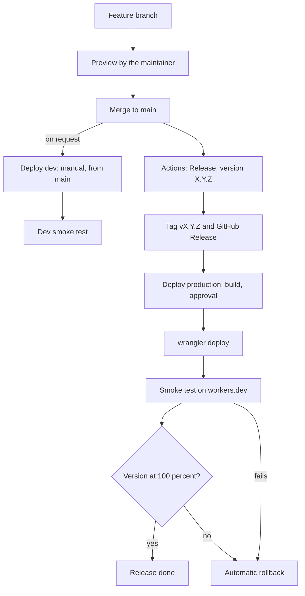

How this site reaches Cloudflare and how to undo a bad release. Production is the Worker `notes` at https://notes.szolotov.com; dev is a Worker Preview named `dev`[^preview] of the same Worker at https://dev.notes.szolotov.com. Dev is the pre-production site and is deployed by hand from `main`; there is no stage.

> [!info] Checked against
> `wrangler.jsonc`, `.github/workflows/{deploy-dev,deploy-production,release}.yml`, `scripts/smoke-test.sh`, `scripts/write-version.mjs` and `docs/deployment.md` in the repository, and the Wrangler 4.149.0 CLI help (`npx wrangler rollback --help`). Cloudflare docs: [Rollbacks](https://developers.cloudflare.com/workers/versions-and-deployments/rollbacks/), [Wrangler commands for Workers](https://developers.cloudflare.com/workers/wrangler/commands/workers/) (`deployments`, `versions`, `preview`) and [Previews on custom domains](https://developers.cloudflare.com/workers/previews/custom-domains/). Worker Previews are in open beta, so flags may change.

## When to use

- Cutting a release to production.
- Production serves the wrong or a broken version and you need to undo it.
- Checking which version is live on production or dev.
- A deploy run failed and you need to know whether the site is affected.

Day-to-day publishing of notes needs none of this: merging to `main` deploys nothing, and **Deploy dev** is run only when the owner asks for it.

## Preconditions

- Write access to the repository and, for production, approval rights on the `production` GitHub environment.
- CI is green on the `main` commit you want to release. The Release workflow refuses a commit without a successful `ci.yml` push run.[^ci]
- For manual Cloudflare commands: Node.js from `.nvmrc`, `npm ci` done, and `CLOUDFLARE_API_TOKEN` and `CLOUDFLARE_ACCOUNT_ID` exported for the account that owns the Worker.

## The release path



## Steps

### Release to production

1. Check that CI on the `main` head is green and, if you want the pre-production check, that dev serves that commit (run **Deploy dev** first if it does not):

   ```bash
   curl -s https://dev.notes.szolotov.com/version.txt   # main+<40-char sha>
   ```

2. In GitHub, open **Actions**, **Release**, **Run workflow** on `main`, and enter the version as `X.Y.Z` (no leading `v`, strictly greater than the latest tag).
3. The workflow validates the version, requires the green CI run, creates the annotated tag `vX.Y.Z` and the GitHub Release, then calls **Deploy production**.
4. Approve the deployment to the `production` environment when the run waits. The build is cold and takes about 15 minutes.

What **Deploy production** does after approval, and therefore verifies:

1. Records the live version id (`wrangler deployments status --json`) for the automatic rollback.
2. Runs `wrangler deploy`, which also applies the routes, including the Custom Domain `notes.szolotov.com`.
3. Smoke-tests the **workers.dev** URL with `scripts/smoke-test.sh`: `/version.txt` equals `X.Y.Z+<sha>`, content and security headers, `noindex` on workers.dev, `robots.txt`.
4. Requires `wrangler deployments status` to show exactly the new version at 100%.
5. On any failure, or on cancellation, rolls back to the version recorded in step 1.

> [!note] Why workers.dev
> Cloudflare Bot Fight Mode answers GitHub-hosted runners with 403 on the custom domains, so CI verifies on workers.dev and only logs a notice for notes.szolotov.com.

### Dev

**Deploy dev** is manual and runs only from `main`: **Actions**, **Deploy dev**, **Run workflow**, branch `main`, action `deploy`. It builds, then runs `wrangler preview --name dev`. Dev is a Preview of the same Worker, so it never touches production traffic. It may lag behind `main` by design, and `/version.txt` shows which commit it serves. If a newer commit has reached `main` during the run, the run skips with a notice and succeeds; run it again. Feature branches are not deployed anywhere: the maintainer shows them with screenshots or a video before the merge.

The old Preview `stage` is removed once with **Deploy dev**, action `remove-stage`.

## Validation

Check what is live on production and dev:[^version]

```bash
curl -s https://notes.szolotov.com/version.txt        # <X.Y.Z>+<40-char sha>
curl -s https://dev.notes.szolotov.com/version.txt  # main+<40-char sha>
curl -sI https://notes.szolotov.com | grep -i x-robots-tag   # no output: production is indexable
```

Check which deployment serves traffic (`deployments list` shows only the most recent ones; add `--json` for scripts):

```bash
npx wrangler deployments status
npx wrangler deployments list
```

`status` must show a single version at 100%. More than one version means a gradual deployment is active, and the automatic rollback is skipped.

## Rollback

> [!warning] A rollback is not in git
> It changes what Cloudflare serves, not `main` or the tags. The site then runs an older build while `main` has moved on, so follow up with a roll-forward.

Production only; dev has no rollback.

1. Find the version id to return to:

   ```bash
   npx wrangler deployments list
   npx wrangler versions list
   ```

2. Roll back, giving a reason (`--yes` skips the prompt; without a version id Wrangler picks the version uploaded before the latest one):

   ```bash
   VERSION_ID="<version-id>"
   npx wrangler rollback "${VERSION_ID}" --message "Roll back vX.Y.Z: <reason>" --yes
   ```

   The rollback creates a new deployment and takes effect on all routes and domains at once. The dashboard offers the same under the Worker, **Deployments**, **Rollback**.

3. Validate with `curl -s https://notes.szolotov.com/version.txt` and `npx wrangler deployments status`.

Only the 100 most recently published versions can be rolled back to. Rollback is also refused when a Durable Object class changed since that version, or when the target version binds an R2 bucket, KV namespace or queue that no longer exists; this Worker only has the `ASSETS` binding, so in practice the limit is the 100 versions. Rolling back from a gradual deployment replaces the split with the chosen version at 100%.

### Roll forward through the pipeline

To redeploy a tag, including an older good one: **Actions**, **Deploy production**, **Run workflow**, select the **tag** (for example `v0.1.0`) as the ref, and approve. This rebuilds the tag and deploys it with the same checks, and rolls back automatically if they fail. Production deploys refuse any ref that is not a `vX.Y.Z` tag, and the tagged commit must have a successful `ci.yml` push run on `main` and be on `main`, so a tag whose CI run is no longer available cannot be redeployed; use a rollback in that case. Pushing a `v*.*.*` tag by hand also starts **Deploy production**, but tags created by the Release workflow do not (they are deployed by the explicit call).

Dev recovers by merging a fix and running **Deploy dev** again. To remove the Preview: `npx wrangler preview delete --name dev`.

## Troubleshooting

| Symptom                                                                                | Cause and fix                                                                                                                                                                                                               |
| -------------------------------------------------------------------------------------- | --------------------------------------------------------------------------------------------------------------------------------------------------------------------------------------------------------------------------- |
| Cloudflare error 1042 right after a deploy that created a new workers.dev route        | The route is still propagating. The smoke test retries the version, content, header and indexing checks, so wait or re-run; this no longer fails a deploy or triggers a rollback.                                           |
| `curl` works locally but CI gets 403 on notes.szolotov.com or dev.notes.szolotov.com   | Bot Fight Mode blocks GitHub runners on the custom domains. Expected: CI verifies on workers.dev. Look up the `cf-ray` in Security, Events only if workers.dev fails too.                                                   |
| Dev smoke test notice, workers.dev URL of the Preview redirects to a Cloudflare login  | Cloudflare Access protects Worker Previews in this account. The dev smoke test passes with a notice; Wrangler reporting https://dev.notes.szolotov.com is the check. Production never accepts an Access redirect.           |
| Wrangler warns "Custom domain Preview URLs are configured, but none are active"        | Before the first production deploy, `previews_enabled` on the Custom Domain has not been applied yet. It is applied by `wrangler deploy` (the first release) or in the dashboard under Domains, **Production and Preview**. |
| Deploy dev fails at "Require the custom domain Preview URL"                            | The Preview exists only on workers.dev because `previews_enabled` has not been applied. Do the first production release or enable **Production and Preview** in the dashboard, then re-run.                                 |
| Deploy dev fails with "runs only from main"                                            | The run was started from another branch. Re-run it with branch `main` selected.                                                                                                                                             |
| Deploy dev run succeeds but dev still shows an older commit                            | The run skipped because a newer commit reached `main` during the build (see the notice). Run it again.                                                                                                                      |
| Deploy production fails in the tag guard ("Tag ... points at ...", not a `vX.Y.Z` ref) | The run was not started from a release tag, or the tag does not resolve to the commit being deployed. Re-run from the correct tag.                                                                                          |
| Deploy production waits and never starts                                               | The `production` environment needs approval; approve it in the run.                                                                                                                                                         |
| Release fails with "must be strictly greater than the latest tag"                      | Pick a higher `X.Y.Z`. Tags are never reused; if the failure came after the tag step, re-run only **Deploy production** from that tag.                                                                                      |
| Run failed, unsure whether production is affected                                      | Run `npx wrangler deployments status` and `curl -s https://notes.szolotov.com/version.txt`. The job log says either "rolled back", or "failed before it went live".                                                         |

The full setup, token permissions and removal of the old stage Preview are in `docs/deployment.md` in the repository. For how changes are decided and recorded, see [[adr/index|the architecture decisions]]. If a bad release becomes an incident, follow [[incident-response]]; the checks before any production release are in [[production-change-checklist]].

[^preview]: Both come from `wrangler.jsonc`: production uses the top-level `vars`, and the Preview takes its own from `previews.vars` (`ENVIRONMENT` is `preview`), which is what makes the Worker send `noindex` on dev.

[^ci]: The Release workflow asks the GitHub API for completed `ci.yml` runs of that commit from a push event on `main` and needs at least one with the conclusion `success`. A green pull request run does not count.

[^version]: `/version.txt` is written at build time by `scripts/write-version.mjs`, and the Worker always serves it with `Cache-Control: no-store`, so it shows the live build and never a cached one.
